# CollectionViewClassifyMenu 分类菜单 / CollectionViewClassifyMenu


## 功能展示 / Feature showcase
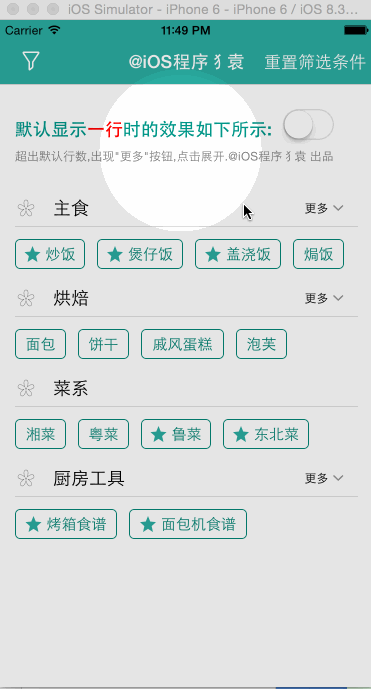

## 单选可折叠菜单的特性展示 / Features of the single-selection foldable menu
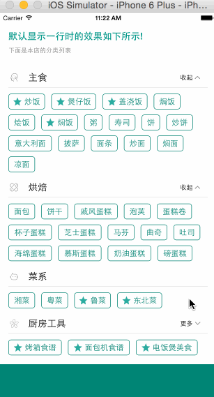
                  
| 中文 | English |
|:---|:---|
| 更多信息请查看[我的微博](http://weibo.com/luohanchenyilong/)。 | Check out [my weibo](http://weibo.com/luohanchenyilong/) for more info. |
| 然并卵？ 请看以下应用场景： | So what? Take a look at these use cases: |
| 场景一：《手机淘宝App》 | Scenario 1: the Mobile Taobao app |
| 筛选条件过多时可以折叠，例如《手机淘宝App》中商品评价的筛选 | Filter conditions can be folded when there are too many, for example the review filter of products in the Mobile Taobao app |

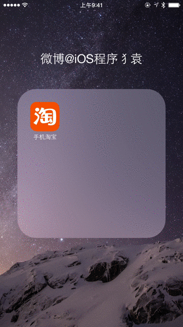

> 已在 `Example/` 中实现：`CYLProductViewController`（商品页两行预览）和 `CYLReviewListViewController`（可折叠单选评价筛选）。

| 中文 | English |
|:---|:---|
| 场景二：《脉脉App》 | Scenario 2: the Maimai app |
| 分类菜单：例如《脉脉App》中的搜索分类筛选 | Classify menu: for example the search category filter in the Maimai app |

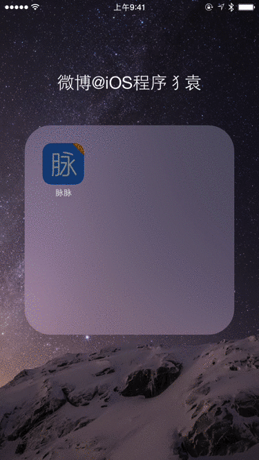

> 已在 `Example/` 中实现：`CYLSearchCategoryViewController`（搜索分类、职位类别侧栏与行业选择）。


## 示例中的两种样式 / Two styles in the demo


| 中文 | English |
|:---|:---|
| 第一种是用 CollectionView 做的两级菜单，可以折叠第二级菜单 | The first is a two-level menu built with a collection view; the second level can be folded |
| 第二种是侧边栏菜单，具有多选功能。示例应用保存筛选条件（`UserDefaults`，由宿主处理选择结果）；组件本身不读取或持久化业务数据。 | The second is a side-bar menu with multiple selection. The example app saves the filter conditions (`UserDefaults`, the host handles the selection result); the component itself neither reads nor persists business data. |

| 中文 | English |
|:---|:---|
| 更多信息请查看[我的 Twitter](https://twitter.com/stevechen1010)。 | Check out [my twitter](https://twitter.com/stevechen1010) for more info. |

## CocoaPods

| 中文 | English |
|:---|:---|
| 本组件支持 iOS 15.0 及以上。它不在 CocoaPods trunk 上：请引用本仓库的某个提交，并以同样方式按提交固定 CYLAnimatedItem（CYLTabBarController 的动效图标组件，同样不在 trunk 上）。使用 `master` 的最新提交，以及它自己的 Podfile 所指定的 CYLTabBarController 提交： | The component supports iOS 15.0 and later. It is not on the CocoaPods trunk: reference a commit of this repository, and pin CYLAnimatedItem (CYLTabBarController's animated icon component, also not on the trunk) by commit the same way. Use the newest commit of `master` and the CYLTabBarController commit its own Podfiles name: |

```ruby
pod 'CollectionViewClassifyMenu', :git => 'https://github.com/ChenYilong/CollectionViewClassifyMenu.git',
                                  :commit => '<CollectionViewClassifyMenu commit>'
pod 'CYLAnimatedItem', :git => 'https://github.com/ChenYilong/CYLTabBarController.git',
                       :commit => '<the CYLTabBarController commit in this repository\'s Podfile>'
```

| 中文 | English |
|:---|:---|
| Swift Package Manager 的写法相同，按 revision 引用： | Swift Package Manager, the same by revision: |

```swift
.package(url: "https://github.com/ChenYilong/CollectionViewClassifyMenu.git", revision: "<commit>")
```

| 中文 | English |
|:---|:---|
| 已在仓库之外的 App 中验证（issue #11）：`docs/issue-progress.md` 与 [ios-cocoapods-commit-consumer.png](docs/assets/ios-cocoapods-commit-consumer.png)。 | Checked from an app outside the repository (issue #11): `docs/issue-progress.md` and [ios-cocoapods-commit-consumer.png](docs/assets/ios-cocoapods-commit-consumer.png). |
| 该 pod 包含可复用的菜单、XIB 和图片，但**不含**示例数据。原有的版权声明继续适用。 | The pod contains the reusable menus, XIBs and images, but **not** demo data. The existing copyright notices continue to apply. |
| 两个示例分别通过本地 Pod 引用同一个组件： | The two examples each reference the same component through a local pod: |
| `.xcworkspace` 与 `Podfile.lock` 由 `pod install` 生成，不提交到仓库（与 CYLTabBarController 的 `.gitignore` 相同）。 | The `.xcworkspace` and `Podfile.lock` are generated by `pod install` and are not committed to the repository (the same as in CYLTabBarController's `.gitignore`). |

```sh
pod install
open CollectionViewClassifyMenu.xcworkspace

cd TagCollectionView
pod install
open TagCollectionView.xcworkspace
```

### 快速开始（Swift） / Quick start (Swift)

| 中文 | English |
|:---|:---|
| 核心库是纯 Swift，公开 API 同时带有 `@objc` 标注。请在宿主中实现 `CYLMenuDataSource`，并在菜单使用期间持有它。组件对数据源和代理只做弱引用。宿主提供分区标题和条目标题、可选的图片与互斥项标记，处理选择事件，并决定是否保存以及如何保存。 | The core library is pure Swift, and its public API also carries `@objc` annotations. Implement `CYLMenuDataSource` in the host and retain it for as long as the menu is in use. The component holds the data source and delegate weakly. The host provides section and item titles, optional image and exclusive-item flags, handles selections, and decides whether and how to persist them. |

```swift
import CollectionViewClassifyMenu

// self implements CYLMenuDataSource and CYLMenuDelegate.
let menu = CYLClassifyMenuViewController()
menu.menuDataSource = self
menu.menuDelegate = self
menu.defaultVisibleRows = 2  // Default: 1.
// Present or embed menu as a child view controller.
```

| 中文 | English |
|:---|:---|
| 数据源必须实现的方法有 `numberOfSectionsInMenu()`、`menuNumberOfItems(inSection:)`、`menuTitle(forSection:)` 和 `menuTitleForItem(at:)`。可在加载视图之前设置可选的 `menuHeaderView`。`menuFooterView` 位于标签下方的同一个滚动视图中（例如显示所选标签的结果；内容变化后请调用 `updateMenuLayout()`），`selectedIndexPath` 用于高亮已选中的标签（请在 `menu(_:didSelectItemAt:)` 中设置；点击不会改变它）。宿主数据变化后，请调用 `reloadMenuData()`。筛选控制器使用同样的协议；宿主可通过 `selectedIndexPaths` 保存并恢复选择。如果提供了互斥项，`reloadMenuData()` 会把筛选的选择重置为每个分区的第一个互斥项。 | The required data source methods are `numberOfSectionsInMenu()`, `menuNumberOfItems(inSection:)`, `menuTitle(forSection:)` and `menuTitleForItem(at:)`. Set an optional `menuHeaderView` before loading the view. `menuFooterView` sits below the tags in the same scroll view (for example the results of the selected tag; call `updateMenuLayout()` after its content changes), and `selectedIndexPath` highlights the selected tag (set it from `menu(_:didSelectItemAt:)`; taps do not change it). After changing host data, call `reloadMenuData()`. The filter controller uses the same protocols; `selectedIndexPaths` allows the host to save and restore selections. `reloadMenuData()` resets filter selections to each section's first exclusive item, if one is supplied. |
| `CYLTagView` 同样接受这些协议，并支持 `CYLTagView()` 与 `CYLTagView(frame:)`（仅 CocoaPods，Swift Package Manager 暂不包含）。完整实现请参见两个示例控制器。 | `CYLTagView` also accepts the same protocols and supports both `CYLTagView()` and `CYLTagView(frame:)` (CocoaPods only; Swift Package Manager does not include it yet). See the two demo controllers for complete implementations. |

### CYLTagListView：可组合的标签菜单 / CYLTagListView: composable tag menu

| 中文 | English |
|:---|:---|
| `CYLTagListView` 是一个可嵌入的标签视图：数据和业务逻辑全部由宿主通过 `CYLMenuDataSource` / `CYLMenuDelegate` 提供，组件只负责布局、折叠和选择状态。README 中的两个场景（淘宝评价筛选、脉脉搜索分类）已在 `Example/` 中用它实现，更多用法见 [docs/component-architecture.md](docs/component-architecture.md)。 | `CYLTagListView` is an embeddable tag view: the host provides all data and business logic through `CYLMenuDataSource` / `CYLMenuDelegate`, and the component only handles layout, folding and selection state. The two scenarios in this README (the Taobao review filter and the Maimai search categories) are implemented with it in `Example/`; more usage is in [docs/component-architecture.md](docs/component-architecture.md). |

```swift
import CollectionViewClassifyMenu

let filter = CYLTagListView()
filter.style = style                                    // CYLMenuStyle
filter.selectionMode = .single                          // .none / .single / .multiple
filter.allowsEmptySelection = false                     // 再次点击不会取消最后一项
filter.showsSectionHeaders = false                      // 平铺，不显示分组标题
filter.foldStyle = .footerChevron                       // 底部 ∨/∧ 折叠
filter.defaultVisibleRows = 2                           // 折叠时显示两行
filter.isScrollEnabled = false                          // 嵌入其他滚动视图
filter.menuDataSource = self
filter.menuDelegate = self
filter.reloadMenuData()
filter.selectedIndexPaths = [IndexPath(item: 0, section: 0)]
```

| 中文 | English |
|:---|:---|
| 新增接口： | New APIs: |

| API | 用途 |
| --- | --- |
| `menuImageForItem(at:)` | 标签图标由宿主提供（替代旧的“条目是否有图片”回调与内置图片） |
| `menuImage(forSection:)` | 分组标题图标（`CYLClassifyMenuViewController` 不再写死图片） |
| `menuAccessoryView(forSection:)` | 分组标题右侧的自定义视图，如“行业: IT互联网 ▾” |
| `menuItemIsEnabled(at:)` | 禁用标签，如“差评(0)” |
| `menu(_:shouldSelectItemAt:)` | 宿主拦截点击 |
| `menu(_:didDeselectItemAt:)` | 取消选中回调 |
| `menu(_:didChangeExpanded:inSection:)` | 展开/折叠回调 |
| `menu(_:didChangeContentHeight:)` | 内容高度变化，便于嵌入时调整高度 |
| `menu(_:didChangeSelectedItems:)` | 每次点击改变选择后回调一次，用于刷新筛选结果 |
| `CYLMenuStyle.foldChevronImage` | 底部折叠箭头图片，展开时旋转 180° |
| `CYLMenuStyle` | 标题字体与颜色、图标颜色（按状态）、图标与文字间距、图标大小、位置偏移、`layoutCentered`、间距、高度、折叠文案；Dynamic Type |
| `CYLTagAppearance` | 每种状态的背景、文字颜色、字体、图标颜色、圆角（0 为胶囊）、边框、margin（参照 `CYLBadgeAppearance`） |
| `CYLTagButton` | 单个标签视图（横向的 `CYLFlatDesignTabBarButton`），也是唯一的“图标 + 标题 + 动效图标”组件，可单独使用：`init(title:image:)` / `init(title:image:animationURL:)`，按内容自适应大小（`intrinsicContentSize`）；角标 `badgeValue`（`nil` 隐藏、空字符串为小红点、其他文字为胶囊）与 `badgeColor`（默认 `systemRed`），位于图标（无图标时为标题）右上角，VoiceOver 读作标签的值；`CYLMenuStyle.imagePlacement = .top` / `.bottom` 使图标位于标题上方 / 下方；`height(forTitle:iconSize:style:traitCollection:)` 测量高度。Android、HarmonyOS、微信小程序（`cyl-tag-button`）提供同名 API |
| `menuSelectedImageForItem(at:)` | 选中态图标 |
| `menuAnimationURLForItem(at:)`, `CYLTagButton.animationURL` | Lottie / PAG / Rive / SVGA / GIF 动效图标（CYLTabBarController 动效引擎） |
| `init(configuration:)`, `init(configurationFile:)`, `CYLMenuStyle(configuration:)` | 字典（map）与配置文件初始化 |
| `selectionMode`, `allowsEmptySelection` | 无选择 / 单选 / 多选（支持互斥项“全部”） |
| `foldStyle`, `defaultVisibleRows` | 标题“更多”按钮、底部箭头或仅截断预览 |
| `showsSectionHeaders` | 分组或平铺 |
| `selectedIndexPaths`, `selectItem(at:)`, `deselectItem(at:)`, `deselectAllItems()` | 代码控制选择（不触发回调） |
| `setExpanded(_:forSection:animated:)`, `isSectionExpanded(_:)`, `canFoldSection(_:)` | 代码控制折叠 |
| `contentHeight`, `heightThatFitsWidth(_:)`, `intrinsicContentSize`, `isScrollEnabled` | 嵌入到表头、Stack View 或 Auto Layout |
| `numberOfRows(inSection:)`, `numberOfVisibleItems(inSection:)` | 查询布局结果 |

| API | Purpose |
| --- | --- |
| `menuImageForItem(at:)` | Tag icons are provided by the host (replaces the old "item has an image" callback and the built-in images) |
| `menuImage(forSection:)` | Section title icon (`CYLClassifyMenuViewController` no longer hard-codes images) |
| `menuAccessoryView(forSection:)` | Custom view on the right of the section title, such as "Industry: IT & Internet ▾" |
| `menuItemIsEnabled(at:)` | Disable a tag, such as "Negative reviews (0)" |
| `menu(_:shouldSelectItemAt:)` | Lets the host intercept taps |
| `menu(_:didDeselectItemAt:)` | Deselection callback |
| `menu(_:didChangeExpanded:inSection:)` | Expand / collapse callback |
| `menu(_:didChangeContentHeight:)` | Callback when the content height changes, so an embedding view can adjust its height |
| `menu(_:didChangeSelectedItems:)` | Called once after each tap that changes the selection, to refresh the filter results |
| `CYLMenuStyle.foldChevronImage` | Image of the bottom fold arrow, rotated 180° when expanded |
| `CYLMenuStyle` | Title font and color, icon color (per state), spacing between icon and text, icon size, position offset, `layoutCentered`, spacing, height, fold text; Dynamic Type |
| `CYLTagAppearance` | Per state: background, text color, font, icon color, corner radius (0 means a capsule), border and margin (modeled on `CYLBadgeAppearance`) |
| `CYLTagButton` | A single tag view (a horizontal `CYLFlatDesignTabBarButton`) and the only "icon + title + animated icon" component; it can be used on its own: `init(title:image:)` / `init(title:image:animationURL:)`, sized to its content (`intrinsicContentSize`); the badge `badgeValue` (`nil` hides it, an empty string is a red dot, any other text is a capsule) and `badgeColor` (default `systemRed`) sit at the top right of the icon (of the title when there is no icon) and VoiceOver reads them as the tag's value; `CYLMenuStyle.imagePlacement = .top` / `.bottom` puts the icon above / below the title; `height(forTitle:iconSize:style:traitCollection:)` measures the height. Android, HarmonyOS and the WeChat Mini Program (`cyl-tag-button`) have the same API |
| `menuSelectedImageForItem(at:)` | Selected-state icon |
| `menuAnimationURLForItem(at:)`, `CYLTagButton.animationURL` | Lottie / PAG / Rive / SVGA / GIF animated icons (CYLTabBarController's animation engines) |
| `init(configuration:)`, `init(configurationFile:)`, `CYLMenuStyle(configuration:)` | Initialization from a dictionary (map) and from configuration files |
| `selectionMode`, `allowsEmptySelection` | No selection / single selection / multiple selection (supports an exclusive "All" item) |
| `foldStyle`, `defaultVisibleRows` | "More" button in the title, bottom arrow, or a truncated preview only |
| `showsSectionHeaders` | Grouped or flat |
| `selectedIndexPaths`, `selectItem(at:)`, `deselectItem(at:)`, `deselectAllItems()` | Control selection from code (no callback is triggered) |
| `setExpanded(_:forSection:animated:)`, `isSectionExpanded(_:)`, `canFoldSection(_:)` | Control folding from code |
| `contentHeight`, `heightThatFitsWidth(_:)`, `intrinsicContentSize`, `isScrollEnabled` | Embed in a table header, a stack view or Auto Layout |
| `numberOfRows(inSection:)`, `numberOfVisibleItems(inSection:)` | Query the layout result |

#### 折叠控件与标题 / Fold control and title

| 中文 | English |
|:---|:---|
| 折叠控件（「更多 ⌄」）与列表标题是**创建时的样式参数**，由核心库统一实现（`CYLMenuFoldControl`、`CYLTagFoldButton`）： | The fold control ("More ⌄") and the list title are **style parameters set at creation**, implemented by the core (`CYLMenuFoldControl`, `CYLTagFoldButton`): |

```swift
// 淘宝评价筛选：分组 footer 中仅箭头，展开后箭头旋转 180°
let filter = CYLTagListView(foldControl: CYLMenuFoldControl(position: .footer, content: .icon))
// 原分类菜单：分组 header 右侧「更多 ⌄」，列表标题居中
let menu = CYLTagListView(foldControl: CYLMenuFoldControl(position: .headerTrailing, content: .iconAndTitle),
                          title: "分类", titlePosition: .topCenter)
```

| 参数 | 取值 |
| --- | --- |
| `CYLMenuFoldControlPosition` | `.none`、`.footer`（分区 footer，位于下方居中，淘宝评价）、`.headerTrailing`（分区 header 的尾部，即右上角，原分类菜单；从右到左的语言中在左侧）、`.headerLeading`（分区 header 的首部，标题之前）、`.tail`（标签的最后一项：折叠时是最后一个可见标签，隐藏的标签为它让出位置；展开后跟在最后一个标签之后；点击即展开/折叠，内置行为。仅图标时是与标签同款描边的圆形，箭头复用核心 bundle 的 `cyl_fold_chevron`，由 `CYLTagFoldCell` 绘制） |
| `CYLMenuFoldControlContent` | `.iconAndTitle`（「更多 ⌄」）、`.title`（「更多」）、`.icon`（「⌄」）。展开后带图标的样式只保留箭头并旋转 180°，仅文字的样式显示「收起」 |
| `CYLMenuFoldControl` 属性 | `title` / `collapseTitle`（默认为本地化的“更多”“收起”）、`image`（默认为核心 bundle 中的 `cyl_fold_chevron`）、`color`、`font`、`rotatesImageWhenExpanded` |
| `title`、`titleImage`、`titlePosition`、`titleStyle` | 整个列表上方的标题：`.topLeading`（左上角）或 `.topCenter`（居中）。标题由 `titleView` 绘制，与标签复用同一个视图（`CYLTagButton`，横向布局），可以只显示图标、只显示文字或两者都显示；`titleStyle` 是一个 `CYLMenuStyle`（字体、文字与图标颜色、图标大小与位置……），默认 `defaultTitleStyle` 为加粗的 headline 字体；`titleView` 的全部公开 API（如动效图标 `animationURL`）都可使用 |

| Parameter | Values |
| --- | --- |
| `CYLMenuFoldControlPosition` | `.none`, `.footer` (the section footer, centered below; Taobao reviews), `.headerTrailing` (the trailing end of the section header, i.e. the top right; the original classify menu; on the left in right-to-left languages), `.headerLeading` (the leading end of the section header, before the title) and `.tail` (the last item among the tags: when folded it is the last visible tag and the hidden tags make room for it; when expanded it follows the last tag; tapping it expands or collapses, which is built in. With an icon only it is a circle with the same outline as the tags; the arrow reuses `cyl_fold_chevron` from the core bundle and is drawn by `CYLTagFoldCell`) |
| `CYLMenuFoldControlContent` | `.iconAndTitle` ("More ⌄"), `.title` ("More") and `.icon` ("⌄"). When expanded, the styles with an icon keep only the arrow and rotate it 180°, while the text-only style shows "Collapse" |
| `CYLMenuFoldControl` properties | `title` / `collapseTitle` (default to the localized "More" and "Collapse"), `image` (defaults to `cyl_fold_chevron` in the core bundle), `color`, `font`, `rotatesImageWhenExpanded` |
| `title`、`titleImage`、`titlePosition`、`titleStyle` | The title above the whole list: `.topLeading` (top left) or `.topCenter` (centered). The title is drawn by `titleView`, which reuses the same view as the tags (`CYLTagButton`, laid out horizontally) and can show only an icon, only text, or both; `titleStyle` is a `CYLMenuStyle` (font, text and icon colors, icon size and position, ...), and the default `defaultTitleStyle` uses a bold headline font; all public APIs of `titleView` (such as the animated icon `animationURL`) are available |

| 中文 | English |
|:---|:---|
| 折叠控件是一个无边框的 `CYLTagButton`（与标签相同的视图），图标位于文字之后（`CYLMenuStyle.imagePlacement = .trailing`）。旧的 `foldStyle` 仍可使用，并与 `foldControl` 互相对应（`.headerButton` 为 header 右侧文字，`.footerChevron` 为 footer 箭头）。配置文件中的位置名称为 `"footer"`、`"headerLeading"`、`"headerTrailing"`、`"tail"`（`"headerLeft"` / `"headerRight"` 为别名）；旧名称 `bottom`、`topLeading`、`topTrailing`、`inline` 已移除（见 `docs/component-architecture.md`）。 | The fold control is a borderless `CYLTagButton` (the same view as the tags) with the icon after the text (`CYLMenuStyle.imagePlacement = .trailing`). The old `foldStyle` still works and corresponds to `foldControl` (`.headerButton` is the text on the right of the header, `.footerChevron` is the arrow in the footer). In configuration files the position names are `"footer"`, `"headerLeading"`, `"headerTrailing"` and `"tail"` (`"headerLeft"` / `"headerRight"` are aliases); the old names `bottom`, `topLeading`, `topTrailing` and `inline` have been removed (see `docs/component-architecture.md`). |

#### 网格、文字在左图标在右与 More 按钮 / Grid, title-then-icon and the More button

| 中文 | English |
|:---|:---|
| 搜索页常见的“最近搜索 / 发现”由核心库的接口实现，示例只提供数据与点击事件： | The "recent searches / discover" lists common on search pages are implemented by the core's API; the example only provides the data and the tap events: |

```swift
// 最近搜索：折叠为两行，箭头是最后一个标签。
let recent = CYLTagListView(foldControl: CYLMenuFoldControl(position: .tail, content: .icon))
recent.defaultVisibleRows = 2

// 发现：每行两个、等宽，超出部分末尾省略号；右上角 More 按钮。
let discover = CYLTagListView()
discover.style = CYLMenuStyle.gridStyle(itemsPerRow: 2)
// 数据源：func menuImageForItem(at:) -> UIImage?（如「热」图标，位于文字之后）、func menuShowsMoreButton(inSection:) -> Bool
// 代理：func menu(_:didTapMoreButtonInSection:)（由宿主决定，如随机刷新）
```

| 接口 | 说明 |
| --- | --- |
| `CYLMenuStyle.numberOfItemsPerRow`、`CYLMenuStyle.gridStyle(itemsPerRow:)` | 大于 0 时每行固定个数、所有标签等宽，文字超出时末尾省略号；`gridStyle` 为无背景、无边框、文字居左的网格外观。配置文件键 `itemsPerRow` |
| `CYLMenuStyle.imagePlacement`、`contentAlignment` | 封装的标签按钮（`CYLTagButton`）支持图标在文字之前（`Leading`，默认）或之后（`Trailing`，文字在左、图标在右）；`contentAlignment` 为 `Center`（默认，整体居中）或 `Leading`（从左边距开始：文字在前、图标紧随其后，文字过长时末尾省略号，图标始终可见；只有文字时不留图标空位）。`gridStyle` 即为 `Leading` + `Trailing`。配置文件键为 `imagePlacement`、`contentAlignment`。图标的 `accessibilityLabel`（如“热门”）由 VoiceOver 读作该标签的值 |
| `menuShowsMoreButton(inSection:)`、`menu(_:didTapMoreButtonInSection:)`、`menuAccessibilityLabelForMoreButton(inSection:)` | 分区标题右侧的 More 按钮（三个点，核心 bundle 的 `cyl_more`，与 CYLTabBarController 的 More Tab 使用的 `ellipsis` 图标一致；可用 `moreButtonImage` / `moreButtonColor` 替换），点击事件由宿主实现；标识符为 `CYLTagListMoreButton`，VoiceOver 默认读作“<分区> 更多操作”，宿主可按其动作提供名称（如“换一批”） |

| API | Description |
| --- | --- |
| `CYLMenuStyle.numberOfItemsPerRow`, `CYLMenuStyle.gridStyle(itemsPerRow:)` | When greater than 0, each row has a fixed number of tags of equal width, and text that does not fit is truncated with an ellipsis; `gridStyle` is a grid look with no background, no border and left-aligned text. Configuration key `itemsPerRow` |
| `CYLMenuStyle.imagePlacement`、`contentAlignment` | The encapsulated tag button (`CYLTagButton`) supports the icon before the text (`Leading`, the default) or after it (`Trailing`, text on the left and icon on the right); `contentAlignment` is `Center` (the default, centered as a whole) or `Leading` (starting from the left margin: the text first and the icon right after it; a text that is too long is truncated with an ellipsis while the icon always stays visible; with text only, no space is left for an icon). `gridStyle` is `Leading` + `Trailing`. Configuration keys are `imagePlacement` and `contentAlignment`. The icon's `accessibilityLabel` (such as "Hot") is read by VoiceOver as the tag's value |
| `menuShowsMoreButton(inSection:)`、`menu(_:didTapMoreButtonInSection:)`、`menuAccessibilityLabelForMoreButton(inSection:)` | The More button on the right of the section title (three dots, `cyl_more` in the core bundle, the same as the `ellipsis` icon used by CYLTabBarController's More tab; replaceable through `moreButtonImage` / `moreButtonColor`); the host implements the tap event. Its identifier is `CYLTagListMoreButton`, VoiceOver reads it as "<section> More actions" by default, and the host can supply a name that matches its action (such as "Shuffle") |

#### 新建标签 / New tag item

| 中文 | English |
|:---|:---|
| `menuItemType(at:)` 返回 `CYLMenuItemTypeCreate` 的条目由核心库的 `CYLTagCreateCell`（继承 `CYLTagListCell`）显示：核心 bundle 中的加号图标 `cyl_tag_plus`、本地化标题“新建标签”或“新建标签：<名称>”（`CYLMenuNewTag`、`CYLMenuNewTagNamed`，简体中文、繁体中文、英文）、带边框的外观，且不会被选中。数据源返回的标题是要新建的名称（空字符串表示由宿主询问名称），点击时回调 `menu(_:didRequestNewItemWithName:at:)`。 | Items for which `menuItemType(at:)` returns `CYLMenuItemTypeCreate` are shown by the core's `CYLTagCreateCell` (a subclass of `CYLTagListCell`): the plus icon `cyl_tag_plus` in the core bundle, the localized title "New tag" or "New tag: <name>" (`CYLMenuNewTag`, `CYLMenuNewTagNamed`; Simplified Chinese, Traditional Chinese and English), a bordered look, and they are never selected. The title returned by the data source is the name to create (an empty string means the host asks for the name), and a tap calls back `menu(_:didRequestNewItemWithName:at:)`. |

#### 配置文件 / Configuration files

| 中文 | English |
|:---|:---|
| 以上参数都可以写在字典或配置文件中（`foldControl`：`position`、`content`、`title`、`collapseTitle`、`image`、`color`、`font`、`rotatesImageWhenExpanded`；`title`、`titleImage`、`titlePosition`、`titleStyle`；条目的 `type: create`），与 CYLTabBarController 的配置文件初始化方式相同。JSON 与 plist 直接读取；JSON5、YAML、TOML、INI、.properties、XML、Protocol Buffers 文本等格式在链接 CYLTabBarController 时由其 `CYLTabBarConfigurationParser` 读取，取值再按本项目的规则转换（枚举名、颜色、尺寸等均可写成字符串）。示例见 `Example-Swift/CYLTagEditorExample/CYLTagEditorExample.bundle/<语言>.lproj/fold-styles.{json,plist,yaml,xml}`。 | All the parameters above can be written in a dictionary or a configuration file (`foldControl`: `position`, `content`, `title`, `collapseTitle`, `image`, `color`, `font`, `rotatesImageWhenExpanded`; `title`, `titleImage`, `titlePosition`, `titleStyle`; an item's `type: create`), the same way as CYLTabBarController's configuration file initialization. JSON and plist are read directly; formats such as JSON5, YAML, TOML, INI, .properties, XML and Protocol Buffers text are read by CYLTabBarController's `CYLTabBarConfigurationParser` when CYLTabBarController is linked, and the values are then converted by this project's rules (enum names, colors, sizes and so on can all be written as strings). For examples see `Example-Swift/CYLTagEditorExample/CYLTagEditorExample.bundle/<语言>.lproj/fold-styles.{json,plist,yaml,xml}`. |

#### 标签外观 / Tag appearance

| 中文 | English |
|:---|:---|
| 每个标签由 `CYLTagButton` 绘制：图标与标题的参数完全参照 CYLTabBarController 的 `CYLFlatDesignTabBarItem`，只是把纵向排列改为横向排列；背景、边框、圆角参照 `CYLBadgeView`（`CYLBadgeAppearance`），每种状态一个 `CYLTagAppearance`。 | Each tag is drawn by `CYLTagButton`: the icon and title parameters follow CYLTabBarController's `CYLFlatDesignTabBarItem` exactly, only with a horizontal layout instead of a vertical one; the background, border and corner radius follow `CYLBadgeView` (`CYLBadgeAppearance`), with one `CYLTagAppearance` per state. |

```swift
let style = CYLMenuStyle()
// 标题与图标（CYLFlatDesignTabBarItem）
style.setTitleTextAttributes([.font: UIFont.systemFont(ofSize: 13),
                              .foregroundColor: UIColor.darkGray], for: .normal)
style.setIconColor(.systemBlue, for: .normal)          // 模板图标的 tintColor
style.setIconColor(.white, for: .selected)
style.imageTitleSpacing = 6                            // 图标与文字间距
style.imageSize = CGSize(width: 16, height: 16)
style.titlePositionAdjustment = UIOffset(horizontal: 0, vertical: 1)
style.layoutCentered = true                            // 只有图标或只有标题时居中
// 背景、边框、圆角（CYLBadgeView）
style.normalAppearance.borderColor = .systemGray4
style.normalAppearance.borderWidth = 1
style.normalAppearance.cornerRadius = 0                // 0 = 自动胶囊
style.normalAppearance.margin = 12
style.selectedAppearance.backgroundColor = .systemBlue
```

| 中文 | English |
|:---|:---|
| 数据源可通过 `menuSelectedImageForItem(at:)` 提供选中态图标。 | The data source can provide the selected-state icon through `menuSelectedImageForItem(at:)`. |

#### 动效图标 / Animated icons

| 中文 | English |
|:---|:---|
| `menuAnimationURLForItem(at:)`（或 `CYLTagButton.animationURL`）可以提供 Lottie（.json）、PAG（.pag）、Rive（.riv）、SVGA、GIF 动效文件，播放方式与 CYLTabBarController 的 Tab 图标相同：点击选中时播放，选中时停在最后一帧，取消选中时回到第一帧（开启“减弱动态效果”时不播放）。 | `menuAnimationURLForItem(at:)` (or `CYLTagButton.animationURL`) can supply Lottie (.json), PAG (.pag), Rive (.riv), SVGA and GIF animation files, played the same way as CYLTabBarController's tab icons: it plays when a tap selects the tag, rests on the last frame while selected, and returns to the first frame when deselected (it does not play when Reduce Motion is on). |
| `CYLTagButton` 是 CYLTabBarController 共享的“动效图标 + 标题”组件 `CYLAnimatedItemView` 的子类（[指南](https://github.com/ChenYilong/CYLTabBarController/blob/feat/cross-platform-components/docs/Animated-Item.md)）。pod 只依赖 `CYLTabBarController/CYLAnimatedItem`（静态图片，不含 TabBar 和动效引擎）；App 需自行加入所播放文件类型对应的引擎： | `CYLTagButton` is a subclass of CYLTabBarController's shared animated icon + title component, `CYLAnimatedItemView` ([guide](https://github.com/ChenYilong/CYLTabBarController/blob/feat/cross-platform-components/docs/Animated-Item.md)). The pod depends on `CYLTabBarController/CYLAnimatedItem` only (static images, no tab bar, no animation engine); the app adds the engine of each file type it plays: |

```ruby
cyl_tab_bar = { :git => 'https://github.com/ChenYilong/CYLTabBarController.git', :commit => '<sha>' }
pod 'CYLTabBarController/CYLAnimatedItemLottieSwift', cyl_tab_bar   # or …PAG, …PAGEnterprise, …Rive, …SVGA, …GIF
```

| 中文 | English |
|:---|:---|
| 在 Android 上，库只依赖 `io.github.chenyilong:cyltabbarcontroller-animateditem`（不含动效库）；App 需自行加入 Lottie、libpag、rive-android 或 SVGAPlayer。标签显示的内容（继承自 CYLAnimatedItemView 的规则）： | On Android the library depends on `io.github.chenyilong:cyltabbarcontroller-animateditem` (no animation library); the app adds Lottie, libpag, rive-android or SVGAPlayer. What a tag shows (CYLAnimatedItemView's rules, inherited): |
| 1. 能够播放时显示动效； | 1. the animation, when it can play; |
| 2. 否则显示传给标签的静态 `image` / `selectedImage`，布局与只有图片时相同（没有引擎或库、类型未知、文件缺失、为空或已损坏、下载失败的情况，以及远程文件下载期间）； | 2. otherwise the static `image` / `selectedImage` given to the tag, with the same layout as the image alone (no engine or library, an unknown type, a missing, empty or corrupted file, a failed download), and while a remote file downloads; |
| 3. 只有当标签有动效文件而没有静态图片时，才显示组件的占位图（`CYLAnimatedItemView.defaultPlaceholderImage`，大小与标签图标相同）；有标题而没有图标的标签从不显示占位图。 | 3. the component's placeholder (`CYLAnimatedItemView.defaultPlaceholderImage`, sized like the tag's icon) only when the tag has an animation file and no static image; a tag with a title and no icon never shows one. |
| 没有引擎时，播放方法（`playAnimation()`、`restartAnimation()`、`stopAnimation()`）不执行任何操作，`animationURL` 会被保留，因此加入引擎子 spec 之后，同样的代码就会播放动效。 | Without an engine the playback methods (`playAnimation()`, `restartAnimation()`, `stopAnimation()`) do nothing and `animationURL` is kept, so the same code animates once an engine subspec is added. |
| 远程动效文件由引擎加载，而不是由标签加载：在 iOS 上，Rive 和 SVGA 引擎可读取 URL，而 Lottie（Swift，4.x）、PAG 和 GIF 只读取本地文件（远程 URL 会立即显示静态图片或占位图；这是 CYLTabBarController 的待办事项）；在 Android 上，所有引擎都可读取 URL。 | Remote animation files are loaded by the engines, never by the tag: on iOS the Rive and SVGA engines read URLs, while Lottie (Swift, 4.x), PAG and GIF read local files only (a remote URL shows the static image, or the placeholder, at once; a CYLTabBarController TODO); on Android every engine reads URLs. |
| 动效库读取的选项（例如 Rive 文件的画板与状态机）写在 URL 中，编码方式与 CYLTabBarController 的 `CYLTabBarAnimationURLWithOptions()` 相同：在代码中用 `URL.cylAddingAnimationOptions(_:)`，在字典或配置文件中用 `CYLTagItemKey.animationOptions`（`"animationOptions"`），或直接写在文件名后（`"icons.riv#artboard=CHAT"`）： | Options read by the animation library (for example the artboard and state machine of a Rive file) are written in the URL, encoded the same way as CYLTabBarController's `CYLTabBarAnimationURLWithOptions()`: in code use `URL.cylAddingAnimationOptions(_:)`, in a dictionary or configuration file use `CYLTagItemKey.animationOptions` (`"animationOptions"`), or write them directly after the file name (`"icons.riv#artboard=CHAT"`): |

```swift
tag.animationURL = iconsURL.cylAddingAnimationOptions(["artboard": "CHAT",
                                                       "stateMachine": "CHAT_Interactivity",
                                                       "input": "active"])
```

| 中文 | English |
|:---|:---|
| 未选中时动效默认停在第一帧（与 CYLTabBarController 的 Tab 图标相同）；第一帧为空的文件可以停在其他帧：`menuAnimationRestingProgressForItem(at:)`、`CYLTagButton.animationRestingProgress` 或字典中的 `CYLTagItemKey.animationRestingProgress`（0...1，例如 `1` 为最后一帧）。 | When not selected, the animation rests on the first frame by default (the same as CYLTabBarController's tab icons); a file whose first frame is empty can rest on another frame: `menuAnimationRestingProgressForItem(at:)`, `CYLTagButton.animationRestingProgress`, or `CYLTagItemKey.animationRestingProgress` in a dictionary (0...1; for example `1` is the last frame). |
| 每个分区可以有自己的外观：`menuStyle(forSection:)` 或字典中的 `CYLTagSectionKey.style`（覆盖在列表样式之上的 `CYLMenuStyleKey` 键），例如把白色线条的 Rive 图标（CYLTabBarController 深色 TabBar 用的 `icons.riv`）放在深色标签上。颜色、字体、边框、图标颜色、图文布局按分区设置；高度、间距与内边距始终使用列表的样式。`scroll(toSection:animated:)` 滚动到某个分区。 | Each section can have its own look: `menuStyle(forSection:)` or `CYLTagSectionKey.style` in a dictionary (`CYLMenuStyleKey` keys layered over the list style), for example white-line Rive icons (the `icons.riv` used by CYLTabBarController's dark tab bar) on dark tags. Colors, fonts, borders, icon colors and the icon-text layout are set per section; the height, spacing and padding always use the list's style. `scroll(toSection:animated:)` scrolls to a section. |
| Lottie 2.x 按名称查找 JSON 引用的图片，因此示例把这些图片放在 `Assets.xcassets/LottieImages`（CYLTabBarController 的示例放在 App 根目录）。 | Lottie 2.x looks up the images referenced by the JSON by name, so the example keeps these images in `Assets.xcassets/LottieImages` (CYLTabBarController's example keeps them in the app root). |
| 示例的“动效”Tab（`CYLTagAnimationDemoViewController`）使用从 CYLTabBarController（所有分支中最新的提交）示例复制的资源：Lottie（含图片资源与占位图、绿色主题）、Rive、GIF 动效文件与 TabBar 图片（`Assets.xcassets/TabBarIcon`），PAG 文件由 `pod install` 下载（包括 CYLTabBarController Example-PAG 的 Tab 图标 `tab_home`、`tab_health`、`tab_moments`、`tab_me`）；每个分区一种动效库，点击播放，可全部播放并切换速度。`style.animationSize`、`style.animationSpeed` 设置大小与速度。 | The example's "Animation" tab (`CYLTagAnimationDemoViewController`) uses resources copied from the CYLTabBarController example (the newest commit across all branches): Lottie (with image assets, a placeholder and a green theme), Rive and GIF animation files and the tab bar images (`Assets.xcassets/TabBarIcon`); the PAG files are downloaded by `pod install` (including the tab icons `tab_home`, `tab_health`, `tab_moments` and `tab_me` of CYLTabBarController's Example-PAG). Each section uses one animation library, a tap plays it, and you can play all of them and switch the speed. `style.animationSize` and `style.animationSpeed` set the size and the speed. |
| Rive 文件自带的背景：`truck.riv` 的画板填充（红色 `Background`）会在标签里画出一块矩形，按 CYLTableViewPlaceHolder 的 [PR #22](https://github.com/ChenYilong/CYLTableViewPlaceHolder/pull/22) 把它的透明度设为 0（只改这一个字节）；`house.riv` 的天空（紫色渐变）与灰色画板填充同样设为透明（三个字节，按维护者的决定修改，来源没有许可文件，版权归原作者），房子下方的地面属于画面，保留。记录与 SHA-256 见 `Animations/Rive/README.md`。 | Backgrounds that ship inside the Rive files: the artboard fill of `truck.riv` (the red `Background`) draws a rectangle inside the tag, so its opacity is set to 0 following CYLTableViewPlaceHolder's [PR #22](https://github.com/ChenYilong/CYLTableViewPlaceHolder/pull/22) (only this one byte is changed); the sky of `house.riv` (a purple gradient) and its gray artboard fill are made transparent in the same way (three bytes, changed at the maintainer's decision; the source has no license file and the copyright belongs to the original author), while the ground below the house is part of the picture and is kept. The record and the SHA-256 are in `Animations/Rive/README.md`. |

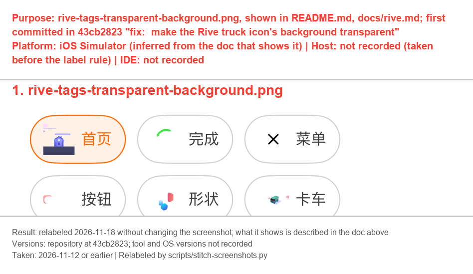

#### 字典与配置文件初始化 / Map and configuration file

| 中文 | English |
|:---|:---|
| 与 CYLTabBarController 的 `init(configuration:)`、`init(configurationFile:)` 相同（键在 `CYLTagListKey`、`CYLTagSectionKey`、`CYLTagItemKey`、`CYLMenuStyleKey`、`CYLTagAppearanceKey`、`CYLMenuFoldControlKey` 中）： | The same as CYLTabBarController's `init(configuration:)` and `init(configurationFile:)` (the keys are in `CYLTagListKey`, `CYLTagSectionKey`, `CYLTagItemKey`, `CYLMenuStyleKey`, `CYLTagAppearanceKey` and `CYLMenuFoldControlKey`): |

```swift
let tags = CYLTagListView(configuration: [
    CYLTagListKey.selectionMode: "multiple",
    CYLTagListKey.foldStyle: "footerChevron",
    CYLTagListKey.style: [CYLMenuStyleKey.normal: [CYLTagAppearanceKey.cornerRadius: 0]],
    CYLTagListKey.sections: [[CYLTagSectionKey.title: "Tabs",
                              CYLTagSectionKey.items: [[CYLTagItemKey.title: "Home",
                                                        CYLTagItemKey.image: "system:house",
                                                        CYLTagItemKey.animation: "tab_home.json"]]]],
])
let fromFile = try CYLTagListView(configurationFile: "tags.json")
```

| 中文 | English |
|:---|:---|
| 文件中的值都可以写成字符串（颜色 "#RRGGBB"、图片 "system:star"、内边距 "{t, l, b, r}" 或数组、枚举名称等），文件名相对于配置文件或 App 资源解析。JSON 与 plist 直接读取；YAML、TOML 等格式在链接 CYLTabBarController 时由其解析器读取。示例见 `Example/CYLMenuExample/CYLMenuExample.bundle/Configurations/animated-tags.json` 与 `CYLTagConfigurationDemoViewController`。示例的 PAG 文件由 `pod install` 下载（`scripts/fetch-animation-resources.py`，固定版本并校验 SHA-256，与 CYLTabBarController 相同）。示例的“样式”Tab（`CYLTagStyleDemoViewController`）参照 `CYLFlatDesignTabBarDemoViewController`：上方为标签预览，点击下方列表的每一行即时修改一个参数。 | Values in the file can all be written as strings (colors as "#RRGGBB", images as "system:star", insets as "{t, l, b, r}" or an array, enum names, and so on), and file names are resolved relative to the configuration file or the app resources. JSON and plist are read directly; formats such as YAML and TOML are read by CYLTabBarController's parser when CYLTabBarController is linked. For examples see `Example/CYLMenuExample/CYLMenuExample.bundle/Configurations/animated-tags.json` and `CYLTagConfigurationDemoViewController`. The example's PAG files are downloaded by `pod install` (`scripts/fetch-animation-resources.py`, with pinned versions and SHA-256 verification, the same as CYLTabBarController). The example's "Style" tab (`CYLTagStyleDemoViewController`) follows `CYLFlatDesignTabBarDemoViewController`: the tag preview is at the top, and tapping each row of the list below changes one parameter instantly. |
| **破坏性变更：**`CYLMenuStyle` 中扁平的颜色、边框和内边距属性（`textColor`、`itemBackgroundColor`、`borderColor`、`cornerRadius`、`itemHorizontalPadding`……）已移到按状态区分的 `CYLTagAppearance` 对象中，标题字体改为 `titleFont(for:traitCollection:)`，圆角为 0 现在表示胶囊形。旧的“条目是否有图片”回调已移除，请改为从 `menuImageForItem(at:)` 返回图片。`CYLClassifyMenuViewController` 的分区图标现在来自 `menuImage(forSection:)`。 | **Breaking changes:** `CYLMenuStyle`'s flat color, border and padding properties (`textColor`, `itemBackgroundColor`, `borderColor`, `cornerRadius`, `itemHorizontalPadding`…) moved to its per-state `CYLTagAppearance` objects, the title font is now `titleFont(for:traitCollection:)`, and a corner radius of 0 now means a capsule. The old "item has an image" callback was removed; return the image from `menuImageForItem(at:)` instead. Section icons of `CYLClassifyMenuViewController` now come from `menuImage(forSection:)`. |

#### 标签云：android-tagview 的初始化方式 / Tag cloud, the android-tagview way

| 中文 | English |
|:---|:---|
| 与 android-tagview 一样：创建列表、设置间距、添加标签，并用 block 监听点击和删除。android-tagview 的每个公开 API 在这里都有对应项，对照表见 [docs/android-tagview-api.md](docs/android-tagview-api.md)。 | Like android-tagview: create the list, set its spacing, add tags, and listen to taps and deletions in blocks. Every public API of android-tagview has a counterpart here; the table is in [docs/android-tagview-api.md](docs/android-tagview-api.md). |

```swift
let tagListView = CYLTagListView()
tagListView.lineSpacing = 5               // android-tagview: setLineMargin / app:lineMargin
tagListView.interitemSpacing = 3          // setTagMargin / app:tagMargin
tagListView.tagContentInsets = UIEdgeInsets(top: 3, left: 10, bottom: 3, right: 10)  // textPadding…
tagListView.addTags(withTitles: ["Asia", "Europe", "Africa"])

let tag = CYLTag(title: "Tag Text", backgroundColorHex: "#DDDDDD")
tag.textColor = .white
tag.highlightedBackgroundColor = UIColor(white: 0.33, alpha: 1)   // layoutColorPress
tag.cornerRadius = 20
tag.textSize = 14
tag.borderWidth = 1
tag.borderColor = .white
tag.isDeletable = true                                            // a "×" after the title
tagListView.addTag(tag)

tagListView.tagClickHandler = { index, tag in print("click", index, tag.title) }
tagListView.tagDeleteHandler = { index, tag in print("deleted", index, tag.title) }
```

| 中文 | English |
|:---|:---|
| 新增：`CYLTag`、`CYLTagDataSource`；`addTag(_:)`、`addTags(_:)`、`addTags(withTitles:)`、`insertTag(_:at:)`、`removeTag(at:)`、`removeAllTags()`、`tags`、`tagClickHandler`、`tagDeleteHandler`、`deleteItem(at:)`。 | New: `CYLTag`, `CYLTagDataSource`; `addTag(_:)`, `addTags(_:)`, `addTags(withTitles:)`, `insertTag(_:at:)`, `removeTag(at:)`, `removeAllTags()`, `tags`, `tagClickHandler`, `tagDeleteHandler`, `deleteItem(at:)`. |
| 可删除的标签：数据源 `menuItemIsDeletable(at:)`、`menuRemoveItem(at:)`，代理 `menu(_:didDeleteItemAt:)`；`CYLMenuStyle.deleteIndicatorTitle`（默认 "×"）、`deleteIndicatorColor`、`deleteIndicatorFont`；VoiceOver 提供“删除”操作。 | Deletable tags: data source `menuItemIsDeletable(at:)` and `menuRemoveItem(at:)`, delegate `menu(_:didDeleteItemAt:)`; `CYLMenuStyle.deleteIndicatorTitle` (default "×"), `deleteIndicatorColor`, `deleteIndicatorFont`; VoiceOver offers a "Delete" action. |
| 按下颜色：`CYLMenuStyle.highlightedBackgroundColor`。背景图：`CYLTagAppearance.backgroundImage`。 | Pressed color: `CYLMenuStyle.highlightedBackgroundColor`. Background image: `CYLTagAppearance.backgroundImage`. |
| 四边内边距：`CYLTagAppearance.contentInsets`（默认 {5, 10, 5, 10}，`margin` 是左右两边）、`CYLMenuStyle.tagContentInsets`；在 Interface Builder 中可设置 `lineSpacing`、`interitemSpacing`、`tagContentInsetTop/Left/Bottom/Right`。 | Per-side padding: `CYLTagAppearance.contentInsets` (default {5, 10, 5, 10}; `margin` is the left and right sides) and `CYLMenuStyle.tagContentInsets`; in Interface Builder you can set `lineSpacing`, `interitemSpacing` and `tagContentInsetTop/Left/Bottom/Right`. |
| 每个标签可以有自己的字号，行高随之变化：字号较大的标签比同一行的其他标签更高。 | Each tag can have its own font size and the row height follows: a tag with larger text is taller than the others in its row. |
| 配置键：`CYLTagListKey.tags`、`CYLTagItemKey.deletable`、`.identifier`、`.style`、`CYLMenuStyleKey.highlightedBackgroundColor`、`.tagContentInsets`、`.deleteIndicator…`、`CYLTagAppearanceKey.contentInsets`、`.backgroundImage`；`UIColor.cylMenuColor(from:)`。 | Configuration keys: `CYLTagListKey.tags`, `CYLTagItemKey.deletable`, `.identifier`, `.style`, `CYLMenuStyleKey.highlightedBackgroundColor`, `.tagContentInsets`, `.deleteIndicator…`, `CYLTagAppearanceKey.contentInsets`, `.backgroundImage`; `UIColor.cylMenuColor(from:)`. |
| 示例：“样式”Tab → 标签云（`CYLTagCloudDemoViewController`）。 | Demo: the "Style" tab → tag cloud (`CYLTagCloudDemoViewController`). |

#### Android 标签库：评分与 Swift 复刻 / Android tag libraries: scores and Swift ports

| 中文 | English |
|:---|:---|
| 三个 Android 标签库的每个公开 API 在这里都有对应项（各 100 分），它们的示例也已移植为 Swift（“样式”Tab → Android 标签库示例）。核心库负责绘制并处理全部交互；示例只传入数据和样式值，并处理点击。 | Every public API of three Android tag libraries has a counterpart here (100 each), and their samples are ported to Swift (the "Style" tab → Android tag library samples). The core draws and handles everything; the samples pass data and style values and handle taps. |

| 库 | 对照表 | 核心 API | 示例 |
| --- | --- | --- | --- |
| [kaedea/android-tagview](https://github.com/kaedea/android-tagview) | [docs/android-tagview-api.md](docs/android-tagview-api.md) | `CYLTag`、`CYLMenuStyle.tagCloud()`、角标、`headerIndicatorColor` | `CYLTagCloudSample.swift`（含 YY 热门搜索） |
| [shellljx/TagViewGroup](https://github.com/shellljx/TagViewGroup) | [docs/tagviewgroup-api.md](docs/tagviewgroup-api.md) | `CYLImageTagGroupView`, `CYLImageTagView` | `CYLImageTagSample.swift` |
| [whilu/AndroidTagView](https://github.com/whilu/AndroidTagView) | [docs/androidtagview-api.md](docs/androidtagview-api.md) | `CYLMenuStyle.tagContainer()`、`CYLTagColors`、重新排序、长按、涟漪、绘制的叉号 | `CYLTagContainerSample.swift` |

| Library | Table | Core API | Sample |
| --- | --- | --- | --- |
| [kaedea/android-tagview](https://github.com/kaedea/android-tagview) | [docs/android-tagview-api.md](docs/android-tagview-api.md) | `CYLTag`, `CYLMenuStyle.tagCloud()`, badges, `headerIndicatorColor` | `CYLTagCloudSample.swift` (including the YY hot searches) |
| [shellljx/TagViewGroup](https://github.com/shellljx/TagViewGroup) | [docs/tagviewgroup-api.md](docs/tagviewgroup-api.md) | `CYLImageTagGroupView`, `CYLImageTagView` | `CYLImageTagSample.swift` |
| [whilu/AndroidTagView](https://github.com/whilu/AndroidTagView) | [docs/androidtagview-api.md](docs/androidtagview-api.md) | `CYLMenuStyle.tagContainer()`, `CYLTagColors`, reordering, long press, ripple, drawn cross | `CYLTagContainerSample.swift` |

| 状态 | 截图 |
| --- | :---: |
| android-tagview：TagView 示例 | 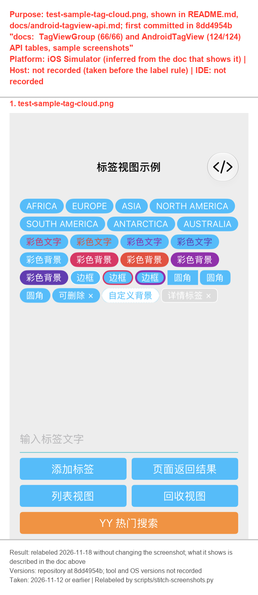 |
| android-tagview：YY 热门搜索 | 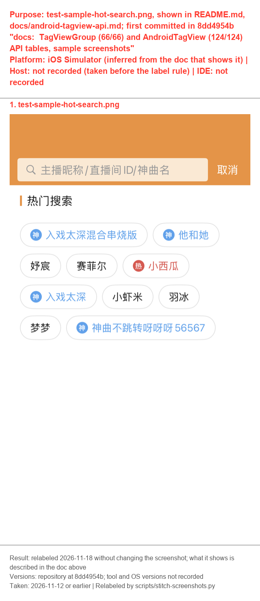 |
| TagViewGroup：图片标签 | 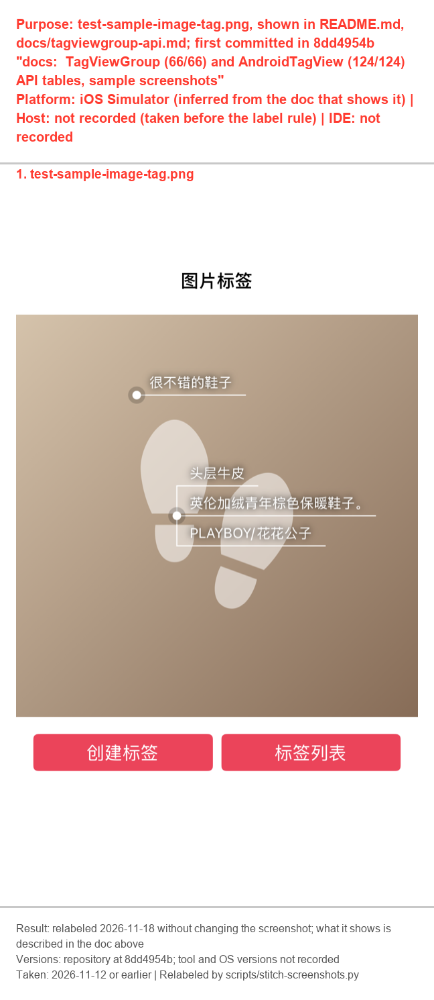 |
| TagViewGroup：编辑 | 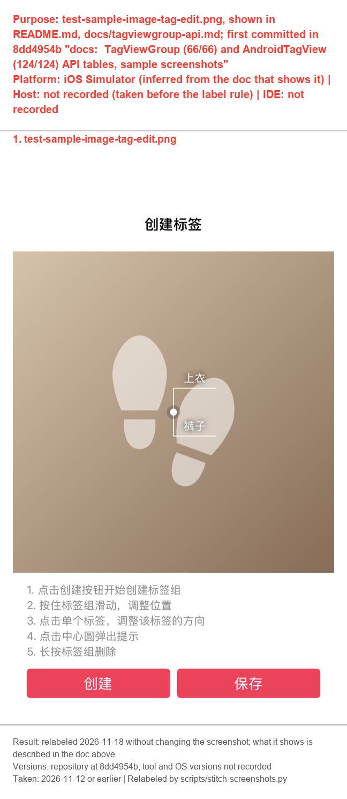 |
| AndroidTagView：五个容器 | 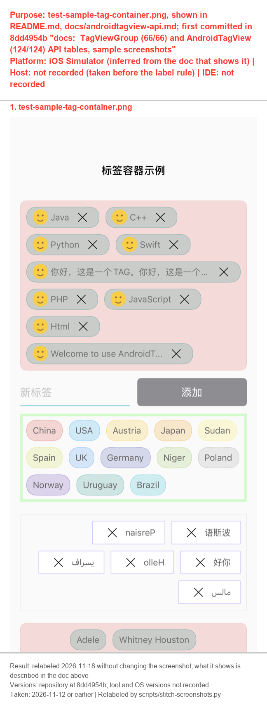 |

| State | Screenshot |
| --- | :---: |
| android-tagview：TagView Sample |  |
| android-tagview: YY hot searches |  |
| TagViewGroup: image tags |  |
| TagViewGroup: editing |  |
| AndroidTagView: five containers |  |

| 中文 | English |
|:---|:---|
| 语言与无障碍：示例的文字在 `CYLMenuExample.bundle` 中有简体中文、繁体中文和英文三种语言，英文即三个 Android 示例的原文。核心为不能长按、拖动或点图片的用户（VoiceOver、Voice Control、Switch Control）提供了替代操作：标签的“前移 / 后移”与长按动作（`longPressAccessibilityActionName`）；图片标签的圆点是一个元素（“标签组：…”），可“上移 / 下移 / 左移 / 右移”和删除；图片本身是一个按钮；徽标读作标签的值（`badgeAccessibilityLabel`）。图片标签的文字随动态字体放大，放大时线段变长、长标签自动换行，标签互不重叠。 | Languages and accessibility: the example's text is available in Simplified Chinese, Traditional Chinese and English in `CYLMenuExample.bundle`; the English is the original text of the three Android samples. The core provides alternative actions for users who cannot long-press, drag or tap an image (VoiceOver, Voice Control, Switch Control): "Move earlier / later" and a long-press action for tags (`longPressAccessibilityActionName`); the dot of an image tag is one element ("Tag group: ...") that can be moved up / down / left / right and deleted; the image itself is a button; the badge is read as the tag's value (`badgeAccessibilityLabel`). The text of image tags grows with Dynamic Type; when enlarged the lines get longer, long tags wrap automatically, and tags never overlap. |

| 状态 | 截图 |
| --- | :---: |
| English：TagView 示例 | 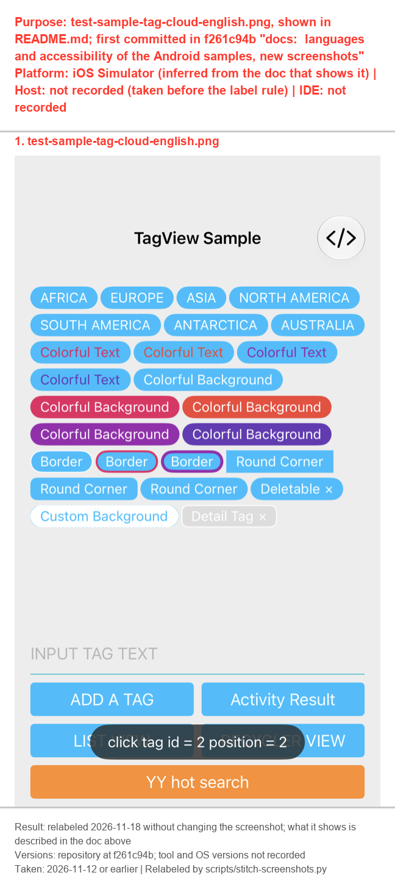 |
| English：热门搜索 | 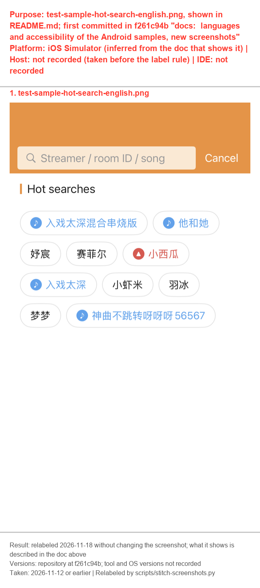 |
| English：标签容器 | 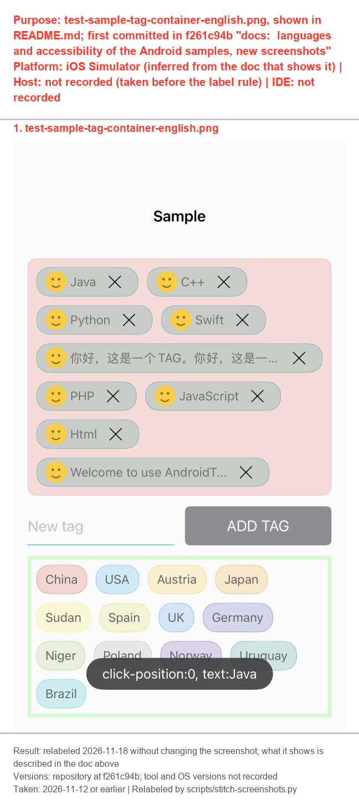 |
| 最大辅助字号：图片标签 | 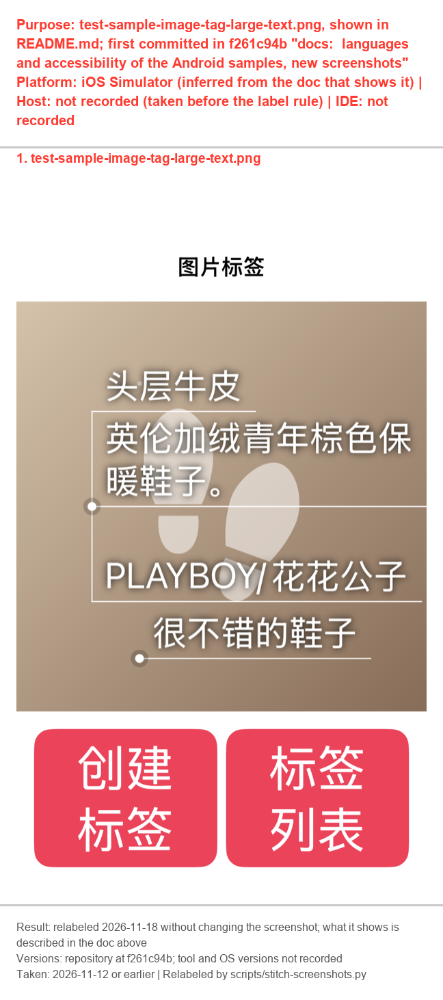 |

| State | Screenshot |
| --- | :---: |
| English：TagView Sample |  |
| English：hot search |  |
| English：tag containers |  |
| Largest accessibility text size: image tags |  |

| 中文 | English |
|:---|:---|
| 搜索框：示例的所有搜索框（场景二搜索分类、搜索历史与发现、YY 热门搜索）都使用同级仓库 [CYLSearchViewController](https://github.com/ChenYilong/CYLSearchViewController) 的 `CYLSearchBarView`，以 commit 依赖引入（`Example/Podfile` 的 `CYL_SEARCH`）。 | Search bars: all search bars in the example (the scenario 2 search categories, search history and discover, YY hot searches) use `CYLSearchBarView` from the sibling repository [CYLSearchViewController](https://github.com/ChenYilong/CYLSearchViewController), pulled in as a commit dependency (`CYL_SEARCH` in `Example/Podfile`). |

| 状态 | 截图 |
| --- | :---: |
| 标签云：代码与字典初始化 | 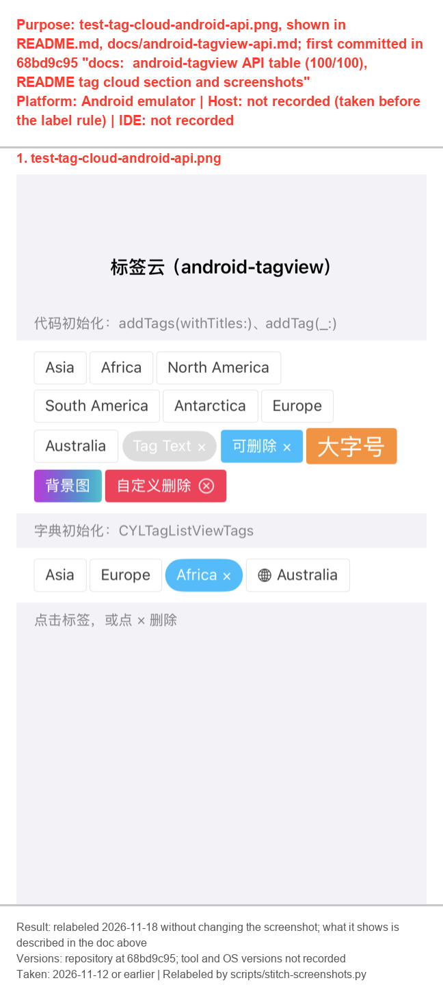 |
| 可删除的标签 | 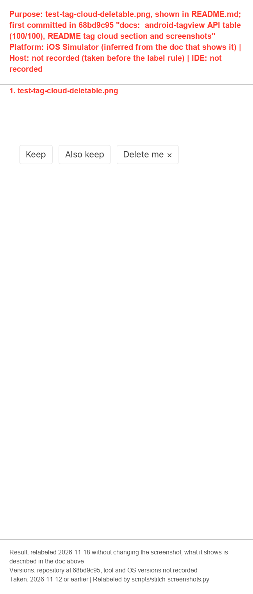 |

| State | Screenshot |
| --- | :---: |
| Tag cloud in code and from a dictionary |  |
| A deletable tag |  |

### Android 版（Kotlin） / Android version (Kotlin)

| 中文 | English |
|:---|:---|
| `android/` 是 Android 版：三个 Android 标签库各自转写为 Kotlin，再合并为一个库（`android/merged/library`，包名 `com.cyl.classifymenu`），保留它们的全部 API，并对齐 iOS 库的每个公开 API：893 / 893（对照表：[docs/android-api.md](docs/android-api.md)）。示例 App（`android/merged/example`）按提交集成 Android 版 CYLTabBarController（`android/merged/gradle.properties`），由配置文件创建 TabBar，每个示例一个 Tab，并让加号按钮凸出 TabBar。 | `android/` is the Android version: the three Android tag libraries, each transcribed to Kotlin, merged into one library (`android/merged/library`, package `com.cyl.classifymenu`) that keeps all their APIs and matches every public API of the iOS library: 893 / 893 (table: [docs/android-api.md](docs/android-api.md)). The example app (`android/merged/example`) integrates CYLTabBarController for Android by commit (`android/merged/gradle.properties`), builds its tab bar from a configuration file, gives each example a tab, and raises the plus button above the bar. |

| Tab | 示例 |
| --- | --- |
| TagView · Container · ViewGroup 页 | 三个 Android 原库的示例 |
| Classify · Filter 页 | iOS 演示 App：单选分类菜单、多选筛选（从左侧滑入），查询共享的 SQLite 数据库 |
| Tags | TagCollectionView 示例 |
| Editor | `Example-Swift` 的标签编辑器与折叠样式（见 `Example-Swift` 目录） |
| Menu | `Example/CYLMenuExample` 全部场景：评价筛选（内存 / 网络 / 数据库）、搜索分类、样式、动效（Lottie / PAG / Rive / SVGA / GIF）、查询筛选（菜单联动、最近搜索与发现、标签云、配置初始化），均位于 `Example/CYLMenuExample` |
| New（PlusButton） | TagViewGroup 的编辑页 |

| Tab | Example |
| --- | --- |
| TagView · Container · ViewGroup | The samples of the three original Android libraries |
| Classify · Filter | The iOS demo app's classify menu with single selection and multiple-choice filter (sliding in from the left), querying the shared SQLite database |
| Tags | The TagCollectionView demo |
| Editor | The tag editor and fold styles of `Example-Swift` (see the `Example-Swift` folder) |
| Menu | Every scenario of `Example/CYLMenuExample`: review filter (memory / network / database), search categories, styles, animations (Lottie / PAG / Rive / SVGA / GIF), query filters (menu linkage, recent searches and discover, tag cloud, configuration initialization), all in `Example/CYLMenuExample` |
| New（PlusButton） | TagViewGroup's editor |

```sh
android/scripts/gradle.sh merged :library:testDebugUnitTest :example:assembleDebug
```

| 中文 | English |
|:---|:---|
| 关键细节（自上而下：TabBar 与凸出的 PlusButton；评价筛选的网络模式；菜单联动生成的 SQL；搜索分类的职位页；Rive 与 GIF 动效标签；最近搜索与发现；标签编辑器）： | Key details, top to bottom: the tab bar and its raised plus button, the review filter in network mode, the SQL of the menu linkage, the jobs page of the search categories, Rive and GIF tags, recent searches and discover, the tag editor: |

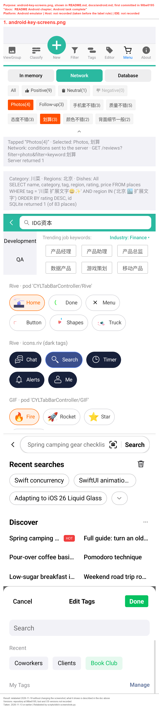

| 中文 | English |
|:---|:---|
| 平台：Android | Platform: Android |
| 环境：Android 15（API 35）模拟器 `CYL_API35_arm64`（sdk_gphone64_arm64，主机 GPU 渲染）；compileSdk / targetSdk 35，AGP 8.7.3，Kotlin 2.0.21，JDK 17；主机 macOS 27.3 | Environment: Android 15 (API 35) emulator `CYL_API35_arm64` (sdk_gphone64_arm64, host GPU rendering); compileSdk / targetSdk 35, AGP 8.7.3, Kotlin 2.0.21, JDK 17; host macOS 27.3 |
| 版本：[`27edb4f`](https://github.com/ChenYilong/CollectionViewClassifyMenu/commit/27edb4f)（各截图取自 `047b2ab` 至 `27edb4f` 的提交，TabBar 取自 `27edb4f`；其中 `047b2ab` 是最早的提交，`27edb4f` 是最新的提交，即上面的 `27edb4f`）；CYLTabBarController for Android [`4639a0c`](https://github.com/ChenYilong/CYLTabBarController/commit/4639a0c) | Version: [`27edb4f`](https://github.com/ChenYilong/CollectionViewClassifyMenu/commit/27edb4f) (the crops come from commits `047b2ab` to `27edb4f`, the tab bar from `27edb4f`; `047b2ab` is the earliest commit and `27edb4f` the latest, the same `27edb4f` as above); CYLTabBarController for Android [`4639a0c`](https://github.com/ChenYilong/CYLTabBarController/commit/4639a0c) |
| 时间：2026-11-12 至 2026-11-13（NZDT，UTC+13） | Taken: 2026-11-12 to 2026-11-13 (NZDT, UTC+13) |
| 每个屏幕的完整截图与移植记录：[docs/android.md](docs/android.md)；跨平台规则（共享数据库、与 iOS 一致的外观）：[docs/cross-platform.md](docs/cross-platform.md)。 | Every screen at full size, and the porting log: [docs/android.md](docs/android.md); cross-platform rules (the shared database, a look consistent with iOS): [docs/cross-platform.md](docs/cross-platform.md). |
| 三个移植库的上游 PR 与 issue 已全部处理：4 个 PR 全部合并，90 个未关闭 issue 全部解决（评分 100，[docs/android-upstream.md](docs/android-upstream.md)）。AndroidTagView，自上而下：长标签另起一行而不是被缩短；末端对齐、自动换行的文字、阴影、起始图标、自定义删除图标，以及没有删除图标的标签： | Upstream pull requests and issues of the three ported libraries: all 4 pull requests merged and all 90 open issues resolved (score 100, [docs/android-upstream.md](docs/android-upstream.md)). AndroidTagView, top to bottom: a long tag starts a new line instead of being shortened; end gravity, wrapped text, elevation, a start icon, a custom delete icon and a tag without one: |

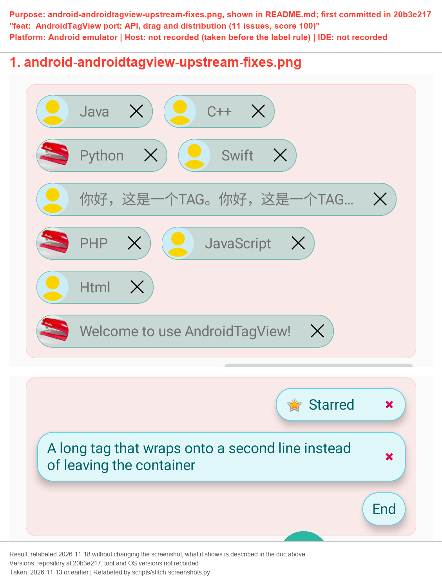

| 中文 | English |
|:---|:---|
| 平台：Android；环境：Android 15（API 35）模拟器 `CYL_API35_arm64`，compileSdk / targetSdk 35，AGP 8.7.3，Kotlin 2.0.21；主机 macOS 27.3 | Platform: Android; environment: Android 15 (API 35) emulator `CYL_API35_arm64`, compileSdk / targetSdk 35, AGP 8.7.3, Kotlin 2.0.21; host macOS 27.3 |
| 版本：`b85e474`（上）与 `fbe5cea`（下），位于 `feat/android-kotlin`；时间：2026-11-13 14:14 与 14:25（NZDT） | Version: `b85e474` (top) and `fbe5cea` (bottom) on `feat/android-kotlin`; taken: 2026-11-13 14:14 and 14:25 (NZDT) |

### 其他平台的基本初始化 / Basic setup on the other platforms

| 中文 | English |
|:---|:---|
| 所有平台都用同一套概念：宿主提供数据源（分区、条目标题）和代理（点击、选择变化），或者传入一份配置（字典 / JSON，键与 iOS 的 `CYLTagListKey` 等相同）。下面是每个平台最小的初始化，更多细节见各自的文档。 | Every platform uses the same concepts: the host provides a data source (sections, item titles) and a delegate (taps, selection changes), or passes in a configuration (a dictionary / JSON with the same keys as iOS's `CYLTagListKey` and friends). Below is the smallest setup of each platform; see its document for more. |

#### Android（Kotlin）

| 中文 | English |
|:---|:---|
| 库在 `android/merged/library`（包名 `com.cyl.classifymenu`），示例 App 通过 `implementation(project(":library"))` 引用。实现 `CYLMenuDataSource`，创建 `CYLTagListView`，设置数据源并重新加载。详见 [docs/android.md](docs/android.md) 与 [docs/android-api.md](docs/android-api.md)。 | The library is in `android/merged/library` (package `com.cyl.classifymenu`), and the example app references it with `implementation(project(":library"))`. Implement `CYLMenuDataSource`, create a `CYLTagListView`, set the data source and reload. See [docs/android.md](docs/android.md) and [docs/android-api.md](docs/android-api.md). |

```kotlin
class ReviewMenu(context: Context) : CYLMenuDataSource, CYLMenuDelegate {
    private val titles = listOf("All", "Positive", "With photos")

    override fun numberOfSectionsInMenu() = 1
    override fun menuNumberOfItemsInSection(section: Int) = titles.size
    override fun menuTitleForSection(section: Int) = "Reviews"
    override fun menuTitleForItemAtIndexPath(indexPath: CYLIndexPath) = titles[indexPath.item]

    val list = CYLTagListView(context).also {
        it.menuDataSource = this
        it.menuDelegate = this
        it.reloadMenuData()
    }
}
```

#### HarmonyOS（ArkTS）

| 中文 | English |
|:---|:---|
| 核心库是 HAR 模块 `harmony/classifymenu`（依赖名 `@cyl/classifymenu`，示例中为 `"@cyl/classifymenu": "file:../classifymenu"`）。用 `CYLTagListState` 保存数据源和代理，再用 `CYLTagListView` 组件显示。详见 [docs/harmony.md](docs/harmony.md)。 | The core library is the HAR module `harmony/classifymenu` (dependency name `@cyl/classifymenu`, `"@cyl/classifymenu": "file:../classifymenu"` in the example). Hold the data source and delegate in a `CYLTagListState` and show it with the `CYLTagListView` component. See [docs/harmony.md](docs/harmony.md). |

```ts
import { CYLTagListState, CYLTagListView, CYLMenuDataSource, CYLIndexPath } from '@cyl/classifymenu';

class ReviewSource implements CYLMenuDataSource {
  private titles: string[] = ['All', 'Positive', 'With photos'];
  numberOfSectionsInMenu(): number { return 1; }
  menuNumberOfItemsInSection(section: number): number { return this.titles.length; }
  menuTitleForSection(section: number): string { return 'Reviews'; }
  menuTitleForItem(indexPath: CYLIndexPath): string { return this.titles[indexPath.item]; }
}

// In a component: @State list: CYLTagListState = new CYLTagListState();
//   aboutToAppear() { this.list.menuDataSource = new ReviewSource(); this.list.reloadMenuData(); }
//   build() { CYLTagListView({ tagList: this.list }) }
```

#### 微信小程序 / WeChat Mini Program

| 中文 | English |
|:---|:---|
| 安装 npm 包 `cyl-tag-list-miniprogram`，在微信开发者工具中选择“工具 → 构建 npm”，在页面的 `usingComponents` 中声明组件，再把配置传给 `cyl-tag-list`。详见 [CrossPlatform/wechat-miniprogram/packages/cyl-tag-list-miniprogram/README.md](CrossPlatform/wechat-miniprogram/packages/cyl-tag-list-miniprogram/README.md) 与 [CrossPlatform/README.md](CrossPlatform/README.md)。 | Install the npm package `cyl-tag-list-miniprogram`, choose "Tools → Build npm" in WeChat DevTools, declare the component in the page's `usingComponents`, and pass a configuration to `cyl-tag-list`. See [CrossPlatform/wechat-miniprogram/packages/cyl-tag-list-miniprogram/README.md](CrossPlatform/wechat-miniprogram/packages/cyl-tag-list-miniprogram/README.md) and [CrossPlatform/README.md](CrossPlatform/README.md). |

```sh
npm install cyl-tag-list-miniprogram
```

```json
{ "usingComponents": { "cyl-tag-list": "cyl-tag-list-miniprogram/cyl-tag-list/cyl-tag-list" } }
```

```xml
<cyl-tag-list configuration="{{configuration}}" bind:tagtap="onTagTap" />
```

#### Flutter

| 中文 | English |
|:---|:---|
| `flutter/cyl_tag_list` 是原生 `CYLTagListView` 的 Flutter 封装（iOS 用 Swift pod，Android 用 Kotlin 库）。`configuration` 就是 iOS `CYLTagListView(configuration:)` 的字典。iOS 要求静态链接（`use_frameworks! :linkage => :static`），详见 [flutter/cyl_tag_list/README.md](flutter/cyl_tag_list/README.md) 与 [docs/cross-platform.md](docs/cross-platform.md)。 | `flutter/cyl_tag_list` wraps the native `CYLTagListView` for Flutter (the Swift pod on iOS, the Kotlin library on Android). `configuration` is the dictionary of iOS's `CYLTagListView(configuration:)`. iOS needs static linking (`use_frameworks! :linkage => :static`); see [flutter/cyl_tag_list/README.md](flutter/cyl_tag_list/README.md) and [docs/cross-platform.md](docs/cross-platform.md). |

```dart
CylTagListView(
  controller: CylTagListController(),
  configuration: {
    'selectionMode': 'multiple',
    'sections': [
      {'title': 'Reviews', 'items': [{'title': 'All'}, {'title': 'Positive'}]},
    ],
  },
  onTap: (tap) => print(tap.title),
);
```

#### React Native

| 中文 | English |
|:---|:---|
| `react-native/react-native-cyl-tag-list` 是 `CYLTagListView` 的 Fabric 视图（iOS 与 Android），`configuration` 同样是配置字典，事件有 `onTagTap`、`onSelectionChange` 和 `onContentHeightChange`。iOS 的 `CylTagListView.mm` / `.h` 是 React Native 的桥接代码，按 React Native 的要求保持 Objective-C++。详见 [react-native/react-native-cyl-tag-list/README.md](react-native/react-native-cyl-tag-list/README.md)。 | `react-native/react-native-cyl-tag-list` is a Fabric view of `CYLTagListView` (iOS and Android); `configuration` is the same configuration dictionary, and the events are `onTagTap`, `onSelectionChange` and `onContentHeightChange`. The iOS `CylTagListView.mm` / `.h` are React Native's bridge code and stay Objective-C++ as React Native requires. See [react-native/react-native-cyl-tag-list/README.md](react-native/react-native-cyl-tag-list/README.md). |

```tsx
import { CylTagListView } from 'react-native-cyl-tag-list';

<CylTagListView
  style={{ height: 120 }}
  configuration={{ selectionMode: 'multiple', sections: [{ title: 'Reviews', items: [{ title: 'All' }, { title: 'Positive' }] }] }}
  onTagTap={(e) => console.log(e.nativeEvent.title)}
/>
```

### 无障碍 / Accessibility

| 设置 | 支持 |
| --- | --- |
| VoiceOver | 标签是带“按钮”特征的元素，选中、禁用状态通过 `selected` / `notEnabled` 朗读；分区标题带 `header` 特征；折叠按钮朗读“<分区> 更多/收起”，展开或折叠后焦点保持在折叠按钮上。旧版多选筛选的单元格与 TagView 同样可朗读。 |
| 动态字体（Dynamic Type） | 字体随系统字号缩放（上限 2 倍），标签高度随之增加，字号变化后重新测量。 |
| 粗体文本（Bold Text） | 标签使用粗体，测量与绘制使用同一字体，不会被截断。 |
| 增强对比度（Increase Contrast） | 标签边框改用文字颜色并至少 1pt。 |
| 减弱动态效果（Reduce Motion） | 展开与收起不使用动画。 |

| Setting | Support |
| --- | --- |
| VoiceOver | Tags are elements with the "button" trait, and the selected and disabled states are read through `selected` / `notEnabled`; section titles carry the `header` trait; the fold button is read as "<section> More / Collapse", and after expanding or collapsing the focus stays on the fold button. The cells of the old multiple filter and the TagView are read the same way. |
| Dynamic Type | Fonts scale with the system text size (up to 2x), the tag height grows accordingly, and tags are measured again after a size change. |
| Bold Text | Tags use bold text, and measuring and drawing use the same font, so nothing is truncated. |
| Increase Contrast | The tag border uses the text color and is at least 1pt. |
| Reduce Motion | Expanding and collapsing are not animated. |

| 中文 | English |
|:---|:---|
| \| Voice Control / Switch Control / 全键盘控制 \| 每个标签、“+ 新建标签”、折叠按钮和列表标题都是带本地化标签的元素，可用名称点击或依次聚焦。 \| | \| Voice Control / Switch Control / Full Keyboard Access \| Every tag, the "+ New tag" item, the fold button and the list title are elements with localized labels, so they can be tapped by name or focused in turn. \| |
| `CYLTagListView` 的视图带有固定的 `accessibilityIdentifier`（声明于 `CYLTagListAccessibility.swift`），测试与工具无需坐标即可找到它们： | The views of `CYLTagListView` carry fixed `accessibilityIdentifier`s (declared in `CYLTagListAccessibility.swift`), so tests and tools can find them without coordinates: |

| 视图 | 标识符 | 朗读 |
| --- | --- | --- |
| 列表标题 `titleView` | `CYLTagListTitle` | 标题文字（仅图标时取图标的 `accessibilityLabel`，没有则作为装饰隐藏），`header` |
| 标签 | `CYLTagListItem` | 标签文字，按钮，选中 / 禁用 |
| “+ 新建标签” | `CYLTagCreateItem` | “新建标签” / “新建标签：<名称>”，按钮（从不“已选中”） |
| 折叠按钮（含作为标签的 `Inline` 折叠格） | `CYLTagListFoldControl` | “<分组> 更多/收起”，按钮 |
| More 按钮 | `CYLTagListMoreButton` | “<分组> 更多操作”，按钮 |

| View | Identifier | Spoken as |
| --- | --- | --- |
| List title `titleView` | `CYLTagListTitle` | The title text (for an icon-only title, the icon's `accessibilityLabel`; without one it is hidden as decoration), `header` |
| Tag | `CYLTagListItem` | The tag text, button, selected / disabled |
| "+ New tag" | `CYLTagCreateItem` | "New tag" / "New tag: <name>", button (never "selected") |
| Fold button (including the `Inline` fold cell that acts as a tag) | `CYLTagListFoldControl` | "<section> More / Collapse", button |
| More button | `CYLTagListMoreButton` | "<section> More actions", button |

| 中文 | English |
|:---|:---|
| 数据源可实现 `menuAccessibilityHintForItem(at:)`为标签提供朗读提示，如 Swift 示例管理模式下的“轻点两下删除此标签”。 | The data source can implement `menuAccessibilityHintForItem(at:)` to give tags a spoken hint, such as "Double-tap to delete this tag" in the manage mode of the Swift example. |
| 宿主提供的分区右侧视图（如行业选择按钮）应设置自己的 `accessibilityLabel`，示例中有演示。 | A view the host puts on the right of a section (such as an industry picker button) should set its own `accessibilityLabel`; the example shows how. |

### 国际化与本地化 / Localization

| 中文 | English |
|:---|:---|
| 组件的全部资源只有一个 bundle：`CYLClassifyMenuResources.bundle`，其中包含图片、XIB 以及 `en.lproj`、`zh-Hans.lproj`、`zh-Hant.lproj` 下的 `CYLClassifyMenu.strings`（源文件位于 `CollectionViewClassifyMenu/Resources/Localization/`）。组件自己选择 `.lproj`，宿主 App 无需声明这些语言。 | All of the component's resources live in a single bundle, `CYLClassifyMenuResources.bundle`, which contains the images, the XIBs and `CYLClassifyMenu.strings` under `en.lproj`, `zh-Hans.lproj` and `zh-Hant.lproj` (the sources are in `CollectionViewClassifyMenu/Resources/Localization/`). The component picks the `.lproj` itself, so the host app does not need to declare these languages. |

```swift
CYLMenuResources.preferredLanguage = "en"                          // App 内切换语言；nil 跟随系统
let more = CYLMenuLocalizedString("CYLMenuExpand")                 // "More"
let plus = CYLMenuResources.image(named: "cyl_tag_plus")           // 组件 bundle 中的图片
CYLMenuResources.localizedString(forKey: "CYLMenuCollapse", language: "zh-Hant")   // "收合"
```

| 中文 | English |
|:---|:---|
| 切换语言后新创建的视图使用新语言。`CYLMenuStyle` 的 `expandTitle` / `collapseTitle` 默认取自该 bundle，也可由宿主覆盖。新增文案时，在三个 `.strings` 中加入相同的键（测试会检查键一致）。 | Views created after switching the language use the new language. `expandTitle` / `collapseTitle` of `CYLMenuStyle` default to the values in this bundle and can be overridden by the host. When adding a string, add the same key to all three `.strings` files (a test checks that the keys match). |
| 示例的界面文案同样只放在一个 bundle：`Example/CYLMenuExample/CYLMenuExample.bundle`，通过 Swift 函数 `CYLExampleLocalizedString` 读取，键为中文原文；评价关键词与标签属于示例数据，不翻译。启动参数 `-CYLExampleLanguage en` 可切换示例与组件的语言。Swift 示例使用函数 `CYLTagEditorLocalizedString` 读取 `CYLTagEditorExample.bundle`；`CollectionViewClassifyMenu.xcodeproj` 的演示 App 使用 Swift 函数 `CYLDemoLocalizedString` 读取 `CYLClassifyMenuDemo.bundle`。每一层各有自己的查找宏（或函数）与 bundle，代码中不出现面向用户的中文字面量（含无障碍标签与提示）。 | The example's UI text is likewise kept in a single bundle, `Example/CYLMenuExample/CYLMenuExample.bundle`, read through the Swift function `CYLExampleLocalizedString`, with the original Chinese text as the key; review keywords and tags are example data and are not translated. The launch argument `-CYLExampleLanguage en` switches the language of the example and the component. The Swift example reads `CYLTagEditorExample.bundle` with the function `CYLTagEditorLocalizedString`; the demo app of `CollectionViewClassifyMenu.xcodeproj` reads `CYLClassifyMenuDemo.bundle` with the Swift function `CYLDemoLocalizedString`. Each layer has its own lookup macro (or function) and bundle, and no user-facing Chinese literals appear in the code (accessibility labels and hints included). |

### 示例工程 / Example projects

| 中文 | English |
|:---|:---|
| 核心库与所有示例（`Example/`、`Example-Swift/`、根目录工程的演示 App、`TagCollectionView` 演示）及其测试均以 Swift 编写；公开 API 带有 `@objc` 标注，迁移记录见 [docs/Swift-Migration.md](docs/Swift-Migration.md)。 | The core library, all examples (`Example/`, `Example-Swift/`, the demo app of the root project, the `TagCollectionView` demo) and their tests are written in Swift; the public API carries `@objc` annotations, and the migration log is in [docs/Swift-Migration.md](docs/Swift-Migration.md). |
| `Example/` 通过 Podfile 以本地路径集成核心库，并引入 [CYLTabBarController](https://github.com/ChenYilong/CYLTabBarController) 搭建两个作用不同的 TabBar： | `Example/` integrates the core library by local path in its Podfile and pulls in [CYLTabBarController](https://github.com/ChenYilong/CYLTabBarController) to build two tab bars with different roles: |
| 根 TabBar（底部）：“场景一：评价筛选”与“场景二：搜索分类”两个 Tab； | The root tab bar (at the bottom): the two tabs "Scenario 1: review filter" and "Scenario 2: search categories"; |
| 分类 TabBar（场景二）：场景二首页点击搜索框 push 进入搜索页（`hidesBottomBarWhenPushed`，隐藏根 TabBar），搜索页内嵌的 CYLTabBarController 同样位于底部，切换“找人/动态/八卦/职位”，每个 Tab 是一个标签页。 | The category tab bar (scenario 2): tapping the search box on the scenario 2 home page pushes the search page (`hidesBottomBarWhenPushed`, which hides the root tab bar); the CYLTabBarController embedded in the search page is also at the bottom and switches between "People / Posts / Gossip / Jobs", each tab being a tag page. |
| 根 TabBar 中间的 PlusButton（`CYLExamplePlusButton`，CYLTabBarController 的 `CYLPlusButton`）：点击后进入 `plusChildViewController`（`CYLQueryScenariosViewController`），按场景分组展示筛选演示。PlusButton 只注册在根 TabBar 的 context（`CYLExampleRootTabBarContext`）上，场景二内嵌的分类 TabBar 没有 PlusButton。 | The PlusButton in the middle of the root tab bar (`CYLExamplePlusButton`, CYLTabBarController's `CYLPlusButton`): tapping it opens `plusChildViewController` (`CYLQueryScenariosViewController`), which shows the filter demos grouped by scenario. The PlusButton is registered only on the root tab bar's context (`CYLExampleRootTabBarContext`); the category tab bar embedded in scenario 2 has no PlusButton. |
| TabBar 总是位于底部；从 Tab 中 push 的页面隐藏根 TabBar。 | A tab bar is always at the bottom; pages pushed from a tab hide the root tab bar. |

```sh
cd Example
pod install
open CYLMenuExample.xcworkspace
```

| 场景 | 实现 |
| --- | --- |
| 场景一：淘宝评价筛选 | `CYLProductViewController` 在商品页用 `CYLMenuFoldStyle.truncate` 预览两行关键词；`CYLReviewListViewController` 使用多选、带图标和数量的筛选，默认折叠为两行，底部箭头旋转 180° 展开/折叠。每次点击（显示点击事件）都按所有所选条件（AND，“全部”表示不限）刷新下方列表。顶部开关区分两种场景：**内存筛选**（`CYLMemoryReviewQuery`，在已加载的数据中同步匹配）与**网络筛选**（`CYLNetworkReviewQuery`，把条件编码为请求 URL，模拟服务器延迟返回，显示加载状态并丢弃过期响应）。 |
| 场景二：脉脉搜索分类 | `CYLSearchHomeViewController` push `CYLSearchCategoryViewController`，提供搜索框和底部 CYLTabBarController 分类（找人/动态/八卦/职位）；点击标签填入搜索框；“职位”页左侧为职位类别，右侧为关键词，分区标题右侧为宿主提供的行业选择按钮。 |

| Scenario | Implementation |
| --- | --- |
| Scenario 1: Taobao review filter | `CYLProductViewController` previews two rows of keywords on the product page with `CYLMenuFoldStyle.truncate`; `CYLReviewListViewController` uses a multiple-selection filter with icons and counts, folded to two rows by default, and the bottom arrow rotates 180° to expand or collapse. Every tap (the tap event is shown) refreshes the list below by all the selected conditions (AND; "All" means no limit). A switch at the top distinguishes two modes: **in-memory filtering** (`CYLMemoryReviewQuery`, which matches synchronously within the loaded data) and **network filtering** (`CYLNetworkReviewQuery`, which encodes the conditions into a request URL, simulates a delayed server response, shows a loading state and discards stale responses). |
| Scenario 2: Maimai search categories | `CYLSearchHomeViewController` pushes `CYLSearchCategoryViewController`, which provides the search box and the categories (People / Posts / Gossip / Jobs) in a CYLTabBarController at the bottom; tapping a tag fills in the search box; on the "Jobs" page the left side holds the job categories and the right side the keywords, and the host supplies an industry picker button on the right of the section title. |

| 中文 | English |
|:---|:---|
| \| 查询筛选（PlusButton）· 查询参数设置 \| 淘宝评价默认显示全部；条件太多时由用户多选输入筛选条件，这正是标签列表（TagCollectionView）的用途。场景一的评价筛选增加第三种方式**数据库筛选**（`CYLDatabaseReviewQuery`）：所选条件生成一条 SQL（评分、有图、追加为 `reviews` 表的列，关键词为 `review_keywords` 表的行，全部 AND），在 SQLite 中查询，状态栏显示 SQL 与匹配数量。 \| | \| Query filters (PlusButton) · query parameter settings \| Taobao reviews show everything by default; when there are too many conditions the user enters them by multiple selection, which is exactly what the tag list (TagCollectionView) is for. The review filter of scenario 1 adds a third mode, **database filtering** (`CYLDatabaseReviewQuery`): the selected conditions generate one SQL statement (rating, with images and follow-up reviews are columns of the `reviews` table, keywords are rows of the `review_keywords` table, all combined with AND), which is queried in SQLite, and the status bar shows the SQL and the number of matches. \| |
| \| 查询筛选（PlusButton）· 最近搜索 + 发现 \| `CYLSearchDiscoverViewController`（纯 Swift）按搜索 App 的搜索页实现：顶部返回、搜索框（占位文字为第一个发现话题）、以图搜索与“搜索”按钮；“最近搜索”折叠为两行，箭头是最后一个标签（`CYLMenuFoldControlPosition.tail`），右侧垃圾桶清空；“发现”每行两个（`gridStyle(itemsPerRow: 2)`），超出部分省略号，热门话题文字之后有“热”图标（`menuImageForItem(at:)`，文字在左、图标在右），右上角 More 按钮随机刷新；底部“按住提问，有问必答 ✨”与麦克风按钮。数据按语言放在 `CYLMenuExample.bundle/<语言>.lproj/search-discover.json`（简体中文、繁体中文、英文各一份，最近搜索与 24 个发现话题，顺序与热门话题相同），“热”图标同样按语言放在该 `.lproj`（热、熱、HOT）；刷新时随机选取 6 个；点击话题或最近搜索即填入搜索框并移到最近搜索最前。无障碍：每个标签提示“轻点两下搜索”，More 按钮读作“换一批”（核心库 `menuAccessibilityLabelForMoreButton(inSection:)`），热门图标读作“热门”，仅图标的按钮支持大字内容查看器（Large Content Viewer），边框颜色随深色模式与“增强对比度”变化，搜索与聆听时有朗读提示，以图搜索按钮给出说明而不是无响应。 \| | \| Query filters (PlusButton) · recent searches + discover \| `CYLSearchDiscoverViewController` (pure Swift) follows the search page of a search app: a back button at the top, a search box (its placeholder is the first discover topic), an image search button and a "Search" button; "Recent searches" fold to two rows, the arrow is the last tag (`CYLMenuFoldControlPosition.tail`), and the trash can on the right clears them; "Discover" has two tags per row (`gridStyle(itemsPerRow: 2)`) with overflow truncated by an ellipsis, a "Hot" icon after the text of hot topics (`menuImageForItem(at:)`, text on the left and icon on the right), and a More button at the top right that refreshes randomly; at the bottom are "Hold to ask, every question answered ✨" and a microphone button. The data lives per language in `CYLMenuExample.bundle/<语言>.lproj/search-discover.json` (one file each for Simplified Chinese, Traditional Chinese and English, with the recent searches and 24 discover topics in the same order as the hot topics), and the "Hot" icon is likewise kept per language in that `.lproj` (Simplified Chinese, Traditional Chinese and English variants of "Hot"); a refresh picks 6 at random; tapping a topic or a recent search fills in the search box and moves it to the front of the recent searches. Accessibility: each tag has the hint "Double-tap to search", the More button is read as "Shuffle" (the core's `menuAccessibilityLabelForMoreButton(inSection:)`), the hot icon is read as "Hot", icon-only buttons support the Large Content Viewer, border colors follow dark mode and Increase Contrast, searching and listening give spoken feedback, and the image search button gives an explanation instead of doing nothing. \| |
| \| 查询筛选（PlusButton）· 菜单选择 \| 移植原 Demo（`CollectionViewClassifyMenu.xcodeproj`）的分类菜单与多选筛选：`CYLMenuLinkageViewController` 继承核心库的 `CYLClassifyMenuViewController`，左上角按钮打开核心库的 `CYLMultipleFilterController`，数据源直接复用原 Demo 的 `CYLDemoDataSource`、`CYLDBManager` 与 `data.json`（工程引用原文件，不复制）。原 Demo 只实现了筛选界面，没有筛选数据；现在点击分类标签（单选，高亮）或确认多选筛选（地区、菜品）都会生成 SQL，在 `places` 表中查询，并在标签下方（`menuFooterView`）显示条件、SQL 与结果；选择保存在数据库的 `selections` 表中，再次进入时恢复。 \| | \| Query filters (PlusButton) · menu selection \| Ports the classify menu and multiple-choice filter of the original demo (`CollectionViewClassifyMenu.xcodeproj`): `CYLMenuLinkageViewController` subclasses the core's `CYLClassifyMenuViewController`, the button at the top left opens the core's `CYLMultipleFilterController`, and the data source reuses the original demo's `CYLDemoDataSource`, `CYLDBManager` and `data.json` directly (the project references the original files instead of copying them). The original demo only implemented the filter UI and had no data to filter; now tapping a category tag (single selection, highlighted) or confirming a multiple-choice filter (region, dishes) generates SQL, queries the `places` table, and shows the conditions, the SQL and the result below the tags (`menuFooterView`); the selections are saved in the `selections` table of the database and restored when you come back. \| |
| 数据库是 `CYLExampleDatabase`（iOS SDK 自带的 libsqlite3，文件在 Caches 目录）：每次启动由 App 内的数据重新生成 `reviews`、`review_keywords`、`places` 表，`selections` 表保留各演示最后确认的条件。所有值都通过 `?` 绑定，界面上显示的 SQL 只用于展示。 | The database is `CYLExampleDatabase` (the libsqlite3 that ships with the iOS SDK, with the file in the Caches directory): on every launch the `reviews`, `review_keywords` and `places` tables are regenerated from the data inside the app, while the `selections` table keeps the conditions each demo last confirmed. All values are bound through `?`, and the SQL shown in the UI is for display only. |
| `CYLExampleMenuSource` 演示了宿主如何把自己的模型转换为 `CYLMenuDataSource`；核心库不持有任何业务数据。 | `CYLExampleMenuSource` shows how a host turns its own models into a `CYLMenuDataSource`; the core library holds no business data. |
| 截图来自 CI（`Example screenshots`，提交 `22370a8`，iPhone 模拟器）： | Screenshots come from CI (`Example screenshots`, commit `22370a8`, iPhone simulator): |

| 场景一：商品页预览 | 场景一：评价筛选（展开） | 场景二：搜索首页 | 场景二：职位分类 |
| --- | --- | --- | --- |
| 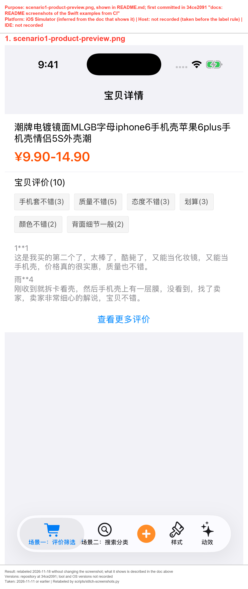 | 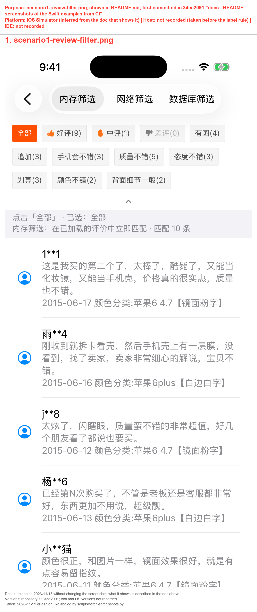 | 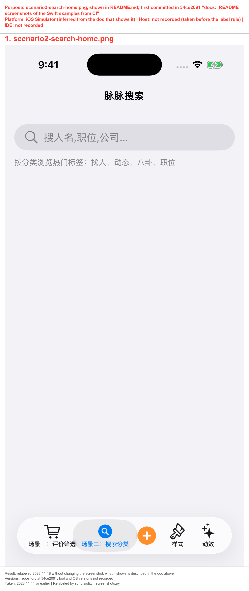 | 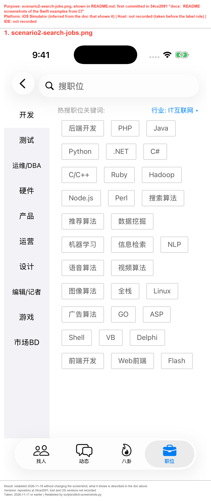 |

| Scenario 1: product page preview | Scenario 1: review filter (expanded) | Scenario 2: search home | Scenario 2: job categories |
| --- | --- | --- | --- |
|  |  |  |  |

| 查询筛选（PlusButton） | 评价筛选 · 数据库 | 菜单选择 · 数据库联动 | 配置初始化 |
| --- | --- | --- | --- |
| 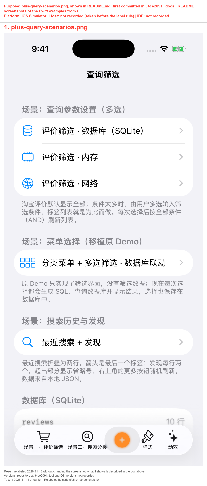 | 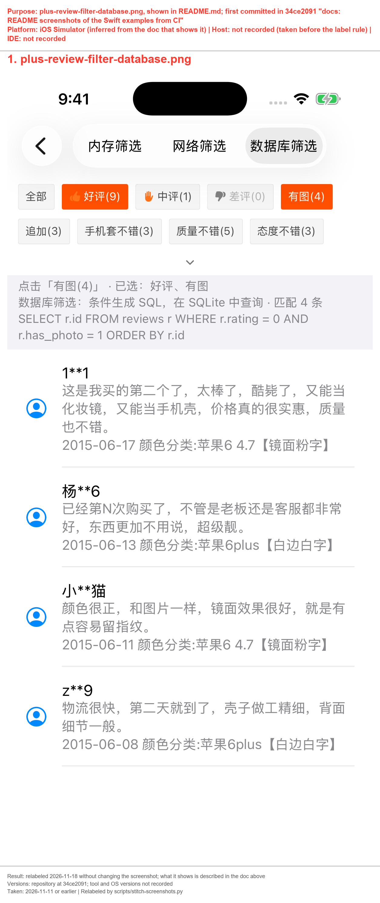 | 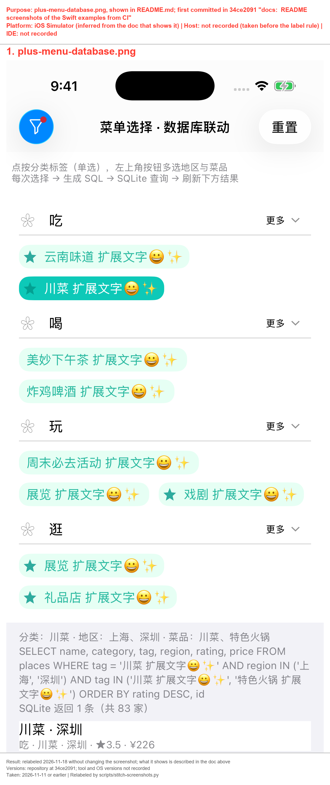 | 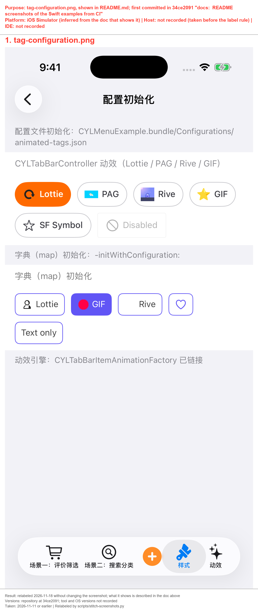 |

| Query filters (PlusButton) | Review filter · database | Menu selection · database linkage | Configuration initialization |
| --- | --- | --- | --- |
|  |  |  |  |

| 标签样式 | 标签样式（英文） | 动效图标 |
| --- | --- | --- |
| 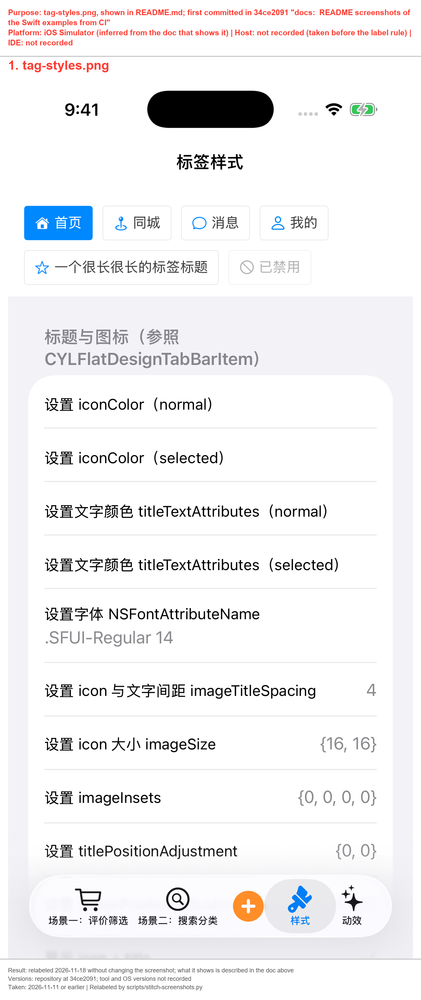 | 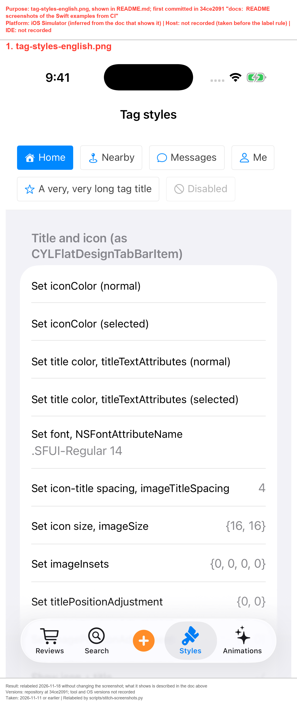 | 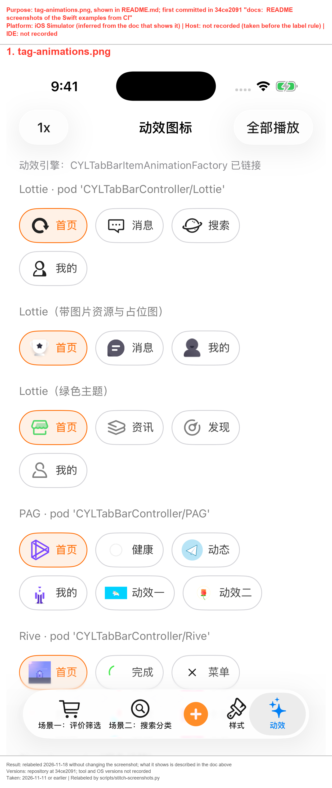 |

| Tag styles | Tag styles (English) | Animated icons |
| --- | --- | --- |
|  |  |  |

| 最近搜索 + 发现（箭头为最后一个标签） | 最近搜索展开 | 最近搜索 + 发现（英文） |
| --- | --- | --- |
| 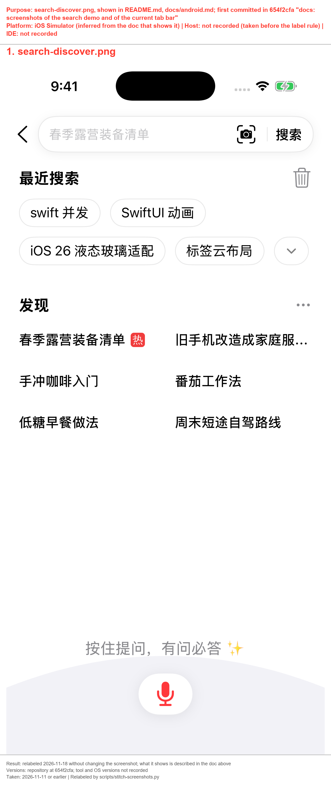 | 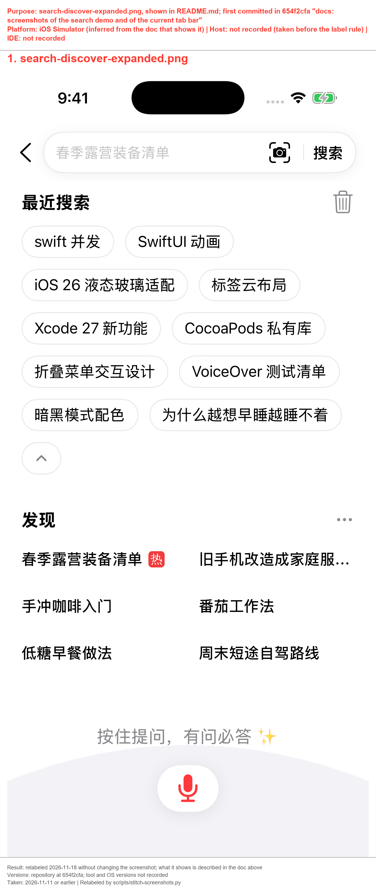 | 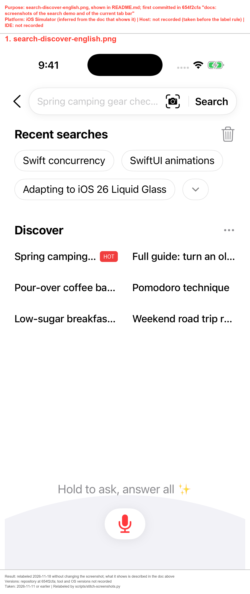 |

| Recent searches + discover (the arrow is the last tag) | Recent searches expanded | Search history + discover (English) |
| --- | --- | --- |
|  |  |  |

### 纯 Swift 示例：新建标签 / Swift example: new tag

| 中文 | English |
|:---|:---|
| `Example-Swift/`（`CYLTagEditorExample`）是纯 Swift 编写的示例，同样通过 Podfile 以本地路径集成核心库（`pod 'CollectionViewClassifyMenu', :path => '..'`），修改核心代码后直接生效。它演示聊天 App 联系人“编辑备注 → 编辑标签”中**新建标签**的场景： | `Example-Swift/` (`CYLTagEditorExample`) is an example written in pure Swift. It also integrates the core library by local path in its Podfile (`pod 'CollectionViewClassifyMenu', :path => '..'`), so changes to the core code take effect immediately. It demonstrates the **new tag** scenario in a chat app's contact "Edit remark → Edit tags" flow: |

| 页面 | 实现 |
| --- | --- |
| 编辑备注（`CYLRemarkViewController`） | “标签”行显示已选标签（只读的 `CYLTagListView`），点击后以 sheet 弹出编辑标签。 |
| 编辑标签（`CYLTagEditorViewController`） | 顶部「取消 / 编辑标签 / 完成」，「完成」有选择或改动时为绿色，搜索时不可用；搜索框；「最近使用」与「我的标签」（分组标题右侧为「管理」，`menuAccessoryView(forSection:)`）。选中的标签为绿色，同一标签在两个分组中同时选中。最后一个标签后是「+ 新建标签」，输入名称后新建并选中。 |
| 搜索 | 输入文字（不区分大小写，如 "ios" 找到 "iOS"）显示“搜索结果”，该名称的标签不存在时末尾为“+ 新建标签：ios”；点击或按键盘搜索键即新建、选中，结束搜索并滚动到新标签。 |
| 管理 | 「管理」后点击「我的标签」中的标签可删除。 |

| Page | Implementation |
| --- | --- |
| Edit remark (`CYLRemarkViewController`) | The "Tags" row shows the selected tags (a read-only `CYLTagListView`); tapping it presents the tag editor as a sheet. |
| Edit tags (`CYLTagEditorViewController`) | "Cancel / Edit tags / Done" at the top; "Done" turns green when there is a selection or a change, and is unavailable while searching; a search box; "Recently used" and "My tags" (the right side of the section title shows "Manage", through `menuAccessoryView(forSection:)`). Selected tags are green, and the same tag is selected in both sections at once. After the last tag comes "+ New tag"; entering a name creates the tag and selects it. |
| Search | Typing text (case-insensitive, so "ios" finds "iOS") shows "Search results"; when no tag with that name exists, "+ New tag: ios" appears at the end; tapping it or pressing the keyboard's search key creates and selects the tag, ends the search and scrolls to the new tag. |
| Manage | After tapping "Manage", tapping a tag in "My tags" deletes it. |

| 中文 | English |
|:---|:---|
| 演示数据来自本地 JSON：`CYLTagEditorExample.bundle/<语言>.lproj/tags.json`（简体中文、繁体中文、英文各一份，标签相同、顺序相同），由 `CYLTagData`（`Codable`）解析，按 App 当前语言加载。内容是有意义的联系人标签（家人、大学同学、客户、iOS 开发、读书会、深圳、待回复……），以及“最近使用”和编辑备注页初始选中的标签；修改文件即可替换数据。 | The demo data comes from local JSON: `CYLTagEditorExample.bundle/<语言>.lproj/tags.json` (one file each for Simplified Chinese, Traditional Chinese and English, with the same tags in the same order), parsed by `CYLTagData` (`Codable`) and loaded according to the app's current language. The content is meaningful contact tags (family, university classmates, clients, iOS development, book club, Shenzhen, to reply...), plus the "Recently used" tags and the tags initially selected on the edit remark page; edit the file to replace the data. |
| 第二个 Tab“折叠样式”（`CYLFoldStylesViewController`）用初始化参数创建各种折叠控件与标题样式（底部仅箭头、底部文字 + 箭头、底部仅文字、右上角文字 + 箭头（原分类菜单）、右上角仅箭头、左上角文字 + 箭头、标题居中），以及不同的标题样式（图标 + 文字、仅图标、仅文字居中、绿色标题、图标在文字之后），每个演示都使用封装好的 title 属性；再分别从 JSON、plist、YAML、XML 配置文件创建；根 TabBar 为 CYLTabBarController（底部）。 | The second tab, "Fold styles" (`CYLFoldStylesViewController`), creates various fold controls and title styles from initialization parameters (arrow only at the bottom, text + arrow at the bottom, text only at the bottom, text + arrow at the top right (the original classify menu), arrow only at the top right, text + arrow at the top left, centered title), as well as different title styles (icon + text, icon only, centered text only, a green title, icon after the text); every demo uses the encapsulated title property; it then creates them again from JSON, plist, YAML and XML configuration files; the root tab bar is a CYLTabBarController (at the bottom). |
| 为此核心库新增：`menuItemIsSelectable(at:)`（「+ 新建标签」这样的操作项：点击会回调，但不会被选中）、 `menuStyleForItem(at:)`（单个标签的外观，如带边框的「+ 新建标签」）与 `scrollToItem(at:animated:)`。 | To support this the core library adds: `menuItemIsSelectable(at:)` (for action items such as "+ New tag": a tap calls back but the item is never selected), `menuStyleForItem(at:)` (the look of a single tag, such as the bordered "+ New tag") and `scrollToItem(at:animated:)`. |

```sh
cd Example-Swift
pod install
open CYLTagEditorExample.xcworkspace
```

| 中文 | English |
|:---|:---|
| CI 中 `Unit tests (swift)` 运行其测试，`Example screenshots` 同时生成其截图（`swift-<页面>.png`）。 | In CI, `Unit tests (swift)` runs its tests, and `Example screenshots` also generates its screenshots (`swift-<页面>.png`). |

| 编辑备注 | 编辑标签 | 搜索并新建标签 | 折叠样式 | 配置文件创建 |
| --- | --- | --- | --- | --- |
| 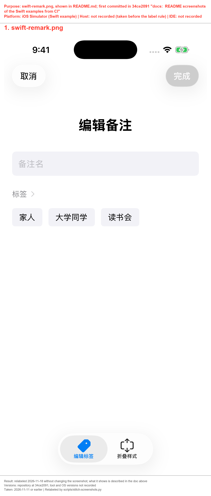 | 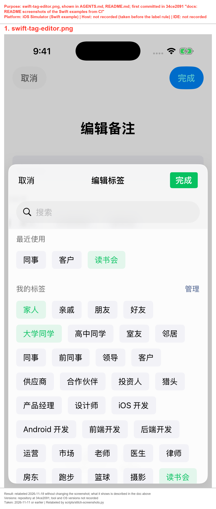 | 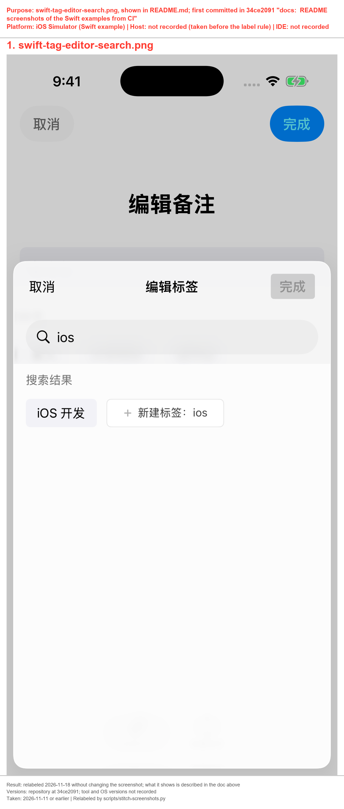 | 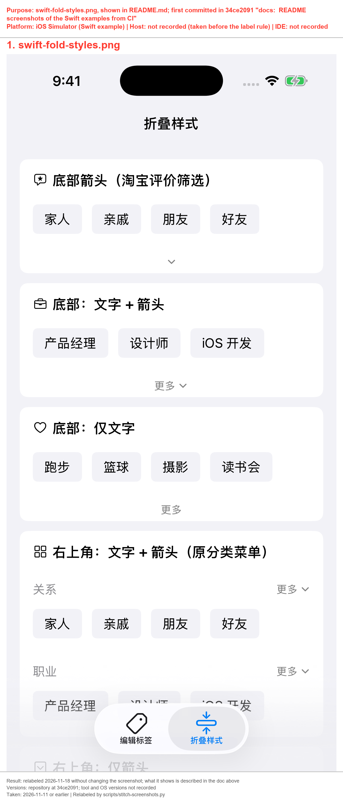 | 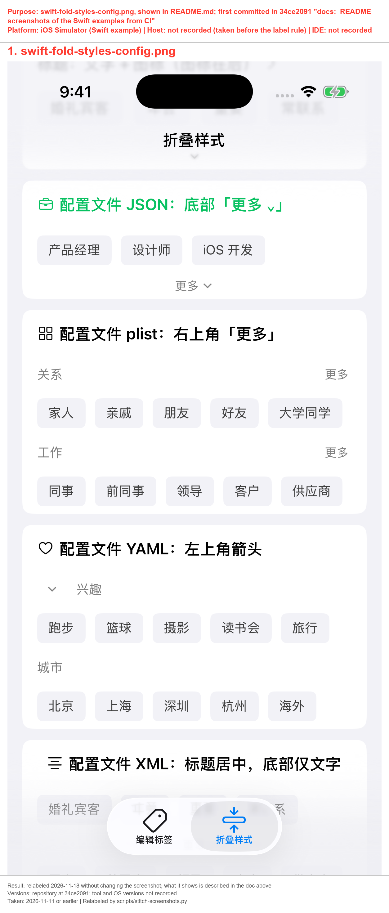 |

| Edit remark | Edit tags | Search and create a tag | Fold styles | Created from a configuration file |
| --- | --- | --- | --- | --- |
|  |  |  |  |  |

### 测试 / Tests

| 中文 | English |
|:---|:---|
| 两个示例的测试（`Example/CYLMenuExampleTests`：115 个，`Example-Swift/CYLTagEditorExampleTests`：22 个）按**面向协议**组织：每个功能一个测试类、一个文件，测试之间共享的能力是带默认实现的协议，放在 `Example-Shared/TestSupport/`，同时编译进两个测试 target。 | The tests of the two examples (`Example/CYLMenuExampleTests`: 115, `Example-Swift/CYLTagEditorExampleTests`: 22) are organized around protocols: one test case class and one file per feature, and the capabilities they share are protocols with default implementations in `Example-Shared/TestSupport/`, compiled into both test targets. |

| 协议 | 作用 |
| --- | --- |
| `CYLWindowHosting` | 在 App 的 scene 中用自己的窗口显示页面（`show(_:)`、`showInNavigation(_:)`），测试结束时关闭 |
| `CYLTagListInspecting` | 读取并点击标签列表：cell、标签按钮、分区头/尾、折叠控件、布局 frame、`assertItemsFit` |
| `CYLAccessibilityQuerying` | 按 accessibility identifier 和 label 查找视图，不用坐标 |
| `CYLScreenshotCapturing` | 记录被测状态的截图：附加到测试结果，并写入 `CYL_TEST_SCREENSHOTS_DIR` |
| `CYLConditionWaiting` | 等待异步结果（`waitUntil { … }`），不用固定延时 |
| `CYLViewOverlapInspecting` | 找出一个视图（如搜索栏）在窗口中覆盖的其他可见视图 |

| Protocol | What it gives a test |
| --- | --- |
| `CYLWindowHosting` | Shows a page in its own window in the app's scene (`show(_:)`, `showInNavigation(_:)`) and closes it when the test ends |
| `CYLTagListInspecting` | Reads and taps a tag list: cells, tag buttons, section headers and footers, fold controls, layout frames, `assertItemsFit` |
| `CYLAccessibilityQuerying` | Finds views by accessibility identifier and label, without coordinates |
| `CYLScreenshotCapturing` | Records a screenshot of the state under test: attached to the test result and written to `CYL_TEST_SCREENSHOTS_DIR` |
| `CYLConditionWaiting` | Waits for asynchronous results (`waitUntil { … }`) instead of a fixed delay |
| `CYLViewOverlapInspecting` | Finds the other visible views that a view (such as a search bar) covers in the window |

| 中文 | English |
|:---|:---|
| 核心库的私有视图只通过 `CYLTagListProbe` 读取（唯一一处 key-value coding），核心改名时只改这一处。 | The core library's private views are read only through `CYLTagListProbe` (the single place that uses key-value coding), so a rename in the core changes only this one place. |
| 每个测试 target 只有一个很小的基类（`CYLMenuExampleTestCase`、`CYLTagEditorTestCase`，负责语言和要显示的页面），测试数据与替身在各自的 `Support/` 中（`CYLMenuFixtures`、`CYLRecordingMenuDelegate`、`CYLTabBarInspecting`）。 | Each test target has only one small base class (`CYLMenuExampleTestCase`, `CYLTagEditorTestCase`, responsible for the language and the page to show), and the test data and test doubles are in their own `Support/` (`CYLMenuFixtures`, `CYLRecordingMenuDelegate`, `CYLTabBarInspecting`). |

| 测试类 | 内容 |
| --- | --- |
| `CYLTagListSelectionTests` · `CYLTagListFoldingTests` · `CYLTagListLayoutTests` | 选择模式、折叠样式、布局与宽度 |
| `CYLTagButtonTests` · `CYLTagConfigurationTests` · `CYLTagListAccessibilityTests` | 标签按钮外观、配置初始化、VoiceOver |
| `CYLTagStyleDemoTests` · `CYLAnimatedIconTests` | “样式”与“动效”页，CYLTabBarController 动效引擎 |
| `CYLAndroidSampleTests` | 三个 Android 标签库示例的复刻与其核心功能：容器边框、对齐、主题、叉号、涟漪、拖动排序、长按、图片标签 |
| `CYLSearchBarPlacementTests` | 搜索栏在任何时候都不覆盖任何视图：分类搜索、搜索发现、热门搜索三个页面，默认与最大字号 |
| `CYLAndroidSampleAccessibilityTests` | 这些示例的英文与繁体中文；代替长按、拖动和点图片的无障碍操作；徽标的朗读；图片标签的动态字体 |
| `CYLTagCloudTests` | android-tagview 的 API：`CYLTag`、添加/删除标签、可删除标签、按下颜色、背景图、四边内边距、字号、配置键 |
| `CYLReviewFilterScenarioTests` · `CYLSearchCategoryScenarioTests` | 场景一（评价筛选）、场景二（搜索分类） |
| `CYLRootTabBarTests` · `CYLExampleDatabaseTests` · `CYLSearchDiscoverTests` · `CYLLocalizationTests` | 根 TabBar 与 PlusButton、SQLite、最近搜索 + 发现、国际化 |
| `CYLTagStoreTests` · `CYLTagEditorTests` · `CYLFoldStylesTests` · `CYLTagEditorAccessibilityTests` | 纯 Swift 示例：标签数据、编辑标签、折叠样式、无障碍 |

| Test case | Coverage |
| --- | --- |
| `CYLTagListSelectionTests` · `CYLTagListFoldingTests` · `CYLTagListLayoutTests` | Selection modes, fold styles, layout and width |
| `CYLTagButtonTests` · `CYLTagConfigurationTests` · `CYLTagListAccessibilityTests` | Tag button appearance, configuration initialization, VoiceOver |
| `CYLTagStyleDemoTests` · `CYLAnimatedIconTests` | The "Style" and "Animation" pages, CYLTabBarController's animation engines |
| `CYLAndroidSampleTests` | The ports of the three Android tag library samples and their core features: container border, alignment, themes, cross, ripple, drag reordering, long press, image tags |
| `CYLSearchBarPlacementTests` | The search bar never covers any view at any time: the three pages of categorized search, search discover and hot search, at the default and the largest text size |
| `CYLAndroidSampleAccessibilityTests` | English and Traditional Chinese for these examples; accessibility actions that replace long press, drag and tapping an image; how badges are read; Dynamic Type for image tags |
| `CYLTagCloudTests` | The android-tagview API: `CYLTag`, adding and removing tags, deletable tags, pressed color, background image, per-side padding, font size, configuration keys |
| `CYLReviewFilterScenarioTests` · `CYLSearchCategoryScenarioTests` | Scenario 1 (review filter) and scenario 2 (search categories) |
| `CYLRootTabBarTests` · `CYLExampleDatabaseTests` · `CYLSearchDiscoverTests` · `CYLLocalizationTests` | The root tab bar and PlusButton, SQLite, recent searches + discover, localization |
| `CYLTagStoreTests` · `CYLTagEditorTests` · `CYLFoldStylesTests` · `CYLTagEditorAccessibilityTests` | The Swift example: tag data, tag editing, fold styles, accessibility |

```sh
scripts/unit-tests.sh example   # 115 tests; screenshots in build/test-screenshots/example/
scripts/unit-tests.sh swift     # 22 tests; screenshots in build/test-screenshots/swift/
```

| 中文 | English |
|:---|:---|
| Xcode 27（iOS 27 SDK）要求 App 采用 scene 生命周期，否则启动即被 UIKit 终止（测试报 “The test runner crashed before establishing connection”）；两个示例和根目录的两个演示 App 因此各有一个 scene delegate（`CYLExampleSceneDelegate`、`CYLTagEditorSceneDelegate`、`CYLSceneDelegate`、`CYLTagDemoSceneDelegate`；后两个是 `scripts/unit-tests.sh menu\|tag` 的测试宿主），测试窗口也加入 App 的 scene。 | Xcode 27 (iOS 27 SDK) requires apps to adopt the scene lifecycle, otherwise UIKit terminates the app at launch (the tests report "The test runner crashed before establishing connection"); the two examples and the two demo apps in the root directory therefore each have a scene delegate (`CYLExampleSceneDelegate`, `CYLTagEditorSceneDelegate`, `CYLSceneDelegate`, `CYLTagDemoSceneDelegate`; the last two are the test hosts of `scripts/unit-tests.sh menu\|tag`), and the test windows are also added to the app's scene. |
| 测试截图（本地运行：macOS 27.3、Xcode 27.2、iPhone 17 Pro 模拟器 iOS 26.1；example 80、swift 19、menu 17、tag 6，共 122 个测试全部通过）： | Test screenshots (local run: macOS 27.3, Xcode 27.2, iPhone 17 Pro simulator on iOS 26.1; example 80, swift 19, menu 17, tag 6, 122 tests in total, all passing): |

| 单选：替换同组选择 | 多选 | 底部箭头：折叠 | 底部箭头：展开 |
| --- | --- | --- | --- |
| 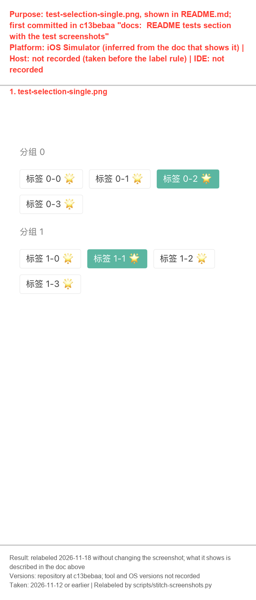 | 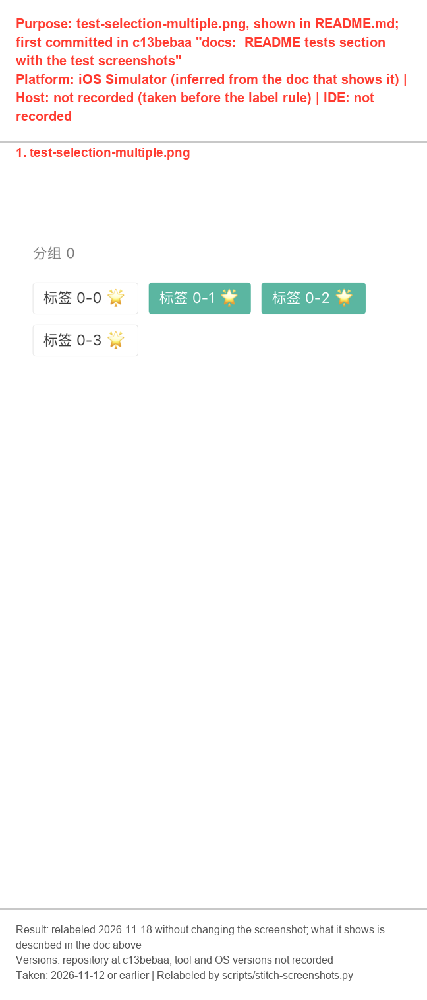 | 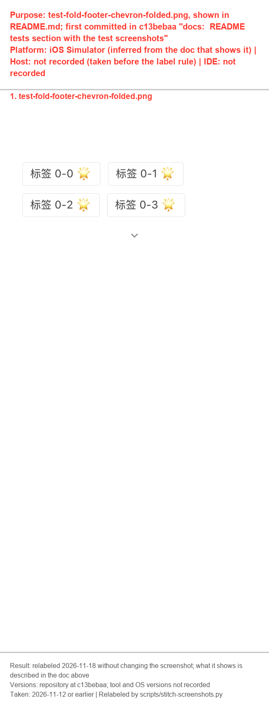 | 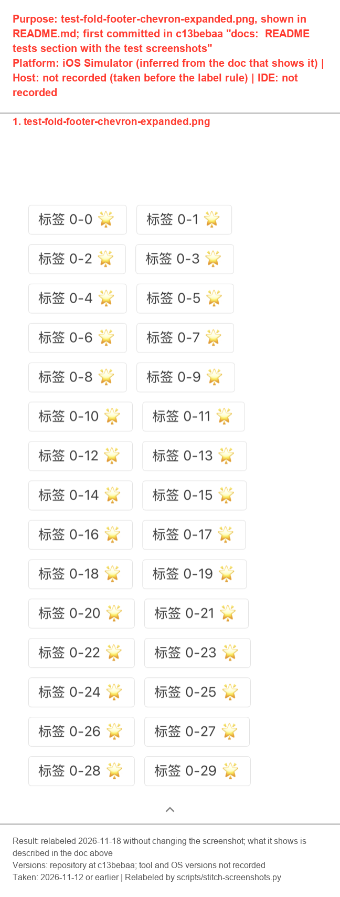 |

| Single selection: replaces the selection in the same section | Multiple selection | Bottom arrow: folded | Bottom arrow: expanded |
| --- | --- | --- | --- |
|  |  |  |  |

| 分组头按钮：各组独立折叠 | 行内折叠：折叠 | 行内折叠：展开 | 网格：每行两个 |
| --- | --- | --- | --- |
| 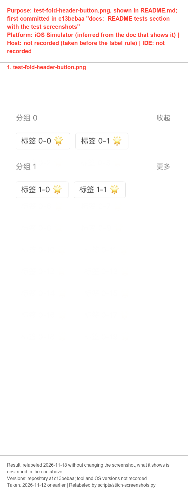 | 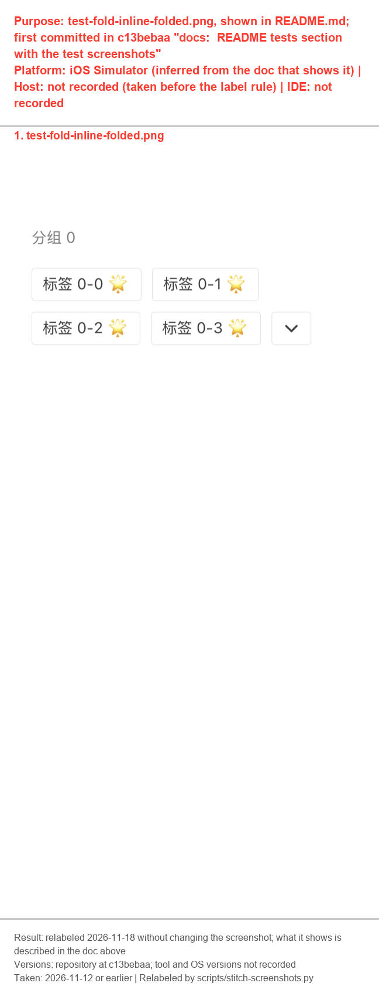 | 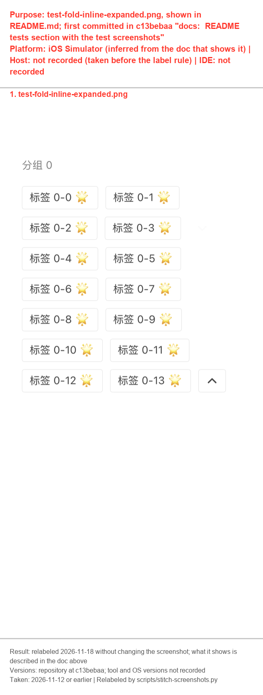 | 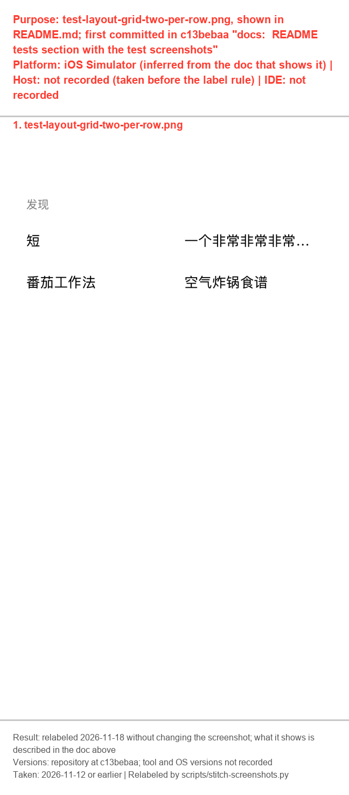 |

| Section header button: each section folds independently | Inline fold: folded | Inline fold: expanded | Grid: two per row |
| --- | --- | --- | --- |
|  |  |  |  |

| 宿主图标与分组头附件 | 240pt 窄屏 | 样式页：胶囊 + 图标颜色 | 动效页 |
| --- | --- | --- | --- |
| 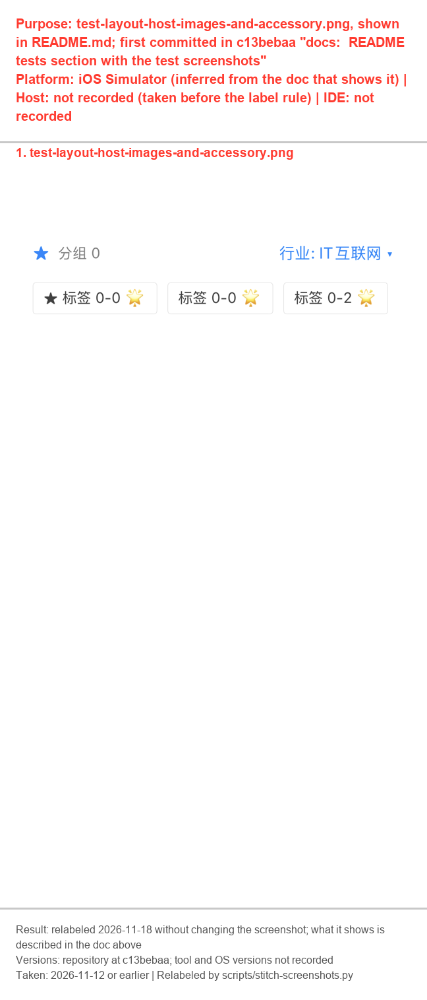 | 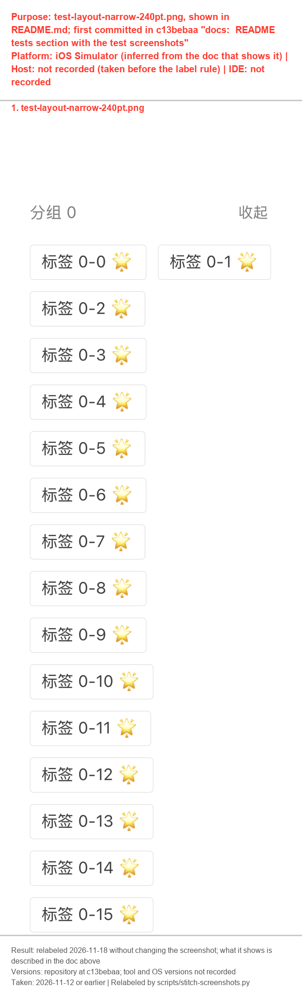 | 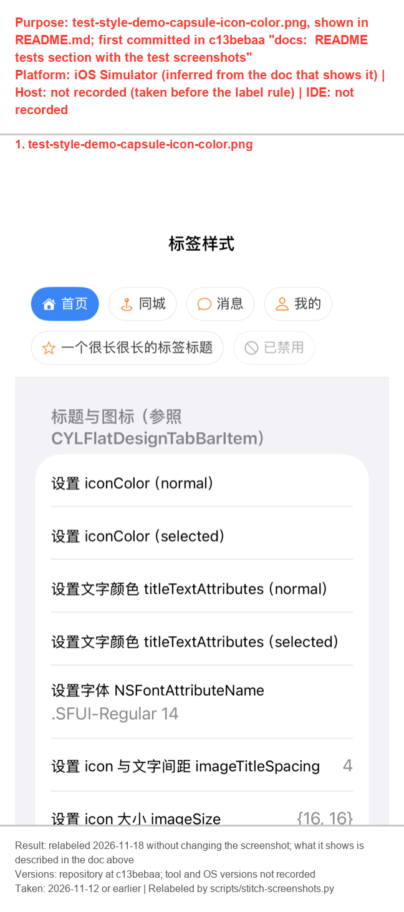 | 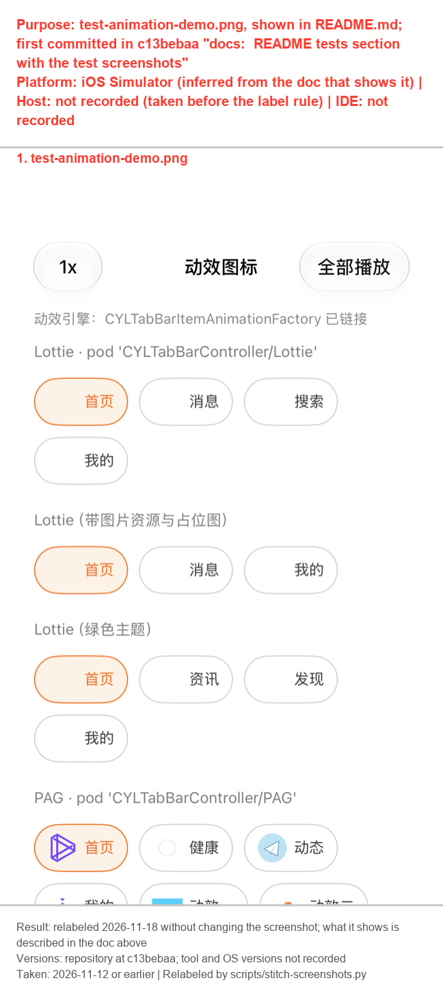 |

| Host icons and section header accessory | 240pt narrow screen | Style page: capsule + icon color | Animation page |
| --- | --- | --- | --- |
|  |  |  |  |

| 动效页：深色分区（icons.riv） | 场景一：商品页预览 | 场景一：筛选折叠 | 场景一：筛选展开 |
| --- | --- | --- | --- |
| 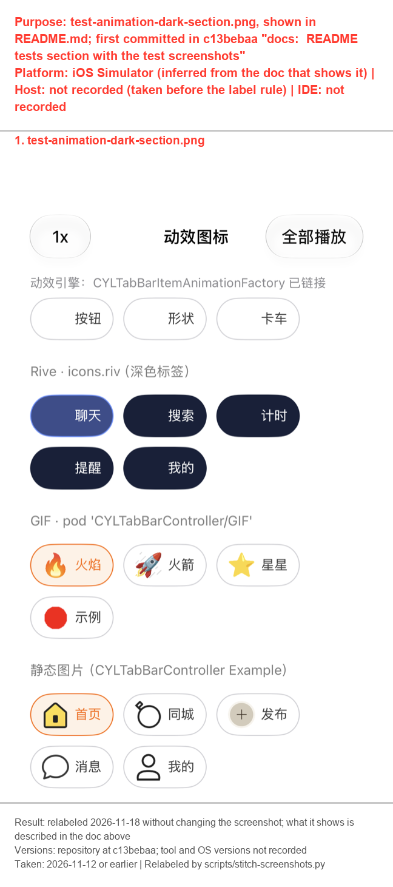 |  |  |  |

| Animation page: dark section (icons.riv) | Scenario 1: product page preview | Scenario 1: filter folded | Scenario 1: filter expanded |
| --- | --- | --- | --- |
|  |  |  |  |

| 场景一：好评 + 有图（内存） | 场景二：找人 | 场景二：职位 | 根 TabBar |
| --- | --- | --- | --- |
|  |  |  |  |

| Scenario 1: positive reviews + with images (in memory) | Scenario 2: People | Scenario 2: Jobs | Root tab bar |
| --- | --- | --- | --- |
|  |  |  |  |

| PlusButton：查询筛选 | 评价筛选 · 数据库 | 菜单选择 · 数据库联动 | 最近搜索 + 发现 |
| --- | --- | --- | --- |
|  |  |  |  |

| PlusButton: query filters | Review filter · database | Menu selection · database linkage | Recent searches + discover |
| --- | --- | --- | --- |
|  |  |  |  |

| 根 TabBar（英文） | 纯 Swift：编辑标签 | 纯 Swift：搜索并新建 | 纯 Swift：管理 |
| --- | --- | --- | --- |
|  |  |  |  |

| English: root tab bar | Swift: edit tags | Swift: search and create | Swift: manage |
| --- | --- | --- | --- |
|  |  |  |  |

| 纯 Swift：编辑备注 | 纯 Swift：折叠样式 |
| --- | --- |
|  |  |

| Swift: edit remark | Swift: fold styles |
| --- | --- |
|  |  |

### 命名迁移 / Naming migration

| 中文 | English |
|:---|:---|
| 类型和方法的重命名（`CYL` 前缀、Swift 命名）与旧的 Objective-C 名称在**源码和运行时都不兼容**；集成新版本时请更新 import、类型引用、自定义的 XIB / storyboard 类。完整的旧名称与新名称对照见 [docs/Swift-Migration.md](docs/Swift-Migration.md)（“Swift API changes”）。iOS 15 弃用的 `titleEdgeInsets`、`imageEdgeInsets` 和 `adjustsImageWhenHighlighted` 不再使用，按钮布局由 `CYLMenuStyle` 的 `imageTitleSpacing` 与 `imagePlacement` 控制。 | The renaming of types and methods (the `CYL` prefix, Swift naming) is **source and runtime incompatible** with the old Objective-C names; when integrating the new version update imports, type references and custom XIB / storyboard classes. The full table of old and new names is in [docs/Swift-Migration.md](docs/Swift-Migration.md) ("Swift API changes"). The `titleEdgeInsets`, `imageEdgeInsets` and `adjustsImageWhenHighlighted` that iOS 15 deprecates are no longer used; the button layout is controlled by `CYLMenuStyle`'s `imageTitleSpacing` and `imagePlacement`. |

### 发布 / Release

```sh
scripts/pod-lint.sh lib
scripts/pod-lint.sh version
scripts/pod-lint.sh bump 0.1.1  # Commit the updated podspec first.
scripts/pod-lint.sh check-tag 0.1.1
# Create and push a matching Git tag, then explicitly:
scripts/pod-lint.sh push
```

| 中文 | English |
|:---|:---|
| push 命令要求 `origin` 上有对应的 tag，并且已登录 CocoaPods trunk 账号。它不会自动运行。`0.1.0` 的 podspec 并不表示 CocoaPods 发布或 Git tag 已经存在。 | The push command requires a matching tag on `origin` and an authenticated CocoaPods trunk account. It is not run automatically. The `0.1.0` podspec does not imply that a CocoaPods release or Git tag already exists. |
| 设计分析与未覆盖场景见 `docs/component-architecture.md`；issue 进度见 `docs/issue-progress.md`。 | For the design analysis and the scenarios not covered, see `docs/component-architecture.md`; for issue progress, see `docs/issue-progress.md`. |
