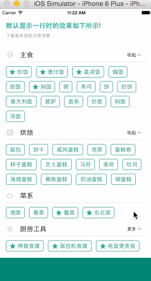

# CollectionViewClassifyMenu


## 功能展示


## 单选可折叠菜单的特性展示

                  
Check out [my weibo](http://weibo.com/luohanchenyilong/) for more info.


然并卵？
请看以下应用场景：

场景一：《手机淘宝App》


筛选条件，如果数目过多，可以折叠，：比如《手机淘宝App》中商品的评价筛选


> 已在 `Example/` 中实现：`CYLProductViewController`（商品页两行预览）和 `CYLReviewListViewController`（可折叠单选评价筛选）。

场景二：《脉脉App》


分类菜单：比如《脉脉App》中的搜索分类筛选


> 已在 `Example/` 中实现：`CYLSearchCategoryViewController`（搜索分类、职位类别侧栏与行业选择）。


## Demo中具有两种样式


第一种是CollectionView做的两级菜单，可以折叠第二级菜单

第二种是侧边栏菜单，具有多选功能。示例应用保存筛选条件；组件本身不读取或持久化业务数据。

以下 NSCoding 用法是旧版本的历史说明；当前示例使用 `NSUserDefaults`，由宿主处理选择结果。旧版本若要关闭持久化，可在 AppDelegate 里清除固化数据。
 
 
清除方法已经在工程中写出:
 
 
```Objective-C
- (void)initFilterSetting:(BOOL)restore
{
    if (!restore) {
        CYLFilterParamsTool *filterParamsTool = [[CYLFilterParamsTool alloc] init];
        [NSKeyedArchiver archiveRootObject:filterParamsTool toFile:filterParamsTool.filename];
    }
}
```

用法如下

YES为保存,NO为不保存.
 
 
```Objective-C
- (BOOL)application:(UIApplication *)application didFinishLaunchingWithOptions:(NSDictionary *)launchOptions {
    //...
    //设NO表示,每次启动程序,清除用户上次的筛选条件,不写该行,默认保存.
    [self initFilterSetting:NO];
    return YES;
}
```


Check out [my twitter](https://twitter.com/stevechen1010) for more info.

## CocoaPods

The component supports iOS 15.0 and later. Until a versioned release is
published, add the current branch to your Podfile:

```ruby
pod 'CollectionViewClassifyMenu', :git => 'https://github.com/ChenYilong/CollectionViewClassifyMenu.git', :branch => 'master'
```

The pod contains the reusable menus, XIBs and images, but **not** demo data.
The existing copyright notices continue to apply.

两个示例分别通过本地 Pod 引用同一个组件：

```sh
pod install
open CollectionViewClassifyMenu.xcworkspace

cd TagCollectionView
pod install
open TagCollectionView.xcworkspace
```

### Interface-oriented usage / 面向接口使用

Implement `CYLMenuDataSource` in the host and retain it for as long as the
menu is in use. The component holds the data source and delegate weakly.
The host provides section and item titles, optional image and exclusive-item
flags, handles selections, and decides whether and how to persist them.

```objc
@import CollectionViewClassifyMenu;

// self implements CYLMenuDataSource and CYLMenuDelegate.
CYLClassifyMenuViewController *menu = [[CYLClassifyMenuViewController alloc] init];
menu.menuDataSource = self;
menu.menuDelegate = self;
menu.defaultVisibleRows = 2;  // Default: 1.
// Present or embed menu as a child view controller.
```

The required data source methods are `numberOfSectionsInMenu`,
`menuNumberOfItemsInSection:`, `menuTitleForSection:` and
`menuTitleForItemAtIndexPath:`. Set an optional `menuHeaderView` before loading
the view. After changing host data, call `reloadMenuData`. The filter
controller uses the same protocols; `selectedIndexPaths` and
`setSelectedIndexPaths:` allow the host to save and restore selections.
`reloadMenuData` resets filter selections to each section's first exclusive
item, if one is supplied.

`CYLTagView` also accepts the same protocols and supports both `[[CYLTagView alloc]
initWithFrame:]` and `+[CYLTagView tagView]`. See the
two demo controllers for complete implementations.

### CYLTagListView：可组合的标签菜单 / Composable tag menu

`CYLTagListView` 是一个可嵌入的标签视图：数据和业务逻辑全部由宿主通过
`CYLMenuDataSource` / `CYLMenuDelegate` 提供，组件只负责布局、折叠和选择状态。
README 中的两个场景（淘宝评价筛选、脉脉搜索分类）已在 `Example/` 中用它实现。

```objc
@import CollectionViewClassifyMenu;

CYLTagListView *filter = [[CYLTagListView alloc] init];
filter.style = style;                                   // CYLMenuStyle
filter.selectionMode = CYLMenuSelectionModeSingle;      // None / Single / Multiple
filter.allowsEmptySelection = NO;                       // 再次点击不会取消最后一项
filter.showsSectionHeaders = NO;                        // 平铺，不显示分组标题
filter.foldStyle = CYLMenuFoldStyleFooterChevron;       // 底部 ∨/∧ 折叠
filter.defaultVisibleRows = 2;                          // 折叠时显示两行
filter.scrollEnabled = NO;                              // 嵌入其他滚动视图
filter.menuDataSource = self;
filter.menuDelegate = self;
[filter reloadMenuData];
filter.selectedIndexPaths = @[[NSIndexPath indexPathForItem:0 inSection:0]];
```

New APIs / 新增接口:

| API | 用途 |
| --- | --- |
| `-menuImageForItemAtIndexPath:` | 标签图标由宿主提供（替代 `menuItemHasImageAtIndexPath:` 与内置图片） |
| `-menuImageForSection:` | 分组标题图标（`CYLClassifyMenuViewController` 不再写死图片） |
| `-menuAccessoryViewForSection:` | 分组标题右侧的自定义视图，如“行业: IT互联网 ▾” |
| `-menuItemIsEnabledAtIndexPath:` | 禁用标签，如“差评(0)” |
| `-menu:shouldSelectItemAtIndexPath:` | 宿主拦截点击 |
| `-menu:didDeselectItemAtIndexPath:` | 取消选中回调 |
| `-menu:didChangeExpanded:inSection:` | 展开/折叠回调 |
| `-menu:didChangeContentHeight:` | 内容高度变化，便于嵌入时调整高度 |
| `CYLMenuStyle` | 字体（支持 Dynamic Type）、颜色、边框、圆角、间距、内边距、高度、折叠文案 |
| `selectionMode`, `allowsEmptySelection` | 无选择 / 单选 / 多选（支持互斥项“全部”） |
| `foldStyle`, `defaultVisibleRows` | 标题“更多”按钮、底部箭头或仅截断预览 |
| `showsSectionHeaders` | 分组或平铺 |
| `selectedIndexPaths`, `-selectItemAtIndexPath:`, `-deselectItemAtIndexPath:`, `-deselectAllItems` | 代码控制选择（不触发回调） |
| `-setExpanded:forSection:animated:`, `-isSectionExpanded:`, `-canFoldSection:` | 代码控制折叠 |
| `contentHeight`, `-heightThatFitsWidth:`, `intrinsicContentSize`, `scrollEnabled` | 嵌入到表头、Stack View 或 Auto Layout |
| `-numberOfRowsInSection:`, `-numberOfVisibleItemsInSection:` | 查询布局结果 |

**Breaking change:** `menuItemHasImageAtIndexPath:` was removed; return the
image from `menuImageForItemAtIndexPath:` instead. Section icons of
`CYLClassifyMenuViewController` now come from `menuImageForSection:`.

### Example / 示例工程

`Example/` 通过 Podfile 以本地路径集成核心库，并引入
[CYLTabBarController](https://github.com/ChenYilong/CYLTabBarController) 搭建两个作用不同的 TabBar：

- 根 TabBar（底部）：「场景一：评价筛选」与「场景二：搜索分类」两个 Tab；
- 分类 TabBar（场景二顶部）：嵌入在搜索页中的 `CYLTopTabBarController`，切换「找人/动态/八卦/职位」，每个 Tab 是一个标签页。


```sh
cd Example
pod install
open CYLMenuExample.xcworkspace
```

| 场景 | 实现 |
| --- | --- |
| 场景一：淘宝评价筛选 | `CYLProductViewController` 在商品页用 `CYLMenuFoldStyleTruncate` 预览两行关键词；`CYLReviewListViewController` 使用单选、带图标和数量、底部箭头折叠的筛选，作为表头随列表滚动，并按所选标签过滤评价。 |
| 场景二：脉脉搜索分类 | `CYLSearchCategoryViewController` 提供搜索框和顶部 CYLTabBarController 分类（找人/动态/八卦/职位）；点击标签填入搜索框；“职位”页左侧为职位类别，右侧为关键词，分组标题右侧为宿主提供的行业选择按钮。 |

`CYLExampleMenuSource` shows how a host turns its own models into a
`CYLMenuDataSource`; the core library holds no business data.

### Naming migration / 命名迁移

This naming change is **source and runtime incompatible** with the old names.
Update imports, type references, custom XIB/storyboard classes, and any
`NSClassFromString` calls when integrating the new version:

| Old name | New name |
| --- | --- |
| `CollectionViewCell` | `CYLCollectionViewCell` |
| `FilterBaseController`, `FilterCollectionCell` | `CYLFilterBaseController`, `CYLFilterCollectionCell` |
| `UICollectionViewLeftAlignedLayout` | `CYLCollectionViewLeftAlignedLayout` |
| `TagView`, `TagGroup`, `TagModel` | `CYLTagView`, `CYLTagGroup`, `CYLTagModel` |
| `HeaderCell`, `TagCell` | `CYLTagHeaderCell`, `CYLTagCell` |
| `FilterControllerDelegate`, `FilterHeaderViewDelegate`, `HeaderCellDelegate` | `CYLFilterControllerDelegate`, `CYLFilterHeaderViewDelegate`, `CYLTagHeaderCellDelegate` |
| `+[TagView TagView]` | `+[CYLTagView tagView]` |
| `filterControllerDidCompleted:` | `filterControllerDidComplete:` |
| `filterHeaderViewMoreBtnClicked:`, `moreBtnClicked:` | `filterHeaderViewDidTapMoreButton:`, `moreButtonTapped:` |
| `headerViewDidClickedNameView:index:` | `headerViewDidTapNameView:index:` |
| `cyl_setBoarderWith:color:` | `cyl_setBorderWidth:color:` |

Category headers use names such as `UIView+CYLGeneral.h`; category methods use
the `cyl_` prefix. `NSArray` and `NSDictionary` no longer override the system
`descriptionWithLocale:` for logging; call `cyl_descriptionWithLocale:`
explicitly when the old custom format is desired.

### Button layout without deprecated insets / 按钮布局

iOS 15 deprecates `titleEdgeInsets`, `imageEdgeInsets` and
`adjustsImageWhenHighlighted`. The component no longer uses them:
`CYLIndexPathButton` offers `cyl_imageTitleSpacing` and
`cyl_titleLeadingInset`, and `CYLRightImageButton` places its image after the
title by overriding the content rects. Image helpers use
`UIGraphicsImageRenderer`. If you set edge insets on these buttons yourself,
use the new properties instead.

### Release / 发布

```sh
scripts/pod-lint.sh lib
scripts/pod-lint.sh version
scripts/pod-lint.sh bump 0.1.1  # Commit the updated podspec first.
scripts/pod-lint.sh check-tag 0.1.1
# Create and push a matching Git tag, then explicitly:
scripts/pod-lint.sh push
```

The push command requires a matching tag on `origin` and an authenticated
CocoaPods trunk account. It is not run automatically. The `0.1.0` podspec
does not imply that a CocoaPods release or Git tag already exists.

设计分析与未覆盖场景见 `docs/component-architecture.md`；issue 进度见
`docs/issue-progress.md`。
