# CollectionViewClassifyMenu


## 功能展示
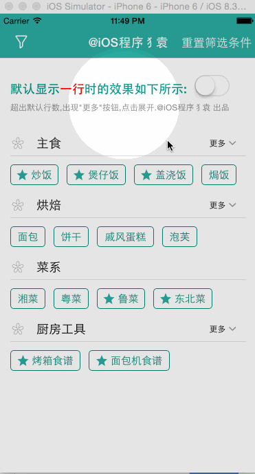

## 单选可折叠菜单的特性展示
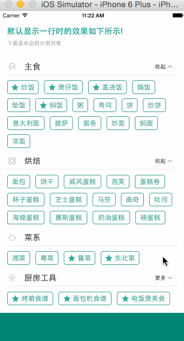
                  
Check out [my weibo](http://weibo.com/luohanchenyilong/) for more info.


然并卵？
请看以下应用场景：

场景一：《手机淘宝App》


筛选条件，如果数目过多，可以折叠，：比如《手机淘宝App》中商品的评价筛选


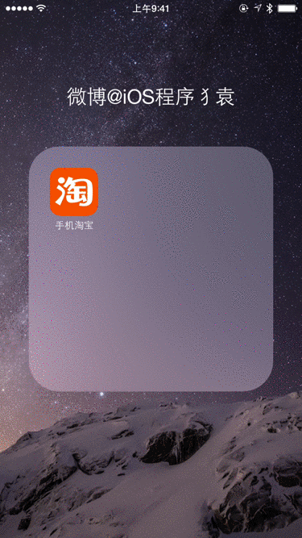

> 已在 `Example/` 中实现：`CYLProductViewController`（商品页两行预览）和 `CYLReviewListViewController`（可折叠单选评价筛选）。

场景二：《脉脉App》


分类菜单：比如《脉脉App》中的搜索分类筛选


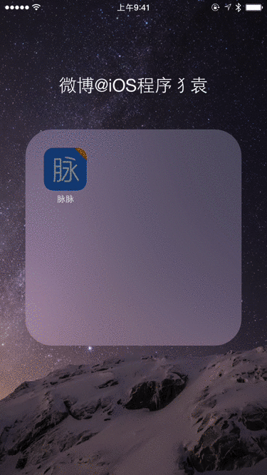

> 已在 `Example/` 中实现：`CYLSearchCategoryViewController`（搜索分类、职位类别侧栏与行业选择）。


## Demo中具有两种样式


第一种是CollectionView做的两级菜单，可以折叠第二级菜单

第二种是侧边栏菜单，具有多选功能。示例应用保存筛选条件；组件本身不读取或持久化业务数据。

以下 NSCoding 用法是旧版本的历史说明；当前示例使用 `NSUserDefaults`，由宿主处理选择结果。旧版本若要关闭持久化，可在 AppDelegate 里清除固化数据。
 
 
清除方法已经在工程中写出:
 
 
```Objective-C
- (void)initFilterSetting:(BOOL)restore
{
    if (!restore) {
        CYLFilterParamsTool *filterParamsTool = [[CYLFilterParamsTool alloc] init];
        [NSKeyedArchiver archiveRootObject:filterParamsTool toFile:filterParamsTool.filename];
    }
}
```

用法如下

YES为保存,NO为不保存.
 
 
```Objective-C
- (BOOL)application:(UIApplication *)application didFinishLaunchingWithOptions:(NSDictionary *)launchOptions {
    //...
    //设NO表示,每次启动程序,清除用户上次的筛选条件,不写该行,默认保存.
    [self initFilterSetting:NO];
    return YES;
}
```


Check out [my twitter](https://twitter.com/stevechen1010) for more info.

## CocoaPods

The component supports iOS 15.0 and later. Until a versioned release is
published, add the current branch to your Podfile:

```ruby
pod 'CollectionViewClassifyMenu', :git => 'https://github.com/ChenYilong/CollectionViewClassifyMenu.git', :branch => 'master'
```

The pod contains the reusable menus, XIBs and images, but **not** demo data.
The existing copyright notices continue to apply.

两个示例分别通过本地 Pod 引用同一个组件：

`.xcworkspace` 与 `Podfile.lock` 由 `pod install` 生成，不提交到仓库（与 CYLTabBarController 的 `.gitignore` 相同）。

```sh
pod install
open CollectionViewClassifyMenu.xcworkspace

cd TagCollectionView
pod install
open TagCollectionView.xcworkspace
```

### Interface-oriented usage / 面向接口使用

Implement `CYLMenuDataSource` in the host and retain it for as long as the
menu is in use. The component holds the data source and delegate weakly.
The host provides section and item titles, optional image and exclusive-item
flags, handles selections, and decides whether and how to persist them.

```objc
@import CollectionViewClassifyMenu;

// self implements CYLMenuDataSource and CYLMenuDelegate.
CYLClassifyMenuViewController *menu = [[CYLClassifyMenuViewController alloc] init];
menu.menuDataSource = self;
menu.menuDelegate = self;
menu.defaultVisibleRows = 2;  // Default: 1.
// Present or embed menu as a child view controller.
```

The required data source methods are `numberOfSectionsInMenu`,
`menuNumberOfItemsInSection:`, `menuTitleForSection:` and
`menuTitleForItemAtIndexPath:`. Set an optional `menuHeaderView` before loading
the view. `menuFooterView` sits below the tags in the same scroll view (for example
the results of the selected tag; call `updateMenuLayout` after its content
changes), and `selectedIndexPath` highlights the selected tag (set it from
`-menu:didSelectItemAtIndexPath:`; taps do not change it). After changing host data, call `reloadMenuData`. The filter
controller uses the same protocols; `selectedIndexPaths` and
`setSelectedIndexPaths:` allow the host to save and restore selections.
`reloadMenuData` resets filter selections to each section's first exclusive
item, if one is supplied.

`CYLTagView` also accepts the same protocols and supports both `[[CYLTagView alloc]
initWithFrame:]` and `+[CYLTagView tagView]`. See the
two demo controllers for complete implementations.

### CYLTagListView：可组合的标签菜单 / Composable tag menu

`CYLTagListView` 是一个可嵌入的标签视图：数据和业务逻辑全部由宿主通过
`CYLMenuDataSource` / `CYLMenuDelegate` 提供，组件只负责布局、折叠和选择状态。
README 中的两个场景（淘宝评价筛选、脉脉搜索分类）已在 `Example/` 中用它实现。

```objc
@import CollectionViewClassifyMenu;

CYLTagListView *filter = [[CYLTagListView alloc] init];
filter.style = style;                                   // CYLMenuStyle
filter.selectionMode = CYLMenuSelectionModeSingle;      // None / Single / Multiple
filter.allowsEmptySelection = NO;                       // 再次点击不会取消最后一项
filter.showsSectionHeaders = NO;                        // 平铺，不显示分组标题
filter.foldStyle = CYLMenuFoldStyleFooterChevron;       // 底部 ∨/∧ 折叠
filter.defaultVisibleRows = 2;                          // 折叠时显示两行
filter.scrollEnabled = NO;                              // 嵌入其他滚动视图
filter.menuDataSource = self;
filter.menuDelegate = self;
[filter reloadMenuData];
filter.selectedIndexPaths = @[[NSIndexPath indexPathForItem:0 inSection:0]];
```

New APIs / 新增接口:

| API | 用途 |
| --- | --- |
| `-menuImageForItemAtIndexPath:` | 标签图标由宿主提供（替代 `menuItemHasImageAtIndexPath:` 与内置图片） |
| `-menuImageForSection:` | 分组标题图标（`CYLClassifyMenuViewController` 不再写死图片） |
| `-menuAccessoryViewForSection:` | 分组标题右侧的自定义视图，如“行业: IT互联网 ▾” |
| `-menuItemIsEnabledAtIndexPath:` | 禁用标签，如“差评(0)” |
| `-menu:shouldSelectItemAtIndexPath:` | 宿主拦截点击 |
| `-menu:didDeselectItemAtIndexPath:` | 取消选中回调 |
| `-menu:didChangeExpanded:inSection:` | 展开/折叠回调 |
| `-menu:didChangeContentHeight:` | 内容高度变化，便于嵌入时调整高度 |
| `-menu:didChangeSelectedItems:` | 每次点击改变选择后回调一次，用于刷新筛选结果 |
| `CYLMenuStyle.foldChevronImage` | 底部折叠箭头图片，展开时旋转 180° |
| `CYLMenuStyle` | 标题字体与颜色、图标颜色（按状态）、图标与文字间距、图标大小、位置偏移、`layoutCentered`、间距、高度、折叠文案；Dynamic Type |
| `CYLTagAppearance` | 每种状态的背景、文字颜色、字体、图标颜色、圆角（0 为胶囊）、边框、margin（参照 `CYLBadgeAppearance`） |
| `CYLTagButton` | 单个标签视图（横向的 `CYLFlatDesignTabBarButton`），也可单独使用 |
| `-menuSelectedImageForItemAtIndexPath:` | 选中态图标 |
| `-menuAnimationURLForItemAtIndexPath:`, `CYLTagButton.animationURL` | Lottie / PAG / Rive / GIF 动效图标（CYLTabBarController 动效引擎） |
| `-initWithConfiguration:`, `+tagListViewWithConfigurationFile:error:`, `+styleWithConfiguration:` | 字典（map）与配置文件初始化 |
| `selectionMode`, `allowsEmptySelection` | 无选择 / 单选 / 多选（支持互斥项“全部”） |
| `foldStyle`, `defaultVisibleRows` | 标题“更多”按钮、底部箭头或仅截断预览 |
| `showsSectionHeaders` | 分组或平铺 |
| `selectedIndexPaths`, `-selectItemAtIndexPath:`, `-deselectItemAtIndexPath:`, `-deselectAllItems` | 代码控制选择（不触发回调） |
| `-setExpanded:forSection:animated:`, `-isSectionExpanded:`, `-canFoldSection:` | 代码控制折叠 |
| `contentHeight`, `-heightThatFitsWidth:`, `intrinsicContentSize`, `scrollEnabled` | 嵌入到表头、Stack View 或 Auto Layout |
| `-numberOfRowsInSection:`, `-numberOfVisibleItemsInSection:` | 查询布局结果 |

#### 折叠控件与标题 / Fold control and title

折叠控件（「更多 ⌄」）与列表标题是**创建时的样式参数**，由核心库统一实现（`CYLMenuFoldControl`、`CYLTagFoldButton`）：

```objc
// 淘宝评价筛选：底部仅箭头，展开后箭头旋转 180°
CYLTagListView *filter = [[CYLTagListView alloc] initWithFoldControl:
    [CYLMenuFoldControl foldControlWithPosition:CYLMenuFoldControlPositionBottom content:CYLMenuFoldControlContentIcon]];
// 原分类菜单：分组标题右上角「更多 ⌄」，列表标题居中
CYLTagListView *menu = [[CYLTagListView alloc] initWithFoldControl:
    [CYLMenuFoldControl foldControlWithPosition:CYLMenuFoldControlPositionTopTrailing content:CYLMenuFoldControlContentIconAndTitle]
                                                              title:@"分类" titlePosition:CYLMenuTitlePositionTopCenter];
```

| 参数 | 取值 |
| --- | --- |
| `CYLMenuFoldControlPosition` | `None`、`Bottom`（分组下方居中，淘宝评价）、`TopTrailing`（分组标题右上角，原分类菜单）、`TopLeading`（分组标题左上角，标题之前） |
| `CYLMenuFoldControlContent` | `IconAndTitle`（「更多 ⌄」）、`Title`（「更多」）、`Icon`（「⌄」）。展开后带图标的样式只保留箭头并旋转 180°，仅文字的样式显示「收起」 |
| `CYLMenuFoldControl` 属性 | `title` / `collapseTitle`（默认本地化的「更多」「收起」）、`image`（默认核心 bundle 中的 `cyl_fold_chevron`）、`color`、`font`、`rotatesImageWhenExpanded` |
| `title`、`titleImage`、`titlePosition`、`titleStyle` | 整个列表上方的标题：`CYLMenuTitlePositionTopLeading`（左上角）或 `TopCenter`（居中）。标题由 `titleView` 绘制，与标签复用同一个视图（`CYLTagButton`，横向布局），可以只显示图标、只显示文字或两者都显示；`titleStyle` 是一个 `CYLMenuStyle`（字体、文字与图标颜色、图标大小与位置……），默认 `+defaultTitleStyle` 为加粗的 headline 字体；`titleView` 的全部公开 API（如动效图标 `animationURL`）都可使用 |

折叠控件是一个无边框的 `CYLTagButton`（与标签相同的视图），图标位于文字之后（`CYLMenuStyle.imagePlacement = CYLTagImagePlacementTrailing`）。
旧的 `foldStyle` 仍可使用，并与 `foldControl` 互相对应（`HeaderButton` 为右上角文字，`FooterChevron` 为底部箭头）。

#### 新建标签 / New tag item

`-menuItemTypeAtIndexPath:` 返回 `CYLMenuItemTypeCreate` 的项目由核心库的 `CYLTagCreateCell`（继承 `CYLTagListCell`）显示：
核心 bundle 中的加号图标 `cyl_tag_plus`、本地化标题「新建标签」或「新建标签：<名称>」（`CYLMenuNewTag`、`CYLMenuNewTagNamed`，简体中文、繁体中文、英文）、
带边框的外观，且不会被选中。数据源返回的标题是要新建的名称（空字符串表示由宿主询问名称），点击时回调
`-menu:didRequestNewItemWithName:atIndexPath:`。

#### 配置文件 / Configuration files

以上参数都可以写在字典或配置文件中（`foldControl`：`position`、`content`、`title`、`collapseTitle`、`image`、`color`、`font`、
`rotatesImageWhenExpanded`；`title`、`titleImage`、`titlePosition`、`titleStyle`；项目的 `type: create`），与 CYLTabBarController 的配置文件初始化方式相同。
JSON 与 plist 直接读取；JSON5、YAML、TOML、INI、.properties、XML、Protocol Buffers 文本等格式在链接 CYLTabBarController 时由其
`CYLTabBarConfigurationParser` 读取，取值再按本项目的规则转换（枚举名、颜色、尺寸等均可写成字符串）。示例见
`Example-Swift/CYLTagEditorExample/CYLTagEditorExample.bundle/<语言>.lproj/fold-styles.{json,plist,yaml,xml}`。

#### 标签外观 / Tag appearance

每个标签由 `CYLTagButton` 绘制：图标与标题的参数完全参照 CYLTabBarController 的
`CYLFlatDesignTabBarItem`，只是把纵向排列改为横向排列；背景、边框、圆角参照 `CYLBadgeView`
（`CYLBadgeAppearance`），每种状态一个 `CYLTagAppearance`。

```objc
CYLMenuStyle *style = [CYLMenuStyle defaultStyle];
// 标题与图标（CYLFlatDesignTabBarItem）
[style setTitleTextAttributes:@{NSFontAttributeName: [UIFont systemFontOfSize:13],
                                NSForegroundColorAttributeName: UIColor.darkGrayColor}
                     forState:UIControlStateNormal];
[style setIconColor:UIColor.systemBlueColor forState:UIControlStateNormal];   // 模板图标的 tintColor
[style setIconColor:UIColor.whiteColor forState:UIControlStateSelected];
style.imageTitleSpacing = 6;                       // 图标与文字间距
style.imageSize = CGSizeMake(16, 16);
style.titlePositionAdjustment = UIOffsetMake(0, 1);
style.layoutCentered = YES;                        // 只有图标或只有标题时居中
// 背景、边框、圆角（CYLBadgeView）
style.normalAppearance.borderColor = UIColor.systemGray4Color;
style.normalAppearance.borderWidth = 1;
style.normalAppearance.cornerRadius = 0;           // 0 = 自动胶囊
style.normalAppearance.margin = 12;
style.selectedAppearance.backgroundColor = UIColor.systemBlueColor;
```

数据源可通过 `-menuSelectedImageForItemAtIndexPath:` 提供选中态图标。

#### 动效图标 / Animated icons

`-menuAnimationURLForItemAtIndexPath:`（或 `CYLTagButton.animationURL`）可以提供 Lottie（.json）、PAG（.pag）、
Rive（.riv）、GIF 动效文件，播放方式与 CYLTabBarController 的 Tab 图标相同：点击选中时播放，选中时停在最后一帧，
取消选中时回到第一帧（减弱动态效果时不播放）。动效视图与播放器来自 CYLTabBarController 的动效引擎
（`CYLTabBarItemAnimationFactory`），组件在运行时查找，不依赖 CYLTabBarController；在 App 的 Podfile 中加入需要的动效库：

```ruby
pod 'CYLTabBarController/Lottie'   # 或 /PAG、/Rive、/GIF
```

未链接动效引擎或文件无法加载时显示静态图标。

动效库读取的选项（例如 Rive 文件的画板与状态机）写在 URL 中，编码方式与 CYLTabBarController 的
`CYLTabBarAnimationURLWithOptions()` 相同：在代码中用 `CYLMenuAnimationURLWithOptions()`，在字典或配置文件中用
`CYLTagItemAnimationOptions`（`"animationOptions"`），或直接写在文件名后（`"icons.riv#artboard=CHAT"`）：

```objc
item.animationURL = CYLMenuAnimationURLWithOptions(iconsURL, @{ @"artboard" : @"CHAT",
                                                                @"stateMachine" : @"CHAT_Interactivity",
                                                                @"input" : @"active" });
```

未选中时动效默认停在第一帧（与 CYLTabBarController 的 Tab 图标相同）；第一帧为空的文件可以停在其他帧：
`-menuAnimationRestingProgressForItemAtIndexPath:`、`CYLTagButton.animationRestingProgress` 或字典中的
`CYLTagItemAnimationRestingProgress`（0...1，例如 `@1` 为最后一帧）。

每个分组可以有自己的外观：`-menuStyleForSection:` 或字典中的 `CYLTagSectionStyle`（覆盖在列表样式之上的
`CYLMenuStyle…` 键），例如白色线条的 Rive 图标（CYLTabBarController 深色 TabBar 用的 `icons.riv`）放在深色标签上。
颜色、字体、边框、图标颜色、图文布局按分组设置；高度、间距与内边距始终使用列表的样式。`-scrollToSection:animated:`
滚动到某个分组。

Lottie 2.x 按名称查找 JSON 引用的图片，因此 Example 把这些图片放在 `Assets.xcassets/LottieImages`
（CYLTabBarController 的 Example 放在 App 根目录）。

Example 的「动效」Tab（`CYLTagAnimationDemoViewController`）使用从 CYLTabBarController（所有分支中最新的提交）
Example 复制的资源：Lottie（含图片资源与占位图、绿色主题）、Rive、GIF 动效文件与 TabBar 图片（`Assets.xcassets/TabBarIcon`），
PAG 文件由 `pod install` 下载（包括 CYLTabBarController Example-PAG 的 Tab 图标 `tab_home`、`tab_health`、`tab_moments`、`tab_me`）；每个分组一种动效库，点击播放，可全部播放与切换速度。`style.animationSize`、`style.animationSpeed` 设置大小与速度。

#### 字典与配置文件初始化 / Map and configuration file

与 CYLTabBarController 的 `-initWithConfiguration:`、`-initWithConfigurationFile:error:` 相同：

```objc
CYLTagListView *tags = [[CYLTagListView alloc] initWithConfiguration:@{
    CYLTagListViewSelectionMode : @"multiple",
    CYLTagListViewFoldStyle : @"footerChevron",
    CYLTagListViewStyle : @{ CYLMenuStyleNormal : @{ CYLTagAppearanceCornerRadius : @0 } },
    CYLTagListViewSections : @[ @{ CYLTagSectionTitle : @"Tabs",
                                   CYLTagSectionItems : @[ @{ CYLTagItemTitle : @"Home",
                                                              CYLTagItemImage : @"system:house",
                                                              CYLTagItemAnimation : @"tab_home.json" } ] } ],
}];
NSError *error = nil;
CYLTagListView *fromFile = [CYLTagListView tagListViewWithConfigurationFile:@"tags.json" error:&error];
```

文件中的值都可以写成字符串（颜色 "#RRGGBB"、图片 "system:star"、内边距 "{t, l, b, r}" 或数组、枚举名称等），
文件名相对于配置文件或 App 资源解析。JSON 与 plist 直接读取；YAML、TOML 等格式在链接 CYLTabBarController 时由其解析器读取。
示例见 `Example/CYLMenuExample/CYLMenuExample.bundle/Configurations/animated-tags.json` 与
`CYLTagConfigurationDemoViewController`。Example 的 PAG 示例文件由 `pod install` 下载（`scripts/fetch-animation-resources.py`，
固定版本并校验 SHA-256，与 CYLTabBarController 相同）。Example 的「样式」Tab
（`CYLTagStyleDemoViewController`）参照 `CYLFlatDesignTabBarDemoViewController`：上方为标签预览，
点击下方列表的每一行即时修改一个参数。

**Breaking changes:** `CYLMenuStyle`'s flat color, border and padding properties (`textColor`, `itemBackgroundColor`, `borderColor`, `cornerRadius`, `itemHorizontalPadding`…) moved to its per-state `CYLTagAppearance` objects, `itemFontForTraitCollection:` became `titleFontForState:traitCollection:`, and a corner radius of 0 now means a capsule. `menuItemHasImageAtIndexPath:` was removed; return the
image from `menuImageForItemAtIndexPath:` instead. Section icons of
`CYLClassifyMenuViewController` now come from `menuImageForSection:`.

### Accessibility / 无障碍

| 设置 | 支持 |
| --- | --- |
| VoiceOver | 标签是带“按钮”特征的元素，选中、禁用状态通过 `selected` / `notEnabled` 朗读；分组标题带 `header` 特征；折叠按钮朗读“<分组> 更多/收起”，展开或收起后焦点保持在折叠按钮上。旧版多选筛选的单元格与 TagView 同样可朗读。 |
| 动态字体 Dynamic Type | 字体随系统字号缩放（上限 2 倍），标签高度随之增加，字号变化后重新测量。 |
| 粗体文本 Bold Text | 标签使用粗体，测量与绘制使用同一字体，不会被截断。 |
| 增强对比度 Increase Contrast | 标签边框改用文字颜色并至少 1pt。 |
| 减弱动态效果 Reduce Motion | 展开与收起不使用动画。 |

| Voice Control / Switch Control / 全键盘控制 | 每个标签、“+ 新建标签”、折叠按钮和列表标题都是带本地化标签的元素，可用名称点击或依次聚焦。 |

`CYLTagListView` 的视图带有固定的 `accessibilityIdentifier`（声明于 `CYLTagListAccessibility.h`），测试与工具无需坐标即可找到它们：

| 视图 | 标识符 | 朗读 |
| --- | --- | --- |
| 列表标题 `titleView` | `CYLTagListTitle` | 标题文字（仅图标时取图标的 `accessibilityLabel`，没有则作为装饰隐藏），`header` |
| 标签 | `CYLTagListItem` | 标签文字，按钮，选中 / 禁用 |
| “+ 新建标签” | `CYLTagCreateItem` | “新建标签” / “新建标签：<名称>”，按钮（从不“已选中”） |
| 折叠按钮 | `CYLTagListFoldControl` | “<分组> 更多/收起”，按钮 |

数据源可实现 `-menuAccessibilityHintForItemAtIndexPath:`（Swift：`menuAccessibilityHintForItem(at:)`）为标签提供朗读提示，如 Swift Example 管理模式下的“轻点两下删除此标签”。

宿主提供的分组右侧视图（如行业选择按钮）应设置自己的 `accessibilityLabel`，Example 中有示例。

### Localization / 国际化与本地化

组件的全部资源只有一个 bundle：`CYLClassifyMenuResources.bundle`，其中包含图片、XIB 以及
`en.lproj`、`zh-Hans.lproj`、`zh-Hant.lproj` 下的 `CYLClassifyMenu.strings`（源文件位于
`CollectionViewClassifyMenu/Resources/Localization/`）。组件自己选择 `.lproj`，宿主 App 无需声明这些语言。

```objc
CYLMenuResources.preferredLanguage = @"en";   // App 内切换语言；nil 跟随系统
NSString *more = CYLMenuLocalizedString(@"CYLMenuExpand", nil);   // "More"
UIImage *plus = CYLMenuImage(@"cyl_tag_plus");                     // 组件 bundle 中的图片
[CYLMenuResources localizedStringForKey:@"CYLMenuCollapse" language:@"zh-Hant"];   // "收合"
```

Swift 无法调用宏，使用同名函数：`CYLMenuLocalizedString("CYLMenuExpand")`。

切换语言后新创建的视图使用新语言。`CYLMenuStyle` 的 `expandTitle` / `collapseTitle` 默认取自该 bundle，
也可由宿主覆盖。新增文案时，在三个 `.strings` 中加入相同的键（测试会检查键一致）。

Example 的界面文案同样只放在一个 bundle：`Example/CYLMenuExample/CYLMenuExample.bundle`，通过 Swift 函数 `CYLExampleLocalizedString` 读取，键为中文原文；
评价关键词与标签属于示例数据，不翻译。启动参数 `-CYLExampleLanguage en` 可切换 Example 与组件的语言。
Swift Example 使用函数 `CYLTagEditorLocalizedString` 读取 `CYLTagEditorExample.bundle`；`CollectionViewClassifyMenu.xcodeproj`
的演示 App 使用 Swift 函数 `CYLDemoLocalizedString` 读取 `CYLClassifyMenuDemo.bundle`。每一层各有自己的查找宏（或函数）与 bundle，
代码中不出现面向用户的中文字面量（含无障碍标签与提示）。

### Example / 示例工程

所有示例（`Example/`、`Example-Swift/`、根目录工程的演示 App、`TagCollectionView` 演示）及其测试均以 Swift 编写；核心库保持 Objective-C，并通过 `NS_SWIFT_NAME` 等标注适配 Swift 命名。

`Example/` 通过 Podfile 以本地路径集成核心库，并引入
[CYLTabBarController](https://github.com/ChenYilong/CYLTabBarController) 搭建两个作用不同的 TabBar：

- 根 TabBar（底部）：「场景一：评价筛选」与「场景二：搜索分类」两个 Tab；
- 分类 TabBar（场景二）：场景二首页点击搜索框 push 进入搜索页（`hidesBottomBarWhenPushed`，隐藏根 TabBar），搜索页内嵌的 CYLTabBarController 同样位于底部，切换「找人/动态/八卦/职位」，每个 Tab 是一个标签页。

- 根 TabBar 中间的 PlusButton（`CYLExamplePlusButton`，CYLTabBarController 的 `CYLPlusButton`）：点击后进入
  `plusChildViewController`（`CYLQueryScenariosViewController`），按场景分组展示筛选演示。PlusButton 只注册在根 TabBar 的
  context（`CYLExampleRootTabBarContext`）上，场景二内嵌的分类 TabBar 没有 PlusButton。

TabBar 总是位于底部；从 Tab 中 push 的页面隐藏根 TabBar。


```sh
cd Example
pod install
open CYLMenuExample.xcworkspace
```

| 场景 | 实现 |
| --- | --- |
| 场景一：淘宝评价筛选 | `CYLProductViewController` 在商品页用 `CYLMenuFoldStyleTruncate` 预览两行关键词；`CYLReviewListViewController` 使用多选、带图标和数量的筛选，默认折叠为两行，底部箭头旋转 180° 展开/收起。每次点击（显示点击事件）都按所有所选条件（AND，「全部」表示不限）刷新下方列表。顶部开关区分两种场景：**内存筛选**（`CYLMemoryReviewQuery`，在已加载的数据中同步匹配）与**网络筛选**（`CYLNetworkReviewQuery`，把条件编码为请求 URL，模拟服务器延迟返回，显示加载状态并丢弃过期响应）。 |
| 场景二：脉脉搜索分类 | `CYLSearchHomeViewController` push `CYLSearchCategoryViewController`，提供搜索框和底部 CYLTabBarController 分类（找人/动态/八卦/职位）；点击标签填入搜索框；“职位”页左侧为职位类别，右侧为关键词，分组标题右侧为宿主提供的行业选择按钮。 |

| 查询筛选（PlusButton）· 查询参数设置 | 淘宝评价默认显示全部；条件太多时由用户多选输入筛选条件，这正是标签列表（TagCollectionView）的用途。场景一的评价筛选增加第三种方式**数据库筛选**（`CYLDatabaseReviewQuery`）：所选条件生成一条 SQL（评分、有图、追加为 `reviews` 表的列，关键词为 `review_keywords` 表的行，全部 AND），在 SQLite 中查询，状态栏显示 SQL 与匹配数量。 |
| 查询筛选（PlusButton）· 菜单选择 | 移植原 Demo（`CollectionViewClassifyMenu.xcodeproj`）的分类菜单与多选筛选：`CYLMenuLinkageViewController` 继承核心库的 `CYLClassifyMenuViewController`，左上角按钮打开核心库的 `CYLMultipleFilterController`，数据源直接复用原 Demo 的 `CYLDemoDataSource`、`CYLDBManager` 与 `data.json`（工程引用原文件，不复制）。原 Demo 只实现了筛选界面，没有筛选数据；现在点击分类标签（单选，高亮）或确认多选筛选（地区、菜品）都会生成 SQL，在 `places` 表中查询，并在标签下方（`menuFooterView`）显示条件、SQL 与结果；选择保存在数据库的 `selections` 表中，再次进入时恢复。 |

数据库是 `CYLExampleDatabase`（iOS SDK 自带的 libsqlite3，文件在 Caches 目录）：每次启动由 App 内的数据重新生成
`reviews`、`review_keywords`、`places` 表，`selections` 表保留各演示最后确认的条件。所有值都通过 `?` 绑定，界面上显示的
SQL 只用于展示。

`CYLExampleMenuSource` shows how a host turns its own models into a
`CYLMenuDataSource`; the core library holds no business data.

截图来自 CI（`Example screenshots`，提交 `ff35b27`，iPhone 模拟器）：

| 场景一：商品页预览 | 场景一：评价筛选（展开） | 场景二：搜索首页 | 场景二：职位分类 |
| --- | --- | --- | --- |
| 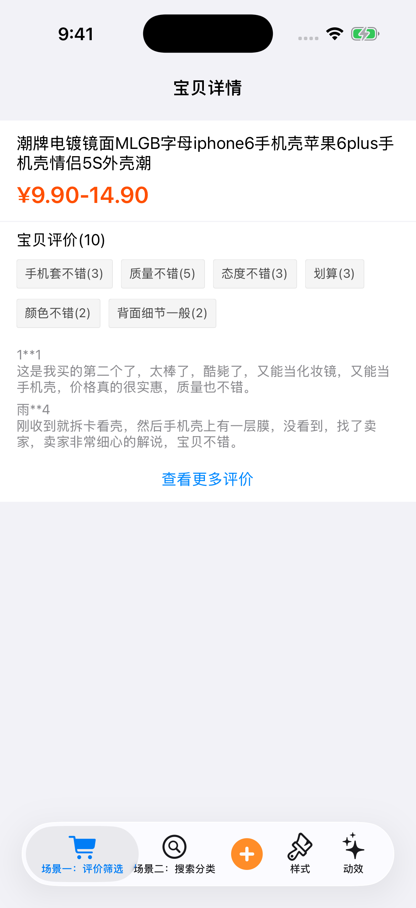 | 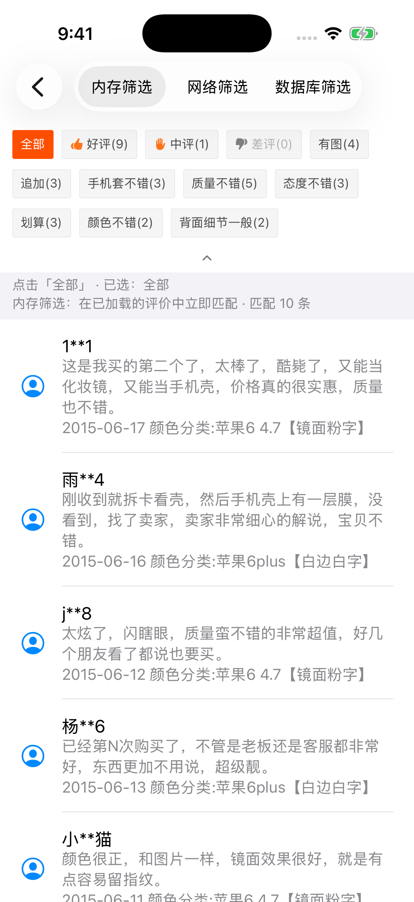 | 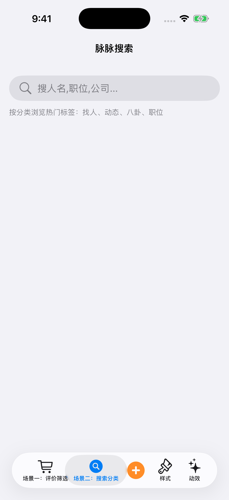 |  |

| 查询筛选（PlusButton） | 评价筛选 · 数据库 | 菜单选择 · 数据库联动 | 配置初始化 |
| --- | --- | --- | --- |
| 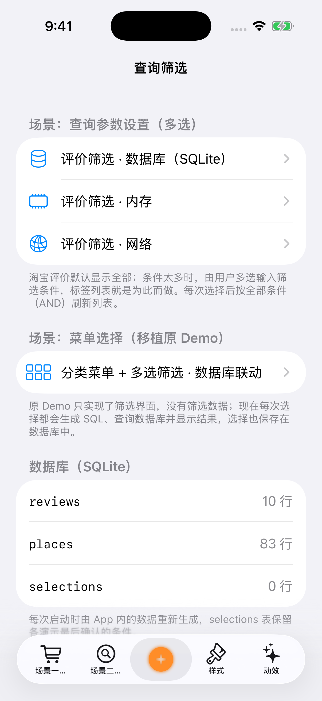 | 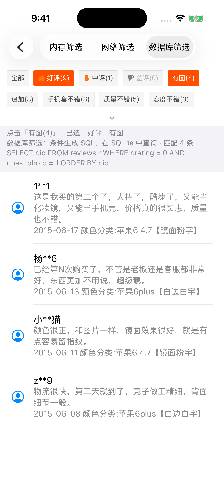 |  | 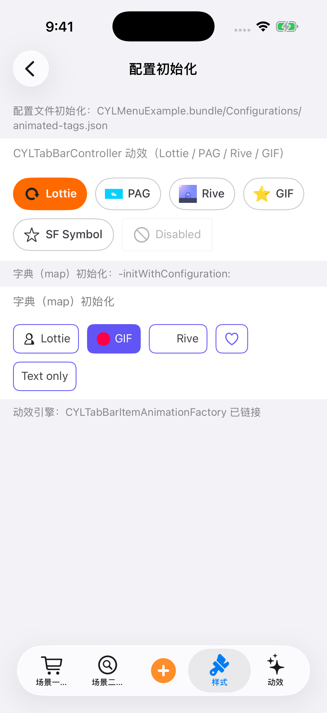 |

| 标签样式 | Tag styles (English) | 动效图标 |
| --- | --- | --- |
| 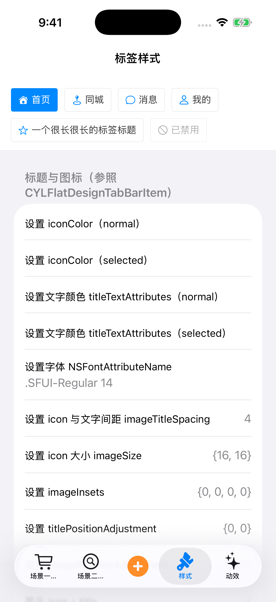 | 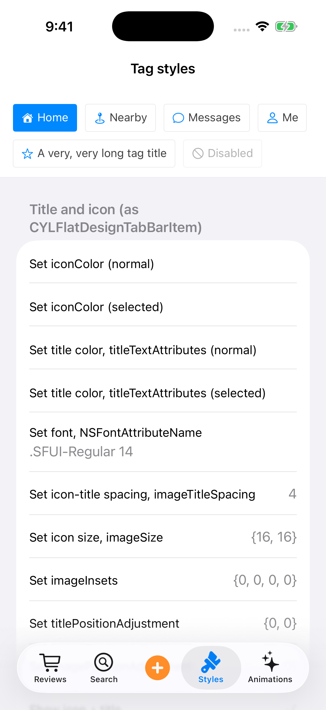 | 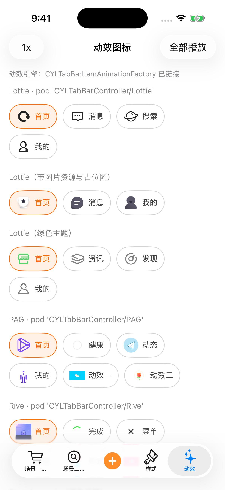 |

### Swift Example / 纯 Swift 示例：新建标签

`Example-Swift/`（`CYLTagEditorExample`）是纯 Swift 编写的示例，同样通过 Podfile 以本地路径集成核心库
（`pod 'CollectionViewClassifyMenu', :path => '..'`），修改核心代码后直接生效。它演示聊天 App 联系人「编辑备注 → 编辑标签」中
**新建标签**的场景：

| 页面 | 实现 |
| --- | --- |
| 编辑备注（`CYLRemarkViewController`） | 「标签」行显示已选标签（只读的 `CYLTagListView`），点击后以 sheet 弹出编辑标签。 |
| 编辑标签（`CYLTagEditorViewController`） | 顶部「取消 / 编辑标签 / 完成」，「完成」有选择或改动时为绿色，搜索时不可用；搜索框；「最近使用」与「我的标签」（分组标题右侧为「管理」，`-menuAccessoryViewForSection:`）。选中的标签为绿色，同一标签在两个分组中同时选中。最后一个标签后是「+ 新建标签」，输入名称后新建并选中。 |
| 搜索 | 输入文字（不区分大小写，如 "ios" 找到 "iOS"）显示「搜索结果」，该名称的标签不存在时末尾为「+ 新建标签：ios」；点击或按键盘搜索键即新建、选中，结束搜索并滚动到新标签。 |
| 管理 | 「管理」后点击「我的标签」中的标签可删除。 |

演示数据来自本地 JSON：`CYLTagEditorExample.bundle/<语言>.lproj/tags.json`（简体中文、繁体中文、英文各一份，标签相同、顺序相同），
由 `CYLTagData`（`Codable`）解析，按 App 当前语言加载。内容是有意义的联系人标签（家人、大学同学、客户、iOS 开发、读书会、深圳、待回复……），
以及「最近使用」和编辑备注页初始选中的标签；修改文件即可替换数据。

第二个 Tab「折叠样式」（`CYLFoldStylesViewController`）用初始化参数创建各种折叠控件与标题样式（底部仅箭头、底部文字 + 箭头、底部仅文字、
右上角文字 + 箭头（原分类菜单）、右上角仅箭头、左上角文字 + 箭头、标题居中），以及不同的标题样式（图标 + 文字、仅图标、仅文字居中、
绿色标题、图标在文字之后），每个演示都使用封装好的 title 属性；再分别从 JSON、plist、YAML、XML 配置文件创建；
根 TabBar 为 CYLTabBarController（底部）。

为此核心库新增：`-menuItemIsSelectableAtIndexPath:`（「+ 新建标签」这样的操作项：点击会回调，但不会被选中）、
`-menuStyleForItemAtIndexPath:`（单个标签的外观，如带边框的「+ 新建标签」）与 `-scrollToItemAtIndexPath:animated:`。

```sh
cd Example-Swift
pod install
open CYLTagEditorExample.xcworkspace
```

CI 中 `Unit tests (swift)` 运行其测试，`Example screenshots` 同时生成其截图（`swift-<页面>.png`）。

| 编辑备注 | 编辑标签 | 搜索并新建标签 | 折叠样式 | 配置文件创建 |
| --- | --- | --- | --- | --- |
| 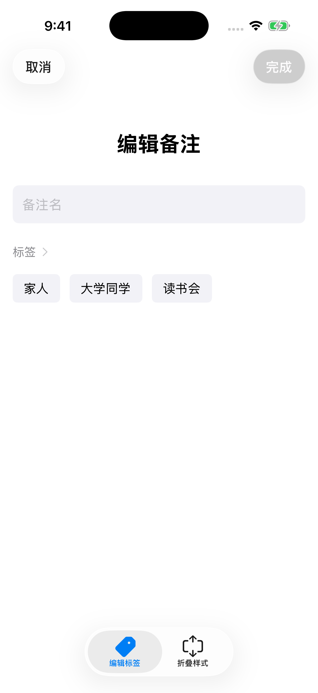 |  | 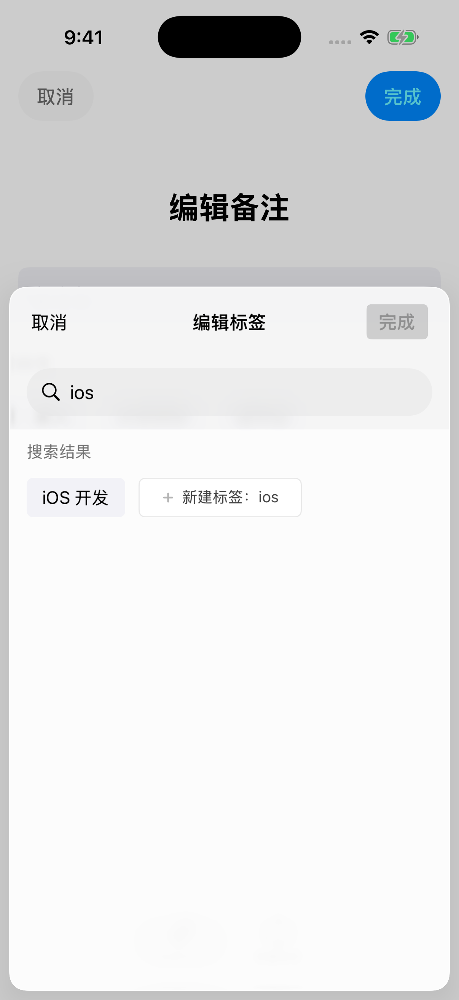 | 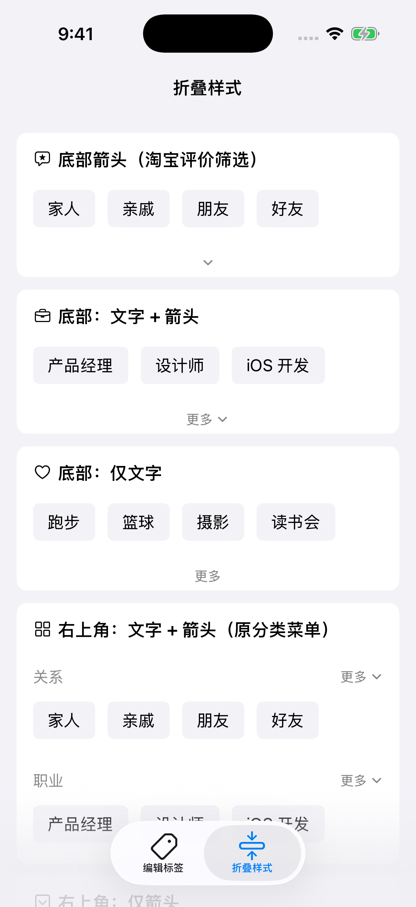 |  |

### Naming migration / 命名迁移

This naming change is **source and runtime incompatible** with the old names.
Update imports, type references, custom XIB/storyboard classes, and any
`NSClassFromString` calls when integrating the new version:

| Old name | New name |
| --- | --- |
| `CollectionViewCell` | `CYLCollectionViewCell` |
| `FilterBaseController`, `FilterCollectionCell` | `CYLFilterBaseController`, `CYLFilterCollectionCell` |
| `UICollectionViewLeftAlignedLayout` | `CYLCollectionViewLeftAlignedLayout` |
| `TagView`, `TagGroup`, `TagModel` | `CYLTagView`, `CYLTagGroup`, `CYLTagModel` |
| `HeaderCell`, `TagCell` | `CYLTagHeaderCell`, `CYLTagCell` |
| `FilterControllerDelegate`, `FilterHeaderViewDelegate`, `HeaderCellDelegate` | `CYLFilterControllerDelegate`, `CYLFilterHeaderViewDelegate`, `CYLTagHeaderCellDelegate` |
| `+[TagView TagView]` | `+[CYLTagView tagView]` |
| `filterControllerDidCompleted:` | `filterControllerDidComplete:` |
| `filterHeaderViewMoreBtnClicked:`, `moreBtnClicked:` | `filterHeaderViewDidTapMoreButton:`, `moreButtonTapped:` |
| `headerViewDidClickedNameView:index:` | `headerViewDidTapNameView:index:` |
| `cyl_setBoarderWith:color:` | `cyl_setBorderWidth:color:` |

Category headers use names such as `UIView+CYLGeneral.h`; category methods use
the `cyl_` prefix. `NSArray` and `NSDictionary` no longer override the system
`descriptionWithLocale:` for logging; call `cyl_descriptionWithLocale:`
explicitly when the old custom format is desired.

### Button layout without deprecated insets / 按钮布局

iOS 15 deprecates `titleEdgeInsets`, `imageEdgeInsets` and
`adjustsImageWhenHighlighted`. The component no longer uses them:
`CYLIndexPathButton` offers `cyl_imageTitleSpacing` and
`cyl_titleLeadingInset`, and `CYLRightImageButton` places its image after the
title by overriding the content rects. Image helpers use
`UIGraphicsImageRenderer`. If you set edge insets on these buttons yourself,
use the new properties instead.

### Release / 发布

```sh
scripts/pod-lint.sh lib
scripts/pod-lint.sh version
scripts/pod-lint.sh bump 0.1.1  # Commit the updated podspec first.
scripts/pod-lint.sh check-tag 0.1.1
# Create and push a matching Git tag, then explicitly:
scripts/pod-lint.sh push
```

The push command requires a matching tag on `origin` and an authenticated
CocoaPods trunk account. It is not run automatically. The `0.1.0` podspec
does not imply that a CocoaPods release or Git tag already exists.

设计分析与未覆盖场景见 `docs/component-architecture.md`；issue 进度见
`docs/issue-progress.md`。
