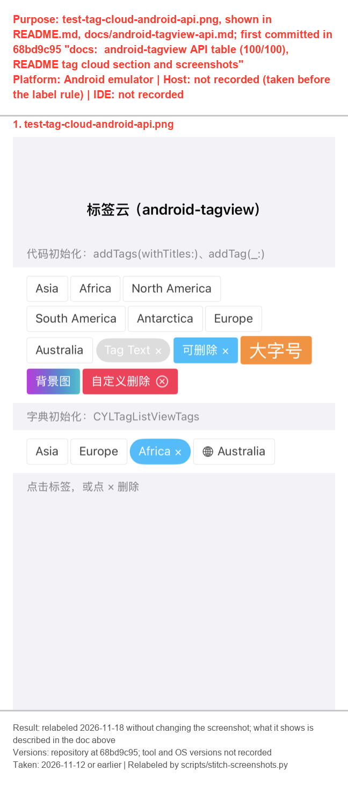
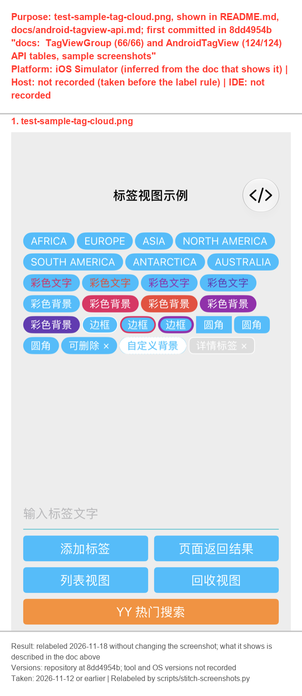
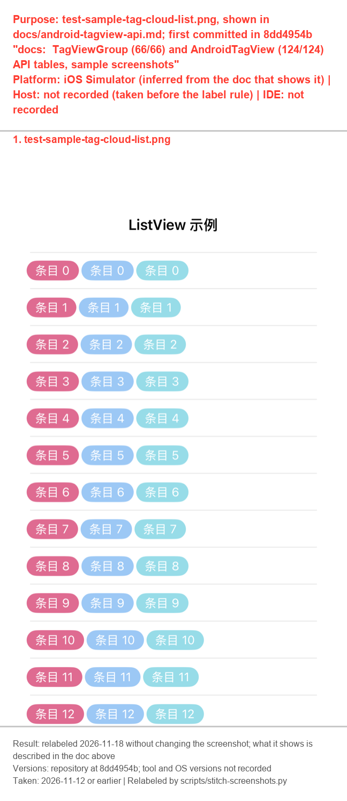
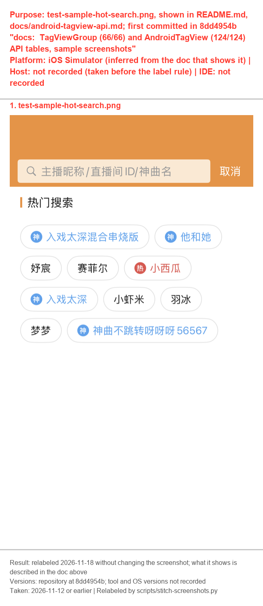

# android-tagview API 对照 / android-tagview API comparison

| 中文 | English |
|:---|:---|
| [kaedea/android-tagview](https://github.com/kaedea/android-tagview)（Android-Cloud-TagView-Plus）是一个 Android 标签云：一个 `TagView`、一个 `Tag` 模型和两个监听器。本页把它的每个公开 API（库源码 `me.kaede.tagview`、XML 属性和 README）对应到 CollectionViewClassifyMenu。`Constants`、`ResolutionUtil` 和 `LogUtil` 是包私有的，因此不属于公开 API。 | [kaedea/android-tagview](https://github.com/kaedea/android-tagview) (Android-Cloud-TagView-Plus) is an Android tag cloud: one `TagView`, one `Tag` model, and two listeners. This page maps every public API of it (library sources `me.kaede.tagview`, the XML attributes and the README) to CollectionViewClassifyMenu. `Constants`, `ResolutionUtil` and `LogUtil` are package-private, so they are not public API. |
| 本页逐项对照 android-tagview 的全部公开 API（`TagView`、`Tag`、两个监听接口、XML 属性），第二列是本项目的对应 API。 Swift 名称写在前面，Objective-C 名称在括号中。 | This page compares every public API of android-tagview (`TagView`, `Tag`, the two listener interfaces, the XML attributes) one by one; the second column is this project's counterpart API. Swift names come first, Objective-C names in brackets. |

## 评分 / Score

| 中文 | English |
|:---|:---|
| 评分 = 已对应的 API 数 ÷ android-tagview 公开 API 数 × 100。完全对应计 1，部分对应计 0.5。 | Score = matched APIs ÷ android-tagview public APIs × 100. A full match counts 1, a partial one 0.5. |

| 版本 | 已对应 | 评分 |
| --- | --- | --- |
| 之前（`654f2cf`） | 17.5 / 47：列表已存在，但没有标签模型、没有添加或移除方法、没有可删除标签、没有按下颜色、没有背景图片、没有分边内边距、没有删除监听器 | 37 |
| [71930fe](https://github.com/ChenYilong/CollectionViewClassifyMenu/commit/71930fe)（功能），[abca838](https://github.com/ChenYilong/CollectionViewClassifyMenu/commit/abca838)（核心库测试的场景修复） | 47 / 47；本地验证：example 61、swift 19、menu 17、tag 6 个测试通过（macOS 27.3，Xcode 27.2，iPhone 17 Pro iOS 26.1） | **100** |

| Version | Matched | Score |
| --- | --- | --- |
| Before (`654f2cf`) | 17.5 / 47: the list existed, but no tag model, no add or remove methods, no deletable tags, no pressed color, no background image, no per-side padding, no delete listener | 37 |
| [71930fe](https://github.com/ChenYilong/CollectionViewClassifyMenu/commit/71930fe) (feature), [abca838](https://github.com/ChenYilong/CollectionViewClassifyMenu/commit/abca838) (scene fix for the core tests) | 47 / 47; verified locally: example 61, swift 19, menu 17, tag 6 tests pass (macOS 27.3, Xcode 27.2, iPhone 17 Pro iOS 26.1) | **100** |

| 中文 | English |
|:---|:---|
| 由 `Example/CYLMenuExampleTests/CYLTagCloudTests.swift`（8 个测试）和标签云示例（`CYLTagCloudDemoViewController`，“样式”标签页 → “标签云”）验证。 | Verified by `Example/CYLMenuExampleTests/CYLTagCloudTests.swift` (8 tests) and the Tag cloud demo (`CYLTagCloudDemoViewController`, Styles tab → Tag cloud). |



## 示例复刻 / Sample port

| 中文 | English |
|:---|:---|
| android-tagview 的完整示例已移植到 Swift：“样式”标签页 → “android-tagview 示例”（`CYLTagCloudSample.swift`）：MainActivity（“TagView Sample”，其 `onCreate` 中的每个标签，INPUT TAG TEXT + ADD A TAG，Activity Result，GitHub）、SubActivity、ListViewActivity（51 行）、RecyclerViewActivity（21 行和一个页脚），以及其 README 中的 YY 热门搜索页面（橙色的 `CYLSearchBarView`，带“取消”，“热门搜索”及一个条形，“神 / 热”角标）。核心库绘制所有内容（`CYLMenuStyle.tagCloud()`、`CYLTag.badgeText`、`headerIndicatorColor`）；这些页面只传入数据和样式值并处理点击。由 `CYLAndroidSampleTests` 验证。 | android-tagview's whole sample is ported to Swift: Styles tab → android-tagview sample (`CYLTagCloudSample.swift`): MainActivity ("TagView Sample", every tag of its `onCreate`, INPUT TAG TEXT + ADD A TAG, Activity Result, GitHub), SubActivity, ListViewActivity (51 rows), RecyclerViewActivity (21 rows and a footer), and the YY hot search screen of its README (orange `CYLSearchBarView` with Cancel, Hot searches with a bar, Divine / Hot badges). The core draws all of it (`CYLMenuStyle.tagCloud()`, `CYLTag.badgeText`, `headerIndicatorColor`); the screens only pass data and style values and handle taps. Verified by `CYLAndroidSampleTests`. |

| 状态 | 截图 |
| --- | :---: |
| MainActivity：TagView 示例 |  |
| ListViewActivity 列表页 |  |
| YY 热门搜索（README 第二张截图） |  |

| State | Screenshot |
| --- | :---: |
| MainActivity：TagView Sample |  |
| ListViewActivity |  |
| YY hot search (the README's second screenshot) |  |

## TagView 视图 / TagView

| android-tagview 的 API | CollectionViewClassifyMenu 的对应 API |
| --- | --- |
| `new TagView(Context)` | `CYLTagListView()` (`-init`, `-initWithFrame:`) |
| `new TagView(Context, AttributeSet)`（XML 布局） | Interface Builder：`init(coder:)`，配合下面的 `IBInspectable` 属性 |
| `new TagView(Context, AttributeSet, int defStyle)` | `init(configuration:)`，通过 `CYLTagListKey.style` 设置样式 |
| `new TagView(Context, AttributeSet, int defStyle, int defStyleRes)` | `init(configurationFile:)`：支持 JSON、plist、YAML…… |
| XML 属性 `app:lineMargin` | IB `lineSpacing`；键 `CYLMenuStyleLineSpacing` |
| XML 属性 `app:tagMargin` | IB `interitemSpacing`；键 `CYLMenuStyleInteritemSpacing` |
| XML 属性 `app:textPaddingLeft` | IB `tagContentInsetLeft`；键 `CYLMenuStyleTagContentInsets` |
| XML 属性 `app:textPaddingRight` | IB `tagContentInsetRight` |
| XML 属性 `app:textPaddingTop` | IB `tagContentInsetTop` |
| XML 属性 `app:textPaddingBottom` | IB `tagContentInsetBottom` |
| `addTag(Tag)` | `addTag(_:)` |
| `addTags(String[])` | `addTags(withTitles:)` |
| `addTags(List<Tag>)` | `addTags(_:)`；键 `CYLTagListKey.tags` |
| `getTags()` | `tags` |
| `remove(int position)` | `removeTag(at:)` |
| `removeAllTags()` | `removeAllTags()` |
| `getLineMargin()` / `setLineMargin(float)` | `lineSpacing`（也可用 `style.lineSpacing`） |
| `getTagMargin()` / `setTagMargin(float)` | `interitemSpacing`（也可用 `style.interitemSpacing`） |
| `getTextPaddingLeft()` / `setTextPaddingLeft(float)` | `tagContentInsetLeft`, `tagContentInsets.left` |
| `getTextPaddingRight()` / `setTextPaddingRight(float)` | `tagContentInsetRight`, `tagContentInsets.right` |
| `getTextPaddingTop()` / `setTextPaddingTop(float)` | `tagContentInsetTop`, `tagContentInsets.top` |
| `getTexPaddingBottom()` / `setTexPaddingBottom(float)` | `tagContentInsetBottom`, `tagContentInsets.bottom` |
| `setOnTagClickListener(OnTagClickListener)` | `tagClickHandler`; `menuDelegate` → `menu(_:didSelectItemAt:)` |
| `setOnTagDeleteListener(OnTagDeleteListener)` | `tagDeleteHandler`; `menuDelegate` → `menu(_:didDeleteItemAt:)` |
| `TagView.TAG`（日志标签 `"TagView"`） | `NSStringFromClass(CYLTagListView.self)` |

| android-tagview | CollectionViewClassifyMenu |
| --- | --- |
| `new TagView(Context)` | `CYLTagListView()` (`-init`, `-initWithFrame:`) |
| `new TagView(Context, AttributeSet)` (XML layout) | Interface Builder: `init(coder:)` with the `IBInspectable` properties below |
| `new TagView(Context, AttributeSet, int defStyle)` | `init(configuration:)`, a style through `CYLTagListKey.style` |
| `new TagView(Context, AttributeSet, int defStyle, int defStyleRes)` | `init(configurationFile:)`: JSON, plist, YAML… |
| XML `app:lineMargin` | IB `lineSpacing`; key `CYLMenuStyleLineSpacing` |
| XML `app:tagMargin` | IB `interitemSpacing`; key `CYLMenuStyleInteritemSpacing` |
| XML `app:textPaddingLeft` | IB `tagContentInsetLeft`; key `CYLMenuStyleTagContentInsets` |
| XML `app:textPaddingRight` | IB `tagContentInsetRight` |
| XML `app:textPaddingTop` | IB `tagContentInsetTop` |
| XML `app:textPaddingBottom` | IB `tagContentInsetBottom` |
| `addTag(Tag)` | `addTag(_:)` |
| `addTags(String[])` | `addTags(withTitles:)` |
| `addTags(List<Tag>)` | `addTags(_:)`; key `CYLTagListKey.tags` |
| `getTags()` | `tags` |
| `remove(int position)` | `removeTag(at:)` |
| `removeAllTags()` | `removeAllTags()` |
| `getLineMargin()` / `setLineMargin(float)` | `lineSpacing` (also `style.lineSpacing`) |
| `getTagMargin()` / `setTagMargin(float)` | `interitemSpacing` (also `style.interitemSpacing`) |
| `getTextPaddingLeft()` / `setTextPaddingLeft(float)` | `tagContentInsetLeft`, `tagContentInsets.left` |
| `getTextPaddingRight()` / `setTextPaddingRight(float)` | `tagContentInsetRight`, `tagContentInsets.right` |
| `getTextPaddingTop()` / `setTextPaddingTop(float)` | `tagContentInsetTop`, `tagContentInsets.top` |
| `getTexPaddingBottom()` / `setTexPaddingBottom(float)` | `tagContentInsetBottom`, `tagContentInsets.bottom` |
| `setOnTagClickListener(OnTagClickListener)` | `tagClickHandler`; `menuDelegate` → `menu(_:didSelectItemAt:)` |
| `setOnTagDeleteListener(OnTagDeleteListener)` | `tagDeleteHandler`; `menuDelegate` → `menu(_:didDeleteItemAt:)` |
| `TagView.TAG` (log tag `"TagView"`) | `NSStringFromClass(CYLTagListView.self)` |

## 监听接口 / Listeners

| android-tagview 的 API | CollectionViewClassifyMenu 的对应 API |
| --- | --- |
| `OnTagClickListener.onTagClick(int position, Tag tag)` | `tagClickHandler: (Int, CYLTag) -> Void` |
| `OnTagDeleteListener.onTagDeleted(int position, Tag tag)` | `tagDeleteHandler: (Int, CYLTag) -> Void` |

| android-tagview | CollectionViewClassifyMenu |
| --- | --- |
| `OnTagClickListener.onTagClick(int position, Tag tag)` | `tagClickHandler: (Int, CYLTag) -> Void` |
| `OnTagDeleteListener.onTagDeleted(int position, Tag tag)` | `tagDeleteHandler: (Int, CYLTag) -> Void` |

## Tag 模型 / Tag

| android-tagview 的 API | CollectionViewClassifyMenu 的对应项（`CYLTag`） |
| --- | --- |
| `new Tag(String text)` | `CYLTag(title:)` |
| `new Tag(String text, int color)` | `CYLTag(title:backgroundColor:)` |
| `new Tag(String text, String color)` | `CYLTag(title:backgroundColorHex:)`，颜色写法如“#RRGGBB”、“#RRGGBBAA”、“systemBlue” |
| `new Tag(int id, String text)` | `CYLTag(identifier:title:)` |
| `new Tag(int id, String text, int color)` | `CYLTag(identifier:title:backgroundColor:)` |
| `new Tag(int id, String text, String color)` | `CYLTag(identifier:title:backgroundColorHex:)` |
| `id` | `identifier`；键 `CYLTagItemKey.identifier` |
| `text` | `title` |
| `tagTextColor` | `textColor` |
| `tagTextSize` | `textSize`（或 `font`）；文字越大，标签越高 |
| `layoutColor` | `backgroundColor` |
| `layoutColorPress` | `highlightedBackgroundColor`; `CYLMenuStyle.highlightedBackgroundColor` |
| `isDeletable` | `isDeletable`；数据源 `menuItemIsDeletable(at:)`；键 `CYLTagItemKey.deletable` |
| `deleteIndicatorColor` | `deleteIndicatorColor`; `CYLMenuStyle.deleteIndicatorColor` |
| `deleteIndicatorSize` | `deleteIndicatorSize`; `CYLMenuStyle.deleteIndicatorFont` |
| `radius` | `cornerRadius`（0 为直角，1000 为胶囊形） |
| `deleteIcon` | `deleteIndicatorTitle`（默认“×”）；`CYLMenuStyle.deleteIndicatorTitle` |
| `layoutBorderSize` | `borderWidth` |
| `layoutBorderColor` | `borderColor` |
| `background`（Drawable 背景） | `backgroundImage`; `CYLTagAppearance.backgroundImage` |

| android-tagview | CollectionViewClassifyMenu (`CYLTag`) |
| --- | --- |
| `new Tag(String text)` | `CYLTag(title:)` |
| `new Tag(String text, int color)` | `CYLTag(title:backgroundColor:)` |
| `new Tag(String text, String color)` | `CYLTag(title:backgroundColorHex:)` ("#RRGGBB", "#RRGGBBAA", "systemBlue") |
| `new Tag(int id, String text)` | `CYLTag(identifier:title:)` |
| `new Tag(int id, String text, int color)` | `CYLTag(identifier:title:backgroundColor:)` |
| `new Tag(int id, String text, String color)` | `CYLTag(identifier:title:backgroundColorHex:)` |
| `id` | `identifier`; key `CYLTagItemKey.identifier` |
| `text` | `title` |
| `tagTextColor` | `textColor` |
| `tagTextSize` | `textSize` (or `font`); a larger text makes the tag taller |
| `layoutColor` | `backgroundColor` |
| `layoutColorPress` | `highlightedBackgroundColor`; `CYLMenuStyle.highlightedBackgroundColor` |
| `isDeletable` | `isDeletable`; data source `menuItemIsDeletable(at:)`; key `CYLTagItemKey.deletable` |
| `deleteIndicatorColor` | `deleteIndicatorColor`; `CYLMenuStyle.deleteIndicatorColor` |
| `deleteIndicatorSize` | `deleteIndicatorSize`; `CYLMenuStyle.deleteIndicatorFont` |
| `radius` | `cornerRadius` (0 is square, 1000 a capsule) |
| `deleteIcon` | `deleteIndicatorTitle` (default "×"); `CYLMenuStyle.deleteIndicatorTitle` |
| `layoutBorderSize` | `borderWidth` |
| `layoutBorderColor` | `borderColor` |
| `background` (Drawable) | `backgroundImage`; `CYLTagAppearance.backgroundImage` |

## 缺少的 API / Missing APIs

| 中文 | English |
|:---|:---|
| 无。android-tagview 的每个公开 API 都有对应项，所以评分为 100。 | None. Every public API of android-tagview has a counterpart, so the score is 100. |
| 无。android-tagview 的每个公开 API 都有对应版本，满分 100。 | None. Every public API of android-tagview has a counterpart version; full score, 100. |

## 本项目有而 android-tagview 没有的功能 / What we have that android-tagview does not

| 中文 | English |
|:---|:---|
| android-tagview 自己的待办列表（动效、列表单元格中的性能）在这里已经覆盖，而且这个列表的功能要多得多： | android-tagview's own to-do list (animations, performance in list cells) is covered here, and the list does much more: |
| 选择：无、单选、多选、互斥项（“全部”）、`allowsEmptySelection`、`selectedIndexPaths`。 | Selection: none, single, multiple, exclusive items ("All"), `allowsEmptySelection`, `selectedIndexPaths`. |
| 带标题、图标和附属视图的分区；通过头部按钮、页脚箭头或内联标签进行折叠。 | Sections with titles, icons and accessory views; folding with a header button, a footer chevron or an inline tag. |
| 图标、选中图标和动效图标（Lottie、PAG、Rive、GIF），通过 CYLTabBarController 的引擎实现。 | Icons, selected icons and animated icons (Lottie, PAG, Rive, GIF) through CYLTabBarController's engine. |
| 状态：正常、选中和禁用外观；每个分区和每个条目独立的样式；网格布局（`numberOfItemsPerRow`）。 | States: normal, selected and disabled appearances; per-section and per-item styles; grid layout (`numberOfItemsPerRow`). |
| “+ 新建标签”创建条目，每个分区一个“更多”按钮，滚动到某个分区或某个条目。 | "+ New tag" create items, a More button per section, scrolling to a section or an item. |
| 通过字典或文件（JSON、plist、YAML、TOML……）进行配置，而不只是 XML 属性。 | Configuration from a dictionary or a file (JSON, plist, YAML, TOML…), not only XML attributes. |
| 单元格复用（`UICollectionView`）：android-tagview 在每次变化时都会移除并重新添加每个标签视图。 | Cell reuse (`UICollectionView`): android-tagview removes and re-adds every tag view on each change. |
| 无障碍：VoiceOver 标签、特征、可删除标签上的“删除”操作、Dynamic Type、粗体文本、提高对比度、减弱动态效果；本地化为英文、简体中文和繁体中文。 | Accessibility: VoiceOver labels, traits, a "Delete" action on deletable tags, Dynamic Type, Bold Text, Increase Contrast, Reduce Motion; localization in English, Simplified Chinese and Traditional Chinese. |
| 角标读作标签的值（`badgeAccessibilityLabel`，例如用“神曲”读“神”）；示例和 YY 页面已本地化，英文是 android-tagview 自带的文字（`CYLAndroidSampleAccessibilityTests`）。 | Badges read as the tag's value (`badgeAccessibilityLabel`, e.g. "divine song" for "divine"); the sample and the YY screen are localized, English being android-tagview's own text (`CYLAndroidSampleAccessibilityTests`). |
| Auto Layout：`contentHeight`、固有内容尺寸、`heightThatFitsWidth(_:)`、`menu(_:didChangeContentHeight:)`。 | Auto Layout: `contentHeight`, the intrinsic content size, `heightThatFitsWidth(_:)`, `menu(_:didChangeContentHeight:)`. |

## 初始化：android-tagview 的方式 / Initialization, the android-tagview way

```swift
let tagListView = CYLTagListView()
tagListView.lineSpacing = 5               // setLineMargin(5)
tagListView.interitemSpacing = 3          // setTagMargin(3)
tagListView.tagContentInsets = UIEdgeInsets(top: 3, left: 10, bottom: 3, right: 10)
tagListView.addTags(withTitles: ["Asia", "Europe", "Africa"])

let tag = CYLTag(title: "Tag Text", backgroundColorHex: "#DDDDDD")
tag.textColor = .white
tag.highlightedBackgroundColor = UIColor(white: 0.33, alpha: 1)
tag.cornerRadius = 20
tag.textSize = 14
tag.borderWidth = 1
tag.borderColor = .white
tag.isDeletable = true
tagListView.addTag(tag)

tagListView.tagClickHandler = { index, tag in print("click", index, tag.title) }
tagListView.tagDeleteHandler = { index, tag in print("deleted", index, tag.title) }
```

| 中文 | English |
|:---|:---|
| 第一个标签方法会让列表显示它自己的标签（`tagDataSource`），不带分区标题，并设为 `selectionMode = .none`，与 android-tagview 的行为一致；之后再设置这些值即可选择标签。宿主的数据源也可以提供可删除的条目：`menuItemIsDeletable(at:)` 和 `menuRemoveItem(at:)`。 | The first tag method makes the list show its own tags (`tagDataSource`) without section headers and with `selectionMode = .none`, as android-tagview behaves; set them afterwards to select tags. A host data source can offer deletable items too: `menuItemIsDeletable(at:)` and `menuRemoveItem(at:)`. |
