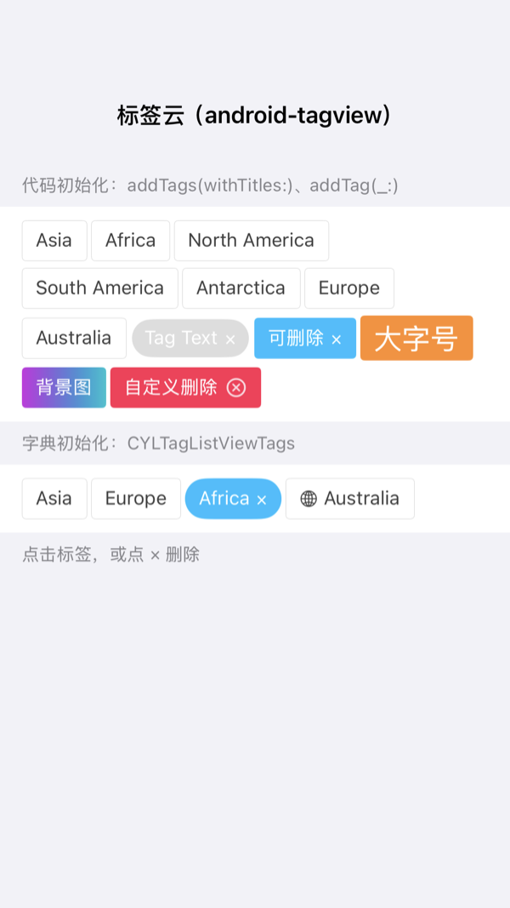
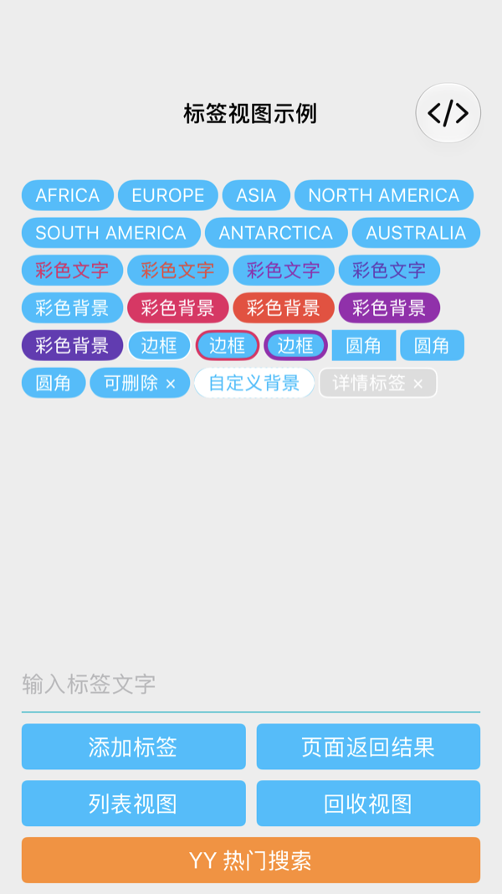
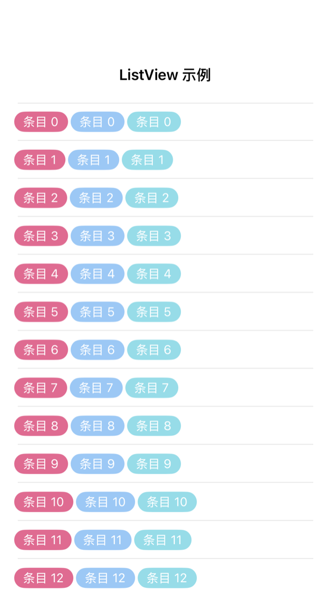
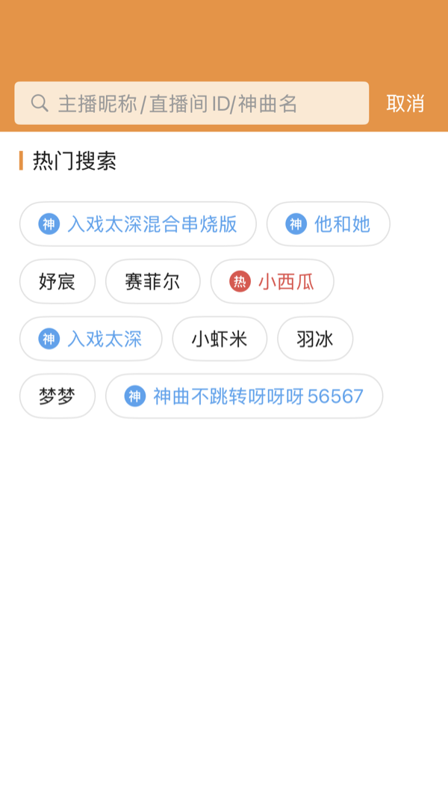

# android-tagview API 对照

[kaedea/android-tagview](https://github.com/kaedea/android-tagview) (Android-Cloud-TagView-Plus) is an Android tag
cloud: one `TagView`, one `Tag` model, and two listeners. This page maps every public API of it (library sources
`me.kaede.tagview`, the XML attributes and the README) to CollectionViewClassifyMenu. `Constants`, `ResolutionUtil`
and `LogUtil` are package-private, so they are not public API.

本页逐项对照 android-tagview 的全部公开 API（`TagView`、`Tag`、两个监听接口、XML 属性），第二列是本项目的对应 API。
Swift 名称写在前面，Objective-C 名称在括号中。

## Score / 评分

Score = matched APIs ÷ android-tagview public APIs × 100. A full match counts 1, a partial one 0.5.

| Version | Matched | Score |
| --- | --- | --- |
| Before (`654f2cf`) | 17.5 / 47: the list existed, but no tag model, no add or remove methods, no deletable tags, no pressed color, no background image, no per-side padding, no delete listener | 37 |
| [71930fe](https://github.com/ChenYilong/CollectionViewClassifyMenu/commit/71930fe) (feature), [abca838](https://github.com/ChenYilong/CollectionViewClassifyMenu/commit/abca838) (scene fix for the core tests) | 47 / 47; verified locally: example 61, swift 19, menu 17, tag 6 tests pass (macOS 27.3, Xcode 27.2, iPhone 17 Pro iOS 26.1) | **100** |

Verified by `Example/CYLMenuExampleTests/CYLTagCloudTests.swift` (8 tests) and the 标签云 demo
(`CYLTagCloudDemoViewController`, 样式 tab → 标签云).



## Sample port / 示例复刻

android-tagview's whole sample is ported to Swift: 样式 tab → android-tagview 示例 (`CYLTagCloudSample.swift`):
MainActivity ("TagView Sample", every tag of its `onCreate`, INPUT TAG TEXT + ADD A TAG, Activity Result, GitHub),
SubActivity, ListViewActivity (51 rows), RecyclerViewActivity (21 rows and a footer), and the YY hot search screen of its
README (orange `CYLSearchBarView` with 取消, 热门搜索 with a bar, 神 / 热 badges). The core draws all of it
(`CYLMenuStyle.tagCloud()`, `CYLTag.badgeText`, `headerIndicatorColor`, `CYLTagCornerRadiusSquare`); the screens only
pass data and style values and handle taps. Verified by `CYLAndroidSampleTests`.

| 状态 / State | 截图 / Screenshot |
| --- | :---: |
| MainActivity：TagView Sample |  |
| ListViewActivity |  |
| YY 热门搜索（README 第二张截图） |  |

## TagView

| android-tagview | CollectionViewClassifyMenu |
| --- | --- |
| `new TagView(Context)` | `CYLTagListView()` (`-init`, `-initWithFrame:`) |
| `new TagView(Context, AttributeSet)` (XML layout) | Interface Builder: `init(coder:)` with the `IBInspectable` properties below |
| `new TagView(Context, AttributeSet, int defStyle)` | `init(configuration:)` (`-initWithConfiguration:`), a style through `CYLTagListViewStyle` |
| `new TagView(Context, AttributeSet, int defStyle, int defStyleRes)` | `init(configurationFile:)` (`-initWithConfigurationFile:error:`): JSON, plist, YAML… |
| XML `app:lineMargin` | IB `lineSpacing`; key `CYLMenuStyleLineSpacing` |
| XML `app:tagMargin` | IB `interitemSpacing`; key `CYLMenuStyleInteritemSpacing` |
| XML `app:textPaddingLeft` | IB `tagContentInsetLeft`; key `CYLMenuStyleTagContentInsets` |
| XML `app:textPaddingRight` | IB `tagContentInsetRight` |
| XML `app:textPaddingTop` | IB `tagContentInsetTop` |
| XML `app:textPaddingBottom` | IB `tagContentInsetBottom` |
| `addTag(Tag)` | `addTag(_:)` (`-addTag:`) |
| `addTags(String[])` | `addTags(withTitles:)` (`-addTagsWithTitles:`) |
| `addTags(List<Tag>)` | `addTags(_:)` (`-addTags:`); key `CYLTagListViewTags` |
| `getTags()` | `tags` |
| `remove(int position)` | `removeTag(at:)` (`-removeTagAtIndex:`) |
| `removeAllTags()` | `removeAllTags()` |
| `getLineMargin()` / `setLineMargin(float)` | `lineSpacing` (also `style.lineSpacing`) |
| `getTagMargin()` / `setTagMargin(float)` | `interitemSpacing` (also `style.interitemSpacing`) |
| `getTextPaddingLeft()` / `setTextPaddingLeft(float)` | `tagContentInsetLeft`, `tagContentInsets.left` |
| `getTextPaddingRight()` / `setTextPaddingRight(float)` | `tagContentInsetRight`, `tagContentInsets.right` |
| `getTextPaddingTop()` / `setTextPaddingTop(float)` | `tagContentInsetTop`, `tagContentInsets.top` |
| `getTexPaddingBottom()` / `setTexPaddingBottom(float)` | `tagContentInsetBottom`, `tagContentInsets.bottom` |
| `setOnTagClickListener(OnTagClickListener)` | `tagClickHandler`; `menuDelegate` → `menu(_:didSelectItemAt:)` |
| `setOnTagDeleteListener(OnTagDeleteListener)` | `tagDeleteHandler`; `menuDelegate` → `menu(_:didDeleteItemAt:)` |
| `TagView.TAG` (log tag `"TagView"`) | `NSStringFromClass(CYLTagListView.self)` |

## Listeners

| android-tagview | CollectionViewClassifyMenu |
| --- | --- |
| `OnTagClickListener.onTagClick(int position, Tag tag)` | `tagClickHandler: (Int, CYLTag) -> Void` |
| `OnTagDeleteListener.onTagDeleted(int position, Tag tag)` | `tagDeleteHandler: (Int, CYLTag) -> Void` |

## Tag

| android-tagview | CollectionViewClassifyMenu (`CYLTag`) |
| --- | --- |
| `new Tag(String text)` | `CYLTag(title:)` |
| `new Tag(String text, int color)` | `CYLTag(title:backgroundColor:)` |
| `new Tag(String text, String color)` | `CYLTag(title:backgroundColorHex:)` ("#RRGGBB", "#RRGGBBAA", "systemBlue") |
| `new Tag(int id, String text)` | `CYLTag(identifier:title:)` |
| `new Tag(int id, String text, int color)` | `CYLTag(identifier:title:backgroundColor:)` |
| `new Tag(int id, String text, String color)` | `CYLTag(identifier:title:backgroundColorHex:)` |
| `id` | `identifier`; key `CYLTagItemIdentifier` |
| `text` | `title` |
| `tagTextColor` | `textColor` |
| `tagTextSize` | `textSize` (or `font`); a larger text makes the tag taller |
| `layoutColor` | `backgroundColor` |
| `layoutColorPress` | `highlightedBackgroundColor`; `CYLMenuStyle.highlightedBackgroundColor` |
| `isDeletable` | `isDeletable`; data source `menuItemIsDeletable(at:)`; key `CYLTagItemDeletable` |
| `deleteIndicatorColor` | `deleteIndicatorColor`; `CYLMenuStyle.deleteIndicatorColor` |
| `deleteIndicatorSize` | `deleteIndicatorSize`; `CYLMenuStyle.deleteIndicatorFont` |
| `radius` | `cornerRadius` (0 is a capsule) |
| `deleteIcon` | `deleteIndicatorTitle` (default "×"); `CYLMenuStyle.deleteIndicatorTitle` |
| `layoutBorderSize` | `borderWidth` |
| `layoutBorderColor` | `borderColor` |
| `background` (Drawable) | `backgroundImage`; `CYLTagAppearance.backgroundImage` |

## Missing APIs / 缺少的 API

None. Every public API of android-tagview has a counterpart, so the score is 100.

无。android-tagview 的每个公开 API 都有对应版本，满分 100。

## What we have that android-tagview does not

android-tagview's own to-do list (animations, performance in list cells) is covered here, and the list does much more:

- Selection: none, single, multiple, exclusive items ("全部"), `allowsEmptySelection`, `selectedIndexPaths`.
- Sections with titles, icons and accessory views; folding with a header button, a footer chevron or an inline tag.
- Icons, selected icons and animated icons (Lottie, PAG, Rive, GIF) through CYLTabBarController's engine.
- States: normal, selected and disabled appearances; per-section and per-item styles; grid layout (`numberOfItemsPerRow`).
- "+ 新建标签" create items, a More button per section, scrolling to a section or an item.
- Configuration from a dictionary or a file (JSON, plist, YAML, TOML…), not only XML attributes.
- Cell reuse (`UICollectionView`): android-tagview removes and re-adds every tag view on each change.
- Accessibility: VoiceOver labels, traits, a "Delete" action on deletable tags, Dynamic Type, Bold Text, Increase Contrast,
  Reduce Motion; localization in English, 简体中文 and 繁體中文.
- Badges read as the tag's value (`badgeAccessibilityLabel`, e.g. 神曲 for 神); the sample and the YY screen are
  localized, English being android-tagview's own text (`CYLAndroidSampleAccessibilityTests`).
- Auto Layout: `contentHeight`, the intrinsic content size, `heightThatFitsWidth(_:)`, `menu(_:didChangeContentHeight:)`.

## Initialization, the android-tagview way

```swift
let tagListView = CYLTagListView()
tagListView.lineSpacing = 5               // setLineMargin(5)
tagListView.interitemSpacing = 3          // setTagMargin(3)
tagListView.tagContentInsets = UIEdgeInsets(top: 3, left: 10, bottom: 3, right: 10)
tagListView.addTags(withTitles: ["Asia", "Europe", "Africa"])

let tag = CYLTag(title: "Tag Text", backgroundColorHex: "#DDDDDD")
tag.textColor = .white
tag.highlightedBackgroundColor = UIColor(white: 0.33, alpha: 1)
tag.cornerRadius = 20
tag.textSize = 14
tag.borderWidth = 1
tag.borderColor = .white
tag.isDeletable = true
tagListView.addTag(tag)

tagListView.tagClickHandler = { index, tag in print("click", index, tag.title) }
tagListView.tagDeleteHandler = { index, tag in print("deleted", index, tag.title) }
```

The first tag method makes the list show its own tags (`tagDataSource`) without section headers and with
`selectionMode = .none`, as android-tagview behaves; set them afterwards to select tags. A host data source can offer
deletable items too: `menuItemIsDeletable(at:)` and `menuRemoveItem(at:)`.
