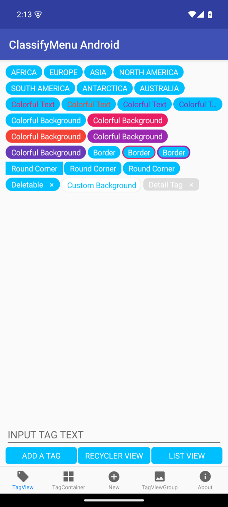
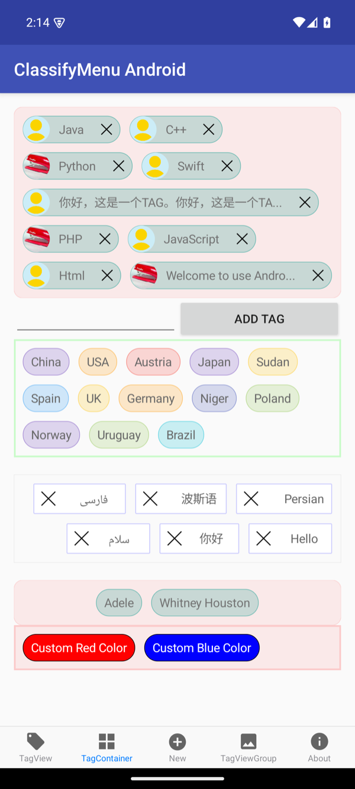
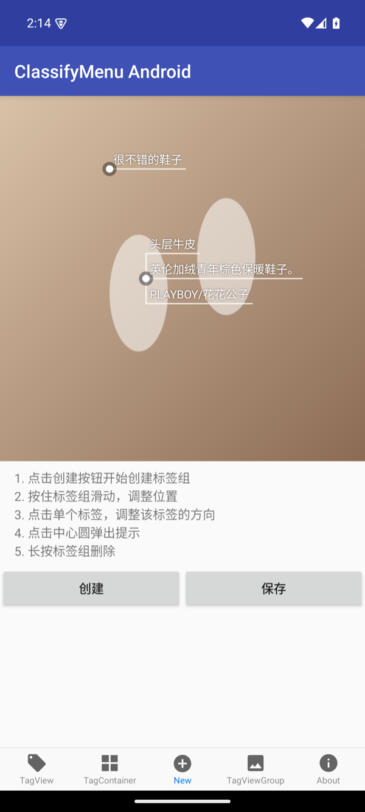
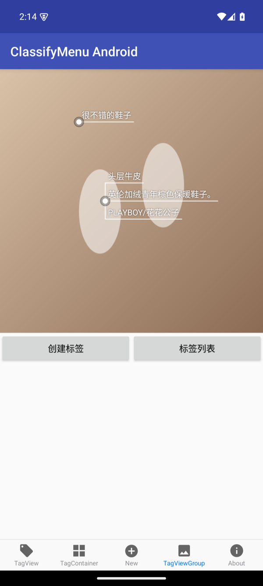
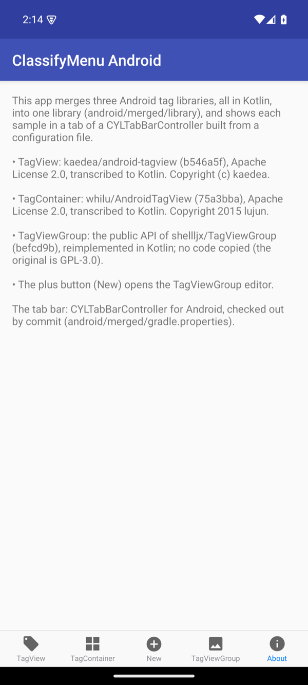
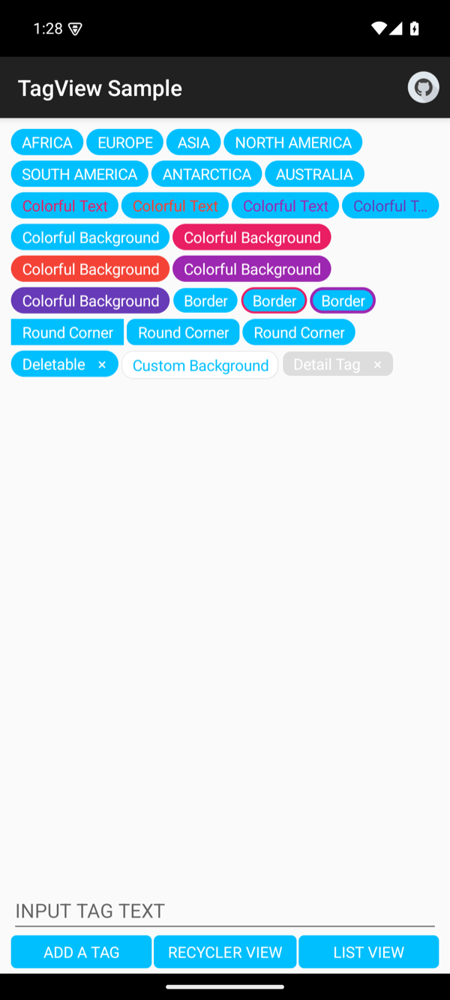
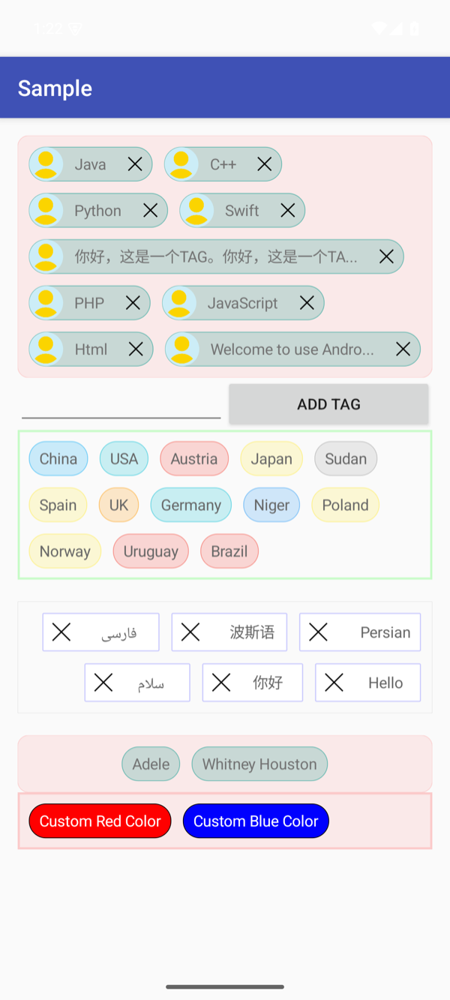
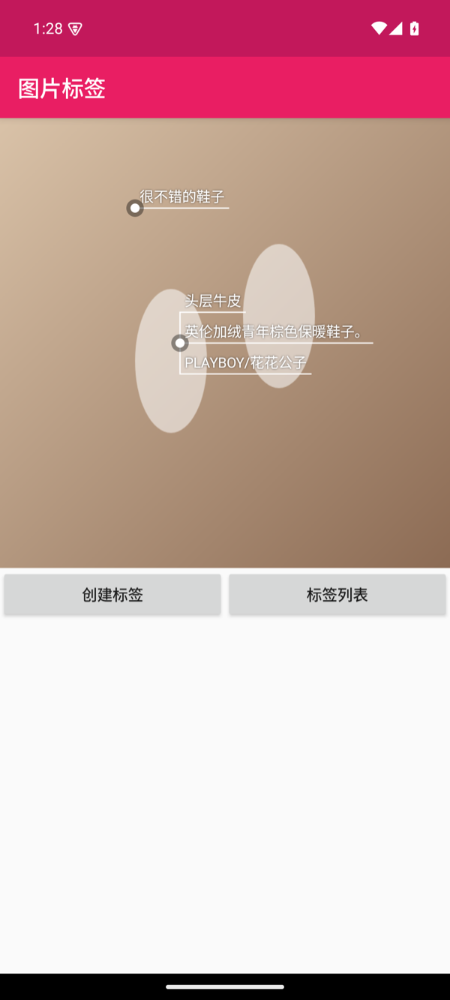

# Android (Kotlin)

This document tracks the Android work in `android/`: Kotlin transcriptions of three Android tag libraries, the
library merged from them, its API table against the iOS core, and the Android ports of the iOS examples.

## TODO (2026-11-12): Kotlin ports, merged library, API parity with iOS, iOS examples on Android

### Context

- Branch `feat/android-kotlin`, created from `claude/intelligent-curie-1etnx5` (PR #15 waits for CI there).
- Sources (cloned read-only for reference; not committed):
  - [kaedea/android-tagview](https://github.com/kaedea/android-tagview) at `b546a5f` (2016-06-15), Apache-2.0,
    Java, 6 library files + 4 sample activities.
  - [shellljx/TagViewGroup](https://github.com/shellljx/TagViewGroup) at `befcd9b` (2019-03-09), **GPL-3.0**,
    Java. Decision (user, 2026-11-12): do not transcribe its code; reimplement its public API and behavior in
    Kotlin, credit it as the API reference, so `android/` keeps this repository's license.
  - [whilu/AndroidTagView](https://github.com/whilu/AndroidTagView) at `75a3bba` (2019-03-16), Apache-2.0, Java,
    4 library files + 1 sample activity.
- CYLTabBarController's Android library: `CYLTabBarController/Example-Android/cyltabbar` (namespace
  `com.cyl.tabbar`, depends on `:tabpages`), AGP 8.7.3, Kotlin 2.0.21. The repository root is not a Gradle build
  and has no JitPack configuration, so a Maven coordinate by commit is not available. Plan: `android/merged`
  pins the commit in `gradle.properties`; `settings.gradle.kts` clones CYLTabBarController at that commit into a
  cache and includes its `Example-Android` build; it falls back to the local sibling folder when the clone fails.
- Toolchain: JDK 17 (`~/develop/jdk/jdk-17.0.21+9/Contents/Home`), Android SDK `~/Library/Android/sdk`,
  Gradle 9.3.1. Gradle fails on this exFAT volume (`._*` files), so builds run in a mirror under `/tmp`.
- Only Android code and docs change: no iOS code is modified.

### Requirements

1. `android/` with one folder per repository (`android-tagview`, `TagViewGroup`, `AndroidTagView`) and a fourth,
   `merged`.
2. Transcribe each project into its folder, all in Kotlin (library and sample).
3. Merge the three into one project in `merged`: keep every public API, one example app. The example uses
   CYLTabBarController's Android tab bar, one tab bar item per example; depend on CYLTabBarController's newest
   commit by commit reference (Gradle or Maven), else a local path.
4. A table in `docs/` of every public iOS API, with the matching public API of `merged` in the second column.
5. Add the APIs missing from `merged`; mark rows not aligned with `TODO`; full marks when every iOS API is
   aligned; re-score in this document each time `merged` gains an API, until full marks.
6. Port every iOS example to `merged` (a translation; the iOS code is not changed), using the Android APIs of
   the table. Take screenshots, update this document and the Android chapter of the README.

### Prompt (verbatim)

> 注意本任务仅仅修改android代码，不要改iOS代码。在本项目中新建文件夹命名为 android ，下面的代码 每一个仓库 创建一个文件夹，并创建第四个文件夹命名为merged https://github.com/kaedea/android-tagview   https://github.com/shellljx/TagViewGroup     https://github.com/whilu/AndroidTagView 第二步骤：分别将这三个项目在各自文件夹中做代码转录，全部翻译为kotlin语言。第三步骤：将以上三个文件夹里的kotlin代码合并为一个项目，保留所有api接口，并将example合并为一个。使用CYLTabBarController 的android端作为展示的功能划分，采用gradle或者maven指向CYLTabBarController 最新提交，找到gradle或者maven使用commit引用的方式集成，如果不行就采用本地路径引用。一个example一个tabbaritem区分。第四步骤：在docs在合适的文档或创建文档，列出iOS端所有的公开api，第二列 ，列出找到的在该merged文件夹下所有的公开api的对应项。第五步，将缺失merged文件夹缺失的API对齐。在该表格未对齐的地方标注TODO如果iOS端和android能完全对齐所有api就是满分，merged文件夹每次新增一个api就在该文档中打分，一直达到满分。第六步骤：将iOS端的example全部移植到merged文件夹，注意是翻译，不要改iOS代码。使用上面提到的表格中android的api实现。并截图更新文档，readme 在android章节。

English: Change only Android code, not iOS code. Create a folder `android` in this project, one folder per
repository below, and a fourth named `merged` (kaedea/android-tagview, shellljx/TagViewGroup, whilu/AndroidTagView).
Step 2: transcribe each project into its folder, all translated to Kotlin. Step 3: merge the Kotlin code of the
three folders into one project, keep all API interfaces, and merge the examples into one; use CYLTabBarController's
Android side for the feature split, point Gradle or Maven at CYLTabBarController's newest commit (by commit
reference, else a local path); one tab bar item per example. Step 4: in a suitable or new document in docs, list
every public iOS API and, in the second column, the matching public API found in `merged`. Step 5: align the APIs
missing from `merged`; mark unaligned rows with TODO; full marks when iOS and Android align completely; score the
document each time `merged` gains an API, until full marks. Step 6: port all iOS examples to `merged` (translate,
do not change iOS code), using the Android APIs of the table; take screenshots, update the docs and the README's
Android chapter.

### Status

- [x] Step 1: folders (`android/android-tagview`, `android/TagViewGroup`, `android/AndroidTagView`; `merged` next)
- [x] Step 2 (2026-11-12): Kotlin transcriptions of android-tagview (`13ba988`) and AndroidTagView (`643ba99`),
  the TagViewGroup API reimplementation (`b510e7d`). Each folder builds its sample (`assembleDebug`); the three
  samples run on the API 35 emulator (screenshots below). Samples opt out of Android 15's edge-to-edge
  enforcement (`values-v35`), as their original target SDKs never drew under the system bars.
- [x] Step 3 (2026-11-12): `android/merged`. The `library` module keeps every public API of the three libraries in
  their own packages (`me.kaede.tagview`, `co.lujun.androidtagview`, `com.licrafter.tagview`), copied by
  `android/scripts/sync_merged_sources.py` (only the `R` import changes; `--check` reports drift). The `example`
  app is a CYLTabBarController built from `assets/cyl_merged_tabbar.json`: tabs TagView, TagContainer, TagViewGroup,
  About, pages registered by page ID, and a plus button (New) whose page is the TagViewGroup editor.
  CYLTabBarController by commit: `gradle.properties` pins `cyl.tabbar.commit` (now `1fddee2`, the newest commit on
  any branch); `settings.gradle.kts` checks that commit out (sparse, blobless clone into `.cyltabbar/`) and includes
  its `Example-Android` build in place of `io.github.chenyilong:cyltabbarcontroller`; when the clone fails it uses the
  local folder `cyl.tabbar.localPath`. Verified on the API 35 emulator (screenshots below).
- [ ] Step 4: API table
- [ ] Step 5: missing APIs (score per added API)
- [ ] Step 6: iOS examples ported, screenshots, README Android chapter

## Screenshots

The merged example, top to bottom: the TagView, TagContainer, plus (New), TagViewGroup and About tabs.

Kotlin samples on the API 35 emulator, top to bottom: android-tagview, AndroidTagView, TagViewGroup.

