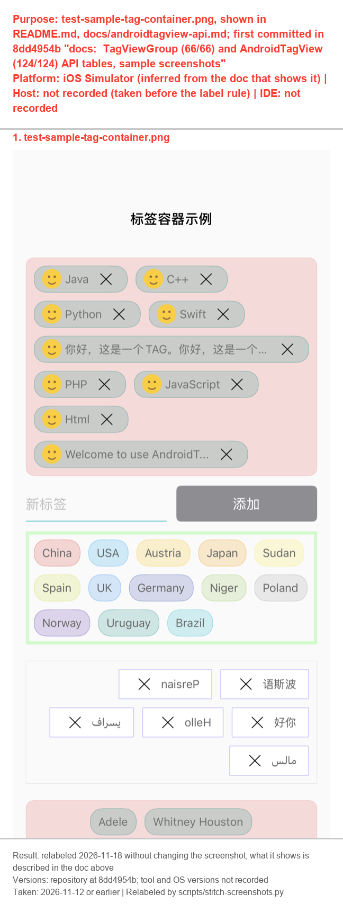

# AndroidTagView API 对照 / AndroidTagView API comparison

| 中文 | English |
|:---|:---|
| [whilu/AndroidTagView](https://github.com/whilu/AndroidTagView) 是一个标签容器（`TagContainerLayout`），包含标签视图（`TagView`）：主题（`ColorFactory`）、拖拽重新排序、每个标签上的叉号、涟漪、长按选择、从右到左的文字，以及大量 XML 属性。本页把它的库（`co.lujun.androidtagview`）的每个公开 API、XML 属性和 README 对应到 CollectionViewClassifyMenu。Swift 名称在前。 | [whilu/AndroidTagView](https://github.com/whilu/AndroidTagView) is a tag container (`TagContainerLayout`) of tag views (`TagView`): themes (`ColorFactory`), drag to reorder, a cross on each tag, ripples, selection by long press, right-to-left text, and many XML attributes. This page maps every public API of its library (`co.lujun.androidtagview`), its XML attributes and its README to CollectionViewClassifyMenu. Swift names first. |
| 本页逐项对照 AndroidTagView 的全部公开 API；第二列是本项目的对应 API。 | This page compares every public API of AndroidTagView one by one; the second column is this project's counterpart API. |

## 评分 / Score

| 中文 | English |
|:---|:---|
| 评分 = 已对应的 API 数 ÷ AndroidTagView 公开 API 数 × 100。 | Score = matched APIs ÷ AndroidTagView public APIs × 100. |

| 版本 | 已对应 | 评分 |
| --- | --- | --- |
| 之前（`3f88358`） | 部分对应：没有容器边框、拖拽、对齐方式、主题、涟漪、绘制的叉号、长按、标题长度、字母 RTL、默认图片、ColorFactory | — |
| `c4205eb` + 本次改动 | 下方 124 / 124 行 | **100** |

| Version | Matched | Score |
| --- | --- | --- |
| Before (`3f88358`) | partial: no container border, drag, gravity, themes, ripple, drawn cross, long press, title length, letters RTL, default image, ColorFactory | — |
| `c4205eb` + this change | 124 / 124 rows below | **100** |

| 中文 | English |
|:---|:---|
| 示例已移植：“样式”标签页 → “AndroidTagView 示例”（`CYLTagContainerSampleViewController`，content_main.xml 的五个容器），由 `CYLAndroidSampleTests` 验证。 | The sample is ported: Styles tab → AndroidTagView sample (`CYLTagContainerSampleViewController`, the five containers of content_main.xml), verified by `CYLAndroidSampleTests`. |

| 状态 | 截图 |
| --- | :---: |
| 五个容器：拖动 + 叉号 + 头像、随机主题、右对齐 RTL、居中涟漪、自定义颜色 |  |

| State | Screenshot |
| --- | :---: |
| Five containers: drag + cross + avatar, random themes, right-aligned RTL, centered ripple, custom colors |  |

## TagContainerLayout：构造方法和 XML 属性 / TagContainerLayout: constructors and XML attributes

| AndroidTagView 的 API | CollectionViewClassifyMenu（`CYLTagListView`，其 `style: CYLMenuStyle`） |
| --- | --- |
| `TagContainerLayout(Context)` / `(Context, AttributeSet)` / `(Context, AttributeSet, Int)` | `CYLTagListView()`、`init(coder:)`、`init(configuration:)`；默认值：`CYLMenuStyle.tagContainer()` |
| `vertical_interval` | `lineSpacing` |
| `horizontal_interval` | `interitemSpacing` |
| `container_border_width` | `containerBorderWidth` |
| `container_border_radius` | `containerCornerRadius` |
| `container_border_color` | `containerBorderColor` |
| `container_background_color` | `style.backgroundColor` |
| `container_enable_drag` | `allowsReordering` |
| `container_drag_sensitivity` | `reorderingSensitivity` |
| `container_max_lines` | `maximumNumberOfRows` |
| `container_gravity` | `style.rowAlignment` (`.leading`, `.center`, `.trailing`) |
| `tag_border_width` | `normalAppearance.borderWidth` |
| `tag_corner_radius` | `normalAppearance.cornerRadius` |
| `tag_horizontal_padding` | `tagContentInsets.left` / `.right` |
| `tag_vertical_padding` | `tagContentInsets.top` / `.bottom` |
| `tag_text_size` | `normalAppearance.font` |
| `tag_bd_distance` | `style.titlePositionAdjustment.vertical` |
| `tag_text_color` | `normalAppearance.textColor` |
| `tag_border_color` | `normalAppearance.borderColor` |
| `tag_background_color` | `normalAppearance.backgroundColor` |
| `tag_max_length` | `style.maximumTitleLength` |
| `tag_clickable` | `allowsTapping` |
| `tag_selectable` | 由 `tagLongPressHandler` 触发 `toggleSelection(at:)`；`selectionMode` |
| `tag_theme` | `colorTheme` (`.none`, `.random`, `.pureCyan`, `.pureTeal`) |
| `tag_text_direction` | `style.deleteIndicatorPlacement = .leading`, `style.imagePlacement`, `semanticContentAttribute` |
| `tag_ripple_color` | `style.rippleColor` |
| `tag_ripple_alpha` | `style.rippleAlpha` |
| `tag_ripple_duration` | `style.rippleDuration` |
| `tag_enable_cross` | `CYLTag.isDeletable`; `menuItemIsDeletable(at:)` |
| `tag_cross_width` | `style.deleteIndicatorWidth` |
| `tag_cross_color` | `style.deleteIndicatorColor` |
| `tag_cross_line_width` | `style.deleteIndicatorLineWidth` |
| `tag_cross_area_padding` | `style.deleteIndicatorPadding` |
| `tag_support_letters_rlt` | `style.reversesTitleCharacters` |
| `tag_background` | `normalAppearance.backgroundImage` |

| AndroidTagView | CollectionViewClassifyMenu (`CYLTagListView`, its `style: CYLMenuStyle`) |
| --- | --- |
| `TagContainerLayout(Context)` / `(Context, AttributeSet)` / `(Context, AttributeSet, Int)` | `CYLTagListView()`, `init(coder:)`, `init(configuration:)`; defaults: `CYLMenuStyle.tagContainer()` |
| `vertical_interval` | `lineSpacing` |
| `horizontal_interval` | `interitemSpacing` |
| `container_border_width` | `containerBorderWidth` |
| `container_border_radius` | `containerCornerRadius` |
| `container_border_color` | `containerBorderColor` |
| `container_background_color` | `style.backgroundColor` |
| `container_enable_drag` | `allowsReordering` |
| `container_drag_sensitivity` | `reorderingSensitivity` |
| `container_max_lines` | `maximumNumberOfRows` |
| `container_gravity` | `style.rowAlignment` (`.leading`, `.center`, `.trailing`) |
| `tag_border_width` | `normalAppearance.borderWidth` |
| `tag_corner_radius` | `normalAppearance.cornerRadius` |
| `tag_horizontal_padding` | `tagContentInsets.left` / `.right` |
| `tag_vertical_padding` | `tagContentInsets.top` / `.bottom` |
| `tag_text_size` | `normalAppearance.font` |
| `tag_bd_distance` | `style.titlePositionAdjustment.vertical` |
| `tag_text_color` | `normalAppearance.textColor` |
| `tag_border_color` | `normalAppearance.borderColor` |
| `tag_background_color` | `normalAppearance.backgroundColor` |
| `tag_max_length` | `style.maximumTitleLength` |
| `tag_clickable` | `allowsTapping` |
| `tag_selectable` | `toggleSelection(at:)` from `tagLongPressHandler`; `selectionMode` |
| `tag_theme` | `colorTheme` (`.none`, `.random`, `.pureCyan`, `.pureTeal`) |
| `tag_text_direction` | `style.deleteIndicatorPlacement = .leading`, `style.imagePlacement`, `semanticContentAttribute` |
| `tag_ripple_color` | `style.rippleColor` |
| `tag_ripple_alpha` | `style.rippleAlpha` |
| `tag_ripple_duration` | `style.rippleDuration` |
| `tag_enable_cross` | `CYLTag.isDeletable`; `menuItemIsDeletable(at:)` |
| `tag_cross_width` | `style.deleteIndicatorWidth` |
| `tag_cross_color` | `style.deleteIndicatorColor` |
| `tag_cross_line_width` | `style.deleteIndicatorLineWidth` |
| `tag_cross_area_padding` | `style.deleteIndicatorPadding` |
| `tag_support_letters_rlt` | `style.reversesTitleCharacters` |
| `tag_background` | `normalAppearance.backgroundImage` |

## TagContainerLayout：方法 / TagContainerLayout: methods

| AndroidTagView 的 API | CollectionViewClassifyMenu 的对应 API |
| --- | --- |
| `setTags(List<String>)` / `setTags(String...)` | `setTags(withTitles:)`; `replaceTags(_:)` |
| `setTags(List<String>, List<int[]>)` | `setTags(withTitles:colors:)`，配合 `CYLTagColors` |
| `addTag(String)` | `addTag(withTitle:)` |
| `addTag(String, int)` | `insertTag(withTitle:at:)` |
| `removeTag(int)` | `removeTag(at:)` |
| `removeConsecutiveTags(List<Integer>)` | `removeTags(at:)` |
| `removeAllTags()` | `removeAllTags()` |
| `setOnTagClickListener(listener)` | `tagClickHandler`, `tagLongPressHandler`, `selectedTagDragHandler`, `tagDeleteHandler`; `menuDelegate` |
| `toggleSelectTagView(int)` | `toggleSelection(at:)` |
| `selectTagView(int)` | `selectItem(at:)` |
| `deselectTagView(int)` | `deselectItem(at:)` |
| `getSelectedTagViewPositions()` | `selectedIndexPaths` |
| `getSelectedTagViewText()` | `selectedTitles` |
| `size()` | `tags.count` |
| `getTagText(int)` | `tags[i].title` |
| `getTags()` | `tags` |
| `getTagView(int)` | `tagButton(at:)` |
| `getTagViewState()` | `isReordering` |
| `get/setTagBdDistance` | `style.titlePositionAdjustment` |
| `get/setDragEnable` | `allowsReordering` |
| `get/setVerticalInterval` | `lineSpacing` |
| `get/setHorizontalInterval` | `interitemSpacing` |
| `get/setBorderWidth` | `containerBorderWidth` |
| `get/setBorderRadius` | `containerCornerRadius` |
| `get/setBorderColor` | `containerBorderColor` |
| `get/setBackgroundColor` | `style.backgroundColor` |
| `get/setGravity` | `style.rowAlignment` |
| `get/setSensitivity` | `reorderingSensitivity` |
| `get/setDefaultImageDrawableID` | `defaultTagImage` |
| `get/setMaxLines` | `maximumNumberOfRows` |
| `get/setTagMaxLength` | `style.maximumTitleLength` |
| `get/setTheme` | `colorTheme` |
| `get/setIsTagViewClickable` | `allowsTapping` |
| `get/setIsTagViewSelectable` | `toggleSelection(at:)`; `selectionMode` |
| `get/setTagBorderWidth` | `normalAppearance.borderWidth` |
| `get/setTagBorderRadius` | `normalAppearance.cornerRadius` |
| `get/setTagTextSize` | `normalAppearance.font` |
| `get/setTagHorizontalPadding` | `tagContentInsetLeft` / `tagContentInsetRight` |
| `get/setTagVerticalPadding` | `tagContentInsetTop` / `tagContentInsetBottom` |
| `get/setTagBorderColor` | `normalAppearance.borderColor` |
| `get/setTagBackgroundColor` | `normalAppearance.backgroundColor` |
| `get/setTagTextColor` | `normalAppearance.textColor` |
| `get/setTagTextDirection` | `style.deleteIndicatorPlacement`, `semanticContentAttribute` |
| `get/setTagTypeface` | `normalAppearance.font` |
| `get/setRippleAlpha` / `RippleColor` / `RippleDuration` | `style.rippleAlpha`, `rippleColor`, `rippleDuration` |
| `get/setCrossColor` | `style.deleteIndicatorColor` |
| `get/setCrossAreaPadding` | `style.deleteIndicatorPadding` |
| `isEnableCross` / `setEnableCross` | `CYLTag.isDeletable` |
| `get/setCrossAreaWidth` | `style.deleteIndicatorWidth` |
| `get/setCrossLineWidth` | `style.deleteIndicatorLineWidth` |
| `is/setTagSupportLettersRTL` | `style.reversesTitleCharacters` |
| `get/setTagBackgroundResource` | `normalAppearance.backgroundImage` |

| AndroidTagView | CollectionViewClassifyMenu |
| --- | --- |
| `setTags(List<String>)` / `setTags(String...)` | `setTags(withTitles:)`; `replaceTags(_:)` |
| `setTags(List<String>, List<int[]>)` | `setTags(withTitles:colors:)` with `CYLTagColors` |
| `addTag(String)` | `addTag(withTitle:)` |
| `addTag(String, int)` | `insertTag(withTitle:at:)` |
| `removeTag(int)` | `removeTag(at:)` |
| `removeConsecutiveTags(List<Integer>)` | `removeTags(at:)` |
| `removeAllTags()` | `removeAllTags()` |
| `setOnTagClickListener(listener)` | `tagClickHandler`, `tagLongPressHandler`, `selectedTagDragHandler`, `tagDeleteHandler`; `menuDelegate` |
| `toggleSelectTagView(int)` | `toggleSelection(at:)` |
| `selectTagView(int)` | `selectItem(at:)` |
| `deselectTagView(int)` | `deselectItem(at:)` |
| `getSelectedTagViewPositions()` | `selectedIndexPaths` |
| `getSelectedTagViewText()` | `selectedTitles` |
| `size()` | `tags.count` |
| `getTagText(int)` | `tags[i].title` |
| `getTags()` | `tags` |
| `getTagView(int)` | `tagButton(at:)` |
| `getTagViewState()` | `isReordering` |
| `get/setTagBdDistance` | `style.titlePositionAdjustment` |
| `get/setDragEnable` | `allowsReordering` |
| `get/setVerticalInterval` | `lineSpacing` |
| `get/setHorizontalInterval` | `interitemSpacing` |
| `get/setBorderWidth` | `containerBorderWidth` |
| `get/setBorderRadius` | `containerCornerRadius` |
| `get/setBorderColor` | `containerBorderColor` |
| `get/setBackgroundColor` | `style.backgroundColor` |
| `get/setGravity` | `style.rowAlignment` |
| `get/setSensitivity` | `reorderingSensitivity` |
| `get/setDefaultImageDrawableID` | `defaultTagImage` |
| `get/setMaxLines` | `maximumNumberOfRows` |
| `get/setTagMaxLength` | `style.maximumTitleLength` |
| `get/setTheme` | `colorTheme` |
| `get/setIsTagViewClickable` | `allowsTapping` |
| `get/setIsTagViewSelectable` | `toggleSelection(at:)`; `selectionMode` |
| `get/setTagBorderWidth` | `normalAppearance.borderWidth` |
| `get/setTagBorderRadius` | `normalAppearance.cornerRadius` |
| `get/setTagTextSize` | `normalAppearance.font` |
| `get/setTagHorizontalPadding` | `tagContentInsetLeft` / `tagContentInsetRight` |
| `get/setTagVerticalPadding` | `tagContentInsetTop` / `tagContentInsetBottom` |
| `get/setTagBorderColor` | `normalAppearance.borderColor` |
| `get/setTagBackgroundColor` | `normalAppearance.backgroundColor` |
| `get/setTagTextColor` | `normalAppearance.textColor` |
| `get/setTagTextDirection` | `style.deleteIndicatorPlacement`, `semanticContentAttribute` |
| `get/setTagTypeface` | `normalAppearance.font` |
| `get/setRippleAlpha` / `RippleColor` / `RippleDuration` | `style.rippleAlpha`, `rippleColor`, `rippleDuration` |
| `get/setCrossColor` | `style.deleteIndicatorColor` |
| `get/setCrossAreaPadding` | `style.deleteIndicatorPadding` |
| `isEnableCross` / `setEnableCross` | `CYLTag.isDeletable` |
| `get/setCrossAreaWidth` | `style.deleteIndicatorWidth` |
| `get/setCrossLineWidth` | `style.deleteIndicatorLineWidth` |
| `is/setTagSupportLettersRTL` | `style.reversesTitleCharacters` |
| `get/setTagBackgroundResource` | `normalAppearance.backgroundImage` |

## TagView 视图 / TagView

| AndroidTagView 的 API | CollectionViewClassifyMenu 的对应项（`CYLTagButton`、`CYLTag`） |
| --- | --- |
| `TagView(Context, String)` | `CYLTag(title:)`；带 `title` 的 `CYLTagButton` |
| `TagView(Context, String, int defaultImageID)` | `CYLTag.image`; `defaultTagImage` |
| `getText()` | `title` |
| `getIsViewClickable()` / `setIsViewClickable` | `isEnabled`; `allowsTapping` |
| `getIsViewSelected()` | `isSelected` |
| `setIsViewSelectable` | `toggleSelection(at:)` |
| `selectView()` / `deselectView()` | `isSelected = true / false`; `selectItem(at:)` / `deselectItem(at:)` |
| `setTagMaxLength` | `style.maximumTitleLength` |
| `setOnTagClickListener` | 列表的各个处理回调 |
| `get/setTagBackgroundColor` | `CYLTag.backgroundColor` |
| `get/setTagSelectedBackgroundColor` | `CYLTag.selectedBackgroundColor` |
| `setTagBorderColor` | `CYLTag.borderColor` |
| `setTagTextColor` | `CYLTag.textColor` |
| `setBorderWidth` | `CYLTag.borderWidth` |
| `setBorderRadius` | `CYLTag.cornerRadius`（方角用 `CYLTagCornerRadiusSquare`） |
| `setTextSize` | `CYLTag.textSize` |
| `setHorizontalPadding` / `setVerticalPadding` | `CYLTagAppearance.contentInsets` |
| `setImage(Bitmap)` | `CYLTag.image`、`CYLTagButton.image`；圆形：`style.imageCornerRadius` |
| `isEnableImage()` | `image != nil` |
| `get/setTextDirection` | `style.deleteIndicatorPlacement`, `semanticContentAttribute` |
| `setTypeface` | `CYLTag.font` |
| `setRippleAlpha` / `setRippleColor` / `setRippleDuration` | `style.rippleAlpha`, `rippleColor`, `rippleDuration`; `CYLTagListCell.showRipple(at:)` |
| `setBdDistance` | `style.titlePositionAdjustment` |
| `is/setEnableCross` | `CYLTagButton.showsDeleteIndicator` |
| `get/setCrossAreaWidth` / `CrossLineWidth` / `CrossAreaPadding` / `CrossColor` | `style.deleteIndicatorWidth`, `deleteIndicatorLineWidth`, `deleteIndicatorPadding`, `deleteIndicatorColor` |
| `is/setTagSupportLettersRTL` | `style.reversesTitleCharacters` |

| AndroidTagView | CollectionViewClassifyMenu (`CYLTagButton`, `CYLTag`) |
| --- | --- |
| `TagView(Context, String)` | `CYLTag(title:)`; `CYLTagButton` with `title` |
| `TagView(Context, String, int defaultImageID)` | `CYLTag.image`; `defaultTagImage` |
| `getText()` | `title` |
| `getIsViewClickable()` / `setIsViewClickable` | `isEnabled`; `allowsTapping` |
| `getIsViewSelected()` | `isSelected` |
| `setIsViewSelectable` | `toggleSelection(at:)` |
| `selectView()` / `deselectView()` | `isSelected = true / false`; `selectItem(at:)` / `deselectItem(at:)` |
| `setTagMaxLength` | `style.maximumTitleLength` |
| `setOnTagClickListener` | the list's handlers |
| `get/setTagBackgroundColor` | `CYLTag.backgroundColor` |
| `get/setTagSelectedBackgroundColor` | `CYLTag.selectedBackgroundColor` |
| `setTagBorderColor` | `CYLTag.borderColor` |
| `setTagTextColor` | `CYLTag.textColor` |
| `setBorderWidth` | `CYLTag.borderWidth` |
| `setBorderRadius` | `CYLTag.cornerRadius` (`CYLTagCornerRadiusSquare` for square corners) |
| `setTextSize` | `CYLTag.textSize` |
| `setHorizontalPadding` / `setVerticalPadding` | `CYLTagAppearance.contentInsets` |
| `setImage(Bitmap)` | `CYLTag.image`, `CYLTagButton.image`; round: `style.imageCornerRadius` |
| `isEnableImage()` | `image != nil` |
| `get/setTextDirection` | `style.deleteIndicatorPlacement`, `semanticContentAttribute` |
| `setTypeface` | `CYLTag.font` |
| `setRippleAlpha` / `setRippleColor` / `setRippleDuration` | `style.rippleAlpha`, `rippleColor`, `rippleDuration`; `CYLTagListCell.showRipple(at:)` |
| `setBdDistance` | `style.titlePositionAdjustment` |
| `is/setEnableCross` | `CYLTagButton.showsDeleteIndicator` |
| `get/setCrossAreaWidth` / `CrossLineWidth` / `CrossAreaPadding` / `CrossColor` | `style.deleteIndicatorWidth`, `deleteIndicatorLineWidth`, `deleteIndicatorPadding`, `deleteIndicatorColor` |
| `is/setTagSupportLettersRTL` | `style.reversesTitleCharacters` |

## OnTagClickListener 监听接口 / OnTagClickListener

| AndroidTagView 的 API | CollectionViewClassifyMenu 的对应 API |
| --- | --- |
| `onTagClick(position, text)` | `tagClickHandler`; `menu(_:didSelectItemAt:)` |
| `onTagLongClick(position, text)` | `tagLongPressHandler`; `menu(_:didLongPressItemAt:)` |
| `onSelectedTagDrag(position, text)` | `selectedTagDragHandler`; `menu(_:didBeginDraggingSelectedItemAt:)` |
| `onTagCrossClick(position)` | `tagDeleteHandler`，配合 `removesItemsOnDelete = false`；`menu(_:didDeleteItemAt:)` |

| AndroidTagView | CollectionViewClassifyMenu |
| --- | --- |
| `onTagClick(position, text)` | `tagClickHandler`; `menu(_:didSelectItemAt:)` |
| `onTagLongClick(position, text)` | `tagLongPressHandler`; `menu(_:didLongPressItemAt:)` |
| `onSelectedTagDrag(position, text)` | `selectedTagDragHandler`; `menu(_:didBeginDraggingSelectedItemAt:)` |
| `onTagCrossClick(position)` | `tagDeleteHandler` with `removesItemsOnDelete = false`; `menu(_:didDeleteItemAt:)` |

## ColorFactory 颜色工厂 / ColorFactory

| AndroidTagView 的 API | CollectionViewClassifyMenu 的对应项（`CYLTagColors`） |
| --- | --- |
| `BG_COLOR_ALPHA` ("33") / `BD_COLOR_ALPHA` ("88") | `CYLTagColorsBackgroundAlpha` / `CYLTagColorsBorderAlpha` |
| `RED` … `CYAN`（13 种颜色） | `CYLTagColors.paletteHexByName` |
| `PURE_COLOR`（纯色：CYAN、TEAL） | `CYLTagColorTheme.pureCyan` / `.pureTeal` |
| `NONE` / `RANDOM` / `PURE_CYAN` / `PURE_TEAL` | `CYLTagColorTheme.none` / `.random` / `.pureCyan` / `.pureTeal` |
| `SHARP666666` / `SHARP727272` | `CYLTagColors.gray666666` / `gray727272` |
| `onRandomBuild()` | `CYLTagColors.randomColors()`; `CYLTagColors(for: .random, seed:)` |
| `onPureBuild(type)` | `CYLTagColors(for: .pureCyan / .pureTeal, seed: 0)` |

| AndroidTagView | CollectionViewClassifyMenu (`CYLTagColors`) |
| --- | --- |
| `BG_COLOR_ALPHA` ("33") / `BD_COLOR_ALPHA` ("88") | `CYLTagColorsBackgroundAlpha` / `CYLTagColorsBorderAlpha` |
| `RED` … `CYAN` (13 colors) | `CYLTagColors.paletteHexByName` |
| `PURE_COLOR` (CYAN, TEAL) | `CYLTagColorTheme.pureCyan` / `.pureTeal` |
| `NONE` / `RANDOM` / `PURE_CYAN` / `PURE_TEAL` | `CYLTagColorTheme.none` / `.random` / `.pureCyan` / `.pureTeal` |
| `SHARP666666` / `SHARP727272` | `CYLTagColors.gray666666` / `gray727272` |
| `onRandomBuild()` | `CYLTagColors.randomColors()`; `CYLTagColors(for: .random, seed:)` |
| `onPureBuild(type)` | `CYLTagColors(for: .pureCyan / .pureTeal, seed: 0)` |

## 缺少的 API / Missing APIs

| 中文 | English |
|:---|:---|
| 无。 | None. |

## 本项目有而 AndroidTagView 没有的功能 / What we have that AndroidTagView does not

| 中文 | English |
|:---|:---|
| 分区、折叠、分区标题、单选和多选规则、互斥项、动效图标、网格、配置文件、Auto Layout 尺寸计算（`heightThatFitsWidth(_:)`）、单元格复用。 | Sections, folding, section headers, single and multiple selection rules, exclusive items, animated icons, grids, configuration files, Auto Layout sizing (`heightThatFitsWidth(_:)`), cell reuse. |
| 每个标签独立的外观（`CYLTag`）、角标、按下颜色、无障碍（VoiceOver 的“删除”操作、Dynamic Type、减弱动态效果）。 | Per-tag looks (`CYLTag`), badges, pressed colors, accessibility (VoiceOver "Delete" action, Dynamic Type, Reduce Motion). |
| 无需手势的重新排序与长按：前移 / 后移自定义操作（并播报新位置），以及由 `longPressAccessibilityActionName` 命名的长按操作，适用于 VoiceOver、Voice Control 和 Switch Control。示例已本地化（英文是 AndroidTagView 自带的文字），并由 `CYLAndroidSampleAccessibilityTests` 验证。 | Reordering and long presses without gestures: Move earlier / Move later custom actions (with an announcement of the new position) and a long-press action named by `longPressAccessibilityActionName`, for VoiceOver, Voice Control and Switch Control. The sample is localized (English is AndroidTagView's own text) and verified by `CYLAndroidSampleAccessibilityTests`. |
| 主题让同一个标签在多次重新加载之间保持相同的颜色（AndroidTagView 每次都会随机选一个新颜色）。 | Themes stay the same color for a tag across reloads (AndroidTagView picks a new random color each time). |
