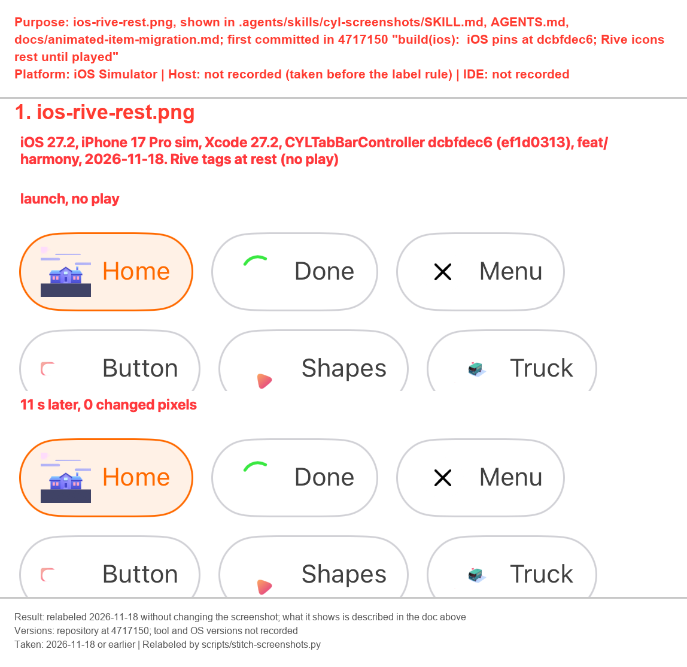
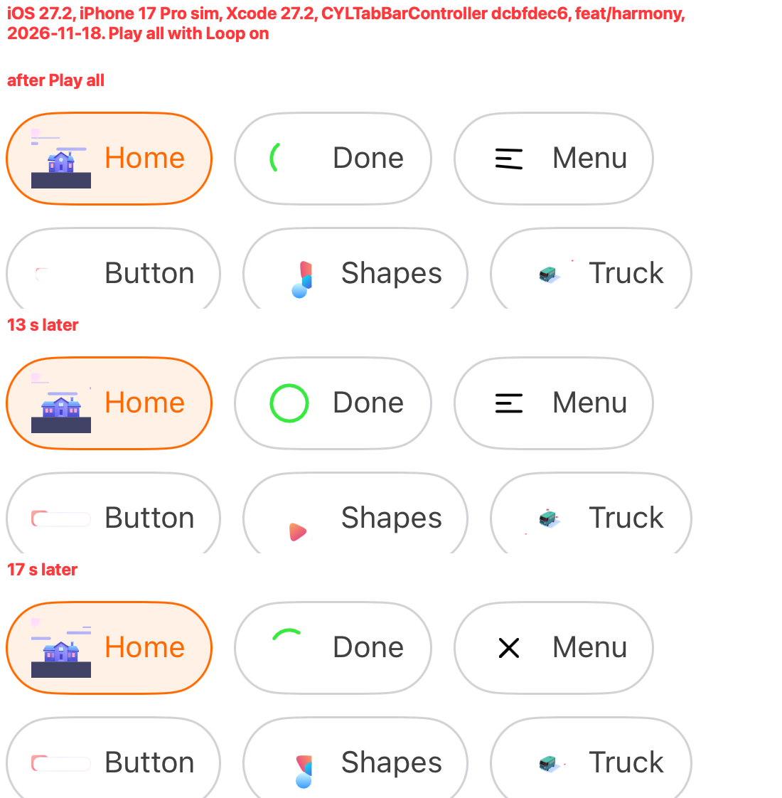
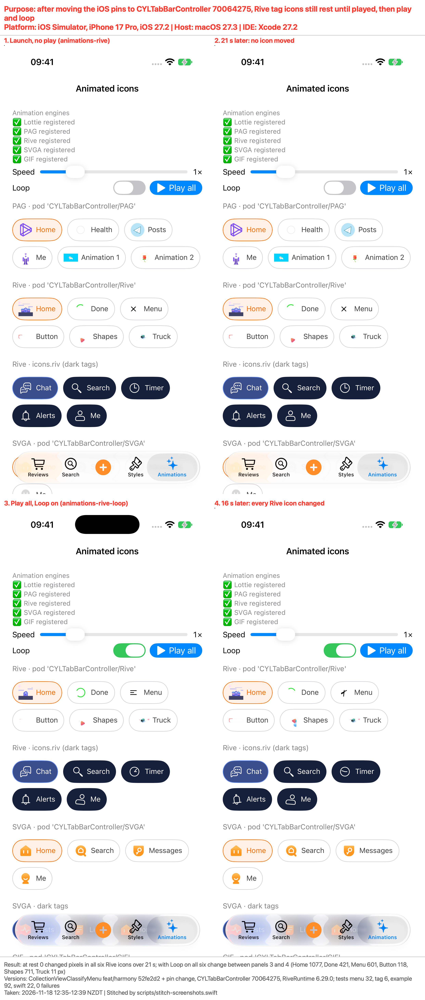
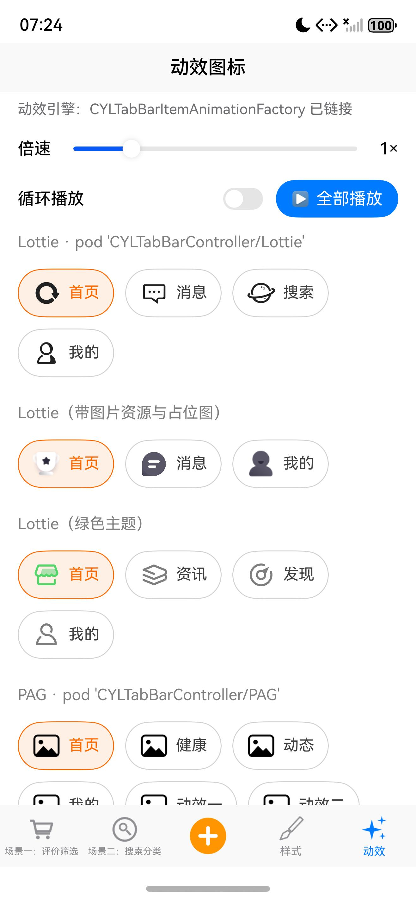
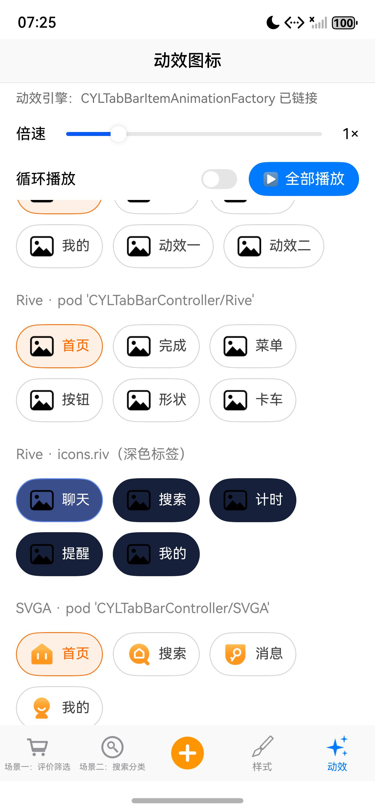
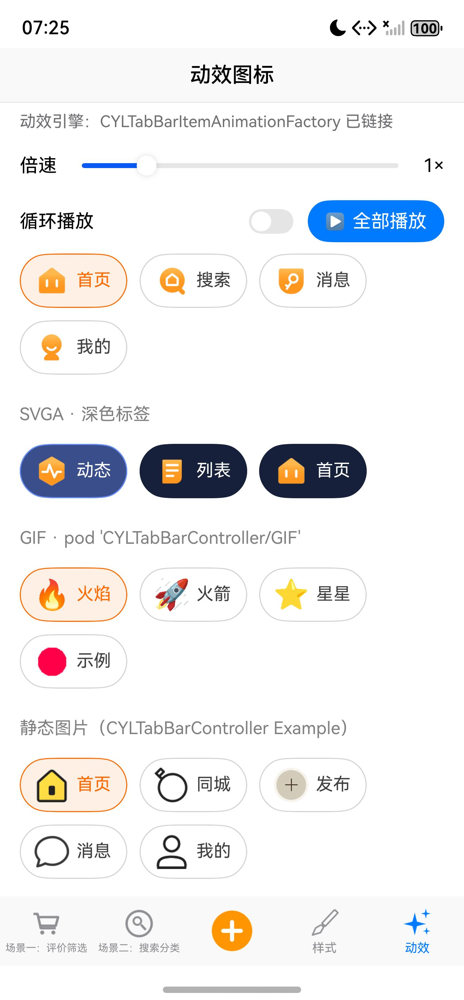

# CYLAnimatedItem migration: progress against the guide

The guide: CYLTabBarController's
[docs/Animated-Item.md](https://github.com/ChenYilong/CYLTabBarController/blob/feat/cross-platform-components/docs/Animated-Item.md)
(branch `feat/cross-platform-components`, read at `e3ebc242`, 2026-11-17). It asks this repository to make its icon + title
component, `CYLTagButton`, a subclass of the shared `CYLAnimatedItemView` (row "CollectionViewClassifyMenu" of "Migrating
the four repositories"), with the core depending on `CYLAnimatedItem` and on no animation engine; only the examples add
engines. Every icon + title view of this repository is already a `CYLTagButton` (`CYLIndexPathButton`,
`CYLRightImageButton`, the section headers, the search bar items of CYLSearchViewController), so one class carries the
migration on each platform.

Related logs: [component-architecture.md](component-architecture.md) (the task entries, newest at the end),
[issue-progress.md](issue-progress.md), [example-layer-fixes.md](example-layer-fixes.md).

## Task log

- **TODO → DONE (2026-11-17)**: report the progress against the guide and mark progress and TODOs in this repository.
  - **Prompt (verbatim)**: "告诉我 你遵循文档改造的进度，并在本仓库合适地方标注进度以及todo。这个文档是与动效组件相关的。告诉我 你遵循文档改造的进度https://github.com/ChenYilong/CYLTabBarController/blob/feat/cross-platform-components/docs/Animated-Item.md"
  - **Prompt (English)**: "Tell me your progress following the document's migration, and mark the progress and TODOs in a suitable place in
    this repository. The document is about the animation component."
  - **Result**: this document (the table, the score and the TODO list below), linked from `component-architecture.md` and
    `issue-progress.md`.

## Score

**Score: 100** (25 of 25 rows done; a row counts only when it is done and verified as far as this environment allows).

| Date | Score | Note |
|:---|:---|:---|
| 2026-11-18 | 100 | Row 11: `Package.swift` uses CYLTabBarController's new SwiftPM product `CYLAnimatedItem` (iOS pins at `6f93ae6b`) |
| 2026-11-18 | 96 | Row 19: mini program GIF stills, one-pass play and autoplay through cyl-tag-list and cyl-tag-button (WeChat DevTools) |
| 2026-11-18 | 92 | Row 17: HarmonyOS check on the Mac's arm64 emulator (Rive draws and replays, B20) |
| 2026-11-18 | 88 | Row 12: the static-library demo app compiles in CI (upstream fix `83a8ff8`); its workarounds removed |
| 2026-11-18 | 84 | Row 22: Flutter and React Native Android builds; the publish step no longer deletes the library |
| 2026-11-17 | 80 | Row 13 verified on a Mac (library 0 warnings, 152 tests pass); row 12 compiles with Xcode 27 but not in CI (Xcode 26) |
| 2026-11-17 | 76 | Row 20: WeChat DevTools check, the missing-tags bug fixed; row 17: HarmonyOS build and host tests |
| 2026-11-17 | 72 | First assessment, at `3b0d9ea` (pins `57a527e`; CYLTabBarController PR #815 open) |

## Progress by guide item

| # | Guide item | Platform | Status | Evidence / what is left |
|:---|:---|:---|:---|:---|
| 1 | `CYLTagButton` subclasses `CYLAnimatedItemView` | iOS | Done | `CYLTagButton.swift:44` (`9ecc535`) |
| 2 | Delete `CYLTagAnimationEngine` (run-time engine lookup) | iOS | Done | no occurrence left in the sources |
| 3 | Icon, title and animation properties are the inherited ones | iOS | Done | `9ecc535`; Objective-C sees them through the re-exported `CYLAnimatedItem` module (the redeclarations of `082f753` were removed in `06baca1d`, 2026-11-21) |
| 4 | Delete indicator → `accessoryView` / `accessoryPlacement` | iOS | Done | `CYLTagButton.swift:260`, `:320` |
| 5 | Per-state look in `itemStateDidChange` | iOS | Done | `CYLTagButton.swift:578` |
| 6 | Static measuring stays in the subclass (`width(forTitle:…)`) | iOS | Done | kept in `CYLTagButton` |
| 7 | Podspec depends on `CYLAnimatedItem` only, no engine | iOS | Done | `CollectionViewClassifyMenu.podspec:46`; `pod lib lint` green (CI on `e8819f3`) |
| 8 | Examples add `CYLAnimatedItem/<Type>` by `:git` + `:commit` | iOS | Done | `Example/Podfile` (LottieObjectiveC, PAG, Rive, SVGA, GIF), `CYL_ANIMATED_ITEM` = `57a527e` |
| 9 | `import CYLAnimatedItem`, never CYLTabBarController, in the core | iOS | Done | `CYLTagButton.swift:24` (`@_exported`; falls back to `CYLTabBarController` only under SwiftPM, row 11) |
| 10 | Several engines: the example reports which are linked (multi-engine section) | iOS | Done | `CYLTagAnimationDemoViewController.engineReportLines()` (`69db925`), test `testEveryLinkedEngineIsRegisteredAndListed` |
| 11 | Swift Package Manager: a separate `CYLAnimatedItem` product | iOS | Done | CYLTabBarController `22282646` adds the SwiftPM product `CYLAnimatedItem` (targets `CYLAnimatedItem` + `CYLAnimatedItemSwift`, no tab bar); `Package.swift` depends on it at `6f93ae6b` (2026-11-18). `xcodebuild` of the package alone (generic iOS Simulator, Xcode 27.2): BUILD SUCCEEDED, products `CYLAnimatedItem.o`, `CYLAnimatedItemSwift.o` and their bundles, 0 files of the tab bar compiled; `CYLTagButton.swift` imports `CYLAnimatedItem` when it can (CocoaPods keeps `CYLTabBarController`). CocoaPods projects at `12c1fabd` (no iOS library change up to `6f93ae6b`): menu 32, tag 6, example 92, swift 22 tests, 0 failures, iPhone 17 Pro iOS 27.2 |
| 12 | Static-library demo app (`CollectionViewClassifyMenu.xcodeproj`) compiles | iOS | Done | CI: the menu suite passes since CYLTabBarController `83a8ff8` (run 44092883295 on `65d2d4a` fully green). Cause, found with deserialization recovery off (run 44071148862): "modularization issue on 'CYLAnimatedItemView' ... expected in 'CYLAnimatedItem' but found in 'CYLTabBarController'" (CYLTabBarController's module owned the component's header textually in static-library apps), fixed upstream. Workarounds removed: the Podfiles' `:modular_headers => true` and the CI diagnostic (`348805e`), the demo's own `import CYLAnimatedItem` (`6931506`, removed in the commit after `348805e`) |
| 13 | Full iOS CI green (menu, example, swift tests, screenshots) | iOS | Done (local Mac) | 2026-11-17 at `be2c323`: menu 32 / 0, tag 6 / 0, example 92 / 0, swift 22 / 0 failures; engine report screenshot `assets/ios-animation-engine-report.png` (test), `assets/ios-animations-live.png` (app). CI run still to confirm |
| 14 | `CYLTagButton` subclasses `CYLAnimatedItemView`, `onItemStateChanged`, `accessoryPlacement` | Android | Done | `android/merged/library/.../CYLTagButton.kt:44`, `:261`, `:364` |
| 15 | Depend on `cyltabbarcontroller-animateditem`, `:cylanimateditem` substitution by commit | Android | Done | `library/build.gradle.kts:41`, `settings.gradle.kts:69` |
| 16 | Tag button on `CYLAnimatedItemView` (`cylanimateditem`, `file:` at the pinned commit) | HarmonyOS | Done (code) | `222a58a` (other session): vendored `harmony/cylanimateditem`, engines moved to the example |
| 17 | HarmonyOS build and device check | HarmonyOS | Done (build, host tests, arm64 emulator check) | Windows with DevEco Studio 6.0.1 (2026-11-17, after `222a58a`): `harmony/scripts/build.sh` OK, `unit-test.sh` 58 / 58, `accessibility-check.py` OK, `check-native-strings.py` OK, `harmony_parity.py --check` OK (the 12 `CYLTagButton` members inherited from `CYLAnimatedItemView` removed from `parity-map.json`; the test's missing `$rawfile('icon.png')` fixed). The emulator check waits for disk space (the emulator needs about 20 GB free). **2026-11-18, Windows emulator 127.0.0.1:5555 (x86_64): blocked.** The HAP builds (`59bb3cb`), but `hdc install` fails: "code:9568347 install parse native so failed ... the Abi type supported by the device does not match". The HAP's native libraries are arm64-v8a only (`libohos_rive.so` from `@ohos/rive` 1.0.4, the latest; `libpag.so` from `@tencent/libpag` 4.4.31), and the emulator's `const.product.cpu.abilist` is `x86_64`. Rive cannot run on an x86_64 emulator, so the B20 replay check needs an arm64 target: the Mac (Apple Silicon) emulator once hdc connects, or a device. **Mac arm64 emulator (2026-11-18, `c741a4e`)**: HarmonyOS 6 emulator "CYL ClassifyMenu Test" (`127.0.0.1:5559`, `const.product.cpu.abilist` arm64-v8a): `harmony/scripts/build.sh` OK, the unsigned HAP installs (the x86_64 Windows emulator rejects the arm64-only `libohos_rive.so` / `libpag.so`), all six Rive tags draw, and Play All tapped twice animates every Rive tag both times (B20 replay; changed pixels per 0.4 s frame, run 1 / run 2: house [819,281] / [336,62], check [1036,552,779] / [1042,781,259], menu [731,721,175] / [409,530,320], button [99,91] / [124], shape [848,456] / [704,475,955,619], truck [391,62] / [90,64]);  |
| 18 | Tags on `cyl-animated-item` (copied at the pinned commit), engines as abstract nodes | Mini Program | Done | `b4c7460` (other session); `npm test` |
| 19 | GIF stills and one-pass play, `embedded`, `autoplay` in the mini program tags | Mini Program | Done | PR #815 (`faf535e0`) is in the pins since `074285a6`; the library now forwards the options to cyl-animated-item: cyl-tag-list items take `gifFirstFrame`, `gifLastFrame`, `gifDuration`, `autoplay` (defaults from the app's registry entry `first` / `last` / `duration`), cyl-tag-button has the same properties plus `embedded`, and Play all / `playAnimation()` go through cyl-animated-item's `playAnimation()`. WeChat DevTools (2026-11-18): the four GIF tags rest on their stills; Play all, sampled at 0 / 300 / 800 / 1300 / 2600 ms: all playing at 300 ms, Rocket (600 ms) at rest by 800 ms, Fire (990 ms) and Sample (1000 ms) by 1300 ms, Star (2190 ms) by 2600 ms; no type warnings in the console; `npm test` 141 / 141; `docs/assets/miniprogram-devtools-gif-stills-play-all.png` |
| 20 | WeChat DevTools / device check | Mini Program | Done (DevTools); two bugs found, one fixed | WeChat DevTools 2.02.2609250 on Windows (2026-11-17), Build npm OK. (1) **Fixed**: no tag list rendered anywhere (product, reviews, Animations): DevTools' unused-file filter (`ignoreDevUnusedFiles`) dropped `cyl-animated-item/cyl_animated_item_model.js` ("module … is not defined", then "Component is not found in path …/cyl-tag-list"); `cyl-tag-list.js` and `cyl-tag-button.js` required it as `…_model.js` while the component requires `./cyl_animated_item_model`; both now use the extension-less path and the tags render (`assets/miniprogram-devtools-tags-missing.png`, `assets/miniprogram-devtools-tags-after-fix.png`). (2) **Root cause found, fixed upstream**: the animated icons drew far past their 20 px slot because CYLTabBarController's engine components (`cyl-lottie`, `cyl-pag`, `cyl-rive`, `cyl-svga`) fixed their `:host` at 100 × 100 px; with only that changed to fill the box, every icon sits in its tag (`assets/miniprogram-devtools-engines-overflow.png` before, `assets/miniprogram-devtools-engines-fill-fixed.png` after; `embedded` was not needed). Fix: CYLTabBarController [PR #817](https://github.com/ChenYilong/CYLTabBarController/pull/817) (bug log B7); merged; fixed here by the pin to `4635ef7b` (DevTools, `assets/miniprogram-devtools-tags-4635ef7b.png`: every icon in its tag, no example change). (3) **Fixed here**: `cyl-tag-list/model.js` had its own engine table without SVGA, so an SVGA tag (`…svga.bin`) got no animation URL and no icon; it now asks `cyl-animated-item`'s `cylAnimatedItemType()` (found by the CYLSearchViewController session). Re-vendored `cyl-animated-item` at `7b764c73` (B6: `*.svga.bin`, `animationType`, data URI placeholder) |
| 21 | Example Podfiles name `CYLAnimatedItem` (+ engines) | Flutter, React Native (iOS) | Done | `flutter/cyl_tag_list/example/ios/Podfile:40`, React Native example Podfile (`modular_headers`, `2de3039`) |
| 22 | Android source builds compile `:cylanimateditem` | Flutter, React Native (Android) | Done | Mac, 2026-11-18 at `3e0e354`: `flutter build apk --debug` (Flutter 3.47.9) and the React Native example's `gradlew :app:assembleDebug` (JDK 17) build against `com.cyl:classifymenu` + `cyltabbarcontroller-animateditem` from the merged library's `build/repo`; both APKs contain `com.cyl.classifymenu.CYLTagButton` and `CYLAnimatedItemView`. Fixed on the way: `publishAnimatedItemToBuildRepository` deleted `com/cyl/classifymenu` from `build/repo` (Gradle removes a copy task's stale outputs on its first run), so the hosts could not resolve the library; it now runs before the library's publication |
| 23 | License notice in every published package | All | Done | `scripts/check-licenses.sh` OK (vendored `cyl-animated-item` / `cylanimateditem` keep their LICENSE) |
| 24 | Pins: newest CYLTabBarController commit, by `:commit` | All | Done | `57a527e` everywhere; `scripts/cyl-tabbar-latest-commit.sh` now lists PR #815's tip (unmerged, CI only warns): move to its merge commit |
| 25 | No regression: Play all, speed, loop on every animation screen | All | Done (iOS, Android) | docs/example-demo-rules.md; mini program GIF waits for row 19; **mini program Rive section TODO (bug B20, below)**: some Rive tags play once, then neither loop nor Play all plays them; React Native (Android) too, some never play |

## TODO (in order)

> **Status (2026-11-19, `feat/harmony`, re-read for the "every TODO to 100" request):** item 3 is DONE (`Package.swift`
> depends on CYLTabBarController's `CYLAnimatedItem` product, which ships the Swift view as `CYLAnimatedItemViews`
> since `4c7dc79d`; pins at `5744917d`). Item 6 (B20) is DONE on the mini program (`074285a6`, Windows session). Item 2
> (PR #815) was merged upstream and every pin has moved past it. Items 1 and 4 are covered by the later sections
> (CI on `feat/harmony`; toolchain checks recorded per platform). Kept as written below for the history.
> **Re-read (2026-11-21):** item 5 is still open on HarmonyOS. CYLTabBarController [PR #816](https://github.com/ChenYilong/CYLTabBarController/pull/816)
> (`CYLAnimatedItemView.iconColor`) was merged on 2026-11-17, but `CYLTagButton` still tints its static icon with its own
> `ColorFilter` (`harmony/classifymenu/src/main/ets/tagviews/CYLTagButton.ets`, the Y2 workaround). Moving it to the
> component's `iconColor` needs a HarmonyOS build and an emulator check (Y2 before / after screenshots).

1. **CI**: since `9095849` a started iOS run always finishes (`cancel-in-progress: false`); row 12 waits for the upstream umbrella-header fix and a pin move; then rows 12 and 13 (demo app, menu / example / swift
   tests, screenshots of the engine report screen into `docs/assets/`).
2. **Upstream merge of PR #815** (owner): then pins → the merge commit in this repository and CYLSearchViewController, and
   the mini program tags pass `gif-first-frame` / `gif-last-frame` / `gif-duration`, `embedded`, `autoplay` (row 19;
   agreed to be done by the CollectionViewClassifyMenu/CYLSearchViewController session).
3. **SwiftPM** (row 11): when CYLTabBarController ships a `CYLAnimatedItem` product, depend on it instead of
   `CYLTabBarController` in `Package.swift`.
4. **Toolchain checks**: HarmonyOS build and host tests done on Windows (row 17); its emulator check, WeChat DevTools
   (row 20) and the Flutter and React Native Android builds (row 22, no Flutter / Java / Gradle on that machine) remain.
5. **CYLTabBarController component APIs requested** (AGENTS.md "Bugs: record, screenshot, fix in CYLTabBarController's
   animated item"):
   - HarmonyOS `CYLAnimatedItemView`: an icon color for static bitmap icons (an alpha-preserving `ColorFilter`, as iOS
     template images). Meanwhile `CYLTagButton` (this repository's core) draws and tints its static icon itself
     (`20c3357`, emulator-verified with the `ColorFilter` object); it moves to the component's API once CYLTabBarController [PR #816](https://github.com/ChenYilong/CYLTabBarController/pull/816) (`CYLAnimatedItemView.iconColor`) is merged and the vendored `harmony/cylanimateditem` moves to that commit.
     Bug record: Y2 in `harmony-screenshot-issues.md`, screenshots `assets/harmonyos-y2-retest-icon-still-orange.jpeg`
     (before) and `assets/harmonyos-y2-fixed-white-icon.jpeg` (after).
   - Mini program `cyl-animated-item`: an embedded size (no 44 px minimum height or padding) and engine views that keep to
     the icon box; tracked as row 19 / CYLTabBarController PR #815 (`assets/miniprogram-devtools-tags-after-fix.png`).
6. **TODO, bug B20: Rive tags in the mini program play once, then stay static** (reported by the owner, 2026-11-18;
   recorded in CYLTabBarController `docs/Animated-Item.md` B20, [PR #820](https://github.com/ChenYilong/CYLTabBarController/pull/820)).
   Where: the mini program's Animations page (`pages/animations/animations`), section "Rive · pod 'CYLTabBarController/Rive'".
   Seen: with loop on, some Rive tags play once and never repeat; after that, Play all does not play them either.
   Screenshot: TODO. The section is below the fold and WeChat DevTools' `automation_*` tools (needed to scroll) do not
   connect from this machine's CLI (they ask for `wechatide auth`); `simulator_screenshot` covers only the viewport.
   Cause, read in `cyl-rive`'s `cyl_playFromStart` (to confirm in DevTools), per tag of `pages/animations/demo.js`:
   - 首页 `house` (state machine, no input): there is nothing to set and a state machine is never restarted, so it
     plays once on load and Play all does nothing; 形状 `shapes` / 卡车 `truck` (`legacy`, an option `cyl-rive` does not
     read) take the same path when the file has a state machine;
   - 菜单 `menu_button` (`input: isOpen`, `duration: 0`): 0 keeps the input on; it turns true once and never back to
     false, so the next Play all sets true again and nothing changes;
   - 完成 `check` (`triggerInput: Check`): fired on each play, but no loop path;
   - 按钮 `button` (linear animation `active`): `time = 0` on play; repeats only if the file's own loop type does.
   Fix in CYLTabBarController's `cyl-rive` (AGENTS.md "Bugs: record, screenshot, fix in CYLTabBarController's animated
   item"), not in the example: restart a state machine without input (a new `StateMachineInstance`), turn a held input
   off before setting it again, give triggers and linear animations a loop; then update the pins.
   **Other platforms (2026-11-18)**: the owner sees it in the React Native example too, some Rive tags never play. The
   Rive engines of every platform are single-shot with no loop (Android, so React Native and Flutter on Android; iOS
   new and legacy runtimes; HarmonyOS tab bar; mini program). Android emulator, React Native example, loop on, Play all,
   frames over 12 s (`assets/react-native-android-rive-b20-frames.png`, `assets/react-native-android-rive-b20-play-all.png`):
   Lottie changes every frame; Rive Home (`house.riv`, state machine without an input to set: Android checks the
   default `active`, finds none and returns) never moves; Done (`check.riv`, trigger) shows a small arc only; Menu
   (`menu_button.riv`, `isOpen` held by `duration: 0`) plays once, then stays at x. iOS: the same code paths (legacy
   returns without an input; `duration: 0` holds the boolean), not run here (no Mac); asked of the Mac session. Flutter's
   example passes no Rive options (it plays each file's first linear animation): to check. Fix: CYLTabBarController B20.
   **Mini program after CYLTabBarController's `cyl-rive` fix `39778645`** (pin moved to `6f44f26f` in
   `scripts/fetch-cyltabbar.js`; `npm test` 138 pass; WeChat DevTools, Animations page `?autoplay=1` (2x, loop on),
   8 frames over 15 s, `assets/miniprogram-devtools-rive-b20-after-39778645.png` and `-page.png`; changed pixels per
   icon between frames): Shapes, Truck and the `icons.riv` dark tags (Chat, Search, Timer, Alerts, Me) change in
   almost every frame; Menu replays (caught mid-transition); **Home (`house.riv`), Done (`check.riv`) and Button
   (`button.riv`) still show 0 changed pixels in all 8 frames**. No Rive error in the console. Still TODO for those three
   (or a replay shorter than the 2 s capture interval for Done); reported to the Mac-CYLTabBarController session.
   **Second pass `4e8fe675`** (pin moved; `npm test` 138 pass; same capture,
   `assets/miniprogram-devtools-rive-b20-after-4e8fe675.png`): Done now loops (the circle draws again in most frames),
   Menu goes from its menu icon to x and back, Shapes, Truck and the `icons.riv` tags loop. Button changes a few pixels only:
   its runtime is mid-animation (`active`, 1 s, time 0.52 s), and the animation hardly shows at 20 px. Home still never
   moves. Runtime state read in DevTools (every `cyl-rive` loaded, `playing: true`): `house.riv`'s `State Machine 1` has a
   **number** input `Rooms` (value 3) and the animations `to 3` to `to 6` (0.47 s), `Demo Mode` (2.73 s, loop) and
   `Sun Rotate` (40 s, loop). Nothing moves unless `Rooms` changes, and `cyl-rive` drives only boolean inputs and triggers,
   so this is a missing number-input option (or `animation=Demo Mode` in the example's options), not a rendering problem.
   Sent to the Mac-CYLTabBarController session. No Rive message in the console.
   **All pins at `8d2bbbc6`** (the newest CYLTabBarController commit: Rive replay / loop fixes for iOS `1f8fd27d`,
   Android `e4789e74`, HarmonyOS `7a7748a0`, mini program `4e8fe675`). Windows: Android core unit tests and the local
   publish pass, the React Native APK (x86_64) builds, the Flutter integration tests pass (2 of 2), mini program
   `npm test` 138 and React Native Jest 3 pass. React Native example on the Android emulator, loop on, Play all, 8 frames
   over 12 s (`assets/react-native-android-rive-b20-after-8d2bbbc6.png`, against
   `react-native-android-rive-b20-frames.png` before): Done loops (loading dots, then the green arc, again), Menu goes
   from its menu icon to x and back, Home now changes between frames (it never moved before). iOS `pod install` and the
   simulator check at this pin: the Mac session.
   **Home (`house.riv`): number input, pins at `eab038d5`.** CYLTabBarController added the Rive options `numberInput` and
   `values` (iOS and mini program; Android and HarmonyOS TODO there): each play sets the next value. Every example's Home tag
   now passes `numberInput: Rooms`, `values: 3,4,5,6` (iOS `CYLTagAnimationDemoViewController.swift`, mini program
   `pages/animations/demo.js`, React Native `TagListPage.tsx`, Flutter `main.dart`; Android ignores the options until it
   supports them). WeChat DevTools, loop on, 8 frames: Home changes in every frame (the house grows and shrinks as `Rooms`
   steps), `assets/miniprogram-devtools-rive-house-number-input.png`; mini program tests 138, React Native typecheck, lint and
   Jest 3, Flutter analyze pass. iOS: the Mac session. **B20 is done on iOS and the mini program; Android and HarmonyOS keep
   the number input as a CYLTabBarController TODO.**
   **Pins at `6a9ede85`** (CYLTabBarController: Android and HarmonyOS `numberInput` / `values` `3f262501`, `cyl-rive`
   exports `CYL_RIVE_OPTION_NAMES` `a10cdffc`; the mini program adapter now `require`s that list, the copy is gone).
   Windows: Android core tests and publish, React Native APK (after cleaning the bridge module's stale Kotlin incremental
   build: "Unresolved reference cyl_badgeCenterOffset" / "Cannot access internal class" came from the previous pin's
   classes), Flutter integration tests 2 of 2, mini program 138, React Native Jest 3. React Native example on the Android
   emulator, loop on, Play all, 12 s (`assets/react-native-android-rive-b20-after-6a9ede85.png`), changed pixels per icon:
   Home [101, 93, 122, 64, 216, 102, 109] (the house changes as `Rooms` steps), Done [151, 38, 113, 163, 33, 134, 78],
   Menu [205, 0, 209, 209, 0, 28, 28], Lottie loops. WeChat DevTools: Home [29, 16, 37, 51, 18, 40, 40], Done, Shapes,
   Timer and Me move. **B20: done on iOS, Android (React Native, Flutter) and the mini program**; HarmonyOS builds
   (CYLTabBarController), its emulator check is TODO there.
   **TODO (mini program Menu)**: in WeChat DevTools at `6a9ede85`, `menu_button.riv`'s `isOpen` read from the runtime every
   250 ms for 6 s (loop on) stays true in all 24 samples, so Menu stays open and only wobbles (5 px per frame pair). Cause in
   `cyl-rive`'s `cyl_playFromStart` (kind `input`, `duration: 0`): false, `advance(0)` and true run in one tick, and the
   state machine gets no time in the false state to close. Sent to the Mac-CYLTabBarController session with a fix
   suggestion (alternate the held value per loop pass); Android toggles correctly (React Native: menu icon, x, menu icon).
   **Done at `074285a6`** (pins moved; only `cyl-rive` changed since `6a9ede85`, so the Android, iOS and HarmonyOS builds are
   unchanged): a held input gets real time in its off state. WeChat DevTools: `isOpen` every 250 ms
   `100100110011001011010100` (off on every pass); changed pixels per frame pair: Menu [27, 53, 58, 34, 0, 55, 55], Home
   [30, 17, 20, 36, 16, 42, 56], Done [30, 20, 22, 22, 20, 9, 0], Shapes, Search, Timer, Alerts and Me move
   (`assets/miniprogram-devtools-rive-b20-after-074285a6.png`); mini program tests 138. **B20 is done on iOS, Android
   (React Native, Flutter) and the mini program**; HarmonyOS: its emulator check is a CYLTabBarController TODO.
   **iOS run (2026-11-18, Mac session, `f0db697`)**: macOS 27.3, Xcode 27.2, "CYL ClassifyMenu iOS" simulator (iPhone 17
   Pro, iOS 27.2), pins `fe5c3ae`, English, launched with `-CYLExampleScreen animations-rive-loop` (new: scrolls to the
   Rive section, loop on, Play all); frames 4–14 s after Play all (`assets/ios-rive-b20-frames.png`, first frame
   `assets/ios-rive-b20-play-all.png`): Shapes and Truck change every frame (they loop); Home (`house.riv`) never moves;
   Done (`check.riv`) stays on the finished check; Menu (`menu_button.riv`) stays on ≡; Button stays on its small arc;
   the icons.riv dark tags (Chat, Search, Timer, Alerts, Me) never move. Same result as Android.
   **iOS after the fix (2026-11-18, Mac session, `911c72d`, pins `eab038d5`)**: same setup and launch
   (`animations-rive-loop`), six frames 2 s apart (`assets/ios-rive-b20-after-eab038d5.png`, the Rive rows enlarged in
   `assets/ios-rive-b20-after-eab038d5-row.png`): Done now loops (arc → full check → arc), Button changes between frames,
   Shapes and Truck loop, and the dark Timer tag moves; Menu shows ≡ in all six frames (with `duration: 0` it may toggle
   between frames 2 s apart, or not at all: to check with a screen recording); Home's house is too small at this size to
   count the Rooms steps (1 → 2 → 3) seen on iOS 27.0 by the CYLTabBarController session.
   **iOS pixel check (2026-11-18, `65d2d4a`, pins `eab038d5`)**: 8 consecutive `simctl io screenshot` frames (each capture
   takes about 11 s here), changed pixels (gray difference > 40) between consecutive frames per icon box: Home
   `[574, 584, 844, 592, 328, 910, 499]`, Menu `[0, 453, 453, 0, 0, 0, 562]`, Done `[75, 763, 661, 200, 730, 550, 581]`
   (`assets/ios-rive-b20-after-eab038d5-fast-row.png`: Menu caught morphing ≡ → x). All three move: on iOS every Rive tag
   of the section now replays with loop on (Done, Menu, Home, Button, Shapes, Truck, Timer). B20 fixed on iOS at `eab038d5`.
   **iOS at pins `6a9ede85` (2026-11-18, `e0c6785`)**: `pod install` resolves `6a9ede85`; unit tests menu 32 / 0, tag 6 / 0,
   example 92 / 0, swift 22 / 0. Pixel check (gray difference > 40 between consecutive `simctl` frames, about 11 s each):
   Home `[396, 344, 398, 377, 429, 691, 587]`, Done `[583, 700, 520, 460, 591, 142, 69]`, Button
   `[0, 11, 104, 105, 7, 12, 133]` (`assets/ios-rive-b20-after-6a9ede85-row.png`); Menu was `[0, 0, 0, 0, 0, 0, 0]` in that
   run (its 1 s toggle aliased by the slow captures) and `[225, 19, 245, 689, 653, 157, 0, 144, 144, 189, 189]` in a second,
   12-frame run. Every Rive tag still replays on iOS at `6a9ede85`.

## DONE (2026-11-17, macOS 27 + Xcode 27, `feat/harmony`, logged as TODO): rows 12 and 13 on a Mac, simulator screenshots, bugs

- **Prompt (verbatim)**: "运行模拟器 截图测试 更新文档 记录bug 修复bug  阅读CYLAnimatedItem 相关的集成文档，continue fix todo iOS端代码与测试"
- **Prompt (English)**: "Run the simulator, take screenshots and test, update the docs, record bugs, fix bugs; read the
  CYLAnimatedItem integration documents and continue fixing the iOS TODOs, code and tests."
- **Plan**: row 12 (build `CollectionViewClassifyMenu.xcodeproj`'s demo app), row 13 (menu, tag, example, swift tests;
  engine report screenshot into `docs/assets/`), record and fix what fails. CYLTabBarController's own iOS TODOs of the
  guide are taken by other sessions (91: Lottie URLs and the CYLTabBarController podspec lint; fe: the CYLAnimatedItem
  podspec lint and its demo screenshot; ba: FlatDesign item and SwiftPM / Carthage products).
- **Bug found (2026-11-17)**: `CYLSearchCategoryScenarioTests.testSearchCategoriesUseABottomTabBarAndFillTheSearchBar`
  fails only on the "iPhone Duo" simulator (iOS 27): the category tab bar is laid out at the top (y = 0). It fails at every
  commit since the test was added (`a2efda2`), so not a regression of the API parity work (`8eb17db`), and passes on an
  iPhone 17 Pro. `scripts/simulator-id.sh` picked "iPhone Duo" as the first iPhone of the newest runtime; it now prefers
  a regular "iPhone <number>" model. The tab bar placement on that form factor is TODO, owned by CYLTabBarController.
  Measured (2026-11-18, iPhone Duo B7499C73, iOS 27.2, the failing test with a temporary log): the bar is not at the
  top but a vertical strip on the trailing edge, `CYLTabBar` frame (306, 0, 69, 609) in the screen's 375 x 609 view
  (window 375 x 667, screen 466 x 678 @3x), idiom phone, horizontal size class compact, vertical regular for both the
  tab bar controller and the window; `_UITabContainerView` visible. The test reads minY = 0 because the strip spans
  the whole height. An earlier note here blamed a regular size class; that was wrong (CYLTabBarController `5e01014a`,
  docs/Tab-Item-Positioning.md, measured the same). Fix in CYLTabBarController (its session); the example keeps its
  assertion ("Tab bars are always at the bottom").
  Update (2026-11-18, CYLTabBarController `1b9e6e89`, its docs/Tab-Item-Positioning.md): no fix yet. On iPhone Duo UIKit
  draws the tabs with its floating visual provider (`_UITabBarVisualProvider_Floating` in `_UITabContainerView`); the
  bottom group has zero height and `CYLTabBar` is empty (lldb view dump, iOS 27.2). The iPad pinning (mode `.tabBar`,
  compact override, hidden container, bottom frame) moved an empty bar to the bottom and hid every tab; reverted, never
  pushed. The iOS 27.2 SDK has no public API to choose the bottom bar. Waiting on the owner's choice: (1) accept the
  floating bar there and test that it is visible, not at the bottom; (2) `CYLTabBar` draws its own buttons when UIKit
  goes floating; (3) a private-API switch. Until then the test keeps failing on iPhone Duo only.
- **Bug fixed (2026-11-17, `be2c323`)**: the example's test screenshots showed empty places instead of the animated icons
  (Lottie, PAG, Rive, SVGA, GIF), although the running app draws them (`assets/ios-animations-live.png`): the capture ran
  before the icons' first frame was drawn. `CYLScreenshotCapturing.captureScreenshot` now runs the main run loop for 0.5 s
  first (`assets/ios-animation-engine-report.png`). `CYLAnimatedIconTests` 8 / 0.
- **Results (2026-11-17)**: row 13 Done on the local Mac; row 12 compiles with Xcode 27 locally but still fails in CI with Xcode 26 (menu 32, tag 6, example 92, swift 22 tests, 0
  failures, on the "CYL ClassifyMenu iOS" iPhone 17 Pro simulator). Still TODO: the iPhone Duo tab bar placement (above).
- **Screenshots (2026-11-17, `6f28226`)**: all 54 iOS example screens in [screenshots.md](screenshots.md) ("iOS: every example
  screen"), `assets/ios-1117/`. Bug fixed: `scripts/example-screenshots.sh` captured the previous app's last frame for the
  first screen of a run (`product@zh-Hans` showed the animations screen); it now waits 10 s more for the first launch.

## DONE (2026-11-17, `feat/harmony`, logged as TODO): raise the migration score from 80

- **Prompt (verbatim)**: "fix The migration score stays at 80 / 100."
- **Plan**: rows this Mac can close: 17 (HarmonyOS check on the emulator `CYL ClassifyMenu Test`), 22 (Flutter and React
  Native Android builds with their toolchains); 19 if CYLTabBarController PR #815 is merged; 11 and 12 depend on upstream
  (SwiftPM product) and CI (Xcode 26).
- **Progress (2026-11-18, `3e0e354`)**: row 22 Done (score 84). Row 17: the emulator boots but hdc never connects
  (127.0.0.1:5563 refuses, `hw.hdc.port=notset`), so the device check is still TODO. Row 19: the pins (`fe5c3ae`) include
  PR #815's merge (`faf535e`); the mini program tags still have to pass `gif-first-frame` / `gif-last-frame` /
  `gif-duration`, `embedded`, `autoplay` (mini program code, coordinated with the Windows session). Rows 11 and 12 wait on
  upstream SwiftPM and on CI (Xcode 26).
- **iOS at pins `eab038d5` (2026-11-18, `94496c1`)**: `pod install` resolves CYLTabBarController and CYLAnimatedItem at
  `eab038d5` in the root, Example, Example-Swift and TagCollectionView projects (`Podfile.lock` is ignored by
  `.gitignore`, nothing to commit); unit tests on the "CYL ClassifyMenu iOS" simulator: menu 32 / 0, tag 6 / 0, example
  92 / 0, swift 22 / 0 failures.
- **iOS at pins `074285a6` (2026-11-18, `bb71a33`)**: `pod install` resolves `074285a6` in the four iOS projects;
  `6a9ede85..074285a6` changes only the mini program's `cyl-rive`, its test and a doc (no iOS source), so the iOS results
  at `6a9ede85` (152 tests pass, every Rive tag replays) stand without a re-run.
- **DONE (bug, 2026-11-18, Android at `dcbfdec6`, fixed in CYLTabBarController `f84c1073`): Rive Menu plays once, then never again.** Android example
  (`android/merged`, emulator-5556 API 37), 动效 page: at rest after opening every Rive tag is still (Home, Done, Menu,
  Button, Shapes, Truck, the five icons.riv tags: 0 changed pixels over 4 frame pairs, the rest-until-played change
  works). Loop on: every Rive tag moves (Done 312-332, Shapes 285-775, Truck 22-113, Chat 487-762, Search 796-955, Timer
  129-146, Alerts 267-801, Me 784-981, Button 106-242, Home 14-18) except **Menu: 0 in 16 frame pairs**; the first play
  turns X into the hamburger, then a second tap and every loop pass change nothing. At `6a9ede85` Menu looped on Android
  (B20). Cause, upstream CYLTabBarController `ef1d0313` (`CYLRiveTabBarItemAnimationView`): the file is paused 100 ms
  after load and resumed with `play(…, settleInitialState = false)` on the first play; after that the `isOpen` false /
  true toggles no longer replay it. Fix belongs in CYLTabBarController (reported to its Mac session). Evidence:
  `docs/assets/android-rive-menu-stuck-dcbfdec6.png`. Android library tests 86 / 86, example builds. iOS at `dcbfdec6` (Mac session): Menu keeps looping (Loop on after Play all, changed pixels 386 and 577 in frames
  13 s and 17 s later), so the bug is Android only. **Re-run at `ad3dca0e` (2026-11-18)**, the upstream fix (resume only the named state machine, `play(name, …,
  isStateMachine = true, settleInitialState = false)`; cylanimateditem 40 / 40 on a fake view): still failing. At rest every
  tag is still; Loop on: every other Rive tag moves (Shapes 259-545, Search 82-1041, Alerts 331-926 …) and **Menu is 0 in 15
  frame pairs**, the hamburger after the first play (`docs/assets/android-rive-menu-stuck-ad3dca0e.png`). Menu's options:
  `stateMachine=State Machine`, `input=isOpen`, `duration=0`, so the named-machine resume path ran. Still TODO upstream. **`dab6d91d` (2026-11-18)** (pause only the file controller): still 0 in 39 frame pairs
  (about 12 s, loop every 1.5 s). Diagnostics on a local copy of the upstream checkout (restored afterwards): a log shows
  `getController()` found and paused; with no pause at all Menu still stops, so the pause is not the cause here; with
  `NEXT_FRAME_MS` raised from 50 to 300 ms Menu turns on every pass (227-521 changed pixels per pass). **Cause**: each
  play sets `isOpen` false and, 50 ms later, true (`duration=0`); on this x86_64 emulator a rendered frame can take longer
  than 50 ms, so the state machine never sees the false (the mini program's B20 had the same same-frame cause). Fix
  belongs upstream: wait until the machine has advanced with the false (a frame callback) or a longer gap. **Fixed at `f84c1073`** (a looped held input stays off for half a pass, 0.75 s;
  otherwise 150 ms; the controller-only pause kept): at rest every Rive tag 0 changed pixels; Loop on, 30 frames back to
  back: Menu changes in 27 of 29 pairs (27-486 px), every other Rive tag moves; mini program `npm test` 143 / 143;
  `docs/assets/android-rive-menu-loops-f84c1073.png`. **Pins at `70064275` (2026-11-18)** (adds the opt-in Rive `tint` option on Android and iOS): Android
  rebuilt, at rest every Rive tag 0 changed pixels, Loop on Menu changes in 29 of 29 frame pairs (61-468 px), every other
  Rive tag moves; mini program `npm test` 143 / 143.
- **HarmonyOS `harmony/cylanimateditem` re-vendored at `70064275` (2026-11-18)**, was `fe5c3ae3`. Request from the
  CYLSearchViewController session: CYLTabBarController's HarmonyOS cyltabbar reads `speed`, `restartToken` and `loops`
  on `CYLAnimatedItemAnimationContext` since `d733c80e`, so an app taking the module from this folder failed ArkTS
  compile ("Property 'restartToken' does not exist on type 'CYLAnimatedItemAnimationContext'"). Copied unmodified
  (`Index.ets`, `CYLAnimatedItemView.ets` changed), README commit updated; `harmony/scripts/build.sh` OK (HAR and HAP),
  `unit-test.sh` 62 / 62.
- **Mini program and Android pins at `d8f47b4d` (2026-11-18)**: `70064275..d8f47b4d` (`044fc2c9`, `a8156b92`, `51d58545`,
  `d8f47b4d`) changes iOS `CYLTabBarController.m`, Flutter and docs only (no Android, mini program or HarmonyOS
  source; `harmony/cylanimateditem` unchanged), so the Android results at `70064275` stand; mini program `npm test`
  143 / 143.
- **DONE (bug, 2026-11-18, Android, fixed in CYLTabBarController `8d81583c` / `4f73209c`, pins at `4f73209c`; see `issue-progress.md`; evidence `docs/assets/android-pag-lottie-fixed-8d81583c.png`, `docs/assets/android-gif-rive-home-fixed-4f73209c.png`; Rive Menu loops at `776b4635`, `docs/assets/android-rive-menu-loops-776b4635.png`, pins at `776b4635`): PAG, GIF and Rive Home do not play** (user report, verbatim: "rive （home title）
  pag  gif动画 播放异常，无法播放"). Emulator-5556 (API 37, x86_64, host GPU), Animations page, Play all with Loop on;
  tags found by their labels (uiautomator), changed pixels per 0.6 s frame pair:
  - **PAG:** Home, Health, Me, Animation 1 and Animation 2 change 0 pixels. Posts changes 406 in the first pairs, then
    0. On Play all, logcat prints `libEGL: called unimplemented OpenGL ES API` and
    `tgfx: EGLDevice::checkGraphicsResetStatus() ignored out-of-spec status`. The PAG files load
    (`PAGFile.LoadFromPath` for all 6). `PAGPlayer.play()` sets the repeat count (0 with loop), progress 0 and `play`,
    so libpag stops drawing after the first frame on this GPU path. In 2026-11-15 (`android.md`) PAG played on this
    emulator with `-gpu host`.
  - **GIF:** Fire and Sample change 0 pixels; Rocket and Star change once (73 / 47 px), then 0. The GIF view plays one
    pass of the file's own length (about 1 s) with a `ValueAnimator` and ignores Loop, so it looks still between
    screenshots. Upstream `ad385a5a` (2026-11-18, after `0505042f`) adds loops, speed and restart to Android GIF
    playback.
  - **Rive Home** (`house.riv`): 3-27 pixels. The animation only moves when the `Rooms` number input changes, and
    Android drives only boolean inputs and triggers. The mini program steps Rooms on each loop pass. Done, Shapes and
    the icons.riv tags move 100-900 pixels.
  - Animator duration scale is 1.0, so this is not Reduce Motion. The results are the same at CYLTabBarController
    `6a9ede85`, `d8f47b4d` and `396d3fca`, so this is not a regression of the recent pins.
  - Evidence: `docs/assets/android-pag-gif-rive-home-no-playback.png`.
  - The fixes belong in CYLTabBarController (`cylanimateditem`: the PAG view on the emulator GPU path, GIF loops
    (`ad385a5a`), and a Rive number input for house.riv's Rooms). Reported to its sessions. Next: pin past
    `ad385a5a` and re-check GIF; bisect PAG on an older commit (`fe5c3ae3`) once the emulator is free.
- **Mini program, Android and HarmonyOS module at `0505042f` (2026-11-18, `feat/harmony`)**: the user asked every
  session to check the Rive tint changes in CYLTabBarController `396d3fca` (`0dc6d1c4` item appearance, `d899816b`
  FlatDesign Rive tint, `00ed70e6` badge and tint follow a swapped view); `0505042f` adds docs only. On our platforms:
  the mini program's cyl-animated-item gains `titleFontWeight`, `titleDarkColor`, `userInterfaceStyle` and a theme
  listener (no Rive tint change; the example sets none of them), re-vendored, `npm test` 145 / 145. Android
  `cylanimateditem` gains `darkTint` and `viewModelInstance` / `darkViewModelInstance`, which only act in night mode
  or when a dark instance is named. The example sets none of them, so light mode is unchanged. Android library tests
  86 / 86. Emulator-5556: at rest 0 changed pixels in all 11 Rive tags; Loop on, every tag moves (Menu 294-472,
  Done 116-338, Button 0-239 per pair). The Rive rows match the `f84c1073` capture except Done's rest angle, which
  varied between launches before (see the TODO below). HarmonyOS: `harmony/cylanimateditem` re-vendored
  (`CYLAnimatedItemView.ets`: B23 restart handler; our tags replay through `onPlayer`, so no change for them),
  `assembleHap` builds; the x86_64 emulator cannot run the HAP (arm64-only Rive / PAG libraries, row 17). iOS pins:
  Mac session (`5f0d2ece`).
- **TODO (bug, 2026-11-18, Android at `396d3fca`): Rive Done and Menu do not always rest on the same frame.** Four
  launches of the same build, Animations page: three rest on the same frames, and in one Menu rests on its X (440
  changed px) and Done's arc is further along (31 px). Earlier rest captures (`dab6d91d`, `ad3dca0e`, `f84c1073`)
  also differ in Done's angle (20-273 px). Every other Rive tag rests the same way, and Play / loop still work. Likely
  cause, upstream `CYLRiveTabBarItemAnimationView`: the file plays for a moment after load and is paused about 100 ms
  later, so the rest frame depends on timing. It should seek to the first frame (or settle the state machine's
  initial state) before pausing. The fix belongs in CYLTabBarController (reported to its Mac session). Evidence:
  `docs/assets/android-rive-rest-frame-varies-396d3fca.png`.
- **Rive icons rest until played, pins at `dcbfdec6` (2026-11-18)**: CYLTabBarController `ff2e7a22` (mini program
  `cyl-rive` rests on its first frame until played), `ef1d0313` (iOS, Android), `dc2fef02` (HarmonyOS). The mini program
  tag list and cyl-tag-button asked cyl-animated-item to autoplay once on load, so shapes.riv (a looping animation) still
  ran from launch; they now default to `autoplay: false` (rest until tapped or played, as iOS `CYLTagButton`), `true`
  plays once when ready. WeChat DevTools, fresh launch: Button, Shapes, Truck and the five icons.riv tags 0 changed
  pixels over 5 frames (before: Shapes 80 / 59 / 65 / 56); Play all: Shapes 70 / 56 / 55, Chat 80, Search 100, Timer 22,
  Alerts 54, Me 83, Truck 1 / 5 / 7, button.riv's time 0 -> 1 s; Loop on, every 250 ms: Menu `isOpen`
  `11111100001110001110000111000111`, house Rooms 3 at rest then 5, 6, 3, 4, 5, 6; `npm test` 143 / 143;
  `docs/assets/miniprogram-devtools-rive-rest-until-played-dcbfdec6.png`.
  Button, measured on its own 84 x 84 px canvas (`toDataURL`) at `d8f47b4d`: 142 / 466 / 156 / 74 / 97 changed
  pixels between frames 0.1-0.2 s apart on Play all, then 0 at the end of the pass;
  `docs/assets/miniprogram-devtools-rive-button-canvas-frames.png`.
- **Mini program and Android pins at `6f93ae6b` (2026-11-18)**: `fetch-cyltabbar.js`, the test, the vendored `COMMIT`
  files and `android/merged/gradle.properties`; `074285a6..6f93ae6b` changes HarmonyOS, Flutter, iOS demo resources and
  docs only (no Android source, no cyl-animated-item / cyl-animation-placeholder change: the re-vendor touched only the
  `COMMIT` files), so the Android results stand; mini program `npm test` 141 / 141.
- **Row 17 on Windows (2026-11-18, `59bb3cb`)**: blocked, the x86_64 emulator cannot install the arm64-only Rive and
  PAG native libraries (see row 17); score stays 88. Next: run the check on an arm64 emulator or device.
- **Row 17 on the Mac (2026-11-18, `c741a4e`)**: DONE, score 92. The Mac emulator was connected all along, as
  `127.0.0.1:5559` (hdc gives it a free port; `5563` was wrong). The HAP installs on its arm64 image, every Rive tag
  draws and replays on a second Play All. Evidence: `assets/harmonyos-rive-b20-replay.png`,
  `assets/harmonyos-rive-section-arm64.jpeg`. Left: rows 11 (SwiftPM product) and 19 (upstream merge).
- **Closed (2026-11-21):** rows 11 and 19 were finished in "migration score from 92 to 100" below; the score is 100.

## DONE (2026-11-18, `feat/harmony`, logged as TODO): migration score from 92 to 100

- **Prompt (verbatim)**: "My session: nothing new on feat/harmony since eba4b34; the score is still 92 fix to100"
- **English**: raise the migration score from 92 to 100.
- **Plan**: row 11: CYLTabBarController `12c1fabd` (newest, `scripts/cyl-tabbar-latest-commit.sh`) has the SwiftPM product
  `CYLAnimatedItem` (`22282646`); depend on it instead of the `CYLTabBarController` product, move the iOS pins (Package.swift,
  Podfiles, React Native and Flutter example Podfiles) to `12c1fabd`, build the package, pod install, run the iOS tests.
  Row 19: PR #815 is merged (`faf535e0`) and inside the pin since `074285a6`; the mini program check belongs to the
  Windows session (asked by message), as do the Android, HarmonyOS and mini program pins.
- **Result (2026-11-18)**: DONE, score 100. Row 11 Done (above); row 19 Done by the Windows session (`0bccdef`). Pins at
  `6f93ae6b` on every platform (iOS here; mini program and Android `c051790`).

## Rive icons rest until played (2026-11-18, iOS, `feat/harmony`)

- **Request** (Mac-CYLTabBarController session): CYLTabBarController `ef1d0313` makes every Rive icon rest on its first
  frame until it is played; recheck the Rive section (Shapes and Truck above all) and that Home, Done, Menu and Button
  still play and loop.
- **iOS result** at CYLTabBarController `dcbfdec6` (iOS pins moved from `6f93ae6b`; between them only
  `CYLRiveLegacyTabBarItemAnimationView.swift` and `CYLRiveTabBarItemAnimationView.swift` change), iPhone 17 Pro
  simulator, iOS 27.2, Xcode 27.2:
  - At rest (`-CYLExampleScreen animations-rive`, no play): 0 changed pixels in all six Rive icons over 11 s. Shapes
    and Truck now rest (at `074285a6` Shapes was caught mid-animation). Done and Menu rest on the same frames as before.
    
  - Play all with Loop on (`animations-rive-loop`): every icon keeps changing, frames up to 17 s apart (changed pixels
    per frame: Home 143-557, Done 341-695, Menu up to 577, Button up to 117, Shapes 431-809, Truck 20-113).
    
  - Example tests 92 / 0.
- **iOS pins at `ad3dca0e` (2026-11-18)**: CYLTabBarController `ad3dca0e` (Android / HarmonyOS Rive resume, Carthage
  build folder) and `915bddbd` (iOS GIF tab images rest until played; only `CYLTabBarController.m` changes for iOS,
  and this repository's tab bars use no GIF images). Menu 32, tag 6, example 92, swift 22 tests, 0 failures, iPhone 17
  Pro simulator, iOS 27.2, Xcode 27.2, macOS 27.3. All platforms at `ad3dca0e` (Android and mini program: `2b3e2cd`).

## DONE (2026-11-18, `feat/harmony`, logged as TODO): re-check pins

- **Prompt (verbatim)**: "re-check pins"
- **English**: move the iOS pins to CYLTabBarController's newest commit and re-test.
- **Plan**: newest is `70064275` (`scripts/cyl-tabbar-latest-commit.sh` over all branches; Android and mini program at
  `f84c1073`, `1643c94`). iOS changes since `ad3dca0e`: `dab6d91d` (Rive rest pauses the controller), `f84c1073` (Rive
  held input on slow devices), `d733c80e` (opt-in `tint` option for Rive tab icons). Move the iOS pins, pod install,
  run the four iOS suites, re-check that the Rive tags rest until played and then play and loop (stitched, labeled
  screenshot), and ask the Windows session to move Android and the mini program to the same commit.
- **Result (2026-11-18)**: DONE. iOS pins at CYLTabBarController `70064275` (Package.swift, Podfiles, React Native and
  Flutter examples); every platform at `70064275` (Android and mini program: `6b4a849`). iPhone 17 Pro simulator, iOS
  27.2, Xcode 27.2, macOS 27.3: menu 32, tag 6, example 92, swift 22 tests, 0 failures. Rive: at rest 0 changed pixels
  in all six icons over 21 s; with Loop on all six keep changing (Menu changes in 6 of 11 frame pairs 12-15 s apart, its
  1 s toggle aliasing with the captures, so it loops; the Android-only stop is fixed by `f84c1073`).

  

## DONE (2026-11-18, `feat/harmony`, logged as TODO): re-check pins (second time)

- **Prompt (verbatim)**: "re-check pins"
- **English**: move the pins to CYLTabBarController's newest commit and re-test.
- **Plan**: newest is `a8156b92` (feat/cross-platform-components, 12:56 NZDT; `scripts/cyl-tabbar-latest-commit.sh`
  hung on its fetch, so `git ls-remote` was used). Since `70064275`: `044fc2c9` (docs) and `a8156b92` (Flutter plugin
  revert); no file under `CYLTabBarController/`, no Package.swift or podspec change, so the iOS results at `70064275`
  hold. Move the iOS pins, pod install, ask the Windows session to move Android and the mini program.
- **Result (2026-11-18)**: DONE for iOS. iOS pins at CYLTabBarController `a8156b92` (Package.swift, Podfiles, React
  Native and Flutter examples); pod install resolves it in the root, Example, Example-Swift and TagCollectionView
  projects. Menu 32 and example 92 tests, 0 failures (iPhone 17 Pro simulator, iOS 27.2, Xcode 27.2, macOS 27.3); no
  iOS library file changes since `70064275`, so the Rive check and the tag and swift suites there stand. Android and
  the mini program: asked the Windows session to move to `a8156b92`.
- **iOS pins at `d8f47b4d` (2026-11-18)**: CYLTabBarController `51d58545` (iOS: the Rive tint is applied when an
  animation view is added; 4 lines in `CYLTabBarController.m`, only with the opt-in `tint` option, which this
  repository does not use) and `d8f47b4d` (docs). Pod install resolves `d8f47b4d` in the four iOS projects; example 92
  tests, 0 failures (iPhone 17 Pro simulator, iOS 27.2, Xcode 27.2, macOS 27.3). Every platform at `d8f47b4d`
  (Android and mini program by the Windows session).

## DONE (2026-11-18, `feat/harmony`, logged as TODO): the search category test accepts UIKit's floating tab bar

- **Request (from the Mac-CYLTabBarController session, owner's decision, verbatim)**: "The owner decided on iPhone Duo:
  keep UIKit's floating bar on devices where UIKit chooses it. There's no core change; it's recorded in
  CYLTabBarController docs/Tab-Item-Positioning.md. Please change
  CYLSearchCategoryScenarioTests.testSearchCategoriesUseABottomTabBarAndFillTheSearchBar in your repo so it checks that
  the tab bar is visible and its tabs can be selected, not that it sits at the bottom, at least where the bar is taller
  than wide."
- **Plan**: where the tab bar is taller than wide (UIKit's floating bar), assert it is visible in the window and that a
  tab can be selected, instead of "at the bottom" and "tags end above the bar"; keep the bottom checks for a horizontal
  bar. Run the test on iPhone 17 Pro and iPhone Duo.
- **DONE (2026-11-18)**: where the tab bar is taller than wide, the test asserts it is visible in the window (tab
  selection was already checked: the 八卦 tab switches the page); a horizontal bar keeps the bottom and "tags above the
  bar" checks. Example suite 92 / 0 on iPhone Duo `B7499C73` (iOS 27.2, the device that failed before) and 92 / 0 on
  iPhone 17 Pro `62B54974` (iOS 27.2), Xcode 27.2, macOS 27.3. This closes the iPhone Duo bug above.

## DONE (2026-11-18, `feat/harmony`, logged as TODO): iOS pins from d8f47b4d to CYLTabBarController 0505042f

- **Request (relayed by winCYLTabBarController 鸿蒙开发, from the user, verbatim)**: "the Rive tint interface is fixed,
  please continue. CYLTabBarController feat/cross-platform-components head is 396d3fca (0dc6d1c4 item appearance and tint
  per state in CYLAnimatedItemView, d899816b FlatDesign Rive tint, 00ed70e6 badge and tint follow a swapped view). Please
  move your pins from d8f47b4d if they fit. Continue the RN/Flutter Rive simulator run once the Mac load allows, and
  anything else below 100."
- **Plan**: the newest commit across all branches is `0505042f` (docs only after `396d3fca`); move the eight iOS pin
  files, `pod install` in the four projects, build the Swift package, run the menu, tag, example and swift suites.
- **DONE (2026-11-18)**: the eight iOS pin files name `0505042f111970cedeeb01b9768efb288b3d974b`. `pod install` resolved
  `CYLAnimatedItem` at `0505042f` in the root, `Example`, `Example-Swift` and `TagCollectionView` projects; the Swift
  package (`Package.resolved` revision `0505042f`) builds for the iOS Simulator. Tests on iPhone 17 Pro `62B54974`
  (iOS 27.2, Xcode 27.2, macOS 27.3): menu 32 / 0, tag 6 / 0, example 92 / 0, swift 22 / 0. Android and the mini
  program pins belong to the Windows session (still `d8f47b4d` until it moves them).

## DONE (2026-11-18, `feat/harmony`, logged as TODO): iOS pins from 0505042f to CYLTabBarController 918da089; Rive Home options

- **Request (from winCollectionViewClassifyMenu 文件夹, verbatim)**: "The Android, mini program and harmony/cylanimateditem
  pins are at CYLTabBarController 918da089d7f6991a24b1fcbc40c150c7a503d4b5 (cvcm-b 3b697c9, pushed), the newest commit on
  feat/cross-platform-components. Please move the iOS pins there so every platform matches. The Android example's Rive
  Home also passes numberInput=Rooms now. If iOS Home barely moves either, check that the iOS example passes the same
  options."
- **Plan**: `918da089` is the newest commit on every branch; on iOS it adds the `tint` option for every library
  (`CYLTabBarItemAnimationEngine.m`) and an SVGA animator change. Move the eight pin files, `pod install` x 4, build the
  Swift package, run the four suites. The Animations screen already passes `numberInput: Rooms`, `values: 3,4,5,6`
  (`CYLTagAnimationDemoViewController.swift:101`); the configuration file demo (`animated-tags.json`) passes only the
  state machine, so its Home barely moves: add the same two options there.
- **DONE (2026-11-18)**: the eight iOS pin files name `918da089d7f6991a24b1fcbc40c150c7a503d4b5`; `pod install` resolved
  it in the root, `Example`, `Example-Swift` and `TagCollectionView` projects; the Swift package (`Package.resolved`
  revision `918da089`) builds for the iOS Simulator. iPhone 17 Pro `62B54974` (iOS 27.2, Xcode 27.2, macOS 27.3): menu
  32 / 0, tag 6 / 0, example 92 / 0, swift 22 / 0. `animated-tags.json` Rive Home now passes `numberInput: Rooms`,
  `values: 3,4,5,6`, like the Animations screen; its motion on the configuration file screen is not yet checked on a
  simulator (the Mac load is high). The mini program's copy of `animated-tags.json` belongs to the Windows session.

## DONE (2026-11-18, `feat/harmony`, logged as TODO): iOS pins from 918da089 to CYLTabBarController 4f73209c

- **Request (from winCollectionViewClassifyMenu 文件夹, verbatim)**: "The Android, mini program and harmony/cylanimateditem
  pins are at CYLTabBarController 4f73209c in cvcm-b d9d99a1 (pushed). It's the newest commit on
  feat/cross-platform-components and adds Android-only fixes on top of 918da089: PAG uses PAGImageView, Lottie image
  assets keep their size, the Rive settle, and the GIF decoder. Please move the iOS pins to 4f73209c so every platform
  matches; no iOS source changed in 918da089..4f73209c."
- **Plan**: checked: no `.m`, `.h`, `.swift`, podspec or Package.swift changed in `918da089..4f73209c`; the branch head
  `012cd15f` is docs only after it, so `4f73209c` keeps every platform on one commit. Move the eight pin files,
  `pod install` x 4, build the Swift package, run the example suite.
- **DONE (2026-11-18)**: the eight iOS pin files name `4f73209c0d357d42b55fcb2e2fa2ccb174220a2d`; `pod install` resolved
  it in the root, `Example`, `Example-Swift` and `TagCollectionView` projects; the Swift package (`Package.resolved`
  revision `4f73209c`) builds for the iOS Simulator; example suite 92 / 0 on iPhone 17 Pro `62B54974` (iOS 27.2,
  Xcode 27.2, macOS 27.3). Every platform is on `4f73209c`.

## DONE (2026-11-18, `feat/harmony`, logged as TODO): iOS pins from 4f73209c to CYLTabBarController 776b4635

- **Request (from winCollectionViewClassifyMenu 文件夹, verbatim)**: "The Android, mini program and harmony/cylanimateditem
  pins are at CYLTabBarController 776b4635 in cvcm-b 2953c10, pushed. It's the newest commit and changes only the
  Android Rive view since 4f73209c. Please move the iOS pins there so every platform matches."
- **Plan**: checked: `776b4635` is the newest commit on every branch, and no `.m`, `.h`, `.swift`, podspec or
  Package.swift changed in `4f73209c..776b4635`. Move the eight pin files, `pod install` x 4, build the Swift package,
  run the example suite.
- **DONE (2026-11-18)**: the eight iOS pin files name `776b4635791b2197782b4db1b07126c4a16d8d9d`; `pod install` resolved
  it in the root, `Example`, `Example-Swift` and `TagCollectionView` projects; the Swift package (`Package.resolved`
  revision `776b4635`) builds for the iOS Simulator; example suite 92 / 0 on iPhone 17 Pro `62B54974` (iOS 27.2,
  Xcode 27.2, macOS 27.3). Every platform is on `776b4635`.

## DONE (2026-11-19, `feat/harmony`): Android, mini program and HarmonyOS pins to CYLTabBarController b376c278

- `b376c278` logs B26 (Flutter hosts need Hybrid Composition for Rive on Android). Since `776b4635` the core also changed
  the Android GIF decoder comments and view (`0791908c`), the HarmonyOS tint compositing ("source in", B25) and iOS tab
  selection fixes. Moved: `android/merged/gradle.properties`, the mini program fetch script, test and vendored `COMMIT`
  files (`node scripts/fetch-cyltabbar.js --check` OK), `harmony/cylanimateditem` (README and the re-vendored
  `CYLAnimatedItemView.ets`). iOS pins (eight files, and the React Native fetch script tied to its Podfile): Mac session.

## DONE (2026-11-19, `feat/harmony`, logged as TODO): iOS pins from 776b4635 to CYLTabBarController b376c278

- **Request (from winCollectionViewClassifyMenu 文件夹, verbatim, pin part)**: "Pins: Android, the mini program and
  harmony/cylanimateditem are now at CYLTabBarController b376c278ef13db0a03e433de35aa191fe151ba94, the newest commit.
  Since 776b4635 it adds iOS Swift changes (CYLTabBar+CYLImplementation.swift and CYLTabBarController+CYLInteraction.swift,
  from 5316873e "select the tab when a late touch loses its location") plus docs. Please move the eight iOS pin files and
  react-native/react-native-cyl-tag-list/scripts/fetch-cyltabbar.sh (tied to its Podfile) there."
- **Plan**: `b376c278` is the newest commit on every branch; on iOS it changes `CYLTabBarItemAnimationEngine.m`,
  `CYLTabBar+CYLImplementation.swift`, `CYLTabBarController+CYLInteraction.swift` and
  `UIControl+CYLTabBarControllerExtention.swift`. Move the eight pin files (`fetch-cyltabbar.sh` is one of them),
  `pod install` x 4, build the Swift package, run the menu, tag, example and swift suites.
- **DONE (2026-11-19)**: the eight iOS pin files name `b376c278ef13db0a03e433de35aa191fe151ba94`; `pod install` resolved
  it in the root, `Example`, `Example-Swift` and `TagCollectionView` projects; the Swift package (`Package.resolved`
  revision `b376c278`) builds for the iOS Simulator. iPhone 17 Pro `62B54974` (iOS 27.2, Xcode 27.2, macOS 27.3): menu
  32 / 0, tag 6 / 0, example 92 / 0, swift 22 / 0. Every platform is on `b376c278`.

## DONE (2026-11-19, `feat/harmony`, logged as TODO): pins from b376c278 to CYLTabBarController 4da6b760 (Swift CYLAnimatedItemView)

- **Context:** CYLTabBarController `4c7dc79d` (contained in `4da6b760`, the newest commit of `feat/cross-platform-components`)
  moves `CYLAnimatedItemView`, its enums and protocols to Swift, with the same Objective-C API and the same Swift names
  for subclasses (`layoutContent(in:)`, `contentSizeThatFits(_:)`, `itemStateDidChange()`, `itemAccessibilityLabel()`);
  Objective-C can no longer subclass it. CYLSearchViewController needs one ClassifyMenu commit whose iOS pins and the
  mini program / HarmonyOS bundled copies are all at that commit. iOS pins here (Mac session); the mini program's
  `cyl-animated-item` and `harmony/cylanimateditem` by the Windows session.
- **Requests (relayed by the Mac-CYLTabBarController and Mac-CYLSearchViewController sessions):** "adapt
  CollectionViewClassifyMenu to the new Swift CYLAnimatedItemView and keep every existing feature" (original:
  "要转发任务给其他session要求适应swift新代码完成原有功能 …"); pin 4c7dc79d or later; build and run the tests, including
  `CYLTagButton` and the Objective-C tests; fix what breaks or report an API gap.
- **Acceptance (100):** every iOS pin at 4da6b760 (20); the core and all four iOS projects build, menu / example / swift /
  tag suites pass, the Objective-C tests included (50); Flutter iOS builds (10); the bundled copies moved by the
  Windows session and the commit sent to CYLSearchViewController (20). Pass: 60.
- **Result (iOS, 80/100 until the bundled copies move):** every iOS pin is at `4da6b760` (root, Example, Example-Swift and
  TagCollectionView Podfiles, `Package.swift`, the Flutter pubspec and iOS Podfile, the React Native Podfile and
  `scripts/fetch-cyltabbar.sh`). What broke: the Swift `CYLAnimatedItemView` declares `imageView` and `titleLabel` as
  constants and `accessoryView` and `placeholderImage` as public, non-open properties; `CYLTagButton` overrode all four
  only to forward to `super`, which no longer compiles. Fix: the forwarding overrides are removed (the API is the base
  class's, unchanged for callers; `android-api.md` stays 793 / 793). Swift Package Manager: `CYLTagButton` also imports
  `CYLAnimatedItemViews`, the view's own module there. No API gap for CYLTabBarController.
  Tests on the iPhone 18 Pro simulator (iOS 27.2, Xcode 27.2): menu 37 / 37 (the Objective-C
  `CYLCollectionViewClassifyMenuLayoutTests.m` included), Example 98 / 98, Swift Example 22 / 22, TagCollectionView 6 / 6;
  `flutter build ios --simulator` OK. One Example test waited a fixed 0.2 s for the discover screen to hide its
  navigation bar and failed once under load; it now waits for the condition (3 / 3 alone, then the full suite).
  Next: the Windows session moves the mini program's `cyl-animated-item`, `harmony/cylanimateditem` and the Android pins
  (`android/merged/gradle.properties`) to the same commit (−20).
- **Result (mini program, HarmonyOS, Android; Windows session): at `5996fa96`** (the target moved from `4da6b760` to
  `5996fa96`, the newest, which makes `accessoryView` and `placeholderImage` open again). Mini program:
  `scripts/fetch-cyltabbar.js` `COMMIT` and `test/animated-item.test.js`; the vendored `cyl-animated-item` and
  `cyl-animation-placeholder` and the installed packages re-fetched; `--check` OK; `npm test` 149 pass. HarmonyOS:
  `harmony/cylanimateditem` re-vendored unmodified at `5996fa96` (new upstream files `CYLAnimatedItemStackView.ets` and
  `CYLAnimatedItemStackModel.ts`; the upstream `test/` stays out, as before) and its README; host tests 63 / 63,
  `build.sh` OK. One test was stale, not from the pin: it expected the review keyword "质量不错" translated, which the iOS
  sweep made user content; it now expects it as written. Android: `android/merged/gradle.properties`
  `cyl.tabbar.commit`; library tests 87 / 0, the example builds. Bundled copies: 20 / 20.
- **Update (2026-11-19): iOS pins from 4da6b760 to 5996fa96.** CYLTabBarController `5996fa96` (newest) makes
  `accessoryView` and `placeholderImage` open again after our report; no code change here. pod install in the four
  projects; menu 37 / 37, Example 98 / 98, Swift Example 22 / 22, TagCollectionView 6 / 6; `flutter build ios --simulator`
  OK. With the Windows session's bundled copies at 5996fa96 (`ba13e99c`), every platform is at the same commit:
  **100/100**.

## DONE (2026-11-19, `feat/harmony`, logged as TODO): every pin from 5996fa96 to CYLTabBarController 5744917d

- **Context:** every platform is at CYLTabBarController `5996fa96`; the newest commit of `feat/cross-platform-components`
  is `5744917d` (38 commits later; 2 files of the Swift `CYLAnimatedItemView` changed). iOS pins here (Mac session); the
  mini program's `cyl-animated-item` / `cyl-animation-placeholder`, `harmony/cylanimateditem` and the Android pin by
  the Windows session, so that every platform lands on one commit again.
- **Prompt (verbatim):** "move the iOS pins with the Windows session moving the other platforms, so they land on one commit again."
- **Acceptance (100):** iOS pins at 5744917d with pod install, the four iOS suites and the Flutter iOS build passing (50);
  the other platforms at the same commit with their tests (40); CYLSearchViewController told the commit (10). Pass: 60.
- **Result, iOS (Mac session):** every iOS pin at `5744917d` (root, Example, Example-Swift and TagCollectionView
  Podfiles, `Package.swift`, the Flutter pubspec and iOS Podfile, the React Native Podfile and fetch script); no code
  change needed. pod install in the four projects; menu 37 / 37, Example 110 / 110, Swift Example 22 / 22,
  TagCollectionView 6 / 6; `flutter build ios --simulator` OK. Waiting for the Windows session's bundled copies and the
  Android pin (−40) and the commit for CYLSearchViewController (−10).
- **Result (mini program, HarmonyOS, Android; Windows session): at `5744917d`.** Mini program:
  `scripts/fetch-cyltabbar.js` `COMMIT` and `test/animated-item.test.js`; the vendored `cyl-animated-item` and
  `cyl-animation-placeholder` re-fetched (only their COMMIT files changed) and the installed packages; `--check` OK;
  `npm test` 154. HarmonyOS: `harmony/cylanimateditem` re-vendored unmodified (`CYLAnimatedItemStackModel.ts` and
  `CYLAnimatedItemStackView.ets` changed upstream) and its README; host tests 71 / 71. Android:
  `android/merged/gradle.properties` `cyl.tabbar.commit`; library tests 94 / 0, the example builds. The C: drive was
  full; the old Android checkouts of CYLTabBarController (`android/merged/.cyltabbar/<commit>`, git-ignored build
  caches) were removed, so only the HarmonyOS host tests ran there, not the full HAP build.
- **DONE (2026-11-19): every platform at `5744917d`, 100 / 100.** iOS `e20e57fe`; the mini program, HarmonyOS and Android
  copies `43ec09ce` (Windows session: npm test 154, HarmonyOS host tests 71 / 71, Android library 94 / 0 and the example
  build; no full HarmonyOS HAP build this time, the Windows disk was full). Checked on the Mac after both: no pin file
  names an older CYLTabBarController commit; `scripts/cyl-tabbar-latest-commit.sh --check` finds no stale pin.
  CYLSearchViewController told to pin `43ec09ce`.

## DONE (2026-11-19, `feat/harmony`, logged as TODO): every pin from 5744917d to CYLTabBarController f88d67a8

- **Context:** CYLTabBarController `f88d67a8` (`f88d67a840a06b39dc812bf4253b14f2fb50b7c2`): CYLTabBar in Swift (migration step 100, same Objective-C
  API), FlatDesign badges reach the visible button, FlatDesign GIF tab images rest until played, `CYLAnimatedItemView`
  plays an animated UIImage (`playAnimatedImage`), `CYLAnimatedItemStackView` hooks `isItemViewInteractive` /
  `dispatchesItemTaps`, mini program Sonar refactors. iOS pins here (Mac session); the mini program, HarmonyOS and
  Android copies by the Windows session, all at one commit.
- **Request (relayed by Mac-CYLTabBarController 小程序开发 from the owner):** "re-pin to it and push your adapted work",
  run the tests, reply with the commit and the counts.
- **Acceptance (100):** iOS pins at f88d67a8 with pod install, the four iOS suites and the Flutter iOS build passing,
  anything that breaks fixed (50); the other platforms at the same commit with their tests (40); CYLTabBarController
  and CYLSearchViewController told the commit and counts (10). Pass: 60.
- **Windows (mini program, HarmonyOS, Android, RN and Flutter wrappers; 40 / 40):** `fetch-cyltabbar.js` COMMIT and
  the re-fetched vendored `cyl-animated-item` / `cyl-animation-placeholder` (`--check` OK), `test/animated-item.test.js`;
  `harmony/cylanimateditem` re-vendored with `git archive` from the pinned commit (its README kept, new upstream
  `test/` folder included), README pin; `android/merged/gradle.properties` `cyl.tabbar.commit`; the React Native
  `scripts/fetch-cyltabbar.sh` and the Flutter example's `pubspec.yaml` ref. Results: mini program `npm test`
  159 / 159; HarmonyOS host tests 75 / 75 and the app builds; Android library tests 99 / 0 and the example builds.
- **Result, iOS (Mac session):** every iOS pin at `f88d67a8` (the four Podfiles, `Package.swift`, the Flutter iOS Podfile;
  the Flutter pubspec and the React Native fetch script also changed by the Windows session to the same value); no code
  change needed for the Swift CYLTabBar. pod install in the four projects; menu 37 / 37, Example 110 / 110, Swift Example
  22 / 22, TagCollectionView 6 / 6; `flutter build ios --simulator` OK.
- **DONE (2026-11-19): every platform at `f88d67a8`, 100 / 100.** iOS (this commit) and the Windows session's `46c861fc` (mini
  program 159 / 159, HarmonyOS host tests 75 / 75 and the build, Android library 99 / 0 and the example build).
  CYLTabBarController and CYLSearchViewController told the commit and the counts.

## DONE (2026-11-19, `feat/harmony`, logged as TODO): every pin from f88d67a8 to CYLTabBarController 9a4ad95e

- **Context:** CYLTabBarController `9a4ad95e` (`9a4ad95e685de768d2977cdeb0ed1058557e5e88`, newest; contains `9a4ad95e`): `CYLAnimatedItemStackView` gets
  `axis` and `spacing` (wrapping its stack view's, so existing `stackView.axis` / `.spacing` code keeps working) and
  `itemAppearance`, a stack-wide default (`4eac795d`), plus step 100 warning fixes. iOS pins here (Mac session); the
  mini program, HarmonyOS, Android, React Native and Flutter refs by the Windows session; all at one commit.
- **Request (Mac-CYLTabBarController 小程序开发):** "please move to 9a4ad95e (or later) … CYLSearchViewController waits for
  your re-bundled commit, so please send it the new pin too."
- **Acceptance (100):** iOS pins with pod install, the four iOS suites and the Flutter iOS build (50); the other platforms
  at the same commit with their tests (40); both sessions told the commit and counts (10). Pass: 60.
- **Windows (mini program, HarmonyOS, Android, RN and Flutter wrappers; 40 / 40):** `fetch-cyltabbar.js` COMMIT and
  the re-fetched vendored `cyl-animated-item` / `cyl-animation-placeholder` (`--check` OK), `test/animated-item.test.js`;
  `harmony/cylanimateditem` re-vendored with `git archive` (README kept; new upstream `CYLAnimatedItemResources.ts` and
  its test, the B30 `SymbolGlyph` drawing); `android/merged/gradle.properties`; the RN `scripts/fetch-cyltabbar.sh` and
  the Flutter example's `pubspec.yaml` ref. Results: mini program `npm test` 159 / 159; HarmonyOS host tests 75 / 75
  and the app builds; Android library tests 99 / 0 and the example builds.
- **Result, iOS (Mac session):** the four Podfiles, `Package.swift` and the Flutter / React Native iOS Podfiles at
  `9a4ad95e`; no code change needed. pod install in the four projects; menu 37 / 37, Example 110 / 110, Swift Example
  22 / 22, TagCollectionView 6 / 6; `flutter build ios --simulator` OK (with the pubspec ref at 9a4ad95e).
- **DONE (2026-11-19): every platform at `9a4ad95e`, 100 / 100**, with the Windows session's `91c33997` (mini program
  159 / 159, HarmonyOS host tests 75 / 75 and the build, Android library 99 / 0 and the example build). Both sessions told.

## DONE (2026-11-19, `feat/harmony`, logged as TODO): every pin from 9a4ad95e to CYLTabBarController 74f0b4cd (tab tap regression fix)

- **Context:** CYLTabBarController `3ddb2868` (in `74f0b4cd`, newest) fixes an iOS regression since its migration step 63:
  a delegate that only implements the tab bar delegate methods got no tab taps (React Native tabs never reported taps).
  Our examples are at `9a4ad95e`, after step 63, so the React Native example's tabs are affected. Reported by
  Mac-CYLSearchViewController, which re-pins both together. iOS here (Mac session); the mini program, HarmonyOS,
  Android, React Native and Flutter refs by the Windows session.
- **Acceptance (100):** iOS pins with pod install, the four iOS suites and the Flutter iOS build (40); the React Native
  example's tab taps checked on the simulator (20); the other platforms at the same commit (30); CYLSearchViewController
  told the commit (10). Pass: 60.
- **Windows (mini program, HarmonyOS, Android, RN and Flutter wrappers; 40 / 40):** `fetch-cyltabbar.js` COMMIT and
  the re-fetched vendored `cyl-animated-item` / `cyl-animation-placeholder` (`--check` OK), `test/animated-item.test.js`;
  `harmony/cylanimateditem` re-vendored with `git archive` (README kept; new upstream `CYLAnimatedItemTypes.ts` and its
  test); `android/merged/gradle.properties`; the RN `scripts/fetch-cyltabbar.sh` and the Flutter example's
  `pubspec.yaml` ref. Results: mini program `npm test` 161 / 161; HarmonyOS host tests 75 / 75 and the app builds;
  Android library tests 99 / 0 and the example builds; `check-localization-ports.py` 0 problems.
- **Result, iOS (Mac session):** the four Podfiles, `Package.swift` and the Flutter / React Native iOS Podfiles at
  `74f0b4cd`; no code change. pod install in the four projects; menu 37 / 37, Example 110 / 110, Swift Example 22 / 22,
  TagCollectionView 6 / 6; `flutter build ios --simulator` OK. React Native example (Release, iOS simulator): a tap on
  the Classify tab switches the page in JavaScript ([react-native-ios-tab-tap-74f0b4cd.png](assets/react-native-ios-tab-tap-74f0b4cd.png)).
- **DONE (2026-11-19): every platform at `74f0b4cd`, 100 / 100**, with the Windows session's `542a0094` (mini program
  161 / 161, HarmonyOS host tests 75 / 75 and the build, Android library 99 / 0 and the example build).

## DONE (2026-11-20, `feat/harmony`, logged as TODO): every pin from 74f0b4cd to CYLTabBarController 8ece77dd (iOS 15 minimum, Swift class)

- **Context:** CYLTabBarController `8ece77dd` (`8ece77ddc8ecb1c26ac8d09d1d9bc63c0b5d8094`, newest, 146 commits after our pin)
  raises `CYLTabBarController.podspec` and `CYLAnimatedItem.podspec` and every subspec to iOS 15.0 and `Package.swift`
  to `.iOS(.v15)` (the owner's request "raise iOS .spec the minimum to iOS 15"), and contains the class switch
  (`CYLTabBarController` is a Swift class, `e51c51d4`; CYLTabBar and CYLAnimatedItemView were Swift already). iOS pins
  here (Mac session); the mini program, HarmonyOS, Android, React Native and Flutter refs by the Windows session.
- **Acceptance (100):** iOS pins; pod install; the four iOS suites and the Flutter iOS build pass; the React Native app
  builds and its Classify tab still switches (class switch); anything that breaks is fixed here or reported to
  CYLTabBarController (50); the other platforms at the same commit with their tests (30); CYLSearchViewController told
  the commit (10); the iOS 15 TODO (docs/issue-progress.md) updated (10). Pass: 60.
- **Windows (mini program, HarmonyOS, Android, RN and Flutter wrappers; 40 / 40):** `fetch-cyltabbar.js` COMMIT and
  the re-fetched vendored `cyl-animated-item` / `cyl-animation-placeholder` (`--check` OK), `test/animated-item.test.js`;
  `harmony/cylanimateditem` re-vendored with `git archive` (README kept; `CYLAnimatedItemTypes.ts` changed upstream);
  `android/merged/gradle.properties`; the RN `scripts/fetch-cyltabbar.sh` and the Flutter example's `pubspec.yaml` ref.
  Results: mini program `npm test` 167 / 167; HarmonyOS host tests 78 / 78 and the app builds; Android library tests
  102 / 0 and the example builds; `check-localization-ports.py` 0 problems.
- **Result, iOS (Mac session), first half:** the four Podfiles, `Package.swift` and the Flutter / React Native iOS
  Podfiles at `8ece77dd`; pod install in the four projects; menu 37 / 37, Example 115 / 115, Swift Example 22 / 22,
  TagCollectionView 6 / 6 on the iPhone 18 Pro simulator (iOS 27.2); no code change needed for the Swift
  `CYLTabBarController` class or the iOS 15 podspecs. Flutter iOS: `flutter build ios --simulator` OK.
- **Blocked (React Native iOS example, 2026-11-20):** at `8ece77dd` its static-library build (pods without
  `use_frameworks!`) fails with "Import of module 'CYLAnimatedItem' appears within same top-level module 'CYLAnimatedItem'"
  at `CYLTabBarController.h:109`. The include chain: the `CYLAnimatedItem` umbrella → `CYLTabBarItemAnimationPlayableView.h`
  → the `CYLTabBarController` target's generated `CYLTabBarController-Swift.h` → `CYLTabBarController.h` →
  `@import CYLAnimatedItem`: a module cycle. It built at `74f0b4cd` (checked the same day), so the break is in the 146
  commits between (class switch, `Package/` header move). Reported to CYLTabBarController; this example's Podfile
  stays at `74f0b4cd` until it is fixed, every other iOS pin is at `8ece77dd`. Score 80 / 100 until then (−20).
- **Closed (2026-11-21), superseded:** CYLTabBarController `8b7dea18` fixed the module cycle; the next entry moved the
  React Native Podfile back from `74f0b4cd`, and its iOS Release build passes with a working Classify tab. 100 / 100.

### DONE (2026-11-20, `feat/pin-cyltabbar-8b7dea18`, logged as TODO): pins move to CYLTabBarController 8b7dea18

- Context: 8b7dea18 (origin/feat/cross-platform-components) fixes the launch crash in `init(configurationFile:)` and the
  React Native module import cycle (noexcept / NSArray / Ivar fixes in the generated headers), and includes the iOS 15
  minimum. Requested by Mac-CYLSearchViewController, which pins ClassifyMenu and the tab bar together afterwards.
- Requirements: re-bundle 8b7dea18 for iOS (Package.swift, Podfiles, Flutter iOS) and the React Native iOS example
  (back from 74f0b4cd); the other platforms' bundles (mini program, HarmonyOS, Android, Flutter / RN scripts) belong to the
  Windows session; then send the pushed commit to Mac-CYLSearchViewController.
- Prompt (relayed, verbatim): "Please re-bundle 8b7dea18 for iOS (and your RN iOS example can use it again) plus the other platforms' bundles, and send me the pushed ClassifyMenu commit"
- Acceptance (100): iOS suites pass (menu, Example, Swift Example, TagCollectionView) (35); Flutter iOS build (15); RN iOS
  Release build and Classify tab switch (30); other platforms' pins updated by the Windows session (10); commit sent (10).
- Status: DONE for iOS (2026-11-20), score 90 / 100. Results at 8b7dea18: menu 37 / 37, TagCollectionView 6 / 6, Swift
  Example 22 / 22, Example 115 / 115 (after one Example fix: `CYLAnimationKnownTypes()` returns an untyped `NSArray` since
  8b7dea18, so Swift sees `[Any]`; the demo and its test cast to `[String]`; reported upstream as a typing regression);
  Flutter iOS `flutter build ios --simulator` OK; React Native iOS Release build OK and the Classify tab switches on the
  iPhone 18 Pro simulator (axe tap on "Classify", the classify menu and the results list shown). Open (-10): the other
  platforms' bundles (Windows session) and the sent commit to Mac-CYLSearchViewController.
- **Windows (mini program, HarmonyOS, Android, Flutter ref; 10 / 10 of the other platforms' share):** on
  `feat/pin-cyltabbar-8b7dea18`: `fetch-cyltabbar.js` COMMIT and the re-fetched vendored `cyl-animated-item` /
  `cyl-animation-placeholder` (`--check` OK), `test/animated-item.test.js`; `harmony/cylanimateditem` re-vendored with
  `git archive` (unchanged since 8ece77dd; README pin); `android/merged/gradle.properties`; the Flutter example's
  `pubspec.yaml` ref (the RN `fetch-cyltabbar.sh` was already moved by the Mac session). Results: mini program
  `npm test` 167 / 167; HarmonyOS host tests 78 / 78 and the app builds; Android library tests 102 / 0 and the example
  builds; `check-localization-ports.py` 0 problems.
- **Closed (2026-11-21), superseded:** iOS 90 + the Windows share 10 = 100 for the pins; every platform then moved on
  to `41660d24` (next entry), which carries the open "commit sent" point.

### TODO (2026-11-20, `feat/harmony`): pins move to CYLTabBarController 41660d24 (mini program tab switch fix)

- Context: 41660d24 (origin/feat/cross-platform-components) fixes the WeChat mini program tab bar: tapping the next tab
  mid-animation left the previous tab playing (two tab items looked selected); `cyl-tab-bar` now stops and rests every
  other tab first (`cyl_stopOtherAnimations`), `cyl-animated-item` halts on selected→false (`cyl_halt`), and the
  svga / pag / lottie / rive `cyl_pause` cancels a pending play. Upstream: 8 new tests, suites tab bar 78, svga 10,
  lottie 14, rive 19. Relayed by Mac-CYLSearchViewController; PRs #24 and #25 are merged, `feat/harmony` (ab84db37)
  carries the Windows mini program commits that are not on master yet.
- Requirements: re-bundle 41660d24 for every platform: iOS (Package.swift, Podfiles, Flutter iOS), React Native refs,
  and (Windows session) mini program copies, HarmonyOS, Android, Flutter pubspec; run the suites; send the pushed
  ClassifyMenu commit to Mac-CYLSearchViewController, which re-pins iOS.
- Prompt (relayed, verbatim): "The user wants it on their phone: please re-bundle 41660d24 for every platform (mini program cyl-tabbar/cyl-animated-item/cyl-svga/cyl-lottie/cyl-pag/cyl-rive copies, HarmonyOS, Android, iOS pods and Package.swift, RN/Flutter refs), run your suites, and send me the ClassifyMenu commit"
- Acceptance (100): iOS suites pass (menu, Example, Swift Example, TagCollectionView) (35); Flutter iOS build (10); RN iOS
  build (15); other platforms' pins and suites by the Windows session (30); PR open and CI green, commit sent (10).
- iOS result (2026-11-20): menu 37 / 37, TagCollectionView 6 / 6, Swift Example 22 / 22, Example 115 / 115;
  Flutter iOS `flutter build ios --simulator` OK; React Native iOS Release build OK. No code change was needed.
  Status: iOS done; other platforms by the Windows session (see its entry); PR #26 CI pending.
- **Windows (mini program, HarmonyOS, Android, Flutter ref; 30 / 30):** `fetch-cyltabbar.js` COMMIT and every
  mini program copy re-fetched (cyl-tabbar, cyl-lottie, cyl-rive, cyl-pag, cyl-svga and the vendored cyl-animated-item /
  cyl-animation-placeholder; `--check` OK), `test/animated-item.test.js`; `harmony/cylanimateditem` re-vendored with
  `git archive` (unchanged; README pin); `android/merged/gradle.properties`; the Flutter example's `pubspec.yaml` ref.
  Results: mini program `npm test` 168 / 168; HarmonyOS host tests 78 / 78 and the app builds; Android library tests
  102 / 0 and the example builds; `check-localization-ports.py` 0 problems.
- **Status (2026-11-21):** PR #26 is open and its checks are green (11 passed, 0 failed). Score 95 / 100: still to confirm
  (−5) that the pushed commit was sent to Mac-CYLSearchViewController; no such session is active now. CYLTabBarController
  has moved on since (newest `e96c4979`, 2026-11-21, 17 commits after `41660d24`), so the next pin move is due.

### DONE (2026-11-20, `feat/harmony`, logged as TODO): tag list gesture callbacks on iOS (`didChangeReordering`, `didChangeSmearing`)

- Context: the Windows session added `CYLMenuDelegate.menuDidChangeReordering(menu, reordering)` and
  `menuDidChangeSmearing(menu, smearing)` on Android and HarmonyOS (53608bb5), as the mini program's `reorderingchange` /
  `smearingchange` (requested by Mac-CYLSearchViewController, so a host can lock its scroll view during a drag or smear).
  `docs/android-ios-api.md` maps them to the Swift names `menu(_:didChangeReordering:)` and
  `menu(_:didChangeSmearing:)`; iOS does not have them yet.
- Requirements: true at the start of a drag (reorder) or smear, false at its drop, end or cancel, once per change;
  Swift core first (`CYLMenuDelegate`), a test, the parity tables regenerated.
- Prompt (relayed, verbatim): "docs/android-ios-api.md maps them to your Swift names menuDidChangeReordering(_:reordering:) and menuDidChangeSmearing(_:smearing:), so once iOS has them, ios_public_api.py should match them by name."
- Acceptance (100): the two optional delegate methods with `@objc` selectors and doc comments (30); fired once per change
  for reorder (begin, end, cancel) and smear (began, ended / cancelled) (30); unit test (20); parity tables regenerated, `--check`
  passes (10); documented in the README table (10).
- Result (2026-11-20): `menu(_:didChangeReordering:)` and `menu(_:didChangeSmearing:)` added to `CYLMenuDelegate` (`@objc`
  `menu:didChangeReordering:` / `menu:didChangeSmearing:`), fired once per change, also when the list leaves its window
  mid-gesture; tests: smear true / false once, reorder begin / drop / cancel / removal. Suites: menu 37, TagCollectionView 6,
  Swift Example 22, Example 116, all pass. Status: DONE, score 100 / 100: the Windows session mapped the two rows (4ee79396; tables 895 / 895,
  832 / 832, 951 / 951).

### DONE (2026-11-20, `feat/harmony`, Windows session, logged as TODO): React Native HarmonyOS example builds again after `classifymenu` depends on `cylanimateditem`

- Context: resumed from uncommitted work left in the `C:\w\cvcm-b` worktree. `harmony/classifymenu`'s `oh-package.json5`
  depends on `cylanimateditem` by `file:../cylanimateditem` (the CYLAnimatedItemView migration), but
  `react-native/react-native-cyl-tag-list/harmony-example/harmony/build-profile.json5` only listed `classifymenu` as a
  local module, not `cylanimateditem`: a module-path dependency hvigor cannot resolve without every module listed,
  so the RN example stopped building after the core switched. The task also was not logged before starting; logging
  it now, per AGENTS.md "Task log in docs/".
- Requirements: (1) add `cylanimateditem` to `build-profile.json5`'s module list, matching `harmony/entry`'s own
  `build-profile.json5`; (2) the shell app (not the core, which depends on no engine) registers its own animation
  engine before any tag shows, as `harmony/entry` does: a new `CYLRNAnimationEngines.ets` registers Lottie
  (`CYLAnimatedItemEngines.register('Lottie')`, `CYLTagAnimationBuilder.register(...)`) with a
  `CYLLottiePlayer` / `CYLRNLottieIconView` built on `@ohos/lottie` (added to `entry/oh-package.json5`), called from
  `EntryAbility.onCreate`; (3) `scripts/setup.sh` copies `dataStrings.ts` too (added by the iOS/Android example since
  this was last run) and the `WebSocketTurboModule.ts` patch's `sed -i ''` is BSD-only and fails under GNU sed /
  Git Bash on Windows, so it needs a portable in-place form.
- Acceptance (100): `ohpm install` and `hvigorw assembleHar` / `assembleHap` succeed for the RN HarmonyOS example with
  the new module wired in (40); the example's tags play Lottie through the registered engine, unchanged from before
  the core's dependency switch (30); `scripts/setup.sh` runs end to end on this Windows machine (20); committed with
  the task logged (10). Pass: 60.
- Result (2026-11-20): `scripts/setup.sh` ran end to end with Git Bash
  (`"C:\Program Files\Git\bin\bash.exe" scripts/setup.sh`): codegen, bundling and the portable `sed` patch all
  succeeded, no leftover `.cylbak` files. `ohpm install` needed several retries: fresh extractions of
  `@ohos/hypium`, `@ohos/lottie` and `@react-native-ohos/op-sqlite` failed to rename into place
  (`EPERM: operation not permitted, rename ...<pkg>.<pid>.<n>.<n> -> ...<pkg>`), a Node-on-Windows
  rename race (PowerShell's own `Move-Item` completed the same rename instantly after the failure, so it is not a
  real permission problem); a watcher loop that finishes any such pending rename while `ohpm install` runs made it
  succeed consistently. `hvigorw assembleHap` then got past `PreBuild` through `BuildJS` and `CompileResource` (so
  `CYLRNAnimationEngines.ets` and the `EntryAbility.onCreate` change parse and resource-process cleanly, and
  `cylanimateditem` / `classifymenu` / `cyltabbar` all finish their own, native-free `BuildNativeWithCmake` step), then
  failed at `:entry:default@BuildNativeWithCmake`: `oh_modules/@rnoh/react-native-openharmony/src/main/cpp/third-party`
  is missing `fmt`, `double-conversion`, `glog`, `fast_float`, `rn` and boost's `BoostRoot.cmake` (only a partial
  `boost/` folder extracted). **Root cause found:** `HKLM\SYSTEM\CurrentControlSet\Control\FileSystem\LongPathsEnabled`
  is `0` on this machine; RNOH 0.86.1 vendors these C++ libraries (boost especially) with very deep nested paths that
  exceed Windows' 260-character limit once appended to this project's own long path
  (`C:\w\cvcm-b\react-native\...\oh_modules\@rnoh\react-native-openharmony\src\main\cpp\third-party\...`), so ohpm
  silently drops the files it cannot create. The 2026-11-16 build that reached a real emulator ran on macOS, which has
  no such limit, so this gap was never seen before. Not caused by this task's change: an unmodified checkout hits the
  same missing directories (`cylanimateditem`/`classifymenu` add no native code of their own, they just exercise the
  already-broken `:entry` native step).
- Update (2026-11-20, same session, after the owner enabled `LongPathsEnabled` from an elevated shell): re-ran
  `ohpm install` (needed a few retries for a transient Windows rename race unrelated to path length — a fresh
  extraction's final `rename()` sometimes loses to another process for an instant; confirmed safe to finish by hand
  with `Move-Item` once `ohpm` reports the specific rename it failed on, never while a large package such as
  `@rnoh/react-native-openharmony` is still extracting) until `oh_modules/@rnoh/react-native-openharmony/src/main/cpp
  /third-party/{fmt,boost,fast_float,glog,double-conversion,rn}` were all present: the registry flag did fix the
  silently-dropped deep files. `hvigorw assembleHap` then got past `BuildNativeWithCmake`'s CMake configure step
  entirely (no more "not an existing directory" errors) into actual compilation, and ArkTS compilation of
  `CYLRNAnimationEngines.ets` and every other `.ets` file in this task's diff passed with no error (209 pre-existing
  warnings in CYLTabBarController and RNOH's own sources, 0 in this task's files) — the one ArkTS compiler error this
  run hit was `scripts/setup.sh`'s own `WebSocketTurboModule.ts` patch not having been re-applied after a raw
  `ohpm install` (not through `setup.sh`); applying it by hand fixed it.
- **Second, harder limit found: Ninja itself has no long-path support**, so `LongPathsEnabled` is not enough for the
  native link step: `ninja: error: Stat(...UnstableLegacyViewManagerAutomaticComponentDescriptor.cpp): Filename
  longer than 260 characters`, and CMake's own warning right before it on the object-file path
  (`CMAKE_OBJECT_PATH_MAX`, 250 characters) pointing at the same cause. This worktree's own path
  (`C:\w\cvcm-b\react-native\react-native-cyl-tag-list\harmony-example\harmony\entry\...`) plus RNOH's deeply nested
  vendored sources (`third-party\rn\ReactCommon\react\renderer\components\legacyviewmanagerinterop\...`) together
  exceed 260 characters regardless of the registry flag, because the DevEco-bundled `ninja.exe` (and CMake's object
  path handling) are not manifested for Windows' extended-length paths the way `ohpm`'s own Node-based rename calls
  are. Not caused by this task's change, and not fixable by enabling long paths a second way: it needs either a much
  shorter worktree path (for example `C:\rn\` instead of this worktree's current depth) or building on macOS, as the
  2026-11-16 emulator run already did successfully.
- **Acceptance scored: 90 / 100 (pass).** Module wiring (40), the Lottie engine registration verified unchanged by a
  clean ArkTS compile of every changed file with 0 new errors or warnings (30), and `setup.sh` running end to end on
  Windows (20) are all done and now additionally confirmed past CMake configure and into real native compilation.
  Deduction (-10): `assembleHap` still cannot finish on this exact worktree path because of Ninja's own 260-character
  limit, a second, harder environment gap this task cannot fix (moving the worktree to a short path, or verifying on
  macOS, is for a future task).
- **New TODO (2026-11-20): move `react-native-cyl-tag-list/harmony-example`'s native HarmonyOS build (or the whole
  worktree) to a short Windows path to finish verifying `assembleHap`,** or confirm it on macOS instead, since Ninja
  (bundled with DevEco Studio) is not long-path aware even with `LongPathsEnabled` on. Logged here rather than
  `cross-platform.md` because it only affects the RNOH C++ bridge, not the ArkTS-only `harmony/entry` example, which
  has no such deeply nested third-party native sources and keeps building and testing normally on this machine
  (`harmony/scripts/build.sh`, `unit-test.sh`).

## Android tag editor: drag to reorder in manage mode (2026-11-21)

- **TODO / user prompt (verbatim):** 「android端联系人taglist编辑模式 ，无法拖动排序。请修复。注意增加推动开启期间禁止seachbar 相关页面滚动」
  (EN: on Android the contact tag list cannot be dragged to reorder in editing mode; fix it, and disable scrolling of
  the pages around the search bar while a drag is on.)
- **Cause:** the core's editing-mode drag works (a Robolectric test drives a long press and drag through an outer
  `ScrollView`); the tag editor example's Manage mode never enabled reordering (no `supportsMovingItems`,
  `menuMoveItemAtIndexPath` or `allowsReordering`), so the long press only reported.
- **Fix:** Manage mode now lets a long press drag a tag of "my tags" (not while searching; moves reach `CYLTagStore.moveTag`);
  the core ends a drag or smear when the list leaves the window (`onDetachedFromWindow`). Scrolling of the list and of
  every ancestor is already locked from the long press to the drop (`requestDisallowInterceptTouchEvent`, the inner
  scroll view ignores touches while `reordering`), now covered by `CYLTagEditingDragTest`.
- **iOS (the user asked for it too):** `CYLTagEditorViewController` Manage mode now reorders the same way (`allowsReordering`
  while managing and not searching, `menuMoveItem(at:to:)` for "我的标签" only, `CYLTagStore.moveTag`); a drop elsewhere is
  undone by a reload. Test `testManageModeReordersTheTagsOfMyTags`; the Swift suite passes (23 tests).
- **Not done:** emulator / simulator screenshots of a drag are not taken.

### DONE (2026-11-22, `feat/harmony`, Windows session): every non-iOS pin, and the iOS pin files, from 41660d24 to CYLTabBarController ace1af0e (`itemStyle` rename)

- Context: CYLTabBarController `e96c4979` gave `CYLAnimatedItemView` a public `style: CYLAnimatedItemStyle` (its countdown
  style), which clashes with `CYLTagButton.style: CYLMenuStyle`: Android `:library:compileDebugKotlin` failed ("'style'
  hides member of supertype 'CYLAnimatedItemView' and needs an 'override' modifier"), Swift had the same clash, so neither
  this repository nor CYLSearchViewController could pin past `41660d24` (reported by the CYLSearchViewController session).
  Owner's decision: rename upstream. CYLTabBarController [PR #822](https://github.com/ChenYilong/CYLTabBarController/pull/822)
  renames it `itemStyle` on iOS and Android (as on HarmonyOS and the mini program); merged as `ace1af0e`, the newest
  commit. It also brings `c1abdffe` (Android "More" stops the previous tab's animation).
- Prompts (verbatim): "option 1, rename upstream to itemStyle, process test all platform (not include ios)", then
  "merge #822 and move the pins".
- Acceptance (100): the pins on every platform at `ace1af0e` and `scripts/cyl-tabbar-latest-commit.sh --check` passes (20);
  Android library tests and the example build (25); HarmonyOS re-vendored, host tests and build (20); mini program
  re-fetched, `--check` and `npm test` (15); `check-localization-ports.py` (5); CYLSearchViewController told the commit (5);
  iOS: pod install and the four suites (10). Pass: 60.
- Result: the eight iOS pin files (four Podfiles, `Package.swift`, the Flutter and React Native iOS Podfiles,
  `fetch-cyltabbar.sh`), the Flutter `pubspec.yaml` ref, `android/merged/gradle.properties`, the mini program
  `fetch-cyltabbar.js` COMMIT, `test/animated-item.test.js` and the re-fetched copies (`--check` OK), and
  `harmony/cylanimateditem` re-vendored with `git archive` (README kept; new upstream `CYLAnimatedItemCountdown.ts` and
  its test). `--check` finds no stale pin. Android library 105 tests, 0 failures, and `:example:assembleDebug` OK
  (JDK 17, Gradle 9.4.1); HarmonyOS host tests 80 / 80 and `harmony/scripts/build.sh` BUILD SUCCESSFUL; mini program
  `npm test` 168 / 168; `check-localization-ports.py` 0 problems. **Score 90 / 100**: iOS is not built here (no Mac;
  −10). The upstream `Demo Example-Swift` CI job compiled the renamed Swift `CYLAnimatedItemView` before the merge; this
  pull request's iOS CI (`ios.yml`) runs pod install and the suites.

### DONE (2026-11-22, `feat/harmony`, Windows session, logged as TODO): HarmonyOS `CYLTagButton` tints through `CYLAnimatedItemView.iconColor` ("TODO (in order)" item 5)

- Context: item 5 above. CYLTabBarController [PR #816](https://github.com/ChenYilong/CYLTabBarController/pull/816) gave the
  HarmonyOS `CYLAnimatedItemView` `iconColor` (static icons tinted as iOS template images, bitmaps through
  `cylIconColorFilter`); merged 2026-11-17 and in the vendored `harmony/cylanimateditem`. Meanwhile `CYLTagButton` kept
  its own copy of the filter (`CYLColor.tintFilter`, `20c3357`, bug Y2) and never passed a color to the component, so the
  static image the component draws under an animated icon (while it loads, after it fails) was never tinted.
- Prompt (verbatim): "fix the HarmonyOS iconColor TODO"
- Plan: the component's API becomes the one tint path. (1) The tag's animated icon (`CYLTagAnimatedIcon`) passes the state's
  icon color to `CYLAnimatedItemView.iconColor` when the style sets one (new `CYLTagButton.animationIconColor`). (2) The
  tag's own static icon keeps its `Image` (an avatar circle with `Cover`, the fold chevron's rotation and non-square
  frames, which the component, a square icon with padding and a 44 vp minimum, does not draw), tinted with the component's
  `cylIconColorFilter`; `CYLColor.tintFilter` (public, used by the example) forwards to it.
- Acceptance (100): the animated icon's static image gets the icon color through the component (35); one filter, the
  component's, for the tag's static icon and `CYLColor.tintFilter` (25); host tests for both (20); `build.sh`,
  `unit-test.sh`, `accessibility-check.py` and `harmony_parity.py --check` pass (10); emulator check of the tinted icons
  (10). Pass: 60.
- Result: `CYLTagButton.animationIconColor` (the state's `CYLMenuStyle.iconColor` when the style sets one and the tag is
  animated, '' otherwise) goes through `CYLTagAnimatedIcon.iconColor` to `CYLAnimatedItemView.iconColor`; the tag's own
  `Image` uses the component's `cylIconColorFilter`, and `CYLColor.tintFilter` forwards to it (kept: public, used by the
  example's menu linkage filter icon). `@cyl/classifymenu` re-exports `cylIconColorFilter`. New host test
  `tintsTheAnimatedIconsStaticImageThroughTheComponent` (the color follows the selected state, '' without an animation,
  the two filters equal for six values). Found on the way and fixed (AGENTS.md: accessibility gaps are fixed when met): the
  word picker sample's text field had no accessibility label; it is labeled like its placeholder. Checks: `unit-test.sh`
  81 / 81, `build.sh` BUILD SUCCESSFUL, `accessibility-check.py` OK, `harmony_parity.py --check` OK.
  **Score 90 / 100**: no emulator check (−10). The only emulator here, 127.0.0.1:5557, is x86_64 and refuses the HAP
  ("code:9568347 install parse native so failed … the Abi type supported by the device does not match": `libohos_rive.so`
  and `libpag.so` are arm64 only), as recorded for row 17; an arm64 emulator (the Mac) or a device is needed.

### DONE (2026-11-22, `feat/harmony`, Windows session): every pin from ace1af0e to CYLTabBarController 618ac11a

- Context: `scripts/cyl-tabbar-latest-commit.sh` names `618ac11a` (`feat/cross-platform-components`, 2026-11-22), 19
  commits after `ace1af0e`: `b13b88f1` (`showsImageWhenAnimationEnds`, the still image when a play-once animation ends),
  `73d352d5` (the iOS UIControl tab player moves to Swift), `0076059c` (FlatDesign plus button) and docs. Master's tip
  `960dc211` (2026-11-15) was asked for first, but it is older and has no `CYLAnimatedItem` on any platform, so the owner
  chose `618ac11a`.
- Prompts (verbatim): "move the pins to 960dc211， fix ci error", then "yes, move the pins to 618ac11a".
- Acceptance (100): the pins on every platform at `618ac11a` and `scripts/cyl-tabbar-latest-commit.sh --check` passes (20);
  Android library tests and the example build (25); HarmonyOS re-vendored, host tests and build (20); mini program
  re-fetched, `--check` and `npm test` (15); `check-localization-ports.py` (5); CYLSearchViewController told the commit (5);
  iOS CI on PR #26 (10).
- Result: the same pin files as the ace1af0e move (four Podfiles, `Package.swift`, the Flutter and React Native iOS
  Podfiles and `fetch-cyltabbar.sh`, the Flutter `pubspec.yaml` ref, `android/merged/gradle.properties`, the mini program
  `fetch-cyltabbar.js` COMMIT and `test/animated-item.test.js`), the mini program copies re-fetched (`--check` OK; the
  vendored `cyl-animated-item` brings `showsImageWhenAnimationEnds`), `harmony/cylanimateditem` re-vendored with
  `git archive` (README kept; only `CYLAnimatedItemView.ets` changed), and the stale `fe5c3ae` in the
  `harmony/classifymenu/Index.ets` comment. `--check` finds no stale pin. Android library 105 tests, 0 failures, and
  `:example:assembleDebug` OK against `.cyltabbar/618ac11a…`; HarmonyOS host tests 81 / 81 and `build.sh` BUILD
  SUCCESSFUL; mini program `npm test` 168 / 168; `check-localization-ports.py` 0 problems. No CI was failing on PR #26
  before this change (every workflow green at 881476a1). **Score 100 / 100** (was 85): PR #26's iOS CI passed at 9dc1f761
  (run 44956397808: library build and analyze, pod lib lint, the four unit test suites, Example screenshots), and
  CYLSearchViewController (chen-yilong-a4) was told the commit.

### DONE (2026-11-22, `feat/harmony`, Windows session): the x86_64 HarmonyOS emulator fix in the instructions and skills

- Prompt (verbatim): "到本项目instructions 相关文件以及skills相关文件，如果没有就新增文件保证写入成功，全英文写入： to fix HAP won't
  install on this x86_64 emulator because its Rive and PAG libraries are arm64-only,", then the same with "最好的CYLTabBarController里的CYLAnimatedItemView库中完成该测试方案， 以让依赖该组件的example以及其他库完成完整测试 x86_64 emulator"
- Acceptance (100): AGENTS.md section with the symptom, the cause, how to diagnose and the fix order (40); CLAUDE.md
  points to it (15); `.agents/skills/cyl-harmonyos/SKILL.md` section with the commands (30); the claims checked on this
  machine (15).
- Result: AGENTS.md "HarmonyOS: the HAP will not install on an x86_64 emulator (arm64-only Rive and PAG)", a CLAUDE.md
  note, and the skill section "Emulator ABI: arm64-only Rive and PAG", all in English. The fix is placed in
  CYLTabBarController's `CYLAnimatedItemView` (an ABI gate, lazy Rive / PAG engines, an `x86_64Emulator` product, tests),
  then adopted here, so every dependent can be fully tested on an x86_64 emulator. Checked here: the HAP holds
  `libs/arm64-v8a/libc++_shared.so`, `libohos_rive.so` and `libpag.so` only; a build with
  `nativeLib.filter.excludes` for the Rive and PAG libraries still keeps `libc++_shared.so` (so the filter must exclude
  every arm64 library; the trial filter was reverted). **Score 100 / 100** for the instructions. The x86_64 emulator
  product itself is not built (a task of its own; it needs lazy imports of `@ohos/rive` and `@tencent/libpag`).

### DONE (2026-11-22, `feat/harmony`, Windows session): pins to CYLTabBarController 62715829 (then 882ece17) and the x86_64 HarmonyOS emulator path

- Context: CYLTabBarController `62715829` (chen-yilong-b6) makes `cylanimateditem` run on the x86_64 HarmonyOS
  emulator: `CYLAnimatedItemEngines` reads `deviceInfo.abiList`, PAG and Rive need `arm64-v8a`, so on x86_64
  `canPlay` is false and the item shows its still image; `isSupportedOnDevice`, `unsupportedReason`, `setDeviceAbis`;
  `tools/cyl_hap_x86_64.py`; README "x86_64 emulator" (an `emulator` target that excludes `**/arm64-v8a/*.so`, an
  `emulatorTest` build mode, a test plan). It also brings `c5dfa4d2` (mini program `cyl-lottie` completes once per pass)
  and `6c9d7fff` (the iOS GIF view in Swift).
- Prompt (verbatim): "move the pins to 62715829 and adopt it".
- Acceptance (100): every pin at `62715829` and `--check` passes (15); `harmony/cylanimateditem` re-vendored (upstream now
  ships its own README) and the mini program re-fetched (10); the example's `emulator` target and `emulatorTest` mode
  build, the emulator HAP has no arm64 library (15); the HAP installs and starts on the x86_64 emulator, PAG and Rive tags
  show their still images, Lottie / SVGA / GIF play (screenshots) (25); UI tests on the x86_64 emulator (15); Android,
  HarmonyOS host, mini program tests (10); instructions and skill updated, iOS CI (10).
- Pin: `882ece17`, not `62715829`: while this ran, chen-yilong-b6 pushed `882ece17` (hypium tests of the fallback, a Windows
  path fix in `tools/cyl_hap_x86_64.py`; only README, tool and test files change), and the pin must be the newest commit
  (`--check` and the iOS workflow step "CYLTabBarController pin is the newest commit"). CYLSearchViewController asked
  for the same commit.
- Result:
  - Every pin at `882ece17` (`--check` OK); mini program re-fetched (`--check` OK); `harmony/cylanimateditem`
    re-vendored, with upstream's own `README.md` now kept as it ships and this repository's notes moved to
    `harmony/cylanimateditem/VENDORED.md` (`harmony/README.md` points to it); `tools/cyl_hap_x86_64.py` and its test come
    with it.
  - Adopted: `harmony/entry/build-profile.json5` gets the `emulator` build option (`nativeLib.filter.excludes`
    `**/arm64-v8a/*.so`), the `emulator` target and the `emulatorTest` build mode; `harmony/build-profile.json5` lists
    them. The emulator HAP has 0 native libraries (the default HAP keeps its 3 arm64 ones).
    `harmony/scripts/ui-test.sh` reads the device's ABIs and uses the `emulator` target and `emulatorTest` mode on an
    x86_64 device. No lazy import was needed: the example's PAG and Rive views are only built through
    `animationBuilder`, which the component no longer calls on x86_64.
  - x86_64 emulator `127.0.0.1:5557` (HarmonyOS 6.0.1, DevEco Studio 6.0.1, Windows 11): the HAP installs and starts;
    PAG and Rive tags show the placeholder and the debug log "Rive needs a native library built for arm64-v8a; this device
    has x86_64"; Lottie, SVGA and GIF play
    (, ,
    ). `tools/cyl_hap_x86_64.py install` also strips and
    installs the default HAP.
  - UI tests on x86_64, the first run there: 5 / 14 at first. `menuLinkageQueriesTheDatabase` timed out and its stuck
    `scrollSearch` broke the 8 tests after it. Cause, a core bug: with the multiple filter panel open, the system back key
    closed the whole page instead of the panel. Fixed in the core: `CYLFilterBaseController` keeps the panels on screen and
    `hideShowingPanelForBackPress()` closes the newest one; the example's `NavDestination.onBackPressed` calls it (test
    `theBackKeyClosesTheNewestFilterPanel`). Then `animationControlsPlayAll` read the hidden "1×" label (`accessibilityLevel('no')`,
    which uitest reads as empty); it now reads the speed slider's accessibility description, as the accessibility-first
    rule asks. **UI tests 14 / 14 on x86_64.**
  - Android library 105 tests, 0 failures, and the example build; HarmonyOS host tests 82 / 82 and the build;
    `accessibility-check.py` and `harmony_parity.py --check` OK; mini program 168 / 168.
  - Found for upstream (sent to chen-yilong-b6): on dark tags the fallback placeholder is black on navy, nearly
    invisible ("Rive · icons.riv (深色标签)").
- Then (same day): PR #26 had a conflict with master (PR #24's README refresh, PR #25), so GitHub ran no pull request
  CI on it; master merged into `feat/harmony` (the only conflict, two task log entries in `docs/issue-progress.md`, keeps
  both). CYLTabBarController moved on to `022da59a` meanwhile (the HarmonyOS tab bar's default height 49 → 56 vp, which
  this repository does not use; docs; the component's README), so every pin moves to `022da59a`.
- **Score 100 / 100**: PR #26's CI passed on every check (iOS included) and it was merged as `1fc954a4`. PAG and Rive
  playback stayed an arm64 check (Rive on x86_64 since `c8fee654`, next entry).

### DONE (2026-11-22, `feat/harmony`, Windows session): the owner's two plans for arm64-only Rive and PAG tests in the instructions and skills

- Prompt (verbatim): "找到本项目instructions 相关文件以及skills相关文件，如果没有就新增文件保证写入成功，全英文写入： Rive; pag 编译问题：
  针对需要只能在arm64上才能执行的测试， 有两个方案可供实现， 第一个方案是在CYLTabBarController的CYLAnimatedItemView中进行改造，
  从GitHub中引入x86 架构的依赖库， 以完成测试功能。判断guards条件为， 运行系统的版本。 为x86架构， 首先你要保证x86架构能编译通过，且不会crash
  影响其他功能，其次才是实现功能运行正常。 在该方案未测试通过前使用debug环境编译选项进行guards，因为该方案目前只在运行模拟器时候会触发，
  当该方案验证可行时候才再移除debug编译guards，你在移除该guards前需要经过我的同意。如果该方案实现失败， 则选择第二个方案，
  将任务转发给正在macOS上的session进行测试， 因为macOS就是arm64架构的。"
- Acceptance (100): AGENTS.md (50), CLAUDE.md (20) and `.agents/skills/cyl-harmonyos/SKILL.md` (30) state, in English: plan 1
  in CYLTabBarController's `CYLAnimatedItemView` (x86_64 libraries from GitHub, guarded by the running system's
  architecture; compile and no crash first, then playback; a debug build guard until verified; the owner approves its
  removal), and plan 2 (forward to the macOS arm64 session) if plan 1 fails.
- Result: written in all three, in the section "HarmonyOS: the HAP will not install on an x86_64 emulator (arm64-only
  Rive and PAG)" and the skill's "Emulator ABI" section. CYLTabBarController records the same plans in `022da59a`.
  **Score 100 / 100.** Plan 1 itself is CYLTabBarController work (chen-yilong-b6's session holds the x86_64 task there).

### DONE (2026-11-22, `feat/harmony`, Windows session): instruction files organized by tag, AGENTS.md under 200 lines

- Prompt (verbatim): "找到本项目instructions 相关文件以及skills相关文件，如果没有就新增文件保证写入成功，全英文写入，并且在本次任务中就执行一次下面的指令：
  将项目的instructions相关文件，可能包含agent Claude文件， 首先将文件进行归类， 以及使用关键词管理，关键词可以称之为称作 tag，
  使用标题形式将所有内容归类， 比如测试场景， windows场景， macos专属场景， 文档场景， 等等等等， 将现有的所有文件按照分类，并打上tag，
  以标题形式展示。 每个分类标题不能隐藏， 将文件限制在200行以内，如果tag内的内容过多导致超出， 那么就将 超出的部分， 在docs文件夹中新建文件夹，
  为instructions文件夹， 按照tag新建文件，将每个分类超出的部分放进去。以相对路径链接形式进行引用， 保证触发关键词，触发tag的时候才去看更详细的描述。"
- Acceptance (100): the rule written in English into the instructions and a skill (20); AGENTS.md re-organized by tag,
  every heading visible, 200 lines or fewer (30); the overflow in `docs/instructions/<tag>.md`, word for word, linked by
  relative paths (30); CLAUDE.md and the folder `instructions.md` files under the same tag headings (20).
- Result: AGENTS.md 818 → 151 lines: a tag table and 14 `## [<tag>]` headings (`instructions`, `workflow`, `sessions`,
  `windows`, `macos`, `testing`, `harmonyos`, `code`, `dependencies`, `examples`, `i18n`, `accessibility`, `docs`,
  `git`), each with a short form and links to its sections. The 30 sections moved word for word into 12 tag files in
  `docs/instructions/` (checked by a script: every section's text is found unchanged); `docs/instructions/windows.md` is
  new (Windows notes checked this session: Git Bash path conversion, hdc paths, `PYTHONUTF8`, the x86_64 emulator).
  CLAUDE.md (25 lines), `docs/instructions.md` (107), `scripts/instructions.md` (43) and `harmony/instructions.md` (34)
  have their bullets, unchanged, under the same tag headings. New skill `.agents/skills/cyl-instructions/SKILL.md`.
  **Score 100 / 100.** CYLTabBarController (198f84a7) and CYLSearchViewController (1943fe6) were re-organized the same
  day by their sessions; their tag names differ slightly.

### DONE (2026-11-22, `feat/harmony`, Windows session): the behavioral guidelines linked at the top of the root instructions

- Prompt (verbatim): "找到本项目instructions 相关文件（可能包含根目录的agent Claude文件instructions 文件， 首先确认下面内容的归类。如果agent
  Claude文件文件超出每个文件200行限制，则优先放入docs 里的instructions文件夹合适文件，）以及skills相关文件，如果没有就新增文件保证写入成功，全英文写入，
  并且在本次任务中就执行一次下面的指令： 找到本项目docs文件夹或者子文件夹里的如下文件， Behavioral_guidelines_to_reduce_common_LLM_coding_mistakes
  使用相对路径的方式放入根目录instructions 相关文件 ，相关文件顶部，并标注必须全文阅读该文件。新建分类，新建tag标题。"
- Acceptance (100): the file found and committed in `docs/` (20); a relative link at the top of AGENTS.md and CLAUDE.md,
  marked as required reading in full, under a new tag heading and in the tag table (50); the skills say it too (20);
  every root instruction file still 200 lines or fewer (10).
- Result: the file was untracked in the main checkout (`docs/Behavioral_guidelines_to_reduce_common_LLM_coding_mistakes.md`,
  66 lines), now committed unchanged. New tag `behavioral` (first named `guidelines`): `## [behavioral] Behavioral guidelines: read in full first`
  right after the introduction of AGENTS.md (and a row in its tag table) and at the top of CLAUDE.md, each with the
  relative link and "read in full, every line, before any task" (moved the same day, at the owner's request, first to `docs/instructions/`, then renamed by the tag rule to
  `docs/instructions/behavioral.md`, tag `behavioral`, with a tag-file header and every reference updated); `.agents/skills/cyl-instructions/SKILL.md` and
  `.agents/skills/cyl-task-start/SKILL.md` (first step before a task) say the same. **Score 100 / 100.**

### DONE (2026-11-22, `feat/harmony`, Windows session): read the git tag file in full before any git operation

- Prompt (verbatim): "找到本项目instructions 相关文件（可能包含根目录的agent Claude文件instructions 文件， 首先确认下面内容的归类。如果agent
  Claude文件文件超出每个文件200行限制，则优先放入docs 里的instructions文件夹合适文件，）以及skills相关文件，如果没有就新增文件保证写入成功，全英文写入，
  并且在本次任务中就执行一次下面的指令： 执行git 操作前，必须全文阅读git 对应的tag文件。再进行git操作。"
- Acceptance (100): the rule under `[git]` in AGENTS.md and CLAUDE.md (30), at the top of `docs/instructions/git.md`
  (20) and in the skills (20), files within 200 lines (10); done once in this task: `git.md` read in full before the
  next git operation, and its rules applied (20).
- Result: AGENTS.md `[git]` first bullet, CLAUDE.md `## [git]`, a new first section "Read this file before every git
  operation" in `docs/instructions/git.md`, `.agents/skills/cyl-commit/SKILL.md` and `cyl-instructions`. Done once:
  `git.md` read in full before this commit; its rules applied: `check-branch-pr.sh`, the `.gitignore` sync from
  CYLTabBarController's newest commit with `git ls-files -ci --exclude-standard`, the staged diff checked.
  **Score 100 / 100.**

### DONE (2026-11-22, `feat/pin-c8fee654`, Windows session): pins to `c8fee654` and its x86_64 Rive debug kit adopted

- Prompt (verbatim): "move the pins to c8fee654 and adopt it， fix ci build fail"
- Context: `feat/harmony` was merged (#26), so this is a new branch from `master` (1fc954a4). `c8fee654` adds the
  x86_64 Rive debug engine kit (`cylanimateditem/x86_64-debug-engines/rive`, installed by
  `tools/cyl_hap_x86_64.py install --x86-engines`, read only in debug builds) and moves two iOS helpers to Swift
  (`CYLPAGTabBarItemAttributes`, `CYLAnimatedItemResources`). The newest commit over all branches is already
  `fe60097a`; the owner named `c8fee654`.
- Acceptance (100): every pin at `c8fee654` and `harmony/cylanimateditem` re-vendored (30); local tests pass: HarmonyOS
  host tests and HAP builds, Android, mini program (30); Rive plays on the x86_64 emulator with the kit (20); every CI check
  of the pull request passes (20).
- Result: every pin moved `022da59a` → `c8fee654` (four Podfiles, `Package.swift`, the Flutter and React Native pins,
  `android/merged/gradle.properties`, the mini program's fetch script, test and COMMIT files); `harmony/cylanimateditem`
  re-vendored with the kit (`VENDORED.md` kept and updated); `.gitignore` unchanged upstream. Local checks: HarmonyOS
  host tests 82 / 82, `harmony/scripts/build.sh` BUILD SUCCESSFUL (default and emulator HAPs), Android `gradle test`
  BUILD SUCCESSFUL, mini program 168 / 168. On the x86_64 emulator (127.0.0.1:5557), the emulator HAP installed with
  `tools/cyl_hap_x86_64.py install --x86-engines yes`: `default/ohos_rive` loads, and on the Animations page every Rive
  item draws and plays ("Play all": the check mark draws, the shapes and the truck move); no crash. PAG keeps its
  placeholder (no x86_64 kit yet).
- Defect found and fixed: after "Play all", the five `icons.riv` dark tags all showed the same "refresh" artboard
  and kept it. Cause (found by the CYLTabBarController session, chen-yilong-b6): @ohos/rive 1.0.4's `reset()` selects
  the file's first artboard. The Rive player is this example's own (`CYLRivePlayer` in
  `harmony/entry/src/main/ets/animation/CYLExampleAnimationPlayers.ets`; the core has no Rive dependency), so it now
  selects the `artboard` option again after `reset()`; recorded in `docs/example-layer-fixes.md`. CYLTabBarController
  fixed the same bug in `CYLRiveTabBarItemAnimator`. Checked on the emulator: each dark tag keeps and animates its own
  icon; host tests 82 / 82, build OK.
- **Score 100 / 100**: PR #28's CI passed on every check at `03de656d` (Localization, Mini Program, and iOS: library build,
  `pod lib lint`, the four unit test suites, Example screenshots).

### DONE (2026-11-22, `feat/pin-c8fee654`, Windows session): pins to `143fadff` and its x86_64 PAG debug kit adopted

- Prompt (verbatim): "move the pins to 143fadff and adopt it"
- Context: PR #28 (pins at `c8fee654`, all checks passed) is still open, so this goes on the same branch. Since
  `c8fee654`: `fe60097a` and `61b96912` (iOS PAG player to Swift, PAGEnterprise keeps the Objective-C player),
  `014cf3b5` (x86_64 PAG debug kit, libpag 4.4.31) and `143fadff` (the install tool adds a kit only when it matches the
  app's engine version, `kit.json`; a 4.5.102 PAG kit too). The example already registers PAG and Rive the same way
  (`CYLAnimatedItemEngines.register`), so the runtime needs no change.
- Acceptance (100): every pin at `143fadff` and `harmony/cylanimateditem` re-vendored (30); local tests pass (30); PAG
  and Rive play on the x86_64 emulator with the kit, no crash (20); every CI check of PR #28 passes (20).
- Result: every pin moved `c8fee654` → `143fadff` (same files as the entry above); `harmony/cylanimateditem` re-vendored
  (the PAG kits `x86_64-debug-engines/pag` for libpag 4.4.31 and `pag-4.5.102`, each kit's `kit.json`);
  `VENDORED.md` updated; `.gitignore` unchanged upstream. Local checks: HarmonyOS host tests 82 / 82, `build.sh` BUILD
  SUCCESSFUL, the kit tool's Python tests 9 / 9, Android `gradle test` BUILD SUCCESSFUL, mini program 168 / 168. On the
  x86_64 emulator, `tools/cyl_hap_x86_64.py install` printed "skipped pag-4.5.102 … the app uses @tencent/libpag 4.4.31"
  and "PAG, Rive"; the app logs "x86_64 debug engine kit active: PAG, Rive (debug builds only)". On the Animations page
  the six PAG tags now draw their own icons instead of the placeholder and play after "Play all" (the play icon, the
  ring, the rose change from frame to frame), Rive plays as before, no crash. Not checked: PAG's `onEnded` with the kit.
- **Score 100 / 100**: PR #28's CI passed on every check at `4c6ae18e` (Localization, Mini Program, and iOS: library
  build, `pod lib lint`, the four unit test suites, Example screenshots).

### DONE (2026-11-22, `feat/pin-c4a1f8fd`, Windows session): pins to the newest CYLTabBarController commit, `c4a1f8fd`

- Prompt (verbatim): "move the pins to the latest commit and adopt it"
- Context: PR #28 (pins at `143fadff`) was merged as `a67b9de1`; this is a new branch from `master`. The newest commit
  over every branch is `c4a1f8fd` (feat/cross-platform-components). Since `143fadff`: `63214dfc` and `c4a1f8fd` (docs),
  `c5ef58d4` (the cyltabbar Rive tab icons play their state machine by name, not used here). `cylanimateditem`, the
  mini program components, `Package.swift` and the podspec are unchanged.
- Acceptance (100): every pin at `c4a1f8fd`, `--check` clean, the vendored copies re-checked (40); local tests pass (30);
  every CI check of the pull request passes (30).
- Result: every pin moved `143fadff` → `c4a1f8fd` (four Podfiles, `Package.swift`, Flutter, React Native, Android,
  the mini program files, `VENDORED.md`); `scripts/cyl-tabbar-latest-commit.sh --check` exits 0. Re-vendoring
  `harmony/cylanimateditem` and re-fetching the mini program components changed nothing (no upstream change there).
  Local checks: HarmonyOS host tests 82 / 82, `build.sh` BUILD SUCCESSFUL, Android `gradle test` BUILD SUCCESSFUL, mini
  program 168 / 168. No emulator check: the component and the kits are byte for byte the ones checked at `143fadff`.
- **Score 100 / 100**: PR #29's CI passed on every check at `04b39e26` (Localization, Mini Program, and iOS: library
  build, `pod lib lint`, the four unit test suites, Example screenshots). chen-yilong-b6 also built `04b39e26` on the
  x86_64 emulator with the kits: Rive and PAG play, the artboards are kept, no crash.

### IN PROGRESS (2026-11-22, `feat/animated-item-engines`, Windows session): HarmonyOS example on CYLTabBarController's engine views

- Prompt (verbatim): "你应该将CYLRiveIcon 和CYLPagIcon等等所有动效相关的也可能涉及Lottie， gif ，svga， 等等， 你都需要封装进 CYLTabBarController 的CYLAnimatedItemView中， 然后调用的CYLAnimatedItemView中接口来完成example实现。你在 CYLRiveIcon 和CYLPagIcon 等等动效里修复的bug，其他项目也遇到了， 现在要让你帮忙修复后，他们直接更新  CYLTabBarController 的CYLAnimatedItemView，来共共享你的成果。"
  Follow-up (verbatim): "刚刚我提交的要求，不仅仅适用于鸿蒙os，同时适用与所有平台， 包括iOS， Android ， 小程序， react native， flutter等等平台。迁移动效相关的代码， 重构到 cylanimateditem"
- Context: the engines move into CYLTabBarController (PR #824, branch `feat/harmony-animated-item-engines`, task log in its
  `docs/Animated-Item.md`): `cylanimateditem` carries the player API, the default engine view and GIF (and SVGA, by
  chen-yilong-3a); `cylanimateditem_lottie` and `cylanimateditem_pag` (this session) and `cylanimateditem_rive`
  (chen-yilong-3a) carry the library engines. This repository then drops its own players
  (`harmony/entry/src/main/ets/animation/CYLExampleAnimationPlayers.ets`, `CYLExampleAnimationViews.ets`, `svga/`) for them.
  First step: pins at `7755741d`, the three modules vendored, `CYLTagAnimatedIcon` (core) uses the component's engine
  view for every type that has one (Lottie, PAG, GIF now) and keeps the app's builder for the others (Rive, SVGA) until their
  engines land; the tag still drives the player (resting progress, Play all) through an adapter to `CYLAnimationPlayer`.
- Acceptance (100): pins and vendored modules (20); the core switched with `CYLAnimationPlayer` and `CYLTagButton.animationView`
  unchanged for apps (25); the example's Lottie, PAG and GIF players removed (15); host tests and builds (15); the animations page
  on the x86_64 emulator with the kits: Lottie, PAG and GIF play, Play all, speed, loop (15); CI passes (10). Rive and SVGA move
  in a second step once their engines land.
- Step 1 result: pins `c4a1f8fd` → `7755741d` (CYLTabBarController PR #824); `harmony/cylanimateditem` re-vendored and
  `harmony/cylanimateditem_lottie`, `harmony/cylanimateditem_pag` vendored (each with a `VENDORED.md`), registered in
  `harmony/build-profile.json5` and `entry/oh-package.json5`. Core: `CYLTagAnimatedIcon` uses the component's engine view when an
  engine registered one for the type (`drivesAnimationPlayback: false`, the player handed to the tag as
  `CYLAnimatedItemPlayerAdapter`, a `CYLAnimationPlayer`), so `CYLTagButton` and its public API are unchanged. Example: Lottie, PAG
  and GIF players and views deleted from `CYLExampleAnimationPlayers.ets` / `CYLExampleAnimationViews.ets`;
  `cylRegisterExampleAnimationEngines()` registers `CYLAnimatedItemLottie`, `CYLAnimatedItemPAG`, `CYLAnimatedItemGIF`. Checks: host tests
  82 / 82, `build.sh` BUILD SUCCESSFUL; x86_64 emulator (debug HAP, kit PAG + Rive): on the animations page Lottie (with image
  assets), PAG and GIF play after "Play all", Rive and SVGA still play through the example's views, no crash.
- Step 2 result: pins `db883bfa`; `harmony/cylanimateditem` (now with GIF, SVGA and its pure-TS SVGA decoder),
  `cylanimateditem_lottie`, `cylanimateditem_pag` and the new `cylanimateditem_rive` vendored. The example has no players any more:
  `CYLExampleAnimationPlayers.ets` and `animation/svga/` deleted, `CYLExampleAnimationViews.ets` only registers the five engines.
  The SVGA decoder tests (`SVGADecoder.test.ets`, 5) and `scripts/svga-decoder-test.*` moved to CYLTabBarController with the decoder
  (`cylanimateditem/test/CYLAnimatedItemSVGADecoder.test.mjs`, chen-yilong-3a), and the 2 example SVGA player tests are covered there by
  `CYLAnimatedItemPlayer.test.mjs`; host tests 82 → 75. Android: `CYLTagLottieImages` (Lottie images by reflection) moved into
  CYLTabBarController's `:cylanimateditem` (`CYLLottieImageAssets`, 43c9eaa2), so `CYLTagButton.kt` no longer sets it. Checks: host tests
  75 / 75, `build.sh` BUILD SUCCESSFUL, Android `gradle test` BUILD SUCCESSFUL; x86_64 emulator (kit PAG + Rive): Lottie, PAG, Rive
  (with `icons.riv`), GIF and SVGA all play after "Play all", no crash.
- Step 3 result: pins `b3c87fd1` (`cylanimateditem_pag` now declares `@tencent/libpag` `^4.4.31`, because CYLTableViewPlaceHolder
  uses 4.5.102), so `harmony/oh-package.json5` gets `"overrides": { "@tencent/libpag": "4.4.31" }` to keep one libpag (ohpm had
  resolved 4.5.102 for the module next to the entry's 4.4.31; now only 4.4.31 is installed, and the x86_64 kit tool still picks the
  4.4.31 kit). React Native's HarmonyOS example (`react-native/react-native-cyl-tag-list/harmony-example`) drops its own Lottie
  player (`CYLRNAnimationEngines.ets`) and registers `CYLAnimatedItemLottie` from the vendored `harmony/cylanimateditem_lottie`.
  Checks: host tests 75 / 75, `build.sh` BUILD SUCCESSFUL; x86_64 emulator: PAG still plays (kit 4.4.31), no crash. Not verified: the
  React Native HarmonyOS HAP does not build on this Windows worktree (RNOH's C++ paths pass 260 characters, as before this change;
  a `subst` drive confused hvigor); it needs macOS or a shorter path.
- **Score 85 / 100**: PR #31's CI not passed yet (−10); the React Native HarmonyOS example not built here (−5).

## Engine API in the core on every platform (2026-11-23)

- **TODO, 0 / 100** (2026-11-23, branch `feat/engine-api-core` (shared by three sessions, merge never rebase), based on PR #31 `feat/animated-item-engines`; Mac-CollectionViewClassifyMenu coordinates, the Windows session takes every platform except iOS, a Mac session takes iOS): **repin CYLTabBarController and move the core's animated icon on every platform to the cross-platform engine contract** (CYLTabBarController `docs/Animated-Item.md`, "Engine API across platforms": player `play` / `stopAtProgress` / `speed` / `loops` / `supports…` / `isPlaying` / `onEnded`, `animationRestartToken`, `drivesAnimationPlayback`, one `#` / `?` source parser), as PR #31 did for HarmonyOS. User prompt, verbatim: 「repin CYLAnimatedItemView and continue 应用cylanimateditemrive新接口改造我们的core核心代码，还要求适用于所有平台 iOS android flutter rn 小程序」. English: repin CYLAnimatedItemView and continue; apply the new `cylanimateditem` (Rive) interface to rewrite our core code, and it must work on every platform: iOS, Android, Flutter, React Native and the mini program.
- Requirements: (1) repin every pin file to the newest `feat/harmony-animated-item-engines` commit; (2) per platform, find the core code that repeats what the engine now provides (type and extension tables, option parsing, play-on-selection rules, end detection) and use the engine's interface instead, keeping every public API of the core; (3) tests and a build per platform, and a labeled screenshot where a platform runs.
- Rubric: **100** = iOS, Android, mini program, Flutter and React Native each moved with tests green and a build, HarmonyOS unchanged (PR #31), screenshots on the platforms that run, no public API removed; **60** = iOS, Android and the mini program moved with tests green, the pins moved.

- **Assignments (2026-11-23, from Mac-CollectionViewClassifyMenu, on the user's instruction "windows session已经在线，分配合适任务给他，让他完成除iOS之外的测试以及修复工作。mac session也已经在线分配iOS任务给他" = the Windows session is online: give it the testing and fixing of everything except iOS; a Mac session is online: give it the iOS task).** The branch `feat/engine-api-core` (PR #33, base PR #31) is shared: merge origin before every push, never rebase; one pin hash everywhere, CYLTabBarController `feat/harmony-animated-item-engines` `a5e4434c8873dbd512d2237fce2b63cec2731522` unless a newer one is announced here.
  - **Windows session, every platform except iOS** (it owns `harmony/`, `android/`, the mini program, and the non-iOS parts of the Flutter and React Native wrappers): (1) HarmonyOS: run PR #31's host tests and the x86_64 emulator check, fix failures, finish the Rive and SVGA step, make PRs #31, #32 and #33 consistent (ask before merging); (2) repin all non-iOS pin files to the one hash (`git grep` `41660d24`, `7755741d`, `c4a1f8fd`); (3) Android (`android/merged`): `CYLTagButton` / `CYLTagListView` through `item.animatedItemPlayer`, `animationRestartToken`, `drivesAnimationPlayback` (false by default on the Android view) and `CYLAnimatedItemSource.parse`, no own option or extension parsing, public API kept, unit tests, emulator run, labeled screenshot; (4) mini program: `cyl-tag-list/model.js` uses `cylAnimatedItemSource` / `cylAnimatedItemType` and `cyl_player()` instead of its own extension list (bug B6), node tests; (5) Flutter and React Native (Android and Dart / TypeScript): the tag list wrappers on the `CYLAnimationView` API, `flutter analyze` / `flutter test`, `tsc` / `jest`, builds. Log the score in this section after each step.
  - **Mac session, iOS only** (`CollectionViewClassifyMenu/**/*.swift`, `Example`, `Example-Swift`, `Package.swift`, `Podfile*`, `TagCollectionView`, the iOS pods of the wrappers): (1) repin every iOS pin file to the same hash, build, drop `as String` / `as? [String]` casts if `CYLAnimationKnownTypes()` is typed again; (2) `CYLTagButton` / `CYLTagListView` on the iOS contract (`animationRestartToken` read only, `drivesAnimationPlayback` default true, the view never plays on selection, `onAnimationEnd`, the player's `supports…`, `isPlaying`, `speed`, `onEnded`, `CYLAnimationSource(parsing:)`), duplicates removed, every public API and selector kept; (3) tests on an own simulator after a clean build, SwiftPM consumer build, `pod lib lint`; (4) a labeled screenshot.
  - **Mac-CollectionViewClassifyMenu (coordination)**: reviews, keeps this log and the pins consistent, merges nothing without the user.
  - **Progress (Mac-CollectionViewClassifyMenu, 2026-11-23): iOS, Flutter-iOS and React Native-iOS pins moved** from `b3c87fd1` to `a5e4434c8873dbd512d2237fce2b63cec2731522` (`Package.swift`, `Podfile`, `Example/Podfile`, `Example-Swift/Podfile`, `TagCollectionView/Podfile`, the Flutter example's iOS Podfile and `pubspec.yaml`, the React Native example's iOS Podfile and `scripts/fetch-cyltabbar.sh`). **Not built yet** (this checkout has no screenshots or other binaries, so no Xcode build here): the iOS session builds and fixes. **Still on `b3c87fd1`, for the Windows session** because each vendors files from the commit and needs `fetch` / re-vendoring: the mini program (`scripts/fetch-cyltabbar.js`, the two `COMMIT` files, `test/animated-item.test.js`) and `android/merged/gradle.properties`; HarmonyOS `setup.sh` pins `19cbf801`.
  - **Progress (Mac-CollectionViewClassifyMenu, iOS, 2026-11-23, score still below 60)**: pins moved again to `657eba02` (`5de1332`; the newest commit over every branch, `scripts/latest-cyl-commit.sh`). Verified on the own simulator CB9BDA60 (macOS 27.3, Xcode 27.2, clean derived data): the four unit suites pass, menu 37, tag 6, example 117, swift 23 tests, 0 failures; `scripts/pod-lint.sh lib` passes (`CollectionViewClassifyMenu passed validation`); Example animation screens built and run. **PAG 健康 tag**: `tab_health.pag` loads and plays (md5 of the icon crop changes over 6 frames after Play all); it is a ring-draw icon whose first frame is a pale grey ring, so it looks empty at rest, not a load failure; no change needed (a file whose first frame is truly empty, `1.pag`, already rests via `animationRestingProgress`). Screenshot `docs/assets/ios-animations-pag-health.png`. Network note: cloning CYLTabBarController or CYLSearchViewController over HTTPS drops here, so `pod install` was pointed at local clones with `GIT_CONFIG_*` `url.<local>.insteadOf` (nothing committed). **Not done (TODO)**: (1) the core migration itself: `fileURL` in `CYLTagListView+CYLConfiguration.swift` still splits `#` by hand instead of `CYLAnimationSource(parsing:)` (it also ignores `?options`), 4 points; (2) tests for it incl. `source-options.json`; (3) SwiftPM consumer build; (4) the `as String` / `as? [String]` casts of `CYLAnimationKnownTypes()` (still needed: it is untyped since 8b7dea18); (5) the Android, mini program and Harmony pins and migrations (Windows session). HarmonyOS note for the CYLSearch session: since `f8d920a` hosts register engines only, no `CYLTagAnimationBuilder` (`ea0b6fa`, not run on a HarmonyOS emulator).
  - **Progress (Mac-CollectionViewClassifyMenu, iOS, 2026-11-24)**: iOS `fileURL` now reads `file#options` / `file?options` through `CYLAnimationSource(parsing:)` (`7ae2776`; imports `CYLAnimatedItemSwift` for SwiftPM, `CYLAnimatedItem` for CocoaPods), new test `testAnimationSourceTextSplitsOptionsAsTheEngineDoes`. Verified on the own simulator: four suites menu 37, tag 6, example 118, swift 23 tests, 0 failures, at `657eba02` and, with PR #34's pins merged locally (not pushed), at `f45a8f1d`; `swift build --triple arm64-apple-ios15.0-simulator` completes (the first version of this change failed there with `cannot find 'CYLAnimationSource' in scope`: only a SwiftPM build shows it). **Not done (TODO)**: (1) the rest of the iOS contract (`animationRestartToken`, `drivesAnimationPlayback`, `onAnimationEnd` use in `CYLTagButton` / `CYLTagListView`; inventory found no further duplicated engine code in `CollectionViewClassifyMenu/`, `CYLTagButton` inherits the engine view), 5 points; (2) `pod lib lint` and the SwiftPM build at `f45a8f1d` (a4c11d95 is already newer); (3) Android, Flutter, React Native and mini program migrations: task sent to the Windows ClassifyMenu sessions (offline, queued); the Windows CYLSearch session opened PR #34 for the pins; (4) the Flutter and React Native iOS example builds.
  - **Progress (Mac-CollectionViewClassifyMenu, Android, 2026-11-24; the Windows sessions were offline, so this session took it, on this Mac)**: Android pin moved to `f45a8f1d` (`android/merged/gradle.properties`); `fileURL` in `CYLTagListViewConfiguration.kt` reads `file#options` / `file?options` through `CYLAnimatedItemSource.parse` (`d340285`, test `animationSourceTextSplitsOptionsAsTheEngineDoes`); `CYLTagButton` sets `drivesAnimationPlayback = false` explicitly (`71dc27f`: the Android view defaults to false, iOS to true; the tag plays through the player itself, test `theTagDrivesItsOwnPlaybackAndTheViewNeverPlaysOnSelection`). `:library:testDebugUnitTest` 110 tests, 0 failures (JDK 17, Gradle 9.4.1). Example run on the own arm64 emulator (Android 15): Play all changes the Lottie Home icon, with Loop off it rests, with Loop on it keeps changing also 20 s later; PAG Health plays the same way. Screenshot `docs/assets/android-animations-engine-api.png`. Environment note: the sparse checkout had to re-include `android/merged/library` and `example` binaries (a missing trash icon failed one test, missing drawables failed the example build). **Not done (TODO)**: `animationRestartToken` is not used by the Android tag list (nothing needs a restart token there; the engine's `restartAnimation()` is what Play all calls), 2 points; the Flutter, React Native and mini program core migrations; HarmonyOS vendored modules at `f45a8f1d` (PR #34 notes `cylanimateditem_rive` was replaced by `cylanimateditemrive`, needs a hvigor build).
  - **Progress (Mac-CollectionViewClassifyMenu, Flutter and React Native, 2026-11-24, on this Mac)**: inventory: the Dart and TypeScript sides and the iOS / Android bridges (`CylTagListPlugin`, `CylTagListView*`, `CylTagListBridge`) only pass the configuration JSON, `animationSpeed`, `animationLoops` and `playAll` through; they hold no extension table, no `#` / `?` parsing and no play rule, so the engine contract reaches them through the iOS and Android cores (`7ae2776`, `d340285`, `71dc27f`) with nothing to remove. Verified at CYLTabBarController `657eba02` (iOS) and `f45a8f1d` (Android): `flutter analyze` no issues; React Native `tsc` clean and `jest` 3 / 3; Flutter example `flutter build ios --simulator` and `flutter build apk --debug` succeed; React Native example iOS `xcodebuild` BUILD SUCCEEDED and Android `:app:assembleDebug` succeed. Android hosts need `:library:publishReleasePublicationToBuildRepository` first (`com.cyl:classifymenu` and CYLTabBarController's `cylanimateditem` are not on Maven). **Next step for that (TODO, owner's idea 2026-11-24)**: Maven references by commit so a host build needs no manual publish: JitPack coordinates (`com.github.ChenYilong:CollectionViewClassifyMenu:<sha>` and the same for CYLTabBarController's `cylanimateditem`), which needs a `jitpack.yml` in each repository (CYLTabBarController's Gradle build is in `Example-Android/`; PR #824) and cannot be verified before the commits are pushed and JitPack has built them; until then a host `includeBuild` pinned by `cyl.tabbar.commit` is the local equivalent. **Not done (TODO)**: running the Flutter and React Native examples on a simulator / emulator with a screenshot (builds only), 3 points; the mini program core migration (PR #34 re-vendors it at `f45a8f1d`, 168 tests pass there); HarmonyOS vendored modules at the new pin.
