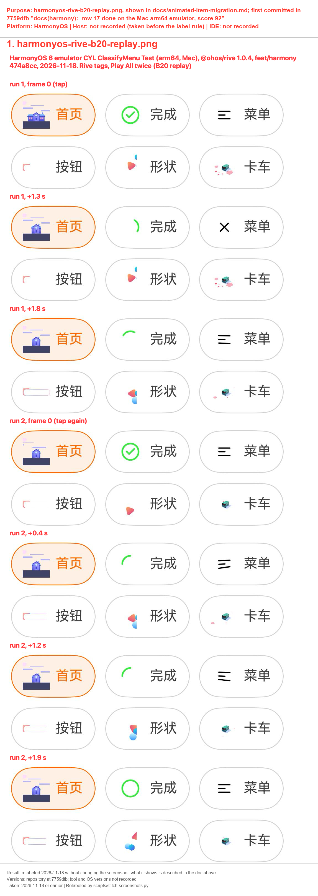

# CYLAnimatedItem migration: progress against the guide

The guide: CYLTabBarController's
[docs/Animated-Item.md](https://github.com/ChenYilong/CYLTabBarController/blob/feat/cross-platform-components/docs/Animated-Item.md)
(branch `feat/cross-platform-components`, read at `e3ebc242`, 2026-11-17). It asks this repository to make its icon + title
component, `CYLTagButton`, a subclass of the shared `CYLAnimatedItemView` (row "CollectionViewClassifyMenu" of "Migrating
the four repositories"), with the core depending on `CYLAnimatedItem` and on no animation engine; only the examples add
engines. Every icon + title view of this repository is already a `CYLTagButton` (`CYLIndexPathButton`,
`CYLRightImageButton`, the section headers, the search bar items of CYLSearchViewController), so one class carries the
migration on each platform.

Related logs: [component-architecture.md](component-architecture.md) (the task entries, newest at the end),
[issue-progress.md](issue-progress.md), [example-layer-fixes.md](example-layer-fixes.md).

## Task log

- **TODO → DONE (2026-11-17)**: report the progress against the guide and mark progress and TODOs in this repository.
  - **Prompt (verbatim)**: "告诉我 你遵循文档改造的进度，并在本仓库合适地方标注进度以及todo。这个文档是与动效组件相关的。告诉我 你遵循文档改造的进度https://github.com/ChenYilong/CYLTabBarController/blob/feat/cross-platform-components/docs/Animated-Item.md"
  - **Prompt (English)**: "Tell me your progress following the document's migration, and mark the progress and TODOs in a suitable place in
    this repository. The document is about the animation component."
  - **Result**: this document (the table, the score and the TODO list below), linked from `component-architecture.md` and
    `issue-progress.md`.

## Score

**Score: 100** (25 of 25 rows done; a row counts only when it is done and verified as far as this environment allows).

| Date | Score | Note |
|:---|:---|:---|
| 2026-11-18 | 100 | Row 11: `Package.swift` uses CYLTabBarController's new SwiftPM product `CYLAnimatedItem` (iOS pins at `6f93ae6b`) |
| 2026-11-18 | 96 | Row 19: mini program GIF stills, one-pass play and autoplay through cyl-tag-list and cyl-tag-button (WeChat DevTools) |
| 2026-11-18 | 92 | Row 17: HarmonyOS check on the Mac's arm64 emulator (Rive draws and replays, B20) |
| 2026-11-18 | 88 | Row 12: the static-library demo app compiles in CI (upstream fix `83a8ff8`); its workarounds removed |
| 2026-11-18 | 84 | Row 22: Flutter and React Native Android builds; the publish step no longer deletes the library |
| 2026-11-17 | 80 | Row 13 verified on a Mac (library 0 warnings, 152 tests pass); row 12 compiles with Xcode 27 but not in CI (Xcode 26) |
| 2026-11-17 | 76 | Row 20: WeChat DevTools check, the missing-tags bug fixed; row 17: HarmonyOS build and host tests |
| 2026-11-17 | 72 | First assessment, at `d979073` (pins `57a527e`; CYLTabBarController PR #815 open) |

## Progress by guide item

| # | Guide item | Platform | Status | Evidence / what is left |
|:---|:---|:---|:---|:---|
| 1 | `CYLTagButton` subclasses `CYLAnimatedItemView` | iOS | Done | `CYLTagButton.swift:44` (`1813025`) |
| 2 | Delete `CYLTagAnimationEngine` (run-time engine lookup) | iOS | Done | no occurrence left in the sources |
| 3 | Icon, title and animation properties are the inherited ones | iOS | Done | `1813025`; Objective-C sees them through redeclarations (`d3efc5f`) |
| 4 | Delete indicator → `accessoryView` / `accessoryPlacement` | iOS | Done | `CYLTagButton.swift:260`, `:320` |
| 5 | Per-state look in `itemStateDidChange` | iOS | Done | `CYLTagButton.swift:578` |
| 6 | Static measuring stays in the subclass (`width(forTitle:…)`) | iOS | Done | kept in `CYLTagButton` |
| 7 | Podspec depends on `CYLAnimatedItem` only, no engine | iOS | Done | `CollectionViewClassifyMenu.podspec:46`; `pod lib lint` green (CI on `71562ca`) |
| 8 | Examples add `CYLAnimatedItem/<Type>` by `:git` + `:commit` | iOS | Done | `Example/Podfile` (LottieObjectiveC, PAG, Rive, SVGA, GIF), `CYL_ANIMATED_ITEM` = `57a527e` |
| 9 | `import CYLAnimatedItem`, never CYLTabBarController, in the core | iOS | Done | `CYLTagButton.swift:24` (`@_exported`; falls back to `CYLTabBarController` only under SwiftPM, row 11) |
| 10 | Several engines: the example reports which are linked (multi-engine section) | iOS | Done | `CYLTagAnimationDemoViewController.engineReportLines()` (`b4d0e51`), test `testEveryLinkedEngineIsRegisteredAndListed` |
| 11 | Swift Package Manager: a separate `CYLAnimatedItem` product | iOS | Done | CYLTabBarController `22282646` adds the SwiftPM product `CYLAnimatedItem` (targets `CYLAnimatedItem` + `CYLAnimatedItemSwift`, no tab bar); `Package.swift` depends on it at `6f93ae6b` (2026-11-18). `xcodebuild` of the package alone (generic iOS Simulator, Xcode 27.2): BUILD SUCCEEDED, products `CYLAnimatedItem.o`, `CYLAnimatedItemSwift.o` and their bundles, 0 files of the tab bar compiled; `CYLTagButton.swift` imports `CYLAnimatedItem` when it can (CocoaPods keeps `CYLTabBarController`). CocoaPods projects at `12c1fabd` (no iOS library change up to `6f93ae6b`): menu 32, tag 6, example 92, swift 22 tests, 0 failures, iPhone 17 Pro iOS 27.2 |
| 12 | Static-library demo app (`CollectionViewClassifyMenu.xcodeproj`) compiles | iOS | Done | CI: the menu suite passes since CYLTabBarController `83a8ff8` (run 44092883295 on `f8301a4` fully green). Cause, found with deserialization recovery off (run 44071148862): "modularization issue on 'CYLAnimatedItemView' ... expected in 'CYLAnimatedItem' but found in 'CYLTabBarController'" (CYLTabBarController's module owned the component's header textually in static-library apps), fixed upstream. Workarounds removed: the Podfiles' `:modular_headers => true` and the CI diagnostic (`698260e`), the demo's own `import CYLAnimatedItem` (`880d9b1`, removed in the commit after `698260e`) |
| 13 | Full iOS CI green (menu, example, swift tests, screenshots) | iOS | Done (local Mac) | 2026-11-17 at `0583e1d`: menu 32 / 0, tag 6 / 0, example 92 / 0, swift 22 / 0 failures; engine report screenshot `assets/ios-animation-engine-report.png` (test), `assets/ios-animations-live.png` (app). CI run still to confirm |
| 14 | `CYLTagButton` subclasses `CYLAnimatedItemView`, `onItemStateChanged`, `accessoryPlacement` | Android | Done | `android/merged/library/.../CYLTagButton.kt:44`, `:261`, `:364` |
| 15 | Depend on `cyltabbarcontroller-animateditem`, `:cylanimateditem` substitution by commit | Android | Done | `library/build.gradle.kts:41`, `settings.gradle.kts:69` |
| 16 | Tag button on `CYLAnimatedItemView` (`cylanimateditem`, `file:` at the pinned commit) | HarmonyOS | Done (code) | `1a8a80b` (other session): vendored `harmony/cylanimateditem`, engines moved to the example |
| 17 | HarmonyOS build and device check | HarmonyOS | Done (build, host tests, arm64 emulator check) | Windows with DevEco Studio 6.0.1 (2026-11-17, after `1a8a80b`): `harmony/scripts/build.sh` OK, `unit-test.sh` 58 / 58, `accessibility-check.py` OK, `check-native-strings.py` OK, `harmony_parity.py --check` OK (the 12 `CYLTagButton` members inherited from `CYLAnimatedItemView` removed from `parity-map.json`; the test's missing `$rawfile('icon.png')` fixed). The emulator check waits for disk space (the emulator needs about 20 GB free). **2026-11-18, Windows emulator 127.0.0.1:5555 (x86_64): blocked.** The HAP builds (`deb3af5`), but `hdc install` fails: "code:9568347 install parse native so failed ... the Abi type supported by the device does not match". The HAP's native libraries are arm64-v8a only (`libohos_rive.so` from `@ohos/rive` 1.0.4, the latest; `libpag.so` from `@tencent/libpag` 4.4.31), and the emulator's `const.product.cpu.abilist` is `x86_64`. Rive cannot run on an x86_64 emulator, so the B20 replay check needs an arm64 target: the Mac (Apple Silicon) emulator once hdc connects, or a device. **Mac arm64 emulator (2026-11-18, `474a8cc`)**: HarmonyOS 6 emulator "CYL ClassifyMenu Test" (`127.0.0.1:5559`, `const.product.cpu.abilist` arm64-v8a): `harmony/scripts/build.sh` OK, the unsigned HAP installs (the x86_64 Windows emulator rejects the arm64-only `libohos_rive.so` / `libpag.so`), all six Rive tags draw, and Play All tapped twice animates every Rive tag both times (B20 replay; changed pixels per 0.4 s frame, run 1 / run 2: house [819,281] / [336,62], check [1036,552,779] / [1042,781,259], menu [731,721,175] / [409,530,320], button [99,91] / [124], shape [848,456] / [704,475,955,619], truck [391,62] / [90,64]);  |
| 18 | Tags on `cyl-animated-item` (copied at the pinned commit), engines as abstract nodes | Mini Program | Done | `62fce9b` (other session); `npm test` |
| 19 | GIF stills and one-pass play, `embedded`, `autoplay` in the mini program tags | Mini Program | Done | PR #815 (`faf535e0`) is in the pins since `074285a6`; the library now forwards the options to cyl-animated-item: cyl-tag-list items take `gifFirstFrame`, `gifLastFrame`, `gifDuration`, `autoplay` (defaults from the app's registry entry `first` / `last` / `duration`), cyl-tag-button has the same properties plus `embedded`, and Play all / `playAnimation()` go through cyl-animated-item's `playAnimation()`. WeChat DevTools (2026-11-18): the four GIF tags rest on their stills; Play all, sampled at 0 / 300 / 800 / 1300 / 2600 ms: all playing at 300 ms, Rocket (600 ms) at rest by 800 ms, Fire (990 ms) and Sample (1000 ms) by 1300 ms, Star (2190 ms) by 2600 ms; no type warnings in the console; `npm test` 141 / 141; `docs/assets/miniprogram-devtools-gif-stills-play-all.png` |
| 20 | WeChat DevTools / device check | Mini Program | Done (DevTools); two bugs found, one fixed | WeChat DevTools 2.02.2609250 on Windows (2026-11-17), Build npm OK. (1) **Fixed**: no tag list rendered anywhere (product, reviews, Animations): DevTools' unused-file filter (`ignoreDevUnusedFiles`) dropped `cyl-animated-item/cyl_animated_item_model.js` ("module … is not defined", then "Component is not found in path …/cyl-tag-list"); `cyl-tag-list.js` and `cyl-tag-button.js` required it as `…_model.js` while the component requires `./cyl_animated_item_model`; both now use the extension-less path and the tags render (`assets/miniprogram-devtools-tags-missing.jpg`, `assets/miniprogram-devtools-tags-after-fix.jpg`). (2) **Root cause found, fixed upstream**: the animated icons drew far past their 20 px slot because CYLTabBarController's engine components (`cyl-lottie`, `cyl-pag`, `cyl-rive`, `cyl-svga`) fixed their `:host` at 100 × 100 px; with only that changed to fill the box, every icon sits in its tag (`assets/miniprogram-devtools-engines-overflow.jpg` before, `assets/miniprogram-devtools-engines-fill-fixed.jpg` after; `embedded` was not needed). Fix: CYLTabBarController [PR #817](https://github.com/ChenYilong/CYLTabBarController/pull/817) (bug log B7); merged; fixed here by the pin to `4635ef7b` (DevTools, `assets/miniprogram-devtools-tags-4635ef7b.jpg`: every icon in its tag, no example change). (3) **Fixed here**: `cyl-tag-list/model.js` had its own engine table without SVGA, so an SVGA tag (`…svga.bin`) got no animation URL and no icon; it now asks `cyl-animated-item`'s `cylAnimatedItemType()` (found by the CYLSearchViewController session). Re-vendored `cyl-animated-item` at `7b764c73` (B6: `*.svga.bin`, `animationType`, data URI placeholder) |
| 21 | Example Podfiles name `CYLAnimatedItem` (+ engines) | Flutter, React Native (iOS) | Done | `flutter/cyl_tag_list/example/ios/Podfile:40`, React Native example Podfile (`modular_headers`, `27c0394`) |
| 22 | Android source builds compile `:cylanimateditem` | Flutter, React Native (Android) | Done | Mac, 2026-11-18 at `0f1897c`: `flutter build apk --debug` (Flutter 3.47.9) and the React Native example's `gradlew :app:assembleDebug` (JDK 17) build against `com.cyl:classifymenu` + `cyltabbarcontroller-animateditem` from the merged library's `build/repo`; both APKs contain `com.cyl.classifymenu.CYLTagButton` and `CYLAnimatedItemView`. Fixed on the way: `publishAnimatedItemToBuildRepository` deleted `com/cyl/classifymenu` from `build/repo` (Gradle removes a copy task's stale outputs on its first run), so the hosts could not resolve the library; it now runs before the library's publication |
| 23 | License notice in every published package | All | Done | `scripts/check-licenses.sh` OK (vendored `cyl-animated-item` / `cylanimateditem` keep their LICENSE) |
| 24 | Pins: newest CYLTabBarController commit, by `:commit` | All | Done | `57a527e` everywhere; `scripts/cyl-tabbar-latest-commit.sh` now lists PR #815's tip (unmerged, CI only warns): move to its merge commit |
| 25 | No regression: Play all, speed, loop on every animation screen | All | Done (iOS, Android) | docs/example-demo-rules.md; mini program GIF waits for row 19; **mini program Rive section TODO (bug B20, below)**: some Rive tags play once, then neither loop nor Play all plays them; React Native (Android) too, some never play |

## TODO (in order)

1. **CI**: since `53e3ea7` a started iOS run always finishes (`cancel-in-progress: false`); row 12 waits for the upstream umbrella-header fix and a pin move; then rows 12 and 13 (demo app, menu / example / swift
   tests, screenshots of the engine report screen into `docs/assets/`).
2. **Upstream merge of PR #815** (owner): then pins → the merge commit in this repository and CYLSearchViewController, and
   the mini program tags pass `gif-first-frame` / `gif-last-frame` / `gif-duration`, `embedded`, `autoplay` (row 19;
   agreed to be done by the CollectionViewClassifyMenu/CYLSearchViewController session).
3. **SwiftPM** (row 11): when CYLTabBarController ships a `CYLAnimatedItem` product, depend on it instead of
   `CYLTabBarController` in `Package.swift`.
4. **Toolchain checks**: HarmonyOS build and host tests done on Windows (row 17); its emulator check, WeChat DevTools
   (row 20) and the Flutter and React Native Android builds (row 22, no Flutter / Java / Gradle on that machine) remain.
5. **CYLTabBarController component APIs requested** (AGENTS.md "Bugs: record, screenshot, fix in CYLTabBarController's
   animated item"):
   - HarmonyOS `CYLAnimatedItemView`: an icon color for static bitmap icons (an alpha-preserving `ColorFilter`, as iOS
     template images). Meanwhile `CYLTagButton` (this repository's core) draws and tints its static icon itself
     (`64c6bc3`, emulator-verified with the `ColorFilter` object); it moves to the component's API once CYLTabBarController [PR #816](https://github.com/ChenYilong/CYLTabBarController/pull/816) (`CYLAnimatedItemView.iconColor`) is merged and the vendored `harmony/cylanimateditem` moves to that commit.
     Bug record: Y2 in `harmony-screenshot-issues.md`, screenshots `assets/harmonyos-y2-retest-icon-still-orange.jpeg`
     (before) and `assets/harmonyos-y2-fixed-white-icon.jpeg` (after).
   - Mini program `cyl-animated-item`: an embedded size (no 44 px minimum height or padding) and engine views that keep to
     the icon box; tracked as row 19 / CYLTabBarController PR #815 (`assets/miniprogram-devtools-tags-after-fix.jpg`).
6. **TODO, bug B20: Rive tags in the mini program play once, then stay static** (reported by the owner, 2026-11-18;
   recorded in CYLTabBarController `docs/Animated-Item.md` B20, [PR #820](https://github.com/ChenYilong/CYLTabBarController/pull/820)).
   Where: the mini program's Animations page (`pages/animations/animations`), section "Rive · pod 'CYLTabBarController/Rive'".
   Seen: with loop on, some Rive tags play once and never repeat; after that, Play all does not play them either.
   Screenshot: TODO. The section is below the fold and WeChat DevTools' `automation_*` tools (needed to scroll) do not
   connect from this machine's CLI (they ask for `wechatide auth`); `simulator_screenshot` covers only the viewport.
   Cause, read in `cyl-rive`'s `cyl_playFromStart` (to confirm in DevTools), per tag of `pages/animations/demo.js`:
   - 首页 `house` (state machine, no input): there is nothing to set and a state machine is never restarted, so it
     plays once on load and Play all does nothing; 形状 `shapes` / 卡车 `truck` (`legacy`, an option `cyl-rive` does not
     read) take the same path when the file has a state machine;
   - 菜单 `menu_button` (`input: isOpen`, `duration: 0`): 0 keeps the input on; it turns true once and never back to
     false, so the next Play all sets true again and nothing changes;
   - 完成 `check` (`triggerInput: Check`): fired on each play, but no loop path;
   - 按钮 `button` (linear animation `active`): `time = 0` on play; repeats only if the file's own loop type does.
   Fix in CYLTabBarController's `cyl-rive` (AGENTS.md "Bugs: record, screenshot, fix in CYLTabBarController's animated
   item"), not in the example: restart a state machine without input (a new `StateMachineInstance`), turn a held input
   off before setting it again, give triggers and linear animations a loop; then update the pins.
   **Other platforms (2026-11-18)**: the owner sees it in the React Native example too, some Rive tags never play. The
   Rive engines of every platform are single-shot with no loop (Android, so React Native and Flutter on Android; iOS
   new and legacy runtimes; HarmonyOS tab bar; mini program). Android emulator, React Native example, loop on, Play all,
   frames over 12 s (`assets/react-native-android-rive-b20-frames.png`, `assets/react-native-android-rive-b20-play-all.png`):
   Lottie changes every frame; Rive Home (`house.riv`, state machine without an input to set: Android checks the
   default `active`, finds none and returns) never moves; Done (`check.riv`, trigger) shows a small arc only; Menu
   (`menu_button.riv`, `isOpen` held by `duration: 0`) plays once, then stays at x. iOS: the same code paths (legacy
   returns without an input; `duration: 0` holds the boolean), not run here (no Mac); asked of the Mac session. Flutter's
   example passes no Rive options (it plays each file's first linear animation): to check. Fix: CYLTabBarController B20.
   **Mini program after CYLTabBarController's `cyl-rive` fix `39778645`** (pin moved to `6f44f26f` in
   `scripts/fetch-cyltabbar.js`; `npm test` 138 pass; WeChat DevTools, Animations page `?autoplay=1` (2x, loop on),
   8 frames over 15 s, `assets/miniprogram-devtools-rive-b20-after-39778645.png` and `-page.jpg`; changed pixels per
   icon between frames): Shapes, Truck and the `icons.riv` dark tags (Chat, Search, Timer, Alerts, Me) change in
   almost every frame; Menu replays (caught mid-transition); **Home (`house.riv`), Done (`check.riv`) and Button
   (`button.riv`) still show 0 changed pixels in all 8 frames**. No Rive error in the console. Still TODO for those three
   (or a replay shorter than the 2 s capture interval for Done); reported to the Mac-CYLTabBarController session.
   **Second pass `4e8fe675`** (pin moved; `npm test` 138 pass; same capture,
   `assets/miniprogram-devtools-rive-b20-after-4e8fe675.png`): Done now loops (the circle draws again in most frames),
   Menu goes from its menu icon to x and back, Shapes, Truck and the `icons.riv` tags loop. Button changes a few pixels only:
   its runtime is mid-animation (`active`, 1 s, time 0.52 s), and the animation hardly shows at 20 px. Home still never
   moves. Runtime state read in DevTools (every `cyl-rive` loaded, `playing: true`): `house.riv`'s `State Machine 1` has a
   **number** input `Rooms` (value 3) and the animations `to 3` to `to 6` (0.47 s), `Demo Mode` (2.73 s, loop) and
   `Sun Rotate` (40 s, loop). Nothing moves unless `Rooms` changes, and `cyl-rive` drives only boolean inputs and triggers,
   so this is a missing number-input option (or `animation=Demo Mode` in the example's options), not a rendering problem.
   Sent to the Mac-CYLTabBarController session. No Rive message in the console.
   **All pins at `8d2bbbc6`** (the newest CYLTabBarController commit: Rive replay / loop fixes for iOS `1f8fd27d`,
   Android `e4789e74`, HarmonyOS `7a7748a0`, mini program `4e8fe675`). Windows: Android core unit tests and the local
   publish pass, the React Native APK (x86_64) builds, the Flutter integration tests pass (2 of 2), mini program
   `npm test` 138 and React Native Jest 3 pass. React Native example on the Android emulator, loop on, Play all, 8 frames
   over 12 s (`assets/react-native-android-rive-b20-after-8d2bbbc6.png`, against
   `react-native-android-rive-b20-frames.png` before): Done loops (loading dots, then the green arc, again), Menu goes
   from its menu icon to x and back, Home now changes between frames (it never moved before). iOS `pod install` and the
   simulator check at this pin: the Mac session.
   **Home (`house.riv`): number input, pins at `eab038d5`.** CYLTabBarController added the Rive options `numberInput` and
   `values` (iOS and mini program; Android and HarmonyOS TODO there): each play sets the next value. Every example's Home tag
   now passes `numberInput: Rooms`, `values: 3,4,5,6` (iOS `CYLTagAnimationDemoViewController.swift`, mini program
   `pages/animations/demo.js`, React Native `TagListPage.tsx`, Flutter `main.dart`; Android ignores the options until it
   supports them). WeChat DevTools, loop on, 8 frames: Home changes in every frame (the house grows and shrinks as `Rooms`
   steps), `assets/miniprogram-devtools-rive-house-number-input.png`; mini program tests 138, React Native typecheck, lint and
   Jest 3, Flutter analyze pass. iOS: the Mac session. **B20 is done on iOS and the mini program; Android and HarmonyOS keep
   the number input as a CYLTabBarController TODO.**
   **Pins at `6a9ede85`** (CYLTabBarController: Android and HarmonyOS `numberInput` / `values` `3f262501`, `cyl-rive`
   exports `CYL_RIVE_OPTION_NAMES` `a10cdffc`; the mini program adapter now `require`s that list, the copy is gone).
   Windows: Android core tests and publish, React Native APK (after cleaning the bridge module's stale Kotlin incremental
   build: "Unresolved reference cyl_badgeCenterOffset" / "Cannot access internal class" came from the previous pin's
   classes), Flutter integration tests 2 of 2, mini program 138, React Native Jest 3. React Native example on the Android
   emulator, loop on, Play all, 12 s (`assets/react-native-android-rive-b20-after-6a9ede85.png`), changed pixels per icon:
   Home [101, 93, 122, 64, 216, 102, 109] (the house changes as `Rooms` steps), Done [151, 38, 113, 163, 33, 134, 78],
   Menu [205, 0, 209, 209, 0, 28, 28], Lottie loops. WeChat DevTools: Home [29, 16, 37, 51, 18, 40, 40], Done, Shapes,
   Timer and Me move. **B20: done on iOS, Android (React Native, Flutter) and the mini program**; HarmonyOS builds
   (CYLTabBarController), its emulator check is TODO there.
   **TODO (mini program Menu)**: in WeChat DevTools at `6a9ede85`, `menu_button.riv`'s `isOpen` read from the runtime every
   250 ms for 6 s (loop on) stays true in all 24 samples, so Menu stays open and only wobbles (5 px per frame pair). Cause in
   `cyl-rive`'s `cyl_playFromStart` (kind `input`, `duration: 0`): false, `advance(0)` and true run in one tick, and the
   state machine gets no time in the false state to close. Sent to the Mac-CYLTabBarController session with a fix
   suggestion (alternate the held value per loop pass); Android toggles correctly (React Native: menu icon, x, menu icon).
   **Done at `074285a6`** (pins moved; only `cyl-rive` changed since `6a9ede85`, so the Android, iOS and HarmonyOS builds are
   unchanged): a held input gets real time in its off state. WeChat DevTools: `isOpen` every 250 ms
   `100100110011001011010100` (off on every pass); changed pixels per frame pair: Menu [27, 53, 58, 34, 0, 55, 55], Home
   [30, 17, 20, 36, 16, 42, 56], Done [30, 20, 22, 22, 20, 9, 0], Shapes, Search, Timer, Alerts and Me move
   (`assets/miniprogram-devtools-rive-b20-after-074285a6.png`); mini program tests 138. **B20 is done on iOS, Android
   (React Native, Flutter) and the mini program**; HarmonyOS: its emulator check is a CYLTabBarController TODO.
   **iOS run (2026-11-18, Mac session, `689096f`)**: macOS 27.3, Xcode 27.2, "CYL ClassifyMenu iOS" simulator (iPhone 17
   Pro, iOS 27.2), pins `fe5c3ae`, English, launched with `-CYLExampleScreen animations-rive-loop` (new: scrolls to the
   Rive section, loop on, Play all); frames 4–14 s after Play all (`assets/ios-rive-b20-frames.jpeg`, first frame
   `assets/ios-rive-b20-play-all.png`): Shapes and Truck change every frame (they loop); Home (`house.riv`) never moves;
   Done (`check.riv`) stays on the finished check; Menu (`menu_button.riv`) stays on ≡; Button stays on its small arc;
   the icons.riv dark tags (Chat, Search, Timer, Alerts, Me) never move. Same result as Android.
   **iOS after the fix (2026-11-18, Mac session, `45dd63a`, pins `eab038d5`)**: same setup and launch
   (`animations-rive-loop`), six frames 2 s apart (`assets/ios-rive-b20-after-eab038d5.jpeg`, the Rive rows enlarged in
   `assets/ios-rive-b20-after-eab038d5-row.png`): Done now loops (arc → full check → arc), Button changes between frames,
   Shapes and Truck loop, and the dark Timer tag moves; Menu shows ≡ in all six frames (with `duration: 0` it may toggle
   between frames 2 s apart, or not at all: to check with a screen recording); Home's house is too small at this size to
   count the Rooms steps (1 → 2 → 3) seen on iOS 27.0 by the CYLTabBarController session.
   **iOS pixel check (2026-11-18, `f8301a4`, pins `eab038d5`)**: 8 consecutive `simctl io screenshot` frames (each capture
   takes about 11 s here), changed pixels (gray difference > 40) between consecutive frames per icon box: Home
   `[574, 584, 844, 592, 328, 910, 499]`, Menu `[0, 453, 453, 0, 0, 0, 562]`, Done `[75, 763, 661, 200, 730, 550, 581]`
   (`assets/ios-rive-b20-after-eab038d5-fast-row.png`: Menu caught morphing ≡ → x). All three move: on iOS every Rive tag
   of the section now replays with loop on (Done, Menu, Home, Button, Shapes, Truck, Timer). B20 fixed on iOS at `eab038d5`.
   **iOS at pins `6a9ede85` (2026-11-18, `a3f2547`)**: `pod install` resolves `6a9ede85`; unit tests menu 32 / 0, tag 6 / 0,
   example 92 / 0, swift 22 / 0. Pixel check (gray difference > 40 between consecutive `simctl` frames, about 11 s each):
   Home `[396, 344, 398, 377, 429, 691, 587]`, Done `[583, 700, 520, 460, 591, 142, 69]`, Button
   `[0, 11, 104, 105, 7, 12, 133]` (`assets/ios-rive-b20-after-6a9ede85-row.png`); Menu was `[0, 0, 0, 0, 0, 0, 0]` in that
   run (its 1 s toggle aliased by the slow captures) and `[225, 19, 245, 689, 653, 157, 0, 144, 144, 189, 189]` in a second,
   12-frame run. Every Rive tag still replays on iOS at `6a9ede85`.

## TODO (2026-11-17, macOS 27 + Xcode 27, `feat/harmony`): rows 12 and 13 on a Mac, simulator screenshots, bugs

- **Prompt (verbatim)**: "运行模拟器 截图测试 更新文档 记录bug 修复bug  阅读CYLAnimatedItem 相关的集成文档，continue fix todo iOS端代码与测试"
- **Prompt (English)**: "Run the simulator, take screenshots and test, update the docs, record bugs, fix bugs; read the
  CYLAnimatedItem integration documents and continue fixing the iOS TODOs, code and tests."
- **Plan**: row 12 (build `CollectionViewClassifyMenu.xcodeproj`'s demo app), row 13 (menu, tag, example, swift tests;
  engine report screenshot into `docs/assets/`), record and fix what fails. CYLTabBarController's own iOS TODOs of the
  guide are taken by other sessions (91: Lottie URLs and the CYLTabBarController podspec lint; fe: the CYLAnimatedItem
  podspec lint and its demo screenshot; ba: FlatDesign item and SwiftPM / Carthage products).
- **Bug found (2026-11-17)**: `CYLSearchCategoryScenarioTests.testSearchCategoriesUseABottomTabBarAndFillTheSearchBar`
  fails only on the "iPhone Duo" simulator (iOS 27): the category tab bar is laid out at the top (y = 0). It fails at every
  commit since the test was added (`a2efda2`), so not a regression of the API parity work (`07cc52b`), and passes on an
  iPhone 17 Pro. `scripts/simulator-id.sh` picked "iPhone Duo" as the first iPhone of the newest runtime; it now prefers
  a regular "iPhone <number>" model. The tab bar placement on that form factor is TODO, owned by CYLTabBarController.
  Measured (2026-11-18, iPhone Duo B7499C73, iOS 27.2, the failing test with a temporary log): the bar is not at the
  top but a vertical strip on the trailing edge, `CYLTabBar` frame (306, 0, 69, 609) in the screen's 375 x 609 view
  (window 375 x 667, screen 466 x 678 @3x), idiom phone, horizontal size class compact, vertical regular for both the
  tab bar controller and the window; `_UITabContainerView` visible. The test reads minY = 0 because the strip spans
  the whole height. An earlier note here blamed a regular size class; that was wrong (CYLTabBarController `5e01014a`,
  docs/Tab-Item-Positioning.md, measured the same). Fix in CYLTabBarController (its session); the example keeps its
  assertion ("Tab bars are always at the bottom").
- **Bug fixed (2026-11-17, `0583e1d`)**: the example's test screenshots showed empty places instead of the animated icons
  (Lottie, PAG, Rive, SVGA, GIF), although the running app draws them (`assets/ios-animations-live.png`): the capture ran
  before the icons' first frame was drawn. `CYLScreenshotCapturing.captureScreenshot` now runs the main run loop for 0.5 s
  first (`assets/ios-animation-engine-report.png`). `CYLAnimatedIconTests` 8 / 0.
- **Results (2026-11-17)**: row 13 Done on the local Mac; row 12 compiles with Xcode 27 locally but still fails in CI with Xcode 26 (menu 32, tag 6, example 92, swift 22 tests, 0
  failures, on the "CYL ClassifyMenu iOS" iPhone 17 Pro simulator). Still TODO: the iPhone Duo tab bar placement (above).
- **Screenshots (2026-11-17, `333b349`)**: all 54 iOS example screens in [screenshots.md](screenshots.md) ("iOS: every example
  screen"), `assets/ios-1117/`. Bug fixed: `scripts/example-screenshots.sh` captured the previous app's last frame for the
  first screen of a run (`product@zh-Hans` showed the animations screen); it now waits 10 s more for the first launch.

## TODO (2026-11-17, `feat/harmony`): raise the migration score from 80

- **Prompt (verbatim)**: "fix The migration score stays at 80 / 100."
- **Plan**: rows this Mac can close: 17 (HarmonyOS check on the emulator `CYL ClassifyMenu Test`), 22 (Flutter and React
  Native Android builds with their toolchains); 19 if CYLTabBarController PR #815 is merged; 11 and 12 depend on upstream
  (SwiftPM product) and CI (Xcode 26).
- **Progress (2026-11-18, `0f1897c`)**: row 22 Done (score 84). Row 17: the emulator boots but hdc never connects
  (127.0.0.1:5563 refuses, `hw.hdc.port=notset`), so the device check is still TODO. Row 19: the pins (`fe5c3ae`) include
  PR #815's merge (`faf535e`); the mini program tags still have to pass `gif-first-frame` / `gif-last-frame` /
  `gif-duration`, `embedded`, `autoplay` (mini program code, coordinated with the Windows session). Rows 11 and 12 wait on
  upstream SwiftPM and on CI (Xcode 26).
- **iOS at pins `eab038d5` (2026-11-18, `5f9b76e`)**: `pod install` resolves CYLTabBarController and CYLAnimatedItem at
  `eab038d5` in the root, Example, Example-Swift and TagCollectionView projects (`Podfile.lock` is ignored by
  `.gitignore`, nothing to commit); unit tests on the "CYL ClassifyMenu iOS" simulator: menu 32 / 0, tag 6 / 0, example
  92 / 0, swift 22 / 0 failures.
- **iOS at pins `074285a6` (2026-11-18, `19e1e4a`)**: `pod install` resolves `074285a6` in the four iOS projects;
  `6a9ede85..074285a6` changes only the mini program's `cyl-rive`, its test and a doc (no iOS source), so the iOS results
  at `6a9ede85` (152 tests pass, every Rive tag replays) stand without a re-run.
- **Mini program and Android pins at `6f93ae6b` (2026-11-18)**: `fetch-cyltabbar.js`, the test, the vendored `COMMIT`
  files and `android/merged/gradle.properties`; `074285a6..6f93ae6b` changes HarmonyOS, Flutter, iOS demo resources and
  docs only (no Android source, no cyl-animated-item / cyl-animation-placeholder change: the re-vendor touched only the
  `COMMIT` files), so the Android results stand; mini program `npm test` 141 / 141.
- **Row 17 on Windows (2026-11-18, `deb3af5`)**: blocked, the x86_64 emulator cannot install the arm64-only Rive and
  PAG native libraries (see row 17); score stays 88. Next: run the check on an arm64 emulator or device.
- **Row 17 on the Mac (2026-11-18, `474a8cc`)**: DONE, score 92. The Mac emulator was connected all along, as
  `127.0.0.1:5559` (hdc gives it a free port; `5563` was wrong). The HAP installs on its arm64 image, every Rive tag
  draws and replays on a second Play All. Evidence: `assets/harmonyos-rive-b20-replay.png`,
  `assets/harmonyos-rive-section-arm64.jpeg`. Left: rows 11 (SwiftPM product) and 19 (upstream merge).

## TODO (2026-11-18, `feat/harmony`): migration score from 92 to 100

- **Prompt (verbatim)**: "My session: nothing new on feat/harmony since a1366b9; the score is still 92 fix to100"
- **English**: raise the migration score from 92 to 100.
- **Plan**: row 11: CYLTabBarController `12c1fabd` (newest, `scripts/cyl-tabbar-latest-commit.sh`) has the SwiftPM product
  `CYLAnimatedItem` (`22282646`); depend on it instead of the `CYLTabBarController` product, move the iOS pins (Package.swift,
  Podfiles, React Native and Flutter example Podfiles) to `12c1fabd`, build the package, pod install, run the iOS tests.
  Row 19: PR #815 is merged (`faf535e0`) and inside the pin since `074285a6`; the mini program check belongs to the
  Windows session (asked by message), as do the Android, HarmonyOS and mini program pins.
- **Result (2026-11-18)**: DONE, score 100. Row 11 Done (above); row 19 Done by the Windows session (`eaddb56`). Pins at
  `6f93ae6b` on every platform (iOS here; mini program and Android `557b91d`).
