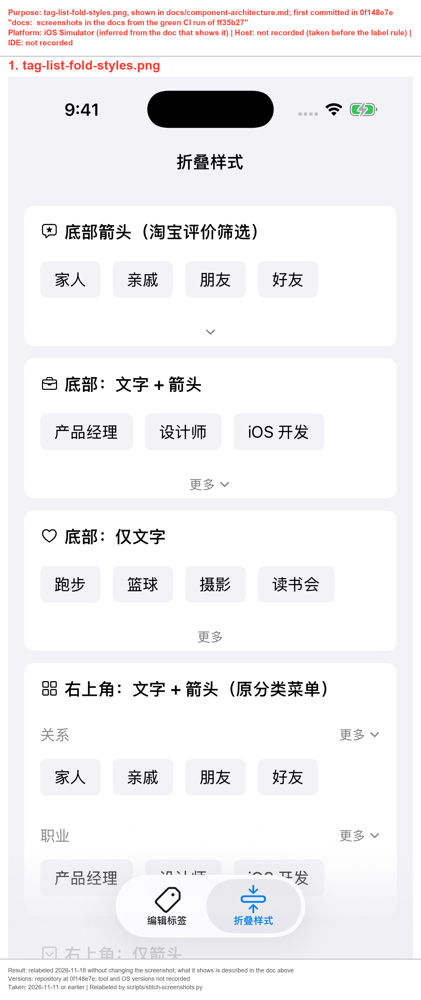
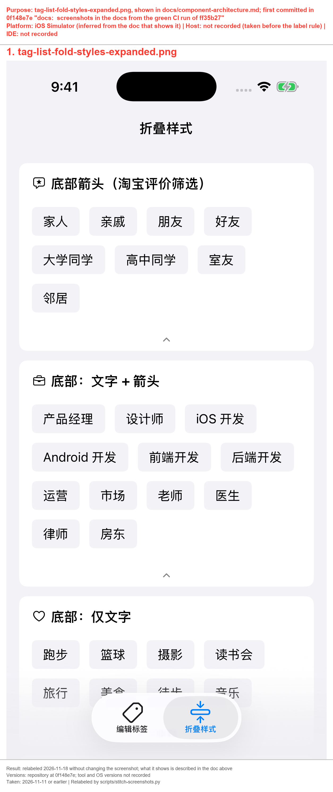
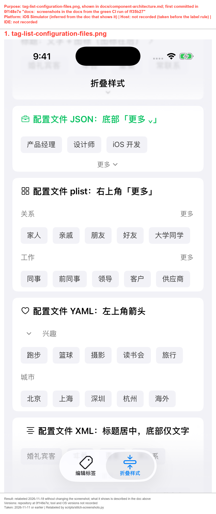
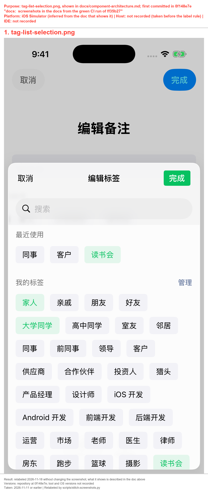
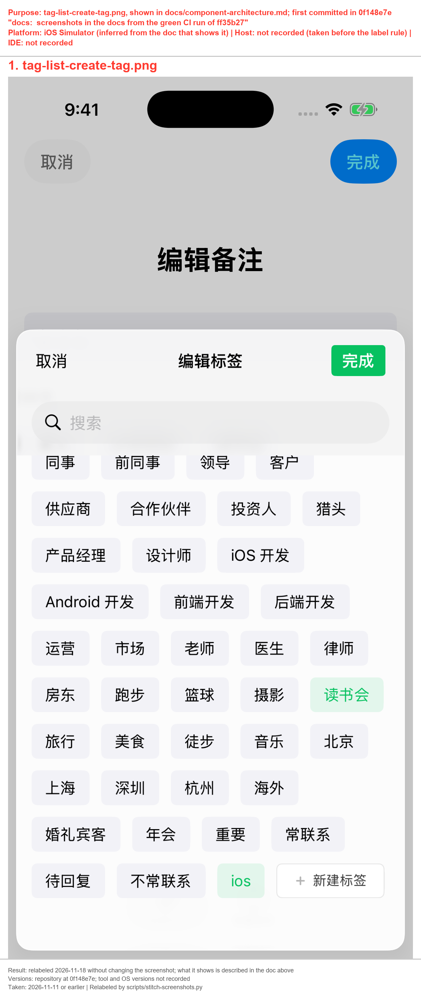
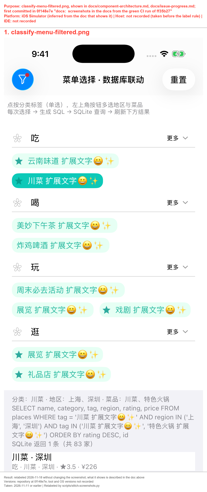
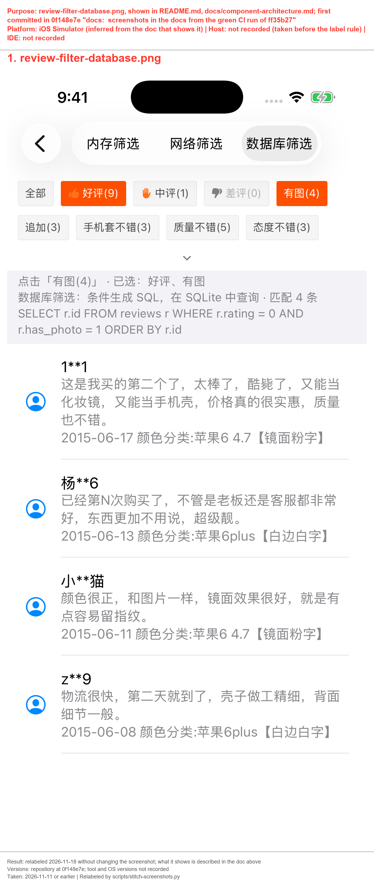
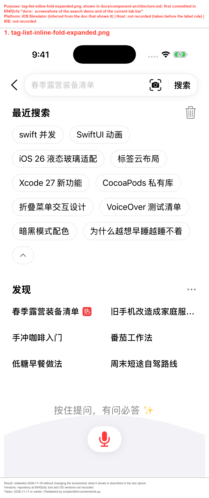
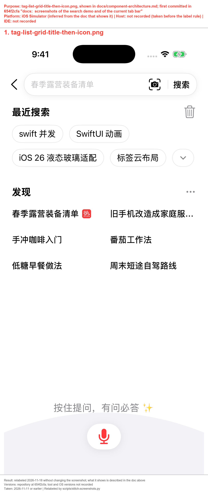

# Component architecture and community review

## aklee 封装思路 / Encapsulation

[b38bceba](https://github.com/aklee/CollectionViewClassifyMenu/commit/b38bceba34d76c56a1dc72a2c6e40bd0a611f3e0)
将标签布局、分组模型、cell 和 header 集中到独立示例中，便于复用界面和理解展开逻辑。
后续的 `TagView` 进一步提供可嵌入的视图。

原始提交仍将数据和行为绑定在控制器、具体 `TagGroup`/`TagModel`、屏幕宽度、
主 bundle 与日志输出中；它不是数据源可替换的 Pod。旧行计数反复扫描和复制数组，
数据改变后缓存也可能过期。组件现在由 `CYLMenuDataSource` 和 `CYLMenuDelegate`
连接宿主：两个示例提供自己的数据，选择和持久化由宿主负责。资源放在独立 bundle；
`TagView` 支持代码和 XIB 初始化。旧公开模型和接口仍可用于兼容。

The original change usefully grouped tag views, cells and models, but tied
data, screen geometry and callbacks to the implementation. The current Pod
inverts that dependency through host-owned protocols and keeps sample data and
persistence in the demos.

## 低耦合接口 / Decoupled API (CYLTagListView)

旧控制器把图片、分组图标、选择规则、折叠方式和尺寸写死在实现里，宿主只能改源码。
新增的 `CYLTagListView` 只负责布局、折叠和选择状态，其余全部交给宿主：

- 数据：`CYLMenuDataSource` 新增标签图标、分组图标、分组标题右侧视图和禁用状态。
- 行为：`CYLMenuDelegate` 新增拦截选择、取消选中、展开/折叠和内容高度变化回调。
- 外观：`CYLMenuStyle` 统一描述字体（含 Dynamic Type 上限）、颜色、边框、圆角、间距和高度；
  视图持有样式副本，宿主修改原对象不会意外影响已显示的菜单。
- 选择：`CYLMenuSelectionMode`（无 / 单选 / 多选）、`allowsEmptySelection` 和互斥项；
  代码修改选择不触发回调，与 UIKit 惯例一致。
- 折叠：`CYLMenuFoldStyle`（标题按钮、底部箭头、仅截断预览）与 `defaultVisibleRows`；`CYLMenuFoldControl`
  的位置还包括 `Inline`：折叠按钮作为最后一个标签（`CYLTagFoldCell`），点击即展开/收起，隐藏的标签为它让出位置。
- 网格与图标位置：`CYLMenuStyle.numberOfItemsPerRow`（`gridStyle(itemsPerRow:)`）让标签等宽、每行固定个数、超出省略号；
  `imagePlacement`（图标在文字前或后）与 `contentAlignment`（居中或从左边距开始）让标签按钮支持「文字在左、图标在右」，
  如「苹果官方社区… [热]」：文字截断，图标始终可见。
- More 按钮：数据源 `menuShowsMoreButtonInSection:` 在分组标题右侧显示核心库的 More 按钮（三个点），
  事件由代理 `menu:didTapMoreButtonInSection:` 交给宿主（Example 中为随机刷新）。
- 嵌入：`contentHeight`、`intrinsicContentSize`、`heightThatFitsWidth:` 和 `scrollEnabled`，
  可放进表头、Stack View 或 Auto Layout。

行计算与旧组件相同，按实际容器宽度单次遍历；宽度或文字大小变化时重新测量。
`Example/` 通过 Podfile 以本地路径集成核心库，用这些接口实现 README 的两个场景；
`CYLExampleMenuSource` 演示宿主如何把自己的模型转成数据源。

## DONE (2026-11-14, logged as TODO 2026-11-13): rename the fold control positions (`CYLMenuFoldControlPosition`)

- **Context:** the fold control's place is named by geometry today (`Bottom`, `TopTrailing`, `TopLeading`,
  `Inline`). The maintainer proposes names taken from the collection view's own parts: the control that is always the
  last item of the tags (folded or expanded, as in the Android recent searches and the review filter screenshots)
  is the `tail`; below the section, the `footer`; in the header's top right / top left corner, `headerRight` /
  `headerLeft`. The core is not released and not on `master`, so the names may change (no compatibility kept,
  AGENTS.md "Core quality first, examples last").
- **Requirements:** compare the current and the proposed names in a table, judge which is easier to understand,
  pick one set and implement it (iOS core, Android port, examples, configuration strings, README, docs).

| Today | Proposed | What it is | Assessment | Chosen |
| --- | --- | --- | --- | --- |
| `none` | (unchanged) | no fold control, every row shown | clear | `none` |
| `bottom` | `footer` | centered below the section | **proposed is better**: it names the collection view's section footer, where the control is a supplementary view, and pairs with "header…"; "bottom" could mean the bottom of the whole list | `footer` |
| `topTrailing` | `headerRight` | at the end of the section header | **mixed**: "header" is better than "top" (it says which view holds it); "right" is wrong in right-to-left languages, where the code puts it on the left (the header layout follows the leading edge, `foldAtLeadingEdge`), and UIKit / Android name such edges leading / trailing (start / end) | `headerTrailing` |
| `topLeading` | `headerLeft` | before the section title in the header | same as above | `headerLeading` |
| `inline` | `tail` | a tag cell that is always the last item, folded or expanded | **proposed is better**: "inline" only says it sits among the tags, "tail" says where (the end of the items, as `byTruncatingTail` is the end of a text); `lastItem` was considered and is longer without being clearer in a list of positions | `tail` |

- **Decision:** `none`, `footer`, `headerLeading`, `headerTrailing`, `tail`: the proposal's structure-based names,
  with leading / trailing instead of left / right so that they stay true in right-to-left layouts. Swift:
  `CYLMenuFoldControlPosition.footer` … `.tail`; Objective-C while the file is not migrated:
  `CYLMenuFoldControlPositionFooter` …; Kotlin: `FOOTER`, `HEADER_LEADING`, `HEADER_TRAILING`, `TAIL`.
- **Configuration strings:** `"footer"`, `"headerLeading"`, `"headerTrailing"`, `"tail"`; `"headerLeft"` /
  `"headerRight"` accepted as aliases of the leading / trailing names (as `"topleft"` / `"topright"` are today); the
  old strings (`"bottom"`, `"topLeading"`, `"topTrailing"`, `"inline"`) are dropped, and the example JSON files are
  updated.
- **When:** with the Swift migration of `CYLMenuFoldControl`, the enum's file (step 8 of `docs/Swift-Migration.md`;
  step 7 moved `CYLTagListView` and kept the old case names, so the names change once, in Swift), together with the
  Android port in the same commit.
- **Status:** DONE (step 8 of `docs/Swift-Migration.md`): iOS `CYLMenuFoldControlPosition.none / .footer /
  .headerTrailing / .headerLeading / .tail` (Objective-C `CYLMenuFoldControlPositionFooter`…), Kotlin `NONE`, `FOOTER`,
  `HEADER_TRAILING`, `HEADER_LEADING`, `TAIL`; configuration strings `"footer"`, `"headerLeading"`, `"headerTrailing"`,
  `"tail"` (aliases `"headerLeft"`, `"headerRight"`) on both platforms; the example JSON, plist, YAML and XML files,
  the examples, tests, README and this document updated.
- **Prompt (verbatim, 2026-11-13, with the Android recent searches and the review filter screenshots):**

  > 我想到一个很好的，定义折叠功能按钮位置的枚举定义。如果是截图中tag list ，collectionView总是最后一个按钮是折叠按钮。无论折叠还是不折叠都是最后一个是折叠或者展开按钮。那么我们可以成为tail ，底部用 footer . 顶部 右上角  headerright 顶部 左上角 。headerleft。评估我现在的命名与现在代码的实现相比哪一个更容易理解。在合适的文档中记入TODO，在文档中列出表格 旧有的那现有的对比，选一个实现。该core代码还没发布不在master分支，命名可修改

- **Prompt (English):** a better enum for the fold button's position: in a tag list like the screenshots, the last
  item of the collection view is always the fold button, folded or not, so call it `tail`; below, `footer`; top right,
  `headerRight`; top left, `headerLeft`. Judge whether my names or the current ones are easier to understand; record a
  TODO in a suitable document with a table comparing the old and the proposed names, and pick one to implement. The
  core is not released and not on `master`, so the names may change.

## 截图 / Screenshots

CI 截图（`Example screenshots`，提交 `22370a8`，iPhone 模拟器，`macos-26`）。`CYLTagListView` 的折叠控件与标题样式、由配置文件创建、多选与新建标签，以及移植的分类菜单与多选筛选：

| 折叠控件与标题样式 | 全部展开（箭头旋转 180°） | 由 JSON / plist / YAML / XML 创建 |
| --- | --- | --- |
|  |  |  |

| 多选（两个分组同时选中） | 搜索后新建并选中标签 | 分类菜单 + 多选筛选（数据库） | 评价筛选（SQLite） |
| --- | --- | --- | --- |
|  |  |  |  |

| 折叠按钮作为最后一个标签（展开） | 网格：文字在左、图标在右，More 按钮 |
| --- | --- |
|  |  |

## Swift 示例与 Swift 友好的核心 / Swift examples, Swift-friendly core

所有示例（`Example/`、`Example-Swift/`、根目录工程的演示 App `CYLClassifyMenuDemo`、`TagCollectionView` 演示）及其测试均为 Swift；
核心库保持 Objective-C，只通过 Swift 标注适配 Swift 调用（`NS_SWIFT_NAME`、字符串字面量形式的 `swift_name`、`cyl_` 方法的
`cylXxx` 版本），从不修改 Objective-C 接口。例如 `+[CYLTagView tagView]` 在 Swift 中为 `makeTagView()`，
`CYLMenuLocalizedString` 宏另有 Swift 可调用的同名函数。公开头文件的多行注释统一为 `/*! … */` 文档注释块
（`scripts/check-doc-comments.py`），Xcode 快速帮助与 Swift 接口都能显示。
The examples are all Swift; the core stays Objective-C and only gains Swift annotations next to its public
declarations, so Objective-C callers see no change.

不兼容修改：移除 `menuItemHasImageAtIndexPath:`，改用 `menuImageForItemAtIndexPath:`；
`CYLClassifyMenuViewController` 的分组图标改由 `menuImageForSection:` 提供。

## 社区提交 / Community commits

- [ce86ea2](https://github.com/XIAODINGPA/CollectionViewClassifyMenu/commit/ce86ea2bedce65c89344ebb6933bb5cf01cbab82)
  已在当前历史中。其单行累计宽度思路简化了旧算法，但 `<=` 会在间距恰好相等时过早换行，
  且后续行仍反复扫描。现有实现一次遍历所有行，按实际可用宽度计算。
- `izhangmi`、`NSIRLConnection` 和 `XIAODINGPA` 已有分支提交均已在本仓库历史中；
  `jouns/CollectionViewClassifyMenu` 为空仓库，没有可合并的分支。
- `SecondShuo/CollectionViewClassifyMenu-master` 的唯一提交是无共同祖先的旧项目快照，
  源码与本仓库历史快照实质相同，仅有空行和文件权限差异，还包含 Xcode 个人状态。
  已通过 [922cd7f](https://github.com/ChenYilong/CollectionViewClassifyMenu/commit/922cd7fc880c1a21d8275a4b1ce272ca587f079e)
  合并其历史，同时保留现有代码和修复，未重新引入旧代码或个人状态。

## 验证边界 / Validation limits

- 行布局与复用对应 [#8](https://github.com/ChenYilong/CollectionViewClassifyMenu/issues/8)、
  [#9](https://github.com/ChenYilong/CollectionViewClassifyMenu/issues/9) 和
  [#13](https://github.com/ChenYilong/CollectionViewClassifyMenu/issues/13)；
  section header 宽度对应 [#7](https://github.com/ChenYilong/CollectionViewClassifyMenu/issues/7)。
- 演示和测试覆盖 320/390 pt、长文本及 emoji、复用和外部数据源，以及 Dynamic Type 字号缩放、
  无障碍元素（标签、特征、提示与固定的 `accessibilityIdentifier`）；并未覆盖所有真机、旋转，
  也没有在设备上用 VoiceOver 实际走查。
- iOS 15 已弃用的按钮 edge insets、`adjustsImageWhenHighlighted` 和
  `UIGraphicsBeginImageContext` 已在 [32720b0](https://github.com/ChenYilong/CollectionViewClassifyMenu/commit/32720b0352a0ab93fb5722e711e9954356b63624) 中替换；
  2026-11-11 的 CI（[ff35b27](https://github.com/ChenYilong/CollectionViewClassifyMenu/commit/ff35b27)，`macos-26`）中
  `pod lib lint` 与库的构建/静态分析（有警告即失败）均已通过。
- 历史 3.5 英寸设备不支持项目现有的 iOS 15 最低版本，因此不能在原设备上复验 #7。

## 动效组件改造进度 / Progress against CYLTabBarController's Animated-Item.md

The progress table, score and TODO list against CYLTabBarController's
[docs/Animated-Item.md](https://github.com/ChenYilong/CYLTabBarController/blob/feat/cross-platform-components/docs/Animated-Item.md)
are kept in one place: [animated-item-migration.md](animated-item-migration.md). The entries below are the detailed task logs.

## DONE (2026-11-17): CYLTagButton subclasses CYLTabBarController's CYLAnimatedItemView; no animation engine in the core

- **Context**: branch `feat/harmony` (PR #20). CYLTabBarController's guide
  [docs/Animated-Item.md](https://github.com/ChenYilong/CYLTabBarController/blob/feat/cross-platform-components/docs/Animated-Item.md)
  (read at the branch tip `35aa757`) ships the shared animated icon + title component `CYLAnimatedItem`: iOS subspec
  `CYLTabBarController/CYLAnimatedItem` (CYLUtils only, static images, `CYL_ANIMATION_ENGINE_AVAILABLE` = 0 without an
  engine) and one Core-free engine subspec per file type (`CYLAnimatedItemLottieSwift`, `…LottieObjectiveC`, `…PAG`,
  `…PAGEnterprise`, `…Rive`, `…SVGA`, `…GIF`); Android module `:cylanimateditem`, Maven
  `io.github.chenyilong:cyltabbarcontroller-animateditem`. Its migration row for this repository: `CYLTagButton`
  subclasses `CYLAnimatedItemView`, `CYLTagAnimationEngine` and the own icon / title / animation storage go,
  `deleteIndicatorLabel` becomes `accessoryView`, the per-state look goes to `itemStateDidChange` / `onItemStateChanged`,
  the indicator's side to `accessoryPlacement`, the static measuring stays. The display priority (animation, then the
  static image, then the component's placeholder only without a static image), the failure cases and the URL loading
  rule are the base class's and are inherited. CYLSearchViewController's search bar items subclass `CYLTagButton` and
  follow (its task log: `docs/animated-icon-component.md`).
- **Requirements**:
  1. Change the CocoaPods, Gradle / Maven and npm configuration as the guide says; the core depends on the component.
  2. Rework the core so that it shows the same animations through it.
  3. The core depends on no animation engine; animated icons show only when the example layer adds an engine.
  4. The components concerned: the packaged animated icon + title core component, `CYLTagButton`.
- **Prompt (verbatim)**: "https://github.com/ChenYilong/CYLTabBarController/blob/13e717c9/docs/Animated-Item.md 根据文档链接，根据该文档，修改cocoapods gradle maven npm等配置，要求更新core核心代码 ，依赖该新组件。改造core核心代码，要求实现同等动效效果。core核心代码不依赖于动效引擎，仅仅在example层引入动效引擎时才展示动效icon。涉及的组件为本仓库中已经封装好的动效icon加title的核心组件代码。"
- **Prompt (English)**: "Following the linked document, change the CocoaPods, Gradle, Maven, npm and similar
  configuration; update the core code to depend on the new component. Rework the core code to achieve the same
  animation effects. The core code does not depend on the animation engine; animated icons show only when the example
  layer adds the animation engine. The components concerned are this repository's packaged animated icon + title core
  components."
- **Guide link (user, 2026-11-17)**: link the guide on its branch, the newest address:
  <https://github.com/ChenYilong/CYLTabBarController/blob/feat/cross-platform-components/docs/Animated-Item.md>.
- **Status**: done in the commit after the task log `45101fb` (the row "CollectionViewClassifyMenu" of the guide's
  "Downstream migration status" table points at `45101fb`); CYLTabBarController pinned at its branch tip `7511f7d`
  (no code change since `35aa757`, the guide read there). Verification items below stay TODO.
- **Result**:
  - iOS: `CYLTagButton` subclasses `CYLAnimatedItemView` (`import CYLTabBarController`); `CYLTagAnimationEngine`, the own
    icon / title / animation storage, the player and the loop timer are gone. Inherited: `title`, `image`,
    `selectedImage`, `imageView`, `titleLabel`, `animationURL`, `animationSpeed` (now `CGFloat`; `resetAnimationSpeed()`
    follows the style again, `CYLTagListView.animationSpeed = nil` calls it), `animationLoops`,
    `animationRestingProgress`, `animationView`, `playAnimation()` / `restartAnimation()` / `stopAnimation()` /
    `showAnimationLastFrame()`, `delegate`. Overridden hooks: `layoutContent(in:)` (the style's layout, the image view
    under the animation view in the same frame), `contentSizeThatFits(_:)`, `itemStateDidChange()` (the appearance per
    state), `itemAccessibilityLabel()`, `updateItemAccessibility()` (no-op: label, value and traits stay computed),
    `reloadAnimation()` (the selection's frame), `playAnimation()` (Reduce Motion). `deleteIndicatorLabel` is the
    `accessoryView` (set once; its tap reaches `animatedItemViewDidTapAccessory(_:)`; leading / trailing through
    `accessoryPlacement`); `top` / `bottom` set `axis = .vertical`. The display priority, the failure fallbacks, the
    placeholder and the URL loading are the base class's; a tag keeps the component placeholder (sized like its icon)
    when it has an animation file and no static image, and a title-only tag shows none.
    `isAnimationEngineAvailable` is `NSClassFromString("CYLTabBarItemAnimationFactory") != nil`; `animationPlayer` is
    not referenced by the core (the base class declares it only with an engine). `animationPlayer` (public before) is
    removed from `CYLTagButton`'s own API (docs/Swift-Migration.md, row 9).
  - Objective-C callers import only `CollectionViewClassifyMenu`, never `CYLTabBarController`. Clang shows a module's
    declarations only to a file that imports that module, so `CYLTagButton` redeclares (forwarding to the base class)
    the inherited members Objective-C uses: `animationURL`, `animationLoops`, `animationView`, `imageView`,
    `titleLabel`, `accessoryView`, `placeholderImage`, `restartAnimation()`, `stopAnimation()` (with the ones it already
    overrides: `title`, `image`, `selectedImage`, `animationSpeed`, `animationRestingProgress`, `playAnimation()`,
    `reloadAnimation()`). CI failed "Unit tests (menu)" on `1813025` without them; `f93974b` worked around it by importing
    CYLTabBarController in the test, which the owner rejected (2026-11-17, prompt verbatim: "Donot import tabbar and fix
    it"); it is reverted and fixed in the core. DONE (2026-11-18): CI "Unit tests (menu)" passes without the import (run 44142400181 at `8794487`; also `f8301a4`).
  - CocoaPods: podspec `s.dependency 'CYLTabBarController/CYLAnimatedItem'`; Example Podfile `CYLAnimatedItem` plus
    `CYLAnimatedItemLottieObjectiveC`, `…PAG`, `…Rive`, `…SVGA`, `…GIF`; RN and Flutter example Podfiles
    `CYLAnimatedItemLottieObjectiveC`, `…Rive`; Example-Swift and the root project no engine; TagCollectionView's Podfile
    pins CYLTabBarController by commit (`CYLAnimatedItem`). `scripts/pod-lint.sh lib` lints with the pinned commit's
    podspec (`--include-podspecs`), since no trunk release has the subspec.
  - SwiftPM: `Package.swift` depends on CYLTabBarController by revision, product `CYLTabBarController` (its only
    product, which also holds its tab bar and Lottie engine). TODO: switch to a `CYLAnimatedItem` product once
    CYLTabBarController offers one; its SwiftPM build is not green upstream, and this repository's CI does not build
    SwiftPM.
  - Android: `CYLTagButton` subclasses `com.cyl.animateditem.CYLAnimatedItemView`; `api("io.github.chenyilong:
    cyltabbarcontroller-animateditem:1.100.0")`, substituted by `project(":cylanimateditem")` of the pinned checkout in
    `android/merged/settings.gradle.kts`; `animationURL` is the base class's `String?` (the cell passes
    `Uri.toString()`; the convenience constructor still takes a `Uri`); `imageView` / `titleLabel` alias `iconView` /
    `titleView`; `disabledAlpha = 1` (the style draws the disabled look); a non-clickable tag (a cell's) leaves touches
    to its parent; the fold button's TalkBack text through `accessibilityText()`. Publishing the library to
    `build/repo` also publishes the pinned `cylanimateditem` there, for the React Native and Flutter hosts. The core adds
    no animation library; the example keeps Lottie, libpag and rive-android.
  - HarmonyOS and the mini program: TODO, blocked upstream. CYLTabBarController has no `CYLAnimatedItem` component there
    yet (the guide's TODO 3 and 4); no local copy is invented. When it ships, `harmony/classifymenu` and the mini program
    `cyl-tag-button` move onto it the same way.
  - Tests: Example-Swift `CYLTagButtonStaticImageTests` (no engine in that example: static image, placeholder only
    without a static image, none for a title alone, playback does nothing, the accessory), Example
    `CYLTagButtonTests.testTagButtonDisplayPriorityWhenTheAnimationCannotPlay` (with the engines: a missing file and an
    unknown type), the Objective-C standalone test (inherited members visible to Objective-C), Android
    `CYLTagButtonStandaloneTest` (no library: static image and same layout, placeholder rule, the accessory's tap).
  - Parity tables regenerated: iOS -> Android 784 / 792 = 99.0 (the 8 `TODO` rows predate this task), Android -> iOS
    731 / 731 = 100; `ios_public_api.py` lists CYLTagButton's inherited `CYLAnimatedItemView` members, mapped in
    `api-map.json`. Mini program `npm test`: 110 pass, 0 fail.
- **TODO (verification)**: no Xcode, Android SDK or DevEco in this Linux container, so nothing was compiled: (1) `pod
  install` and the iOS builds and tests (`scripts/unit-tests.sh`, `scripts/pod-lint.sh lib`) in CI, in particular the
  Swift overrides of the Objective-C members (`title`, `image`, `selectedImage`, `animationSpeed`,
  `animationRestingProgress`, `layoutContent(in:)`) and `scripts/swift-api-check.sh` (refresh
  `scripts/swift-api-baseline.json`); (2) the Android build and Robolectric tests (`android/scripts/gradle.sh merged
  :library:testDebugUnitTest :example:assembleDebug`) and the `build/repo` copy of `cylanimateditem`; (3) the example
  screenshots of the animated tags (Lottie, PAG, Rive, SVGA, GIF) against the previous ones.

## DONE (2026-11-17, closed 2026-11-19): CYLAnimatedItem is its own pod and module

- **Context**: branch `feat/harmony` (PR #20). CYLTabBarController's guide
  ([docs/Animated-Item.md](https://github.com/ChenYilong/CYLTabBarController/blob/feat/cross-platform-components/docs/Animated-Item.md))
  was updated at `1f0fcce` (`c53d2899`): the component is now the pod and module `CYLAnimatedItem`
  (`CYLAnimatedItem.podspec`, subspecs `Core`, `Engine`, `LottieObjectiveC`, `Lottie`, `LottieSwift`, `PAG`,
  `PAGEnterprise`, `Rive`, `SVGA`, `GIF`), with no dependency on CYLTabBarController; Swift writes
  `import CYLAnimatedItem`, Objective-C `@import CYLAnimatedItem;`; Android's engine classes moved to
  `com.cyl.animateditem` (type aliases stay in `com.cyl.tabbar`). Until it is on the trunk, every Podfile names
  `pod 'CYLAnimatedItem'` by `:git` + `:commit`.
- **Requirements**: re-read the updated guide and adjust: the core depends on `CYLAnimatedItem` (no engine), imports
  it instead of CYLTabBarController; the examples add `CYLAnimatedItem/<Type>` engines; pins move to `1f0fcce`; lint
  includes both podspecs; Android imports the new package.
- **Prompt (verbatim)**: "更新了该文档地址 最新地址https://github.com/ChenYilong/CYLTabBarController/blob/feat/cross-platform-components/docs/Animated-Item.md 文档更新了一些描述 请重新阅读 调整"
- **Prompt (English)**: "The document was updated, latest address …/docs/Animated-Item.md; some descriptions changed. Please
  read it again and adjust."
- **Status**: iOS and Android adjusted, pending CI. The podspec depends on `CYLAnimatedItem` (default subspec `Core`,
  no engine); `CYLTagButton.swift` imports `CYLAnimatedItem` (`CYLTabBarController` only where the module is missing,
  that is Swift Package Manager, which still compiles the component into CYLTabBarController); every Podfile names
  `pod 'CYLAnimatedItem'` by `CYL_ANIMATED_ITEM` (same commit) and the examples' engines are `CYLAnimatedItem/<Type>`;
  pins `7511f7d` → `1f0fcce`; `scripts/pod-lint.sh lib` includes `CYLAnimatedItem.podspec` from a checkout of the
  commit; Android imports `CYLTabBarItemAnimationViewMaking` from `com.cyl.animateditem`. Not built here (no Xcode,
  no Android SDK). TODO: CI on the commit; the Objective-C redeclarations of `d3efc5f` can go once Objective-C tests
  `@import CYLAnimatedItem;` (kept for now: the owner rejected importing the tab bar, and they work).
- **CI on `7183711`** (run 44017316252): three failures.
  1. "Unit tests (menu)": the demo app could not load `CYLClassifyMenuViewController`'s members. The root Podfile
     builds static libraries, and `CYLAnimatedItem.podspec` does not set `DEFINES_MODULE`, so the module
     `CYLTagButton` imports did not exist there. Fix: `:modular_headers => true` on the pod in the root and
     TagCollectionView Podfiles (the other Podfiles use frameworks). Upstream suggestion: `DEFINES_MODULE` in
     `CYLAnimatedItem.podspec`.
  2. `CYLAndroidSampleAccessibilityTests.testPictureAndTagGroupsAreAccessibilityElements`: the groups were not hidden
     after a fixed 1.2 s wait (the image tag code does not use `CYLTagButton`). The test now waits for the condition.
  3. **TODO, upstream**: `CYLTagButtonTests.testTagButtonDisplayPriorityWhenTheAnimationCannotPlay` fails for a file
     with an unknown extension. CYLTabBarController's Lottie animator takes every file no other animator takes
     (`canAnimateFileAtURL:` returns `URL != nil`), and its Objective-C player returns a `LOTAnimationView` even when
     the file is not an animation, so the static image is hidden instead of shown. The guide lists the Lottie
     Objective-C load callback as TODO 2. The fix belongs in CYLTabBarController (return no view when the
     composition does not load); the test is kept as written.
- **Upstream fixes pinned** (2026-11-17): CYLTabBarController `fbd05d5` (branch `fix/lottie-unplayable-file`, PR #814,
  the newest commit on any branch) sets `DEFINES_MODULE` in `CYLAnimatedItem.podspec`, and its Lottie animator no
  longer makes a view for a file Lottie cannot play. Every pin moves from `1f0fcce` to `fbd05d5`. The
  `:modular_headers => true` workarounds stay until CI confirms the module, then go. Pending CI.

- **PR #814 merged** (2026-11-17): the owner merged CYLTabBarController PR #814 into `feat/cross-platform-components`
  (PR #788, merge `9a54e26`), so every pin moves from `fbd05d5` to `9a54e26` and the AGENTS.md exception goes. The
  newer `47aec88` ("report registered and missing animation engines", 05:25 UTC) is on the merged PR's branch
  `fix/lottie-unplayable-file`, not in #788, and lacks the license notices: not pinned until it is merged into #788.
  The `:modular_headers => true` workarounds stay until CI on this pin passes (`9a54e26` sets `DEFINES_MODULE`).
- **Pin `0a63bed`** (2026-11-17): the #788 tip and the newest commit on any branch: the engine report (`1e53d7a`,
  formerly `47aec88`) and license notices on top of the #814 merge `9a54e26`. Both #814 fixes are kept
  (`DEFINES_MODULE`, `CYLTabBarItemAnimationURLMayBeLottie`).

- **Closed (2026-11-19):** the iOS CI (`pod lib lint` and the unit tests) passes at `1a80c275` with the pins at
  CYLTabBarController `b376c278`; both upstream fixes (`DEFINES_MODULE`, the Lottie-only animator) are in every pin
  since `0a63bed`.

## DONE (2026-11-17): the guide re-read at `0a63bed`

- **Prompt (verbatim)**: "我已经更新了该文档地址 最新地址https://github.com/ChenYilong/CYLTabBarController/blob/feat/cross-platform-components/docs/Animated-Item.md 文档更新了一些描述 请重新阅读 调整"
- **Prompt (English)**: "I updated the document, latest address …/docs/Animated-Item.md; some descriptions changed. Please read
  it again and adjust."
- **What changed**: the guide records both bugs this repository's CI found on `7183711` as fixed in CYLTabBarController's
  core: `CYLAnimatedItem.podspec` defines its module ("no app needs modular headers for it"), and the Lottie animator
  takes only a Lottie document (`CYLTabBarItemAnimationURLMayBeLottie()`); failure case (4) now says a picture or a
  broken local file makes no Lottie view; the entry waits for a re-test here.
- **Adjusted**: the `:modular_headers => true` workaround is removed from the root and TagCollectionView Podfiles (the
  core fix replaces it, as the core-first rule asks). `CYLTagButtonTests.testTagButtonDisplayPriorityWhenTheAnimationCannotPlay`
  is the re-test: unchanged, expected to pass on `0a63bed`. Pending CI.

- **CI on `b4d0e51`** (run 44026180641): `pod lib lint` passes (first time since the migration). "Unit tests (menu)"
  fails again with "cannot inherit from class 'CYLClassifyMenuViewController' because it has overridable members that
  could not be loaded", now with `CYLAnimatedItem.modulemap` on the command line (upstream `DEFINES_MODULE`, the
  workaround removed in `4171135`). Cause: the demo app imports only CollectionViewClassifyMenu, whose public classes
  are `CYLAnimatedItemView`s, and with explicit modules it did not load the base class's module (at `d3efc5f` the app
  imported CYLTabBarController, which then held the component). Fix in the core: `CYLTagButton.swift` re-exports the
  module (`@_exported import CYLAnimatedItem`, as CYLTabBarController does), so every client of the library loads it.
  Pending CI.

## TODO (2026-11-17): Android CYLIndexPathButton, CYLRightImageButton, CYLMultipleFilterHeaderView on CYLTagButton

- **Context**: branch `feat/harmony` (PR #20). On iOS all three already use the one icon + title component:
  `CYLIndexPathButton` and `CYLRightImageButton` subclass `CYLTagButton`, and `CYLMultipleFilterHeaderView` shows its
  title in `titleButton`, a `CYLTagButton` (`docs/Swift-Migration.md`, row 12). On Android
  (`android/merged/library`) they still extend `Button` / `ViewGroup` and draw their own icon and title, so a new
  animation type would not reach them. Android SDK not available in this container: CI is the build check.
- **Requirements**: continue the TODOs; do not block progress; same structure as iOS, so the shared
  `CYLAnimatedItemView` engine reaches every icon + title view.
- **Prompt (verbatim)**: "continue fix todo还没发布的组件尝试使用commit方式导入。不要阻碍进度"
- **Prompt (English)**: "Continue fixing the TODOs. Try to import components that are not released yet by commit. Do not
  block progress."
- **Status** (2026-11-17): code changed, **not compiled here; CI is the check** (no Android SDK in this container).
  - `CYLIndexPathButton` (`CYLClassifyMenu.kt`) now subclasses `CYLTagButton` (was `Button`). Kept: `section`, `row`,
    `cyl_imageTitleSpacing` (now `style.imageTitleSpacing`), `cyl_titleLeadingInset` (now the leading content inset
    of every state of `style`), `currentImage` (`selectedImage` while selected, else `image`), and a new `gravity`
    property (horizontal gravity mapped to `style.contentAlignment`). Removed: `setImage(Drawable?)` (its JVM signature
    clashes with `CYLTagButton.image`'s setter; callers use `image = …`) and the hand-made layout (`onLayout`,
    `onTextChanged`, padding math): the icon, title, animation, placeholder and fallbacks are `CYLTagButton`'s.
  - `CYLRightImageButton` now subclasses `CYLTagButton` (was `Button`, now `open` as on iOS): style
    `CYLMenuStyle.sectionTitle(fontSize = 12f)` with the arrow after the title 7 dp apart, `image` / `selectedImage`
    the bundle arrows (kept in their own colors), new `expandTitle` / `collapseTitle` (the iOS properties), never
    pressed.
  - `CYLMultipleFilterHeaderView` (`CYLMultipleFilter.kt`) shows its title in `titleButton: CYLTagButton` (a
    `CYLIndexPathButton`, `CYLMenuStyle.sectionTitle(16f, 50 % black)`, 24 dp icon, title at 50 dp with or without the
    icon, a TalkBack heading reported as text, not a button). `imageView` and `titleLabel` stay as read-only accessors
    of `titleButton.imageView` / `titleButton.titleLabel`.
  - Core additions, ported from iOS: `CYLMenuStyle.classifyMenuTag(look)`, `CYLMenuStyle.filterTag()`,
    `CYLMenuStyle.sectionTitle(fontSize, textColor, leadingInset)`, the enum `CYLCollectionCellButtonStyle`
    (`general`, `home`, `red`, `chengNi`) and `CYLTagButton.cylApply(look)` (`CYLGeneralExtensions.kt`; the
    `TextView.cyl_*Style` functions stay for plain text views).
  - Callers changed: `CYLCollectionViewCell` (`cylApply(chengNi)` instead of `cyl_chengNiStyle()`),
    `CYLFilterHeaderView` (`titleButton` in `sectionTitle(leadingInset = 16f)`, not clickable, heading),
    `CYLClassifyMenuViewController` (`title` / `image` instead of `text` / `setImage` / font / gravity calls; data
    source images wrapped with `cyl_imageWithRenderingModeAlwaysOriginal()` so they keep their colors as on iOS; the
    More button's section name is its accessibility hint), `CYLFilterCollectionCell` (`CYLMenuStyle.filterTag()`
    instead of a state-list background and text colors), `CYLMultipleFilterController` (`titleButton.title`). The
    example and the androidTest folder had no callers. New Robolectric test
    `CYLClassifyMenuTest.menuButtonsAndFilterHeaderUseTagButtons`.
  - Parity tables regenerated from the maps (`android/merged/api-map.json`, `ios-map.json`):
    `docs/android-api.md` 784 to 791 / 792 (99.9), `docs/android-ios-api.md` 736 / 736 (100).
  - Remaining: CI build and the unit tests; screenshots of the classify menu and the multiple filter on Android to
    compare with iOS.
- **Pin `d875dd1`** (2026-11-17): the #788 tip and newest commit (`5ff6021` guide, `ab29a84` late-failure fallback and remote GIF downloads, `d875dd1` remote PAG downloads); `DEFINES_MODULE` kept.

## TODO (2026-11-17): the guide re-read at `57a527e`: CYLAnimatedItem on HarmonyOS and the mini program

- **Context**: CYLTabBarController `842aef8` adds the component on HarmonyOS (ohpm module
  `CrossPlatform/harmonyos-cyltabbar/cylanimateditem`, `CYLAnimatedItemView`, engines registered by the app with
  `CYLAnimatedItemEngines.register(...)` and an `animationBuilder`, no animation library in the module) and on the WeChat
  mini program (`src/cyl-animated-item` in cyl-tabbar-miniprogram, engines as abstract nodes `cyl-lottie-view` and its
  siblings, GIF through `<image>`). Unpublished: taken by commit (HarmonyOS `file:` or a copy of the folder at the pinned
  commit; mini program `github:ChenYilong/CYLTabBarController#<sha>` or a copy of `src/cyl-animated-item`). `57a527e`
  fixes the iOS umbrella header (animator headers) and an accessory test. Pins move to `57a527e`.
- **Requirements**: re-read the guide and adjust; import unreleased components by commit; do not block progress; the core
  depends on no animation engine, only the examples add engines; every platform.
- **Prompt (verbatim)**: "我已经更新了该文档地址 最新地址https://github.com/ChenYilong/CYLTabBarController/blob/feat/cross-platform-components/docs/Animated-Item.md 文档更新了一些描述 请重新阅读 调整"
- **Prompt (English)**: "I updated the document, latest address …/docs/Animated-Item.md; some descriptions changed. Please read it
  again and adjust."
- **Status**: started. Pins `57a527e`; HarmonyOS and mini program migrations next (not buildable here: no DevEco, no WeChat
  DevTools).
- **HarmonyOS done** (`1a8a80b`, not compiled here: no DevEco): `harmony/classifymenu`'s `CYLTagButton` draws its icon
  (animation, static image, placeholder) with `CYLAnimatedItemView` through `CYLTagAnimatedIcon` (ArkTS structs cannot
  subclass). The component is vendored unmodified at `57a527e` in `harmony/cylanimateditem` (README with commit, source,
  license), registered in `harmony/build-profile.json5`, depended on with `file:../cylanimateditem`. The library dropped
  `@ohos/lottie`, `@tencent/libpag` and `@ohos/rive`; the example adds them and registers Lottie, PAG, Rive, SVGA and GIF
  (`cylRegisterExampleAnimationEngines()` in `EntryAbility.onCreate`); the players and the SVGA decoder moved to the
  example. Public API kept (`animationView`, `animationPlayer`, `playAnimation()`, speed, loops, resting progress);
  `CYLAnimatedIcon` and the per-engine players left the library.
- **Mini program done** (`62fce9b`, `npm test` 126/126, the packed tarball too; not run in WeChat DevTools):
  `cyl-tag-list` and `cyl-tag-button` draw every icon through `cyl-animated-item`, vendored at `57a527e` into
  `miniprogram_dist/` by `scripts/fetch-cyltabbar.js` (with `cyl-animation-placeholder`, LICENSE and COMMIT files;
  `--check` compares them); engines come from the app through `generic:cyl-lottie-view` / `-pag-` / `-rive-` / `-svga-`;
  the library's `cyl-animation-icon`, the `engines` option and `isAnimationEngineAvailable` are gone.
- **TODO**:
  1. Upstream gaps in `cyl-animated-item` (asked of the CYLTabBarController session, core first): GIF drawn with a plain
     `<image>` (no resting/last frame, speed or loop: a step back on the "Play all / speed / loop" example rule) and
     always-on autoplay. HarmonyOS `CYLAnimatedItemView`: square icon only, no pixel map or symbol as the static image,
     type by file extension (no inline Lottie JSON), 4 vp padding and a 44 vp minimum height (centred and clipped by the
     tag; check on a device).
  2. The React Native and Flutter HarmonyOS shells (`react-native/.../harmony-example`, `flutter/cyl_tag_list_ohos`) build
     `harmony/classifymenu` from source: they need the `cylanimateditem` module and their own engine registration.
  3. Publishing `@cyl/classifymenu` to ohpm needs `cylanimateditem` published first (`file:` dependency).
  4. Build and run: ArkTS compile, HarmonyOS tests and an emulator run; the mini program in WeChat DevTools.

## DONE (2026-11-17): upstream `cyl-animated-item` playback for the mini program tags (CYLTabBarController PR #815)

- **Context**: the owner chose "Extend upstream, then migrate (Recommended)": add playback, a resting progress, GIF stills
  and data-module sources to CYLTabBarController's mini program `cyl-animated-item`, pin it by commit, then move the tags
  onto it with no demo regression.
- **Result upstream**: [CYLTabBarController PR #815](https://github.com/ChenYilong/CYLTabBarController/pull/815)
  (branch `feat/animated-item-miniprogram-playback`, into `feat/cross-platform-components`): `fe1978e0` (`animationData`,
  `autoplay`, `restingProgress`, `gifFirstFrame` / `gifLastFrame` / `gifDuration`, `playAnimation()` /
  `restartAnimation()` / `stopAnimation()`), `3602ae67` (`riveWasmPath` / `pagWasmPath`; cyl-rive and cyl-pag treat an
  empty `wasm-path` as their default), `ca6219a9` (`animationType`, for `.riv.bin` / `.pag.bin`), `b51ac0ae` (`embedded`:
  no padding, 44 px minimum or accessibility role inside a tag). `npm test` there: 36 pass.
- **Migration here**: the other session pushed the same migration first (`62fce9b`, vendored at `57a527e`, the engines
  behind the example's `components/cyl-tag-animation-view`), so this session's copy was not committed (a patch is kept
  in its scratchpad). Left (handed to that session): at `57a527e` a GIF tag loops with no stills and Play all cannot
  restart it; once #815 is merged, move the pins to its merge commit and pass `gif-first-frame` / `gif-last-frame` /
  `gif-duration` (and `embedded`) to the vendored component.

## Progress against the guide (2026-11-17)

The item-by-item progress, the score (72 at `d979073`) and the remaining TODOs of the CYLAnimatedItem migration are kept in
[animated-item-migration.md](animated-item-migration.md).

## Concurrency: a started run finishes (2026-11-17)

`ios.yml` uses `cancel-in-progress: false`. Several sessions push to the same branch within minutes; with
`cancel-in-progress: true` every push cancelled the running iOS run, and on 2026-11-17 no iOS run finished for more
than two hours. GitHub keeps at most one pending run per concurrency group and replaces it with the newest push, so a
started run completes and the next one tests the newest commit.
- **Pin `c8132d2`** (2026-11-17): CYLTabBarController `c8132d2`, the #788 tip and newest commit. It fixes the cause of the
  static-library demo failure ("cannot inherit from class 'CYLClassifyMenuViewController' because it has overridable
  members that could not be loaded", still failing on `0e79c2c` with every workaround here): under CocoaPods
  `CYLTabBarController.h/.m` now import `<CYLAnimatedItem/CYLAnimatedItemView.h>` by its module instead of the quoted
  path, so `CYLAnimatedItemView` is declared once. Also brings the mini program `cyl-animated-item` reading `*.svga.bin`
  and `animationType`, remote Lottie downloads on iOS and the FlatDesign tab button on `CYLAnimatedItemView`. The vendored
  mini program component was re-fetched (`fetch-cyltabbar.js`, `npm test` 130/130); the HarmonyOS module is unchanged
  upstream (README pin updated). Pending CI: the menu job decides whether the demo-app workarounds (`27c0394` modular
  headers, `880d9b1` demo import) can go.
- **Core fix for Objective-C callers** (2026-11-17): CYLSearchViewController's example tests failed to compile on its
  `e7d9655` with "property 'position' not found on object of type 'CYLMenuFoldControl *'": the Swift translation of
  `CYLMenuFoldControl` exposed only its initializer to Objective-C. The class is now `@objcMembers`, so every property
  and method is visible from Objective-C; the Swift API is unchanged. Not built here (no Xcode; `swift-api-check.sh`
  needs it); CI is the check.
- **Workarounds removed** (2026-11-17 17:55 UTC): the static-library menu suite passes since CYLTabBarController
  `83a8ff8` (its public headers `@import CYLAnimatedItem;`; the cause was "CYLAnimatedItemView expected in
  'CYLAnimatedItem' but found in 'CYLTabBarController'", found with `-disable-deserialization-recovery`). Run
  44092883295 on `f8301a4` is fully green. Removed here: `:modular_headers => true` on `CYLAnimatedItem` in the root,
  TagCollectionView and React Native example Podfiles (`27c0394`), and the menu suite's diagnostic flag in `ios.yml`
  (`32b210e`; `CYL_SWIFT_EXTRA_FLAGS` stays available in `scripts/unit-tests.sh`). If the menu suite fails again
  without modular headers, restore them. The demo's `import CYLAnimatedItem` (`880d9b1`) is the other session's to
  remove.
- **Confirmed** (2026-11-17 19:33 UTC): run 44142400181 on `8794487` (no modular headers, no demo `import
  CYLAnimatedItem`): menu, tag and example suites and `pod lib lint` pass. Library build, swift suite and Example
  screenshots were cancelled while still queued (no runner was assigned, 0 steps; runner capacity, not the workflow).
  TODO: the screenshots of these runs did not reach the `ci-screenshots` branch (no `feat-harmony/<sha>/` folder for
  `f8301a4`, `698260e`, `8794487`), and artifact storage is not reachable from the cloud sessions; check the publish
  step for pull request runs.

## DONE (2026-11-17): CI screenshots reach the ci-screenshots branch under the branch commit

- **Context**: the "Example screenshots" job of `ios.yml` publishes with `scripts/publish-screenshots.sh`, but no
  `ci-screenshots/feat-harmony/<sha>/` folder existed for `f8301a4`, `698260e` or `8794487`. The log of the `698260e` run
  says "Published 54 screenshots to ci-screenshots/feat-harmony/531cfa3": on `pull_request` runs `GITHUB_SHA` is the
  temporary merge commit (`refs/pull/N/merge`), not the branch commit, so the folder name matches no commit of the branch.
  Artifact storage is blocked from the cloud sessions, so the branch is the only way to read the images there.
- **Requirements**: fix the screenshot publishing; also add a screenshot job to CYLSearchViewController's CI.
- **Prompt (verbatim)**: "to fix the screenshot publishing in ClassifyMenu and add a screenshot job to CYLSearchViewController's CI"
- **Status**: done. `c4e8b413` passes the head commit (`SCREENSHOT_SHA`); the run for it published 54 screenshots to
  `ci-screenshots/feat-harmony/c4e8b41/` (checked 2026-11-17 21:15 UTC; `animations@en.png` shows every engine registered
  and the playback controls).