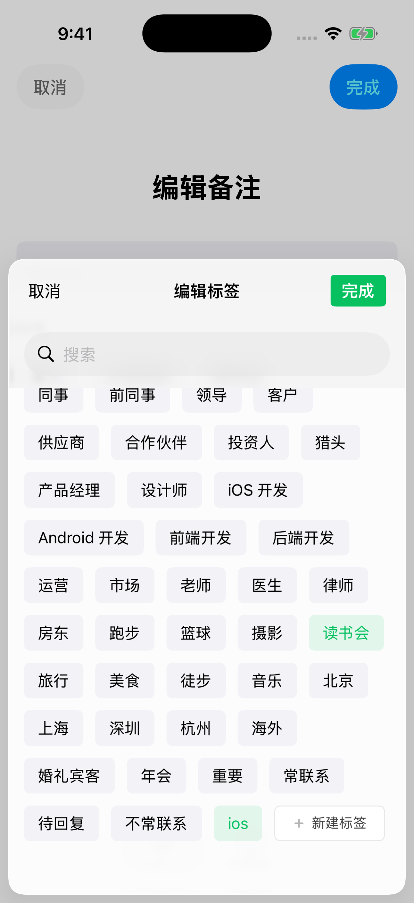

# Component architecture and community review

## aklee 封装思路 / Encapsulation

[b38bceba](https://github.com/aklee/CollectionViewClassifyMenu/commit/b38bceba34d76c56a1dc72a2c6e40bd0a611f3e0)
将标签布局、分组模型、cell 和 header 集中到独立示例中，便于复用界面和理解展开逻辑。
后续的 `TagView` 进一步提供可嵌入的视图。

原始提交仍将数据和行为绑定在控制器、具体 `TagGroup`/`TagModel`、屏幕宽度、
主 bundle 与日志输出中；它不是数据源可替换的 Pod。旧行计数反复扫描和复制数组，
数据改变后缓存也可能过期。组件现在由 `CYLMenuDataSource` 和 `CYLMenuDelegate`
连接宿主：两个示例提供自己的数据，选择和持久化由宿主负责。资源放在独立 bundle；
`TagView` 支持代码和 XIB 初始化。旧公开模型和接口仍可用于兼容。

The original change usefully grouped tag views, cells and models, but tied
data, screen geometry and callbacks to the implementation. The current Pod
inverts that dependency through host-owned protocols and keeps sample data and
persistence in the demos.

## 低耦合接口 / Decoupled API (CYLTagListView)

旧控制器把图片、分组图标、选择规则、折叠方式和尺寸写死在实现里，宿主只能改源码。
新增的 `CYLTagListView` 只负责布局、折叠和选择状态，其余全部交给宿主：

- 数据：`CYLMenuDataSource` 新增标签图标、分组图标、分组标题右侧视图和禁用状态。
- 行为：`CYLMenuDelegate` 新增拦截选择、取消选中、展开/折叠和内容高度变化回调。
- 外观：`CYLMenuStyle` 统一描述字体（含 Dynamic Type 上限）、颜色、边框、圆角、间距和高度；
  视图持有样式副本，宿主修改原对象不会意外影响已显示的菜单。
- 选择：`CYLMenuSelectionMode`（无 / 单选 / 多选）、`allowsEmptySelection` 和互斥项；
  代码修改选择不触发回调，与 UIKit 惯例一致。
- 折叠：`CYLMenuFoldStyle`（标题按钮、底部箭头、仅截断预览）与 `defaultVisibleRows`；`CYLMenuFoldControl`
  的位置还包括 `Inline`：折叠按钮作为最后一个标签（`CYLTagFoldCell`），点击即展开/收起，隐藏的标签为它让出位置。
- 网格与图标位置：`CYLMenuStyle.numberOfItemsPerRow`（`gridStyle(itemsPerRow:)`）让标签等宽、每行固定个数、超出省略号；
  `imagePlacement`（图标在文字前或后）与 `contentAlignment`（居中或从左边距开始）让标签按钮支持「文字在左、图标在右」，
  如「苹果官方社区… [热]」：文字截断，图标始终可见。
- More 按钮：数据源 `menuShowsMoreButtonInSection:` 在分组标题右侧显示核心库的 More 按钮（三个点），
  事件由代理 `menu:didTapMoreButtonInSection:` 交给宿主（Example 中为随机刷新）。
- 嵌入：`contentHeight`、`intrinsicContentSize`、`heightThatFitsWidth:` 和 `scrollEnabled`，
  可放进表头、Stack View 或 Auto Layout。

行计算与旧组件相同，按实际容器宽度单次遍历；宽度或文字大小变化时重新测量。
`Example/` 通过 Podfile 以本地路径集成核心库，用这些接口实现 README 的两个场景；
`CYLExampleMenuSource` 演示宿主如何把自己的模型转成数据源。

## DONE (2026-11-14, logged as TODO 2026-11-13): rename the fold control positions (`CYLMenuFoldControlPosition`)

- **Context:** the fold control's place is named by geometry today (`Bottom`, `TopTrailing`, `TopLeading`,
  `Inline`). The maintainer proposes names taken from the collection view's own parts: the control that is always the
  last item of the tags (folded or expanded, as in the Android recent searches and the review filter screenshots)
  is the `tail`; below the section, the `footer`; in the header's top right / top left corner, `headerRight` /
  `headerLeft`. The core is not released and not on `master`, so the names may change (no compatibility kept,
  AGENTS.md "Core quality first, examples last").
- **Requirements:** compare the current and the proposed names in a table, judge which is easier to understand,
  pick one set and implement it (iOS core, Android port, examples, configuration strings, README, docs).

| Today | Proposed | What it is | Assessment | Chosen |
| --- | --- | --- | --- | --- |
| `none` | (unchanged) | no fold control, every row shown | clear | `none` |
| `bottom` | `footer` | centered below the section | **proposed is better**: it names the collection view's section footer, where the control is a supplementary view, and pairs with "header…"; "bottom" could mean the bottom of the whole list | `footer` |
| `topTrailing` | `headerRight` | at the end of the section header | **mixed**: "header" is better than "top" (it says which view holds it); "right" is wrong in right-to-left languages, where the code puts it on the left (the header layout follows the leading edge, `foldAtLeadingEdge`), and UIKit / Android name such edges leading / trailing (start / end) | `headerTrailing` |
| `topLeading` | `headerLeft` | before the section title in the header | same as above | `headerLeading` |
| `inline` | `tail` | a tag cell that is always the last item, folded or expanded | **proposed is better**: "inline" only says it sits among the tags, "tail" says where (the end of the items, as `byTruncatingTail` is the end of a text); `lastItem` was considered and is longer without being clearer in a list of positions | `tail` |

- **Decision:** `none`, `footer`, `headerLeading`, `headerTrailing`, `tail`: the proposal's structure-based names,
  with leading / trailing instead of left / right so that they stay true in right-to-left layouts. Swift:
  `CYLMenuFoldControlPosition.footer` … `.tail`; Objective-C while the file is not migrated:
  `CYLMenuFoldControlPositionFooter` …; Kotlin: `FOOTER`, `HEADER_LEADING`, `HEADER_TRAILING`, `TAIL`.
- **Configuration strings:** `"footer"`, `"headerLeading"`, `"headerTrailing"`, `"tail"`; `"headerLeft"` /
  `"headerRight"` accepted as aliases of the leading / trailing names (as `"topleft"` / `"topright"` are today); the
  old strings (`"bottom"`, `"topLeading"`, `"topTrailing"`, `"inline"`) are dropped, and the example JSON files are
  updated.
- **When:** with the Swift migration of `CYLMenuFoldControl`, the enum's file (step 8 of `docs/Swift-Migration.md`;
  step 7 moved `CYLTagListView` and kept the old case names, so the names change once, in Swift), together with the
  Android port in the same commit.
- **Status:** DONE (step 8 of `docs/Swift-Migration.md`): iOS `CYLMenuFoldControlPosition.none / .footer /
  .headerTrailing / .headerLeading / .tail` (Objective-C `CYLMenuFoldControlPositionFooter`…), Kotlin `NONE`, `FOOTER`,
  `HEADER_TRAILING`, `HEADER_LEADING`, `TAIL`; configuration strings `"footer"`, `"headerLeading"`, `"headerTrailing"`,
  `"tail"` (aliases `"headerLeft"`, `"headerRight"`) on both platforms; the example JSON, plist, YAML and XML files,
  the examples, tests, README and this document updated.
- **Prompt (verbatim, 2026-11-13, with the Android recent searches and the review filter screenshots):**

  > 我想到一个很好的，定义折叠功能按钮位置的枚举定义。如果是截图中tag list ，collectionView总是最后一个按钮是折叠按钮。无论折叠还是不折叠都是最后一个是折叠或者展开按钮。那么我们可以成为tail ，底部用 footer . 顶部 右上角  headerright 顶部 左上角 。headerleft。评估我现在的命名与现在代码的实现相比哪一个更容易理解。在合适的文档中记入TODO，在文档中列出表格 旧有的那现有的对比，选一个实现。该core代码还没发布不在master分支，命名可修改

- **Prompt (English):** a better enum for the fold button's position: in a tag list like the screenshots, the last
  item of the collection view is always the fold button, folded or not, so call it `tail`; below, `footer`; top right,
  `headerRight`; top left, `headerLeft`. Judge whether my names or the current ones are easier to understand; record a
  TODO in a suitable document with a table comparing the old and the proposed names, and pick one to implement. The
  core is not released and not on `master`, so the names may change.

## 截图 / Screenshots

CI 截图（`Example screenshots`，提交 `22370a8`，iPhone 模拟器，`macos-26`）。`CYLTagListView` 的折叠控件与标题样式、由配置文件创建、多选与新建标签，以及移植的分类菜单与多选筛选：

| 折叠控件与标题样式 | 全部展开（箭头旋转 180°） | 由 JSON / plist / YAML / XML 创建 |
| --- | --- | --- |
|  |  |  |

| 多选（两个分组同时选中） | 搜索后新建并选中标签 | 分类菜单 + 多选筛选（数据库） | 评价筛选（SQLite） |
| --- | --- | --- | --- |
|  |  |  |  |

| 折叠按钮作为最后一个标签（展开） | 网格：文字在左、图标在右，More 按钮 |
| --- | --- |
|  |  |

## Swift 示例与 Swift 友好的核心 / Swift examples, Swift-friendly core

所有示例（`Example/`、`Example-Swift/`、根目录工程的演示 App `CYLClassifyMenuDemo`、`TagCollectionView` 演示）及其测试均为 Swift；
核心库保持 Objective-C，只通过 Swift 标注适配 Swift 调用（`NS_SWIFT_NAME`、字符串字面量形式的 `swift_name`、`cyl_` 方法的
`cylXxx` 版本），从不修改 Objective-C 接口。例如 `+[CYLTagView tagView]` 在 Swift 中为 `makeTagView()`，
`CYLMenuLocalizedString` 宏另有 Swift 可调用的同名函数。公开头文件的多行注释统一为 `/*! … */` 文档注释块
（`scripts/check-doc-comments.py`），Xcode 快速帮助与 Swift 接口都能显示。
The examples are all Swift; the core stays Objective-C and only gains Swift annotations next to its public
declarations, so Objective-C callers see no change.

不兼容修改：移除 `menuItemHasImageAtIndexPath:`，改用 `menuImageForItemAtIndexPath:`；
`CYLClassifyMenuViewController` 的分组图标改由 `menuImageForSection:` 提供。

## 社区提交 / Community commits

- [ce86ea2](https://github.com/XIAODINGPA/CollectionViewClassifyMenu/commit/ce86ea2bedce65c89344ebb6933bb5cf01cbab82)
  已在当前历史中。其单行累计宽度思路简化了旧算法，但 `<=` 会在间距恰好相等时过早换行，
  且后续行仍反复扫描。现有实现一次遍历所有行，按实际可用宽度计算。
- `izhangmi`、`NSIRLConnection` 和 `XIAODINGPA` 已有分支提交均已在本仓库历史中；
  `jouns/CollectionViewClassifyMenu` 为空仓库，没有可合并的分支。
- `SecondShuo/CollectionViewClassifyMenu-master` 的唯一提交是无共同祖先的旧项目快照，
  源码与本仓库历史快照实质相同，仅有空行和文件权限差异，还包含 Xcode 个人状态。
  已通过 [922cd7f](https://github.com/ChenYilong/CollectionViewClassifyMenu/commit/922cd7fc880c1a21d8275a4b1ce272ca587f079e)
  合并其历史，同时保留现有代码和修复，未重新引入旧代码或个人状态。

## 验证边界 / Validation limits

- 行布局与复用对应 [#8](https://github.com/ChenYilong/CollectionViewClassifyMenu/issues/8)、
  [#9](https://github.com/ChenYilong/CollectionViewClassifyMenu/issues/9) 和
  [#13](https://github.com/ChenYilong/CollectionViewClassifyMenu/issues/13)；
  section header 宽度对应 [#7](https://github.com/ChenYilong/CollectionViewClassifyMenu/issues/7)。
- 演示和测试覆盖 320/390 pt、长文本及 emoji、复用和外部数据源，以及 Dynamic Type 字号缩放、
  无障碍元素（标签、特征、提示与固定的 `accessibilityIdentifier`）；并未覆盖所有真机、旋转，
  也没有在设备上用 VoiceOver 实际走查。
- iOS 15 已弃用的按钮 edge insets、`adjustsImageWhenHighlighted` 和
  `UIGraphicsBeginImageContext` 已在 [32720b0](https://github.com/ChenYilong/CollectionViewClassifyMenu/commit/32720b0352a0ab93fb5722e711e9954356b63624) 中替换；
  2026-11-11 的 CI（[ff35b27](https://github.com/ChenYilong/CollectionViewClassifyMenu/commit/ff35b27)，`macos-26`）中
  `pod lib lint` 与库的构建/静态分析（有警告即失败）均已通过。
- 历史 3.5 英寸设备不支持项目现有的 iOS 15 最低版本，因此不能在原设备上复验 #7。
