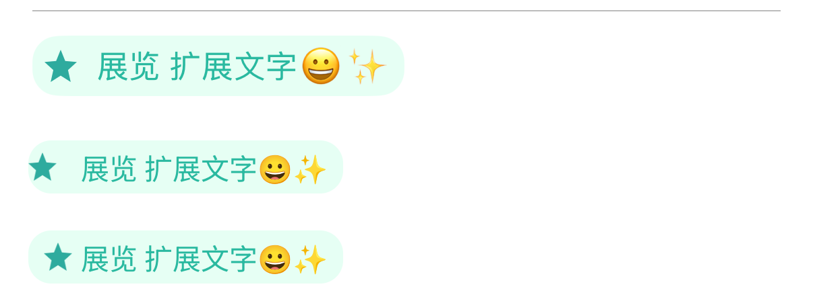

# Cross-platform consistency

The examples of this project on every platform (iOS, Android, and later React Native, Flutter, HarmonyOS, Mini
Program) show the same screens with the same data and look the same as iOS, which is the reference.

## TODO (2026-11-12): one shared local database for every platform

- **Status:** iOS demo app, `Example/CYLMenuExample` and Android DONE; React Native and Flutter have no example in this
  repository yet (they bundle the same file when added).
- **The database:** `Example-Shared/Database/cyl_places.sqlite` (table `places`: id, name, category, tag, region,
  rating, price; 83 rows), made from `data.json` by `scripts/generate-places-db.py`; `--check` fails when the
  committed file no longer matches the data. Every platform opens this one file read-only and builds the same SQL
  (`tag = ?`, `region IN (…)`, `tag IN (…)`, `ORDER BY rating DESC, id`):
  - iOS demo app: bundled through a project reference (`SOURCE_ROOT/Example-Shared/Database`), read with SQLite3
    (`CYLDemoPlaces` in `CYLFilterDemoViewController.swift`); the Filter tab shows the conditions, the SQL and the count.
  - Android example: `Example-Shared/Database` is an asset folder (`example/build.gradle.kts`); `ClassifyPlacesDatabase`
    copies the asset to the app's databases folder when it differs and opens it read-only.
  - The file also holds the menu example's reviews (tables `reviews`, `review_keywords`, the 10 reviews of
    `CYLReviewStore.mockReviews()` in the same order and schema): the Android Menu tab reads them, and its database
    mode runs the iOS example's SQL on them (2026-11-12).
  - `Example/CYLMenuExample` (DONE 2026-11-14): the file is a bundle resource (project reference
    `Example-Shared/Database/cyl_places.sqlite`); `CYLExampleDatabase` attaches it and copies its `reviews`,
    `review_keywords` and `places` rows into its own writable database (which also holds the saved selections), instead
    of filling the tables at run time. Test: `testExampleDatabaseHoldsTheDemoData` (83 places, first 日式拉面 · 北京, 93;
    the reviews in `CYLReviewStore` order); the example suite, 80 tests, 0 failures.
- **Evidence:** both show `SELECT name, category, tag, region, rating, price FROM places ORDER BY rating DESC, id` →
  83 of 83, first 日式拉面 · 北京 ★5.0 ¥93 (`assets/ios-demo-filter-tab.png`, `assets/android-filter-results.png`);
  `scripts/unit-tests.sh menu` 30 tests, 0 failures (the Filter test reads the bundled file).
- **Context:** the Android Classify / Filter tabs query a SQLite `places` table made on the device; the iOS demo app
  filters the same places in memory, and `Example/CYLMenuExample` builds its own SQLite database at run time.
- **Requirements:**
  1. iOS uses the Android implementation's approach: the conditions build an SQL query on a local SQLite database,
     and the page shows the conditions, the SQL statement, the count and the rows.
  2. iOS and Android share **one** local database file (the same file in the repository, bundled by each app), so
     the demos show the same data.
  3. Every other platform uses the same database file too, including React Native and Flutter.
- **Prompt (verbatim):**

  > 这个android实现，同步到iOS端实现，共用share 同一个本地数据库 ，保持演示的一致性。相同要求，其他平台也使用同一个数据库。包括RN flutter。将该要求写进跨端相关文档，标注TODO continue

## TODO (2026-11-12): the tag cells look the same as iOS on every platform

- **Status:** Android left spacing DONE; the iOS icon-to-title gap fixed 2026-11-14; the remaining 6 pt width difference is
  font metrics (inherent); React Native and Flutter have no example in this repository yet.
- **Cause (core):** Android `CYLIndexPathButton` put the image as a compound drawable at the padding edge and
  centered only the text, so the image touched the cell's left edge. iOS `UIButton` centers image and title together,
  then `CYLIndexPathButton -layoutSubviews` moves the image `cyl_imageTitleSpacing / 2` left and the title the same
  right (plus `cyl_titleLeadingInset`). The Android button now computes its padding with the same algorithm (centered
  or start gravity, half spacing, title inset), and the section header's title button starts at 16 with the inset
  between icon and title, as `CYLFilterHeaderView` does on iOS.
- **Pixel comparison** (iOS 27.2 simulator, iPhone 17 Pro, @3x → pt; Android 15 emulator, 2.625x → dp; same data,
  same parameters; `tools`: a CoreGraphics scanner measuring the pill and its content edges):

  | Cell | Platform | Pill | Left padding | Right padding |
  | --- | --- | --- | --- | --- |
  | ★ 展览 扩展文字😀✨ | iOS | 16.0…199.7 (183.7) | 6.0 | 8.7 |
  | ★ 展览 扩展文字😀✨ | Android before | 16.0…193.5 | 0 (image at the edge) | 9.9 |
  | ★ 展览 扩展文字😀✨ | Android after | 16.0…193.5 (177.5) | 8.8 | 9.9 |
  | 美妙下午茶 扩展文字😀✨ | iOS | 16.0…228.7 (212.7) | 10.3 | 12.3 |
  | 美妙下午茶 扩展文字😀✨ | Android after | 16.0…222.5 (206.5) | 10.7 | 10.7 |

  Top to bottom: iOS, Android before, Android after:

  

- **Residual (analyzed below):** iOS cells are about 6 pt wider and the iOS gap between image and title is about 10 pt against
  4.6 dp, although both use text width + 38 and a spacing of 5. Both come from text measurement: the iOS title label
  is wider than `-sizeWithAttributes:` (Apple Color Emoji / PingFang metrics), and `UIButton` centers within that
  label; Android measures with Noto. Next: log the iOS title label's frame in a test, then decide whether the core
  should size cells from the label's intrinsic width on both platforms.
  Update 2026-11-14 (measured, iOS 27.0 simulator, @3x): the core's formula is the same on both platforms
  (`CYLClassifyMenuViewController.cellWidth(for:)`: `ceil(text width) + 38` with an image, `+ 19` without; Android's
  `itemWidth()` in `CYLClassifyMenu.kt` is the same), so the 6 pt width difference comes only from the two text
  measurements (Apple Color Emoji and PingFang against Noto): a font-metric difference, not a layout bug.
  The gap between the icon and the title was a real iOS bug, now fixed: in the cell `云南味道 扩展文字😀✨` (216 pt) the
  image view was at x = 6 and the title label at x = 32, so the gap was 10 pt instead of `imageTitleSpacing` (5 pt) and
  the side padding 6 pt; `CYLIndexPathButton` moved the frames by half the spacing after `layoutSubviews()`, and UIButton
  keeps those frames between passes, so the move was applied again on every pass. It now overrides
  `imageRect(forContentRect:)` and `titleRect(forContentRect:)`, which UIButton asks for on every pass. Measured after
  the fix: image x = 8.5, title x = 29.5, gap 5.0, padding 8.5 on both sides, equal to Android's 4.6 dp gap and 8.8 / 9.9
  paddings within the font difference. Regression test: `CYLExampleDatabaseTests.testPortedClassifyMenuDemoQueriesTheDatabase`
  (gap 5, centered; it fails before the fix). A button on its own in a test window did not reproduce the accumulation, so
  the ObjC test `testButtonsPlaceImageAndTitleWithoutDeprecatedInsets` only checks that frames repeat.
  Left: the width difference is inherent to the platforms' fonts; React Native and Flutter have no example here yet.
- **Context:** with the same parameters, the Android classify menu's tag cells differ from iOS: an image sits at the
  cell's left edge on Android, while iOS centers image and title together, so the left padding equals the right one
  (`assets/request-android-cell-left-spacing.png`, `assets/request-ios-cell-reference.png`,
  `assets/request-android-cell-compare.png`).
- **Requirements:**
  1. Compare the iOS and Android tag cells pixel by pixel, the left spacing above all.
  2. Look for the cause in the core (library) first, comparing the two implementations: with the same parameters
     they must look the same.
  3. Every other platform matches iOS too, including React Native and Flutter.
- **Prompts (verbatim):**

  > 该example中 tag cell 左侧间距有问题。优先从core层面找原因修复。因为右侧间距正确。continue

  > 你刚刚实现的android中 该example中 tag cell 左侧间距有问题。优先从core层面找原因修复。因为右侧间距正确。continue

  > 像素级对比iOS与Android端 tag cell实现UI差别。尤其注意左侧间距，android端异常。优先从core层面对比两者实现差别，因为初始化参数都是一样的情况下，显示也应保持一致。同样要求其他端与iOS端保持一致，包括RN flutter。写入跨端相关文档，标记todo。
