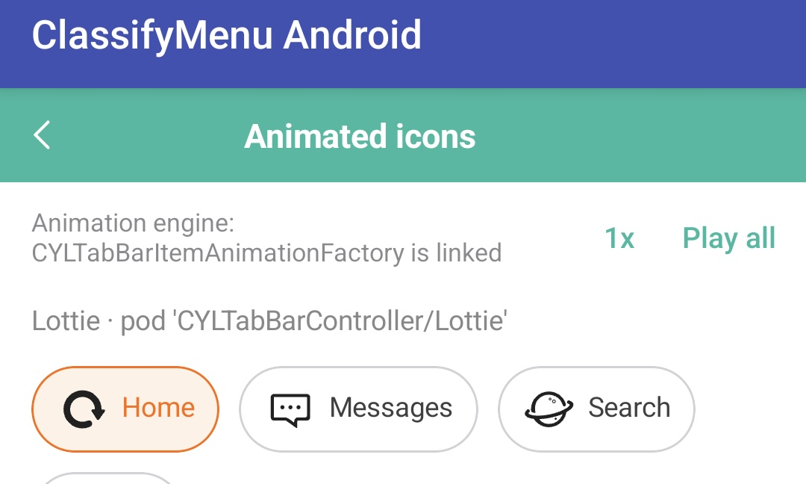

# Example animation playback controls

## Rule (2026-11-13): animation examples combine Play all, a speed slider and a loop switch

Every example page that shows animations (the animated tag icons, any Lottie, PAG, Rive or GIF demo), on every
platform (iOS, Android, React Native, Flutter, mini programs, HarmonyOS), offers three controls that combine into one
playback strategy, applied live:

1. **Play all**: restarts every animation on the page from progress 0 (not from where it stopped).
2. **Speed slider**: the playback rate, for example 0.25× to 3×, default 1×, the current value shown next to it; a
   change applies at once to the playing and the next animations.
3. **Loop switch**: on, the animations repeat until it is switched off; off, each plays once.

The controls are independent and combine (for example 0.5× with the loop on, then Play all), and have accessibility
labels and values (VoiceOver / TalkBack read "Speed, 1.5 times" and "Loop, on"). When the core cannot do one of them,
change the core to support it rather than working around it in the example. The animated icons come from
CYLTabBarController's `CYLTabBarItemAnimationFactory`; the same rule, with its library-side notes, is in
CYLTabBarController's `docs/Tab-Icon-Animation-Quick-Start.md` ("Playback controls in the animation examples").

Example: the Android "Animated icons" page (`CYLTagAnimationScreen.kt`) has a speed button ("1x") and "Play all"; it
gets the speed slider and the loop switch.

## TODO (2026-11-13): apply the rule to the animation examples

- Context: the animated icons pages have a speed button and a one-shot "Play all"; speed and looping cannot be
  controlled live, and the rule was not written in this repository yet.
- Requirements: write the rule into the docs (this file), the instructions (`AGENTS.md`, `docs/instructions.md`) and
  the related skills (pointing to this file); implement it in the example pages, changing the core if needed; every
  example layer.
- Pages:

| Page | Platform | Status |
|:---|:---|:---|
| Animated icons, `android/merged/example/.../menu/CYLTagAnimationScreen.kt` | Android | TODO |
| Animated icons, `Example/CYLMenuExample/CYLTagAnimationDemoViewController.swift` | iOS | TODO |
| React Native, Flutter, mini program and HarmonyOS examples (when they exist) | Cross-platform | TODO |

- Prompt (verbatim): "在docs 中找到example演示规则，找到相关文档及相关章节，如果没有就新建，确保写入成功：全英文写入：instructions相关相关文档中中记录 相关skills中记录引用该文档去，在展示动效相关example展示中，除了一次性play all ，触发重新开始从0进度开始播放， 额外增加倍速滑块，以及循环播放switch。这几个组件可以组合控制动效播放策略。请在example相关页面实现，如有必要可以修改core核心代码，以支持该演示策略。通过调整这些组件可以实时控制动效的播放策略。标记为TODO事项：举例说明，截图中的页面就可以应用该策略。此要求适用于所有层面的example包括iOS端 android端，跨端 rn flutter 小程序 鸿蒙 continue"
- Prompt (English): "Find the example demo rules in docs, the related document and section, and create them if there are
  none; make sure the write succeeds, in English: record it in the instructions documents, and in the related skills
  with a reference to that document. In examples that show animations, besides a one-shot Play all that restarts
  playback from progress 0, add a speed slider and a loop switch; these controls combine to control the playback
  strategy. Implement it in the example pages, changing the core if needed. Adjusting the controls changes the
  playback strategy in real time. Mark it TODO; for example, the page in the screenshot can apply this strategy.
  This applies to examples at every layer: iOS, Android, React Native, Flutter, mini programs and HarmonyOS."
- Status: `TODO` (rule written; no page implements it yet).
