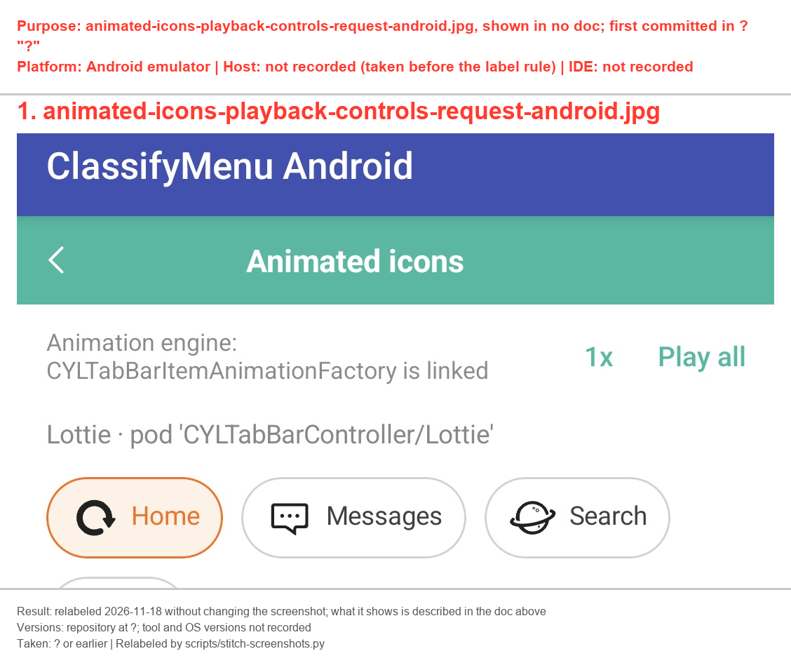
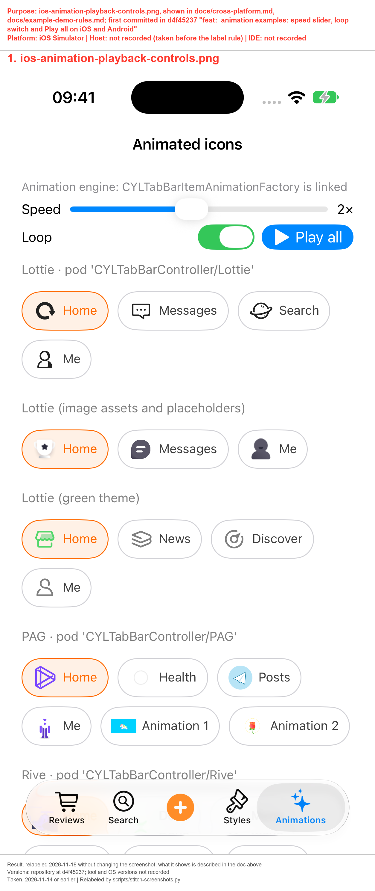
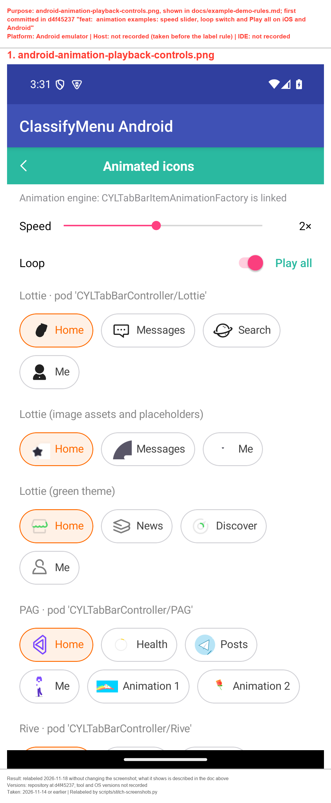
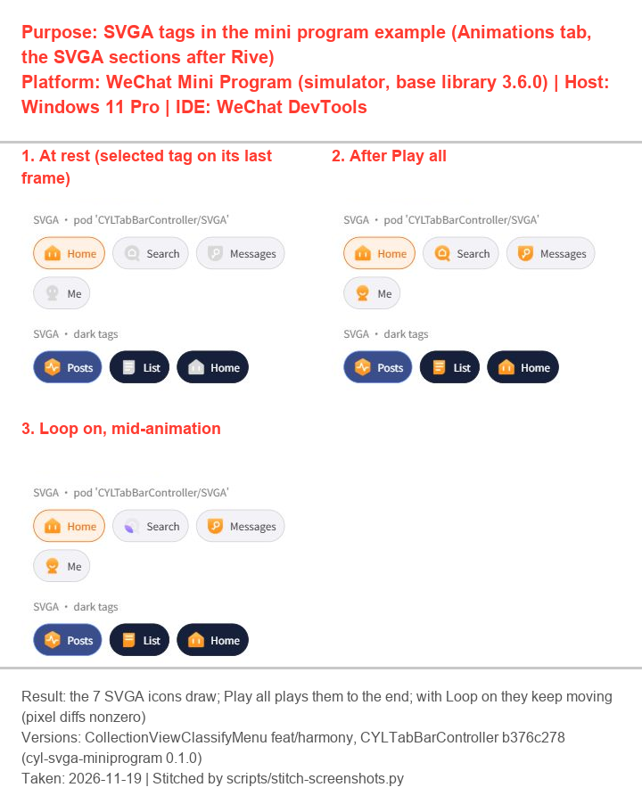
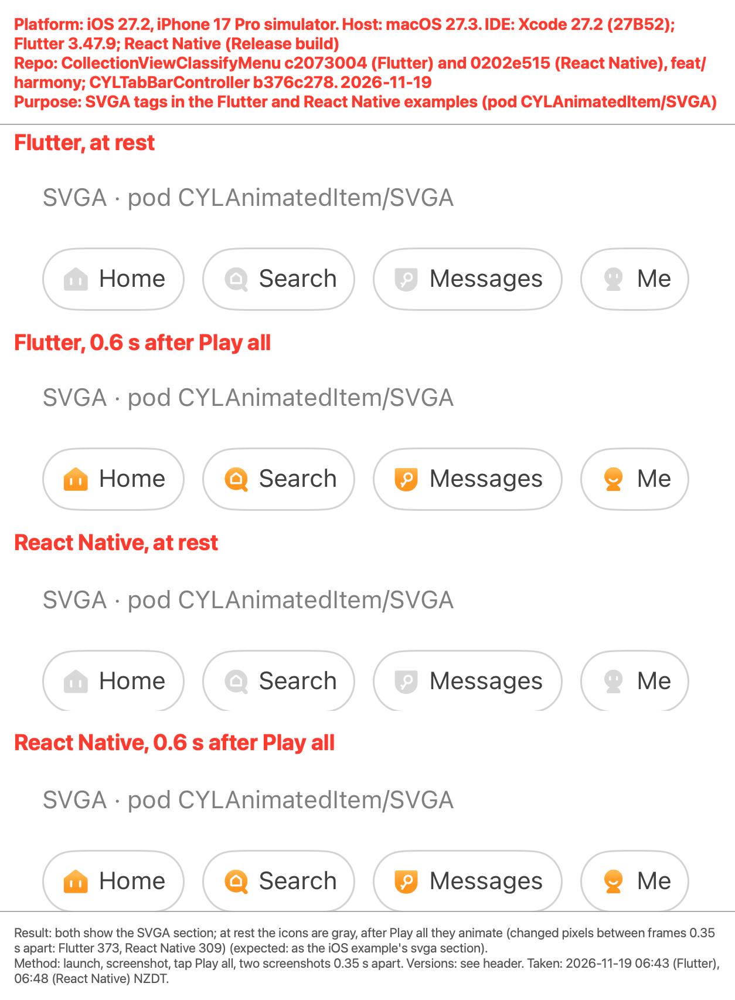
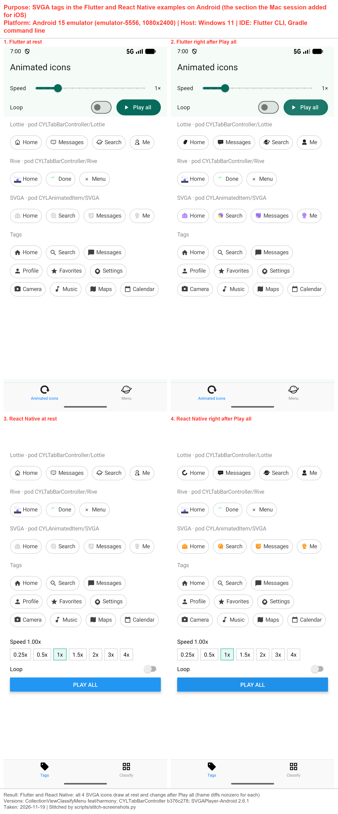
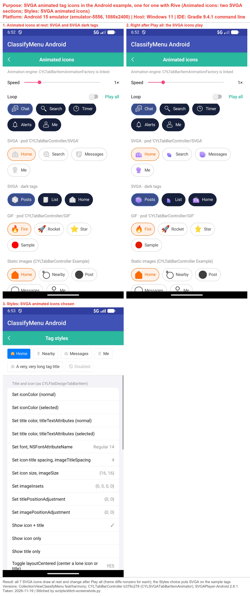

# 示例演示规则 / Example demo rules

| 中文 | English |
|:---|:---|
| 各平台示例演示什么、如何演示的规则。适用于每个示例层：iOS、Android、跨平台示例（React Native、Flutter）、微信小程序和 HarmonyOS。被 `AGENTS.md`（“Example demo rules”）和 `.agents/skills/cyl-dependency/` 引用。 | Rules for what the examples of every platform demonstrate and how. They apply to every example layer: iOS, Android, the cross-platform examples (React Native, Flutter), Mini Program and HarmonyOS. Referenced from `AGENTS.md` ("Example demo rules") and `.agents/skills/cyl-dependency/`. |

## 动效播放控制 / Animation playback controls

| 中文 | English |
|:---|:---|
| 每个展示动效图标或动效（Lottie、PAG、Rive、GIF、symbol effect）的示例界面，例如 Android 菜单标签页中带有“1x”和“Play all”按钮的“Animated icons”界面，都要同时提供以下控制： | Every example screen that shows animated icons or animations (Lottie, PAG, Rive, GIF, symbol effects), for example the Android Menu tab's "Animated icons" screen with its "1x" and "Play all" buttons, offers these controls together: |
| 1. **Play all：** 将界面上的每个动效从进度 0 重新开始，播放一次（现有行为）。 | 1. **Play all:** restarts every animation on the screen from progress 0, once (existing behavior). |
| 2. **速度滑块：** 设置界面上每个动效的播放速度（例如 0.25x 到 4x，默认 1x），当前值显示在滑块旁边。它取代循环切换固定值的速度按钮。 | 2. **Speed slider:** sets the playback speed of every animation on the screen (for example 0.25x to 4x, default 1x), with the current value shown next to it. It replaces a speed button that cycles fixed values. |
| 3. **循环开关：** 为界面上的每个动效开启或关闭循环。关闭时播放一次并停在静止帧；开启时重复播放，直到关闭。 | 3. **Loop switch:** turns looping on or off for every animation on the screen. Off plays once and stops at the resting frame; on repeats until it is turned off. |
| 这些控制可以组合：速度同时作用于 Play all 和循环播放，且每次更改都立即生效，作用于已在播放的动效，无需重启界面。当动效引擎无法做到其中某一项（速度或循环设置）时，修改核心库使其能够做到：把 API 加到核心库（引擎本身缺少时也加到 CYLTabBarController 的动效引擎），绝不在示例中绕过。这些控制要支持无障碍（标签、值、Dynamic Type / 字体缩放；VoiceOver / TalkBack 会朗读，例如“Speed, 1.5 times”和“Loop, on”），并通过示例自己的查找机制本地化。动效图标来自 CYLTabBarController 的 `CYLTabBarItemAnimationFactory`；同一规则及其库侧说明见 CYLTabBarController 的 `docs/Tab-Icon-Animation-Quick-Start.md`（“Playback controls in the animation examples”）。 | The controls combine: the speed applies to Play all and to looping alike, and every change takes effect immediately, on animations already playing, without restarting the screen. When an animation engine cannot do one of these (a speed or a loop setting), change the core library so that it can: add the API to the core (and to CYLTabBarController's animation engine when the engine itself lacks it), never work around it in the example. The controls are accessible (labels, values, Dynamic Type / font scaling; VoiceOver / TalkBack read, for example, "Speed, 1.5 times" and "Loop, on") and localized through the example's lookup. The animated icons come from CYLTabBarController's `CYLTabBarItemAnimationFactory`; the same rule, with its library-side notes, is in CYLTabBarController's `docs/Tab-Icon-Animation-Quick-Start.md` ("Playback controls in the animation examples"). |

## 待办（2026-11-13）：每个动效示例中加入速度滑块和循环开关 / TODO (2026-11-13): speed slider and loop switch in every animation example

| 中文 | English |
|:---|:---|
| **背景：** 动效示例有一个“Play all”按钮（从 0 重新开始，播放一次）和一个速度按钮（“1x”），如所附 Android“Animated icons”界面的截图所示。用户希望有可以组合并实时生效的播放策略控制。 | **Context:** the animation examples have a "Play all" button (restart from 0, once) and a speed button ("1x"), as in the attached screenshot of the Android "Animated icons" screen. The user wants playback strategy controls that combine and act in real time. |
| **需求：** (1) 保留 Play all（从进度 0 重新开始）；(2) 增加速度滑块；(3) 增加循环开关；(4) 三者可组合，并实时改变播放；(5) 需要时修改核心库以支持；(6) 覆盖每个示例层：iOS、Android、React Native、Flutter、微信小程序、HarmonyOS；(7) 用英文把规则记录在说明文档中，并在相关 skill 中引用本文档。 | **Requirements:** (1) keep Play all (restart from progress 0); (2) add a speed slider; (3) add a loop switch; (4) the three combine and change playback in real time; (5) change the core when needed to support it; (6) every example layer: iOS, Android, React Native, Flutter, Mini Program, HarmonyOS; (7) record the rule in English in the instructions documents and reference this document from the related skills. |
| **状态：** iOS 和 Android 已完成（2026-11-14）；Flutter：iOS 和 Android 已完成（`flutter/cyl_tag_list`）；React Native 和 HarmonyOS 已完成（2026-11-15）；微信小程序：已在微信开发者工具中完成（`CrossPlatform/wechat-miniprogram`，2026-11-15）。规则记录于 2026-11-13。2026-11-13 当天曾并行记录了两次（本文档，以及另一个会话在分支 `docs/animation-playback-controls` 上的 `example-animation-controls.md`）；已合并到此处，该文件现在指向本文档。 | **Status:** iOS and Android DONE (2026-11-14); Flutter: iOS and Android DONE (`flutter/cyl_tag_list`); React Native and HarmonyOS DONE (2026-11-15); Mini Program: DONE in WeChat DevTools (`CrossPlatform/wechat-miniprogram`, 2026-11-15). Rule recorded 2026-11-13. Recorded twice in parallel on 2026-11-13 (this document and `example-animation-controls.md` from another session's branch `docs/animation-playback-controls`); merged here, and that file now points to this one. |
| 该需求所涉及的界面（Android，合并示例，菜单标签页 → Animated icons；用户的截图，2026-11-13）： | The screen of the request (Android, merged example, Menu tab → Animated icons; the user's screenshot, 2026-11-13): |

| 平台 | 示例界面 | 状态 |
| --- | --- | --- |
| iOS 平台 | 动效图标界面，`Example/CYLMenuExample/CYLTagAnimationDemoViewController.swift` | 已完成（2026-11-14，见下文） |
| Android 平台 | 动效图标界面，`android/merged/example/.../menu/CYLTagAnimationScreen.kt` | 已完成（2026-11-14，见下文） |
| React Native 跨平台 | `react-native/react-native-cyl-tag-list/example`，Tags 标签页 | iOS 和 Android 已完成（2026-11-15：Play all 命令、0.25x–4x 的速度档位、Loop 开关；`cross-platform.md`、`scripts/e2e-android.sh` 和 iOS UI 测试会检查速度） |
| Flutter 跨平台 | `flutter/cyl_tag_list/example`，动效图标界面 | iOS 和 Android 已完成（动效可播放，`cross-platform.md`） |
| 微信小程序 | `CrossPlatform/wechat-miniprogram/miniprogram/pages/animations`（动效，与 iOS 界面 1:1 一致） | 已在微信开发者工具中完成（2026-11-15；Play all、速度滑块、Loop 开关；Lottie、Rive、PAG 和 GIF 通过 CYLTabBarController 的 cyl-lottie / cyl-rive / cyl-pag 实现；`cross-platform.md`） |
| HarmonyOS 平台 | `harmony/entry`，Tags 标签页 | 已完成（2026-11-15：核心库中的 `@ohos/lottie` 图标、0.25x–4x 速度滑块、Loop 开关、Play all；`android.md`） |

| Platform | Example screen(s) | Status |
| --- | --- | --- |
| iOS | Animated icons, `Example/CYLMenuExample/CYLTagAnimationDemoViewController.swift` | DONE (2026-11-14, below) |
| Android | Animated icons, `android/merged/example/.../menu/CYLTagAnimationScreen.kt` | DONE (2026-11-14, below) |
| React Native | `react-native/react-native-cyl-tag-list/example`, Tags tab | iOS and Android DONE (2026-11-15: Play all command, speed steps 0.25x–4x, Loop switch; `cross-platform.md`, `scripts/e2e-android.sh` and the iOS UI test check the speed) |
| Flutter | `flutter/cyl_tag_list/example`, Animated icons | iOS and Android DONE (animations play, `cross-platform.md`) |
| Mini Program | `CrossPlatform/wechat-miniprogram/miniprogram/pages/animations` (the animations page, the iOS screen 1:1) | DONE in WeChat DevTools (2026-11-15; Play all, speed slider, Loop switch; Lottie, Rive, PAG and GIF through CYLTabBarController's cyl-lottie / cyl-rive / cyl-pag; `cross-platform.md`) |
| HarmonyOS | `harmony/entry`, Tags tab | DONE (2026-11-15: `@ohos/lottie` icons in the core, speed slider 0.25x–4x, Loop switch, Play all; `android.md`) |

### iOS：已完成（2026-11-14） / iOS: DONE (2026-11-14)

| 中文 | English |
|:---|:---|
| **核心库**（`CYLTagButton`、`CYLTagListView`）：`animationSpeed`（对 `style.animationSpeed` 的覆盖，立即生效，对正在播放的动效也一样，无需重新加载列表）、`animationLoops` 和 `CYLTagListView.playAllAnimations()`（屏幕上的每个动效图标从进度 0 开始）。设置样式不再重置正在播放的动效。播放器自带 `loops` 时，循环使用它（CYLTabBarController 自 `dc04439` 起）；在固定的 `0e69250` 上没有，核心库会在播放器的 `progress` 到达末尾时重新开始动效（Lottie、PAG）。 | **Core** (`CYLTagButton`, `CYLTagListView`): `animationSpeed` (an override of `style.animationSpeed` applied at once, also to an animation that is playing, without reloading the list), `animationLoops` and `CYLTagListView.playAllAnimations()` (every animated icon on screen from progress 0). Setting a style no longer resets a playing animation. Looping uses the player's own `loops` when it has one (CYLTabBarController from `dc04439`); with the pinned `0e69250`, which has none, the core starts the animation again when the player's `progress` reaches the end (Lottie, PAG). |
| **限制：** 在 `0e69250` 上，Rive 和 GIF 播放器既没有 `loops` 也没有 `progress`，因此只播放一次；PAG 没有播放速度。这两点会随更新的 CYLTabBarController 消失，但其版本固定被阻塞（`issue-progress.md`，框架构建）。 | **Limits:** Rive and GIF players expose neither `loops` nor `progress` at `0e69250`, so they play once; PAG has no playback speed. Both go away with a newer CYLTabBarController, whose pin is blocked (`issue-progress.md`, the framework build). |
| **示例：** Animated icons 界面有速度滑块（0.25× 到 4×，步长 0.25，数值显示在旁边）、循环开关和 Play all；它们取代了“1x”栏按钮。VoiceOver 会朗读“Speed, 2 times”和“Loop, on”；字符串位于示例的 bundle 中（en、zh-Hans、zh-Hant）。Styles 是样式参数列表（其中一行设置 `style.animationSpeed`），不是播放界面：保持不变。 | **Example:** the Animated icons screen has a speed slider (0.25× to 4× in steps of 0.25, the value next to it), a loop switch and Play all; they replace the "1x" bar button. VoiceOver reads "Speed, 2 times" and "Loop, on"; strings in the example's bundle (en, zh-Hans, zh-Hant). Styles is a list of style parameters (one row sets `style.animationSpeed`), not a playback screen: unchanged. |
| **证据：** `CYLAnimatedIconTests`（滑块的档位和限幅、标签、屏幕上标签的循环与速度、样式未被改动）；示例测试套件，80 个测试，0 个失败。截图：iOS，iPhone 17 Pro 模拟器，iOS 27.0，Xcode 27.2（iOS 27.2 SDK），macOS 27.3，本次提交，2026-11-14 15:23 NZDT；2×，Loop 开启，Lottie 图标正在播放： | **Evidence:** `CYLAnimatedIconTests` (the slider's steps and clamping, the labels, loop and speed on the tags on screen, the style untouched); the example suite, 80 tests, 0 failures. Screenshot: iOS, iPhone 17 Pro simulator, iOS 27.0, Xcode 27.2 (iOS 27.2 SDK), macOS 27.3, this commit, 2026-11-14 15:23 NZDT; 2×, Loop on, the Lottie icons playing: |

  

### Android：已完成（2026-11-14） / Android: DONE (2026-11-14)

| 中文 | English |
|:---|:---|
| **核心库**（`CYLTagButton.kt`、`CYLTagListView.kt`）：与 iOS 相同的三个 API，`animationSpeed`、`animationLoops` 和 `playAllAnimations()`。引擎的播放器（CYLTabBarController `4639a0c`）有速度和进度，但没有循环模式，因此标签会在播放器进度到达末尾时重新开始动效；没有进度的播放器只播放一次。 | **Core** (`CYLTagButton.kt`, `CYLTagListView.kt`): the same three APIs as iOS, `animationSpeed`, `animationLoops` and `playAllAnimations()`. The engine's players (CYLTabBarController `4639a0c`) have a speed and a progress but no loop mode, so the tag starts the animation again when the player's progress reaches the end; a player without a progress plays once. |
| **示例：** Animated icons 界面（菜单标签页）有速度 `SeekBar`（0.25× 到 4×，步长 0.25，数值显示在旁边）、循环 `Switch` 和 Play all；它们取代了“1x”按钮。TalkBack 会朗读“Speed, 2 times”和“Loop”；字符串取自 iOS 示例（Android 示例读取其字符串表）。 | **Example:** the Animated icons screen (Menu tab) has a speed `SeekBar` (0.25× to 4× in steps of 0.25, the value next to it), a loop `Switch` and Play all; they replace the "1x" button. TalkBack reads "Speed, 2 times" and "Loop"; the strings are the iOS example's (the Android example reads its string tables). |
| **证据：** 库的单元测试中的 `animationSpeedAndLoopsReachEveryTagWithoutReplacingTheStyle`；`scripts/gradle.sh merged :library:testDebugUnitTest :example:assembleDebug`：BUILD SUCCESSFUL。截图：Android 15（API 35）模拟器 `CYL_API35_test`，1080 × 2400，macOS 27.3，本次提交，2026-11-14 15:31 NZDT；2×，Loop 开启，图标正在播放： | **Evidence:** `animationSpeedAndLoopsReachEveryTagWithoutReplacingTheStyle` in the library's unit tests; `scripts/gradle.sh merged :library:testDebugUnitTest :example:assembleDebug`: BUILD SUCCESSFUL. Screenshot: Android 15 (API 35) emulator `CYL_API35_test`, 1080 × 2400, macOS 27.3, this commit, 2026-11-14 15:31 NZDT; 2×, Loop on, the icons playing: |

  

| 中文 | English |
|:---|:---|
| **用户提示（原文，2026-11-13）：** | **User prompt (verbatim, 2026-11-13):** |

> 在docs 中找到example演示规则，找到相关文档及相关章节，如果没有就新建，确保写入成功：全英文写入：instructions相关相关文档中中记录 相关skills中记录引用该文档去，在展示动效相关example展示中，除了一次性play all ，触发重新开始从0进度开始播放， 额外增加倍速滑块，以及循环播放switch。这几个组件可以组合控制动效播放策略。请在example相关页面实现，如有必要可以修改core核心代码，以支持该演示策略。通过调整这些组件可以实时控制动效的播放策略。标记为TODO事项：举例说明，截图中的页面就可以应用该策略。此要求适用于所有层面的example包括iOS端 android端，跨端 rn flutter 小程序 鸿蒙

| 中文 | English |
|:---|:---|
| **英文：** 在 docs 中找到示例演示规则（缺少则创建文档或章节），并用英文记录在说明文档中，相关 skill 引用本文档：在展示动效的示例中，除了从进度 0 重新开始的一次性“Play all”之外，增加速度滑块和循环开关。这些控制可组合以设置播放策略，并实时改变它。在示例页面上实现，需要时修改核心库。标记为待办；截图中的页面（Animated icons）就是适用的示例。该需求覆盖每个示例层：iOS、Android、跨平台的 React Native 和 Flutter、微信小程序以及 HarmonyOS。 | **English:** find the example demo rules in docs (create the document or section if missing) and record, in English, in the instructions documents, with the related skills referencing this document: in examples that show animations, besides the one-shot "Play all" that restarts from progress 0, add a speed slider and a loop switch. These controls combine to set the playback strategy and change it in real time. Implement it on the example pages, changing the core when needed. Mark it as a TODO; the screenshot's page (Animated icons) is an example where it applies. The requirement covers every example layer: iOS, Android, cross-platform React Native and Flutter, Mini Program and HarmonyOS. |

## 待办（2026-11-16）：凡展示 Rive 的地方都加上 SVGA / TODO (2026-11-16): SVGA wherever Rive is shown

| 中文 | English |
|:---|:---|
| CYLTabBarController 新增了 SVGA 动效。每个演示 Rive 的示例场景（Animated icons 分区、Styles 的动效选项、配置和菜单数据、截图启动界面、测试）都要在每个平台上增加使用 SVGA 的同样场景，并带有相同的播放控制（Play all、速度、循环）。详情和核心库工作：`issue-progress.md`，“TODO (2026-11-16): SVGA animated icons”。 | CYLTabBarController added SVGA animations. Every example scene that demonstrates Rive (Animated icons sections, the Styles animation choice, configuration and menu data, screenshot launch screens, tests) gets the same scene with SVGA, on every platform, with the same playback controls (Play all, speed, loop). Details and the core work: `issue-progress.md`, "TODO (2026-11-16): SVGA animated icons". |
| 状态：iOS 已完成（2026-11-16）：Animated icons 分区 `svga` 和 `svga-dark`、Styles 操作 `animation.svga`、配置文件和字典演示、启动界面 `animations-svga` 和 `style-svga`，以及测试。SVGA 与 Rive 一样，以自身速度播放一次：CYLTabBarController 的 SVGA 播放器还没有速度或循环 API。HarmonyOS：已完成。Android：已完成（2026-11-19）：Animated icons 分区 `svga`（Home、Search、Messages、Me）和 `svga-dark`（icons.riv 深色标签上的 Posts、List、Home）、Styles 操作 `animation.svga`、字典演示的 SVGA 标签；配置文件是 iOS bundle 的 `animated-tags.json`（已有其 SVGA 标签）。示例新增 `com.github.yyued:SVGAPlayer-Android` 2.6.1（JitPack，按 group 过滤）；有它时，CYLTabBarController 的 `CYLSVGATabBarItemAnimator` 会自行注册。在模拟器上，全部 7 个图标静止时都能绘制，点击 Play all 后会播放。Android 示例没有启动界面（iOS 的 `animations-svga`、`style-svga`），也没有示例单元测试，因此无需在那里添加。微信小程序：已完成（2026-11-19，Windows 会话）：Animated icons 分区 `svga`（Home、Search、Messages、Me）和 `svga-dark`（icons.riv 深色标签上的 Posts、List、Home）、Styles 操作 `animation.svga`、字典演示的 SVGA 标签；配置文件的 SVGA 标签现在也能播放。CYLTabBarController 的 `cyl-svga-miniprogram`（固定提交）由 `scripts/fetch-cyltabbar.js` 安装到 cyl-pag 旁边的“engines”分包，`scripts/export-animations.py` 把 iOS bundle 的六个 `.svga` 文件以 `engines/svga/*.svga.bin` 复制到那里（代码包会排除 `.svga`）；示例的引擎适配器（`components/cyl-tag-animation-view`）通过 `generic:cyl-svga-view` 为标签提供 `cyl-svga`，库和 cyl-animated-item 已声明了它，因此无需修改核心库。微信开发者工具：全部 7 个 SVGA 图标都能绘制，Play all 会把它们播放到最后一帧，开启 Loop 后会持续运动（12 秒内每个图标变化的像素：Search [0, 0, 126, 28, 41]，Messages [133, 0, 32, 99, 138]，Posts [211, 65, 30, 88, 117]）；`npm test` 通过 145 项。 | Status: iOS done (2026-11-16): the Animated icons sections `svga` and `svga-dark`, the Styles action `animation.svga`, the configuration file and dictionary demos, the launch screens `animations-svga` and `style-svga`, and the tests. SVGA, like Rive, plays once at its own speed: CYLTabBarController's SVGA player has no speed or loop API yet. HarmonyOS: done. Android: DONE (2026-11-19): the Animated icons sections `svga` (Home, Search, Messages, Me) and `svga-dark` (Posts, List, Home on the icons.riv dark tags), the Styles action `animation.svga`, the dictionary demo's SVGA tag; the configuration file is the iOS bundle's `animated-tags.json` (already has its SVGA tag). The example adds `com.github.yyued:SVGAPlayer-Android` 2.6.1 (JitPack, group-filtered); CYLTabBarController's `CYLSVGATabBarItemAnimator` registers itself when it is there. On the emulator all 7 icons draw at rest and play after Play all. The Android example has no launch screens (iOS `animations-svga`, `style-svga`) and no example unit tests, so nothing to add there. Mini Program: DONE (2026-11-19, Windows session): the Animated icons sections `svga` (Home, Search, Messages, Me) and `svga-dark` (Posts, List, Home on the icons.riv dark tags), the Styles action `animation.svga`, the dictionary demo's SVGA tag; the configuration file's SVGA tag now plays too. CYLTabBarController's `cyl-svga-miniprogram` (pinned commit) is installed by `scripts/fetch-cyltabbar.js` into the "engines" subpackage next to cyl-pag, and `scripts/export-animations.py` copies the iOS bundle's six `.svga` files there as `engines/svga/*.svga.bin` (a code package leaves out `.svga`); the example's engine adapter (`components/cyl-tag-animation-view`) gives the tags `cyl-svga` through `generic:cyl-svga-view`, which the library and cyl-animated-item already declared, so no core change. WeChat DevTools: all 7 SVGA icons draw, Play all plays them to their last frame, with Loop on they keep moving (changed pixels per icon over 12 s: Search [0, 0, 126, 28, 41], Messages [133, 0, 32, 99, 138], Posts [211, 65, 30, 88, 117]); `npm test` 145 pass. |

Flutter and React Native on iOS: DONE (2026-11-19, `478e83e2`, `e84772ee`): an SVGA section (Home, Search, Messages, Me;
the iOS example's files) after Rive, pod `CYLAnimatedItem/SVGA` (React Native also needs `SVGAPlayerLite` with modular
headers); on the iPhone 17 Pro simulator the icons rest gray and animate after Play all; Flutter iOS integration tests
2 / 2 (21 tags), React Native `tsc` passes. Their Android side: DONE (2026-11-19, Windows session): both example apps add
`com.github.yyued:SVGAPlayer-Android` 2.6.1 (JitPack, group-filtered) and `tools:replace` for the `android:label` (Flutter) /
`android:allowBackup` (React Native) that SVGAPlayer-Android's own manifest sets; React Native gets the four `.svga` files
in `example/android/app/src/main/assets/`, Flutter already had them as Flutter assets. On the emulator all 4 SVGA icons
draw at rest and play after Play all, in both apps.

