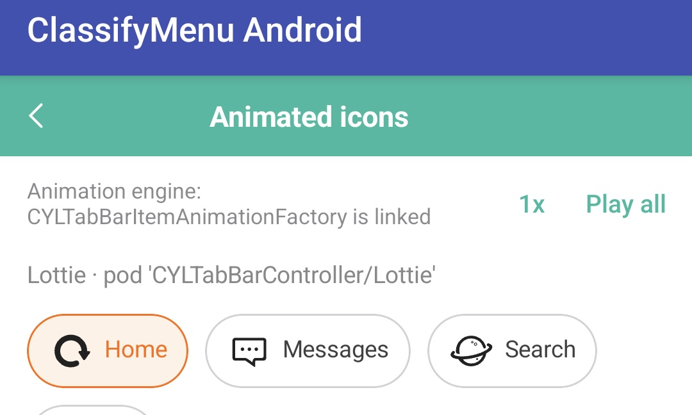
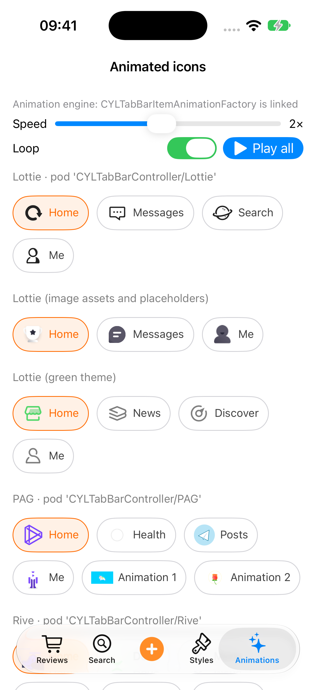
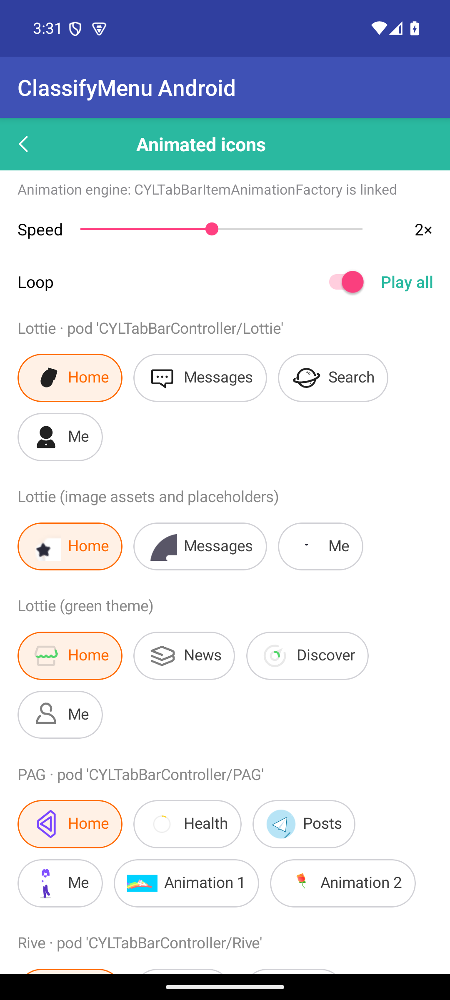

# Example demo rules

Rules for what the examples of every platform demonstrate and how. They apply to every example layer: iOS, Android,
the cross-platform examples (React Native, Flutter), Mini Program and HarmonyOS. Referenced from `AGENTS.md`
("Example demo rules") and `.agents/skills/cyl-dependency/`.

## Animation playback controls

Every example screen that shows animated icons or animations (Lottie, PAG, Rive, GIF, symbol effects), for example
the Android Menu tab's "Animated icons" screen with its "1x" and "Play all" buttons, offers these controls together:

1. **Play all:** restarts every animation on the screen from progress 0, once (existing behavior).
2. **Speed slider:** sets the playback speed of every animation on the screen (for example 0.25x to 4x, default 1x),
   with the current value shown next to it. It replaces a speed button that cycles fixed values.
3. **Loop switch:** turns looping on or off for every animation on the screen. Off plays once and stops at the
   resting frame; on repeats until it is turned off.

The controls combine: the speed applies to Play all and to looping alike, and every change takes effect immediately,
on animations already playing, without restarting the screen. When an animation engine cannot do one of these
(a speed or a loop setting), change the core library so that it can: add the API to the core (and to
CYLTabBarController's animation engine when the engine itself lacks it), never work around it in the example. The
controls are accessible (labels, values, Dynamic Type / font scaling; VoiceOver / TalkBack read, for example, "Speed,
1.5 times" and "Loop, on") and localized through the example's lookup. The animated icons come from
CYLTabBarController's `CYLTabBarItemAnimationFactory`; the same rule, with its library-side notes, is in
CYLTabBarController's `docs/Tab-Icon-Animation-Quick-Start.md` ("Playback controls in the animation examples").

## TODO (2026-11-13): speed slider and loop switch in every animation example

- **Context:** the animation examples have a "Play all" button (restart from 0, once) and a speed button ("1x"), as
  in the attached screenshot of the Android "Animated icons" screen. The user wants playback strategy controls that
  combine and act in real time.
- **Requirements:** (1) keep Play all (restart from progress 0); (2) add a speed slider; (3) add a loop switch;
  (4) the three combine and change playback in real time; (5) change the core when needed to support it; (6) every
  example layer: iOS, Android, React Native, Flutter, Mini Program, HarmonyOS; (7) record the rule in English in the
  instructions documents and reference this document from the related skills.
- **Status:** iOS and Android DONE (2026-11-14); React Native, Flutter, Mini Program and HarmonyOS have no example
  in this repository yet. Rule recorded 2026-11-13. Recorded twice in parallel on 2026-11-13 (this document and
  `example-animation-controls.md` from another session's branch `docs/animation-playback-controls`); merged here,
  and that file now points to this one.

The screen of the request (Android, merged example, Menu tab → Animated icons; the user's screenshot, 2026-11-13):

| Platform | Example screen(s) | Status |
| --- | --- | --- |
| iOS | Animated icons, `Example/CYLMenuExample/CYLTagAnimationDemoViewController.swift` | DONE (2026-11-14, below) |
| Android | Animated icons, `android/merged/example/.../menu/CYLTagAnimationScreen.kt` | DONE (2026-11-14, below) |
| React Native | cross-platform example (animated tags) | TODO |
| Flutter | cross-platform example (animated tags) | TODO |
| Mini Program | example (when added) | TODO |
| HarmonyOS | example (when added) | TODO |

### iOS: DONE (2026-11-14)

- **Core** (`CYLTagButton`, `CYLTagListView`): `animationSpeed` (an override of `style.animationSpeed` applied at once,
  also to an animation that is playing, without reloading the list), `animationLoops` and
  `CYLTagListView.playAllAnimations()` (every animated icon on screen from progress 0). Setting a style no longer
  resets a playing animation. Looping uses the player's own `loops` when it has one (CYLTabBarController from
  `dc04439`); with the pinned `0e69250`, which has none, the core starts the animation again when the player's
  `progress` reaches the end (Lottie, PAG).
- **Limits:** Rive and GIF players expose neither `loops` nor `progress` at `0e69250`, so they play once; PAG has no
  playback speed. Both go away with a newer CYLTabBarController, whose pin is blocked (`issue-progress.md`, the
  framework build).
- **Example:** the Animated icons screen has a speed slider (0.25× to 4× in steps of 0.25, the value next to it), a
  loop switch and Play all; they replace the "1x" bar button. VoiceOver reads "Speed, 2 times" and "Loop, on";
  strings in the example's bundle (en, zh-Hans, zh-Hant). Styles is a list of style parameters (one row sets
  `style.animationSpeed`), not a playback screen: unchanged.
- **Evidence:** `CYLAnimatedIconTests` (the slider's steps and clamping, the labels, loop and speed on the tags on
  screen, the style untouched); the example suite, 80 tests, 0 failures. Screenshot: iOS, iPhone 17 Pro simulator,
  iOS 27.0, Xcode 27.2 (iOS 27.2 SDK), macOS 27.3, this commit, 2026-11-14 15:23 NZDT; 2×, Loop on, the Lottie icons
  playing:

  

### Android: DONE (2026-11-14)

- **Core** (`CYLTagButton.kt`, `CYLTagListView.kt`): the same three APIs as iOS, `animationSpeed`, `animationLoops`
  and `playAllAnimations()`. The engine's players (CYLTabBarController `4639a0c`) have a speed and a progress but no
  loop mode, so the tag starts the animation again when the player's progress reaches the end; a player without a
  progress plays once.
- **Example:** the Animated icons screen (Menu tab) has a speed `SeekBar` (0.25× to 4× in steps of 0.25, the value next
  to it), a loop `Switch` and Play all; they replace the "1x" button. TalkBack reads "Speed, 2 times" and "Loop"; the
  strings are the iOS example's (the Android example reads its string tables).
- **Evidence:** `animationSpeedAndLoopsReachEveryTagWithoutReplacingTheStyle` in the library's unit tests;
  `scripts/gradle.sh merged :library:testDebugUnitTest :example:assembleDebug`: BUILD SUCCESSFUL. Screenshot:
  Android 15 (API 35) emulator `CYL_API35_test`, 1080 × 2400, macOS 27.3, this commit, 2026-11-14 15:31 NZDT; 2×, Loop
  on, the icons playing:

  

- **User prompt (verbatim, 2026-11-13):**

> 在docs 中找到example演示规则，找到相关文档及相关章节，如果没有就新建，确保写入成功：全英文写入：instructions相关相关文档中中记录 相关skills中记录引用该文档去，在展示动效相关example展示中，除了一次性play all ，触发重新开始从0进度开始播放， 额外增加倍速滑块，以及循环播放switch。这几个组件可以组合控制动效播放策略。请在example相关页面实现，如有必要可以修改core核心代码，以支持该演示策略。通过调整这些组件可以实时控制动效的播放策略。标记为TODO事项：举例说明，截图中的页面就可以应用该策略。此要求适用于所有层面的example包括iOS端 android端，跨端 rn flutter 小程序 鸿蒙

- **English:** find the example demo rules in docs (create the document or section if missing) and record, in
  English, in the instructions documents, with the related skills referencing this document: in examples that show
  animations, besides the one-shot "Play all" that restarts from progress 0, add a speed slider and a loop switch.
  These controls combine to set the playback strategy and change it in real time. Implement it on the example pages,
  changing the core when needed. Mark it as a TODO; the screenshot's page (Animated icons) is an example where it
  applies. The requirement covers every example layer: iOS, Android, cross-platform React Native and Flutter, Mini
  Program and HarmonyOS.
