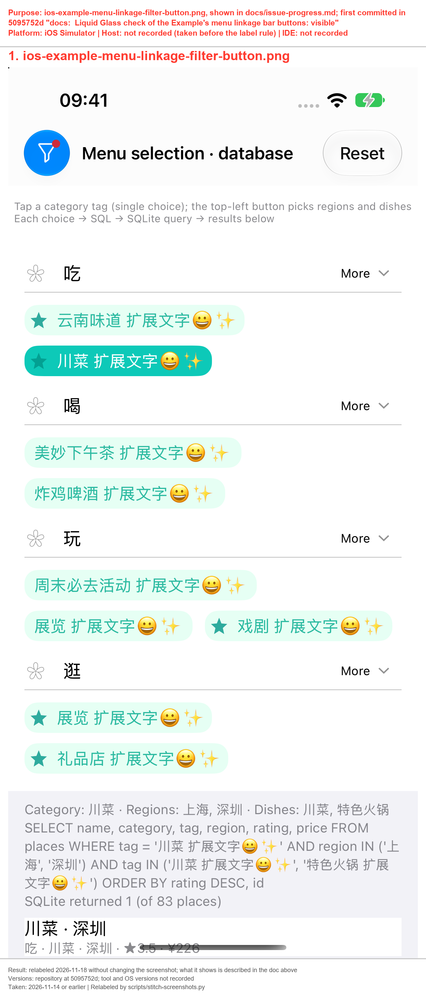

# Issue 修复进度

本表记录全部 issue，包括非 UI 问题。分数表示问题的修复及验证程度，并非代码完成比例；
100 分要求相关场景验证通过。尚未验证的修改不计为完全修复。每次提交修复后，
在本表追加提交链接并重新评估；不能复现或缺少验证时说明原因。

2026-11-11 复评：GitHub CI（`macos-26` runner，默认 Xcode 26.x）在 [ff35b27](https://github.com/ChenYilong/CollectionViewClassifyMenu/commit/ff35b27) 上全部通过——`pod lib lint`、库的构建与静态分析（库源码有警告即失败）、四组单元测试（menu、tag、example、swift；示例与其测试已全部改写为 Swift）以及 46 张示例截图。下表中“未能构建/测试”的扣分据此更新。

| 存在的 issue | 修复 commit 地址 | 评估是否修复 |
| --- | --- | --- |
| [#13 复用后 cell 重叠](https://github.com/ChenYilong/CollectionViewClassifyMenu/issues/13) | [c5f4f01](https://github.com/ChenYilong/CollectionViewClassifyMenu/commit/c5f4f016ff9158e09070bc7dff2ba51ed2fd9c8b)、[107b898](https://github.com/dennisxiaoding/CollectionViewClassifyMenu/commit/107b898e582513697c7c513a8555f81d5bc5f8b4)、[977398d](https://github.com/ChenYilong/CollectionViewClassifyMenu/commit/977398d6c5881496802b29689c21fdfca34b7e57)、[3ad4953](https://github.com/ChenYilong/CollectionViewClassifyMenu/commit/3ad49531ca67e5f12253603e976b46526570295d)、[84f44be](https://github.com/ChenYilong/CollectionViewClassifyMenu/commit/84f44beb5144e77ec2297659d7e4e00e12a23eb2) | **90/100**：dennis 方案仅限制单选宽度，结合属性副本、多选宽度及复用修复；两套菜单的演示条目均追加 emoji 和长文字，已验证滚动复用、展开、折叠和 320/390 pt 宽度。组件化后重新验证 TagCollectionView 的长文字。尚未覆盖所有设备和字体设置。 |
| [#12 layout attributes 被修改](https://github.com/ChenYilong/CollectionViewClassifyMenu/issues/12) | [c5f4f01](https://github.com/ChenYilong/CollectionViewClassifyMenu/commit/c5f4f016ff9158e09070bc7dff2ba51ed2fd9c8b) | **90/100**：布局返回属性副本，测试修改返回值后再次读取不受影响；尚未覆盖所有自定义布局和动态尺寸场景。 |
| [#11 CocoaPods 支持](https://github.com/ChenYilong/CollectionViewClassifyMenu/issues/11) | [84f44be](https://github.com/ChenYilong/CollectionViewClassifyMenu/commit/84f44beb5144e77ec2297659d7e4e00e12a23eb2)、[32720b0](https://github.com/ChenYilong/CollectionViewClassifyMenu/commit/32720b0352a0ab93fb5722e711e9954356b63624)、[ff35b27](https://github.com/ChenYilong/CollectionViewClassifyMenu/commit/ff35b27) | 原 **75/100**：84f44be 提供 iOS 15 podspec、资源 bundle、协议化接口和两个示例的本地 Pod 集成，README 说明通过 Git 分支引入；32720b0 替换 iOS 15 已弃用的按钮 edge insets、`adjustsImageWhenHighlighted` 和旧绘图 API，消除已知的 lint 弃用警告来源，并补充按钮布局测试。2026-11-11：CI 在 [ff35b27](https://github.com/ChenYilong/CollectionViewClassifyMenu/commit/ff35b27) 上 `pod lib lint` 与库的构建/分析（无警告）通过，三个示例工程以本地 Pod 集成并通过测试。**85/100**：仍未发布到 CocoaPods trunk，也没有对应 Git tag。 |
| [#9 标签太多时卡顿](https://github.com/ChenYilong/CollectionViewClassifyMenu/issues/9) | [c5f4f01](https://github.com/ChenYilong/CollectionViewClassifyMenu/commit/c5f4f016ff9158e09070bc7dff2ba51ed2fd9c8b)、[84f44be](https://github.com/ChenYilong/CollectionViewClassifyMenu/commit/84f44beb5144e77ec2297659d7e4e00e12a23eb2) | **85/100**：两套标签布局均采用线性行计算；1,200 项测试验证读取次数，数据更新会使缓存失效。尚未在真机测量滚动帧率。 |
| [#8 布局算法复杂及 iOS 10 问题](https://github.com/ChenYilong/CollectionViewClassifyMenu/issues/8) | [c5f4f01](https://github.com/ChenYilong/CollectionViewClassifyMenu/commit/c5f4f016ff9158e09070bc7dff2ba51ed2fd9c8b)、[84f44be](https://github.com/ChenYilong/CollectionViewClassifyMenu/commit/84f44beb5144e77ec2297659d7e4e00e12a23eb2) | **80/100**：两套布局行计数改为单次遍历，测试长文本折叠和缓存失效；尚未改成 self-sizing。本项目最低版本现为 iOS 15，不再支持 iOS 10。 |
| [#7 3.5 英寸屏幕 header 溢出](https://github.com/ChenYilong/CollectionViewClassifyMenu/issues/7) | [c5f4f01](https://github.com/ChenYilong/CollectionViewClassifyMenu/commit/c5f4f016ff9158e09070bc7dff2ba51ed2fd9c8b)、[84f44be](https://github.com/ChenYilong/CollectionViewClassifyMenu/commit/84f44beb5144e77ec2297659d7e4e00e12a23eb2) | **90/100**：header 按容器宽度布局，测试 240、320、390 pt；iOS 15 不支持原 3.5 英寸设备，无法在原设备上验证。 |
| [#3 类似库参考](https://github.com/ChenYilong/CollectionViewClassifyMenu/issues/3) | 无 | 不适用：不是缺陷，是参考资料，issue 已关闭，无需修复。[component-architecture.md](component-architecture.md) 记录了本项目的封装取舍。 |
| [#2 编译报错](https://github.com/ChenYilong/CollectionViewClassifyMenu/issues/2) | [1e383ca](https://github.com/ChenYilong/CollectionViewClassifyMenu/commit/1e383cab8dca462773e0a04969b7aba67a99deef)、[ff35b27](https://github.com/ChenYilong/CollectionViewClassifyMenu/commit/ff35b27) | 原 **90/100**：历史提交已修正 block 参数中 `*` 的位置，issue 已关闭；现有代码不再包含该写法。2026-11-11：CI 在 [ff35b27](https://github.com/ChenYilong/CollectionViewClassifyMenu/commit/ff35b27) 上编译库与全部示例并通过测试，**95/100**；未在 Xcode 旧版本上复现原报错环境。 |
| [#1 复用后选择状态错误](https://github.com/ChenYilong/CollectionViewClassifyMenu/issues/1) | [c5f4f01](https://github.com/ChenYilong/CollectionViewClassifyMenu/commit/c5f4f016ff9158e09070bc7dff2ba51ed2fd9c8b) | **80/100**：已验证侧边栏选中后滚动复用仍保持状态；历史报告缺少具体复现步骤，其他选择组合未覆盖。 |

## 验证截图 / Screenshot evidence

以下截图来自 CI（`Example screenshots`，提交 `22370a8`，`macos-26`），对应表中的 issue：

| #13 / #1：长文字与 emoji 标签复用后不重叠、选中状态保持 | #13：多选后折叠的长文字标签 | #7：分组标题按容器宽度布局，右侧有宿主视图 | #9：大量标签滚动到末尾 |
| --- | --- | --- | --- |
|  |  |  |  |

## 待办 / TODO

### Done (2026-11-17, `feat/harmony`): every published package ships its license

- Prompt (verbatim): "找到本项目instructions 相关文件以及skills相关文件，如果没有就新增文件保证写入成功，全英文写入：所有需要发布到外部仓库的代码，包括但不限于 cocoapods graddle npm maven等等 必须包含协议声明，如果已经有内置包文件夹就放进去，如果没有就新建，确保写入成功。以iOS为例，内置包bundle文件应包含协议文件。此操作适用于所有平台。"
- Requirements: write the rule, in English, into the instructions (AGENTS.md) and a skill (create them when missing):
  every package published to an external registry (CocoaPods, Gradle / Maven, npm, pub.dev, ohpm, the mini program
  npm packages…) contains a license declaration; when the package has a built-in resource container (iOS: the
  resource bundle) the license file goes into it, otherwise one is created; every platform.
- Decision (asked, 2026-11-17): MIT for this repository's own code; third-party code keeps its license.
- Result: the rule is in AGENTS.md ("License in every published package") and the new skill
  `.agents/skills/cyl-license/`. Files: `LICENSE` (MIT) and `THIRD-PARTY-NOTICES.md` at the root and in the iOS bundle
  (`CollectionViewClassifyMenu/Resources/License/`, podspec `s.license` MIT with `:file`, `s.resource_bundles`, SwiftPM
  `.copy`); Android `META-INF/classifymenu/{LICENSE,NOTICE,LICENSE-APACHE-2.0}` (POM MIT + Apache-2.0) and
  `META-INF/androidtagview/{LICENSE,NOTICE}` (Apache-2.0); MIT `LICENSE` for npm (React Native), both pub.dev packages
  (the Flutter "TODO" placeholder replaced) and their HAR, the ohpm HAR (module root and `rawfile`), the mini program
  package (root, listed in `files`, expected by `verify-package.js`). Check: `scripts/check-licenses.sh` (passes,
  shellcheck clean); mini program `verify-package.js` and `npm test` 111/111 pass.
  2026-11-17, after re-reading CYLTabBarController's guide (tip `ec12a9d`, its `docs/License-Notices.md`): the mini
  program package also carries `miniprogram_dist/LICENSE`, as CYLTabBarController's mini program component folders
  do (the earlier worry about WeChat file types did not hold).
  Pins: d0c82cb had moved every CYLTabBarController pin from `fbd05d5` to the newest `ec12a9d`, which dropped the
  unmerged PR #814 (`fix/lottie-unplayable-file`: the Lottie animator makes no view for a file Lottie cannot play) and
  would fail `testTagButtonDisplayPriorityWhenTheAnimationCannotPlay` again (reported by the CYLSearchViewController
  session). Owner's decision (asked, 2026-11-17): "Back to fbd05d5 until #814"; the pins are `fbd05d5` again, the
  exception is in AGENTS.md ("CYLTabBarController reference and dependency"). Not built here: the iOS bundle, the
  AAR and the HAR (CI and the platform toolchains).
- Found: the packages disagree (iOS podspec "All rights reserved", npm / ohpm / mini program "MIT", Flutter LICENSE a
  "TODO" placeholder, the AndroidTagView port Apache-2.0 from its upstream, the merged Android library none).

### TODO (2026-11-16): reproduce and handle the Rive crash on the HarmonyOS emulator

- **Context:** the HarmonyOS animation screen crashed in `libohos_rive.so` (`EGLWorkerImpl::destroy` →
  `eglDestroySurface` → `NativeWindowDisconnect`, null pointer) when a Rive view is disposed; the Rive pool was reverted
  (`cb52204`); the owner's fixes since then (filter button tint `548039d`, badges and review chip `bf7ed6a`, fold
  capsule `789573b`) were never seen on a device.
- **Requirements:** on the emulator, reproduce the Rive crash, find its cause and handle it; run the animation screen in
  light mode, dark mode and with scrolling; check the filter button, the hot-search badges (Y1) and the selected review
  chip (Y2); update the screenshots and docs.
- **Prompt (verbatim, abridged pasted report):** "使用鸿蒙模拟器处理 复现 以下rive动效 crash bug continue do The Rive crash is only made less likely; the bug is inside @ohos/rive. • The animation screen after the pool revert, in light mode, dark mode and with scrolling, still needs an emulator run. • I hadn't finished reviewing these screenshots: …"
- **Prompt (English):** use the HarmonyOS emulator to reproduce and handle the Rive animation crash below; continue with
  the remaining emulator checks.
- **Reproduced (2026-11-16, emulator `CYL ClassifyMenu Test`, build of `548039d`):** opening the animation screen crashes
  the app every time, by launch option and through the 动效 tab alike, in light and dark mode, about 6–10 s after it
  appears, before any scrolling: `cppcrash` on thread `Rive`, `SIGSEGV` at 0x158 in `NativeWindowDisconnect` ←
  `eglDestroySurface` ← `ohos_rive::EGLWorkerImpl::destroy` ← `Renderer::DisposeOnWorkerThread`. Twice more the emulator
  host itself crashed (Emulator minidump) while the screen was open.
- **Cause, part 1 (the port, triggers it on every opening):** `CYLTagListView` keys each tag by its whole render state
  (`finishKey`: x, y, width, height, font, colors, icon size, …). The first layouts change those values, so `ForEach`
  destroys and rebuilds every tag: logged with a probe in `CYLRiveIconView`, 11 Rive views appear, 11 more appear about
  2 s later, then the first 11 disappear.
- **Cause, part 2 (the library, @ohos/rive 1.0.4, the newest):** when a `RiveAnimationView` goes away, ArkUI destroys its
  XComponent surface at once (`onSurfaceDestroyed`), but the library disposes its renderer later, on its worker thread,
  and calls `eglDestroySurface` on a surface whose native window is already gone. Any disposal of a Rive view can crash.
- **Tried from the port, did not help (local builds, not committed):** calling the renderer's public `stop()`,
  `destroySurface()` and then `stopThread()` from `CYLRiveIconView.aboutToDisappear` (it runs about 15 ms before
  `onSurfaceDestroyed`): the late dispose still crashes the same way.
- **Fix options (decision for the port's owner):** (1) stable `ForEach` keys for tags (section + item + content), with
  position and size passed as observed state instead of being part of the key, so relayouts update tags in place and
  never dispose Rive views while the screen is shown; this removes the crash in normal use, leaving disposal on leaving
  the screen; (2) keep each Rive view alive for the app's lifetime (a pool that does not break the list's layout, unlike
  `95bebc1`); (3) until @ohos/rive is fixed, show each Rive item's SVGA twin on HarmonyOS (every Rive scene already has
  one); (4) report the dispose order to @ohos/rive (openharmony-tpc `ohos_rive`).
- **Retest of `e82b503` (stable ForEach keys), 2026-11-16:** still crashes on every opening, light and dark: probe logs 22 Rive views created and 11 disposed, same `eglDestroySurface` stack. A second rebuild path remains (`CYLTagButton` recreates the icon through `animationViewToken`); also skipping the reload on a style size change (local build) did not stop it. Owner's fallback: switch Rive items off on HarmonyOS.
- **Status:** reproduced and explained; not fixed. The other emulator checks of this task (filter button tint, Y1, Y2)
  wait for the next run, since the emulator host crashed during this one.

### TODO (2026-11-16): HarmonyOS bug: the menu linkage filter icon is nearly invisible

- **Bug:** HarmonyOS example, page "菜单选择 · 数据库联动" (`CYLMenuLinkagePage`): the filter button at the top left of the
  title bar (image `menuLinkageFilter`, bounds [49,175][126,252] px) is drawn almost the color of the bar. Measured on
  `docs/assets/harmonyos-push-query-menu-linkage.jpeg` (2026-11-16 10:36 emulator time): darkest icon pixel
  rgb(249, 249, 249) on a background of luminance 0.958, a contrast of **1.01 : 1**; WCAG 2.1 (1.4.11, non-text
  contrast) asks for at least 3 : 1. "重置" (Reset) on the same bar measures 4.73 : 1. Users with normal or low vision
  cannot see the control that opens the regions and dishes filter.
- **Expected:** the filter icon in the iOS example's tint (the core's `cyl_filter_normal` / `cyl_filter_modified`
  images, gray when no filter is set, highlighted when one is), at 3 : 1 or more.
- **Owner:** the HarmonyOS port's session (winCollectionViewClassifyMenu); reported 2026-11-16.
- **Prompt (verbatim):** "flag the filter icon"

### DONE (2026-11-16, logged as TODO the same day): commit and push after every answer on a feature branch

- **Context:** the pull-request rule of the previous request (`7e11ae6`) is repeated, with one addition: after every
  question-and-answer turn, commit and push on any branch that is not `master` / `main`, without asking.
- **Prompt (verbatim):** "写入instructions相关文件，skills相关指令，找到commit 的相关章节，没有的话就新建，保证写入成功：全英文写入：创建分支后有任何commit必须提交pr。不允许只新建分支，持续向该分支commit代码，但不创建pr。因为不创建pr会导致该分支上的所有commit代码全部被忽略。 commit前必须检查该分支pr是否处于open状态，如果不处于open状态必须新建pr。target 目标优先设置为 在创建pr前的活跃pr，如果没有才设置为master分支。如果open状态的pr已经超过两个，那么就要慎重，你需要询问我，是否新建分支创建pr还是保持在本分支继续提交。因为超过两个分支会导致代码合并困难，无法合理分配分支的目标分支。一次问答结束后，只要当前分支不是master main，则必须commit 必须push ，无须询问，因为代码总是在分支上，并不会push 到master main分支。非常安全。无须担心push后的任何风险。"
- **Prompt (English, the new part):** after each question-and-answer turn, as long as the current branch is not master or
  main, commit and push, without asking: the code is always on a branch and is never pushed to master / main, so it is
  safe and a push carries no risk to worry about.
- **Result:** the pull-request part was already in place (`7e11ae6`); appended "Commit and push at the end of every
  answer" to AGENTS.md and the cyl-commit skill ("Branches and pull requests"), `docs/instructions.md` and
  `harmony/instructions.md`. Checked before this commit: one open pull request, #20 `feat/harmony` → `master`.

### DONE (2026-11-16, logged as TODO the same day): an open pull request for every branch with commits

- **Context:** the branch rule opened a pull request when a branch was created, but did not require one before each
  commit, nor say what to do when the pull request is closed or when several are open.
- **Requirements:** write in English, in the instructions files and the skills, in the commit / branch section (create
  it if missing): every branch with commits has a pull request; check before each commit that the branch's pull request
  is open and open a new one if not; target: the pull request active before, else `master`; more than two open pull
  requests: ask the user whether to open another branch and pull request or keep committing on the current branch.
- **Prompt (verbatim):** "写入instructions相关文件，skills相关指令，找到commit 的相关章节，没有的话就新建，保证写入成功：全英文写入：创建分支后有任何commit必须提交pr。不允许只新建分支，持续向该分支commit代码，但不创建pr。因为不创建pr会导致该分支上的所有commit代码全部被忽略。 commit前必须检查该分支pr是否处于open状态，如果不处于open状态必须新建pr。target 目标优先设置为 在创建pr前的活跃pr，如果没有才设置为master分支。如果open状态的pr已经超过两个，那么就要慎重，你需要询问我，是否新建分支创建pr还是保持在本分支继续提交。因为超过两个分支会导致代码合并困难，无法合理分配分支的目标分支。"
- **Result:** appended to AGENTS.md and `.agents/skills/cyl-commit/SKILL.md` ("Branches and pull requests"),
  `docs/instructions.md` and `harmony/instructions.md`; `scripts/check-branch-pr.sh` checks the branch's open pull
  request and the number of open pull requests (exit 2 when more than two). Checked before this commit: one open pull
  request, #20 `feat/harmony` → `master`.

### DONE (2026-11-16): HarmonyOS bug: fold arrows of the menu linkage page drawn at the wrong size

- **Bug:** HarmonyOS example, the page titled "菜单选择 · 数据库联动" (Menu selection · database linkage,
  `CYLMenuLinkagePage`): the section fold arrows (⌄) are drawn far too large, about a quarter of the screen width, in
  `docs/assets/harmonyos-push-query-menu-linkage.jpeg` (2026-11-16 10:08 emulator time, before `5dc703b`).
- **Found so far:** the port's owner sized the fold chevron in `5dc703b`; `harmonyos-menu-linkage.jpeg` (10:25, after it)
  shows normal arrows beside "更多" (More). To do: retake the same page through the query-scenarios flow, replace the
  screenshot, mark the bug fixed or keep it open.
- **Prompt (verbatim):** "标记bug ： 鸿蒙系统，example 页面： 搜索一下关键词“菜单选择 数据库联动 ” 含有该字符串的页面截图 中的箭头 尺寸异常。"
- **Prompt (English):** mark a bug: HarmonyOS, example page: search for the keyword "菜单选择 数据库联动"; in the
  screenshots of the page that contains it, the arrows have an abnormal size.
- **Result:** fixed by the port's owner in `5dc703b` (fold chevron sized like the header icons). Verified on the emulator
  `CYL ClassifyMenu Test` (2026-11-16 10:36 emulator time) through the same flow (query scenarios → "分类菜单 + 多选筛选"):
  the four fold arrows are 53 × 53 px (about 15 vp at density 3.5), one text line high beside "更多"; the old screenshot
  `harmonyos-push-query-menu-linkage.jpeg` is replaced. `harmonyos-menu-linkage.jpeg` (10:25) already showed the fix.

### DONE (2026-11-16): retest the HarmonyOS fixes on the emulator

- **Context:** the port's owner pushed `95bebc1` (Rive dispose crash, plus tab and filter button), `849c2d8` (tags laid out
  1 vp wide, dark-mode text) and `5dc703b` (tag taps, fold chevrons) on `feat/harmony` (now the only branch).
- **Requirements:** rerun on the dedicated emulator: animations (Chinese, dark, scrolling), the plus tab, the menu-linkage
  filter button and fold chevrons, the tag taps (hilog domain CYLTagList); update the screenshots and the verification
  rows; push to `feat/harmony`.
- **Prompt (verbatim):** "continue"
- **Result:** fixed: tag taps (product tag opens the filtered review list, "好评(9)" filters to 9, hot-search and
  search-category tags fill the search field; hilog `CYLTagList: tap gesture`), the plus tab (opens "查询筛选"), the
  menu-linkage fold controls ("更多 ⌄"). Still wrong: the filter panel opens under a gray dimming layer; the plus button
  still exposes only a description, no accessibility text; B11 regressed (light-mode animated tags are empty boxes);
  opening the animation screen in dark mode or scrolling it crashed the emulator host twice. Reported to the owner.

### DONE (2026-11-16): more HarmonyOS pushed-page screenshots

- **Context:** `screenshots.md` has six pushed pages; more screens open further pages (query scenarios, review
  filters, tag clouds, image tags). The owner's next fix (`c6a8a5c`: plus and filter buttons, Rive pooling) is not
  pushed yet, so this run uses `7c4c294`.
- **Requirements:** run the HarmonyOS example on the emulator, open the next (pushed) pages, add their screenshots to
  the docs.
- **Prompt (verbatim):** "run our HarmonyOS version code on an emulator and push next page update more screenshot in docs"
- **Result:** six more pushed pages in `screenshots.md` (query scenarios ×3, image-tag create, tag-cloud RecyclerView and
  sub-page; 12 pushed pages in all); the review filter "好评(9)" still does not filter (reported to the port's owner).

### DONE (2026-11-16): emulator pushed pages, script rule, SVGA alignment, PR sync

- **Context:** the HarmonyOS screenshots so far show each demo's first page only; zsh word splitting broke inline
  measurements; the SVGA demo's icon and title are not centered with each other; the two open PRs (#20
  `feat/harmony`, #16 `feat/android-kotlin`) drifted again.
- **Requirements:** (1) run the HarmonyOS example on the emulator, open the pushed (next) pages and add their
  screenshots to the docs; (2) write in English into the instructions and skills, in a script-execution section
  (created if missing): prefer bash to run scripts, to avoid zsh's word-splitting errors; (3) fix the SVGA demo so
  icon and title are centered with each other; (4) cherry-pick between all open PRs so their code stays in sync.
- **Prompt (verbatim):** "run our HarmonyOS version code on an emulator and push next page update more screenshot in docs
  写入instructions相关文件，skills相关指令，找到脚本执行的相关章节，没有的话就新建，保证写入成功：全英文写入：优先使用bash 执行脚本 避免以下错误zsh doesn't split $box into words either. Running the same measurement as a bash script.
  SVGA demo runs incorrectly icon and title not align center with each other
  将所有处于open状态的pr 互相cherry pick 保持所有pr保持代码同步"
- **Prompt (English):** run our HarmonyOS code on an emulator, push the next pages and add more screenshots to the docs;
  write into the instructions files and skills, in the script-execution section (create it if missing, make sure it is
  written), in English: prefer bash to run scripts, to avoid the error "zsh doesn't split $box into words either.
  Running the same measurement as a bash script."; the SVGA demo runs incorrectly: icon and title are not centered with
  each other; cherry-pick between all open PRs so every PR keeps the same code.
- **Status:** (2) DONE, see AGENTS.md "Running scripts" (`6081884`). (1) DONE: six pushed pages in
  `screenshots.md` (HarmonyOS: pushed pages), driven by text and accessibility text; four taps changed nothing (plus
  button, menu-linkage filter button, review filter "Good", search category "People") and two controls have no
  accessibility text (plus button, filter button): reported to the port's owner. The animation screen also crashes on
  the emulator (`libohos_rive.so`, null pointer when a Rive view disposes its EGL surface; @ohos/rive 1.0.4 is the
  newest). (3) DONE, no change needed here: the misaligned SVGA screenshots the user saw are CYLTabBarController's
  docs (its HarmonyOS SVGA demo, handled there: `1aea05d`, `0d7d25b`); in this project every SVGA tag's icon and title
  centers are within 1 px, padding equal (42 px each side), measured on the emulator. (4) DONE: the open PRs' branches
  (#20 `feat/harmony`, #16 `feat/android-kotlin`) cherry-picked each other's new commits (5 one way, 2 the other) and
  now hold the same tree; build OK, host tests 49/49, accessibility and native-string checks OK. The owner's defect
  fix `d6adba3` was checked on the emulator: B1, B9, B12 fixed; B11 dark mode and the Rive crash remain.

### DONE (2026-11-16, logged as TODO the same day): commit messages in git cz style, English only

- **Context:** the commit rule (AGENTS.md "Code and naming", `.agents/skills/cyl-commit/`) asked for English
  Conventional Commits with emoji but never named `git cz`, and did not forbid Chinese text in messages.
- **Requirements:** find the commit rule (create it if missing), look for `git cz` (none found), and add in English:
  commits in `git cz` style, entirely in English, no Chinese characters; write it into the instructions documents and
  the skills.
- **Prompt (verbatim):** "写入instructions相关文件以及skills，找到commit规范，如果没找到就新建，寻找关键字 git cz，如果没有就新建，如果有就追加以下规则：全英文写入： git cz 风格提交，全英文commit 不允许出现中午。 continue"
- **Prompt (English):** write into the instructions files and skills: find the commit convention (create it if not
  found), look for the keyword `git cz` (create it if absent, append if present), and add in English: `git cz` style
  commits, English-only commit messages, no Chinese allowed. ("中午" in the prompt is a typo of "中文", Chinese.)
- **Result:** the rule "Commit messages: git cz style, English only" in AGENTS.md (Code and naming),
  `.agents/skills/cyl-commit/SKILL.md` (new section), `docs/instructions.md` and `harmony/instructions.md`, all
  appended; `scripts/check-commit-message.sh` checks the subject format, the author line and CJK characters.

### TODO (2026-11-17, `feat/harmony`): every icon + title component is CYLTagButton (iOS done, Android open)

- Prompt (verbatim): "请确保本项目中所有具有如下特征的组件使用的是同一个组件，如果不是相关代码修改内部实现，以保证使用的是同一个组件，方便我重构该组件就可以把修改应用到所有组件上。我的需求是以后新增动效类型，仅需需要修改这个组件，所有需要使用动效展示的组件都可以支持新增动效，无须在第二个地方修改代码。" (followed by the link to `CYLTagButton.swift#L94` and its description).
- Decision (asked, 2026-11-17): "Replace with CYLTagButton (Recommended)": the public `UIButton` subclasses are
  replaced, a breaking change documented in `Swift-Migration.md`.
- Inventory: animation already plays only in `CYLTagButton` (its private `CYLTagAnimationEngine` is the only caller
  of CYLTabBarController's engine); tags, the list title and the fold control (`CYLTagFoldButton: CYLTagButton`) use
  it; the examples build no icon + title views of their own. Not yet: `CYLTagListHeaderView` (section headers of
  `CYLTagListView`, `UIImageView` + `UILabel`), `CYLMultipleFilterHeaderView` (XIB `UIImageView` + `UILabel`),
  `CYLIndexPathButton` (`UIButton`: classify menu and filter tags, filter header title) and `CYLRightImageButton`
  (`UIButton`: the classify menu's "更多").
- Result (not compiled here: Linux, no Xcode; CI builds and tests it):
  - `CYLIndexPathButton` and `CYLRightImageButton` are `CYLTagButton` subclasses (the names, `section` / `row` and the
    key-value keys `button` / `titleButton` / `moreButton` kept). Their old `UIButton` looks are `CYLMenuStyle` looks:
    `classifyMenuTag(_:)`, `filterTag()`, `sectionTitle(fontSize:textColor:leadingInset:)`. The classify menu and the
    multiple filter measure their cells with the style's font (Bold Text and Dynamic Type included).
  - `CYLTagListView`'s section header shows its icon and title with one `CYLTagButton` (`titleButton`; `iconView` /
    `titleLabel` are that button's views, for the tests' key-value coding).
  - `CYLMultipleFilterHeaderView`'s title is a `CYLTagButton` (`titleButton`); the XIB keeps only the view.
  - Every icon + title component of the iOS core is now a `CYLTagButton` or holds one, and only `CYLTagButton` plays
    animated icons: a new kind of animation is added in one place (CYLTabBarController's animator registry, which
    `CYLTagButton` reads by file extension). Plain text action buttons (Search, Cancel, Manage, 展开/收起 of the
    TagCollectionView demo) are not tags and stay `UIButton`s.
  - Tests: `testClassifyMenuButtonsAreTagButtons` (Objective-C) replaces the `UIButton` inset test; the cell checks
    assert every tag is a `CYLTagButton`; `CYLExampleDatabaseTests` and two header-frame tests updated
    (`headerTitleFrame(inSection:)` in `CYLTagListInspecting`).
  - Breaking changes: `Swift-Migration.md`, step 12.
  - Parity: Android -> iOS 733 / 733 (the two removed spacing properties mapped to the style); iOS -> Android 763 / 771
    = 99.0: the new looks, `expandTitle` / `collapseTitle`, `CYLMultipleFilterHeaderView.titleButton` and
    `CYLTagButton.cylApply(_:)` have no Android counterpart yet, because Android's `CYLIndexPathButton`,
    `CYLRightImageButton` and `CYLMultipleFilterHeaderView` are still `Button` / `ViewGroup`s. TODO: the same refactor
    in `android/merged/library` (needs an Android build).
- Status: iOS done; Android TODO.

### Done (2026-11-17, `feat/harmony`): CYLTagListView members visible to Objective-C

- Prompt (verbatim): "Fix others report issue Still open: the pin bump. This repo still uses the old Nov 12 version of CollectionViewClassifyMenu. Moving to the new one is still blocked: at 652e084, most CYLTagListView members still aren't visible to Objective-C, and our React Native iOS wrapper needs them. The fix is to mark those members @objc in that repo, which I now have access to. Do you want me to do that next?"
- Context: another repository pins the Nov 12 pod and calls `CYLTagListView` from an Objective-C(++) React Native
  wrapper. Since the Swift migration, 177 of the view's 182 public members have no `@objc`, so the generated
  `CollectionViewClassifyMenu-Swift.h` does not declare them. This repository's own React Native wrapper is not
  affected (it goes through a Swift bridge).
- Requirements: expose every Objective-C-representable public member of `CYLTagListView` (properties, methods,
  initializers, the configuration API) with conventional Objective-C names; keep the Swift names; give members whose
  types Objective-C cannot see (`CYLTag`, `CYLTagColors`, `CGFloat?`) an Objective-C route; prove it with an
  Objective-C test in the core's tests.
- Status: done in the core (not compiled here: Linux, no Xcode; CI builds and tests it). Result and details:
  `Swift-Migration.md`, "Objective-C API changes". The other repository can move its pin to the commit that adds
  this.

### DONE (2026-11-17, `feat/harmony`): an Objective-C route for `CYLTagListView.tagClickHandler`

- Prompt (verbatim): "CollectionViewClassifyMenu updated continue"
- Context: CYLSearchViewController (branch `feat/harmonyos-parity`) moves its pin to this repository's newest commit.
  Its React Native iOS wrapper (`CrossPlatform/react-native-cylsearch/ios/CylsearchTagListView.mm`, Objective-C++, as
  Fabric requires) reports every tap of a tag with `tagClickHandler`, as its Android wrapper does. Since `477323d`
  every Objective-C-representable member is `@objc`, but `tagClickHandler` takes a `CYLTag`, which Objective-C cannot
  see, so it stayed Swift-only. `menu:didSelectItemAtIndexPath:` is no substitute: it is not called when a selected
  tag is tapped again in `.single` mode, while `tagClickHandler` is called for every accepted tap.
- Requirements: an Objective-C route for the handler, called for exactly the taps `tagClickHandler` sees, with the
  index and the title; the Swift API unchanged; an Objective-C test.
- Result: `objcTagClickHandler` (`@objc(tagClickHandler)`, unavailable in Swift) in `CYLTagListView.swift`, called in
  `handleTap(at:)` right after `tagClickHandler` with `tag.title`; `testTagListViewAPIIsVisibleToObjectiveC` sets and
  calls it from Objective-C; `Swift-Migration.md`, "Objective-C API changes". Tables: iOS -> Android 767 / 767,
  Android -> iOS 733 / 733. Not compiled here (Linux, no Xcode); CI builds and tests it. The test sets and calls the
  block; it does not simulate a tap (the tap path is private), so the call from `handleTap` is checked only by
  reading it.

### DONE (2026-11-17, `feat/harmony`, logged as TODO in `f30a2b1`): `CYLTagButton` draws a search bar item on HarmonyOS and in the mini program

- Prompt (relayed by the CYLSearchViewController session, same user goal as the entry below): every icon + title /
  animated icon of CYLSearchViewController must be this repository's `CYLTagButton`; iOS and Android are done there.
  What blocks HarmonyOS and the mini program (CYLSearchViewController `docs/animated-icon-component.md`, step 2) must
  be fixed here, in the core, first.
- Context: the HarmonyOS search bar items use system symbols (`$r('sys.symbol.camera')`, drawn with `SymbolGlyph`),
  theme colors (`ResourceColor`, `$r('sys.color.font_primary')`) and an ArkUI V2 (`@ComponentV2`) parent; the ArkTS
  `CYLTagButton` drew icons only with `Image`, took string colors, was a V1 `@Component` with an `@ObjectLink`, and
  pinned `@ohos/lottie 2.0.38` / `@tencent/libpag 4.4.31` while CYLTableViewPlaceHolder's `cylplaceholder` pins
  `2.0.28` / `4.5.102`. The mini program `cyl-tag-button` could not be transparent: `opaqueBackground` turns
  `transparent` and alpha 0 into `#F2F2F7`.
- Requirements:
  1. HarmonyOS `CYLTagButton`: `sys.symbol` icons drawn with `SymbolGlyph` (the icon color per state as its font
     color), `Image` kept for pixel images, rawfiles and pixel maps;
  2. its colors (title, icon, background, border, badge) accept `ResourceColor` (theme resources that follow the
     color mode), not only strings;
  3. usable from an ArkUI V2 parent, following the V1 / V2 bridge already used by CYLSearchViewController (a V1 host
     that holds the model as `@State`);
  4. the animation library versions aligned with `cylplaceholder`, so one app can depend on both;
  5. mini program `cyl-tag-button`: a transparent background possible, the tag list defaults unchanged;
  6. tests (mini program `npm test`, the Linux checks), docs, this entry done.
- Result:
  - HarmonyOS symbols: `CYLImageIsSymbol(image)` (a `Resource` of type `CYLResourceTypeSymbol`, 40000, the
    `ResourceType.SYMBOL` of `$r('sys.symbol.…')`); `CYLTagButtonComponent` draws such an icon with `SymbolGlyph`
    (font size the icon slot's smaller side, 16 vp without a slot; `fontColor([iconColor])` per state) and every other
    image with `Image` as before.
  - HarmonyOS colors: `CYLTagAppearance.backgroundColor` / `textColor` / `iconColor` / `borderColor`,
    `CYLMenuStyle.highlightedBackgroundColor` / `deleteIndicatorColor` / `setTitleTextAttributes` / `setIconColor` /
    `iconColor(state)` / `CYLTitleTextAttributes.textColor`, `CYLTagButtonPart.textColor` / `tintColor`,
    `CYLTagButton.backgroundColor` / `borderColor` / `crossColor` / `badgeColor` take `ResourceColor` (strings still
    work: a string is a `ResourceColor`). `CYLTagListView` keys its render items with `CYLColorKey` (a resource's id).
  - HarmonyOS standalone use: `CYLTagButton.minimumSize` (a touch target; the content is centered in it) and the badge
    metrics `badgeTextColor`, `badgeFont`, `badgeMinimumSize`, `badgeContentInsets`, `badgePositionAdjustment` (iOS and
    Android reach them through a subclass, which ArkTS components cannot override).
  - HarmonyOS `playAnimation()` before the animated icon is loaded (a tag shown for the first time, such as the SVGA
    demo of CYLSearchViewController, which plays once when shown) now plays it once it is loaded (`pendingPlay`), as
    iOS does.
  - HarmonyOS V2: `CYLTagButtonHost`, a V1 `@Component` that holds the button as `@State` and links it to
    `CYLTagButtonComponent`, placed inside a `@ComponentV2` (the bridge CYLSearchViewController's `CYLSearchView`
    already uses for CYLTableViewPlaceHolder's V1 placeholders, `CYLSearchPlaceholderHost`).
  - Animation versions: `@ohos/lottie` stays 2.0.38 (newer than `cylplaceholder`'s 2.0.28 and fine on API 12);
    `@tencent/libpag` stays 4.4.31: the newer 4.5.102 of `cylplaceholder` needs API 15 (CYLTableViewPlaceHolder
    `docs/HarmonyOS.md`), above this library's minimum, API 12 (`compatibleSdkVersion` 5.0.0(12)); `@ohos/rive` 1.0.4
    on both. An app that depends on both libraries (API 15 or later) picks one version of each with ohpm `overrides`
    in its project `oh-package.json5`: `@ohos/lottie` 2.0.38, `@tencent/libpag` 4.5.102 (CYLSearchViewController does).
    TODO: `cylplaceholder` moves to `@ohos/lottie` 2.0.38 (its own session); this library moves to libpag 4.5.102 when
    its minimum reaches API 15.
  - Mini program: style key `allowsTransparentBackground` (false by default) keeps a `transparent` / `clear` /
    zero-alpha tag background (`tagBackground`); without it `opaqueBackground` still gives the default fill, so tag
    lists are unchanged. Documented in the package README and `cyl-tag-button.js`.
  - Mini program `cyl-tag-button`: `accessibilityLabel` (what the screen reader reads first, else the title; an
    icon-only search bar item reads its label), test in `test/tag-button.test.js`.
  - Tests: HarmonyOS `TagButton.test.ets` + 3 (`drawsSystemSymbolsAndTakesThemeColors`,
    `growsToItsMinimumSizeAndCentersTheIcon`, `takesTheBadgeMetrics`); mini program `test/tag-button.test.js` + 1.
    Run here: `npm test` (109 pass, 1 skipped), `harmony/scripts/accessibility-check.py` (the one finding is an
    existing demo image, unchanged), `harmony/scripts/harmony_parity.py` (811 / 849, unchanged: the new members are
    HarmonyOS additions, not iOS symbols).
  - Unverified (Linux, no DevEco Studio): the ArkTS code is not compiled and the local unit tests are not run
    (`harmony/scripts/unit-test.sh`); a symbol icon, a theme color in dark mode and `CYLTagButtonHost` inside a V2
    parent are not seen on an emulator; `ResourceType.SYMBOL` = 40000 is taken from the ArkUI engine, not checked
    against the SDK here. The `oh-package-lock.json5` files are unchanged (no dependency version changed).

### DONE (2026-11-17, `feat/harmony`, logged as TODO in `1e43253`): `CYLTagButton` as the one icon + title + animated icon component

- Prompt (relayed by the CYLSearchViewController session; the user's goal, quoted in that repository's task log):
  every component that shows an icon with a title, or plays an animated icon, in CYLSearchViewController and its
  sub-repositories must be the same component, this repository's `CYLTagButton` and its counterpart on each platform,
  so that a new animation type is added in that one component only. The search bar items (an icon, a title, a badge
  text with a badge color, tappable, selected and disabled states) and later CYLTableViewPlaceHolder's
  `CYLPlaceholderView` animated icon (icon above the title, or icon only) are built on it.
- Context: `CYLTagButton` (iOS `CollectionViewClassifyMenu/Class/TagList/CYLTagButton.swift`, Android
  `android/merged/library/.../CYLTagButton.kt`, HarmonyOS `harmony/classifymenu/src/main/ets/tagviews/CYLTagButton.ets`,
  mini program `cyl-tag-list` component) lays the icon and the title side by side and plays animated icons through
  CYLTabBarController's `CYLTabBarItemAnimationFactory`, found at run time, with no per-format code.
- Requirements (core first, every platform, the same names):
  1. a badge: `badgeValue` (nil hides it, "" shows a dot) and `badgeColor` (default system red), at the top trailing
     corner of the icon (of the title when there is no icon), with a localized accessibility value;
  2. an icon above the title: `CYLTagImagePlacement.top` (and `bottom`), existing raw values kept, layout and
     intrinsic size;
  3. icon-only and title-only tags reserve no spacing for the missing part;
  4. a convenience initializer for standalone use (`init(title:image:)`, `init(title:image:animationURL:)`), a
     sensible default style outside a tag list;
  5. every new iOS member `@objc`;
  6. tests on each platform, parity tables regenerated at 100, docs updated.
- Result (the commit that marks this entry done):
  - iOS (`CYLTagButton.swift`, `CYLMenuStyle.swift`): `badgeValue` / `badgeColor` / `badgeLabel` (a capsule or an 8 pt
    dot, white bold 11 pt text scaled for Dynamic Type, on the icon's top trailing corner or the title's, kept inside the
    tag), `CYLTagImagePlacement.top` (2) / `.bottom` (3) with the stacked layout, `width(forTitle:…)` (the wider of the
    two) and `height(for:)` (the icon slot and the spacing added), the new
    `height(forTitle:iconSize:style:traitCollection:)`, `intrinsicContentSize` / `sizeThatFits(_:)`,
    `init(title:image:)` / `init(title:image:animationURL:)` (an accessibility element with the button trait whose
    traits follow selected and disabled), `accessibilityLabel` (the title, else the icon's label) and
    `accessibilityValue` (the badge; "New" localized for a dot, new core key `CYLTagBadgeDot` in en / zh-Hans /
    zh-Hant) unless set; the configuration key `imagePlacement` reads "top" / "bottom". Every new member is `@objc`.
  - Android (`CYLTagButton.kt`): `badgeValue`, `badgeColor` (`CYLTagBadgeDefaultColor`), `badgeLabel`, `badgeFrame`,
    `CYLTagImagePlacementTop` / `Bottom` (`isVertical`), `heightForTitle`, `CYLTagButton(context, title, image)` /
    `CYLTagButton(context, title, image, animationURL)`, TalkBack reads "title, badge". A stacked tag measures with
    `heightForTitle`; a side-by-side one keeps `heightForStyle` (unchanged).
  - HarmonyOS (`CYLTagButton.ets`, `CYLTagListState.ets`): `badgeValue`, `badgeColor` (`CYLTagBadgeDefaultColor`),
    `badgeLabel`, `accessibilityLabel`, `accessibilityValue` (the component's `accessibilityText` /
    `accessibilityDescription`), `CYLTagImagePlacement.top` / `.bottom` (`CYLTagImagePlacementIsVertical`),
    `heightForTitle`, `new CYLTagButton(title, image, animationURL)`; `intrinsicSize()` uses `heightForTitle`.
  - Mini program: the new `cyl-tag-button` component (iOS property names, `playAnimation()`, `tagtap`), model.js
    `tagButtonView`, `badgeLayout`, `tagHeightForTitle`, `isVerticalPlacement`, `imagePlacement` "top" / "bottom" in
    `cyl-tag-list` too (flex column).
  - Tests: iOS `CYLTagButtonTests` (4 new tests) and `testTagButtonStandaloneAPIIsVisibleToObjectiveC`; Android
    `CYLTagButtonStandaloneTest` (4); HarmonyOS `TagButton.test.ets` (3); mini program `test/tag-button.test.js` (4).
    Run here: `npm test` (108 pass), `export-core-strings.py --check`, `check-native-strings.py`. Not compiled or run
    here (Linux, no Xcode, Android SDK or DevEco): the Swift, Kotlin and ArkTS code and their tests; CI builds iOS.
  - Tables: Android -> iOS 740 / 740 = 100; iOS -> Android 770 / 778 (the 8 TODO rows are the classify menu and filter
    buttons of `d05b42e`, Android refactor still TODO there); `docs/harmony.md` 811 / 849 (the 38 TODO rows are iOS
    symbols added since the last regeneration, none of this task's; four stale keys of `d05b42e` removed from
    `harmony/parity-map.json`).
- TODO left: open `cyl-tag-button` in WeChat DevTools; screenshots of a standalone tag with a badge on each platform;
  the HarmonyOS fold controls (`CYLTagListView.content`) still lay a stacked placement out in a row; Android's
  `CYLTagButton` has no `intrinsicContentSize` (it measures itself in `onMeasure`).

### TODO (2026-11-16): SVGA animated icons (CYLTabBarController added SVGA)

- **Prompt (verbatim):** "找到本项目相关文档，加入TODO：cyltabbar 现已增加svga动效，更新core代码以支持该动效，要求example层一比一复刻rive相关演示。只要rive有的演示场景 svga也要有。"
  (EN: CYLTabBarController now has SVGA animations. Update the core to support them; in the examples, mirror the
  Rive demos one to one: every demo scene that has Rive also gets SVGA.)
- **Core:** the core plays animated icons through CYLTabBarController's `CYLTabBarItemAnimationFactory` (Lottie, PAG,
  Rive, GIF; `CYLTagButton`, `menuAnimationURLForItem(at:)`, the configuration's `animation` /
  `animationOptions`). Add SVGA (`.svga`): pin a CYLTabBarController commit that has the SVGA animator
  (`scripts/cyl-tabbar-latest-commit.sh`), register it like the others, and keep `animationSpeed`, `animationLoops`,
  Play all, resting progress and the selected last frame working (state honestly what the SVGA player cannot do).
  Ports: Android (`android/merged`), Flutter, React Native, HarmonyOS (`harmony/classifymenu`, its own SVGA 2.x decoder and player, done 2026-11-16, see `harmony-verification.md` D5),
  Mini Program (`CrossPlatform/wechat-miniprogram`, a CYLTabBarController SVGA package if it has one).
- **Example, 1:1 with Rive:** every place that shows Rive gets the same scene for SVGA:
  - the Animated icons screen (`CYLTagAnimationDemoViewController`: the Rive sections, e.g. `rive`, `rive-icons`)
    gets matching SVGA sections;
  - the Styles screen (`CYLTagStyleDemoViewController`: the Rive animation choice, `style-rive`) gets an SVGA choice;
  - the configuration demo, the menu source and data (`CYLExampleMenuSource`, `CYLTagConfigurationDemoViewController`,
    `CYLMenuLinkageViewController`, `CYLReviewQuery`) wherever they list Rive files;
  - launch screens for screenshots (`CYLExampleAppDelegate`: `animations-rive`, `style-rive`) get `animations-svga`,
    `style-svga`;
  - tests (`CYLAnimatedIconTests`, `CYLTagStyleDemoTests`, `CYLReviewFilterScenarioTests`) cover SVGA as they cover
    Rive;
  - then the same on every platform's example (`example-demo-rules.md`), with screenshots (`screenshots.md`).
- **Status:** TODO (iOS done and verified on CI, other platforms open).
- **iOS (2026-11-16, `feat/harmony`): done in the iOS example; CI has to confirm it.** The core needed no new API: it gets
  animated icons from CYLTabBarController's `CYLTabBarItemAnimationFactory`, which picks the animator by file extension,
  so `.svga` plays once `pod 'CYLTabBarController/SVGA'` is linked (CYLTabBarController pinned at `cfddcce`, which has
  `CYLSVGATabBarItemAnimator` and SVGAPlayerLite). The core's doc comments now name `.svga`. In the Example, one for one with
  Rive: `Animations/SVGA/` (CYLTabBarController's six SVGA tab icons, unchanged, source and license in its README); the
  Animated icons screen gets two sections, `svga` (home, search, chat, profile) and `svga-dark` (on icons.riv's dark tags);
  the Styles screen gets the action `animation.svga`; `animated-tags.json` and the dictionary demo each get an SVGA tag;
  new launch screens `animations-svga` and `style-svga` in `scripts/example-screenshots.sh`; tests
  `CYLAnimatedIconTests.testSVGASectionsMirrorTheRiveSections`, plus SVGA in the engine test and the Styles test. New
  string `"列表"` (en, zh-Hant). Limit, stated honestly: like Rive, CYLTabBarController's SVGA player has no
  `animationSpeed`, `loops` or `progress`, so SVGA icons play once at the file's own speed. The speed slider and the loop
  switch do not change them. That needs CYLTabBarController's view player to expose them (SVGAPlayer has `loops`), not
  an example workaround. Not compiled here (Linux, no Xcode). CI on `ec52480`: `CYLTagConfigurationTests` still counted five tags in the dictionary demo
  (the SVGA tag made six); the test now counts six and reads the image and string items from the end.
  CI run 43992497583 on `a6cdd69`: all 9 iOS jobs passed; SVGA screenshots in `screenshots.md`
  ("iOS: SVGA animated icons"). Other platforms: HarmonyOS done (D5); Android, Flutter,
  React Native and Mini Program are still TODO.

- TODO（完成全部文档中的 TODO，2026-11-14，`feat/android-kotlin`）/ TODO (finish every TODO in the documents):
  - Context: the Swift core migration reached 100 (`250507c`). The user asks to continue the unfinished work of this
    folder from the memories, then to go through every document, find the keyword TODO and finish the work, above all
    in this project's documents.
  - Open items found on 2026-11-14 (oldest instruction first), each tracked in its own entry:
    1. CYLTabBarController pins of `Example/` and `Example-Swift/` (this list, below).
    2. Liquid Glass check of `CYLMenuLinkageViewController`'s bar buttons (this list, below).
    3. Device check of the accessibility actions (this list, below): needs a physical device.
    4. `Example/CYLMenuExample` reads the shared database ([cross-platform.md](cross-platform.md)).
    5. Residual width difference of the tag cells between iOS and Android ([cross-platform.md](cross-platform.md)).
    6. HarmonyOS NEXT ([android.md](android.md)).
    7. Speed slider and loop switch in the animation examples ([example-demo-rules.md](example-demo-rules.md)).
    8. Swift migration follow-ups: the step 2 files, `library-warnings.sh`, `pod lib lint`
       ([Swift-Migration.md](Swift-Migration.md)).
  - Prompt (verbatim):
    > 根据Memory 以及本地Memory文档，尝试继续完成对于 CollectionViewClassifyMenu文件夹 我们未结束的任务，然后遍历所有文档，找到关键词TODO 完成所有TODO工作。重点查看CollectionViewClassifyMenu文件夹相关文档的TODO

- DONE（Android 标签文字被单元格边缘截断，2026-11-12，`fix/android-tag-title-ellipsis`）/ DONE (Android tag titles cut at the
  cell edge): CYLSearchViewController's Android Discover page (`CYLTagListView`, `gridStyleWithNumberOfItemsPerRow(2)`)
  shows long titles cut mid-letter at the cell's edge, with no gap and no "…" (iOS ends them with "…"). Cause:
  `CYLTagButton.onMeasure` measures its children `UNSPECIFIED`, so the title `TextView` lays its text out at the full
  title width; `place()` then gives it a narrower frame, which clips the text instead of ellipsizing it
  (`maxLines = 1`, `ellipsize = END` are set). Requirements: a gap between the text and the cell edge, and a title that
  does not fit ends with "…", for every tag cell. Reported in CYLSearchViewController (`docs/tag-view-suggestions.md`,
  "Android tag cells cut their text at the cell edge"). User prompt (verbatim):
  > tag cell text are cut by boundary of cell , it should got gap between text and boundary of cell, if text is too long it should show text end with ... please mark this bug as TODO in docs files related.

  Fix: `CYLTagButton.place()` measures a child at its frame (`EXACTLY`) before laying it out, so the title's text layout
  has the frame's width and `maxLines = 1` + `ellipsize = END` end it with "…" inside the cell (all tag cells use it).
  Test: `CYLTagTitleEllipsisTest` (the text layout is as wide as its frame; it fails without the fix); the library's 30
  unit tests pass. Verified in CYLSearchViewController's Android Discover tab on an Android 15 emulator
  (`CYL_API35_arm64`, API 35), macOS 27.3, 2026-11-12 23:5x NZDT, cropped:

  

- DONE（资源文件名过长导致 git 操作失败，2026-11-15）：`Class/Other/Symtem/Images.xcassets` 中的
  `navigationbar_leftBarButtonItem_itis_multiple_choice_filter_params_{normal,modified}` 图片路径长达 229 字符，克隆到
  OneDrive 等深层目录（约 88 字符）后超过 Windows 260 字符上限，`git checkout` / `git worktree add` 报 "Filename too long"。
  修复：资源改名为 `cyl_filter_normal` / `cyl_filter_modified`（`59c55cd`，见下方英文条目）；在此基础上
  （`feat/android-kotlin-b`），`Example/CYLMenuExample` 中三个 `gray_tabbar_*_animation_lottie_placeholder` 的 PNG 文件名
  缩短为 `home@2x.png` 等（asset 名不变；原最长 182 字符，在 OneDrive 路径下仍超 260），并新增 `scripts/check-path-length.sh`
  （默认上限 160 字符），iOS CI 的 Changes job 运行它。最长路径现为 150 字符以内。用户提示词原文：
  > 修复 Class 文件夹下资源文件名太长 导致 git 相关操作失败的问题。 资源文件 关键词搜 leftBarButton continue

- DONE（iOS 演示 app 左上角筛选 icon 不显示，2026-11-12）：资源本身存在（`navigationbar_leftBarButtonItem_itis_multiple_choice_filter_params_normal`，
  现名 `cyl_filter_normal` / `_modified`，核心 bundle 的 Images.xcassets）；原因是 iOS 26+ 导航栏按钮自带浅色 Liquid Glass 气泡，白色 icon 被白色气泡遮住
  （`assets/request-ios-filter-icon-missing.png`）。修复：`CYLFilterDemoViewController.removeGlassBubble(from:)` 设 `hidesSharedBackground`（`34a86bc`），
  截图 `assets/ios-demo-filter-tab.png` 中 icon 与“重置筛选条件”均可见。无需从 Android 复制资源（Android 的
  `classify_filter_*.png` 本来就是从 iOS 复制的）。用户提示词原文：
  > iOS端example左上角icon丢失，该资源在资源文件中就有，找不到去android端 copy一份。记录下iOS端相关文档，标注TODO continue

- DONE（2026-11-15，原 TODO：CYLTabBarController `53766de` 无法以 framework 方式编译，2026-11-12）：根目录演示 app（静态库）用 `53766de` 编译并通过 30 个测试；
  `Example/` 用 framework 编译时，CYLTabBarController 生成的 `CYLTabBarController-Swift.h` 引用未声明的 `CYLTabBarItemAnimationPlayableView`
  （`scripts/library-warnings.sh` 失败）。因此 `Example/Podfile`、`Example-Swift/Podfile` 暂留在已通过 CI 的 `0e69250`，
  `cyl-tabbar-latest-commit.sh --check` 会警告；待 CYLTabBarController 修复后统一升级。
  2026-11-14 复查 / Rechecked on 2026-11-14: the newest commit `1742d66` (`feat/cross-platform-components`) still fails
  as a framework in `Example/` (`pod install` passes, the build does not): `CYLSettingsDemoRows.swift:474` cannot find
  `CYLTabBarLoginStateDidChangeNotification`, and `CYLSettingsDemoRows+Pages.swift:470/476` has an ambiguous
  `cyl_showBadgeValue(_:animationType:)`. The pins stay (`53766de` root, `0e69250` examples); still TODO, to fix in
  CYLTabBarController.
  Retried with `dc04439` and `2a12582` (the newest on 2026-11-14 22:46): the same `CYLTabBarItemAnimationPlayableView`
  error in `CYLTabBarController-Swift.h`; nothing to change here until CYLTabBarController builds as a framework.
  Diagnosis (read-only, 2026-11-14, `2a12582`): the podspec lists `CYLTabBarItemAnimationPlayableView.h` as a public header
  of the `CYLTabBarItemAnimation` subspec, and the built framework's `Headers/` and `CYLTabBarController-umbrella.h`
  (line 27) contain it, so it is not missing. The errors ("no type or protocol named", and "cannot define category for
  undefined class 'CYLTabBar'" in `CYLTabBar+CYLTabBarControllerExtention.h`) are an include-order problem of the mixed
  framework: the generated `CYLTabBarController-Swift.h` is read before the Objective-C declarations it needs. The fix
  belongs in CYLTabBarController (its Swift header imports or forward declarations, or the umbrella order), not here;
  another session was committing there on 2026-11-14, so nothing was changed in that repository.
  Retried with `182b8ef` (23:41, "tab bar host view in Swift (step 36)"): the same errors ("cannot find protocol declaration for
  `CYLTabBarItemAnimationPlayableView` / `CYLTabBarItemAnimationViewProviding`"); that session was still committing.
  **Fixed (2026-11-15)** in CYLTabBarController [`117be52c`](https://github.com/ChenYilong/CYLTabBarController/commit/117be52cfc28109465d52544820f10cc3f00ba89)
  (`feat/cross-platform-components-followup`, its newest commit). Two include-order problems:
  - `CYLSwiftInterface.h` imported the generated Swift header before `CYLTabBarItemAnimationPlayableView.h`. That header
    declares the two protocols that the Swift animation classes adopt, and it imports only UIKit. It is now imported
    first, like `CYLBadgeProtocol.h`.
  - `CYLTabBar.h` imported `NSObject+CYLTabBarControllerExtention.h` before `@interface CYLTabBar`. That import reached
    the Swift header and the umbrella header, so `CYLTabBar+CYLTabBarControllerExtention.h` saw no class. It is now
    imported after the interface.

  The same pin is now in all three Podfiles (root, `Example/`, `Example-Swift/`; `cyl-tabbar-latest-commit.sh --check`
  passes). Evidence (iPhone 17 Pro simulator, iOS 27.0, Xcode 27.2, each project built from the git pin):
  - `Example` builds as a framework, 80 tests, 0 failures (including `CYLExampleDatabaseTests`' filter-icon check);
  - `Example-Swift` 19 tests, 0 failures (its `project.pbxproj` regenerated by `pod install`: the new pods need no
    "Embed Pods Frameworks" phase);
  - root `CollectionViewClassifyMenuTests` 30 tests, 0 failures.

  The earlier header fix [`460ed89f`](https://github.com/ChenYilong/CYLTabBarController/commit/460ed89f192db37d5b347cf72b5ee63ecdc11854)
  (`noexcept` and generic types for Objective-C++) is in the same history.
- DONE（验证，2026-11-14）：`Example/CYLMenuExample` 的 `CYLMenuLinkageViewController` 导航栏按钮在 iOS 26+ 没有被 Liquid Glass 气泡遮住：
  左上角筛选按钮的图标（漏斗，已修改时带红点）与右上角“重置”均可见，无需 `hidesSharedBackground`。截图：iOS，iPhone 17 Pro 模拟器，
  iOS 27.0，Xcode 27.2，macOS 27.3，提交 `ff14821`，2026-11-14 21:42 NZDT（`plus-menu-filtered`，英文）：

  

- DONE（两个功能分到不同 tabbaritem，2026-11-12，`feat/android-kotlin`）：
  - Android：Classify 与 Filter 两个 tab（`d12f101`，截图见 [android.md](android.md)）。
  - iOS 演示 app（`CollectionViewClassifyMenu.xcodeproj`）：改为 CYLTabBarController（配置文件 `CYLClassifyMenuDemo.bundle/<语言>.lproj/tabbar.json`，
    凸起加号页为“关于”），Classify（`CYLMainViewController`，只保留单选菜单）与 Filter（新 `CYLFilterDemoViewController`：左上按钮从左侧滑出、
    占大半屏，按地区/菜品列出 data.json 的 83 家商家）两个 tab；截图见 [screenshots.md](screenshots.md)。核心库同时修复：
    `CYLClassifyMenuViewController` 改设 `navigationItem.title`（原 `title` 会覆盖 tab 标题），`CYLFilterBaseController` 底部按钮避开 home indicator。
    `scripts/unit-tests.sh menu`：30 个测试 0 失败（新增 2 个 tab 测试）。CYLTabBarController 全部固定到 `53766de`。
  - 跨端：本仓库没有 React Native / Flutter 示例（CYLTabBarController 仓库的跨端示例复刻的是 CYLTabBarController），不适用；
    以后新增跨端示例时按“一个功能一个 tab”实现（记在 [android.md](android.md) 鸿蒙/跨端 TODO 下）。
  - 上下文：用户附两张 Android 截图（`assets/request-split-classify-menu.png` 单选可折叠菜单，`assets/request-split-multiple-filter.jpg`
    多选筛选），二者此前共用 Classify 一个 tab。
  - 要求：拆成两个 tabbaritem 分开展示，不共用；适用于所有平台的 example：iOS、Android、跨端 React Native / Flutter。
  - 计划：Android 合并示例：Classify（单选菜单，选中标签联动 SQLite）与 Filter（多选筛选，左上按钮从左侧滑出，联动 SQLite）两个 tab；
    iOS Swift 版原示例（`CollectionViewClassifyMenu.xcodeproj` 演示 app）同样拆成两个 tab；跨端：本仓库无 RN / Flutter 示例，记录。
  - 用户提示词原文：
    > 拆分截图中的两个功能，使用不同的tabbaritem 分开展示。不要共用一个tabbatitem。该改变适用于所有平台example展示。包括iOS端和android端以及跨端rn flutter。continue

- DONE（多选筛选页在 example 层展示并与本地数据联动，2026-11-12，`feat/android-kotlin`）：Android Filter tab：左上按钮从左侧滑出、
  占大半屏，选择后 SQL 查询本地 SQLite `places` 并显示结果（修复底部按钮无文字、背景图按中心拉伸）；iOS：`Example/CYLMenuExample` 的
  `CYLMenuLinkageViewController` 已有同一页面并联动 SQLite，Swift 版原示例（演示 app）新增 Filter tab，按地区/菜品列出同样的 83 家商家
  （与 Android、Example 数据库相同的生成规则）。跨端：本仓库无 RN / Flutter 示例。
  - 上下文：用户附图（`assets/request-multiple-filter-reference.png`，README 的多选筛选动图：左上角按钮点击后从左侧滑出、占大半屏，
    地区/菜品两组、"全部"互斥、底部"返回默认/确认筛选"）。iOS Swift 版原 ObjC 示例（`CYLMainViewController`）有此页；
    `Example/CYLMenuExample` 的 `CYLMenuLinkageViewController`（加号页 → 查询场景 → 菜单联动）已用同一页面并与 SQLite
    （`CYLExampleDatabase` 的 `places` 表）联动。
  - 要求：example 层展示该页、特性不变；导航栏左侧按钮点击后从左侧滑出、占大半屏；与项目真实本地数据联动展示筛选；
    更新所有对 Swift 版原 ObjC 示例的复刻（Android、跨端）。
  - 计划：(1) iOS：在模拟器验证 `CYLMenuLinkageViewController` 并截图；(2) Android Classify 标签页（复刻原示例）：修复底部按钮文字、
    分组图标、背景图按中心拉伸，并像 iOS 一样把筛选和分类选择生成 SQL、查询本地 SQLite（`places` 数据移植）并显示结果；
    (3) 跨端：本仓库没有 React Native / Flutter 复刻（在 CYLTabBarController 仓库），记录为不适用。
  - 用户提示词原文：
    > 将swift 原objc example层中的附件中图片中显示的页面也在example层面展示。展示特性不变。在导航栏左侧点击按钮后从左侧滑动出现，占据大半屏幕。并与项目中真实本地数据进行联动展示筛选功能。更新所有example中对swift 原objc example的复刻项目，比如android和跨端项目。

2026-11-12 记录，分支 `claude/intelligent-curie-1etnx5`（[PR #15](https://github.com/ChenYilong/CollectionViewClassifyMenu/pull/15)）：

- TODO（验证）：尚未在真机上用 VoiceOver、Voice Control、Switch Control 和 Accessibility Inspector 检查新增的
  无障碍操作（标签前移/后移、图片标签组、搜索栏）；原因：本机没有连接真机。目前由单元测试覆盖标签、操作和字号。

### 已完成 / Done（2026-11-12）

- DONE（截图拼接顺序更正，2026-11-12）：用户确认原话“优先横向排布”与“最差是横向拼接”矛盾，更正为优先竖向排布；英文更正说明写入
  `AGENTS.md`、`.agents/skills/cyl-verify/`、`docs/instructions.md` 与 vault 根目录 `instructions.md`。用户提示词原文：
  > 更新instructions相关文件以及skills里关于截图的我的错误描述拼接顺序：全英文写入：原话里"优先横向排布"和"最差是横向拼接"互相矛盾。更正为优先竖向排布。然后继续你未完成的任务 continue

- DONE（规则：上游项目的 open PR 与 issues，2026-11-12，`feat/android-kotlin`）：英文规则写入 `AGENTS.md`（新章节
  "Upstream projects (translations and ports)"）、`docs/instructions.md` 与新 skill `.agents/skills/cyl-upstream/`；vault 根目录
  `instructions.md` 第 17 节已有同一规则（另一会话写入），未重复。应用到 `android/` 三个移植项目的任务记在
  [android.md](android.md)（TODO，排在 step 6 之后）。用户提示词原文：
  > 写入一条规则到。instructions相关文件和skills文件中，全英文写入以下规则：如果本项目文档中出现了 非本项目的 GitHub 链接，切该链接是用来 做代码翻译等任务的，那么在翻译过程前，或者翻译过程后，需要 访问该GitHub 的 pr 链接，将处于open状态的pr合并进来。并且为该项目的issues页面，中处于open状态的issues在docs文件夹下相关文档，如果没有就新建文档中制作表格，第一列为issue地址 第二列为issue描述，第三列为修复状态，默认填TODO。你需要找到这些issue在我们项目代码中的对应项，尝试修复。issues修复完为满分，每修复一个issue打一次分，一直到满分为止。 举例说明：比如：本项目的android文件夹内，存在多个其他项目翻译为kotlin的任务，这些任务均默认翻译master分支代码，忽略了pr与issues内容，如果翻译任务还未开启那么就先 merge 该项目处于open状态的pr，再尝试解决open issues，只要issues处理状态达到60分，就可以开始翻译工作，翻译完成后，再开始尝试解决剩余的issues到满分。如果翻译工作已经完成，那么就单独对open pr内容进行翻译后，再merge到我们的项目中。基于翻译过的代码还是要处理issues。一直到满分。其他平台同样规则执行。

- DONE（规则：凸起的 PlusButton，2026-11-12，`feat/android-kotlin`）：在 `AGENTS.md`（CYLTabBarController 默认集成）与
  `.agents/skills/cyl-dependency/` 第 6 条写入英文规则：example 演示 PlusButton 时总是优先凸起效果（按钮顶部超出 tabbar），
  配置键 `CYLPlusButtonCenterYOffset` / `CYLPlusButtonCenterYMultiplier`。用户提示词原文：
  > 找到instructions相关文档以及skills相关文档。找到CYLTabBarController 相关example层集成章节，如果没有就新建，全英文追加一条规则集成PlusButton进行example演示时，总是优先使用plus button凸起效果。凸起的含义是plus button顶点超出tabbar范围。
- DONE（规则：截图，2026-11-12，`feat/android-kotlin`）：在 `AGENTS.md`「CI/CD and Example screenshots」、
  `.agents/skills/cyl-verify/`（新章节 Screenshots）与 `docs/instructions.md` 写入英文规则：截图保存到 docs 相关文档（默认
  `docs/screenshots.md`）并入库；标注平台、系统版本、模拟器版本、SDK 版本、仓库版本或 commit、时间；清晰原图；关键节点更新
  README；截取关键细节并拼接。拼接顺序按“纵向优先（手机端）→ 双列多行 → 横向一行最多三列”理解（原文首尾都写“横向”，首项按
  手机端阅读理解为纵向，与既有“截图自上而下”规则一致）。用户提示词原文：
  > continue in order. 找到instructions相关文件，以及skills相关文件，找到构建build ci cd章节。如果没有就新建，确保写入成功，全英文写入如下内容：所有截图，包括CI CD截图以及本地构建截图，全部保存在docs文件夹相关文档中，如果无相关文档就新建文档，保存图片到git仓库。并在合适的时机，你认为效果符合预期就更新最新图片到readme，找到相关章节如果没有就新建，并标注运行平台iOS android flutter reactnative 鸿蒙 小程序。运行环境 操作系统版本，模拟器版本，对应平台版本sdk版本（iOS android flutter reactnative 鸿蒙 小程序）本仓库版本号或commit地址。当前时间。截图使用清晰原图。
  > 追加截图细节，全英文：关键节点指的是比如可以删除todo关键词，或者Linux关键词，或者可以merge pr。或者你评估已经符合预期效果无bug 无issue。readme中展示的截取关键细节，如无必要不要全屏截取。最好是采用凭借格式展示多个关键细节。拼接截图，优先采用横向排布，方便手机端查看。其次是双列 多行拼接。最差是横向拼接。横向拼接一行最多三列。
- DONE（分支合并，2026-11-12）：唯一 open 的 PR #16 即当前分支 `feat/android-kotlin`；合并 `master`（`ba8cd91`），PR #16 的
  target 改为 `master`，删除已完全包含在当前分支中的 `claude/intelligent-curie-1etnx5` 与 `clean-oc`；保留默认分支 `master`
  与 CI 截图分支 `ci-screenshots`。用户提示词原文：
  > 将所有处于open状态的分支的target branch指向本分支，当前分支，全部合并仅仅保留当前分支，处理冲突后合并，继续以上未完成的任务。
- DONE（2026-11-14，`250507c`，100 分）：Core 转 Swift，见 [Swift-Migration.md](Swift-Migration.md)。TODO：Android 与跨端适配鸿蒙 NEXT，见 [android.md](android.md)。

- DONE（`feat/android-kotlin`）：`CYLCollectionViewLeftAlignedLayout` 合并上游 mokagio/UICollectionViewLeftAlignedLayout 的
  PR #37、#31、#25、#20，并处理上游全部 issue（25 / 25，满分）；逐项表格与测试见
  [CYLCollectionViewLeftAlignedLayout.md](CYLCollectionViewLeftAlignedLayout.md)。

- 合并：[PR #15](https://github.com/ChenYilong/CollectionViewClassifyMenu/pull/15) 的 18 项 CI 检查在 `cd730cc` 上全部通过，
  CI 截图（`ci-screenshots` 分支 `claude-intelligent-curie-1etnx5/cd730cc`，52 张）已查看；合并到 `master`，合并提交 `6537fbc`。
- DONE（规则：任务先记入 docs，2026-11-12）：把规则写入本项目的 instructions 与 skills 文件（全英文）：开始任何任务前，先在
  `docs/` 中找到合适的文档，把任务记为 TODO（详细上下文、要求、用户提示词原文），再开始；完成后标记为已完成。
  上下文：根目录 `instructions.md` 第 16 节与 CYLSearchViewController（`4fad905`）已有此规则，本项目缺少；
  本项目没有自己的 `instructions.md`，写入 `AGENTS.md`（`CLAUDE.md` 引用它）、`docs/instructions.md` 与
  `cyl-commit` skill。用户提示词：「写入instructions相关文件，skills相关文件，开始任何任务前总是找到docs里的合适文档，
  现将任务标记为TODO ，给出任务详细上下文以及我的要求，我的提示词，再开始任务，目的是防止任务中断后，丢失上下文，
  无法找到上下文。任务结束后再标记TODO为已完成。」
  结果：规则写入 `AGENTS.md`「Task log in docs/」、`docs/instructions.md`、`cyl-commit` skill（任务开始前的步骤）与
  `cyl-verify` skill（任务结束时标记完成并附证据）；本条目即按该规则先记录、后完成。
- 依赖：两个 Podfile 的 `CYL_TAB_BAR` 更新为最新提交 `0e69250`（`feat/cross-platform-components`）；两次提交之间
  只有测试、文档、Liquid Glass PlusButton 修复与依赖更新，没有本项目复制的文件变化。`CYL_SEARCH` 更新为
  CYLSearchViewController `167d6f4`。
- Rive 资源：`truck.riv` 的红色画板背景、`house.riv` 的紫色天空与灰色画板填充设为透明（按维护者的决定），
  记录与 SHA-256 见 `Example/CYLMenuExample/CYLMenuExample.bundle/Animations/Rive/README.md`；
  `testTruckRiveDrawsNoBackgroundRectangle`、`testHouseRiveDrawsNoBackgroundSquare`。
- 可读性：搜索栏的占位文字在最大字号下不再缩小到四分之一，改为同字号并以省略号截断（CYLSearchViewController
  `placeholderLabel`）。
- 布局：图片标签的标签组在最大字号下不再相互覆盖，`CYLImageTagView` 只移动显示位置（`displayOffset`），
  不改数据；见 [tagviewgroup-api.md](tagviewgroup-api.md)。

## DONE (2026-11-15): asset names too long for git

- **Context:** the two filter icons of the core's `Images.xcassets` (`CollectionViewClassifyMenu/Class/Other/Symtem/`)
  repeat a 70-character name in the image set folder and in each file, so their paths reach 231 characters. git fails on
  them where paths are limited (Windows `MAX_PATH` 260 with the clone's own path in front, `core.longpaths` off).
- **Requirement:** shorten the resource names and update every reference (core, Example, docs).
- **Prompt (verbatim):**

  > 修复 Class 文件夹下资源文件名太长 导致 git 相关操作失败的问题。 资源文件 关键词搜 leftBarButton continue

  English: fix the resource file names under the Class folder that are so long that git operations fail; search the
  resources for the keyword leftBarButton.
- **Result:** `navigationbar_leftBarButtonItem_itis_multiple_choice_filter_params_{normal,modified}` became
  `cyl_filter_{normal,modified}` (image set folders, the @2X/@3X files and `Contents.json`), and the two callers were
  updated (`CYLFilterDemoViewController.swift`, `Example/CYLMenuExample/CYLMenuLinkageViewController.swift`). The longest
  path under `Class/` went from 231 characters to about 100; the longest tracked path in the repository is now 182 (an Example tab icon).
  The entry above (2026-11-12, the icon not showing) keeps the old names as history.
- **Evidence:** the core demo builds (iPhone 17 Pro simulator, iOS 27.0, Xcode 27.2). Its `CYLClassifyMenuResources.bundle/Assets.car`
  holds `cyl_filter_normal` and `cyl_filter_modified` (`assetutil --info`), and the `CollectionViewClassifyMenuTests` suite
  passes (30 tests). `CYLExampleDatabaseTests` checks that both icons load and that the filter button shows one. That
  Example suite does not build yet because of the blocked CYLTabBarController framework build (missing
  `CYLTabBarItemAnimati…` types in its Swift header), which this change does not touch.

### DONE (2026-11-16): audit for the "private getter returns undefined" crash
- Prompted by another project's crash (`this.hud is undefined`: a private getter in a page struct returned `undefined`; Back failed the same way in `leave()`).
- Result for `harmony/` (102 `.ets` files): no getters inside any `@Component` struct; no `this.x!` assertions or `x!:` fields; every field dereferenced in `aboutToDisappear` / `onBackPress` / `onPageHide` / `leave` is initialized at declaration or is a required `@ObjectLink` (`CYLFilterBaseController.controller`, `CYLImageTagGroupView.group`, `CYLTagListView.model`, `CYLAnimatedIcon.bitmaps`, `CYLTagListCell.cell`). Toasts and dialogs go through `getUIContext()` or `CYLExampleUIContext.context?`. No change needed.

### DONE (2026-11-16): retest the animation screen with Rive off (`3e02c5f`)
- Emulator `CYL ClassifyMenu Test` (Mate 70 Pro profile, HarmonyOS 6.0.0.112, API 21), build of `3e02c5f`, 12:03–12:04.
- Opened, scrolled three screens down and back, then Back: light and dark, app alive, no new fault log. The Rive crash is gone.
- New defects (screenshot `assets/harmonyos-animation-3e02c5f-light-dark-scroll.jpeg`, left to right: light top, light scrolled, dark top, dark scrolled):
  - TODO: scrolled content draws over the status bar and the navigation title ("动效图标"); the list is not clipped under the header.
  - TODO: `--ps cylColorMode dark` leaves the page light (only the status bar turns dark); dark mode needs the system setting or the option needs fixing.
  - Expected: Rive tags show an empty icon area.

### DONE (2026-11-16): retest `3417e7e` (Rive canvas renderer) and Y1–Y3
- Emulator `CYL ClassifyMenu Test` (Mate 70 Pro profile, HarmonyOS 6.0.0.112, API 21), build of `3417e7e`, 12:10–12:12.
- Animation screen: open, scroll, wait 10 s, Back, in light and dark: app alive, no new fault log; Rive icons draw (canvas renderer). Screenshot `assets/harmonyos-animation-3417e7e-light-dark-scroll.jpeg`.
- TODO Z2 (not fixed): scrolled tags still draw over the status bar and the "动效图标" title.
- TODO Z3 (partly fixed): in dark mode only the header block turns dark; the tag list area stays white.
- Y1 pass: the 神 / 热 badge glyphs on the hot-search tags are white on their circles and readable (`assets/harmonyos-hot-search.jpeg`).
- TODO Y2 (fail): the selected 好评 chip's thumbs-up icon is orange on the orange chip, nearly invisible; not white (`assets/harmonyos-reviews-memory-good-selected.jpeg`).
- TODO Y3 (fail): the menu linkage filter icon measures 2.45:1 against the bar (darkest pixel rgb 140,140,142); WCAG non-text minimum is 3:1 (`assets/harmonyos-menu-linkage.jpeg`).
- Rive icons on `3417e7e` (12:13, `assets/harmonyos-animation-3417e7e-rive-section.jpeg`): all 11 Rive tags draw their icon (首页, 完成, 菜单, 形状, 卡车, 聊天, 搜索, 计时, 提醒, 我的); 按钮 shows only a small arc, its resting first frame. The empty icon areas were only in `3e02c5f`, where Rive was switched off.
- TODO: PAG 健康 shows only a faint ring at rest; check that its first frame is meant to be that light.

### DONE (2026-11-16): retest `32cbe81` (Y2, Y3, Z2, Z3)
- Emulator `CYL ClassifyMenu Test` (Mate 70 Pro profile, HarmonyOS 6.0.0.112, API 21), build of `32cbe81`, 12:19–12:22.
- Y2 pass: the selected 好评 chip shows a white thumbs-up (`assets/harmonyos-32cbe81-retest.jpeg`, y2).
- Y3 pass: the filter icon measures 3.68:1 on the screenshot (darkest pixel rgb 109,109,111), above the 3:1 minimum.
- Z2 pass: scrolled tags are clipped below the controls in light and dark.
- Z3 pass: the tag list area is dark in dark mode (`assets/harmonyos-32cbe81-animation-dark.jpeg`).
- TODO: in dark mode the navigation bar ("动效图标") stays light.
- TODO (seen once, not reproduced in three more runs): on the first dark launch right after installing, the tags drew as blank rectangles and the app froze (`appfreeze` THREAD_BLOCK_6S, main thread in `PipelineContext::AddWindowStateChangedCallback` ← `FrameNode::InitializePatternAndContext`).

### DONE (2026-11-16): retest Z4 on `9c8048a`
- Emulator `CYL ClassifyMenu Test` (Mate 70 Pro profile, HarmonyOS 6.0.0.112, API 21), 12:25, `assets/harmonyos-9c8048a-animation-dark-light.jpeg` (left dark, right light).
- Z4 pass: the navigation bar is dark with a white title in dark mode, light with a black title in light mode.
- Z5: the first dark launch right after installing ran without a freeze or fault log this time.
- TODO: in dark mode the caption "动效引擎：CYLTabBarItemAnimationFactory 已链接" is very dim gray on black.

### DONE (2026-11-16): Rive crash fix compared with CYLTableViewPlaceHolder; checked on every platform
- Prompt (verbatim): "CYLTabBarController andCollectionViewClassifyMenu文件夹CYLTableViewPlaceHolder 文件夹has Writing the Rive tab icon component.please learn from it update our 鸿蒙os core component library to fix crash on 鸿蒙os。please learn from it double check this is also fixed on other platform like iOS Android rect native and flutter 微信小程序"
- CYLTableViewPlaceHolder (`CrossPlatform/harmonyos-cylplaceholder/.../CYLRivePlaceholderItemAnimator.ets`, branch `feat/android-refresh-port-followup`) picks `RendererType.Canvas` when `deviceInfo.productModel === 'emulator'`, else `RendererType.Rive`. CYLTabBarController has no ArkTS Rive component on any branch.
- HarmonyOS core: `harmony/classifymenu/.../CYLAnimatedIcon.ets` already does the same since `3417e7e` (`cylRiveRendererType()`, `CYL_RIVE_ENABLED` switch), plus stable tag keys (`e82b503`). Verified on the emulator: no crash on open, scroll, Back, light and dark (entries above).
- Flutter on HarmonyOS (`flutter/cyl_tag_list_ohos/ohos/oh-package.json5`) and the React Native HarmonyOS example (`react-native/react-native-cyl-tag-list/harmony-example/harmony/entry/oh-package.json5`) link `file:` to `harmony/classifymenu`, so they build the same fixed component.
- iOS, Android, React Native (iOS and Android hosts), Flutter (iOS and Android) and the WeChat mini program draw Rive through CYLTabBarController's engines (rive-ios, rive-android, cyl-rive-miniprogram WebAssembly). The crash was specific to @ohos/rive 1.0.4 (dispose after the XComponent surface is gone) and to the HarmonyOS emulator's GPU; neither runtime is used there. Not re-run on those platforms in this task.
- TODO: Rive on a real HarmonyOS device still uses `RendererType.Rive` and has not been tested.
- Z6 pass (`8529951`, 12:29): the caption is readable in dark mode (`assets/harmonyos-8529951-animation-dark.jpeg`).

### DONE (2026-11-16, `feat/harmony`): verify the "TODO need 模拟器截图验证" rows on the emulator (ClassifyMenu rows)
- Prompt (verbatim): "fix TODO need 模拟器截图验证" (with the other session's request: verify every such row of `docs/harmony-screenshot-issues.md` against the head, DONE with commit and screenshot, list the rows still wrong).
- Plan: build the head, run `harmony/scripts/screenshots.sh` in light and dark on emulator `CYL ClassifyMenu Test` (127.0.0.1:5563), check each ClassifyMenu row (C, P, Q, S, V, W, X1, Y, Z); then the React Native / Flutter HarmonyOS rows (R, F) and the CYLTabBarController HarmonyOS example rows (T, D, N, X2).
- Result: 34 ClassifyMenu rows DONE with screenshots; C5 and P1 still wrong; C7, P3, P6, V3 not judged; new E1–E3 (screenshot routes, dark root). R, F, T, D, N, X2 not checked (other apps).

### DONE (2026-11-17, `feat/harmony`): coding rule: fix issues in the core first, the example layer last
- Prompt (verbatim): "continue，并找到instructions相关文档，以及skills相关文档，追加编码规范：全英文写入：如果遇到issue bug，你应该主要优先修改 core 层面的代码以规避类似问题，而非example层。core的定义为发布到 相关库管理平台的代码比如 cocoapods maven gradle npm等平台的代码。最差的方式是在example层修复。如果无法从core 层面修复，你要询问我并告知我原因。并在相关文档中解释 ：为什么不能从core层面解决，而是在example层解决。"
- Requirements: (1) in English, in the instruction documents (`AGENTS.md`, `docs/instructions.md`, `harmony/instructions.md`, `scripts/instructions.md`) and the skills (`.agents/skills/cyl-*`): fix an issue or bug in the core first, so that similar problems are avoided; the core is the code published to a package registry (CocoaPods, Maven / Gradle, npm, pub.dev, ohpm, …); an example-layer fix is the worst option; (2) when a fix cannot be made in the core, ask the user first and say why; (3) document, in the related document, why the fix could not be made in the core.
- Also: "continue" the pending emulator checks (`C:\w\verify\pending-checks.md`), still blocked by disk space (emulator: "No enough space to start Emulator").
- Result: the rule is in `AGENTS.md` ("Fix issues in the core first", with the exact core paths of every registry), in `docs/instructions.md`, `harmony/instructions.md`, `scripts/instructions.md`, and in the skills `cyl-upstream`, `cyl-harmonyos`, `cyl-verify` and `cyl-commit` (plus a pre-commit check). New record `docs/example-layer-fixes.md`: this round's example-layer fixes with their reasons; three of them (Y2 bitmap icon tint, E7 colors that follow the color mode, Z2 list clip) have a core cause and are listed as core follow-ups (TODO).

### Done (2026-11-17, `feat/harmony`): Android -> iOS core API table, score, implement iOS gaps, then the reverse table
- Prompt (verbatim): "找到下面描述中相关的文档，如果没有就新建，如果有就插入：将iOS端与Android的core核心代码，制作一个表格，第一列为Android 端core核心代码的API以及功能列表，第二列为功能描述，第三列为iOS端对应的api或者功能。第三列默认为TODO。制作评分系统，第三列没有TODO 为满分，全部是TODO为0分。制作表格完成后，第一步 寻找iOS端对应的api和功能。第二：打分。第三步：开始实现iOS端没有的功能。和api。第三步：更新iOS端example 使用新增api 和功能，复刻Android的对应的example。我举例说明：android端有一个拖拽tag 的功能，以及诸多API。iOS端则完全没有。你需要标记todo，然后先实现core核心代码，然后复刻example。第二个例子，第一个的例子中其中的tag 结构比iOS端丰富。左侧为icon中间为title，右侧为总是固定保留的删除icon。iOS端缺少删除icon。你应该首选修改core核心代码，将iOS端的封装好的icon加title的组合再merge进android的逻辑，新增删除icon。并支持点击事件 允许拖拽事件。并保持iOS端与android的核心空间代码逻辑一致，API一致。并且taglist也应展示删除tag的演示。删除后更新list数据源后展示是否重新布局。100分后，再制作一个表格格式类似，第一列为iOS端api与功能，第二列描述，第三列为android端的对应，默认TODO，制作评分系统. 找到下面描述中相关的文档，如果没有就新建，如果有就插入：全英文写入：制作一个表格，第一列为，第二列为功能描述，第三列为 对应的api或者功能。第三列默认为TODO。制作评分系统，第三列没有TODO 为满分，全部是TODO为0分。制作表格以及评分系统完成后，第一步 尝试搜索现有代码，尝试匹配TODO项，寻找对应的api和功能。第二：打分。第三：。开始逐一处理TODO。并更新TODO为对应实现。第四步骤：打分。如此循环往复一直到满分为止。同样优先更新核心组件，使用example展示用法。"
- Requirements: (1) Android -> iOS table (Android API, description, iOS API, default TODO) with a score; (2) match existing iOS code; (3) score; (4) implement the missing iOS APIs in the core (same logic and names as Android, e.g. drag to reorder, the always-shown delete icon after icon + title, tap and drag events); (5) port the Android example (delete demo that updates the data source and relayouts); (6) at 100, the iOS -> Android table with a score (exists: `docs/android-api.md`, 709 / 709); (7) write the generic table-and-score loop as an English rule into the instructions and skills.
- Context: new generator `android/scripts/android_public_api.py` writes `docs/android-ios-api.md`; first run 546 / 611 = 89.4 (65 TODO). iOS already has deletable tags and drag (`CYLTagListView`, `CYLTagButton`, `CYLMenuDataSource`); most TODOs are platform types (`CYLColor`, `CYLRect`, `CYLFont`, `CYLControlState`) and renamed members.
- 2026-11-17 (winCollectionViewClassifyMenu session, prompt "开始处理todo"): Android -> iOS 89.4 -> 100 (611 / 611). The generator now also reads Objective-C headers; `android/merged/ios-map.json` (54 hand entries) maps the Android stand-ins to UIKit / Foundation (`CYLRect` -> `CGRect`, `CYLColor` -> `UIColor`, …) and renamed members; new iOS core APIs, same logic as Android: `CYLClassifyMenuViewController.numberOfVisibleItems(inSection:)` / `setSection(_:expanded:)` (the More button uses it), `CYLTagView.numberOfVisibleItems(inSection:)`, `CYLImageTagRippleView.isAnimating`, `CYLFilterBaseController.isShowing`, `CYLTagAppearance.resetBackgroundColor()` / `resetTextColor()` / `resetFont()`, `UIColor.cylAppTint`, the `kTagCollectionView*` constants, `UIView.cyl_viewsWithAccessibilityIdentifier(_:)`. Drag to reorder and icon + title + delete indicator already existed on iOS (`CYLTagContainerSample`: avatar, title, ×, `allowsReordering`, delete then `reloadMenuData()`). Not compiled: no Swift toolchain on Windows; needs an Xcode build on a Mac.
- Done: the reverse generator `android/scripts/ios_public_api.py` reads the Swift sources (it failed on the deleted `CYLTagView.h`; the old 709 / 709 was stale). Real score 585 / 731 = 80.0, then 731 / 731 = 100 after mapping the renamed symbols (old Objective-C keys kept as aliases; 155 old keys name removed symbols, reported by the script). Both tables at 100: iOS -> Android 731 / 731, Android -> iOS 611 / 611.
- 2026-11-16 (this session, branch `feat/harmony`): audit of the forward table found false matches: `android_public_api.py` still fell back to the stale Objective-C keys of `api-map.json` (155 removed symbols) and to same-name matches of Objective-C spellings. It now derives the iOS names from the current Swift symbols (`ios_public_api.symbols()` returns each method's Swift signature) and drops the stale fallback: honest score 568 / 611 = 93.0. Closed in the core, same logic as Android `CYLGeneralExtensions.kt`: `UIView+CYLGeneral.swift` (`cylSetWidth(_:)`…`cylSetSize(_:)`, `cylWidth`…`cylMaxX`, `cylHorizontalCenter(withWidth:)` / `cylVerticalCenter(withHeight:)` rounded up as Android, `cylVerticalCenterInSuperview()`, `cylHorizontalCenterInSuperview()`, `cylSetBorderWidth(_:color:)`, `cylSetCornerRadius(_:)`, `cylAddLineLayer(frame:color:)`, `cylAddTapTarget(_:action:)`, `cylSnapshot(width:)`, `cylSnapshot()`), new `CYLFilterParamsTool` (`kMultipleFilterSetting*`, default selection flags), `CYLFilterBaseController.settingArray`, plus 13 hand mappings in `ios-map.json`. Example usage: the search discover mic button border (`cylSetBorderWidth`), the menu linkage Reset (`CYLFilterParamsTool` default selection); tests `CYLGeneralHelpersTests`. Scores: Android -> iOS 611 / 611 = 100.0, iOS -> Android 761 / 761 = 100.0. Not compiled here (Linux container, no Xcode): CI builds and tests it.
- 2026-11-16 (prompt "continue fix todo fix • Blocked on sub-repo access (7 rows): CYLTag.resetColors() is missing on iOS. It's a one-line addition. The multiple filter's state object, CYLFilterParamsTool (titles, settings, file saving) and settingArray. iOS deleted these during its Swift rewrite, but Android still has them. Someone has to decide in that repo whether iOS gets them back or Android drops them. To let me do this, add a permission rule allowing mcp__claude-code-remote__add_repo, or make the change yourself."): `CYLFilterParamsTool` and `settingArray` were already back on iOS (`a3c2e1f`). Added `CYLTag.resetColors()` (test `CYLGeneralHelpersTests.testTagResetColorsGoesBackToTheListStyle`). Found why the forward table had missed it: `android_public_api.py` dropped every class whose primary constructor spans several lines (`class CYLTag(` … `) {`), so its constructor properties were listed as top-level symbols (and matched to other classes) and its body was skipped. The parser now follows the constructor to its closing line: 611 -> 733 rows (128 members found, 6 misattributed rows gone), all with an iOS counterpart. Scores: Android -> iOS 733 / 733 = 100.0, iOS -> Android 762 / 762 = 100.0.
