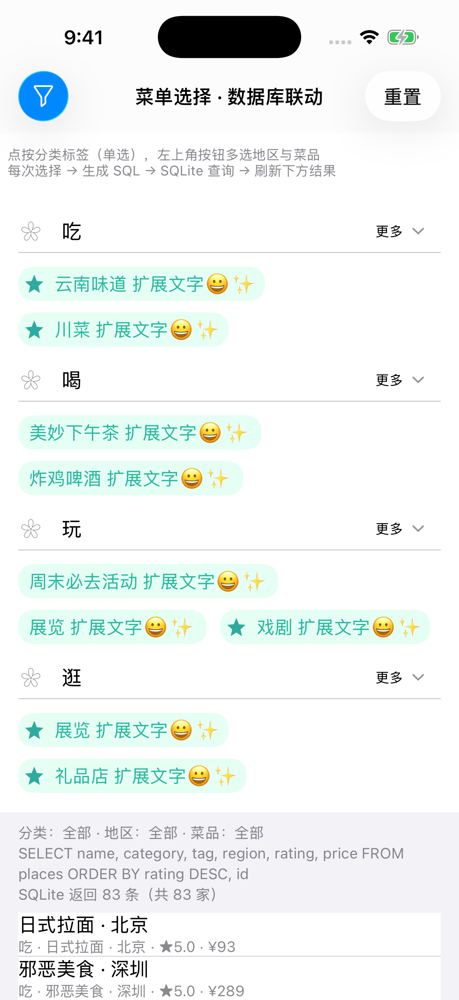
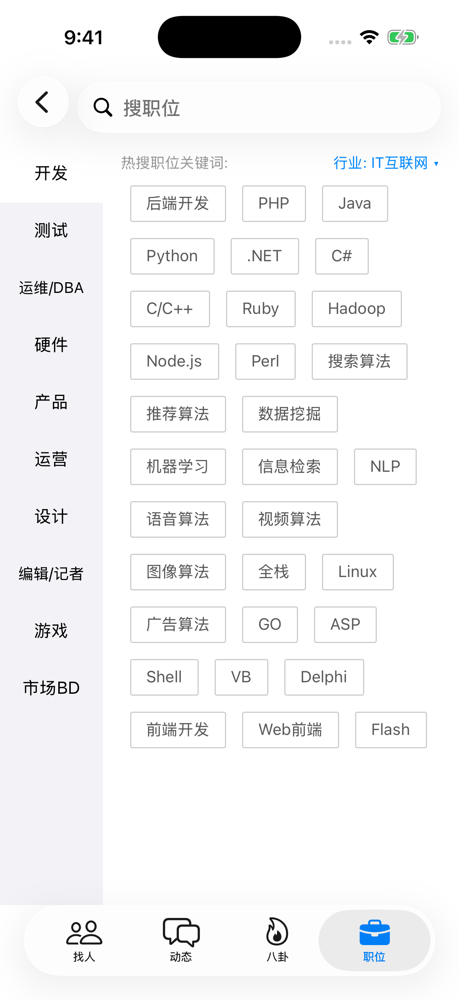
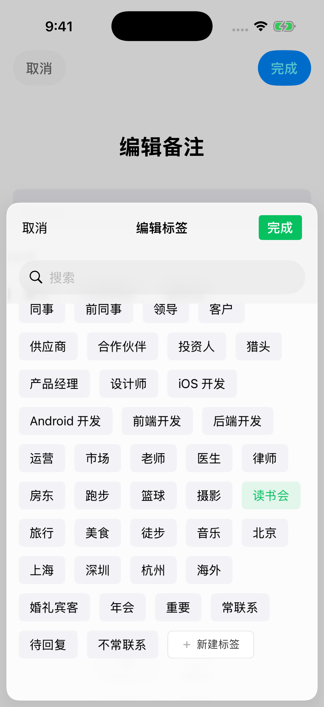

# Issue 修复进度

本表记录全部 issue，包括非 UI 问题。分数表示问题的修复及验证程度，并非代码完成比例；
100 分要求相关场景验证通过。尚未验证的修改不计为完全修复。每次提交修复后，
在本表追加提交链接并重新评估；不能复现或缺少验证时说明原因。

2026-11-11 复评：GitHub CI（`macos-26` runner，默认 Xcode 26.x）在 [ff35b27](https://github.com/ChenYilong/CollectionViewClassifyMenu/commit/ff35b27) 上全部通过——`pod lib lint`、库的构建与静态分析（库源码有警告即失败）、四组单元测试（menu、tag、example、swift；示例与其测试已全部改写为 Swift）以及 46 张示例截图。下表中“未能构建/测试”的扣分据此更新。

| 存在的 issue | 修复 commit 地址 | 评估是否修复 |
| --- | --- | --- |
| [#13 复用后 cell 重叠](https://github.com/ChenYilong/CollectionViewClassifyMenu/issues/13) | [c5f4f01](https://github.com/ChenYilong/CollectionViewClassifyMenu/commit/c5f4f016ff9158e09070bc7dff2ba51ed2fd9c8b)、[107b898](https://github.com/dennisxiaoding/CollectionViewClassifyMenu/commit/107b898e582513697c7c513a8555f81d5bc5f8b4)、[977398d](https://github.com/ChenYilong/CollectionViewClassifyMenu/commit/977398d6c5881496802b29689c21fdfca34b7e57)、[3ad4953](https://github.com/ChenYilong/CollectionViewClassifyMenu/commit/3ad49531ca67e5f12253603e976b46526570295d)、[84f44be](https://github.com/ChenYilong/CollectionViewClassifyMenu/commit/84f44beb5144e77ec2297659d7e4e00e12a23eb2) | **90/100**：dennis 方案仅限制单选宽度，结合属性副本、多选宽度及复用修复；两套菜单的演示条目均追加 emoji 和长文字，已验证滚动复用、展开、折叠和 320/390 pt 宽度。组件化后重新验证 TagCollectionView 的长文字。尚未覆盖所有设备和字体设置。 |
| [#12 layout attributes 被修改](https://github.com/ChenYilong/CollectionViewClassifyMenu/issues/12) | [c5f4f01](https://github.com/ChenYilong/CollectionViewClassifyMenu/commit/c5f4f016ff9158e09070bc7dff2ba51ed2fd9c8b) | **90/100**：布局返回属性副本，测试修改返回值后再次读取不受影响；尚未覆盖所有自定义布局和动态尺寸场景。 |
| [#11 CocoaPods 支持](https://github.com/ChenYilong/CollectionViewClassifyMenu/issues/11) | [84f44be](https://github.com/ChenYilong/CollectionViewClassifyMenu/commit/84f44beb5144e77ec2297659d7e4e00e12a23eb2)、[32720b0](https://github.com/ChenYilong/CollectionViewClassifyMenu/commit/32720b0352a0ab93fb5722e711e9954356b63624)、[ff35b27](https://github.com/ChenYilong/CollectionViewClassifyMenu/commit/ff35b27) | 原 **75/100**：84f44be 提供 iOS 15 podspec、资源 bundle、协议化接口和两个示例的本地 Pod 集成，README 说明通过 Git 分支引入；32720b0 替换 iOS 15 已弃用的按钮 edge insets、`adjustsImageWhenHighlighted` 和旧绘图 API，消除已知的 lint 弃用警告来源，并补充按钮布局测试。2026-11-11：CI 在 [ff35b27](https://github.com/ChenYilong/CollectionViewClassifyMenu/commit/ff35b27) 上 `pod lib lint` 与库的构建/分析（无警告）通过，三个示例工程以本地 Pod 集成并通过测试。**85/100**：仍未发布到 CocoaPods trunk，也没有对应 Git tag。 |
| [#9 标签太多时卡顿](https://github.com/ChenYilong/CollectionViewClassifyMenu/issues/9) | [c5f4f01](https://github.com/ChenYilong/CollectionViewClassifyMenu/commit/c5f4f016ff9158e09070bc7dff2ba51ed2fd9c8b)、[84f44be](https://github.com/ChenYilong/CollectionViewClassifyMenu/commit/84f44beb5144e77ec2297659d7e4e00e12a23eb2) | **85/100**：两套标签布局均采用线性行计算；1,200 项测试验证读取次数，数据更新会使缓存失效。尚未在真机测量滚动帧率。 |
| [#8 布局算法复杂及 iOS 10 问题](https://github.com/ChenYilong/CollectionViewClassifyMenu/issues/8) | [c5f4f01](https://github.com/ChenYilong/CollectionViewClassifyMenu/commit/c5f4f016ff9158e09070bc7dff2ba51ed2fd9c8b)、[84f44be](https://github.com/ChenYilong/CollectionViewClassifyMenu/commit/84f44beb5144e77ec2297659d7e4e00e12a23eb2) | **80/100**：两套布局行计数改为单次遍历，测试长文本折叠和缓存失效；尚未改成 self-sizing。本项目最低版本现为 iOS 15，不再支持 iOS 10。 |
| [#7 3.5 英寸屏幕 header 溢出](https://github.com/ChenYilong/CollectionViewClassifyMenu/issues/7) | [c5f4f01](https://github.com/ChenYilong/CollectionViewClassifyMenu/commit/c5f4f016ff9158e09070bc7dff2ba51ed2fd9c8b)、[84f44be](https://github.com/ChenYilong/CollectionViewClassifyMenu/commit/84f44beb5144e77ec2297659d7e4e00e12a23eb2) | **90/100**：header 按容器宽度布局，测试 240、320、390 pt；iOS 15 不支持原 3.5 英寸设备，无法在原设备上验证。 |
| [#3 类似库参考](https://github.com/ChenYilong/CollectionViewClassifyMenu/issues/3) | 无 | 不适用：不是缺陷，是参考资料，issue 已关闭，无需修复。[component-architecture.md](component-architecture.md) 记录了本项目的封装取舍。 |
| [#2 编译报错](https://github.com/ChenYilong/CollectionViewClassifyMenu/issues/2) | [1e383ca](https://github.com/ChenYilong/CollectionViewClassifyMenu/commit/1e383cab8dca462773e0a04969b7aba67a99deef)、[ff35b27](https://github.com/ChenYilong/CollectionViewClassifyMenu/commit/ff35b27) | 原 **90/100**：历史提交已修正 block 参数中 `*` 的位置，issue 已关闭；现有代码不再包含该写法。2026-11-11：CI 在 [ff35b27](https://github.com/ChenYilong/CollectionViewClassifyMenu/commit/ff35b27) 上编译库与全部示例并通过测试，**95/100**；未在 Xcode 旧版本上复现原报错环境。 |
| [#1 复用后选择状态错误](https://github.com/ChenYilong/CollectionViewClassifyMenu/issues/1) | [c5f4f01](https://github.com/ChenYilong/CollectionViewClassifyMenu/commit/c5f4f016ff9158e09070bc7dff2ba51ed2fd9c8b) | **80/100**：已验证侧边栏选中后滚动复用仍保持状态；历史报告缺少具体复现步骤，其他选择组合未覆盖。 |

## 验证截图 / Screenshot evidence

以下截图来自 CI（`Example screenshots`，提交 `22370a8`，`macos-26`），对应表中的 issue：

| #13 / #1：长文字与 emoji 标签复用后不重叠、选中状态保持 | #13：多选后折叠的长文字标签 | #7：分组标题按容器宽度布局，右侧有宿主视图 | #9：大量标签滚动到末尾 |
| --- | --- | --- | --- |
|  |  |  |  |

## 待办 / TODO

2026-11-12 记录，分支 `claude/intelligent-curie-1etnx5`（[PR #15](https://github.com/ChenYilong/CollectionViewClassifyMenu/pull/15)）：

- TODO（验证）：尚未在真机上用 VoiceOver、Voice Control、Switch Control 和 Accessibility Inspector 检查新增的
  无障碍操作（标签前移/后移、图片标签组、搜索栏）；原因：本机没有连接真机。目前由单元测试覆盖标签、操作和字号。

### 已完成 / Done（2026-11-12）

- DONE（截图拼接顺序更正，2026-11-12）：用户确认原话“优先横向排布”与“最差是横向拼接”矛盾，更正为优先竖向排布；英文更正说明写入
  `AGENTS.md`、`.agents/skills/cyl-verify/`、`docs/instructions.md` 与 vault 根目录 `instructions.md`。用户提示词原文：
  > 更新instructions相关文件以及skills里关于截图的我的错误描述拼接顺序：全英文写入：原话里"优先横向排布"和"最差是横向拼接"互相矛盾。更正为优先竖向排布。然后继续你未完成的任务 continue

- DONE（规则：上游项目的 open PR 与 issues，2026-11-12，`feat/android-kotlin`）：英文规则写入 `AGENTS.md`（新章节
  "Upstream projects (translations and ports)"）、`docs/instructions.md` 与新 skill `.agents/skills/cyl-upstream/`；vault 根目录
  `instructions.md` 第 17 节已有同一规则（另一会话写入），未重复。应用到 `android/` 三个移植项目的任务记在
  [android.md](android.md)（TODO，排在 step 6 之后）。用户提示词原文：
  > 写入一条规则到。instructions相关文件和skills文件中，全英文写入以下规则：如果本项目文档中出现了 非本项目的 GitHub 链接，切该链接是用来 做代码翻译等任务的，那么在翻译过程前，或者翻译过程后，需要 访问该GitHub 的 pr 链接，将处于open状态的pr合并进来。并且为该项目的issues页面，中处于open状态的issues在docs文件夹下相关文档，如果没有就新建文档中制作表格，第一列为issue地址 第二列为issue描述，第三列为修复状态，默认填TODO。你需要找到这些issue在我们项目代码中的对应项，尝试修复。issues修复完为满分，每修复一个issue打一次分，一直到满分为止。 举例说明：比如：本项目的android文件夹内，存在多个其他项目翻译为kotlin的任务，这些任务均默认翻译master分支代码，忽略了pr与issues内容，如果翻译任务还未开启那么就先 merge 该项目处于open状态的pr，再尝试解决open issues，只要issues处理状态达到60分，就可以开始翻译工作，翻译完成后，再开始尝试解决剩余的issues到满分。如果翻译工作已经完成，那么就单独对open pr内容进行翻译后，再merge到我们的项目中。基于翻译过的代码还是要处理issues。一直到满分。其他平台同样规则执行。

- DONE（规则：凸起的 PlusButton，2026-11-12，`feat/android-kotlin`）：在 `AGENTS.md`（CYLTabBarController 默认集成）与
  `.agents/skills/cyl-dependency/` 第 6 条写入英文规则：example 演示 PlusButton 时总是优先凸起效果（按钮顶部超出 tabbar），
  配置键 `CYLPlusButtonCenterYOffset` / `CYLPlusButtonCenterYMultiplier`。用户提示词原文：
  > 找到instructions相关文档以及skills相关文档。找到CYLTabBarController 相关example层集成章节，如果没有就新建，全英文追加一条规则集成PlusButton进行example演示时，总是优先使用plus button凸起效果。凸起的含义是plus button顶点超出tabbar范围。
- DONE（规则：截图，2026-11-12，`feat/android-kotlin`）：在 `AGENTS.md`「CI/CD and Example screenshots」、
  `.agents/skills/cyl-verify/`（新章节 Screenshots）与 `docs/instructions.md` 写入英文规则：截图保存到 docs 相关文档（默认
  `docs/screenshots.md`）并入库；标注平台、系统版本、模拟器版本、SDK 版本、仓库版本或 commit、时间；清晰原图；关键节点更新
  README；截取关键细节并拼接。拼接顺序按“纵向优先（手机端）→ 双列多行 → 横向一行最多三列”理解（原文首尾都写“横向”，首项按
  手机端阅读理解为纵向，与既有“截图自上而下”规则一致）。用户提示词原文：
  > continue in order. 找到instructions相关文件，以及skills相关文件，找到构建build ci cd章节。如果没有就新建，确保写入成功，全英文写入如下内容：所有截图，包括CI CD截图以及本地构建截图，全部保存在docs文件夹相关文档中，如果无相关文档就新建文档，保存图片到git仓库。并在合适的时机，你认为效果符合预期就更新最新图片到readme，找到相关章节如果没有就新建，并标注运行平台iOS android flutter reactnative 鸿蒙 小程序。运行环境 操作系统版本，模拟器版本，对应平台版本sdk版本（iOS android flutter reactnative 鸿蒙 小程序）本仓库版本号或commit地址。当前时间。截图使用清晰原图。
  > 追加截图细节，全英文：关键节点指的是比如可以删除todo关键词，或者Linux关键词，或者可以merge pr。或者你评估已经符合预期效果无bug 无issue。readme中展示的截取关键细节，如无必要不要全屏截取。最好是采用凭借格式展示多个关键细节。拼接截图，优先采用横向排布，方便手机端查看。其次是双列 多行拼接。最差是横向拼接。横向拼接一行最多三列。
- DONE（分支合并，2026-11-12）：唯一 open 的 PR #16 即当前分支 `feat/android-kotlin`；合并 `master`（`ba8cd91`），PR #16 的
  target 改为 `master`，删除已完全包含在当前分支中的 `claude/intelligent-curie-1etnx5` 与 `clean-oc`；保留默认分支 `master`
  与 CI 截图分支 `ci-screenshots`。用户提示词原文：
  > 将所有处于open状态的分支的target branch指向本分支，当前分支，全部合并仅仅保留当前分支，处理冲突后合并，继续以上未完成的任务。
- TODO：Core 转 Swift，见 [Swift-Migration.md](Swift-Migration.md)；Android 与跨端适配鸿蒙 NEXT，见 [android.md](android.md)。

- DONE（`feat/android-kotlin`）：`CYLCollectionViewLeftAlignedLayout` 合并上游 mokagio/UICollectionViewLeftAlignedLayout 的
  PR #37、#31、#25、#20，并处理上游全部 issue（25 / 25，满分）；逐项表格与测试见
  [CYLCollectionViewLeftAlignedLayout.md](CYLCollectionViewLeftAlignedLayout.md)。

- 合并：[PR #15](https://github.com/ChenYilong/CollectionViewClassifyMenu/pull/15) 的 18 项 CI 检查在 `cd730cc` 上全部通过，
  CI 截图（`ci-screenshots` 分支 `claude-intelligent-curie-1etnx5/cd730cc`，52 张）已查看；合并到 `master`，合并提交 `6537fbc`。
- DONE（规则：任务先记入 docs，2026-11-12）：把规则写入本项目的 instructions 与 skills 文件（全英文）：开始任何任务前，先在
  `docs/` 中找到合适的文档，把任务记为 TODO（详细上下文、要求、用户提示词原文），再开始；完成后标记为已完成。
  上下文：根目录 `instructions.md` 第 16 节与 CYLSearchViewController（`4fad905`）已有此规则，本项目缺少；
  本项目没有自己的 `instructions.md`，写入 `AGENTS.md`（`CLAUDE.md` 引用它）、`docs/instructions.md` 与
  `cyl-commit` skill。用户提示词：「写入instructions相关文件，skills相关文件，开始任何任务前总是找到docs里的合适文档，
  现将任务标记为TODO ，给出任务详细上下文以及我的要求，我的提示词，再开始任务，目的是防止任务中断后，丢失上下文，
  无法找到上下文。任务结束后再标记TODO为已完成。」
  结果：规则写入 `AGENTS.md`「Task log in docs/」、`docs/instructions.md`、`cyl-commit` skill（任务开始前的步骤）与
  `cyl-verify` skill（任务结束时标记完成并附证据）；本条目即按该规则先记录、后完成。
- 依赖：两个 Podfile 的 `CYL_TAB_BAR` 更新为最新提交 `0e69250`（`feat/cross-platform-components`）；两次提交之间
  只有测试、文档、Liquid Glass PlusButton 修复与依赖更新，没有本项目复制的文件变化。`CYL_SEARCH` 更新为
  CYLSearchViewController `167d6f4`。
- Rive 资源：`truck.riv` 的红色画板背景、`house.riv` 的紫色天空与灰色画板填充设为透明（按维护者的决定），
  记录与 SHA-256 见 `Example/CYLMenuExample/CYLMenuExample.bundle/Animations/Rive/README.md`；
  `testTruckRiveDrawsNoBackgroundRectangle`、`testHouseRiveDrawsNoBackgroundSquare`。
- 可读性：搜索栏的占位文字在最大字号下不再缩小到四分之一，改为同字号并以省略号截断（CYLSearchViewController
  `placeholderLabel`）。
- 布局：图片标签的标签组在最大字号下不再相互覆盖，`CYLImageTagView` 只移动显示位置（`displayOffset`），
  不改数据；见 [tagviewgroup-api.md](tagviewgroup-api.md)。
