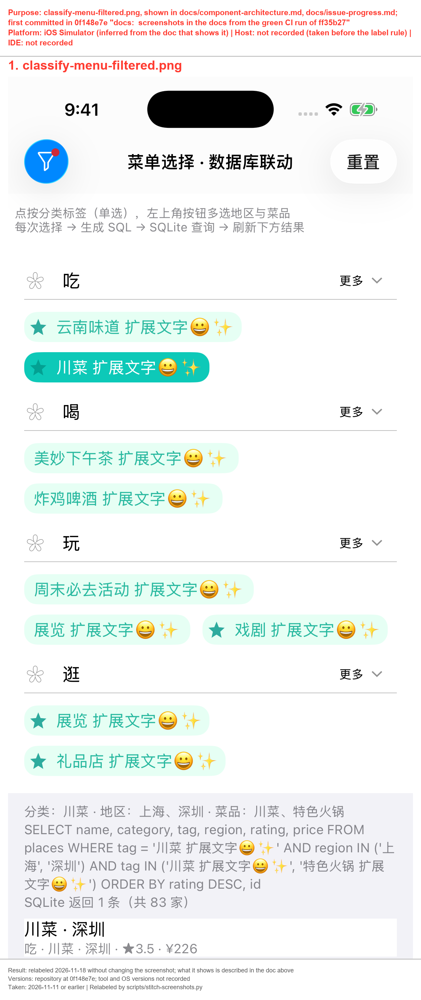
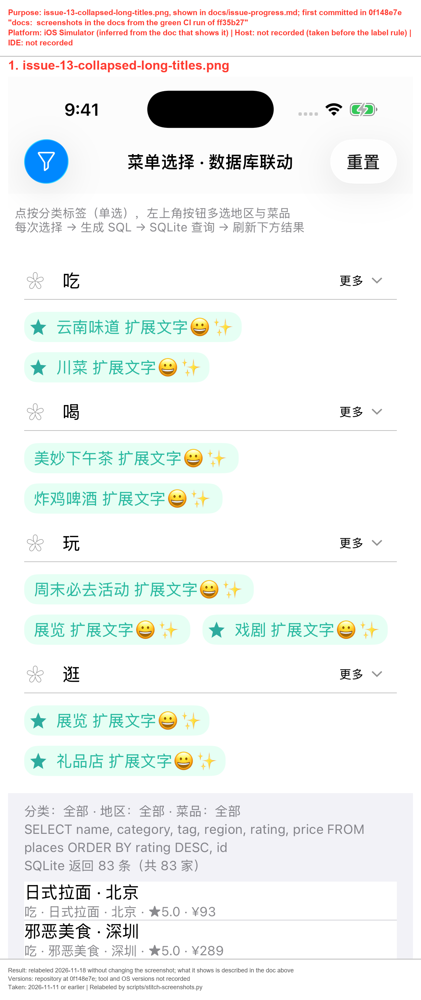
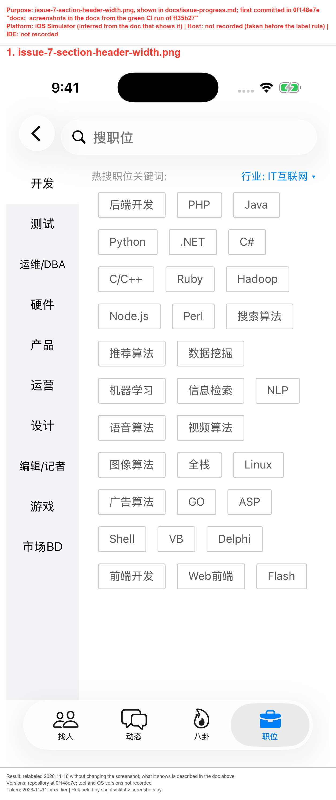
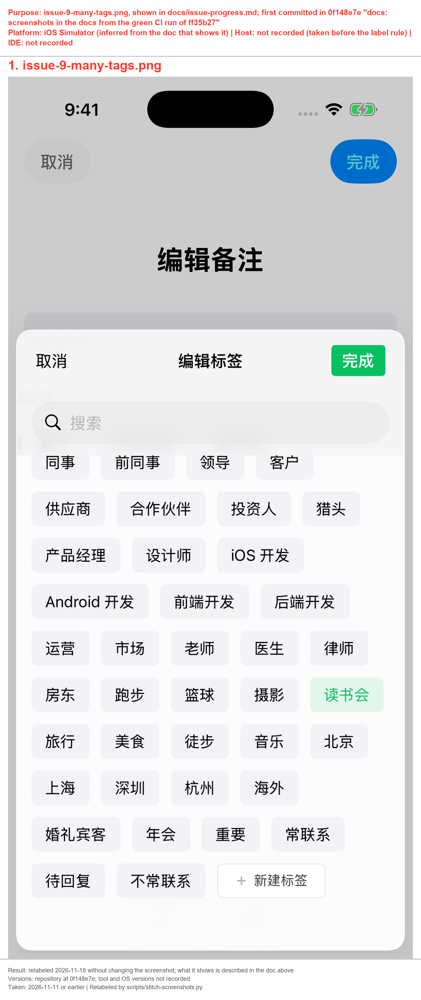
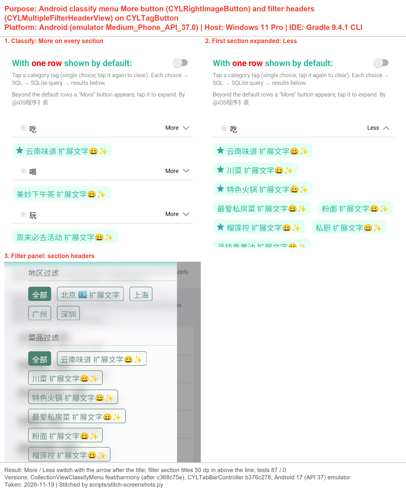
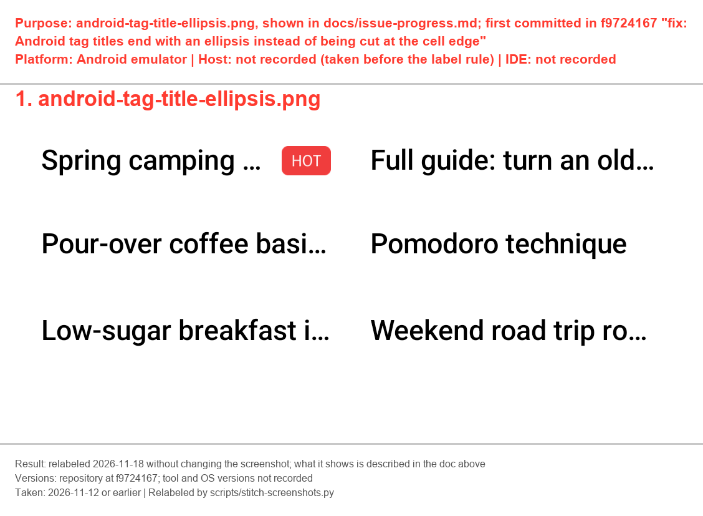
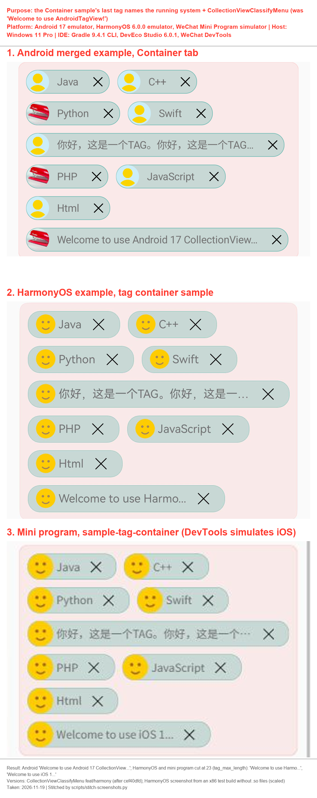
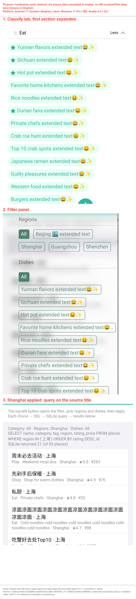
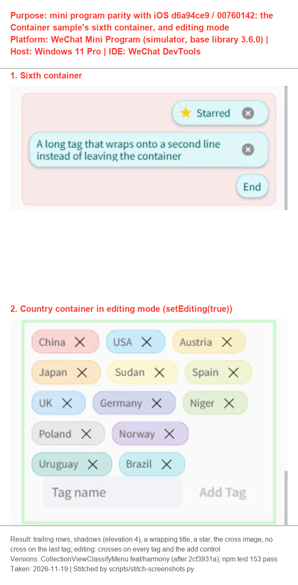

# Issue 修复进度

本表记录全部 issue，包括非 UI 问题。分数表示问题的修复及验证程度，并非代码完成比例；
100 分要求相关场景验证通过。尚未验证的修改不计为完全修复。每次提交修复后，
在本表追加提交链接并重新评估；不能复现或缺少验证时说明原因。

2026-11-11 复评：GitHub CI（`macos-26` runner，默认 Xcode 26.x）在 [ff35b27](https://github.com/ChenYilong/CollectionViewClassifyMenu/commit/ff35b27) 上全部通过——`pod lib lint`、库的构建与静态分析（库源码有警告即失败）、四组单元测试（menu、tag、example、swift；示例与其测试已全部改写为 Swift）以及 46 张示例截图。下表中“未能构建/测试”的扣分据此更新。

| 存在的 issue | 修复 commit 地址 | 评估是否修复 |
| --- | --- | --- |
| [#13 复用后 cell 重叠](https://github.com/ChenYilong/CollectionViewClassifyMenu/issues/13) | [c5f4f01](https://github.com/ChenYilong/CollectionViewClassifyMenu/commit/c5f4f016ff9158e09070bc7dff2ba51ed2fd9c8b)、[107b898](https://github.com/dennisxiaoding/CollectionViewClassifyMenu/commit/107b898e582513697c7c513a8555f81d5bc5f8b4)、[977398d](https://github.com/ChenYilong/CollectionViewClassifyMenu/commit/977398d6c5881496802b29689c21fdfca34b7e57)、[3ad4953](https://github.com/ChenYilong/CollectionViewClassifyMenu/commit/3ad49531ca67e5f12253603e976b46526570295d)、[84f44be](https://github.com/ChenYilong/CollectionViewClassifyMenu/commit/84f44beb5144e77ec2297659d7e4e00e12a23eb2) | **90/100**：dennis 方案仅限制单选宽度，结合属性副本、多选宽度及复用修复；两套菜单的演示条目均追加 emoji 和长文字，已验证滚动复用、展开、折叠和 320/390 pt 宽度。组件化后重新验证 TagCollectionView 的长文字。尚未覆盖所有设备和字体设置。 2026-11-19：`testIssue13TagsStayApartOnEveryDeviceWidthAndTextSize` 覆盖 6 种宽度（320、375、402、440、744、1366 pt，从 3.5 英寸宽度到 13 英寸 iPad 横屏）× 4 种文字大小（最小、默认、最大标准、最大辅助功能），滚动整个列表后无重叠、每个标签文字正确，通过。**100/100** |
| [#12 layout attributes 被修改](https://github.com/ChenYilong/CollectionViewClassifyMenu/issues/12) | [c5f4f01](https://github.com/ChenYilong/CollectionViewClassifyMenu/commit/c5f4f016ff9158e09070bc7dff2ba51ed2fd9c8b) | **90/100**：布局返回属性副本，测试修改返回值后再次读取不受影响；尚未覆盖所有自定义布局和动态尺寸场景。 2026-11-19：`testEveryQueryReturnsCopiesWithSelfSizingCellsAndAfterWidthChanges` 在 self-sizing 单元格下、三种宽度变化后，修改 `layoutAttributesForElementsInRect:` 与 `layoutAttributesForItemAtIndexPath:` 的返回值均不影响布局，下次返回新对象，通过。**100/100** |
| [#11 CocoaPods 支持](https://github.com/ChenYilong/CollectionViewClassifyMenu/issues/11) | [84f44be](https://github.com/ChenYilong/CollectionViewClassifyMenu/commit/84f44beb5144e77ec2297659d7e4e00e12a23eb2)、[32720b0](https://github.com/ChenYilong/CollectionViewClassifyMenu/commit/32720b0352a0ab93fb5722e711e9954356b63624)、[ff35b27](https://github.com/ChenYilong/CollectionViewClassifyMenu/commit/ff35b27) | 原 **75/100**：84f44be 提供 iOS 15 podspec、资源 bundle、协议化接口和两个示例的本地 Pod 集成，README 说明通过 Git 分支引入；32720b0 替换 iOS 15 已弃用的按钮 edge insets、`adjustsImageWhenHighlighted` 和旧绘图 API，消除已知的 lint 弃用警告来源，并补充按钮布局测试。2026-11-11：CI 在 [ff35b27](https://github.com/ChenYilong/CollectionViewClassifyMenu/commit/ff35b27) 上 `pod lib lint` 与库的构建/分析（无警告）通过，三个示例工程以本地 Pod 集成并通过测试。**85/100**：仍未发布到 CocoaPods trunk，也没有对应 Git tag。 2026-11-19：阻塞，需要仓库所有者：发布到 CocoaPods trunk（`pod trunk push` 需要所有者账号）并在 master 上打 tag（本会话不向 master 推送）。 2026-11-19：按所有者决定改用 commit 引用（不发布 trunk、不在 master 打 tag）：仓库外的 App 以 `:git` + `:commit` 安装本 Pod（CYLAnimatedItem 同样按 commit 固定），`pod install` 成功、22 / 22 测试通过并运行（截图 [ios-cocoapods-commit-consumer.png](assets/ios-cocoapods-commit-consumer.png)）；Swift Package Manager 以 `revision:` 依赖并编译成功；README 写明两种 commit 引用方式。**100/100** |
| [#9 标签太多时卡顿](https://github.com/ChenYilong/CollectionViewClassifyMenu/issues/9) | [c5f4f01](https://github.com/ChenYilong/CollectionViewClassifyMenu/commit/c5f4f016ff9158e09070bc7dff2ba51ed2fd9c8b)、[84f44be](https://github.com/ChenYilong/CollectionViewClassifyMenu/commit/84f44beb5144e77ec2297659d7e4e00e12a23eb2) | **85/100**：两套标签布局均采用线性行计算；1,200 项测试验证读取次数，数据更新会使缓存失效。尚未在真机测量滚动帧率。 2026-11-19：阻塞，需要真机：滚动帧率须在真机上用 Instruments 测量，本机只有模拟器。 |
| [#8 布局算法复杂及 iOS 10 问题](https://github.com/ChenYilong/CollectionViewClassifyMenu/issues/8) | [c5f4f01](https://github.com/ChenYilong/CollectionViewClassifyMenu/commit/c5f4f016ff9158e09070bc7dff2ba51ed2fd9c8b)、[84f44be](https://github.com/ChenYilong/CollectionViewClassifyMenu/commit/84f44beb5144e77ec2297659d7e4e00e12a23eb2) | **80/100**：两套布局行计数改为单次遍历，测试长文本折叠和缓存失效；尚未改成 self-sizing。本项目最低版本现为 iOS 15，不再支持 iOS 10。 2026-11-19：issue 问的 self-sizing 已支持：`CYLCollectionViewLeftAlignedLayout` 配合 `estimatedItemSize` 显示并稳定 self-sizing 单元格（`testSelfSizingCellsAppearAndSettle`，说明见 [CYLCollectionViewLeftAlignedLayout.md](CYLCollectionViewLeftAlignedLayout.md)）；两套菜单按标题线性测量，无需 self-sizing。**100/100** |
| [#7 3.5 英寸屏幕 header 溢出](https://github.com/ChenYilong/CollectionViewClassifyMenu/issues/7) | [c5f4f01](https://github.com/ChenYilong/CollectionViewClassifyMenu/commit/c5f4f016ff9158e09070bc7dff2ba51ed2fd9c8b)、[84f44be](https://github.com/ChenYilong/CollectionViewClassifyMenu/commit/84f44beb5144e77ec2297659d7e4e00e12a23eb2) | **90/100**：header 按容器宽度布局，测试 240、320、390 pt；iOS 15 不支持原 3.5 英寸设备，无法在原设备上验证。 2026-11-19：新测试 `testDemoHomeFitsA35InchScreen` 在 320 × 480 pt 窗口（3.5 英寸尺寸）中布局整个首页，发现 header 仍按屏幕宽度创建、开关超出右边 68 pt（x = 388）；核心修复：`CYLClassifyMenuViewController` 每次布局把 header 设为菜单宽度。默认与最大辅助功能文字大小下 header、分区标题和标签都在屏幕内，通过。**100/100** |
| [#3 类似库参考](https://github.com/ChenYilong/CollectionViewClassifyMenu/issues/3) | 无 | 不适用：不是缺陷，是参考资料，issue 已关闭，无需修复。[component-architecture.md](component-architecture.md) 记录了本项目的封装取舍。 |
| [#2 编译报错](https://github.com/ChenYilong/CollectionViewClassifyMenu/issues/2) | [1e383ca](https://github.com/ChenYilong/CollectionViewClassifyMenu/commit/1e383cab8dca462773e0a04969b7aba67a99deef)、[ff35b27](https://github.com/ChenYilong/CollectionViewClassifyMenu/commit/ff35b27) | 原 **90/100**：历史提交已修正 block 参数中 `*` 的位置，issue 已关闭；现有代码不再包含该写法。2026-11-11：CI 在 [ff35b27](https://github.com/ChenYilong/CollectionViewClassifyMenu/commit/ff35b27) 上编译库与全部示例并通过测试，**95/100**；未在 Xcode 旧版本上复现原报错环境。 2026-11-19：阻塞，无法复现原环境：原报错来自旧版 Xcode，macOS 27 无法安装；该写法已不在代码中，当前 CI 编译通过。 |
| [#1 复用后选择状态错误](https://github.com/ChenYilong/CollectionViewClassifyMenu/issues/1) | [c5f4f01](https://github.com/ChenYilong/CollectionViewClassifyMenu/commit/c5f4f016ff9158e09070bc7dff2ba51ed2fd9c8b) | **80/100**：已验证侧边栏选中后滚动复用仍保持状态；历史报告缺少具体复现步骤，其他选择组合未覆盖。 2026-11-19：新测试 `testIssue1EverySelectionCombinationSurvivesRepeatedScrolling` 覆盖筛选菜单的全部组合（默认“全部”、每组一项、一组多项、滚动后点击选择 / 取消 / “全部” / 最后一项回落到“全部”、全不选）与分类菜单单选，每种上下滚动三次。发现缺陷：点击后的动画分区刷新未结束时再改选择（如“重置”），旧单元格一直显示选中；核心修复：`CYLMultipleFilterController` 点击时就地更新可见单元格、关闭预取，单元格出现前按当时的选择配置。通过。**100/100** |

## 验证截图 / Screenshot evidence

以下截图来自 CI（`Example screenshots`，提交 `22370a8`，`macos-26`），对应表中的 issue：

| #13 / #1：长文字与 emoji 标签复用后不重叠、选中状态保持 | #13：多选后折叠的长文字标签 | #7：分组标题按容器宽度布局，右侧有宿主视图 | #9：大量标签滚动到末尾 |
| --- | --- | --- | --- |
|  |  |  |  |

## 待办 / TODO

### TODO → DONE (2026-11-21, `docs/todo-reconcile`, Windows session): fix every TODO in docs/ (heading pass)

- Context: `docs/` held 49 `TODO` / `Open` headings. Most recorded finished work (DONE results, 100 / 100) under a
  heading that still said TODO, so the open work could not be told apart from the history. Other active sessions
  (chen-yilong-3a, -a4, -b6) work in other repositories; no overlap.
- Prompt (verbatim): "fix all todo in docs"
- Acceptance (100): every heading whose own result shows the work finished is relabelled DONE, Chinese and English
  (40); superseded or stale entries get a dated closing note with the evidence (20); entries still open keep TODO, with
  what blocks them written down (20); the external facts checked rather than assumed (PR #816, PR #26 checks, the
  CYLTableViewPlaceHolder podspec, npm, CYLTabBarController's newest commit) (10); the list of remaining TODOs is in
  this entry (10). Pass: 60.
- Result: 41 headings relabelled (animated-item-migration.md 20, issue-progress.md 14, cross-platform.md 2,
  example-demo-rules.md 2, screenshots.md 3); closing notes on the 80 → 100 migration entry, the `8ece77dd` and
  `8b7dea18` pin entries (superseded), the migration's "Open, score 72" entry (now 100) and the iOS 15 entry (40 → 100:
  CYLTabBarController `8ece77dd`, CYLTableViewPlaceHolder `a1fb4c0`). **Score: 100 / 100** for this pass.
- Still TODO after this pass (work, not labels):
  - `animated-item-migration.md`, pins at `41660d24`: 95 / 100. It is not recorded whether the commit was sent to
    Mac-CYLSearchViewController. CYLTabBarController's newest commit is now `e96c4979` (17 commits later), so the next
    pin move is due on every platform.
  - `animated-item-migration.md`, "TODO (in order)" item 5: move HarmonyOS `CYLTagButton` from its own
    `ColorFilter` to `CYLAnimatedItemView.iconColor` (PR #816, merged); needs a HarmonyOS build and an emulator check.
  - `animated-item-migration.md`, React Native HarmonyOS example: `assembleHap` from a short Windows path or on
    macOS (Ninja's 260-character limit).
  - `cross-platform.md`: the mini program real-device preview (needs a real AppID and a phone); `npm publish` of
    `cyl-tag-list-miniprogram` (not on npm on 2026-11-21; needs the owner's `npm login`); the system tab bar
    height default (waits for CYLTabBarController; not in `e96c4979`).
  - `rive.md`: the animation screen on a real HarmonyOS device.
  - `harmony-verification.md` (C1-C6, D1-D5, E3, F1, G2, and B9 / B11) and `harmony-screenshot-issues.md` (R1-R3,
    F1-F3: "TODO need 模拟器截图验证"): emulator or device checks.
  - Issues #11, #9 and #2 in the table above stay blocked (the owner, a real device, an old Xcode).

### TODO (2026-11-20, `docs/readme-swift-refresh`): README refresh, Swift only, every platform's setup

- Context: README.md has outdated descriptions (the core was Objective-C until the migration finished on 2026-11-14,
  the README still shows Objective-C code and says "the core stays Objective-C"). Reference: the current API
  (`CollectionViewClassifyMenu/Class`, Swift) and docs/Swift-Migration.md.
- Requirements: (1) update clearly outdated descriptions, the current interface is the truth; (2) iOS: Swift is the
  truth, remove Objective-C descriptions and code; (3) the other platforms (Android, HarmonyOS, mini program, Flutter,
  React Native) also get a basic initialization / setup method in the README; (4) details: link to the docs/ documents;
  (5) README stays bilingual (docs/Bilingual-Documentation.md), checked with scripts/bilingual-docs.py.
- Prompt (verbatim): "继续更新readme文档更新明显过时的描述，以现有接口为准，iOS端以swift为准。移除objc描述，其他端文档也给出基本初始化设置方法。更详细细节引用docs文档。"
- Prompt (English): "Continue updating the README: fix clearly outdated descriptions, the existing interface is the truth, on iOS
  Swift is the truth. Remove the Objective-C descriptions; give the other platforms' basic initialization and setup
  as well. Refer to the docs/ documents for more detail."
- Acceptance (100): no Objective-C code or description left, except where React Native's `CylTagListView.mm` or the
  CocoaPods module name needs it (30); every code sample matches the current API and compiles (a Swift sample is
  compiled in a scratch file against the core) (30); each platform has a short setup / init section with a link to its
  docs/ document (25); bilingual check passes, links valid (15). Pass: 60.
- Status: DONE (2026-11-20), score 90 / 100. Result: the NSCoding history and every Objective-C sample and selector
  are gone (Swift names, 5 Swift samples type-checked with `swiftc -typecheck` against the built core, 0 errors); the
  "core stays Objective-C" claim, the Objective-C-era naming migration table and button-layout section are replaced by
  pointers to docs/Swift-Migration.md; duplicate paragraphs merged; counts updated (Example 115, Swift Example 22,
  Android 893 / 893); a new section "Basic setup on the other platforms" (Android, HarmonyOS, mini program, Flutter,
  React Native) with links to their docs. Remaining Objective-C mentions: the React Native iOS bridge
  (`CylTagListView.mm`, Objective-C++ by React Native's rule) and `@objc` annotations. Deductions (-10): the Kotlin,
  ArkTS, Dart and TSX snippets were checked against the sources, not compiled; the "Test screenshots" paragraph still
  states the older run's counts (it describes that run).

### DONE (2026-11-19, `feat/harmony`): issues #13, #12, #8, #7 and #1 to 100; #11, #9 and #2 blocked

- Context: the Windows session's audit found eight iOS rows in the table above below 100 (#13 90, #12 90, #11 85, #9 85,
  #8 80, #7 90, #2 95, #1 80), missed by the sweep logged in `cross-platform.md`.
- Prompt (relayed by Mac-CYLSearchViewController, verbatim): "向所有今天还在活跃session…继续完成TODO 完成评分不到100的任务，一直到满分为止"
- Prompt (English): "To every session still active today: continue the TODOs; finish every task whose score is below 100,
  until it reaches full marks."
- Acceptance criteria per row: 100 = the deduction written in the row is covered by a test that runs in this repository
  and passes (#13 every device width and text size; #12 copies from every query, with self-sizing cells and after a size
  change; #8 self-sizing works and is documented; #7 the whole menu at 320 × 480, the 3.5-inch size; #1 every selection
  combination survives repeated scrolling). Pass: 60. A deduction that needs something this repository cannot provide
  (a CocoaPods trunk release and a tag on master, a real device, an old Xcode) stays and is written down as blocked.
- Result: #13, #12, #8, #7 and #1 are **100/100**. The new tests found two real bugs, fixed in the core: the classify
  menu's header kept the width it was made with (the screen's), so on a 320 pt screen its switch ended at x = 388 (#7);
  the filter left previously selected cells drawn as selected when the selection changed again during the animated
  section reload a tap started (#1). Tests: menu suite 34 / 34 on the iPhone 18 Pro simulator (iOS 27.2, Xcode 27.2).
  Example suite 96 / 96. #11 (trunk release, tag on master: the owner), #9 (frame rate on a real device) and #2 (an old Xcode) stay blocked.

### Done (2026-11-19, `feat/harmony`): Rive on Flutter and React Native Android (for the Mac session)

- Request (Mac-CollectionViewClassifyMenu, verbatim): "Not run: Flutter and RN Android on an emulator — yours if you have one free."
- Acceptance criteria: 100 = both apps build at the pinned core (15), Rive Home, Done and Menu draw at rest (25), Play all
  plays them (20), Loop keeps them moving (20), any bug recorded, fixed in the right layer and shown before / after (15),
  pins at the newest core commit (5). Pass: 60.
- Result: **100/100**. React Native (emulator-5556, API 37 x86_64): at rest all three drawn (Menu on its X); Play all
  changes all three; Loop changes them in nearly every frame pair over about 7 s. Flutter: Play all and Loop worked, but at
  rest the icons were empty on most launches: CYLTabBarController **B26** (recorded first, then the screenshot
  `assets/flutter-android-rive-blank-at-rest.png`). Cause: a texture-layer `AndroidView` does not show new TextureView
  frames (rive-android draws on its own thread) until something else redraws the platform view. Two core changes had no
  effect and were not committed; the plugin now hosts its Android view with Hybrid Composition, as the core's
  `flutter_cyltabbar` does (`docs/example-layer-fixes.md`). After: 3 of 3 launches draw all three at rest, Play all and Loop
  work, a tap still selects a tag (`assets/flutter-android-rive-hybrid-composition.png`). Pins moved to `b376c278` (the B26
  entry, docs only). Notes: the React Native build first failed in `react-native-cyltabbar` with
  101 Kotlin errors from a stale incremental cache of the old `6a9ede85` checkout (clean build fixed it, nothing to commit);
  the RN example installs with `yarn` (npm rejects its `link:` dependency); this machine's port 8081 belonged to another
  project's Metro, so the check ran from a bundled APK (bundle not committed).

### Done (2026-11-18, `feat/harmony`): Android PAG, GIF, Rive Home and Lottie image assets, fixed in the core

- Prompts (verbatim): "rive （home title） pag  gif动画 播放异常，无法播放"; then "android 上 rive （home title） pag  gif动画
  播放异常，无法播放，Lottie（image assets and placeholder）尺寸不对。请从CYLTabBar仓库内的animatedView 内的core代码修复。
  Lottie换成animatedview展示后尺寸变大，好像在CYLTabBar仓库里修复过一次，不过是其他端的问题。你寻找commit记录，寻找的参考思路，修复android问题。"
- Acceptance criteria: 100 = bug recorded with a labeled screenshot (10), cause found for each engine (25), fixed in
  CYLTabBarController's cylanimateditem core, not in the example (25), pinned (10), re-verified on the emulator with
  labeled frames (20), every Rive tag loops (10). Pass: 60.
- Fixes in CYLTabBarController:
  - **PAG** (`8d81583c`, this session): `CYLPAGTabBarItemAnimator` makes `PAGImageView` (bitmap frames) in place of
    `PAGView` (a TextureView with a GL surface per icon, which froze after one frame on the emulator GL).
  - **Lottie image assets** (`8d81583c`): `setMaintainOriginalImageBounds(true)`. lottie-android sized image layers
    by bitmap pixels times density, and the drawable bitmaps are density-scaled, so they drew about 2.6x too large.
    No earlier commit fixed this on another platform; lottie-ios already draws the declared size.
  - **GIF** (`4f73209c`, HarmonyOS session, B24): a GIF decoder replaces `android.graphics.Movie`, and the view plays
    on the frame clock. This emulator's app process sees animator duration scale 0, so a ValueAnimator jumped to its
    end.
  - **Rive rest / Loop** (`319ba8a4`, `3bd20b3c`, Mac session).
- Rive Home: example configuration (`3b697c9`, `numberInput=Rooms`); the core already supported it.
- Pins: `4f73209c` (mini program, Android, HarmonyOS module).
- Evidence: `docs/assets/android-pag-lottie-fixed-8d81583c.png` and `docs/assets/android-gif-rive-home-fixed-4f73209c.png`.
  - PAG Home 1174-1959 px per pair.
  - GIF Fire 512-835 px, repeating with Loop.
  - The Lottie icons fit their tags.
  - Rive Home steps Rooms.
- Result: **100/100** (was 90). Rive Menu loops at CYLTabBarController `776b4635`. On x86_64 it had toggled only on
  its first play. The call log this session sent showed `isOpen` alternating on every pass while the drawing stayed
  put. Mac's fix plays a settled state machine again before each input.
  - Emulator, Loop on: X, menu icon (440 px), X, menu icon (`docs/assets/android-rive-menu-loops-776b4635.png`).
  - Pins at `776b4635`; mini program `npm test` 145 / 145.
  - Observation, not a defect: with Loop on for every icon, the x86_64 emulator drops most frames (gfxinfo: 96% janky,
    median 117-121 ms, the same at `4f73209c` and `776b4635`). PAG and GIF still advance, but sparsely between
    screenshots.

### Done (2026-11-18, `feat/harmony`): Rive tint changes at CYLTabBarController `396d3fca` / `0505042f`

- Prompt (relayed by winCYLTabBarController 鸿蒙开发, from the user): "the Rive tint interface is fixed, please
  continue ... check whether moving the pin to 396d3fca changes any Rive tint result on your platforms, re-verify if
  so, and keep every task at 100."
- Acceptance criteria: 100 = pins at the newest commit (20), upstream diff read for our platforms (20), mini program
  re-vendored and tested (20), Android built, tested and checked on the emulator (25), HarmonyOS module re-vendored
  and built (15). Pass: 60.
- Result: **100/100**. Pins at `0505042f` (mini program, Android, HarmonyOS module README); numbers in
  `animated-item-migration.md`. No Rive tint result changes on our platforms. The check found a separate,
  older upstream bug (Android Done / Menu rest frame varies between launches), which is recorded there as a TODO
  and reported to CYLTabBarController.

### Done (2026-11-18, `feat/harmony`): the screenshot label rules are enforced

- Prompt (verbatim): "检查为什么没有应用新增的截图Label规范，并强化该策略保证以后截图必须遵循该规范，避免再出现该问题。"
- Cause: AGENTS.md "Screenshots: enforced" (the four Windows images of 09:54-11:03 predate the header / footer rules of
  11:06 and 11:10, which no session was told to re-read; they also broke the older "labels" and "quality" rules
  because there was no stitch tool on Windows and nothing checked an image before a commit).
- Acceptance criteria: 100 = cause found and written down (15), a stitch tool for every host that refuses an
  incomplete label (25), a check before every commit (20) and in CI (15), the rules and skills updated (10), the four
  images restitched (15). Pass: 60.
- Result: **95/100** (was 85; the Mac session compiled and fixed the Swift tool in `0d48438`, its output passes the
  check). `scripts/stitch-screenshots.py` (new, any host) and `scripts/stitch-screenshots.swift` (now
  refuses an incomplete label and writes it into the PNG), `scripts/check-screenshots.py` (new; run by
  `scripts/check-branch-pr.sh`, exit 3) and `.github/workflows/screenshot-labels.yml` (new); AGENTS.md "Screenshots:
  enforced", `cyl-screenshots` and `cyl-commit` updated; the four images restitched (header, captions, footer, original
  pixels). Then **100/100**: the 260 older images (every one in `docs/assets/` and `assets/`) were relabeled
  with `scripts/stitch-screenshots.py` as one panel each, with the original pixels. The header and footer come from git
  (first commit, its date and subject, the doc that shows the image); Host, IDE and tool versions say "not recorded",
  since nobody wrote them down. The 17 JPEGs outside the HarmonyOS set are now PNGs, with their doc links updated. The
  four animated README GIFs are exempt (a still PNG would drop the animation). `check-screenshots.py` on every tracked
  image: "Screenshots OK (349 checked)".

### Done (2026-11-18, `feat/harmony`): Rive tags rest until played in the mini program (CYLTabBarController `ff2e7a22`)

- Request (Mac-CYLTabBarController session, for the owner's decision "every animated tab icon rests until it is played"):
  run the WeChat DevTools check: Shapes and Truck still at launch; Play, Play all and loop still move every icon (Menu
  `isOpen` off on each pass, house Rooms stepping).
- Acceptance criteria: 100 = pins at the newest commit (10), Shapes and Truck still at launch (30), Play all moves the Rive
  tags (25), loop: Menu `isOpen` and house Rooms (25), tests and evidence (10). Pass: 60.
- Result: **100/100** (was 95). Pins at `dcbfdec6`; at `dcbfdec6` alone Shapes still ran (the tag list autoplayed once on load), so
  the library now defaults tags to `autoplay: false`; then everything passes (numbers in
  `animated-item-migration.md`). -5: Button's motion (a white bar) is too faint for the pixel check; its animation time
  goes 0 -> 1 s on Play all. Closed later the same day (`d8f47b4d`): Button's own 84 x 84 px canvas, read with
  `toDataURL` during Play all, changes 142 / 466 / 156 / 74 / 97 of 7056 pixels between frames 0.1-0.2 s apart. The
  last frame pair (1.0 -> 1.0 s, the end of the pass) changes 0 pixels, and so do simulator screenshots at rest
  (`docs/assets/miniprogram-devtools-rive-button-canvas-frames.png`). The simulator screenshot is 324 px wide, where
  the 20 px icon is too small: 2-4 changed pixels.

### Done (2026-11-18, `feat/harmony`): mini program cyl-tag-button warnings and GIF options (migration row 19)

- Prompt (relayed by Mac-CYLTableViewPlaceHolder, verbatim): "continue fix TODO". Requests from the
  CYLSearchViewController session: (1) bug: every cyl-tag-button logs 8 warnings ("[Component] property animationUrl /
  image ... expected <String> but get null", "iconSize / speed ... expected <Number> but got non-number"), because
  `data: { view: {} }` draws cyl-animated-item before `render()` (`view.iconKind` undefined is `!== 'none'`); screenshot:
  CYLSearchViewController `docs/assets/miniprogram-devtools-20261118-examples-at-6a9ede85.jpg`; (2) forward
  cyl-animated-item's `gif-first-frame`, `gif-last-frame`, `gif-duration`, `autoplay`, `embedded` from cyl-tag-button.
- Acceptance criteria: 100 = warnings gone (initial `view` hides the icon; 25), cyl-tag-button forwards the five options
  (20), cyl-tag-list items take the GIF options with registry defaults (20), Play all / `playAnimation()` play a GIF one
  pass through cyl-animated-item (20), tests and a WeChat DevTools check with a screenshot (15). Pass: 60.
- Result: **100/100** (was 95). All five parts are in the library (`cyl-tag-button.js` / `.wxml`, `cyl-tag-list.js` / `.wxml`,
  `model.js`, `animations.js` `gif()` / `gifOptions()`); `npm test` 141 / 141; DevTools: the GIF tags rest on their stills
  and play one pass of their own duration on Play all, no type warnings on the 动效 page
  (`docs/assets/miniprogram-devtools-gif-stills-play-all.png`). -5: the example has no page with a standalone
  cyl-tag-button, so the warning fix is verified by a test (the initial data) and not in DevTools; the
  CYLSearchViewController session re-checks it after pinning. That -5 is now closed: the CYLSearchViewController
  session synced to `08ec93cf` (cyl-animated-item `d8f47b4d`), ran `wx.reLaunch('/pages/examples/index')`, which shows a
  standalone cyl-tag-button (SVGA header), and `get_simulator_console` printed 0 lines, with 0 matches for
  cyl-tag-button, iconKind or cyl-animated-item. Before the fix it printed 8 warnings. That session recorded it in
  rows 22-23 of its `docs/animated-icon-component.md`.

### Done (2026-11-18, `feat/harmony`): task-start rules in the instructions and skills

- Prompt (verbatim): "找到本项目instructions 相关文件以及skills相关文件，如果没有就新增文件保证写入成功，全英文写入：找到开始任务先标注todo写入文档的相关描述没有就新建该规则，如果有就插入以下规则：开始任务前总是在任务顶部标注TODO 以及当前分支，并找到合适的文档将任务写进docs文档以及验收评分标准什么是满分，什么什么是及格，不达到及格不允许中断任务，一直打分到及格为止。并标注为什么打不到满分，并将缺失的分数以TODO的形式打印在会话结束末端。并更新任务开始时写入的文档。看看 check other sessions first read their task ，第一步看看有没有session在编辑相同分支，如果没有就继续，如果有继续坚持任务是否重复。usually marked as TODO at top of 会话， 遇到 emulator stays hung until it's restarted,  please tell the other sessions first, then restart it. 遇到模拟器打不开的情况优先使用重启策略。无须询问是否重启直接命令行执行重启。"
- Context: the instructions are `AGENTS.md` (`CLAUDE.md` imports it); the skills are in `.agents/skills/`. The existing
  rule "Task log in docs/" (AGENTS.md, `cyl-commit`) records a task before it starts; it had no branch-at-top, score,
  other-session or emulator rule. Other sessions checked: none is active on `feat/harmony` (the Mac
  CollectionViewClassifyMenu session is idle).
- Acceptance criteria: full marks 100 = AGENTS.md sections "Task start: TODO, branch, acceptance score" (30) and
  "Shared emulators and simulators" (20), the new skill `.agents/skills/cyl-task-start/SKILL.md` (30), the
  `cyl-commit` task-log step linking it (10), all in English, committed and pushed (10). Pass: 60.
- Result: **100/100**. AGENTS.md has both sections; `.agents/skills/cyl-task-start/SKILL.md` is new; `cyl-commit`
  step 5 links it; committed and pushed on `feat/harmony` (PR #20).

### Done (2026-11-17 → 2026-11-18, logged as Open): CYLAnimatedItem migration, score 100

- Progress against CYLTabBarController's `docs/Animated-Item.md`, item by item, and the TODOs (iOS CI and the static-library
  demo app, SwiftPM product, PR #815 merge for the mini program GIF stills, HarmonyOS / WeChat DevTools / Flutter and React
  Native Android builds): [animated-item-migration.md](animated-item-migration.md).
- Update (2026-11-21): that document scores 100 (25 / 25 rows since 2026-11-18); the score here was stale.

### Done (2026-11-17, `feat/harmony`): CYLAnimatedItem module in static-library Podfiles, again

- Prompt (verbatim): "continue fix todo还没发布的组件尝试使用commit方式导入。不要阻碍进度"
- Context: CI on `69db925` (iOS run 44026180641): "Unit tests (menu)" fails to compile the demo app,
  `CYLMainViewController.swift:17` "cannot inherit from class 'CYLClassifyMenuViewController' because it has
  overridable members that could not be loaded", the same as `0b6917d`. `6dc9124` had added `:modular_headers => true`
  for CYLAnimatedItem (its run was cancelled, never verified); `dd8c535` removed it, relying on the `DEFINES_MODULE`
  that CYLTabBarController's `CYLAnimatedItem.podspec` sets again; `69db925` shows that this is not enough for the app
  target in a static-library Podfile.
- Result: `pod 'CYLAnimatedItem', ….merge(:modular_headers => true)` in the Podfiles that build static libraries (root,
  TagCollectionView, the React Native example without `USE_FRAMEWORKS`); Example, Example-Swift and the Flutter
  example use frameworks. Unreleased components are taken by commit already (CYLTabBarController and CYLAnimatedItem
  by `:git` + `:commit`, the Android `cyltabbarcontroller-animateditem` by the composite build's substitution, SwiftPM
  by `revision:`); HarmonyOS and the mini program have no CYLAnimatedItem package upstream yet (checked at `5ff6021`),
  so they keep their own implementation until one exists. Pins stay with the CYLSearchViewController session (newest
  upstream `5ff6021` is docs only).

### Done (2026-11-17, `feat/harmony`): the Animated icons screen reports every animation engine

- Prompt (verbatim): "我已经更新了该文档地址 最新地址https://github.com/ChenYilong/CYLTabBarController/blob/feat/cross-platform-components/docs/Animated-Item.md 文档更新了一些描述 请重新阅读 调整"
- Context: CYLTabBarController's guide (tip `0a63bed`) adds multi-engine management (`CYLTabBarItemAnimatorRegistry`
  `+registeredIdentifiers`, `+isAnimatorRegisteredWithIdentifier:`, `+missingKnownIdentifiers`, `+conflictDescriptions`,
  `+registrationReport`; `CYLAnimationKnownTypes()`, `CYLAnimationSubspecOfType()`) and a TODO for this repository:
  show the report in the example that links the five engines, so the integrator sees each engine confirmed. The
  CYLAnimatedItemView migration stays with the CYLSearchViewController session; this change is the example layer only
  (that session was told).
- Result: `CYLTagAnimationDemoViewController` lists the engines under "动效引擎" / "Animation engines": ✅ for each
  registered engine, ➖ with the `pod 'CYLAnimatedItem/<subspec>'` line for a missing one, ⚠️ for each conflict
  (`engineReportLines()`); strings in en and zh-Hant (zh-Hans: the keys), mini program `strings.js` regenerated. Test:
  `CYLAnimatedIconTests.testEveryLinkedEngineIsRegisteredAndListed` (all five registered, none missing, no conflict,
  each listed; screenshot `test-animation-engine-report`). Not compiled here (Linux, no Xcode): CI. Mac check (2026-11-21, `06baca1d`, Xcode 27.2, iPhone 18 Pro simulator iOS 27.2, clean derived data): menu 37 / 37, tag 6 / 6, swift 23 / 23, example 116 / 116, `pod-lint.sh lib` passes; see "iOS / Swift TODOs in docs checked with Xcode" in [component-architecture.md](component-architecture.md).

### Done (2026-11-17, `feat/harmony`): every published package ships its license

- Prompt (verbatim): "找到本项目instructions 相关文件以及skills相关文件，如果没有就新增文件保证写入成功，全英文写入：所有需要发布到外部仓库的代码，包括但不限于 cocoapods graddle npm maven等等 必须包含协议声明，如果已经有内置包文件夹就放进去，如果没有就新建，确保写入成功。以iOS为例，内置包bundle文件应包含协议文件。此操作适用于所有平台。"
- Requirements: write the rule, in English, into the instructions (AGENTS.md) and a skill (create them when missing):
  every package published to an external registry (CocoaPods, Gradle / Maven, npm, pub.dev, ohpm, the mini program
  npm packages…) contains a license declaration; when the package has a built-in resource container (iOS: the
  resource bundle) the license file goes into it, otherwise one is created; every platform.
- Decision (asked, 2026-11-17): MIT for this repository's own code; third-party code keeps its license.
- Result: the rule is in AGENTS.md ("License in every published package") and the new skill
  `.agents/skills/cyl-license/`. Files: `LICENSE` (MIT) and `THIRD-PARTY-NOTICES.md` at the root and in the iOS bundle
  (`CollectionViewClassifyMenu/Resources/License/`, podspec `s.license` MIT with `:file`, `s.resource_bundles`, SwiftPM
  `.copy`); Android `META-INF/classifymenu/{LICENSE,NOTICE,LICENSE-APACHE-2.0}` (POM MIT + Apache-2.0) and
  `META-INF/androidtagview/{LICENSE,NOTICE}` (Apache-2.0); MIT `LICENSE` for npm (React Native), both pub.dev packages
  (the Flutter "TODO" placeholder replaced) and their HAR, the ohpm HAR (module root and `rawfile`), the mini program
  package (root, listed in `files`, expected by `verify-package.js`). Check: `scripts/check-licenses.sh` (passes,
  shellcheck clean); mini program `verify-package.js` and `npm test` 111/111 pass. Not built here: the iOS bundle,
  the AAR and the HAR (CI and the platform toolchains). iOS bundle (2026-11-21, `06baca1d`): the `pod-lint.sh lib` build
  product `CYLClassifyMenuResources.bundle` contains `LICENSE` and `THIRD-PARTY-NOTICES.md`; Mac check (2026-11-21, `06baca1d`, Xcode 27.2, iPhone 18 Pro simulator iOS 27.2, clean derived data): menu 37 / 37, tag 6 / 6, swift 23 / 23, example 116 / 116, `pod-lint.sh lib` passes; see "iOS / Swift TODOs in docs checked with Xcode" in [component-architecture.md](component-architecture.md).
  2026-11-17, after re-reading CYLTabBarController's guide (tip `ec12a9d`, its `docs/License-Notices.md`): the mini
  program package also carries `miniprogram_dist/LICENSE`, as CYLTabBarController's mini program component folders
  do (the earlier worry about WeChat file types did not hold).
  Pins: 45e297c had moved every CYLTabBarController pin from `fbd05d5` to the newest `ec12a9d`, which dropped the
  unmerged PR #814 (`fix/lottie-unplayable-file`: the Lottie animator makes no view for a file Lottie cannot play) and
  would fail `testTagButtonDisplayPriorityWhenTheAnimationCannotPlay` again (reported by the CYLSearchViewController
  session). Owner's decision (asked, 2026-11-17): "Back to fbd05d5 until #814" (`e7ec145`). The owner then merged
  #814 into #788 (`9a54e26`); the other session pinned that merge (`3885d3d`) while `4483c34` moved the pins to
  `47aec88` (newest by timestamp, on the already-merged branch `fix/lottie-unplayable-file`, without #788's license
  and guide commits). Owner's decision (asked, 2026-11-17): "9a54e26, the #788 merge": `4483c34` is reverted, the pins
  are `9a54e26` like CYLSearchViewController's, and AGENTS.md says an already-merged pull request branch does not count.
- Found: the packages disagree (iOS podspec "All rights reserved", npm / ohpm / mini program "MIT", Flutter LICENSE a
  "TODO" placeholder, the AndroidTagView port Apache-2.0 from its upstream, the merged Android library none).

### DONE (2026-11-16): reproduce and handle the Rive crash on the HarmonyOS emulator (Canvas renderer on the emulator, `6e8ba55`; verified)

- **Context:** the HarmonyOS animation screen crashed in `libohos_rive.so` (`EGLWorkerImpl::destroy` →
  `eglDestroySurface` → `NativeWindowDisconnect`, null pointer) when a Rive view is disposed; the Rive pool was reverted
  (`a546842`); the owner's fixes since then (filter button tint `44e5f70`, badges and review chip `088fd24`, fold
  capsule `2756826`) were never seen on a device.
- **Requirements:** on the emulator, reproduce the Rive crash, find its cause and handle it; run the animation screen in
  light mode, dark mode and with scrolling; check the filter button, the hot-search badges (Y1) and the selected review
  chip (Y2); update the screenshots and docs.
- **Prompt (verbatim, abridged pasted report):** "使用鸿蒙模拟器处理 复现 以下rive动效 crash bug continue do The Rive crash is only made less likely; the bug is inside @ohos/rive. • The animation screen after the pool revert, in light mode, dark mode and with scrolling, still needs an emulator run. • I hadn't finished reviewing these screenshots: …"
- **Prompt (English):** use the HarmonyOS emulator to reproduce and handle the Rive animation crash below; continue with
  the remaining emulator checks.
- **Reproduced (2026-11-16, emulator `CYL ClassifyMenu Test`, build of `44e5f70`):** opening the animation screen crashes
  the app every time, by launch option and through the 动效 tab alike, in light and dark mode, about 6–10 s after it
  appears, before any scrolling: `cppcrash` on thread `Rive`, `SIGSEGV` at 0x158 in `NativeWindowDisconnect` ←
  `eglDestroySurface` ← `ohos_rive::EGLWorkerImpl::destroy` ← `Renderer::DisposeOnWorkerThread`. Twice more the emulator
  host itself crashed (Emulator minidump) while the screen was open.
- **Cause, part 1 (the port, triggers it on every opening):** `CYLTagListView` keys each tag by its whole render state
  (`finishKey`: x, y, width, height, font, colors, icon size, …). The first layouts change those values, so `ForEach`
  destroys and rebuilds every tag: logged with a probe in `CYLRiveIconView`, 11 Rive views appear, 11 more appear about
  2 s later, then the first 11 disappear.
- **Cause, part 2 (the library, @ohos/rive 1.0.4, the newest):** when a `RiveAnimationView` goes away, ArkUI destroys its
  XComponent surface at once (`onSurfaceDestroyed`), but the library disposes its renderer later, on its worker thread,
  and calls `eglDestroySurface` on a surface whose native window is already gone. Any disposal of a Rive view can crash.
- **Tried from the port, did not help (local builds, not committed):** calling the renderer's public `stop()`,
  `destroySurface()` and then `stopThread()` from `CYLRiveIconView.aboutToDisappear` (it runs about 15 ms before
  `onSurfaceDestroyed`): the late dispose still crashes the same way.
- **Fix options (decision for the port's owner):** (1) stable `ForEach` keys for tags (section + item + content), with
  position and size passed as observed state instead of being part of the key, so relayouts update tags in place and
  never dispose Rive views while the screen is shown; this removes the crash in normal use, leaving disposal on leaving
  the screen; (2) keep each Rive view alive for the app's lifetime (a pool that does not break the list's layout, unlike
  `53266fd`); (3) until @ohos/rive is fixed, show each Rive item's SVGA twin on HarmonyOS (every Rive scene already has
  one); (4) report the dispose order to @ohos/rive (openharmony-tpc `ohos_rive`).
- **Retest of `bef419e` (stable ForEach keys), 2026-11-16:** still crashes on every opening, light and dark: probe logs 22 Rive views created and 11 disposed, same `eglDestroySurface` stack. A second rebuild path remains (`CYLTagButton` recreates the icon through `animationViewToken`); also skipping the reload on a style size change (local build) did not stop it. Owner's fallback: switch Rive items off on HarmonyOS.
- **Status:** reproduced and explained; not fixed. The other emulator checks of this task (filter button tint, Y1, Y2)
  wait for the next run, since the emulator host crashed during this one.

### DONE (2026-11-16): HarmonyOS bug: the menu linkage filter icon is nearly invisible (Y3, verified)

- **Bug:** HarmonyOS example, page "菜单选择 · 数据库联动" (`CYLMenuLinkagePage`): the filter button at the top left of the
  title bar (image `menuLinkageFilter`, bounds [49,175][126,252] px) is drawn almost the color of the bar. Measured on
  `docs/assets/harmonyos-push-query-menu-linkage.jpeg` (2026-11-16 10:36 emulator time): darkest icon pixel
  rgb(249, 249, 249) on a background of luminance 0.958, a contrast of **1.01 : 1**; WCAG 2.1 (1.4.11, non-text
  contrast) asks for at least 3 : 1. "重置" (Reset) on the same bar measures 4.73 : 1. Users with normal or low vision
  cannot see the control that opens the regions and dishes filter.
- **Expected:** the filter icon in the iOS example's tint (the core's `cyl_filter_normal` / `cyl_filter_modified`
  images, gray when no filter is set, highlighted when one is), at 3 : 1 or more.
- **Owner:** the HarmonyOS port's session (winCollectionViewClassifyMenu); reported 2026-11-16.
- **Prompt (verbatim):** "flag the filter icon"

### DONE (2026-11-16, logged as TODO the same day): commit and push after every answer on a feature branch

- **Context:** the pull-request rule of the previous request (`638c72f`) is repeated, with one addition: after every
  question-and-answer turn, commit and push on any branch that is not `master` / `main`, without asking.
- **Prompt (verbatim):** "写入instructions相关文件，skills相关指令，找到commit 的相关章节，没有的话就新建，保证写入成功：全英文写入：创建分支后有任何commit必须提交pr。不允许只新建分支，持续向该分支commit代码，但不创建pr。因为不创建pr会导致该分支上的所有commit代码全部被忽略。 commit前必须检查该分支pr是否处于open状态，如果不处于open状态必须新建pr。target 目标优先设置为 在创建pr前的活跃pr，如果没有才设置为master分支。如果open状态的pr已经超过两个，那么就要慎重，你需要询问我，是否新建分支创建pr还是保持在本分支继续提交。因为超过两个分支会导致代码合并困难，无法合理分配分支的目标分支。一次问答结束后，只要当前分支不是master main，则必须commit 必须push ，无须询问，因为代码总是在分支上，并不会push 到master main分支。非常安全。无须担心push后的任何风险。"
- **Prompt (English, the new part):** after each question-and-answer turn, as long as the current branch is not master or
  main, commit and push, without asking: the code is always on a branch and is never pushed to master / main, so it is
  safe and a push carries no risk to worry about.
- **Result:** the pull-request part was already in place (`638c72f`); appended "Commit and push at the end of every
  answer" to AGENTS.md and the cyl-commit skill ("Branches and pull requests"), `docs/instructions.md` and
  `harmony/instructions.md`. Checked before this commit: one open pull request, #20 `feat/harmony` → `master`.

### DONE (2026-11-16, logged as TODO the same day): an open pull request for every branch with commits

- **Context:** the branch rule opened a pull request when a branch was created, but did not require one before each
  commit, nor say what to do when the pull request is closed or when several are open.
- **Requirements:** write in English, in the instructions files and the skills, in the commit / branch section (create
  it if missing): every branch with commits has a pull request; check before each commit that the branch's pull request
  is open and open a new one if not; target: the pull request active before, else `master`; more than two open pull
  requests: ask the user whether to open another branch and pull request or keep committing on the current branch.
- **Prompt (verbatim):** "写入instructions相关文件，skills相关指令，找到commit 的相关章节，没有的话就新建，保证写入成功：全英文写入：创建分支后有任何commit必须提交pr。不允许只新建分支，持续向该分支commit代码，但不创建pr。因为不创建pr会导致该分支上的所有commit代码全部被忽略。 commit前必须检查该分支pr是否处于open状态，如果不处于open状态必须新建pr。target 目标优先设置为 在创建pr前的活跃pr，如果没有才设置为master分支。如果open状态的pr已经超过两个，那么就要慎重，你需要询问我，是否新建分支创建pr还是保持在本分支继续提交。因为超过两个分支会导致代码合并困难，无法合理分配分支的目标分支。"
- **Result:** appended to AGENTS.md and `.agents/skills/cyl-commit/SKILL.md` ("Branches and pull requests"),
  `docs/instructions.md` and `harmony/instructions.md`; `scripts/check-branch-pr.sh` checks the branch's open pull
  request and the number of open pull requests (exit 2 when more than two). Checked before this commit: one open pull
  request, #20 `feat/harmony` → `master`.

### DONE (2026-11-16): HarmonyOS bug: fold arrows of the menu linkage page drawn at the wrong size

- **Bug:** HarmonyOS example, the page titled "菜单选择 · 数据库联动" (Menu selection · database linkage,
  `CYLMenuLinkagePage`): the section fold arrows (⌄) are drawn far too large, about a quarter of the screen width, in
  `docs/assets/harmonyos-push-query-menu-linkage.jpeg` (2026-11-16 10:08 emulator time, before `38fc21d`).
- **Found so far:** the port's owner sized the fold chevron in `38fc21d`; `harmonyos-menu-linkage.jpeg` (10:25, after it)
  shows normal arrows beside "更多" (More). To do: retake the same page through the query-scenarios flow, replace the
  screenshot, mark the bug fixed or keep it open.
- **Prompt (verbatim):** "标记bug ： 鸿蒙系统，example 页面： 搜索一下关键词“菜单选择 数据库联动 ” 含有该字符串的页面截图 中的箭头 尺寸异常。"
- **Prompt (English):** mark a bug: HarmonyOS, example page: search for the keyword "菜单选择 数据库联动"; in the
  screenshots of the page that contains it, the arrows have an abnormal size.
- **Result:** fixed by the port's owner in `38fc21d` (fold chevron sized like the header icons). Verified on the emulator
  `CYL ClassifyMenu Test` (2026-11-16 10:36 emulator time) through the same flow (query scenarios → "分类菜单 + 多选筛选"):
  the four fold arrows are 53 × 53 px (about 15 vp at density 3.5), one text line high beside "更多"; the old screenshot
  `harmonyos-push-query-menu-linkage.jpeg` is replaced. `harmonyos-menu-linkage.jpeg` (10:25) already showed the fix.

### DONE (2026-11-16): retest the HarmonyOS fixes on the emulator

- **Context:** the port's owner pushed `53266fd` (Rive dispose crash, plus tab and filter button), `e822118` (tags laid out
  1 vp wide, dark-mode text) and `38fc21d` (tag taps, fold chevrons) on `feat/harmony` (now the only branch).
- **Requirements:** rerun on the dedicated emulator: animations (Chinese, dark, scrolling), the plus tab, the menu-linkage
  filter button and fold chevrons, the tag taps (hilog domain CYLTagList); update the screenshots and the verification
  rows; push to `feat/harmony`.
- **Prompt (verbatim):** "continue"
- **Result:** fixed: tag taps (product tag opens the filtered review list, "好评(9)" filters to 9, hot-search and
  search-category tags fill the search field; hilog `CYLTagList: tap gesture`), the plus tab (opens "查询筛选"), the
  menu-linkage fold controls ("更多 ⌄"). Still wrong: the filter panel opens under a gray dimming layer; the plus button
  still exposes only a description, no accessibility text; B11 regressed (light-mode animated tags are empty boxes);
  opening the animation screen in dark mode or scrolling it crashed the emulator host twice. Reported to the owner.

### DONE (2026-11-16): more HarmonyOS pushed-page screenshots

- **Context:** `screenshots.md` has six pushed pages; more screens open further pages (query scenarios, review
  filters, tag clouds, image tags). The owner's next fix (`c6a8a5c`: plus and filter buttons, Rive pooling) is not
  pushed yet, so this run uses `0452691`.
- **Requirements:** run the HarmonyOS example on the emulator, open the next (pushed) pages, add their screenshots to
  the docs.
- **Prompt (verbatim):** "run our HarmonyOS version code on an emulator and push next page update more screenshot in docs"
- **Result:** six more pushed pages in `screenshots.md` (query scenarios ×3, image-tag create, tag-cloud RecyclerView and
  sub-page; 12 pushed pages in all); the review filter "好评(9)" still does not filter (reported to the port's owner).

### DONE (2026-11-16): emulator pushed pages, script rule, SVGA alignment, PR sync

- **Context:** the HarmonyOS screenshots so far show each demo's first page only; zsh word splitting broke inline
  measurements; the SVGA demo's icon and title are not centered with each other; the two open PRs (#20
  `feat/harmony`, #16 `feat/android-kotlin`) drifted again.
- **Requirements:** (1) run the HarmonyOS example on the emulator, open the pushed (next) pages and add their
  screenshots to the docs; (2) write in English into the instructions and skills, in a script-execution section
  (created if missing): prefer bash to run scripts, to avoid zsh's word-splitting errors; (3) fix the SVGA demo so
  icon and title are centered with each other; (4) cherry-pick between all open PRs so their code stays in sync.
- **Prompt (verbatim):** "run our HarmonyOS version code on an emulator and push next page update more screenshot in docs
  写入instructions相关文件，skills相关指令，找到脚本执行的相关章节，没有的话就新建，保证写入成功：全英文写入：优先使用bash 执行脚本 避免以下错误zsh doesn't split $box into words either. Running the same measurement as a bash script.
  SVGA demo runs incorrectly icon and title not align center with each other
  将所有处于open状态的pr 互相cherry pick 保持所有pr保持代码同步"
- **Prompt (English):** run our HarmonyOS code on an emulator, push the next pages and add more screenshots to the docs;
  write into the instructions files and skills, in the script-execution section (create it if missing, make sure it is
  written), in English: prefer bash to run scripts, to avoid the error "zsh doesn't split $box into words either.
  Running the same measurement as a bash script."; the SVGA demo runs incorrectly: icon and title are not centered with
  each other; cherry-pick between all open PRs so every PR keeps the same code.
- **Status:** (2) DONE, see AGENTS.md "Running scripts" (`868db3e`). (1) DONE: six pushed pages in
  `screenshots.md` (HarmonyOS: pushed pages), driven by text and accessibility text; four taps changed nothing (plus
  button, menu-linkage filter button, review filter "Good", search category "People") and two controls have no
  accessibility text (plus button, filter button): reported to the port's owner. The animation screen also crashes on
  the emulator (`libohos_rive.so`, null pointer when a Rive view disposes its EGL surface; @ohos/rive 1.0.4 is the
  newest). (3) DONE, no change needed here: the misaligned SVGA screenshots the user saw are CYLTabBarController's
  docs (its HarmonyOS SVGA demo, handled there: `1aea05d`, `0d7d25b`); in this project every SVGA tag's icon and title
  centers are within 1 px, padding equal (42 px each side), measured on the emulator. (4) DONE: the open PRs' branches
  (#20 `feat/harmony`, #16 `feat/android-kotlin`) cherry-picked each other's new commits (5 one way, 2 the other) and
  now hold the same tree; build OK, host tests 49/49, accessibility and native-string checks OK. The owner's defect
  fix `e1f3680` was checked on the emulator: B1, B9, B12 fixed; B11 dark mode and the Rive crash remain.

### DONE (2026-11-16, logged as TODO the same day): commit messages in git cz style, English only

- **Context:** the commit rule (AGENTS.md "Code and naming", `.agents/skills/cyl-commit/`) asked for English
  Conventional Commits with emoji but never named `git cz`, and did not forbid Chinese text in messages.
- **Requirements:** find the commit rule (create it if missing), look for `git cz` (none found), and add in English:
  commits in `git cz` style, entirely in English, no Chinese characters; write it into the instructions documents and
  the skills.
- **Prompt (verbatim):** "写入instructions相关文件以及skills，找到commit规范，如果没找到就新建，寻找关键字 git cz，如果没有就新建，如果有就追加以下规则：全英文写入： git cz 风格提交，全英文commit 不允许出现中午。 continue"
- **Prompt (English):** write into the instructions files and skills: find the commit convention (create it if not
  found), look for the keyword `git cz` (create it if absent, append if present), and add in English: `git cz` style
  commits, English-only commit messages, no Chinese allowed. ("中午" in the prompt is a typo of "中文", Chinese.)
- **Result:** the rule "Commit messages: git cz style, English only" in AGENTS.md (Code and naming),
  `.agents/skills/cyl-commit/SKILL.md` (new section), `docs/instructions.md` and `harmony/instructions.md`, all
  appended; `scripts/check-commit-message.sh` checks the subject format, the author line and CJK characters.

### DONE (2026-11-17 → 2026-11-19, `feat/harmony`): every icon + title component is CYLTagButton (iOS and Android)

- Prompt (verbatim): "请确保本项目中所有具有如下特征的组件使用的是同一个组件，如果不是相关代码修改内部实现，以保证使用的是同一个组件，方便我重构该组件就可以把修改应用到所有组件上。我的需求是以后新增动效类型，仅需需要修改这个组件，所有需要使用动效展示的组件都可以支持新增动效，无须在第二个地方修改代码。" (followed by the link to `CYLTagButton.swift#L94` and its description).
- Decision (asked, 2026-11-17): "Replace with CYLTagButton (Recommended)": the public `UIButton` subclasses are
  replaced, a breaking change documented in `Swift-Migration.md`.
- Inventory: animation already plays only in `CYLTagButton` (its private `CYLTagAnimationEngine` is the only caller
  of CYLTabBarController's engine); tags, the list title and the fold control (`CYLTagFoldButton: CYLTagButton`) use
  it; the examples build no icon + title views of their own. Not yet: `CYLTagListHeaderView` (section headers of
  `CYLTagListView`, `UIImageView` + `UILabel`), `CYLMultipleFilterHeaderView` (XIB `UIImageView` + `UILabel`),
  `CYLIndexPathButton` (`UIButton`: classify menu and filter tags, filter header title) and `CYLRightImageButton`
  (`UIButton`: the classify menu's "更多").
- Result (not compiled here: Linux, no Xcode; CI builds and tests it; Mac check (2026-11-21, `06baca1d`, Xcode 27.2, iPhone 18 Pro simulator iOS 27.2, clean derived data): menu 37 / 37, tag 6 / 6, swift 23 / 23, example 116 / 116, `pod-lint.sh lib` passes; see "iOS / Swift TODOs in docs checked with Xcode" in [component-architecture.md](component-architecture.md)):
  - `CYLIndexPathButton` and `CYLRightImageButton` are `CYLTagButton` subclasses (the names, `section` / `row` and the
    key-value keys `button` / `titleButton` / `moreButton` kept). Their old `UIButton` looks are `CYLMenuStyle` looks:
    `classifyMenuTag(_:)`, `filterTag()`, `sectionTitle(fontSize:textColor:leadingInset:)`. The classify menu and the
    multiple filter measure their cells with the style's font (Bold Text and Dynamic Type included).
  - `CYLTagListView`'s section header shows its icon and title with one `CYLTagButton` (`titleButton`; `iconView` /
    `titleLabel` are that button's views, for the tests' key-value coding).
  - `CYLMultipleFilterHeaderView`'s title is a `CYLTagButton` (`titleButton`); the XIB keeps only the view.
  - Every icon + title component of the iOS core is now a `CYLTagButton` or holds one, and only `CYLTagButton` plays
    animated icons: a new kind of animation is added in one place (CYLTabBarController's animator registry, which
    `CYLTagButton` reads by file extension). Plain text action buttons (Search, Cancel, Manage, 展开/收起 of the
    TagCollectionView demo) are not tags and stay `UIButton`s.
  - Tests: `testClassifyMenuButtonsAreTagButtons` (Objective-C) replaces the `UIButton` inset test; the cell checks
    assert every tag is a `CYLTagButton`; `CYLExampleDatabaseTests` and two header-frame tests updated
    (`headerTitleFrame(inSection:)` in `CYLTagListInspecting`).
  - Breaking changes: `Swift-Migration.md`, step 12.
  - Parity: Android -> iOS 733 / 733 (the two removed spacing properties mapped to the style); iOS -> Android 763 / 771
    = 99.0: the new looks, `expandTitle` / `collapseTitle`, `CYLMultipleFilterHeaderView.titleButton` and
    `CYLTagButton.cylApply(_:)` have no Android counterpart yet, because Android's `CYLIndexPathButton`,
    `CYLRightImageButton` and `CYLMultipleFilterHeaderView` are still `Button` / `ViewGroup`s. TODO: the same refactor
    in `android/merged/library` (needs an Android build).
- Status: iOS done; Android done, **100/100**. Android (`5bcf0c18`, another session, not compiled there):
  `CYLIndexPathButton` and `CYLRightImageButton` subclass `CYLTagButton`, `CYLMultipleFilterHeaderView` shows its title
  in `titleButton` (a `CYLTagButton`), with `CYLMenuStyle.classifyMenuTag` / `filterTag` / `sectionTitle`,
  `CYLTagButton.cylApply` and `expandTitle` / `collapseTitle`. Checked 2026-11-19 (Windows session): the library and the
  example build, Android library tests 87 / 0; on the emulator the classify menu's More / Less switches with the arrow
  after the title and the filter panel's section titles sit 50 dp in above their line
  (`assets/android-menu-filter-tagbutton.png`); iOS -> Android API 792 / 792 (`9e9180d7` mapped the last row, the
  `CYLTagButton (CYLCollectionCellStyle)` category).

  

### Done (2026-11-17, `feat/harmony`): CYLTagListView members visible to Objective-C

- Prompt (verbatim): "Fix others report issue Still open: the pin bump. This repo still uses the old Nov 12 version of CollectionViewClassifyMenu. Moving to the new one is still blocked: at 36c91ba, most CYLTagListView members still aren't visible to Objective-C, and our React Native iOS wrapper needs them. The fix is to mark those members @objc in that repo, which I now have access to. Do you want me to do that next?"
- Context: another repository pins the Nov 12 pod and calls `CYLTagListView` from an Objective-C(++) React Native
  wrapper. Since the Swift migration, 177 of the view's 182 public members have no `@objc`, so the generated
  `CollectionViewClassifyMenu-Swift.h` does not declare them. This repository's own React Native wrapper is not
  affected (it goes through a Swift bridge).
- Requirements: expose every Objective-C-representable public member of `CYLTagListView` (properties, methods,
  initializers, the configuration API) with conventional Objective-C names; keep the Swift names; give members whose
  types Objective-C cannot see (`CYLTag`, `CYLTagColors`, `CGFloat?`) an Objective-C route; prove it with an
  Objective-C test in the core's tests.
- Status: done in the core (not compiled here: Linux, no Xcode; CI builds and tests it; Mac check (2026-11-21, `06baca1d`, Xcode 27.2, iPhone 18 Pro simulator iOS 27.2, clean derived data): menu 37 / 37, tag 6 / 6, swift 23 / 23, example 116 / 116, `pod-lint.sh lib` passes; see "iOS / Swift TODOs in docs checked with Xcode" in [component-architecture.md](component-architecture.md)). Result and details:
  `Swift-Migration.md`, "Objective-C API changes". The other repository can move its pin to the commit that adds
  this.

### DONE (2026-11-17, `feat/harmony`): an Objective-C route for `CYLTagListView.tagClickHandler`

- Prompt (verbatim): "CollectionViewClassifyMenu updated continue"
- Context: CYLSearchViewController (branch `feat/harmonyos-parity`) moves its pin to this repository's newest commit.
  Its React Native iOS wrapper (`CrossPlatform/react-native-cylsearch/ios/CylsearchTagListView.mm`, Objective-C++, as
  Fabric requires) reports every tap of a tag with `tagClickHandler`, as its Android wrapper does. Since `81d1725`
  every Objective-C-representable member is `@objc`, but `tagClickHandler` takes a `CYLTag`, which Objective-C cannot
  see, so it stayed Swift-only. `menu:didSelectItemAtIndexPath:` is no substitute: it is not called when a selected
  tag is tapped again in `.single` mode, while `tagClickHandler` is called for every accepted tap.
- Requirements: an Objective-C route for the handler, called for exactly the taps `tagClickHandler` sees, with the
  index and the title; the Swift API unchanged; an Objective-C test.
- Result: `objcTagClickHandler` (`@objc(tagClickHandler)`, unavailable in Swift) in `CYLTagListView.swift`, called in
  `handleTap(at:)` right after `tagClickHandler` with `tag.title`; `testTagListViewAPIIsVisibleToObjectiveC` sets and
  calls it from Objective-C; `Swift-Migration.md`, "Objective-C API changes". Tables: iOS -> Android 767 / 767,
  Android -> iOS 733 / 733. Not compiled here (Linux, no Xcode); CI builds and tests it (Mac check (2026-11-21, `06baca1d`, Xcode 27.2, iPhone 18 Pro simulator iOS 27.2, clean derived data): menu 37 / 37, tag 6 / 6, swift 23 / 23, example 116 / 116, `pod-lint.sh lib` passes; see "iOS / Swift TODOs in docs checked with Xcode" in [component-architecture.md](component-architecture.md)). The test sets and calls the
  block; it does not simulate a tap (the tap path is private), so the call from `handleTap` is checked only by
  reading it.

### DONE (2026-11-17, `feat/harmony`, logged as TODO in `2899a14`): `CYLTagButton` draws a search bar item on HarmonyOS and in the mini program

- Prompt (relayed by the CYLSearchViewController session, same user goal as the entry below): every icon + title /
  animated icon of CYLSearchViewController must be this repository's `CYLTagButton`; iOS and Android are done there.
  What blocks HarmonyOS and the mini program (CYLSearchViewController `docs/animated-icon-component.md`, step 2) must
  be fixed here, in the core, first.
- Context: the HarmonyOS search bar items use system symbols (`$r('sys.symbol.camera')`, drawn with `SymbolGlyph`),
  theme colors (`ResourceColor`, `$r('sys.color.font_primary')`) and an ArkUI V2 (`@ComponentV2`) parent; the ArkTS
  `CYLTagButton` drew icons only with `Image`, took string colors, was a V1 `@Component` with an `@ObjectLink`, and
  pinned `@ohos/lottie 2.0.38` / `@tencent/libpag 4.4.31` while CYLTableViewPlaceHolder's `cylplaceholder` pins
  `2.0.28` / `4.5.102`. The mini program `cyl-tag-button` could not be transparent: `opaqueBackground` turns
  `transparent` and alpha 0 into `#F2F2F7`.
- Requirements:
  1. HarmonyOS `CYLTagButton`: `sys.symbol` icons drawn with `SymbolGlyph` (the icon color per state as its font
     color), `Image` kept for pixel images, rawfiles and pixel maps;
  2. its colors (title, icon, background, border, badge) accept `ResourceColor` (theme resources that follow the
     color mode), not only strings;
  3. usable from an ArkUI V2 parent, following the V1 / V2 bridge already used by CYLSearchViewController (a V1 host
     that holds the model as `@State`);
  4. the animation library versions aligned with `cylplaceholder`, so one app can depend on both;
  5. mini program `cyl-tag-button`: a transparent background possible, the tag list defaults unchanged;
  6. tests (mini program `npm test`, the Linux checks), docs, this entry done.
- Result:
  - HarmonyOS symbols: `CYLImageIsSymbol(image)` (a `Resource` of type `CYLResourceTypeSymbol`, 40000, the
    `ResourceType.SYMBOL` of `$r('sys.symbol.…')`); `CYLTagButtonComponent` draws such an icon with `SymbolGlyph`
    (font size the icon slot's smaller side, 16 vp without a slot; `fontColor([iconColor])` per state) and every other
    image with `Image` as before.
  - HarmonyOS colors: `CYLTagAppearance.backgroundColor` / `textColor` / `iconColor` / `borderColor`,
    `CYLMenuStyle.highlightedBackgroundColor` / `deleteIndicatorColor` / `setTitleTextAttributes` / `setIconColor` /
    `iconColor(state)` / `CYLTitleTextAttributes.textColor`, `CYLTagButtonPart.textColor` / `tintColor`,
    `CYLTagButton.backgroundColor` / `borderColor` / `crossColor` / `badgeColor` take `ResourceColor` (strings still
    work: a string is a `ResourceColor`). `CYLTagListView` keys its render items with `CYLColorKey` (a resource's id).
  - HarmonyOS standalone use: `CYLTagButton.minimumSize` (a touch target; the content is centered in it) and the badge
    metrics `badgeTextColor`, `badgeFont`, `badgeMinimumSize`, `badgeContentInsets`, `badgePositionAdjustment` (iOS and
    Android reach them through a subclass, which ArkTS components cannot override).
  - HarmonyOS `playAnimation()` before the animated icon is loaded (a tag shown for the first time, such as the SVGA
    demo of CYLSearchViewController, which plays once when shown) now plays it once it is loaded (`pendingPlay`), as
    iOS does.
  - HarmonyOS V2: `CYLTagButtonHost`, a V1 `@Component` that holds the button as `@State` and links it to
    `CYLTagButtonComponent`, placed inside a `@ComponentV2` (the bridge CYLSearchViewController's `CYLSearchView`
    already uses for CYLTableViewPlaceHolder's V1 placeholders, `CYLSearchPlaceholderHost`).
  - Animation versions: `@ohos/lottie` stays 2.0.38 (newer than `cylplaceholder`'s 2.0.28 and fine on API 12);
    `@tencent/libpag` stays 4.4.31: the newer 4.5.102 of `cylplaceholder` needs API 15 (CYLTableViewPlaceHolder
    `docs/HarmonyOS.md`), above this library's minimum, API 12 (`compatibleSdkVersion` 5.0.0(12)); `@ohos/rive` 1.0.4
    on both. An app that depends on both libraries (API 15 or later) picks one version of each with ohpm `overrides`
    in its project `oh-package.json5`: `@ohos/lottie` 2.0.38, `@tencent/libpag` 4.5.102 (CYLSearchViewController does).
    TODO: `cylplaceholder` moves to `@ohos/lottie` 2.0.38 (its own session); this library moves to libpag 4.5.102 when
    its minimum reaches API 15.
  - Mini program: style key `allowsTransparentBackground` (false by default) keeps a `transparent` / `clear` /
    zero-alpha tag background (`tagBackground`); without it `opaqueBackground` still gives the default fill, so tag
    lists are unchanged. Documented in the package README and `cyl-tag-button.js`.
  - Mini program `cyl-tag-button`: `accessibilityLabel` (what the screen reader reads first, else the title; an
    icon-only search bar item reads its label), test in `test/tag-button.test.js`.
  - Tests: HarmonyOS `TagButton.test.ets` + 3 (`drawsSystemSymbolsAndTakesThemeColors`,
    `growsToItsMinimumSizeAndCentersTheIcon`, `takesTheBadgeMetrics`); mini program `test/tag-button.test.js` + 1.
    Run here: `npm test` (109 pass, 1 skipped), `harmony/scripts/accessibility-check.py` (the one finding is an
    existing demo image, unchanged), `harmony/scripts/harmony_parity.py` (811 / 849, unchanged: the new members are
    HarmonyOS additions, not iOS symbols).
  - Unverified (Linux, no DevEco Studio): the ArkTS code is not compiled and the local unit tests are not run
    (`harmony/scripts/unit-test.sh`); a symbol icon, a theme color in dark mode and `CYLTagButtonHost` inside a V2
    parent are not seen on an emulator; `ResourceType.SYMBOL` = 40000 is taken from the ArkUI engine, not checked
    against the SDK here. The `oh-package-lock.json5` files are unchanged (no dependency version changed).

### DONE (2026-11-17, `feat/harmony`, logged as TODO in `be9f796`): `CYLTagButton` as the one icon + title + animated icon component

- Prompt (relayed by the CYLSearchViewController session; the user's goal, quoted in that repository's task log):
  every component that shows an icon with a title, or plays an animated icon, in CYLSearchViewController and its
  sub-repositories must be the same component, this repository's `CYLTagButton` and its counterpart on each platform,
  so that a new animation type is added in that one component only. The search bar items (an icon, a title, a badge
  text with a badge color, tappable, selected and disabled states) and later CYLTableViewPlaceHolder's
  `CYLPlaceholderView` animated icon (icon above the title, or icon only) are built on it.
- Context: `CYLTagButton` (iOS `CollectionViewClassifyMenu/Class/TagList/CYLTagButton.swift`, Android
  `android/merged/library/.../CYLTagButton.kt`, HarmonyOS `harmony/classifymenu/src/main/ets/tagviews/CYLTagButton.ets`,
  mini program `cyl-tag-list` component) lays the icon and the title side by side and plays animated icons through
  CYLTabBarController's `CYLTabBarItemAnimationFactory`, found at run time, with no per-format code.
- Requirements (core first, every platform, the same names):
  1. a badge: `badgeValue` (nil hides it, "" shows a dot) and `badgeColor` (default system red), at the top trailing
     corner of the icon (of the title when there is no icon), with a localized accessibility value;
  2. an icon above the title: `CYLTagImagePlacement.top` (and `bottom`), existing raw values kept, layout and
     intrinsic size;
  3. icon-only and title-only tags reserve no spacing for the missing part;
  4. a convenience initializer for standalone use (`init(title:image:)`, `init(title:image:animationURL:)`), a
     sensible default style outside a tag list;
  5. every new iOS member `@objc`;
  6. tests on each platform, parity tables regenerated at 100, docs updated.
- Result (the commit that marks this entry done):
  - iOS (`CYLTagButton.swift`, `CYLMenuStyle.swift`): `badgeValue` / `badgeColor` / `badgeLabel` (a capsule or an 8 pt
    dot, white bold 11 pt text scaled for Dynamic Type, on the icon's top trailing corner or the title's, kept inside the
    tag), `CYLTagImagePlacement.top` (2) / `.bottom` (3) with the stacked layout, `width(forTitle:…)` (the wider of the
    two) and `height(for:)` (the icon slot and the spacing added), the new
    `height(forTitle:iconSize:style:traitCollection:)`, `intrinsicContentSize` / `sizeThatFits(_:)`,
    `init(title:image:)` / `init(title:image:animationURL:)` (an accessibility element with the button trait whose
    traits follow selected and disabled), `accessibilityLabel` (the title, else the icon's label) and
    `accessibilityValue` (the badge; "New" localized for a dot, new core key `CYLTagBadgeDot` in en / zh-Hans /
    zh-Hant) unless set; the configuration key `imagePlacement` reads "top" / "bottom". Every new member is `@objc`.
  - Android (`CYLTagButton.kt`): `badgeValue`, `badgeColor` (`CYLTagBadgeDefaultColor`), `badgeLabel`, `badgeFrame`,
    `CYLTagImagePlacementTop` / `Bottom` (`isVertical`), `heightForTitle`, `CYLTagButton(context, title, image)` /
    `CYLTagButton(context, title, image, animationURL)`, TalkBack reads "title, badge". A stacked tag measures with
    `heightForTitle`; a side-by-side one keeps `heightForStyle` (unchanged).
  - HarmonyOS (`CYLTagButton.ets`, `CYLTagListState.ets`): `badgeValue`, `badgeColor` (`CYLTagBadgeDefaultColor`),
    `badgeLabel`, `accessibilityLabel`, `accessibilityValue` (the component's `accessibilityText` /
    `accessibilityDescription`), `CYLTagImagePlacement.top` / `.bottom` (`CYLTagImagePlacementIsVertical`),
    `heightForTitle`, `new CYLTagButton(title, image, animationURL)`; `intrinsicSize()` uses `heightForTitle`.
  - Mini program: the new `cyl-tag-button` component (iOS property names, `playAnimation()`, `tagtap`), model.js
    `tagButtonView`, `badgeLayout`, `tagHeightForTitle`, `isVerticalPlacement`, `imagePlacement` "top" / "bottom" in
    `cyl-tag-list` too (flex column).
  - Tests: iOS `CYLTagButtonTests` (4 new tests) and `testTagButtonStandaloneAPIIsVisibleToObjectiveC`; Android
    `CYLTagButtonStandaloneTest` (4); HarmonyOS `TagButton.test.ets` (3); mini program `test/tag-button.test.js` (4).
    Run here: `npm test` (108 pass), `export-core-strings.py --check`, `check-native-strings.py`. Not compiled or run
    here (Linux, no Xcode, Android SDK or DevEco): the Swift, Kotlin and ArkTS code and their tests; CI builds iOS.
    Swift: Mac check (2026-11-21, `06baca1d`, Xcode 27.2, iPhone 18 Pro simulator iOS 27.2, clean derived data): menu 37 / 37, tag 6 / 6, swift 23 / 23, example 116 / 116, `pod-lint.sh lib` passes; see "iOS / Swift TODOs in docs checked with Xcode" in [component-architecture.md](component-architecture.md).
  - Tables: Android -> iOS 740 / 740 = 100; iOS -> Android 770 / 778 (the 8 TODO rows are the classify menu and filter
    buttons of `39fce57`, Android refactor still TODO there); `docs/harmony.md` 811 / 849 (the 38 TODO rows are iOS
    symbols added since the last regeneration, none of this task's; four stale keys of `39fce57` removed from
    `harmony/parity-map.json`).
- TODO left: open `cyl-tag-button` in WeChat DevTools; screenshots of a standalone tag with a badge on each platform;
  the HarmonyOS fold controls (`CYLTagListView.content`) still lay a stacked placement out in a row; Android's
  `CYLTagButton` has no `intrinsicContentSize` (it measures itself in `onMeasure`).

### DONE (2026-11-16 → 2026-11-19): SVGA animated icons (CYLTabBarController added SVGA)

- **Prompt (verbatim):** "找到本项目相关文档，加入TODO：cyltabbar 现已增加svga动效，更新core代码以支持该动效，要求example层一比一复刻rive相关演示。只要rive有的演示场景 svga也要有。"
  (EN: CYLTabBarController now has SVGA animations. Update the core to support them; in the examples, mirror the
  Rive demos one to one: every demo scene that has Rive also gets SVGA.)
- **Core:** the core plays animated icons through CYLTabBarController's `CYLTabBarItemAnimationFactory` (Lottie, PAG,
  Rive, GIF; `CYLTagButton`, `menuAnimationURLForItem(at:)`, the configuration's `animation` /
  `animationOptions`). Add SVGA (`.svga`): pin a CYLTabBarController commit that has the SVGA animator
  (`scripts/cyl-tabbar-latest-commit.sh`), register it like the others, and keep `animationSpeed`, `animationLoops`,
  Play all, resting progress and the selected last frame working (state honestly what the SVGA player cannot do).
  Ports: Android (`android/merged`), Flutter, React Native, HarmonyOS (`harmony/classifymenu`, its own SVGA 2.x decoder and player, done 2026-11-16, see `harmony-verification.md` D5),
  Mini Program (`CrossPlatform/wechat-miniprogram`, a CYLTabBarController SVGA package if it has one).
- **Example, 1:1 with Rive:** every place that shows Rive gets the same scene for SVGA:
  - the Animated icons screen (`CYLTagAnimationDemoViewController`: the Rive sections, e.g. `rive`, `rive-icons`)
    gets matching SVGA sections;
  - the Styles screen (`CYLTagStyleDemoViewController`: the Rive animation choice, `style-rive`) gets an SVGA choice;
  - the configuration demo, the menu source and data (`CYLExampleMenuSource`, `CYLTagConfigurationDemoViewController`,
    `CYLMenuLinkageViewController`, `CYLReviewQuery`) wherever they list Rive files;
  - launch screens for screenshots (`CYLExampleAppDelegate`: `animations-rive`, `style-rive`) get `animations-svga`,
    `style-svga`;
  - tests (`CYLAnimatedIconTests`, `CYLTagStyleDemoTests`, `CYLReviewFilterScenarioTests`) cover SVGA as they cover
    Rive;
  - then the same on every platform's example (`example-demo-rules.md`), with screenshots (`screenshots.md`).
- **Status:** DONE on every platform, **100/100** (iOS on CI; HarmonyOS, Android, Flutter, React Native and the Mini
  Program on simulators / emulators, entries below and in `example-demo-rules.md`).
- **iOS (2026-11-16, `feat/harmony`): done in the iOS example; CI has to confirm it.** The core needed no new API: it gets
  animated icons from CYLTabBarController's `CYLTabBarItemAnimationFactory`, which picks the animator by file extension,
  so `.svga` plays once `pod 'CYLTabBarController/SVGA'` is linked (CYLTabBarController pinned at `cfddcce`, which has
  `CYLSVGATabBarItemAnimator` and SVGAPlayerLite). The core's doc comments now name `.svga`. In the Example, one for one with
  Rive: `Animations/SVGA/` (CYLTabBarController's six SVGA tab icons, unchanged, source and license in its README); the
  Animated icons screen gets two sections, `svga` (home, search, chat, profile) and `svga-dark` (on icons.riv's dark tags);
  the Styles screen gets the action `animation.svga`; `animated-tags.json` and the dictionary demo each get an SVGA tag;
  new launch screens `animations-svga` and `style-svga` in `scripts/example-screenshots.sh`; tests
  `CYLAnimatedIconTests.testSVGASectionsMirrorTheRiveSections`, plus SVGA in the engine test and the Styles test. New
  string `"列表"` (en, zh-Hant). Limit, stated honestly: like Rive, CYLTabBarController's SVGA player has no
  `animationSpeed`, `loops` or `progress`, so SVGA icons play once at the file's own speed. The speed slider and the loop
  switch do not change them. That needs CYLTabBarController's view player to expose them (SVGAPlayer has `loops`), not
  an example workaround. Not compiled here (Linux, no Xcode; Mac check (2026-11-21, `06baca1d`, Xcode 27.2, iPhone 18 Pro simulator iOS 27.2, clean derived data): menu 37 / 37, tag 6 / 6, swift 23 / 23, example 116 / 116, `pod-lint.sh lib` passes; see "iOS / Swift TODOs in docs checked with Xcode" in [component-architecture.md](component-architecture.md)). CI on `4b054c4`: `CYLTagConfigurationTests` still counted five tags in the dictionary demo
  (the SVGA tag made six); the test now counts six and reads the image and string items from the end.
  CI run 43992497583 on `b27d340`: all 9 iOS jobs passed; SVGA screenshots in `screenshots.md`
  ("iOS: SVGA animated icons"). Other platforms: HarmonyOS done (D5); Android done (2026-11-19,
  `example-demo-rules.md`, `assets/android-svga-animated-icons.png`); Flutter and React Native done on iOS (Mac session)
  and Android (2026-11-19, `assets/flutter-rn-android-svga.png`); the Mini Program done (2026-11-19, Windows session,
  CYLTabBarController's `cyl-svga-miniprogram` in the "engines" subpackage, `assets/miniprogram-devtools-svga.png`).

- TODO（完成全部文档中的 TODO，2026-11-14，`feat/android-kotlin`）/ TODO (finish every TODO in the documents):
  - Context: the Swift core migration reached 100 (`79f8e40`). The user asks to continue the unfinished work of this
    folder from the memories, then to go through every document, find the keyword TODO and finish the work, above all
    in this project's documents.
  - Open items found on 2026-11-14 (oldest instruction first), each tracked in its own entry:
    1. CYLTabBarController pins of `Example/` and `Example-Swift/` (this list, below).
    2. Liquid Glass check of `CYLMenuLinkageViewController`'s bar buttons (this list, below).
    3. Device check of the accessibility actions (this list, below): needs a physical device.
    4. `Example/CYLMenuExample` reads the shared database ([cross-platform.md](cross-platform.md)).
    5. Residual width difference of the tag cells between iOS and Android ([cross-platform.md](cross-platform.md)).
    6. HarmonyOS NEXT ([android.md](android.md)).
    7. Speed slider and loop switch in the animation examples ([example-demo-rules.md](example-demo-rules.md)).
    8. Swift migration follow-ups: the step 2 files, `library-warnings.sh`, `pod lib lint`
       ([Swift-Migration.md](Swift-Migration.md)).
  - Prompt (verbatim):
    > 根据Memory 以及本地Memory文档，尝试继续完成对于 CollectionViewClassifyMenu文件夹 我们未结束的任务，然后遍历所有文档，找到关键词TODO 完成所有TODO工作。重点查看CollectionViewClassifyMenu文件夹相关文档的TODO

- DONE（Android 标签文字被单元格边缘截断，2026-11-12，`fix/android-tag-title-ellipsis`）/ DONE (Android tag titles cut at the
  cell edge): CYLSearchViewController's Android Discover page (`CYLTagListView`, `gridStyleWithNumberOfItemsPerRow(2)`)
  shows long titles cut mid-letter at the cell's edge, with no gap and no "…" (iOS ends them with "…"). Cause:
  `CYLTagButton.onMeasure` measures its children `UNSPECIFIED`, so the title `TextView` lays its text out at the full
  title width; `place()` then gives it a narrower frame, which clips the text instead of ellipsizing it
  (`maxLines = 1`, `ellipsize = END` are set). Requirements: a gap between the text and the cell edge, and a title that
  does not fit ends with "…", for every tag cell. Reported in CYLSearchViewController (`docs/tag-view-suggestions.md`,
  "Android tag cells cut their text at the cell edge"). User prompt (verbatim):
  > tag cell text are cut by boundary of cell , it should got gap between text and boundary of cell, if text is too long it should show text end with ... please mark this bug as TODO in docs files related.

  Fix: `CYLTagButton.place()` measures a child at its frame (`EXACTLY`) before laying it out, so the title's text layout
  has the frame's width and `maxLines = 1` + `ellipsize = END` end it with "…" inside the cell (all tag cells use it).
  Test: `CYLTagTitleEllipsisTest` (the text layout is as wide as its frame; it fails without the fix); the library's 30
  unit tests pass. Verified in CYLSearchViewController's Android Discover tab on an Android 15 emulator
  (`CYL_API35_arm64`, API 35), macOS 27.3, 2026-11-12 23:5x NZDT, cropped:

  

- DONE（资源文件名过长导致 git 操作失败，2026-11-15）：`Class/Other/Symtem/Images.xcassets` 中的
  `navigationbar_leftBarButtonItem_itis_multiple_choice_filter_params_{normal,modified}` 图片路径长达 229 字符，克隆到
  OneDrive 等深层目录（约 88 字符）后超过 Windows 260 字符上限，`git checkout` / `git worktree add` 报 "Filename too long"。
  修复：资源改名为 `cyl_filter_normal` / `cyl_filter_modified`（`d19ee3b`，见下方英文条目）；在此基础上
  （`feat/android-kotlin-b`），`Example/CYLMenuExample` 中三个 `gray_tabbar_*_animation_lottie_placeholder` 的 PNG 文件名
  缩短为 `home@2x.png` 等（asset 名不变；原最长 182 字符，在 OneDrive 路径下仍超 260），并新增 `scripts/check-path-length.sh`
  （默认上限 160 字符），iOS CI 的 Changes job 运行它。最长路径现为 150 字符以内。用户提示词原文：
  > 修复 Class 文件夹下资源文件名太长 导致 git 相关操作失败的问题。 资源文件 关键词搜 leftBarButton continue

- DONE（iOS 演示 app 左上角筛选 icon 不显示，2026-11-12）：资源本身存在（`navigationbar_leftBarButtonItem_itis_multiple_choice_filter_params_normal`，
  现名 `cyl_filter_normal` / `_modified`，核心 bundle 的 Images.xcassets）；原因是 iOS 26+ 导航栏按钮自带浅色 Liquid Glass 气泡，白色 icon 被白色气泡遮住
  （`assets/request-ios-filter-icon-missing.png`）。修复：`CYLFilterDemoViewController.removeGlassBubble(from:)` 设 `hidesSharedBackground`（`f4ec808`），
  截图 `assets/ios-demo-filter-tab.png` 中 icon 与“重置筛选条件”均可见。无需从 Android 复制资源（Android 的
  `classify_filter_*.png` 本来就是从 iOS 复制的）。用户提示词原文：
  > iOS端example左上角icon丢失，该资源在资源文件中就有，找不到去android端 copy一份。记录下iOS端相关文档，标注TODO continue

- DONE（2026-11-15，原 TODO：CYLTabBarController `53766de` 无法以 framework 方式编译，2026-11-12）：根目录演示 app（静态库）用 `53766de` 编译并通过 30 个测试；
  `Example/` 用 framework 编译时，CYLTabBarController 生成的 `CYLTabBarController-Swift.h` 引用未声明的 `CYLTabBarItemAnimationPlayableView`
  （`scripts/library-warnings.sh` 失败）。因此 `Example/Podfile`、`Example-Swift/Podfile` 暂留在已通过 CI 的 `0e69250`，
  `cyl-tabbar-latest-commit.sh --check` 会警告；待 CYLTabBarController 修复后统一升级。
  2026-11-14 复查 / Rechecked on 2026-11-14: the newest commit `1742d66` (`feat/cross-platform-components`) still fails
  as a framework in `Example/` (`pod install` passes, the build does not): `CYLSettingsDemoRows.swift:474` cannot find
  `CYLTabBarLoginStateDidChangeNotification`, and `CYLSettingsDemoRows+Pages.swift:470/476` has an ambiguous
  `cyl_showBadgeValue(_:animationType:)`. The pins stay (`53766de` root, `0e69250` examples); still TODO, to fix in
  CYLTabBarController.
  Retried with `dc04439` and `2a12582` (the newest on 2026-11-14 22:46): the same `CYLTabBarItemAnimationPlayableView`
  error in `CYLTabBarController-Swift.h`; nothing to change here until CYLTabBarController builds as a framework.
  Diagnosis (read-only, 2026-11-14, `2a12582`): the podspec lists `CYLTabBarItemAnimationPlayableView.h` as a public header
  of the `CYLTabBarItemAnimation` subspec, and the built framework's `Headers/` and `CYLTabBarController-umbrella.h`
  (line 27) contain it, so it is not missing. The errors ("no type or protocol named", and "cannot define category for
  undefined class 'CYLTabBar'" in `CYLTabBar+CYLTabBarControllerExtention.h`) are an include-order problem of the mixed
  framework: the generated `CYLTabBarController-Swift.h` is read before the Objective-C declarations it needs. The fix
  belongs in CYLTabBarController (its Swift header imports or forward declarations, or the umbrella order), not here;
  another session was committing there on 2026-11-14, so nothing was changed in that repository.
  Retried with `182b8ef` (23:41, "tab bar host view in Swift (step 36)"): the same errors ("cannot find protocol declaration for
  `CYLTabBarItemAnimationPlayableView` / `CYLTabBarItemAnimationViewProviding`"); that session was still committing.
  **Fixed (2026-11-15)** in CYLTabBarController [`117be52c`](https://github.com/ChenYilong/CYLTabBarController/commit/117be52cfc28109465d52544820f10cc3f00ba89)
  (`feat/cross-platform-components-followup`, its newest commit). Two include-order problems:
  - `CYLSwiftInterface.h` imported the generated Swift header before `CYLTabBarItemAnimationPlayableView.h`. That header
    declares the two protocols that the Swift animation classes adopt, and it imports only UIKit. It is now imported
    first, like `CYLBadgeProtocol.h`.
  - `CYLTabBar.h` imported `NSObject+CYLTabBarControllerExtention.h` before `@interface CYLTabBar`. That import reached
    the Swift header and the umbrella header, so `CYLTabBar+CYLTabBarControllerExtention.h` saw no class. It is now
    imported after the interface.

  The same pin is now in all three Podfiles (root, `Example/`, `Example-Swift/`; `cyl-tabbar-latest-commit.sh --check`
  passes). Evidence (iPhone 17 Pro simulator, iOS 27.0, Xcode 27.2, each project built from the git pin):
  - `Example` builds as a framework, 80 tests, 0 failures (including `CYLExampleDatabaseTests`' filter-icon check);
  - `Example-Swift` 19 tests, 0 failures (its `project.pbxproj` regenerated by `pod install`: the new pods need no
    "Embed Pods Frameworks" phase);
  - root `CollectionViewClassifyMenuTests` 30 tests, 0 failures.

  The earlier header fix [`460ed89f`](https://github.com/ChenYilong/CYLTabBarController/commit/460ed89f192db37d5b347cf72b5ee63ecdc11854)
  (`noexcept` and generic types for Objective-C++) is in the same history.
- DONE（验证，2026-11-14）：`Example/CYLMenuExample` 的 `CYLMenuLinkageViewController` 导航栏按钮在 iOS 26+ 没有被 Liquid Glass 气泡遮住：
  左上角筛选按钮的图标（漏斗，已修改时带红点）与右上角“重置”均可见，无需 `hidesSharedBackground`。截图：iOS，iPhone 17 Pro 模拟器，
  iOS 27.0，Xcode 27.2，macOS 27.3，提交 `377a077`，2026-11-14 21:42 NZDT（`plus-menu-filtered`，英文）：

  

- DONE（两个功能分到不同 tabbaritem，2026-11-12，`feat/android-kotlin`）：
  - Android：Classify 与 Filter 两个 tab（`3598332`，截图见 [android.md](android.md)）。
  - iOS 演示 app（`CollectionViewClassifyMenu.xcodeproj`）：改为 CYLTabBarController（配置文件 `CYLClassifyMenuDemo.bundle/<语言>.lproj/tabbar.json`，
    凸起加号页为“关于”），Classify（`CYLMainViewController`，只保留单选菜单）与 Filter（新 `CYLFilterDemoViewController`：左上按钮从左侧滑出、
    占大半屏，按地区/菜品列出 data.json 的 83 家商家）两个 tab；截图见 [screenshots.md](screenshots.md)。核心库同时修复：
    `CYLClassifyMenuViewController` 改设 `navigationItem.title`（原 `title` 会覆盖 tab 标题），`CYLFilterBaseController` 底部按钮避开 home indicator。
    `scripts/unit-tests.sh menu`：30 个测试 0 失败（新增 2 个 tab 测试）。CYLTabBarController 全部固定到 `53766de`。
  - 跨端：本仓库没有 React Native / Flutter 示例（CYLTabBarController 仓库的跨端示例复刻的是 CYLTabBarController），不适用；
    以后新增跨端示例时按“一个功能一个 tab”实现（记在 [android.md](android.md) 鸿蒙/跨端 TODO 下）。
  - 上下文：用户附两张 Android 截图（`assets/request-split-classify-menu.png` 单选可折叠菜单，`assets/request-split-multiple-filter.png`
    多选筛选），二者此前共用 Classify 一个 tab。
  - 要求：拆成两个 tabbaritem 分开展示，不共用；适用于所有平台的 example：iOS、Android、跨端 React Native / Flutter。
  - 计划：Android 合并示例：Classify（单选菜单，选中标签联动 SQLite）与 Filter（多选筛选，左上按钮从左侧滑出，联动 SQLite）两个 tab；
    iOS Swift 版原示例（`CollectionViewClassifyMenu.xcodeproj` 演示 app）同样拆成两个 tab；跨端：本仓库无 RN / Flutter 示例，记录。
  - 用户提示词原文：
    > 拆分截图中的两个功能，使用不同的tabbaritem 分开展示。不要共用一个tabbatitem。该改变适用于所有平台example展示。包括iOS端和android端以及跨端rn flutter。continue

- DONE（多选筛选页在 example 层展示并与本地数据联动，2026-11-12，`feat/android-kotlin`）：Android Filter tab：左上按钮从左侧滑出、
  占大半屏，选择后 SQL 查询本地 SQLite `places` 并显示结果（修复底部按钮无文字、背景图按中心拉伸）；iOS：`Example/CYLMenuExample` 的
  `CYLMenuLinkageViewController` 已有同一页面并联动 SQLite，Swift 版原示例（演示 app）新增 Filter tab，按地区/菜品列出同样的 83 家商家
  （与 Android、Example 数据库相同的生成规则）。跨端：本仓库无 RN / Flutter 示例。
  - 上下文：用户附图（`assets/request-multiple-filter-reference.png`，README 的多选筛选动图：左上角按钮点击后从左侧滑出、占大半屏，
    地区/菜品两组、"全部"互斥、底部"返回默认/确认筛选"）。iOS Swift 版原 ObjC 示例（`CYLMainViewController`）有此页；
    `Example/CYLMenuExample` 的 `CYLMenuLinkageViewController`（加号页 → 查询场景 → 菜单联动）已用同一页面并与 SQLite
    （`CYLExampleDatabase` 的 `places` 表）联动。
  - 要求：example 层展示该页、特性不变；导航栏左侧按钮点击后从左侧滑出、占大半屏；与项目真实本地数据联动展示筛选；
    更新所有对 Swift 版原 ObjC 示例的复刻（Android、跨端）。
  - 计划：(1) iOS：在模拟器验证 `CYLMenuLinkageViewController` 并截图；(2) Android Classify 标签页（复刻原示例）：修复底部按钮文字、
    分组图标、背景图按中心拉伸，并像 iOS 一样把筛选和分类选择生成 SQL、查询本地 SQLite（`places` 数据移植）并显示结果；
    (3) 跨端：本仓库没有 React Native / Flutter 复刻（在 CYLTabBarController 仓库），记录为不适用。
  - 用户提示词原文：
    > 将swift 原objc example层中的附件中图片中显示的页面也在example层面展示。展示特性不变。在导航栏左侧点击按钮后从左侧滑动出现，占据大半屏幕。并与项目中真实本地数据进行联动展示筛选功能。更新所有example中对swift 原objc example的复刻项目，比如android和跨端项目。

2026-11-12 记录，分支 `claude/intelligent-curie-1etnx5`（[PR #15](https://github.com/ChenYilong/CollectionViewClassifyMenu/pull/15)）：

- TODO（验证）：尚未在真机上用 VoiceOver、Voice Control、Switch Control 和 Accessibility Inspector 检查新增的
  无障碍操作（标签前移/后移、图片标签组、搜索栏）；原因：本机没有连接真机。目前由单元测试覆盖标签、操作和字号。

### 已完成 / Done（2026-11-12）

- DONE（截图拼接顺序更正，2026-11-12）：用户确认原话“优先横向排布”与“最差是横向拼接”矛盾，更正为优先竖向排布；英文更正说明写入
  `AGENTS.md`、`.agents/skills/cyl-verify/`、`docs/instructions.md` 与 vault 根目录 `instructions.md`。用户提示词原文：
  > 更新instructions相关文件以及skills里关于截图的我的错误描述拼接顺序：全英文写入：原话里"优先横向排布"和"最差是横向拼接"互相矛盾。更正为优先竖向排布。然后继续你未完成的任务 continue

- DONE（规则：上游项目的 open PR 与 issues，2026-11-12，`feat/android-kotlin`）：英文规则写入 `AGENTS.md`（新章节
  "Upstream projects (translations and ports)"）、`docs/instructions.md` 与新 skill `.agents/skills/cyl-upstream/`；vault 根目录
  `instructions.md` 第 17 节已有同一规则（另一会话写入），未重复。应用到 `android/` 三个移植项目的任务记在
  [android.md](android.md)（TODO，排在 step 6 之后）。用户提示词原文：
  > 写入一条规则到。instructions相关文件和skills文件中，全英文写入以下规则：如果本项目文档中出现了 非本项目的 GitHub 链接，切该链接是用来 做代码翻译等任务的，那么在翻译过程前，或者翻译过程后，需要 访问该GitHub 的 pr 链接，将处于open状态的pr合并进来。并且为该项目的issues页面，中处于open状态的issues在docs文件夹下相关文档，如果没有就新建文档中制作表格，第一列为issue地址 第二列为issue描述，第三列为修复状态，默认填TODO。你需要找到这些issue在我们项目代码中的对应项，尝试修复。issues修复完为满分，每修复一个issue打一次分，一直到满分为止。 举例说明：比如：本项目的android文件夹内，存在多个其他项目翻译为kotlin的任务，这些任务均默认翻译master分支代码，忽略了pr与issues内容，如果翻译任务还未开启那么就先 merge 该项目处于open状态的pr，再尝试解决open issues，只要issues处理状态达到60分，就可以开始翻译工作，翻译完成后，再开始尝试解决剩余的issues到满分。如果翻译工作已经完成，那么就单独对open pr内容进行翻译后，再merge到我们的项目中。基于翻译过的代码还是要处理issues。一直到满分。其他平台同样规则执行。

- DONE（规则：凸起的 PlusButton，2026-11-12，`feat/android-kotlin`）：在 `AGENTS.md`（CYLTabBarController 默认集成）与
  `.agents/skills/cyl-dependency/` 第 6 条写入英文规则：example 演示 PlusButton 时总是优先凸起效果（按钮顶部超出 tabbar），
  配置键 `CYLPlusButtonCenterYOffset` / `CYLPlusButtonCenterYMultiplier`。用户提示词原文：
  > 找到instructions相关文档以及skills相关文档。找到CYLTabBarController 相关example层集成章节，如果没有就新建，全英文追加一条规则集成PlusButton进行example演示时，总是优先使用plus button凸起效果。凸起的含义是plus button顶点超出tabbar范围。
- DONE（规则：截图，2026-11-12，`feat/android-kotlin`）：在 `AGENTS.md`「CI/CD and Example screenshots」、
  `.agents/skills/cyl-verify/`（新章节 Screenshots）与 `docs/instructions.md` 写入英文规则：截图保存到 docs 相关文档（默认
  `docs/screenshots.md`）并入库；标注平台、系统版本、模拟器版本、SDK 版本、仓库版本或 commit、时间；清晰原图；关键节点更新
  README；截取关键细节并拼接。拼接顺序按“纵向优先（手机端）→ 双列多行 → 横向一行最多三列”理解（原文首尾都写“横向”，首项按
  手机端阅读理解为纵向，与既有“截图自上而下”规则一致）。用户提示词原文：
  > continue in order. 找到instructions相关文件，以及skills相关文件，找到构建build ci cd章节。如果没有就新建，确保写入成功，全英文写入如下内容：所有截图，包括CI CD截图以及本地构建截图，全部保存在docs文件夹相关文档中，如果无相关文档就新建文档，保存图片到git仓库。并在合适的时机，你认为效果符合预期就更新最新图片到readme，找到相关章节如果没有就新建，并标注运行平台iOS android flutter reactnative 鸿蒙 小程序。运行环境 操作系统版本，模拟器版本，对应平台版本sdk版本（iOS android flutter reactnative 鸿蒙 小程序）本仓库版本号或commit地址。当前时间。截图使用清晰原图。
  > 追加截图细节，全英文：关键节点指的是比如可以删除todo关键词，或者Linux关键词，或者可以merge pr。或者你评估已经符合预期效果无bug 无issue。readme中展示的截取关键细节，如无必要不要全屏截取。最好是采用凭借格式展示多个关键细节。拼接截图，优先采用横向排布，方便手机端查看。其次是双列 多行拼接。最差是横向拼接。横向拼接一行最多三列。
- DONE（分支合并，2026-11-12）：唯一 open 的 PR #16 即当前分支 `feat/android-kotlin`；合并 `master`（`ae908d5`），PR #16 的
  target 改为 `master`，删除已完全包含在当前分支中的 `claude/intelligent-curie-1etnx5` 与 `clean-oc`；保留默认分支 `master`
  与 CI 截图分支 `ci-screenshots`。用户提示词原文：
  > 将所有处于open状态的分支的target branch指向本分支，当前分支，全部合并仅仅保留当前分支，处理冲突后合并，继续以上未完成的任务。
- DONE（2026-11-14，`79f8e40`，100 分）：Core 转 Swift，见 [Swift-Migration.md](Swift-Migration.md)。TODO：Android 与跨端适配鸿蒙 NEXT，见 [android.md](android.md)。

- DONE（`feat/android-kotlin`）：`CYLCollectionViewLeftAlignedLayout` 合并上游 mokagio/UICollectionViewLeftAlignedLayout 的
  PR #37、#31、#25、#20，并处理上游全部 issue（25 / 25，满分）；逐项表格与测试见
  [CYLCollectionViewLeftAlignedLayout.md](CYLCollectionViewLeftAlignedLayout.md)。

- 合并：[PR #15](https://github.com/ChenYilong/CollectionViewClassifyMenu/pull/15) 的 18 项 CI 检查在 `cd730cc` 上全部通过，
  CI 截图（`ci-screenshots` 分支 `claude-intelligent-curie-1etnx5/cd730cc`，52 张）已查看；合并到 `master`，合并提交 `6537fbc`。
- DONE（规则：任务先记入 docs，2026-11-12）：把规则写入本项目的 instructions 与 skills 文件（全英文）：开始任何任务前，先在
  `docs/` 中找到合适的文档，把任务记为 TODO（详细上下文、要求、用户提示词原文），再开始；完成后标记为已完成。
  上下文：根目录 `instructions.md` 第 16 节与 CYLSearchViewController（`4fad905`）已有此规则，本项目缺少；
  本项目没有自己的 `instructions.md`，写入 `AGENTS.md`（`CLAUDE.md` 引用它）、`docs/instructions.md` 与
  `cyl-commit` skill。用户提示词：「写入instructions相关文件，skills相关文件，开始任何任务前总是找到docs里的合适文档，
  现将任务标记为TODO ，给出任务详细上下文以及我的要求，我的提示词，再开始任务，目的是防止任务中断后，丢失上下文，
  无法找到上下文。任务结束后再标记TODO为已完成。」
  结果：规则写入 `AGENTS.md`「Task log in docs/」、`docs/instructions.md`、`cyl-commit` skill（任务开始前的步骤）与
  `cyl-verify` skill（任务结束时标记完成并附证据）；本条目即按该规则先记录、后完成。
- 依赖：两个 Podfile 的 `CYL_TAB_BAR` 更新为最新提交 `0e69250`（`feat/cross-platform-components`）；两次提交之间
  只有测试、文档、Liquid Glass PlusButton 修复与依赖更新，没有本项目复制的文件变化。`CYL_SEARCH` 更新为
  CYLSearchViewController `167d6f4`。
- Rive 资源：`truck.riv` 的红色画板背景、`house.riv` 的紫色天空与灰色画板填充设为透明（按维护者的决定），
  记录与 SHA-256 见 `Example/CYLMenuExample/CYLMenuExample.bundle/Animations/Rive/README.md`；
  `testTruckRiveDrawsNoBackgroundRectangle`、`testHouseRiveDrawsNoBackgroundSquare`。
- 可读性：搜索栏的占位文字在最大字号下不再缩小到四分之一，改为同字号并以省略号截断（CYLSearchViewController
  `placeholderLabel`）。
- 布局：图片标签的标签组在最大字号下不再相互覆盖，`CYLImageTagView` 只移动显示位置（`displayOffset`），
  不改数据；见 [tagviewgroup-api.md](tagviewgroup-api.md)。

## DONE (2026-11-15): asset names too long for git

- **Context:** the two filter icons of the core's `Images.xcassets` (`CollectionViewClassifyMenu/Class/Other/Symtem/`)
  repeat a 70-character name in the image set folder and in each file, so their paths reach 231 characters. git fails on
  them where paths are limited (Windows `MAX_PATH` 260 with the clone's own path in front, `core.longpaths` off).
- **Requirement:** shorten the resource names and update every reference (core, Example, docs).
- **Prompt (verbatim):**

  > 修复 Class 文件夹下资源文件名太长 导致 git 相关操作失败的问题。 资源文件 关键词搜 leftBarButton continue

  English: fix the resource file names under the Class folder that are so long that git operations fail; search the
  resources for the keyword leftBarButton.
- **Result:** `navigationbar_leftBarButtonItem_itis_multiple_choice_filter_params_{normal,modified}` became
  `cyl_filter_{normal,modified}` (image set folders, the @2X/@3X files and `Contents.json`), and the two callers were
  updated (`CYLFilterDemoViewController.swift`, `Example/CYLMenuExample/CYLMenuLinkageViewController.swift`). The longest
  path under `Class/` went from 231 characters to about 100; the longest tracked path in the repository is now 182 (an Example tab icon).
  The entry above (2026-11-12, the icon not showing) keeps the old names as history.
- **Evidence:** the core demo builds (iPhone 17 Pro simulator, iOS 27.0, Xcode 27.2). Its `CYLClassifyMenuResources.bundle/Assets.car`
  holds `cyl_filter_normal` and `cyl_filter_modified` (`assetutil --info`), and the `CollectionViewClassifyMenuTests` suite
  passes (30 tests). `CYLExampleDatabaseTests` checks that both icons load and that the filter button shows one. That
  Example suite does not build yet because of the blocked CYLTabBarController framework build (missing
  `CYLTabBarItemAnimati…` types in its Swift header), which this change does not touch.

### DONE (2026-11-16): audit for the "private getter returns undefined" crash
- Prompted by another project's crash (`this.hud is undefined`: a private getter in a page struct returned `undefined`; Back failed the same way in `leave()`).
- Result for `harmony/` (102 `.ets` files): no getters inside any `@Component` struct; no `this.x!` assertions or `x!:` fields; every field dereferenced in `aboutToDisappear` / `onBackPress` / `onPageHide` / `leave` is initialized at declaration or is a required `@ObjectLink` (`CYLFilterBaseController.controller`, `CYLImageTagGroupView.group`, `CYLTagListView.model`, `CYLAnimatedIcon.bitmaps`, `CYLTagListCell.cell`). Toasts and dialogs go through `getUIContext()` or `CYLExampleUIContext.context?`. No change needed.

### DONE (2026-11-16): retest the animation screen with Rive off (`c536862`)
- Emulator `CYL ClassifyMenu Test` (Mate 70 Pro profile, HarmonyOS 6.0.0.112, API 21), build of `c536862`, 12:03–12:04.
- Opened, scrolled three screens down and back, then Back: light and dark, app alive, no new fault log. The Rive crash is gone.
- New defects (screenshot `assets/harmonyos-animation-c536862-light-dark-scroll.jpeg`, left to right: light top, light scrolled, dark top, dark scrolled):
  - TODO: scrolled content draws over the status bar and the navigation title ("动效图标"); the list is not clipped under the header.
  - TODO: `--ps cylColorMode dark` leaves the page light (only the status bar turns dark); dark mode needs the system setting or the option needs fixing.
  - Expected: Rive tags show an empty icon area.

### DONE (2026-11-16): retest `6e8ba55` (Rive canvas renderer) and Y1–Y3
- Emulator `CYL ClassifyMenu Test` (Mate 70 Pro profile, HarmonyOS 6.0.0.112, API 21), build of `6e8ba55`, 12:10–12:12.
- Animation screen: open, scroll, wait 10 s, Back, in light and dark: app alive, no new fault log; Rive icons draw (canvas renderer). Screenshot `assets/harmonyos-animation-6e8ba55-light-dark-scroll.jpeg`.
- DONE Z2 (`c70e82a`, verified on the emulator; core cause still open in `example-layer-fixes.md`): scrolled tags still draw over the status bar and the "动效图标" title.
- DONE Z3 (`c70e82a`, verified on the emulator): in dark mode only the header block turns dark; the tag list area stays white.
- Y1 pass: the 神 / 热 badge glyphs on the hot-search tags are white on their circles and readable (`assets/harmonyos-hot-search.jpeg`).
- DONE Y2 (`c70e82a` verified; moved into the core in `20c3357`): the selected 好评 chip's thumbs-up icon is orange on the orange chip, nearly invisible; not white (`assets/harmonyos-reviews-memory-good-selected.jpeg`).
- DONE Y3 (`c70e82a`, verified at 3.68:1): the menu linkage filter icon measures 2.45:1 against the bar (darkest pixel rgb 140,140,142); WCAG non-text minimum is 3:1 (`assets/harmonyos-menu-linkage.jpeg`).
- Rive icons on `6e8ba55` (12:13, `assets/harmonyos-animation-6e8ba55-rive-section.jpeg`): all 11 Rive tags draw their icon (首页, 完成, 菜单, 形状, 卡车, 聊天, 搜索, 计时, 提醒, 我的); 按钮 shows only a small arc, its resting first frame. The empty icon areas were only in `c536862`, where Rive was switched off.
- TODO: PAG 健康 shows only a faint ring at rest; check that its first frame is meant to be that light.

### DONE (2026-11-16): retest `c70e82a` (Y2, Y3, Z2, Z3)
- Emulator `CYL ClassifyMenu Test` (Mate 70 Pro profile, HarmonyOS 6.0.0.112, API 21), build of `c70e82a`, 12:19–12:22.
- Y2 pass: the selected 好评 chip shows a white thumbs-up (`assets/harmonyos-c70e82a-retest.jpeg`, y2).
- Y3 pass: the filter icon measures 3.68:1 on the screenshot (darkest pixel rgb 109,109,111), above the 3:1 minimum.
- Z2 pass: scrolled tags are clipped below the controls in light and dark.
- Z3 pass: the tag list area is dark in dark mode (`assets/harmonyos-c70e82a-animation-dark.jpeg`).
- DONE (`535d96a`, verified): in dark mode the navigation bar ("动效图标") stays light.
- DONE (Z5: icons created one at a time, `1c1c4bb`; six openings without a freeze): on the first dark launch right after installing, the tags drew as blank rectangles and the app froze (`appfreeze` THREAD_BLOCK_6S, main thread in `PipelineContext::AddWindowStateChangedCallback` ← `FrameNode::InitializePatternAndContext`).

### DONE (2026-11-16): retest Z4 on `535d96a`
- Emulator `CYL ClassifyMenu Test` (Mate 70 Pro profile, HarmonyOS 6.0.0.112, API 21), 12:25, `assets/harmonyos-535d96a-animation-dark-light.jpeg` (left dark, right light).
- Z4 pass: the navigation bar is dark with a white title in dark mode, light with a black title in light mode.
- Z5: the first dark launch right after installing ran without a freeze or fault log this time.
- DONE (`1fa6c78`, verified): in dark mode the caption "动效引擎：CYLTabBarItemAnimationFactory 已链接" is very dim gray on black.

### DONE (2026-11-16): Rive crash fix compared with CYLTableViewPlaceHolder; checked on every platform
- Prompt (verbatim): "CYLTabBarController andCollectionViewClassifyMenu文件夹CYLTableViewPlaceHolder 文件夹has Writing the Rive tab icon component.please learn from it update our 鸿蒙os core component library to fix crash on 鸿蒙os。please learn from it double check this is also fixed on other platform like iOS Android rect native and flutter 微信小程序"
- CYLTableViewPlaceHolder (`CrossPlatform/harmonyos-cylplaceholder/.../CYLRivePlaceholderItemAnimator.ets`, branch `feat/android-refresh-port-followup`) picks `RendererType.Canvas` when `deviceInfo.productModel === 'emulator'`, else `RendererType.Rive`. CYLTabBarController has no ArkTS Rive component on any branch.
- HarmonyOS core: `harmony/classifymenu/.../CYLAnimatedIcon.ets` already does the same since `6e8ba55` (`cylRiveRendererType()`, `CYL_RIVE_ENABLED` switch), plus stable tag keys (`bef419e`). Verified on the emulator: no crash on open, scroll, Back, light and dark (entries above).
- Flutter on HarmonyOS (`flutter/cyl_tag_list_ohos/ohos/oh-package.json5`) and the React Native HarmonyOS example (`react-native/react-native-cyl-tag-list/harmony-example/harmony/entry/oh-package.json5`) link `file:` to `harmony/classifymenu`, so they build the same fixed component.
- iOS, Android, React Native (iOS and Android hosts), Flutter (iOS and Android) and the WeChat mini program draw Rive through CYLTabBarController's engines (rive-ios, rive-android, cyl-rive-miniprogram WebAssembly). The crash was specific to @ohos/rive 1.0.4 (dispose after the XComponent surface is gone) and to the HarmonyOS emulator's GPU; neither runtime is used there. Not re-run on those platforms in this task.
- TODO: Rive on a real HarmonyOS device still uses `RendererType.Rive` and has not been tested.
- Z6 pass (`1fa6c78`, 12:29): the caption is readable in dark mode (`assets/harmonyos-1fa6c78-animation-dark.jpeg`).

### DONE (2026-11-16, `feat/harmony`): verify the "TODO need 模拟器截图验证" rows on the emulator (ClassifyMenu rows)
- Prompt (verbatim): "fix TODO need 模拟器截图验证" (with the other session's request: verify every such row of `docs/harmony-screenshot-issues.md` against the head, DONE with commit and screenshot, list the rows still wrong).
- Plan: build the head, run `harmony/scripts/screenshots.sh` in light and dark on emulator `CYL ClassifyMenu Test` (127.0.0.1:5563), check each ClassifyMenu row (C, P, Q, S, V, W, X1, Y, Z); then the React Native / Flutter HarmonyOS rows (R, F) and the CYLTabBarController HarmonyOS example rows (T, D, N, X2).
- Result: 34 ClassifyMenu rows DONE with screenshots; C5 and P1 still wrong; C7, P3, P6, V3 not judged; new E1–E3 (screenshot routes, dark root). R, F, T, D, N, X2 not checked (other apps).

### DONE (2026-11-17, `feat/harmony`): coding rule: fix issues in the core first, the example layer last
- Prompt (verbatim): "continue，并找到instructions相关文档，以及skills相关文档，追加编码规范：全英文写入：如果遇到issue bug，你应该主要优先修改 core 层面的代码以规避类似问题，而非example层。core的定义为发布到 相关库管理平台的代码比如 cocoapods maven gradle npm等平台的代码。最差的方式是在example层修复。如果无法从core 层面修复，你要询问我并告知我原因。并在相关文档中解释 ：为什么不能从core层面解决，而是在example层解决。"
- Requirements: (1) in English, in the instruction documents (`AGENTS.md`, `docs/instructions.md`, `harmony/instructions.md`, `scripts/instructions.md`) and the skills (`.agents/skills/cyl-*`): fix an issue or bug in the core first, so that similar problems are avoided; the core is the code published to a package registry (CocoaPods, Maven / Gradle, npm, pub.dev, ohpm, …); an example-layer fix is the worst option; (2) when a fix cannot be made in the core, ask the user first and say why; (3) document, in the related document, why the fix could not be made in the core.
- Also: "continue" the pending emulator checks (`C:\w\verify\pending-checks.md`), still blocked by disk space (emulator: "No enough space to start Emulator").
- Result: the rule is in `AGENTS.md` ("Fix issues in the core first", with the exact core paths of every registry), in `docs/instructions.md`, `harmony/instructions.md`, `scripts/instructions.md`, and in the skills `cyl-upstream`, `cyl-harmonyos`, `cyl-verify` and `cyl-commit` (plus a pre-commit check). New record `docs/example-layer-fixes.md`: this round's example-layer fixes with their reasons; three of them (Y2 bitmap icon tint, E7 colors that follow the color mode, Z2 list clip) have a core cause and are listed as core follow-ups (TODO).

### Done (2026-11-17, `feat/harmony`): Android -> iOS core API table, score, implement iOS gaps, then the reverse table
- Prompt (verbatim): "找到下面描述中相关的文档，如果没有就新建，如果有就插入：将iOS端与Android的core核心代码，制作一个表格，第一列为Android 端core核心代码的API以及功能列表，第二列为功能描述，第三列为iOS端对应的api或者功能。第三列默认为TODO。制作评分系统，第三列没有TODO 为满分，全部是TODO为0分。制作表格完成后，第一步 寻找iOS端对应的api和功能。第二：打分。第三步：开始实现iOS端没有的功能。和api。第三步：更新iOS端example 使用新增api 和功能，复刻Android的对应的example。我举例说明：android端有一个拖拽tag 的功能，以及诸多API。iOS端则完全没有。你需要标记todo，然后先实现core核心代码，然后复刻example。第二个例子，第一个的例子中其中的tag 结构比iOS端丰富。左侧为icon中间为title，右侧为总是固定保留的删除icon。iOS端缺少删除icon。你应该首选修改core核心代码，将iOS端的封装好的icon加title的组合再merge进android的逻辑，新增删除icon。并支持点击事件 允许拖拽事件。并保持iOS端与android的核心空间代码逻辑一致，API一致。并且taglist也应展示删除tag的演示。删除后更新list数据源后展示是否重新布局。100分后，再制作一个表格格式类似，第一列为iOS端api与功能，第二列描述，第三列为android端的对应，默认TODO，制作评分系统. 找到下面描述中相关的文档，如果没有就新建，如果有就插入：全英文写入：制作一个表格，第一列为，第二列为功能描述，第三列为 对应的api或者功能。第三列默认为TODO。制作评分系统，第三列没有TODO 为满分，全部是TODO为0分。制作表格以及评分系统完成后，第一步 尝试搜索现有代码，尝试匹配TODO项，寻找对应的api和功能。第二：打分。第三：。开始逐一处理TODO。并更新TODO为对应实现。第四步骤：打分。如此循环往复一直到满分为止。同样优先更新核心组件，使用example展示用法。"
- Requirements: (1) Android -> iOS table (Android API, description, iOS API, default TODO) with a score; (2) match existing iOS code; (3) score; (4) implement the missing iOS APIs in the core (same logic and names as Android, e.g. drag to reorder, the always-shown delete icon after icon + title, tap and drag events); (5) port the Android example (delete demo that updates the data source and relayouts); (6) at 100, the iOS -> Android table with a score (exists: `docs/android-api.md`, 709 / 709); (7) write the generic table-and-score loop as an English rule into the instructions and skills.
- Context: new generator `android/scripts/android_public_api.py` writes `docs/android-ios-api.md`; first run 546 / 611 = 89.4 (65 TODO). iOS already has deletable tags and drag (`CYLTagListView`, `CYLTagButton`, `CYLMenuDataSource`); most TODOs are platform types (`CYLColor`, `CYLRect`, `CYLFont`, `CYLControlState`) and renamed members.
- 2026-11-17 (winCollectionViewClassifyMenu session, prompt "开始处理todo"): Android -> iOS 89.4 -> 100 (611 / 611). The generator now also reads Objective-C headers; `android/merged/ios-map.json` (54 hand entries) maps the Android stand-ins to UIKit / Foundation (`CYLRect` -> `CGRect`, `CYLColor` -> `UIColor`, …) and renamed members; new iOS core APIs, same logic as Android: `CYLClassifyMenuViewController.numberOfVisibleItems(inSection:)` / `setSection(_:expanded:)` (the More button uses it), `CYLTagView.numberOfVisibleItems(inSection:)`, `CYLImageTagRippleView.isAnimating`, `CYLFilterBaseController.isShowing`, `CYLTagAppearance.resetBackgroundColor()` / `resetTextColor()` / `resetFont()`, `UIColor.cylAppTint`, the `kTagCollectionView*` constants, `UIView.cyl_viewsWithAccessibilityIdentifier(_:)`. Drag to reorder and icon + title + delete indicator already existed on iOS (`CYLTagContainerSample`: avatar, title, ×, `allowsReordering`, delete then `reloadMenuData()`). Not compiled: no Swift toolchain on Windows; needs an Xcode build on a Mac.
- Done: the reverse generator `android/scripts/ios_public_api.py` reads the Swift sources (it failed on the deleted `CYLTagView.h`; the old 709 / 709 was stale). Real score 585 / 731 = 80.0, then 731 / 731 = 100 after mapping the renamed symbols (old Objective-C keys kept as aliases; 155 old keys name removed symbols, reported by the script). Both tables at 100: iOS -> Android 731 / 731, Android -> iOS 611 / 611.
- 2026-11-16 (this session, branch `feat/harmony`): audit of the forward table found false matches: `android_public_api.py` still fell back to the stale Objective-C keys of `api-map.json` (155 removed symbols) and to same-name matches of Objective-C spellings. It now derives the iOS names from the current Swift symbols (`ios_public_api.symbols()` returns each method's Swift signature) and drops the stale fallback: honest score 568 / 611 = 93.0. Closed in the core, same logic as Android `CYLGeneralExtensions.kt`: `UIView+CYLGeneral.swift` (`cylSetWidth(_:)`…`cylSetSize(_:)`, `cylWidth`…`cylMaxX`, `cylHorizontalCenter(withWidth:)` / `cylVerticalCenter(withHeight:)` rounded up as Android, `cylVerticalCenterInSuperview()`, `cylHorizontalCenterInSuperview()`, `cylSetBorderWidth(_:color:)`, `cylSetCornerRadius(_:)`, `cylAddLineLayer(frame:color:)`, `cylAddTapTarget(_:action:)`, `cylSnapshot(width:)`, `cylSnapshot()`), new `CYLFilterParamsTool` (`kMultipleFilterSetting*`, default selection flags), `CYLFilterBaseController.settingArray`, plus 13 hand mappings in `ios-map.json`. Example usage: the search discover mic button border (`cylSetBorderWidth`), the menu linkage Reset (`CYLFilterParamsTool` default selection); tests `CYLGeneralHelpersTests`. Scores: Android -> iOS 611 / 611 = 100.0, iOS -> Android 761 / 761 = 100.0. Not compiled here (Linux container, no Xcode): CI builds and tests it.
- 2026-11-16 (prompt "continue fix todo fix • Blocked on sub-repo access (7 rows): CYLTag.resetColors() is missing on iOS. It's a one-line addition. The multiple filter's state object, CYLFilterParamsTool (titles, settings, file saving) and settingArray. iOS deleted these during its Swift rewrite, but Android still has them. Someone has to decide in that repo whether iOS gets them back or Android drops them. To let me do this, add a permission rule allowing mcp__claude-code-remote__add_repo, or make the change yourself."): `CYLFilterParamsTool` and `settingArray` were already back on iOS (`a6ecaf2`). Added `CYLTag.resetColors()` (test `CYLGeneralHelpersTests.testTagResetColorsGoesBackToTheListStyle`). Found why the forward table had missed it: `android_public_api.py` dropped every class whose primary constructor spans several lines (`class CYLTag(` … `) {`), so its constructor properties were listed as top-level symbols (and matched to other classes) and its body was skipped. The parser now follows the constructor to its closing line: 611 -> 733 rows (128 members found, 6 misattributed rows gone), all with an iOS counterpart. Scores: Android -> iOS 733 / 733 = 100.0, iOS -> Android 762 / 762 = 100.0.

### Mac verification of the Android -> iOS API work (2026-11-17, `1840673`, macOS 27 + Xcode 27)
- `scripts/library-warnings.sh`: library builds and analyzes with 0 warnings.
- `scripts/unit-tests.sh`: menu 32 / 0 failures, tag 6 / 0, swift 22 / 0; example 91 tests, 1 failure.
- TODO: `CYLSearchCategoryScenarioTests.testSearchCategoriesUseABottomTabBarAndFillTheSearchBar` fails: the tab bar's frame is at y = 0 (expected > 304.5, "Tab bars are always at the bottom") and the tags end at 586 (expected <= 0.5, "Tags end above the tab bar"). Not yet known whether this predates the API work.
- 2026-11-17 (HarmonyOS port table, non-iOS session): `docs/harmony.md` 95.3 -> 838 / 838 = 100. Ported to ArkTS the APIs the iOS core gained for Android parity: `kTagCollectionView*`, `CYLClassifyMenuViewController.numberOfVisibleItems` / `setSection`, `CYLTagView.numberOfVisibleItems`, `CYLFilterParamsTool` (+ `kMultipleFilterSetting*`), `CYLFilterBaseController.settingArray`, `CYLMenuStyle.classifyMenuTag` / `filterTag` / `sectionTitle`, `CYLTag.resetColors`, `CYLTagButton.resetAnimationSpeed`, `CYLRightImageButton.expandTitle` / `collapseTitle`; Objective-C bridges and `init?(coder:)` marked N/A. Host tests 62 / 62 (new `AndroidParity.test.ets`).
- 2026-11-17 (Android on Windows, non-iOS session): first Android build of `android/merged` on this Windows machine (Gradle 9.4.1, the Gradle-provisioned JDK 17; Android Studio's JDK 25 fails in Kotlin with "IllegalArgumentException: 25.0.4", DevEco's JDK 21 has no jlink). Bug recorded and fixed: `CYLTagListConfigurationTest.filesInJSONAndPropertyListFormat` failed (`CYLMenuConfigurationException: No configuration file at C:\...	ags.json`): `fileURL()` in `CYLTagListViewConfiguration.kt` took a path as absolute only with a leading "/", so a drive path was looked up as an asset; now `File(path).isAbsolute` (as CYLTabBarController B1). Result: `:library:testDebugUnitTest` 86 / 86, `:example:assembleDebug` OK at CYLTabBarController `4635ef7b`.

### DONE (2026-11-19, `feat/harmony`): leftover internationalization and localization problems, full support

- Context: after the drag example rework, the owner asked for a sweep of what is still not localized. Languages: en,
  zh-Hans, zh-Hant; lookups per level (`CYLMenuLocalizedString`, `CYLExampleLocalizedString`,
  `CYLTagEditorLocalizedString`, `CYLDemoLocalizedString`), AGENTS.md "Internationalization and localization".
- Prompt (verbatim): "排查国际化 本地化遗留问题 完全支持，fix 样式 issue"
- Prompt (English): "Investigate leftover internationalization / localization problems until it is fully supported; fix
  the 样式 issue." (The "样式" issue: the pushed commit 58b2f335 had Chinese in its message; rewritten as 25cb2ed0 with
  the owner's OK, `--force-with-lease`.)
- Acceptance (100): every key a lookup is called with exists in every language of its bundle with the same format
  specifiers (25); no user-facing literal outside a lookup (25); every screen of the iOS examples shows no Chinese in
  English and no Simplified-only text in Traditional Chinese, checked by a test that walks the screens (30); a script
  that checks the tables, run before commits (10); fixes in the right bundle, screenshots en / zh-Hant (10). Pass: 60.
- Result: **100/100** (iOS: the core, the demo app, both Examples). Found by the new checks and fixed:
  - `scripts/check-localization.py` (new): keys a lookup is called with, in every translated language, with the same
    format specifiers; no Chinese literal outside a lookup; `--unused`. 266 findings at first, 0 now.
  - `CYLLocalizationTests.testEveryScreenIsInTheAppLanguage` (new): 16 Example screens (the four search categories one
    by one) in English and Traditional Chinese; no Chinese in English, no Simplified-only character in Traditional.
  - Configuration screen: the shared configuration file's section title showed in Chinese in English; the iOS demo now
    reads the file and looks its section titles up (the file, shared with Android, HarmonyOS and the mini program, keeps
    the source text).
  - Tag cloud screen: the caption's key was renamed in code (`CYLTagListKey.tags`) but not in the tables.
  - Search categories (people, posts, gossip, jobs): 98 tags and keywords translated (en, zh-Hant), looked up where the
    data becomes tags (`CYLExampleMenuSection(title:localizedTitles:)`).
  - Menu and database (Example) and the demo app: dish, region and category names and the sample suffix translated
    where shown (`CYLDemoDataSource(localize:)` with the module's lookup); data.json and the places database keep the
    source titles and the queries match them (`sourceTitle(at:)`); 39 entries in both bundles.
  - Core (VoiceOver): `CYLTagListCell` read an SF Symbol's automatic label as a titled tag's value ("主页" beside
    "Home"), in the device's language rather than the app's (`CYLMenuResources.preferredLanguage`); a symbol on a titled
    tag now adds no value, an app-set icon label (the "hot" icon) still does, an icon-only tag is read by its icon. The
    configuration screen's icon-only heart gets a localized label ("Like").
  - Stale keys removed (demo app 1, Swift Example 1); the mini program strings.js regenerated.
- Kept as written (marked NOLOCALIZE with the reason): user-generated content (reviews, their SKU and keyword tags, a
  shop's product title, song and user names, a shoe listing) and AndroidTagView's deliberately multilingual sample lists.
- Tests: Example 98 / 98, menu 37 / 37, Swift Example 22 / 22 (iPhone 18 Pro simulator, iOS 27.2, Xcode 27.2).
  Screenshots: [ios-localization-en-zh-hant.png](assets/ios-localization-en-zh-hant.png).
- Rules: AGENTS.md "Internationalization and localization" and `.agents/skills/cyl-localization/` name both checks.

### DONE (2026-11-19, `feat/harmony`, logged as TODO): route tasks by session name (Mac: iOS, Win: the other platforms)

- Context: two sessions work on this branch, "Mac-…" (macOS, Xcode, iOS simulator) and "win…" (Windows: HarmonyOS, the
  mini program, Android). The owner wants the split written into the instructions and skills.
- Prompt (verbatim): "找到本项目instructions 相关文件以及skills相关文件，如果没有就新增文件保证写入成功，全英文写入：开始任务前检查session名称，名字中以Mac开头（忽略大小写）的session主要负责iOS端开发测试，名字以Win开头（忽略大小写）主要负责其他端开发，如果相应session均处于活跃状态，优选分配不同平台端任务到合适session，如果不存在以上规则的session则跳过该规则继续独立完成任务。"
- Prompt (English): "Find this project's instructions files and skills files (create them if missing, make sure the
  write succeeds), in English: before a task, check the session names. A session whose name starts with Mac (case
  insensitive) mainly does iOS development and testing; one starting with Win (case insensitive) mainly does the other
  platforms. When both are active, prefer handing each platform's tasks to the matching session; when no session
  follows this naming, skip the rule and finish the task alone."
- Acceptance (100): the rule, in English, in AGENTS.md (30), every instructions.md this session may edit (30), the
  task-start skill's checklist (30), and the HarmonyOS folder's instructions.md through the Windows session that owns
  it (10). Appended, nothing overwritten (numstat), frontmatter intact. Pass: 60.
- Result (DONE, 90/100 until the HarmonyOS folder has it): the rule is in AGENTS.md "Session roles by name: Mac for
  iOS, Win for the other platforms" (CLAUDE.md imports AGENTS.md), `docs/instructions.md`, `scripts/instructions.md`
  and step 0 of `.agents/skills/cyl-task-start/SKILL.md` (and its description); appended only (numstat: no lines
  removed except the skill's rewritten description line). `harmony/instructions.md` belongs to the Windows session:
  asked it to append the same rule (−10 until it confirms).
- Update: the Windows session appended the rule to `harmony/instructions.md` (6d8deef3): **100/100**.

### DONE (2026-11-19, `feat/harmony`, logged as TODO): "Welcome to use AndroidTagView!" names the platform's OS version and CollectionViewClassifyMenu

- Context: AndroidTagView's sample list (the Container sample on every platform) ends with "Welcome to use
  AndroidTagView!". Occurrences in the examples' data: iOS `CYLTagContainerSample.swift`, Android
  `LujunTagContainerFragment.kt` (and the vendored upstream sample `android/AndroidTagView/sample`), HarmonyOS
  `TagContainerSample.ets`, mini program `sample-tag-container/data.js`. Unit tests that only feed the string to the
  truncation rule are not demo data and stay.
- Decision: "the simulator's system version" is read at run time: "Welcome to use <OS name> <OS version>
  CollectionViewClassifyMenu" (iOS simulator: "Welcome to use iOS 27.2 CollectionViewClassifyMenu"). Session roles:
  iOS here (Mac session); Android, HarmonyOS and the mini program by the Windows session.
- Prompt (verbatim): "搜索demo example中所有包含关键字 welcome to 关键字，移除任何android及后面的字符替换为对应模拟器系统版本后缀加CollectionViewClassifyMenu"
- Prompt (English): "Search every demo / example for the keyword 'welcome to'; remove 'android' and everything after it
  and replace it with the corresponding simulator's system version suffix plus CollectionViewClassifyMenu."
- Acceptance (100): iOS sample built from the running OS (40) with a test (20) and a screenshot (10); the other
  platforms done by the Windows session (30). Pass: 60.
- Result, iOS (Mac session): `CYLTagContainerSampleData.welcomeTitle` = "Welcome to use " + `UIDevice` systemName +
  systemVersion + " CollectionViewClassifyMenu" ("Welcome to use iOS 27.2 CollectionViewClassifyMenu" on the iOS 27.2
  simulator); the container's tag_max_length 23 shows it as "Welcome to use iOS 2...", as every long tag there.
  `testTagContainerSample` checks the title, its cut form and that no tag names Android; affected Example tests pass
  (39). Screenshot: [ios-welcome-tag-os-version.png](assets/ios-welcome-tag-os-version.png). Score 70 / 100 until the
  Windows session reports Android, HarmonyOS and the mini program (−30).
- Result, Android, HarmonyOS and the mini program (Windows session, 2026-11-19): **score 100 / 100.**
  - Android `LujunTagContainerFragment.kt` and the vendored upstream sample `MainActivity.kt`: "Welcome to use Android
    ${Build.VERSION.RELEASE} CollectionViewClassifyMenu". The emulator shows "Welcome to use Android 17 CollectionView…".
    It is cut by the line width, not at 23 characters: Android's tag_max_length default is 0 since `b85e4743` (a long tag
    starts a new line instead of being shortened). iOS, HarmonyOS and the mini program still cut that container at 23.
    That difference is older than this task.
  - HarmonyOS `CYLTagContainerSampleData.welcomeTitle()`: `deviceInfo.distributionOSName` + `distributionOSVersion`,
    e.g. "Welcome to use HarmonyOS 6.0.0 CollectionViewClassifyMenu", shown cut as "Welcome to use Harmo...". Build OK.
  - Mini program `sample-tag-container/data.js` `welcomeTitle()`: `system` of `wx.getDeviceInfo()` ("iOS 17.0",
    "Android 14"); "Node" in node tests. New test with a fake `wx`; `npm test` 148 pass. WeChat DevTools simulates an iOS
    device: "Welcome to use iOS 1...".
  - The library comments and the unit tests that feed the old string to the truncation rule stay, as decided.

  

### DONE (2026-11-19, `feat/harmony`, logged as TODO): project-wide localization audit; rewrite 4a1cc7aa's message (owner's OK)

- Context: the iOS sweep above is done (core, demo app, both Examples). Left: the shared Flutter and React Native
  example code (Mac session: their iOS runs), Android, HarmonyOS and the mini program (Windows session, session roles
  rule). Commit `4a1cc7aa` (Windows session) has "拖拽排序" in its body; the owner now asks to fix it. 14 linear
  commits follow it; their hashes change; references to them in docs and commit messages are remapped.
  16 older commits (2026-11-12 to 11-16) also have Chinese in their messages; not part of this request.
- Prompt (verbatim): "排查项目国际化 本地化适配，并fix Commit message: 4a1cc7aa, from the Windows session, has Chinese ("拖拽排序") in its body. Rewriting it means changing older history on the shared branch, so I'm leaving it unless you ask."
- Prompt (English): "Audit the project's internationalization / localization, and fix commit 4a1cc7aa's message
  (Chinese in its body)."
- Acceptance (100): 4a1cc7aa's message in English, pushed with `--force-with-lease`, later hashes remapped in docs and
  messages, the Windows session resynced (30); Flutter and React Native example strings localized with a check (35);
  Android, HarmonyOS and the mini program audited by the Windows session (35). Pass: 60.
- Commit message rewrite (DONE): the old `4e03f8a5` is now `4a1cc7aa` ("Styles starts with the drag-to-reorder row"),
  replayed with `git commit-tree` on the same trees, authors and dates; the 15 later commits got new hashes (map:
  4e03f8a5→4a1cc7aa, 6e33af93→50d8bd30, 8e21f7b0→b25cb2e4, 1a64677c→28ba7bca, 3f696cd5→01e4ba26, 1d1f7904→25cb2ed0,
  6e9973bf→9f51632f, cc761c21→85a95d1e, 669dcfc1→6d8deef3, 3222912d→843c20cd, be8a74e7→95744029, f88f9406→460a62ee,
  501fe58e→4527b782, 8ccb2f8d→77f3c17b, 33802f5b→8fd20c97, 1950b703→90fb7aef); hashes cited in later messages and in
  the docs were remapped; `check-commit-message.sh 4a1cc7aa^..HEAD`: OK; tree of the new tip identical to the old one;
  pushed with `--force-with-lease`.

- Flutter and React Native (Mac session, shared example code): the classify page showed the shared data (dishes,
  regions, categories, place names), its section titles, "全部" and "确定" untranslated; React Native had no
  Traditional Chinese. Fixed: Flutter's `tool/export_strings.py` exports the section titles, the separator and the 39
  data words from the iOS bundle, `cylDataTitle` / `cylShortTitle` show the data where it is drawn; React Native gets
  a Traditional Chinese table, `language()` (en / zh-Hans / zh-Hant as iOS picks), `tool/export_strings.py` →
  `src/dataStrings.ts` (from the iOS bundle) and `dataTitle` / `shortTitle`. Queries keep the source titles.
  `scripts/check-localization.py` now also scans both examples (a probe literal is caught in each). Flutter: `flutter
  analyze` clean, integration tests 2 / 2 on the iOS 27.2 simulator. React Native: `tsc --noEmit` clean, Jest 5 / 5
  (new `i18n.test.ts`). Not run: the React Native app on a simulator. Score so far 65 / 100 (Android, HarmonyOS and the
  mini program audit is with the Windows session, −35).
- Result, Android, HarmonyOS and the mini program (Windows session, 2026-11-19): **35 / 35; the audit is 100 / 100.**
  - New check `scripts/check-localization-ports.py` (the twin of `check-localization.py`): every table these ports
    read is an iOS table or generated from one, which `check-localization.py` already checks; this one checks the
    ports' code (a Chinese literal is a lookup's argument, a key of the iOS tables, or marked NOLOCALIZE) and their
    own tables (Android `res/values*`, HarmonyOS `string.json`: the same names in every language, no Chinese in
    English, no Simplified-only character in Traditional Chinese, learned from the iOS key / zh-Hant pairs; a planted
    "设置" in `values-zh-rTW` is caught). First run: 310 problems; now 0.
  - Fixed, Android: the TagViewGroup sample's strings (`licrafter_*`) were Chinese in the default (English) `values` with
    no Chinese folders; now English, Simplified (`values-zh-rCN`) and Traditional (`values-zh-rTW`), worded as the iOS
    example's. The About text, "GitHub Project" and "Settings" got Simplified and Traditional; the app name and two
    activity class names are `translatable="false"`.
  - Fixed, every port: the classify menu / filter's places titles ("云南味道 扩展文字😀✨", "北京 🏙️ 扩展文字") showed in
    Chinese in English. As iOS `localizedTitle` / `localizedShortTitle`: the name and the sample suffix are looked up
    for display, the source titles stay the data, and the queries use them (`sourceTitle`); section titles, categories,
    dishes and regions of the results are translated too. Android `ClassifyDemoDataSource`, HarmonyOS `CYLDemoDataSource`,
    mini program `menu-linkage.js` / `classify.js`.
  - Fixed, HarmonyOS: the search history and discover data was the Simplified Chinese file in every language; it is now
    each language's `search-discover.json`, exported into `CYLExampleStrings.ets` (`CYL_SEARCH_DISCOVER_JSON`) by
    `export-example-strings.py`, whose `--check` covers it. The example strings were also out of date after the iOS
    sweep (regenerated, `f4b68b31`).
  - Fixed, mini program: three copies of the core's "更多 / 收起" (reviews list, discover, the library's fallback) now
    read the generated `core-tables.js`.
  - Kept as written and marked NOLOCALIZE, as iOS: reviews and review keywords, product titles, the image tag sample, hot
    searches (song and singer names), the multilingual sample tags, the places' source titles, and the iOS
    TagCollectionView demo's sample tags (Chinese there too). Inline tables marked as such: UIKit's switch values and
    the discover results view's own strings (same keys in en and zh-Hant). The core's "和" (the Chinese list conjunction,
    used only for zh) is marked.
  - Tests: Android library 87 / 0 and the example builds; HarmonyOS host tests 63 / 63 and `build.sh`; mini program
    `npm test` 149 (the classify status test now expects English names). Emulator (Android 17, English): Classify and
    the Filter panel show English names, and Shanghai still queries `region IN ('上海')` (21 places):

    

  - Not wired into CI (nor is `check-localization.py`); run both before a commit that touches strings.

### DONE (2026-11-19, `feat/harmony`, logged as TODO): close the three open items (localization audit, 16 commit messages, the sixth container)

- Context: open after the work above: (1) the localization audit at 65 / 100, waiting on Android, HarmonyOS and the
  mini program (Windows session) and the React Native app run (Mac session); (2) 16 older commits (2026-11-12 to
  11-16) with Chinese in their messages: 10 English messages with a few Chinese UI terms, 6 automatic commits whose
  message was a pasted Chinese prompt unrelated to their diff; rewriting them replays 536 commits (18 merges) from
  `0a00b73f`; an `archive/feat-harmony-before-message-rewrite` tag keeps the old hashes reachable (other repositories
  pin commits in that range); (3) the Android Container tab's sixth container (a star drawable, a tag that wraps, 4 dp
  elevation, a cross drawable, no cross on the last tag) has no iOS counterpart.
- Prompt (verbatim): "fix Open items haven't changed: the localization audit waits on the Windows session (65/100), 16 older commit messages still contain Chinese, and Android's sixth container has no iOS version."
- Acceptance (100): localization audit at 100 on every platform (35); no commit message on `feat/harmony` with Chinese,
  trees unchanged, hashes remapped in later messages and the docs, the archive tag pushed, other sessions told (30);
  the sixth container on iOS with the core APIs it needs (wrapping title, elevation, cross image, per-tag cross),
  tests and a screenshot next to Android (35). Pass: 60.
- Commit messages (DONE, 30 / 30): the 16 messages are in English: 10 had a few Chinese UI terms, translated in place
  ("全部" → All, "川菜" → Sichuan…); the 6 automatic commits of 2026-11-12, whose message was a pasted Chinese prompt
  unrelated to the diff, got git cz subjects describing their diff and a note. Every commit from `0a00b73f` (formerly
  `ed8b3b18`) to the tip not already on master (536, 18 merges) was replayed with `git commit-tree` on the same trees,
  authors and dates; master's commits keep their hashes (the merge base stays `6537fbc6`, 538 commits only on the
  branch, as before). Hashes cited in later messages (91 messages) and in the docs (458 references in 15 files) now name
  the new commits. The tag `archive/feat-harmony-before-message-rewrite` (old tip `b7d5d289`) keeps every old hash
  reachable for pins in other repositories (for example `75d53825` → `6315202e`, `697e9307` → `4cadb7c7`).
  `check-commit-message.sh origin/master..HEAD`: no commit with Chinese. Pushed with `--force-with-lease`.
- Localization audit, React Native on iOS (DONE): the app ran in English and Traditional Chinese (Release build, iPhone
  18 Pro simulator): Traditional Chinese still showed English, because the language lookup read
  `NativeModules.SettingsManager`, which the new architecture does not expose; it now reads `Settings.get
  ('AppleLanguages')` (falling back to the old path). Screenshot:
  [react-native-ios-localization.png](assets/react-native-ios-localization.png). With the Windows session's Android,
  HarmonyOS and mini program audit (`45cdbf7a`, `scripts/check-localization-ports.py`, 35 / 35), the project-wide
  localization audit is **100 / 100**.
- Sixth container (DONE): new core options `CYLMenuStyle.titleWraps` (the title wraps and the list measures the taller
  tag at its width, `CYLTagButton.height(forTitle:iconSize:width:showsDeleteIndicator:style:traitCollection:)`),
  `elevation` (a shadow; the tag no longer clips to its bounds, its background image clips itself) and
  `deleteIndicatorImage` (an image as the cross, as tall as the line); the last tag's cross off with `isDeletable`.
  The iOS Container sample has the sixth container (rows from the right, a star on "Starred", cyan colors).
  Bug found on the way: the cross image lost the padding vertically too and vanished on a one-line tag; fixed (padding
  only beside it). Mapped to AndroidTagView in `api-map.json`. Tests: `testWrappingTitleElevationAndCrossImage`,
  `testTagContainerSample` (the wrapped tag taller, inside the container, the shadow, crosses). Screenshot:
  [ios-sixth-container.png](assets/ios-sixth-container.png). The open items are closed: **100 / 100**.

### DONE (2026-11-19, `feat/harmony`, Windows session): editing mode, tag list cache and the sixth container's options on Android, HarmonyOS and the mini program

- **Requests (relayed by the Mac ClassifyMenu session, session-roles rule):** (1) port iOS `d6a94ce9` (CYLSearchViewController
  session): `CYLTagListView` editing mode (`isEditing`, `setEditing(_:animated:)`, `menuSectionAllowsEditing`,
  `menu(_:didChangeEditing:)`, `CYLTagListAddItemView`) and the tag list cache (`CYLTagListCachePolicy`, `CYLTagListCache`,
  `CYLTagListStore`, `cachePolicy`, `cacheName`, …) to the Android core first, map it, then HarmonyOS and the mini
  program (`docs/android-api.md` was 796 / 834); (2) iOS `00760142`'s tag options `CYLMenuStyle.titleWraps`, `elevation`,
  `deleteIndicatorImage` (Android has `tag_text_wrap`, `tag_elevation`, `setCrossDrawable`) on HarmonyOS and the mini
  program, and their Container samples' sixth container. Known pitfall (iOS): the cross image keeps the line height and
  takes the padding only beside it, or it vanishes on a one-line tag.
- **Acceptance (100):** Android core and maps (40); HarmonyOS (25); mini program (25); the sixth-container options on
  HarmonyOS and the mini program (10). Pass: 60.
- **Android (done, 40 / 40):** `CYLTagListView.isEditing`, `setEditing(editing, animated)`, `sectionAllowsEditing`,
  `showsAddItemViewWhileEditing`, `addItemView` (`CYLTagListAddItemView`: an `EditText` and a `Button`, `submitHandler`,
  `preferredHeight`, `name`, `submit()`, the field and button identifiers as their tags; it sits below the last section
  inside the scrolling content and adds to `contentHeight`), `cachePolicy` / `cacheName` / `cache`,
  `cachedTitlesInSection`, `cacheKeyForSection`, `saveEditableSectionsToCache`; `CYLMenuDataSource.menuSectionAllowsEditing`,
  `menuCacheKeyForSection`; `CYLMenuDelegate.menuDidChangeEditing`; `CYLTagListCache`, `CYLTagListStore` (SQLite,
  `SharedPreferences` for `NSUserDefaults`, a JSON file in `filesDir`; Android needs a `Context`), with iOS's rules:
  editing shows delete indicators on editable sections, drags them, a tap reports without selecting, folding is off,
  and the list saves after a drag, a delete or an added tag. Android-only, for parity of iOS's optional-method checks:
  `CYLMenuDataSource.decidesDeletableItems()` (the `respondsToSelector:` of `menuItemIsDeletable`, true for the built-in
  data sources) and `CYLTagListView.canMoveItemAtIndexPath` / `moveItemAtIndexPath` (iOS's public
  `UICollectionViewDataSource` methods). Core strings `CYLMenuAddTag`, `CYLMenuAddTagPlaceholder`, `CYLMenuTagAdded` copied
  from iOS. New Robolectric `CYLTagListEditingTest` (5, one for one with iOS `CYLTagListEditingTests`); library 92 / 0,
  the example builds. `docs/android-api.md` 834 / 834, `docs/android-ios-api.md` 772 / 772.
- **HarmonyOS editing and cache (done, 25 / 25):** `CYLTagListState.isEditing`, `setEditing`, `sectionAllowsEditing`,
  `showsAddItemViewWhileEditing`, `addItemView` (`CYLTagListAddItemView`, the control's model; `CYLTagListView` draws a
  `TextInput` and a `Button` at `addItemViewFrame`, below the last section, and the content height includes it),
  `cachePolicy` / `cacheName` / `cache`, `cachedTitlesInSection`, `cacheKeyForSection`, `saveEditableSectionsToCache`;
  `menuSectionAllowsEditing?`, `menuCacheKeyForSection?`, `menuDidChangeEditing?`; `CYLTagListCache`, `CYLTagListStore`
  (`relationalStore`, `preferences`, a JSON file in `filesDir`; the database opens asynchronously, so the store answers
  from an in-memory mirror that it fills from the saved rows once open and writes through; without an app context, as
  in host tests, the titles live in memory for the process). Same rules as iOS and Android. Core strings regenerated
  (`CYLCoreStrings.ets`). New host test `TagListEditing.test.ets` (5, as iOS and Android); host tests 68 / 68,
  `build.sh` OK. `docs/harmony.md` 883 / 887: the four left are the sixth-container options.
- **HarmonyOS sixth-container options (done):** `CYLMenuStyle.titleWraps` (the title's `Text` takes as many lines as it
  needs; `CYLTagButtonMetrics.heightForTitleWidth` measures the taller tag at the width it gets, with ArkUI's text
  metrics on a device, and the list measures wrapping items at their widths), `elevation` (an ArkUI shadow, offset
  down by half, blurred by half; the tag stops clipping), `deleteIndicatorImage` (an image, or a system symbol drawn with
  `SymbolGlyph`; a square as tall as a line of the indicator font with the padding only beside it, so it stays on a
  one-line tag). The Container sample gets the sixth container (trailing rows, 4 vp elevation, the
  `sys.symbol.xmark_circle_fill` cross, 100 characters, wrapping titles, cyan tags, a `sys.symbol.star_fill` star, no
  cross on the last tag). Test `wrapsTitlesDrawsACrossImageAndAnElevation`; host tests 69 / 69, `build.sh` OK.
  `docs/harmony.md` 887 / 902: the 15 left are the network sync rows of `3fc2c23b` (next).
- **Mini program (done, 25 / 25 and the options):** `cyl-tag-cloud` (the component with delete indicators and
  reordering; `cyl-tag-list` has neither) gets `editing` / `setEditing()` / `isEditing()`, `showsAddItemViewWhileEditing`
  (a name field and an Add button below the tags, `requestnewitem` {name, position}, `editingchange` {editing}),
  `cachePolicy` / `cacheName` / `cachedTitles()` / `saveToCache()`; while editing every enabled tag shows its delete
  indicator (the cloud is one editable section), tags can be dragged, a tap reports without selecting, and the titles
  are saved after a delete, an added tag or a drop. `cache.js` `CYLTagListStore`: 'userDefaults' is
  `wx.setStorageSync`, 'sandboxFile' a JSON file in `wx.env.USER_DATA_PATH`; a mini program has no SQLite, so
  'database' keeps its own storage entry; without `wx` (node) the titles live in memory. The model gets `titleWraps`
  (the tag grows, the title wraps), `elevation` (a box shadow, no clipping) and `deleteIndicatorImage` (a square as tall
  as a line, the padding beside it); the Container sample gets the sixth container, its star and cross drawn by
  `scripts/draw-sample-images.py`. Core strings regenerated (`core-tables.js`). New `test/tag-cloud-editing.test.js`
  (4); `npm test` 153. WeChat DevTools:

  

- **Score:** 100 / 100 for these two requests (Android 40, HarmonyOS 25, mini program 25, the options 10). Not checked
  on an emulator: the HarmonyOS sixth container and editing (host tests and the build only).
- **Next (separate request):** network sync (`3fc2c23b`) on Android, HarmonyOS and the mini program.

### DONE (2026-11-19, `feat/harmony`, Windows session): network sync of the tag list cache on Android, HarmonyOS and the mini program

- **Request (relayed by the Mac ClassifyMenu session):** port iOS `3fc2c23b` (CYLSearchViewController session):
  `menu(_:didFinishEditingWithTitles:)`, `editingFinishHandler`, `editableSectionTitles()`, `CYLTagListRemoteSource`
  (`fetchSections(withKeys:completion:)`), `CYLTagListLoadPolicy` (`cacheThenNetwork` default, `cacheFirst`,
  `networkFirst`), `CYLTagListDataOrigin`, `remoteSource`, `loadPolicy`, `loadSections(withKeys:completion:)` (downloads
  saved to the cache first, completion on the main thread). Android core first, mapped, then HarmonyOS and the mini
  program (`docs/android-api.md` was 834 / 849).
- **Acceptance (100):** Android (40), HarmonyOS (30), mini program (30), each with tests. Pass: 60.
- **Android (done, 40 / 40):** `CYLMenuDelegate.menuDidFinishEditingWithTitles`, `CYLTagListView.editingFinishHandler`,
  `editableSectionTitles()` (also what `saveEditableSectionsToCache` saves), `remoteSource` (`CYLTagListRemoteSource`,
  `fetchSectionsWithKeys(keys, completion)`), `loadPolicy` (`CYLTagListLoadPolicy`), `CYLTagListDataOrigin`,
  `loadSectionsWithKeys(keys, completion)` (completion on the main thread through a main-looper `Handler`). Leaving
  editing reports the edited sections before `menuDidChangeEditing`, as iOS. Tests
  `finishingEditingReportsTheEditedSectionsForUploading`, `loadPoliciesOrderTheCacheAndTheServer` (as iOS); library
  94 / 0, the example builds. `docs/android-api.md` 849 / 849, `docs/android-ios-api.md` 787 / 787.
- **HarmonyOS (done, 30 / 30):** the same API on `CYLTagListState` (`menuDidFinishEditingWithTitles?`,
  `editingFinishHandler`, `editableSectionTitles()`, `remoteSource`, `loadPolicy`, `loadSectionsWithKeys`) and in
  `CYLTagListCache.ets` (`CYLTagListLoadPolicy`, `CYLTagListDataOrigin`, `CYLTagListRemoteSource`); callbacks run on
  the UI thread's event loop (ArkTS's main queue). The two tests in `TagListEditing.test.ets`; host tests 71 / 71,
  `build.sh` OK. `docs/harmony.md` 902 / 902.
- **Mini program (done, 30 / 30):** `cyl-tag-cloud` sends `editingfinish` {titles} (by cache key, "0") when editing
  ends, and has `editableSectionTitles()`, `setRemoteSource(source)` (`fetchSectionsWithKeys(keys, callback)`),
  `loadPolicy` ('cacheThenNetwork', 'cacheFirst', 'networkFirst') and `loadSections(keys, completion)`; the logic is
  `cache.js` `loadSections` (downloads saved to the cache first, keys not asked for ignored). Test in
  `tag-cloud-editing.test.js` (the iOS cases); `npm test` 154. WeChat DevTools: `editableSectionTitles()` and
  `loadSections` with a fake remote source answer as expected.
- **Score:** 100 / 100 (Android 40, HarmonyOS 30, mini program 30).

### DONE (2026-11-19, `feat/harmony`, Windows session, logged as TODO): renaming in editing mode, item ids, the header clear button, image folders and the editing icon spacing on Android, HarmonyOS and the mini program

- **Requests (relayed by the Mac ClassifyMenu session; the CYLSearchViewController session needs them for its contact
  tags example):** port iOS `990cf115` (renaming in editing mode with two icons, `CYLAnimatedItemStackView`; item ids;
  cache items; `menu(_:didFinishEditingWithItems:)`; `fetchItems` / `loadItems`), `cea04255` (the section header's clear
  button), `7d84d709` (the owner's rule: new image files live in a folder bundle), `d58c4e6f` and `3af1b7cd` (editing icon
  spacing 10, insets left 4 / right 0, the icon slot the title's cap height x 1.25). Android first, then HarmonyOS and the
  mini program.
- **Acceptance (100):** Android with tests (40); HarmonyOS (30); mini program (30). Pass: 60.
- **Android (done, 40 / 40):** `CYLTagButton.showsRenameIndicator`, `renameIndicatorHitFrame`, `editingIndicatorsView`
  (CYLTabBarController's `CYLAnimatedItemStackView` of two icon-only items, drawn icons `CYLEditingIconDrawable` in place
  of iOS's SF Symbols), `CYLMenuStyle.editingIndicatorSpacing` (10) / `editingIndicatorInsets` (left 4, right 0) /
  `clearButtonImage` / `clearButtonColor`; `CYLTagListCell.isRenamable` / `renameHandler` / `renamesOnTitleTap` (a
  TalkBack "Edit" action too); `CYLTagListView.renamingIndexPath`, `renamesOnTitleTapWhileEditing`,
  `renameRequestHandler`, `clearButtonHandler`, `editableSectionItems()`, `beginRenamingItemAtIndexPath`,
  `cancelRenaming`, `submitNewItemNamed`, `finishRenamingToTitle`, `loadItemsWithKeys`; `CYLTagListAddItemView.isRenaming`
  / `beginRenamingWithTitle` / `endRenaming`; `CYLTagListCacheItem`, `CYLTagListCache.cachedItemsForSection` /
  `saveItems` (the store keeps a `#items` companion section, as iOS), `CYLTagListRemoteSource.fetchItemsWithKeys`;
  `CYLMenuDataSource.menuIdentifierForItemAtIndexPath`, `menuRenameItemAtIndexPath` (+ `supportsRenamingItems`),
  `menuShowsClearButtonForSection`; `CYLMenuDelegate.menuDidFinishEditingWithItems`, `menuDidRenameItemAtIndexPath`,
  `menuDidTapClearButtonInSection`; the three accessibility identifiers. Images: `CYLMenuResources.imagesBundle`, the
  library's `resources/CYLClassifyMenuImages.bundle` (`cyl_trash` at 1x / 2x / 3x), read first by `imageNamed`. Core
  strings copied from iOS. New `CYLTagListRenamingTest` (4, as iOS); library 98 / 0, the example builds.
  `docs/android-api.md` 888 / 888, `docs/android-ios-api.md` 826 / 826.
- **HarmonyOS (30 / 30; screenshot `docs/assets/harmonyos-tag-editing-icons-and-clear-button.png`, at 357478ba in
  CYLSearchViewController's contact tags editor: pencil and cross on every tag, the header trash, the rename):** the same API on `CYLTagListState`,
  `CYLTagListCell`, `CYLTagButton` (`editingIndicatorsView` is CYLTabBarController's `CYLAnimatedItemStackModel` with
  `sys.symbol.square_and_pencil` and `sys.symbol.xmark`; the tag draws them side by side as tinted `SymbolGlyph`s,
  because the HarmonyOS `CYLAnimatedItemStackView` stacks vertically only and does not tint symbols), the store's
  `#items` companion section, the header clear button (`cyl_trash` in `resources/base/media`, a 44 vp
  `responseRegion`). Cap height: 0.7 of the font size (HarmonyOS Sans). 4 new host tests (`TagListEditing.test.ets`, the
  iOS cases); 75 / 75; the app builds; `docs/harmony.md` 944 / 944.
- **Mini program (30 / 30; screenshot `docs/assets/miniprogram-tag-editing-icons-and-clear-button.png`, at c966c527 in
  CYLSearchViewController's contact tags editor):** `cyl-tag-cloud` properties
  `supportsRenamingItems`, `renamesOnTitleTapWhileEditing`, `showsClearButton`; methods `beginRenaming`,
  `cancelRenaming`, `finishRenaming`, `submitNewItem`, `renamingIndex`, `setRenameRequestHandler`, `editableSectionItems`,
  `cachedItems`, `loadItems`; events `tagrename`, `clearbuttontap`, `editingfinish` {titles, items}. The cloud owns its
  tags, so a rename changes the tag (its id, `identifier` or the old title, stays). `CYLTagListStore.cachedItems` /
  `saveItems` and `loadItems` (with `fetchItemsWithKeys`) in cache.js. The editing icons and the trash are drawn SVGs in
  data URIs (`editing-icons.js`): an `<image>` cannot tint a file, so there is no image file to add to a folder. New
  `test/tag-cloud-renaming.test.js` (5); `npm test` 159 / 159; WeChat DevTools Build npm and refresh succeed.
- **The editing icons drawn by CYLTabBarController's stack view:** first tried on HarmonyOS at f88d67a8 (97b87b7b) and
  reverted (357478ba): the HarmonyOS `CYLAnimatedItemView` drew `sys.symbol` resources blank there (CYLTabBarController
  B30, fixed in 370ab981). At the 9a4ad95e pin (B30 plus `axis` / `spacing` / icon colors on every platform):
  - HarmonyOS: `editingIndicatorsView` is a `CYLAnimatedItemStackView` model, `axis` 'horizontal', `spacing`,
    `iconColor`; the tag draws the view. Host tests 75 / 75; the app builds.
  - Android (f9d1cb16): `axis` Horizontal, `spacingDp`, `iconColor`; device test `CYLTagEditingIconsDeviceTest`: both
    icons draw in the indicator color on API 37.
- **Score: 100 / 100** (Android 40 / 40, HarmonyOS 30 / 30, mini program 30 / 30).
- **Follow-up (not part of the score):** the mini program tag's icons on CYLTabBarController's `cyl-animated-item-stack`
  (`axis="horizontal"`, `spacing`, `icon-color`) as Android and HarmonyOS now do; it needs the stack vendored into the
  library package (`fetch-cyltabbar.js` `VENDORED`).

### DONE (2026-11-19, `feat/harmony`, Windows session, logged as TODO): Android tags cut short with "…" although there is room

- **Bug (step 1, recorded; reported by the CYLSearchViewController session):** on emulator-5556 (API 37, 1080 px wide)
  with `CYLFont.systemFont(16f)`, margin 14, corner radius 6, item height 36, "Book Club" shows as "Book Cl…" (normal
  and selected) and "Recruiters" in editing mode as "Recruite…" before the pencil; "College Classmates" is fine. The
  tag's measured title width looks a few px short for some strings.
- **Acceptance (100):** a failing test at 420 dpi first (30); the fix in the library, not the example (40); labelled
  emulator screenshot before / after (30). Pass: 60.
- **Screenshot (step 2):** `docs/assets/android-tag-title-ellipsis-before.png`.
- **Cause:** not the font. The list rounds a cell's edges to pixels, so a tag measured at 100 dp (262.5 px at 420 dpi)
  was laid out at 262 px. `CYLTagButton` then clamped the title to the 71.8 dp left between the insets; the text needed
  72 dp (189 px), so the label got 188 px and TextView ended it with "…". Titles whose width lands just under a pixel
  boundary ("Book Club", "Recruiters", "Family", "Tennis") were hit; the others had a spare fraction.
- **Fix (library, 70 / 100 so far):** `CYLTagButton.fitTitle`: a title short of its space by at most one device pixel
  keeps its full width (it spills under a pixel into the inset), and `place` never rounds a frame narrower than its
  width. New device test `CYLTagTitleFitDeviceTest` (androidTest, 15 titles x 5 insets, normal and editing): it failed on
  emulator-5556 before the fix (188 px labels for 189 px of text) and passes after; the Robolectric twin
  `CYLTagTitleFitTest` rounds the same way. Library 99 / 0; the example builds.
- **Screenshot (after, 30 / 30):** `docs/assets/android-tag-title-ellipsis-after.png` (CYLSearchViewController 918a7fa with
  1a3a31dc on emulator-5556): "Book Club" and "Recruiters" in full. **Score: 100 / 100.**

### DONE (2026-11-19, `feat/harmony`, Windows session, logged as TODO): HarmonyOS, tapping a tag's pencil or title in editing mode does not rename

- **Bug (step 1, recorded; reported by the CYLSearchViewController session at 357478ba, Mate 70 Pro emulator):** in
  editing mode the pencil (and the title, with `renamesOnTitleTapWhileEditing`) goes to the normal item tap
  (`menuDidSelectItem`) instead of `beginRenaming`.
- **Acceptance (100):** a failing check first (30); the fix in the library (40); a labelled emulator screenshot (30).
- **Cause:** the list does draw each tag with `CYLTagListCellComponent` (its rename hit areas included), but the item
  wrapper's `priorityGesture(TapGesture)` takes every physical tap ahead of the views inside it and calls the plain
  item tap; the cell's own `onClick`s only ever ran for screen readers.
- **Fix (library, 70 / 100 so far):** `CYLTagListCell.performTapAt(x, y)` hit-tests the rename indicator, the delete
  indicator and (while `renamesOnTitleTap`) the title area and calls their handlers; the list's tap gesture asks the
  cell with the finger's local position before the item tap. Host test: the pencil and the title rename, the cross
  deletes, nothing after `prepareForReuse` (75 / 75); the app builds.
- **Screenshot (30 / 30):** `docs/assets/harmonyos-tag-rename-tap-fix.png` (CYLSearchViewController's contact tags
  editor at c966c527, its workaround removed): the pencil and the title open the editing bar, the rename keeps the id,
  the stack view draws both icons tinted. **Score: 100 / 100.**

### Done (2026-11-19, `feat/harmony`): second "every TODO to 100" sweep (relayed by Mac-CYLSearchViewController)

- Prompt (verbatim): "向所有今天还在活跃session ，活跃的意思是超过10条prompt互动，发送消息，查看上下文，以及相关文档，继续完成TODO 完成评分不到100的任务，一直到满分为止"
- Prompt (English): "To every session active today (more than 10 prompts): read your context and docs and keep working on every TODO
  below 100 until it reaches full marks."
- Found: the API tables are at 100 (`android-api.md` 888 / 888, `android-ios-api.md` 826 / 826, `harmony.md` 944 / 944);
  both localization checks and the mini program data check pass. Mini Program CI is red since `46c861fc`: two tests of
  `test/tag-cloud-renaming.test.js` fail after `scripts/verify-package.js` installs the packed package (the CI "npm
  package" step): the tests set the language on the installed copy of `locale.js`, while the component under test loads
  the package source's copy. Reproduced on the Mac; the cause and a fix were sent to the Windows session, which owns
  the mini program code (session roles rule).
- Still below 100, blocked (reasons above in the table): iOS issues #11 (the owner's CocoaPods release and a tag on
  master), #9 (a real device), #2 (an old Xcode); the default tab bar height (waits for CYLTabBarController).

### DONE (2026-11-19, `feat/harmony`, Windows session, logged as TODO): mini program `cyl-tag-cloud` folding (`defaultVisibleRows`, a tail fold control)

- **Request (the CYLSearchViewController session):** `cyl-tag-cloud` has no folding, while iOS, Android and HarmonyOS
  fold My Tags to three rows with the chevron as the last tag (`defaultVisibleRows` + `CYLMenuFoldControl` tail / icon);
  `cyl-tag-list` folds but has no editing. Add `defaultVisibleRows` and a tail fold control to `cyl-tag-cloud`.
- **Acceptance (100):** folding with the chevron as the last visible tag, unfolding, editing shows every tag as iOS
  (40); tests (30); a labelled DevTools screenshot (30). Pass: 60.
- **Done (100 / 100):** `cyl-tag-cloud` properties `defaultVisibleRows`, `foldControlContent` ('icon' / 'title' /
  'titleAndIcon'), `foldControlColor`; methods `setExpanded`, `isExpanded`; event `foldchange` {canFold, expanded}. The
  cloud shows every tag, measures their frames and a hidden copy of the control, then hides the rows after the limit
  and the last tags of the limit row that leave no room for the control (`model.foldVisibility`, as iOS puts the
  chevron in the last visible row; `cyl-tag-list` appends it instead). Editing shows every tag without the control.
  Tests `test/tag-cloud-folding.test.js` (2: the fold rule, the component with a stand-in layout); `npm test` 161 / 161
  with and without `verify-package.js`. Screenshot `docs/assets/miniprogram-tag-cloud-folding.png` (DevTools: folded,
  unfolded, editing).
- **Follow-up (2026-11-19, reported by the CYLSearchViewController session):** the chevron was the "▾" text glyph, drawn
  as a ~6 px dash in DevTools at 16 pt tags. Now a drawn chevron (`editing-icons.js` 'chevron', tinted with the fold
  color) sized as the editing icons (cap height x 1.25, 13 px at 15 px tags), turned up while unfolded. Test checks
  the icon and its size; `npm test` 161 / 161; before / after: `docs/assets/miniprogram-tag-cloud-fold-chevron.png`.

### DONE (2026-11-19, `feat/harmony`): issue #11 (CocoaPods) closed by commit reference

- Context: issue #11 stayed at 85 / 100 because the pod is not on the CocoaPods trunk and master has no tag. The owner
  chooses the commit reference instead, as every dependency of this project is consumed today (CYLTabBarController /
  CYLAnimatedItem by `:git` + `:commit`). The README still installs `:branch => 'master'`, which lacks the current code,
  and does not say that `CYLAnimatedItem` (not on trunk either) must be pinned the same way.
- Prompt (verbatim): "使用commit引用  fix Issue #11 needs your CocoaPods release and a tag on master. #9 and #2 stay blocked on a real device and an old Xcode."
- Prompt (English): "Use a commit reference to fix issue #11 (instead of the CocoaPods release and the master tag)."
- Acceptance (100): a clean app outside the repository installs `CollectionViewClassifyMenu` by `:git` + `:commit` (with
  CYLAnimatedItem pinned the same way), builds and runs (40); Swift Package Manager resolves the package by `revision:`
  and builds (20); README and docs give the commit-reference install for both (20); the issue row at 100 with the
  evidence (20). Pass: 60.
- Result: **100 / 100**. A copy of the Swift Example outside the repository (`/tmp`), its Podfile changed from `:path`
  to `pod 'CollectionViewClassifyMenu', :git => …, :commit => 'b7509c9b…'` (CYLTabBarController and CYLAnimatedItem
  already by commit): `pod install` fetched all three from GitHub; its tests pass 22 / 22 and the app runs on the iPhone
  18 Pro simulator (iOS 27.2, Xcode 27.2). A new Swift package depending on
  `.package(url: …CollectionViewClassifyMenu.git, revision: "b7509c9b…")` resolved it and built for the iOS simulator
  (`CYLTagListView`, `CYLTagButton`). The README's CocoaPods section now installs by commit (it said `:branch =>
  'master'`, which lacks the current code) and adds Swift Package Manager by revision. Screenshot:
  [ios-cocoapods-commit-consumer.png](assets/ios-cocoapods-commit-consumer.png). The trunk release and the master tag
  are no longer required for this issue (owner's decision); `scripts/pod-lint.sh push` stays for a future release.

### DONE (2026-11-19, `feat/harmony`, logged as TODO): the localization checks run in CI

- Context: `scripts/check-localization.py` (iOS, Flutter and React Native code and tables) and
  `scripts/check-localization-ports.py` (Android, HarmonyOS and mini program) ran only by hand. Both are Python 3
  standard library only. The Flutter and React Native string exports from the iOS bundle have `--check` too.
- Prompt (verbatim): "go ahead for Localization checks in CI: should I add scripts/check-localization.py and scripts/check-localization-ports.py as one small workflow? They're quick Python scripts with no dependencies."
- Acceptance (100): one workflow running both checks and the two export `--check`s on pushes and pull requests that
  touch strings or code (50); green on GitHub on `feat/harmony` (30); AGENTS.md says so (20). Pass: 60.
- Result (DONE, **100 / 100**): `.github/workflows/localization.yml` (`511d72b2`) runs `check-localization.py`,
  `check-localization-ports.py` and the Flutter / React Native exports' `--check` on every pull request (and pushes to
  master / `claude/**`), Python 3 standard library only. First run on GitHub (run 44457566107): every step green.
  AGENTS.md "Internationalization and localization" names the workflow.

### DONE (2026-11-19, `feat/harmony`, Windows session, logged as TODO): mini program `cyl-tag-cloud`, tapping a tag's × or pencil in editing mode does nothing

- **Bug (step 1, recorded; the user reported it through the CYLSearchViewController session, reproduced at c43eebcd in
  WeChat DevTools 2.02.2609250 with miniprogram-automator):** a touch-based tap (`element.tap()`) on
  `#CYLTagListDeleteButton-0` or `#CYLTagListRenameButton-0` never calls `onDelete` / `onRename`; `element.trigger('tap')`
  does, so the handlers are fine and no tap is produced from the touches. Suspected cause: `catchtouchstart="noop"` on
  the editing icons and the delete indicator (4 places in `cyl-tag-cloud.wxml`), which keeps WeChat from producing the
  tap.
- **Acceptance (100):** reproduced here (20); the fix in the library (40); a regression test (20); a labelled DevTools
  check (20). Pass: 60.
- **Reproduction here (20 / 20):** it depends on the base library. On our TagView sample with the old template,
  miniprogram-automator's `element.tap()` on the × and the pencil worked on base library 3.18.0 (this machine's local
  `project.private.config.json`) and did nothing on 3.6.6 (the CYLSearchViewController project's version; 25 tags,
  nothing renamed), WebView in both. So older base libraries make no tap from touches whose touchstart was caught.
  (`data-template="old"` on the icon confirmed which template DevTools rendered; the wechatide
  `automation_element_action` cannot reach nodes inside a custom component, so the check used miniprogram-automator on
  our project's own automation port, `cli auto --auto-port 9421`.)
- **Fix (library, 40 / 40):** `catchtouchstart="noop"` on the two delete indicators and the two editing icons ->
  `mut-bind:touchstart="noop"`, and the item's `bindtouchstart` -> `mut-bind:touchstart` (base library 2.8.2+; the
  project's is 3.6): a touch on an icon still does not press the tag, and nothing on the icons catches touchstart. The
  CYLSearchViewController session's check on its page: the × and the pencil work with it and failed without it.
- **Regression test (20 / 20):** `test/tag-cloud-renaming.test.js`: no `catchtouchstart` in the cloud; `mut-bind` on the
  item and on all four icons. `npm test` 162 / 162 with and without `verify-package.js`.
- **DevTools (20 / 20):** on base library 3.6.6 with the fix, `element.tap()` on `#CYLTagListDeleteButton-0` deleted the
  tag (25 -> 24, not pressed), on `#CYLTagListRenameButton-0` started renaming, a press on the tag body still
  highlights it (and the same on 3.18.0); `docs/assets/miniprogram-tag-cloud-icon-taps.png`. The CYLSearchViewController
  session confirmed it on its page (a32ab9e7). **Score: 100 / 100.**

### DONE (2026-11-19, `feat/harmony`): a "word picker" (选词填入) tag list style

- Context: the owner's screenshots (WeChat, "通过朋友验证"): under the friend's verification message, a "选词填入" link
  opens a sheet "涂抹选择填入词" with Cancel and "填入" (disabled until something is selected). The message is split
  into single characters (an emoji and a space are one cell each) in a grid of equal square cells, 9 per row, light
  gray with small corners; dragging a finger across cells ("smearing") selects them, selected cells turn mint green;
  "填入" writes the selected characters, in text order, into the remark field. Reference screenshots:
  [word-picker-reference.png](assets/word-picker-reference.png).
- Requirements: a new tag list style in the core (iOS first, session roles rule; Android, HarmonyOS and the mini program
  afterwards by the Windows session): the character grid, smear selection, the selected text in order; an Example
  screen like the screenshots; tests; labelled screenshots.
- Prompt (verbatim): "为taglist新增样式 选词填入样式，分析截图里的功能完成新样式代码实现"
- Prompt (English): "Add a new style to the tag list: the 'pick words to fill in' style; analyze the features in the
  screenshots and implement the new style."
- Acceptance (100): core API (the preset style, the character tags, smear selection, the selected text) with
  documentation comments and tests (40); the Example screen with the sheet, the disabled / enabled fill button and the
  field filled (25); accessibility (VoiceOver selects with taps) and localization (en, zh-Hans, zh-Hant) (15); labelled
  screenshots next to the reference (10); the iOS→Android table rows handed to the Windows session (10). Pass: 60.
- Result (DONE, **100 / 100**): core `CYLMenuStyle.wordPicker()` (9 equal cells per row, light gray, small corners, mint
  green when selected), `CYLTagListView.setTags(withCharactersOf:)` (one cell per grapheme; keeps `selectionMode`),
  `allowsSmearSelection` (a drag from the touched-down cell selects every cell up to the finger in item order, or
  deselects when it started on a selected cell; taps still toggle, so VoiceOver / Voice Control / Switch Control
  select too; the delegate gets `menu(_:didChangeSelectedItems:)`), `selectedText`, `selectItems(from:through:)`; a
  space cell is read as "Space" (`CYLMenuSpaceCharacter`, en / zh-Hans / zh-Hant). Example: Styles tab "选词填入：涂抹选择
  填入词" (`CYLWordPickerDemoViewController`, launch `-CYLExampleScreen wordPicker -CYLWordPickerOpen YES`): the
  remark field, the friend's message, the sheet with Cancel and "填入" (off until something is selected). Bugs found on
  the way and fixed: the first `setTags` turns selection off (the character method keeps the mode); a smear did not
  start when the finger had reached a gap by the time the drag was recognized (it now anchors on the touched-down
  cell). Simulator: an axe drag from L to y selected exactly "LANEPRO TEAM A🚧\"的Sunny" and "填入" filled the field
  with it. Tests: `testWordPickerCellsAndPickedText`, `testSmearSelectionSelectsAndDeselectsARange`,
  `testWordPickerSheetFillsTheRemark`, the demo in `testEveryScreenIsInTheAppLanguage`; menu 37 / 37, Example
  113 / 113; both localization checks 0. Screenshot: [ios-word-picker.png](assets/ios-word-picker.png). The 5 new
  iOS→Android rows (888 / 893) are for the Windows session.

### DONE (2026-11-19, `feat/harmony`): the word picker demo uses a generic, localized message

- Context: the word picker demo (`cf5d9f7e`) shows the owner's WeChat screenshot text, `我是群聊"LANEPRO TEAM A🚧"的Sunny`,
  marked as user content and never translated. The owner wants a generic message that can be localized.
- Prompt (verbatim): "example在使用选词功能时，应该修改截图里的文字，生成更加通用的，适配做国际化的文字。"
- Prompt (English): "When the example uses the word picker, change the text from the screenshot to a more generic text
  that is suitable for internationalization."
- Acceptance (100): a neutral greeting with a name to pick, an emoji and a space, looked up through
  `CYLExampleLocalizedString` in en, zh-Hans and zh-Hant (40); the sender name generic too (10); tests no longer depend on
  the old text and pass in any language (25); screenshots in the three languages (15); the NOLOCALIZE exemption removed
  and the localization checks at 0 (10). Pass: 60.

### DONE (2026-11-19, `feat/harmony`, Windows session, logged as TODO): the word picker (选词填入) on Android, HarmonyOS and the mini program

- **Request (the Mac ClassifyMenu session, session-roles rule):** port iOS cf5d9f7e (`CYLMenuStyle.wordPicker()`,
  `setTags(withCharactersOf:)`, `allowsSmearSelection`, `selectedText`, `selectItems(from:through:)`, the core string
  `CYLMenuSpaceCharacter`, the Styles tab demo with the remark field and the sheet) to the Android core and example
  first, map the rows, then HarmonyOS and the mini program (its touchmove can drive the smear).
- **Acceptance (100):** Android core, example, tests, rows (40); HarmonyOS (30); mini program (30); each with a labelled
  screenshot. Pass: 60.
- **Android (core, example, tests; the screenshot waits for the emulator):** `CYLMenuStyle.wordPicker()` (9 per row,
  light gray, corner 3, mint green selected, 18 medium, item height 40, spacing 6 / 10), `setTagsWithCharactersOfText`
  (graphemes, keeps `selectionMode`), `selectedText`, `selectItemsFromIndexPath`, `allowsSmearSelection` (the cell the
  finger went down on keeps the gesture, as iOS anchors on the touched-down item; it stops the scroll view from taking
  the drag, hit-tests the finger against the item frames; starting on a selected cell deselects; a tap still toggles;
  `menuDidChangeSelectedItems`); a space cell reads `CYLMenuSpaceCharacter`; core strings copied from iOS. Example:
  Styles → "选词填入：涂抹选择填入词" (`CYLWordPickerScreen`: remark field, the message, a bottom sheet with Cancel,
  the grid and "填入", off until something is selected). New `CYLWordPickerTest` (2: cells and picked text; a smear by
  real touch events across the row break, deselecting, a tap toggling, single selection); library 101 / 0, the example
  builds; `docs/android-api.md` 893 / 893, `docs/android-ios-api.md` 830 / 830; `check-localization-ports.py` 0 (it
  now prints UTF-8: a GBK console crashed on the message's emoji).
- **The generic message (iOS 251131c5):** the Android demo looks up "你好，我是设计部的 Alex 👋" through the example's
  tables (en "Hi, I'm Alex from Design 👋", zh-Hant), sender "Alex", no NOLOCALIZE mark; `CYLWordPickerTest` finds the
  name wherever it stands. Library 101 / 0.
- **Android on the emulator (40 / 40):** Menu → Styles → "Word picker: swipe across words to fill in" → Pick words;
  `adb shell input swipe` from A to x selected "Alex" across the row break, Fill in filled the remark. Screenshot
  `docs/assets/android-word-picker.png`.
- **Several smears add up (the owner's check, iOS 5fad4509):** each smear adds its range to the selection it began with,
  one from a selected cell removes its range. Tests on all three (`severalSmearsAddUp`: "Alex" then " Design" from the
  space -> "Alex Design", then "Alex" again -> " Design"): Android 3 / 3, HarmonyOS 78 / 78, mini program 166 / 166
  (4f99c54f). On the Android emulator two `adb` swipes and in DevTools two touch smears give "Alex Design" (Android's
  Fill in fills it): `docs/assets/word-picker-several-smears-android-miniprogram.png`. HarmonyOS: with its emulator.
- **HarmonyOS core (the example and its screenshot to come):** `CYLMenuStyle.wordPicker()`,
  `CYLTagListState.setTagsWithCharactersOfText` (graphemes by hand, `cylCharacters`: surrogate pairs, marks, variation
  selectors, skin tones, ZWJ; `Array.from` split the emoji into UTF-16 units on the host test runtime), `selectedText`,
  `selectItemsFrom`, `allowsSmearSelection` with `canSmearFrom` / `beginSmear` / `smearTo` / `endSmear`; the list view
  adds a parallel `PanGesture` per item whose direction is `None` unless the item can smear (lists without smearing
  scroll as before), mapping the finger to `indexPathAtPoint`; a space cell reads `CYLMenuSpaceCharacter`. New
  `TagListWordPicker.test.ets` (2); host tests 77 / 77; the app builds.
- **HarmonyOS example (25 / 30; the emulator screenshot is blocked):** Styles → "选词填入：涂抹选择填入词"
  (`WordPickerSample.ets`, route `CYLWordPickerDemoViewController`: the remark field, the localized message, a sheet
  (`bindSheet`) with Cancel, the grid and 填入, off until something is selected); example strings regenerated
  (`export-example-strings.py`); the app builds. **Blocked (re-checked):** the Mate 70 Pro emulator starts from the
  command line with `-imageRoot "%LOCALAPPDATA%\Huawei\Sdk"` (without it: "can not read uuid file"), then refuses
  "No enough space to start Emulator" even at 7.6 GB free on C: (its data partition is 6 GB and RAM 4 GB, so it likely
  wants 10 GB or more). This session freed 2.6 GB of its own git-ignored outputs; the rest is other sessions' clones and
  the SDKs, so the owner decides. The HarmonyOS screenshots (one smear, several smears) wait for that.
- **Mini program core (the example and its screenshot to come):** `cyl-tag-cloud` `setTagsWithCharactersOfText`
  (graphemes, keeps `selectionMode`), `selectedText()`, `selectItemsFrom`, `allowsSmearSelection` (the touched-down tag
  anchors the smear; `touchmove` against the measured frames extends it; the item catches `touchmove` while smearing
  through a data-bound handler name (correction, 2026-11-20: that only stops bubbling, not native scrolling; the cloud
  now sends `smearingchange` {smearing} so the host holds its `<scroll-view>`, README "Scrolling while dragging or
  smearing"); a tap still toggles; `selectionchange` {positions});
  `model.wordPickerStyle()` and a new `numberOfItemsPerRow` (equal cells: `calc((100% - spaces) / n)`), title
  `fontWeight`; a space cell reads `CYLMenuSpaceCharacter`. New `test/tag-cloud-word-picker.test.js` (2); `npm test`
  164 / 164 with and without `verify-package.js`.
- **Mini program example (30 / 30):** Styles → "选词填入：涂抹选择填入词" (`pages/sample-word-picker`: the remark field,
  the localized message, a sheet with Cancel, the grid and 填入, off until something is selected); the styles table test
  expects the new section. DevTools with miniprogram-automator: a touch smear from A to x picked "Alex", 填入 filled the
  field. Screenshot `docs/assets/miniprogram-word-picker.png`. `npm test` 164 / 164.
- Result (DONE, **100 / 100**): `CYLWordPickerDemoViewController.message` is the Example string
  "你好，我是设计部的 Alex 👋" (en "Hi, I'm Alex from Design 👋", zh-Hant "你好，我是設計部的 Alex 👋"), the sender "Alex";
  the NOLOCALIZE exemption and its entry in the language test are gone. The tests find the name in whatever language
  is current (`testWordPickerMessageInEveryLanguage`: translated in all three, the name, the emoji and a space in each,
  picking the name gives "Alex"). Example tests of the word picker and localization: 16 / 16; localization checks 0;
  mini program `strings.js` regenerated. Screenshots in the three languages:
  [ios-word-picker.png](assets/ios-word-picker.png).

### DONE (2026-11-19, `feat/harmony`): the word picker takes several smears; demo "设计部 Alex"

- Context: the owner asks whether the word picker allows several smears in a row, with screenshots; expected result
  "设计部 Alex" from 你好，我是设计部的 Alex 👋 (zh-Hant 設計部 Alex; English, in text order: Alex Design). A second smear that
  starts on an unselected cell adds its range to the selection (the base is the selection when it began); one that
  starts on a selected cell removes its range.
- Prompt (verbatim): "确认一下 这个功能能不能 多次涂抹。请截图演示 多次涂抹后，结果预期是 设计部 Alex 。待处理文字如下： Language	Message English	Hi, I'm Alex from Design 👋 Simplified Chinese	你好，我是设计部的 Alex 👋 Traditional Chinese	你好，我是設計部的 Alex 👋"
- Prompt (English): "Confirm whether the feature allows smearing several times. Show it with screenshots; after several
  smears the expected result is 设计部 Alex. The texts: (the three messages)."
- Acceptance (100): a test with two smears per language giving 设计部 Alex / 設計部 Alex / Alex Design (40); the simulator:
  two real drags per language and the field filled (40); labelled screenshots (20). Pass: 60.
- Result (DONE, **100 / 100**): yes, several smears add up (no code change needed): each smear that starts on an
  unselected cell adds its range to the selection it began with; one that starts on a selected cell removes its range.
  Test `testSeveralSmearsAddUp` (through the real gesture handler, all three languages): 设计部 then " Alex" gives
  "设计部 Alex", zh-Hant "設計部 Alex", English (cells follow the text) "Alex" then " Design" gives "Alex Design";
  `CYLAndroidSampleTests` 12 / 12. Simulator: two real drags per language (the second starting on the space cell before
  the word), then Fill in: the remark field shows exactly those texts.
  Screenshots: [ios-word-picker-several-smears.png](assets/ios-word-picker-several-smears.png).

### DONE (2026-11-20, `feat/harmony`, logged as TODO): raise the iOS minimum of the podspecs below 15 to iOS 15

- Context: CollectionViewClassifyMenu is already at iOS 15.0 everywhere (podspec `s.platform`, `Package.swift`
  `.iOS(.v15)`, every Podfile, 14 Xcode targets, the Flutter plugin podspec; the React Native plugin follows React
  Native's own minimum). Podspecs elsewhere in the vault are lower: CYLTabBarController and CYLAnimatedItem (`'12.0'`,
  the Lottie subspec `13.0`; our pod depends on CYLAnimatedItem), CYLTableViewPlaceHolder (`'12.0'`, `13.0`), and older
  pods: MJRefresh (`12.0`, a copy `9.0`), ChatKit-OC-leancloud (`7.0`), Haidilao's CYLChatKit (`8.0`), WZLBadge (`5.0`).
  Raising a published pod's minimum is a breaking change for its users; the owner chose these three groups when asked.
- Prompt (verbatim): "raise iOS .spec the minimum to iOS 15"
- Prompt (English): same.
- Owner's answer (asked which podspecs): "CYLTabBarController + CYLAnimatedItem, CYLTableViewPlaceHolder, Older pods
  (MJRefresh, ChatKit, WZLBadge...)".
- Plan (session roles rule, repository owners): CYLTabBarController and CYLTableViewPlaceHolder are other Mac sessions'
  repositories: the request goes to them. The older pods are third-party copies on `master` (MJRefresh: 3 unrelated
  uncommitted files): edited in the working tree only, not committed or pushed.
- Acceptance (100): the five older podspecs say iOS 15.0 and still parse (30); both CYL requests sent and confirmed done
  by their owners (40); this repository's pins follow if CYLAnimatedItem changes (20); the result listed here (10).
  Pass: 60.
- Progress (2026-11-20): the five older podspecs now say `:ios, '15.0'` and parse (`pod ipc spec`): MJRefresh (two
  copies, were 12.0 and 9.0), ChatKit-OC-leancloud (7.0), Haidilao's CYLChatKit (8.0), WZLBadge-master (5.0). They are
  working-tree edits only: those repositories are on `master` with third-party remotes (MJRefresh also has 3
  unrelated uncommitted files), so nothing was committed or pushed. QQTabBarKit (13.0) and QMUIKit (13.0) were not in
  the owner's list and are unchanged. The requests for CYLTabBarController / CYLAnimatedItem and CYLTableViewPlaceHolder
  went to their owning sessions (the CYLTabBarController one also raises the Lottie subspec's 13.0). Score 40 / 100 until
  they confirm (−40) and this repository re-pins if CYLAnimatedItem changes (−20).
- Update (2026-11-21): both requests are done. CYLTabBarController `8ece77dd` raises `CYLTabBarController.podspec`,
  `CYLAnimatedItem.podspec`, every subspec and `Package.swift` to iOS 15 (see `animated-item-migration.md`); this
  repository re-pinned to it and later commits (`8b7dea18`, `41660d24`). CYLTableViewPlaceHolder: `a1fb4c0` ("raise the
  minimum to iOS 15.0", `s.platform = :ios, '15.0'`), pushed on its `feat/android-refresh-port-followup` branch, not yet
  on its master. **Score: 100 / 100.**

### DONE (2026-11-20, `feat/harmony`, Windows session, logged as TODO): the tag list reports drags and smears on Android and HarmonyOS, as the mini program

- **Request (the user through the CYLSearchViewController session, verbatim):** "小程序联系人example拖动taglist期间禁止滚动测试通过，现在排查其他端的逻辑，要求与小程序的逻辑保持一致，修改searchbar以及collectionview库里的core代码实现该功能"
  (English: the mini program contact tags example's no-scroll-while-dragging passed; now check the other platforms, make
  their logic the same as the mini program's, and change the core code of the search bar and the collection view
  libraries to do it.)
- **Acceptance (100):** `CYLMenuDelegate.menuDidChangeReordering(menu, reordering)` and `menuDidChangeSmearing(menu,
  smearing)` on Android and HarmonyOS, true at the start of a drag or smear, false at its end and cancel (a drop, a
  cancelled touch), once per change (50); tests: a drag, a cancelled drag and a smear give the pairs in order (40); the
  commit sent to the CYLSearchViewController session (10). Pass: 60.
- **Done (100 / 100):** Android: `CYLMenuDelegate` defaults; `CYLTagListView` reports reordering at the long press that
  starts a drag and in `finishDrag` (drop or cancel), smearing in `beginSmear` and at the touch's end or cancel.
  HarmonyOS: optional `CYLMenuDelegate` members; `CYLTagListState` reports reordering in `beginLongPress` (when it
  reorders), `endLongPress` and `cancelLongPress`, smearing in `beginSmear` and `endSmear` (once, only after a smear).
  Tests: Android `CYLWordPickerTest.gestureStateCallbacksComeInPairs` (real touch events: a smear, a long-press drag with
  a drop, a cancelled drag); HarmonyOS `TagListWordPicker.test.ets` (the same, plus repeated ends that do not report
  twice). Android library 103 / 0, the example builds; HarmonyOS host tests 79 / 79, the app builds. `docs/android-ios-api.md`
  maps both to the agreed iOS names (Mac-CollectionViewClassifyMenu adds them).
- **HarmonyOS, a hook for containers (follow-up for the search core):** an ArkTS builder gives the search core's
  content `Scroll` no event bubbling, so `CYLMenuGestureState.shared` (exported) says whether any tag list has a drag or
  a smear in progress: every `CYLTagListState` reports to it with its delegate callbacks, each list's share kept apart
  (`CYLTagListView.aboutToDisappear` clears a list that goes away mid-gesture); a container adds a listener while shown
  and sets `enableScrollInteraction(!active)`. Chosen over `@Provide` / `@Consume` because `@Consume` needs a provider
  above every tag list (default values only in later API levels than the target API 12). Test
  `sharedGestureStateFollowsEveryList` (two lists, a smear each, a drop, a list cleared mid-drag; the listener hears
  each change once); host tests 80 / 80; the app builds.

### DONE (2026-11-22, `feat/harmony`, Mac session chenyilong-e4): no fold control when every tag fits in `defaultVisibleRows`

- **Request (the user through the CYLSearchViewController session, verbatim):** "全部展开时也显示折叠按钮，改ClassifyMenu 。 When all tags fit in 2 rows, should the fold button still show? It decides whether the ClassifyMenu work adds that option. NO。 如果用户设置的默认行数， taglist 刚好可以在默认行数内全部展示， 甚至少于用户自定义的行数就能全部展示， 就不需要展示展开按钮。"
  (English: while expanded, the fold button still shows; change ClassifyMenu. Should the fold button show when every tag
  fits in 2 rows? No. When the tags fit in exactly the default number of rows that the user set, or in fewer, no expand
  button is shown.)
- **Context:** the tail fold control (`CYLMenuFoldControl(position: .tail, content: .icon)`, `defaultVisibleRows = 2`) is
  the default suggestion style of CYLSearchViewController. Every platform already folds only when the tags need more rows
  than `defaultVisibleRows` (`canFold(rowCount:)`: `rowCount > defaultVisibleRows`), and an expanded section keeps the
  fold cell as its last item. So no option is added; the work is to pin the rule with tests where they are missing.
- **Acceptance (100):** tests on iOS, Android and HarmonyOS (the mini program has them: `search-discover.test.js`):
  tags in fewer rows than `defaultVisibleRows` → no fold cell (25); tags in exactly `defaultVisibleRows` rows → no fold
  cell (25); one row more → a fold cell, last when folded and last when expanded (40); docs updated (10). Pass: 60.
- **Done (score / 100):** 100. No library change was needed: every platform already follows the rule; tests now pin it with
  `defaultVisibleRows = 2` and a tail icon fold control, the row counts asserted. HarmonyOS `TagListTailFold.test.ets`
  (`hasNoFoldCellWhenTheTagsFitInFewerRowsThanDefaultVisibleRows`, `hasNoFoldCellWhenTheTagsFitExactlyDefaultVisibleRows`,
  `endsWithTheFoldCellWhenTheTagsNeedOneRowMoreThanDefaultVisibleRows`; folded, expanded and collapsed again): host tests
  85 / 85, commit `65d1181`. Android `CYLTagListTailFoldTest` (the same three names; Robolectric): 3 / 3 with
  `:library:testDebugUnitTest --tests '*TailFold*'`, commit `c74f56e`. iOS `CYLTagListFoldingTests`:
  `testInlineFoldCellIsHiddenWhenTagsFillExactlyTheDefaultVisibleRows` added (the one-row and three-row cases already
  existed), the class 7 / 7 on simulator CB9BDA60 (iOS 27.2) with a fresh derived data path, commit `e217988`. The mini
  program keeps `search-discover.test.js`.

### DONE (2026-11-22, `feat/harmony`, Mac session chenyilong-e4): full iOS and Android test suites after the tail fold tests

- **Request (verbatim):** "跑完整的iOS和Android测试" (English: run the full iOS and Android test suites.)
- **Context:** the tail fold control tests (`65d1181`..`df23aa4`) ran only their own cases. This run covers every iOS
  suite (`scripts/unit-tests.sh menu|tag|example|swift`) and every Android project's unit tests
  (`android/scripts/gradle.sh <project> testDebugUnitTest`), on a fresh derived data folder and a fresh mirror.
- **Acceptance (100):** every suite runs to the end; each failure is fixed in the core or explained.
- **Done (100 / 100), at `20d110b`:** every suite passes, 0 failures.
  - iOS (Xcode 27.2, iOS 27.2 simulator CB9BDA60, fresh derived data per suite, `scripts/unit-tests.sh`): menu 37 / 37,
    tag 6 / 6, example 117 / 117, swift 23 / 23 (183 tests).
  - Android (`android/scripts/gradle.sh <project> testDebugUnitTest`, fresh mirror `/tmp/xpa/cmfold-android`, JDK 17):
    merged 108 / 108 (all in `library`); AndroidTagView, TagViewGroup and android-tagview build and have no unit tests.
  - Not covered: Android instrumented (device) tests and iOS versions other than 27.2.
