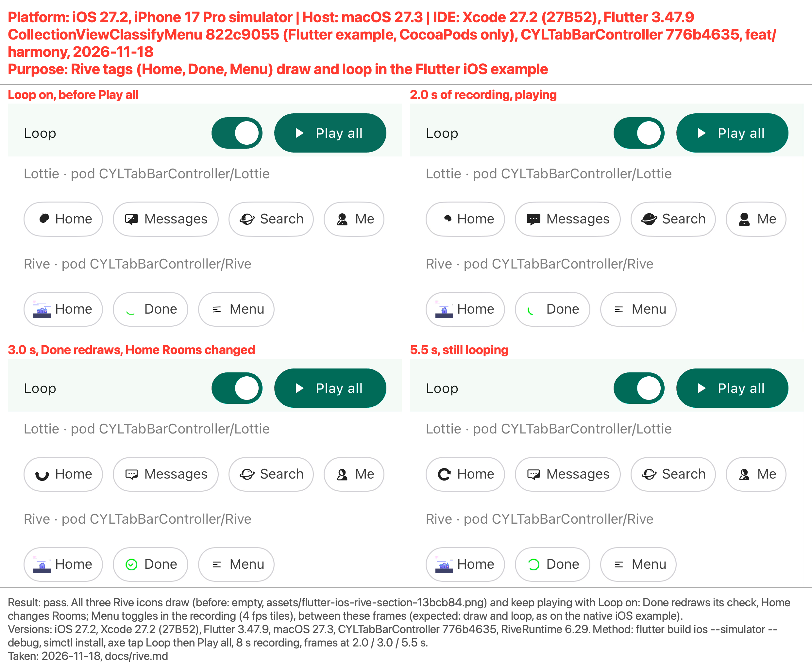

# Rive 动效图标：各平台使用的引擎 / Rive animated icons: engine per platform

| 中文 | English |
|:---|:---|
| 带 `.riv` 动效的标签（例如 `animated-tags.json`）在每个平台由不同的 Rive 引擎绘制。下表列出所用引擎、版本，以及 2026-11-16 的状态（分支 `feat/harmony`）。 | Tags with a `.riv` animation (for example `animated-tags.json`) are drawn by a different Rive runtime on each platform. The table lists which one, its version, and its state on 2026-11-16 (branch `feat/harmony`). |
| 带 `.riv` 动效的标签在每个平台由不同的 Rive 引擎绘制。下表列出引擎、版本与 2026-11-16 的状态（分支 `feat/harmony`）。 | Tags with a `.riv` animation are drawn by a different Rive engine on each platform. The table lists the engine, its version and its state on 2026-11-16 (branch `feat/harmony`). |

| 平台 | Rive 引擎 | 版本 | 接入方式 | 渲染 | 状态 |
|---|---|---|---|---|---|
| iOS（Swift / ObjC 示例） | `RiveRuntime`（rive-ios 库） | `~> 6.29` | `pod 'CYLTabBarController/Rive'`（`Example/Podfile`），通过 `CYLTabBarItemAnimation` | Rive（Metal 渲染） | 已接入；不受鸿蒙崩溃影响 |
| Android（Kotlin 版） | `app.rive:rive-android` | `10.3.0` | `android/gradle/libs.versions.toml`, `implementation(libs.rive)` in `android/merged/example` | Rive（GPU 渲染） | 已接入；不受鸿蒙崩溃影响 |
| HarmonyOS（ArkTS 版） | `@ohos/rive` (`RiveAnimationView`) | `1.0.4` | `harmony/classifymenu/oh-package.json5`; `CYLAnimatedIcon.ets` | 模拟器：`RendererType.Canvas`；真机：`RendererType.Rive`（`cylRiveRendererType()`，`6e8ba55`） | 模拟器上的崩溃已修复（`bef419e`，`6e8ba55`）；真机未测试。开关：`CYL_RIVE_ENABLED` |
| HarmonyOS 上的 Flutter | 通过 HarmonyOS 核心库使用 `@ohos/rive` | `1.0.4` | `flutter/cyl_tag_list_ohos/ohos/oh-package.json5` → `file:../../../harmony/classifymenu` | 与 HarmonyOS 相同 | 与 HarmonyOS 相同的修复 |
| HarmonyOS 上的 React Native | 通过 HarmonyOS 核心库使用 `@ohos/rive` | `1.0.4` | `react-native/react-native-cyl-tag-list/harmony-example/harmony/entry/oh-package.json5` → `file:` `harmony/classifymenu` | 与 HarmonyOS 相同 | 与 HarmonyOS 相同的修复 |
| iOS / Android 上的 Flutter | `RiveRuntime`（rive-ios 库）/ `app.rive:rive-android` | `~> 6.29` / `10.3.0` | `flutter/cyl_tag_list/example/ios/Podfile` 中的 `pod 'CYLTabBarController/Rive'`；`example/android/app/build.gradle.kts` 中的 rive-android（配合 `cyl.tabbar.libs`）；`.riv` 文件位于 `example/assets/rive`（`1f1221c`） | Rive（Metal / GPU 渲染） | 已接入；Rive 行（Home、Done、Menu）位于 `example/lib/main.dart`。iOS 模拟器：能绘制并循环播放（2026-11-18，`assets/flutter-ios-rive-loop.png`）。Android 模拟器（2026-11-19，API 37 x86_64）：插件改用 Hybrid Composition 后，静止时能绘制，并能播放和循环（CYLTabBarController B26；此前图标在静止时为空），`assets/flutter-android-rive-hybrid-composition.png` |
| iOS / Android 上的 React Native | `RiveRuntime`（rive-ios 库）/ `app.rive:rive-android` | `~> 6.29` / `10.3.0` | `example/ios/Podfile` 中的 `pod 'CYLTabBarController/Rive'`；`example/android/app/build.gradle` 中的 rive-android；`.riv` 文件位于 iOS 应用包（`Animations/`，在 Xcode 工程中）和 Android 的 `assets/`（`1f1221c`） | Rive（Metal / GPU 渲染） | 已接入；Rive 行位于 `example/src/TagListPage.tsx`。iOS 模拟器：能绘制、播放并循环（2026-11-18，`assets/react-native-ios-rive-loop.png`）。Android 模拟器（2026-11-19，API 37 x86_64）：静止时能绘制（Menu 显示为 X），能播放并循环 |
| 微信小程序 | `@rive-app/canvas-advanced`（WebAssembly，573 KB），封装为 `cyl-rive-miniprogram` | `2.39.1` | CYLTabBarController 的 `CrossPlatform/rive-miniprogram`，由 `scripts/fetch-cyltabbar.js` 复制到 `cyl_components` | Canvas 2D 绘制 | 已接入（`utils/tag-animations.js` 中 `engines.rive: true`）；不受影响 |

| Platform | Rive engine | Version | Linked by | Renderer | State |
|---|---|---|---|---|---|
| iOS (Swift / ObjC examples) | `RiveRuntime` (rive-ios) | `~> 6.29` | `pod 'CYLTabBarController/Rive'` (`Example/Podfile`), through `CYLTabBarItemAnimation` | Rive (Metal) | Linked; not affected by the HarmonyOS crash |
| Android (Kotlin) | `app.rive:rive-android` | `10.3.0` | `android/gradle/libs.versions.toml`, `implementation(libs.rive)` in `android/merged/example` | Rive (GPU) | Linked; not affected by the HarmonyOS crash |
| HarmonyOS (ArkTS) | `@ohos/rive` (`RiveAnimationView`) | `1.0.4` | `harmony/classifymenu/oh-package.json5`; `CYLAnimatedIcon.ets` | Emulator: `RendererType.Canvas`; device: `RendererType.Rive` (`cylRiveRendererType()`, `6e8ba55`) | Crash fixed on the emulator (`bef419e`, `6e8ba55`); real device untested. Switch: `CYL_RIVE_ENABLED` |
| Flutter on HarmonyOS | `@ohos/rive` via the HarmonyOS core | `1.0.4` | `flutter/cyl_tag_list_ohos/ohos/oh-package.json5` → `file:../../../harmony/classifymenu` | Same as HarmonyOS | Same fix as HarmonyOS |
| React Native on HarmonyOS | `@ohos/rive` via the HarmonyOS core | `1.0.4` | `react-native/react-native-cyl-tag-list/harmony-example/harmony/entry/oh-package.json5` → `file:` `harmony/classifymenu` | Same as HarmonyOS | Same fix as HarmonyOS |
| Flutter on iOS / Android | `RiveRuntime` (rive-ios) / `app.rive:rive-android` | `~> 6.29` / `10.3.0` | `pod 'CYLTabBarController/Rive'` in `flutter/cyl_tag_list/example/ios/Podfile`; rive-android in `example/android/app/build.gradle.kts` (with `cyl.tabbar.libs`); `.riv` files in `example/assets/rive` (`1f1221c`) | Rive (Metal / GPU) | Linked; the Rive row (Home, Done, Menu) is in `example/lib/main.dart`. iOS simulator: draws and loops (2026-11-18, `assets/flutter-ios-rive-loop.png`). Android emulator (2026-11-19, API 37 x86_64): draws at rest, plays and loops after the plugin moved to Hybrid Composition (CYLTabBarController B26; before, the icons were empty at rest), `assets/flutter-android-rive-hybrid-composition.png` |
| React Native on iOS / Android | `RiveRuntime` (rive-ios) / `app.rive:rive-android` | `~> 6.29` / `10.3.0` | `pod 'CYLTabBarController/Rive'` in `example/ios/Podfile`; rive-android in `example/android/app/build.gradle`; `.riv` files in the iOS app bundle (`Animations/`, in the Xcode project) and Android `assets/` (`1f1221c`) | Rive (Metal / GPU) | Linked; the Rive row is in `example/src/TagListPage.tsx`. iOS simulator: draws, plays and loops (2026-11-18, `assets/react-native-ios-rive-loop.png`). Android emulator (2026-11-19, API 37 x86_64): draws at rest (Menu on its X), plays and loops |
| WeChat Mini Program | `@rive-app/canvas-advanced` (WebAssembly, 573 KB) wrapped as `cyl-rive-miniprogram` | `2.39.1` | CYLTabBarController `CrossPlatform/rive-miniprogram`, copied into `cyl_components` by `scripts/fetch-cyltabbar.js` | Canvas 2D | Linked (`engines.rive: true` in `utils/tag-animations.js`); not affected |

## 鸿蒙崩溃 / The HarmonyOS crash

| 中文 | English |
|:---|:---|
| 原因：标签列表在最初几次重新布局时重建了每个标签，而销毁 `RiveAnimationView` 会在 `@ohos/rive` 1.0.4 内部崩溃（对已销毁的原生窗口调用 `eglDestroySurface`）；模拟器的宿主 GPU 在默认 GPU 渲染器下也会崩溃。详见 `issue-progress.md`。 | Cause: the tag list rebuilt every tag on its first relayouts, and disposing a `RiveAnimationView` crashed inside `@ohos/rive` 1.0.4 (`eglDestroySurface` on a destroyed native window); the emulator's host GPU also crashed with the default GPU renderer. Details: `issue-progress.md`. |
| 修复：使用稳定的标签 key（`bef419e`），并在模拟器上使用 Canvas 渲染器（`6e8ba55`），与 CYLTableViewPlaceHolder 的 `CYLRivePlaceholderItemAnimator.ets` 做法一致。 | Fix: stable tag keys (`bef419e`) and the Canvas renderer on the emulator (`6e8ba55`), the same choice as CYLTableViewPlaceHolder's `CYLRivePlaceholderItemAnimator.ets`. |
| 原因与修复同上；详见 `issue-progress.md`。 | The cause and the fix are the same as above; see `issue-progress.md`. |

## 待办 / Open

| 中文 | English |
|:---|:---|
| 待办：在真实的 HarmonyOS 设备上运行动效页面（GPU 渲染器）。 | TODO: run the animation screen on a real HarmonyOS device (GPU renderer). |
| 已完成（决定「加上 Rive」）：Flutter 和 React Native 的 iOS / Android 示例已接入 Rive（`1f1221c`）。 | Done (decided 「加上 Rive」): the Flutter and React Native iOS / Android examples link Rive (`1f1221c`). |
| 已完成（2026-11-19）：Flutter 和 React Native 示例的 Rive 行在 iOS 模拟器（Mac 会话）和 Android 模拟器（Windows 会话）上均能绘制、播放并循环；截图和详情见下文“模拟器上的 Rive 检查”。 | Done (2026-11-19): the Rive row of the Flutter and React Native examples draws, plays and loops on the iOS simulator (Mac session) and the Android emulator (Windows session); screenshots and details in "Rive checks on simulators" below. |

## 已完成（2026-11-16，2026-11-19 复查，`feat/harmony`）：在 Flutter 和 React Native 的 iOS / Android 示例中接入 Rive / DONE (2026-11-16, checked 2026-11-19, `feat/harmony`): link Rive in the Flutter and React Native iOS / Android examples

| 中文 | English |
|:---|:---|
| 提示词（原文）：「加上 Rive」（回答：在 iOS 和 Android 的 Flutter 与 React Native 中接入 Rive，使 `.riv` 标签在那里也有动效）。 | Prompt (verbatim): 「加上 Rive」 (answer to: link Rive in Flutter and React Native on iOS and Android so `.riv` tags animate there too). |
| 需求：(1) iOS：在 `flutter/cyl_tag_list/example/ios/Podfile` 和 `react-native/react-native-cyl-tag-list/example/ios/Podfile` 中加入 `pod 'CYLTabBarController/Rive'`；(2) Android：两个示例应用都加入 `app.rive:rive-android:10.3.0`；(3) 在 `flutter/cyl_tag_list/example/lib/main.dart` 和 `react-native/react-native-cyl-tag-list/example/src/TagListPage.tsx` 中加入一个由 `.riv` 标签组成的 Rive 分区（来自 `harmony/entry/src/main/resources/rawfile/rive`，附 `LICENSE-rive-ios.txt`）；(4) 在 iOS 模拟器和 Android 模拟器上运行，截图放入 `docs/assets`；(5) 更新上面的表格。 | Requirements: (1) iOS: `pod 'CYLTabBarController/Rive'` in `flutter/cyl_tag_list/example/ios/Podfile` and `react-native/react-native-cyl-tag-list/example/ios/Podfile`; (2) Android: `app.rive:rive-android:10.3.0` in both example apps; (3) a Rive section of `.riv` tags (from `harmony/entry/src/main/resources/rawfile/rive`, with `LICENSE-rive-ios.txt`) in `flutter/cyl_tag_list/example/lib/main.dart` and `react-native/react-native-cyl-tag-list/example/src/TagListPage.tsx`; (4) run on the iOS simulator and the Android emulator, screenshots in `docs/assets`; (5) update the table above. |
| 背景：两个示例都只接入了 `CYLTabBarController/Lottie`（iOS）和 Lottie 6.6.2（Android）；缺少对应引擎的标签会显示静态图片。 | Context: both examples link only `CYLTabBarController/Lottie` (iOS) and Lottie 6.6.2 (Android); a tag whose engine is missing shows its static image. |
| 进展（18:11）：`1f1221c` 加入了 Rive pod、rive-android 和 Rive 分区。Flutter iOS 示例在此任务之前无法链接：其 Xcode 工程用 Swift Package Manager 引入核心库，而 Podfile 又引入了 `CollectionViewClassifyMenu` pod（3666 个重复符号）；现在 Podfile 只保留 CYLTabBarController 的 pod。它能在 iPhone 17 Pro 模拟器（iOS 27.2，`CYL ClassifyMenu iOS`）上构建并运行，已嵌入 RiveRuntime 6.29.0，三个 `.riv` 文件也在 `flutter_assets` 中，但 Rive 标签不显示图标（`assets/flutter-ios-rive-section-1f1221c.png`）；原生 iOS 示例能绘制同样的文件（`../assets/rive-tags-transparent-background.png`）。尚未运行：Flutter Android、React Native iOS 和 Android。 | Progress (18:11): `1f1221c` adds the Rive pods, rive-android and the Rive sections. The Flutter iOS example did not link before this task: its Xcode project uses Swift Package Manager for the core while the Podfile also pulled the `CollectionViewClassifyMenu` pod (3666 duplicate symbols); the Podfile now keeps only CYLTabBarController's pods. It builds and runs on the iPhone 17 Pro simulator (iOS 27.2, `CYL ClassifyMenu iOS`), RiveRuntime 6.29.0 is embedded and the three `.riv` files are in `flutter_assets`, but the Rive tags show no icon (`assets/flutter-ios-rive-section-1f1221c.png`); the native iOS example draws the same files (`../assets/rive-tags-transparent-background.png`). Not yet run: Flutter Android, React Native iOS and Android. |

## 已修复的 Bug（2026-11-18）：React Native 和 Flutter 示例中的 Rive 标签只播放一次或从不播放 / Bug fixed (2026-11-18): Rive tags in the React Native and Flutter examples played once or never

| 中文 | English |
|:---|:---|
| 由维护者通过 CYLTabBarController 会话报告：“Rive · pod 'CYLTabBarController/Rive'” 中的 Rive 图标只播放一次就停止；在 React Native 上有些完全不播放。 | Reported by the maintainer through the CYLTabBarController session: Rive icons in "Rive · pod 'CYLTabBarController/Rive'" play once and stop; on React Native some never play. |
| 此处的原因：React Native（`example/src/TagListPage.tsx`）和 Flutter（`example/lib/main.dart`）示例列出 `house.riv`、`check.riv` 和 `menu_button.riv` 时，没有传入其他平台所传的 `animationOptions`，因此播放器驱动的是默认输入 `active`，而这些文件没有该输入。 | Cause here: the React Native (`example/src/TagListPage.tsx`) and Flutter (`example/lib/main.dart`) examples listed `house.riv`, `check.riv` and `menu_button.riv` without the `animationOptions` the other platforms pass, so the player drove the default input `active`, which these files do not have. |
| 修复：`house` `{stateMachine: 'State Machine 1'}`，`check` `{stateMachine: 'State Machine 1', triggerInput: 'Check'}`，`menu_button` `{stateMachine: 'State Machine', input: 'isOpen', duration: '0'}`，与 `harmony/entry/src/main/resources/rawfile/menu/animation-demo.json` 一致。已检查：`tsc --noEmit` 和 `flutter analyze` 无告警；尚未在模拟器上运行。 | Fix: `house` `{stateMachine: 'State Machine 1'}`, `check` `{stateMachine: 'State Machine 1', triggerInput: 'Check'}`, `menu_button` `{stateMachine: 'State Machine', input: 'isOpen', duration: '0'}`, as in `harmony/entry/src/main/resources/rawfile/menu/animation-demo.json`. Checked: `tsc --noEmit` and `flutter analyze` clean; not yet run on a simulator. |
| 上游仍待办（CYLTabBarController，记录在其 `docs/WeChat-Mini-Program.md`）：Rive 图标的循环与重播（状态机无法重启，触发器从不循环，持续保持的输入无法重播）。 | Still TODO upstream (CYLTabBarController, recorded in its `docs/WeChat-Mini-Program.md`): looping and replaying Rive icons (no state machine restart, triggers never loop, a held input cannot replay). |

## 已完成（2026-11-19，`feat/harmony`）：模拟器上的 Rive 检查（配置文件首页、React Native、Flutter） / DONE (2026-11-19, `feat/harmony`): Rive checks on simulators (configuration file Home, React Native, Flutter)

| 中文 | English |
|:---|:---|
| **提示词（原文）**：「continue Rive」 | **Prompt (verbatim)**: "continue Rive" |
| **提示词（英文）**：继续已暂停的 Rive 模拟器检查。 | **Prompt (English)**: continue the paused Rive simulator checks. |
| **计划**：(1) iOS 示例，配置文件页面（`-CYLExampleScreen config`）：Rive 的 Home 标签（`house.riv`，现为 `numberInput: Rooms`，`values: 3,4,5,6`，`a6c9e437`）被选中时会变化；点击前后的帧，像素差异对比。(2) React Native iOS 示例和 (3) Flutter iOS 示例：三个 Rive 标签（`house`、`check`、`menu_button`，选项见上面的修复）能播放并循环；截图和像素差异对比。使用 `scripts/stitch-screenshots.swift` 拼接。 | **Plan**: (1) iOS example, configuration file screen (`-CYLExampleScreen config`): the Rive Home tag (`house.riv`, now `numberInput: Rooms`, `values: 3,4,5,6`, `a6c9e437`) moves when selected; frames before / after a tap, pixel diff. (2) React Native iOS example and (3) Flutter iOS example: the three Rive tags (`house`, `check`, `menu_button`, options from the fix above) play and loop; screenshots and pixel diffs. Stitched with `scripts/stitch-screenshots.swift`. |
| **进展（2026-11-18），第 1 步完成：配置文件页面，Rive Home 会变化。** iPhone 17 Pro `62B54974`，iOS 27.2，Xcode 27.2 (27B52)，macOS 27.3，CYLTabBarController `776b4635`，`-CYLExampleScreen config`，`axe tap`，截图和 5 秒录屏（8 fps）：选中 Rive 后，房子在 0.4 秒内切换到另一个 `Rooms` 值并保持；取消选中会再次变化。每次新的选择都落在同一个值上（不会在不循环时依次经过 3、4、5、6；循环只在“动效”页面中有）。在 `a6c9e437` 之前，该文件只指定了状态机，房子从不变化。 | **Progress (2026-11-18), step 1 done: configuration file screen, Rive Home moves.** iPhone 17 Pro `62B54974`, iOS 27.2, Xcode 27.2 (27B52), macOS 27.3, CYLTabBarController `776b4635`, `-CYLExampleScreen config`, `axe tap`, screenshots and a 5 s recording (8 fps): selecting Rive switches the house to another `Rooms` value within 0.4 s and it stays; deselecting changes it again. Each new selection lands on the same value (no stepping through 3, 4, 5, 6 without loop; the loop is on the Animations screen only). Before `a6c9e437` the file named only the state machine and the house never changed. |

  

| 中文 | English |
|:---|:---|
| 平台：iOS 27.2，iPhone 17 Pro 模拟器 \| 主机：macOS 27.3 \| IDE：Xcode 27.2 (27B52)；CollectionViewClassifyMenu `7adfad31`（`a6c9e437`），CYLTabBarController `776b4635`，feat/harmony，2026-11-18。 | Platform: iOS 27.2, iPhone 17 Pro simulator \| Host: macOS 27.3 \| IDE: Xcode 27.2 (27B52); CollectionViewClassifyMenu `7adfad31` (`a6c9e437`), CYLTabBarController `776b4635`, feat/harmony, 2026-11-18. |
| **进展（2026-11-18），第 3 步完成：Flutter iOS，Rive 标签能绘制并循环。** | **Progress (2026-11-18), step 3 done: Flutter iOS, the Rive tags draw and loop.** |
| ↳ 发现并修复的 Bug：示例不再能链接（`21 duplicate symbols`，`CYLAnimatedItem` 出现两次）：插件通过 Swift Package Manager 引入核心库（包 `CollectionViewClassifyMenu`，依赖产品 `CYLAnimatedItem`），而 Podfile 中的 `CYLAnimatedItem/Rive` 引擎引入了 pod `CYLAnimatedItem`；CYLTabBarController 没有 Rive 引擎的 Swift 包产品。修复：示例在 iOS 上只使用 CocoaPods（`pubspec.yaml` 中 `flutter: config: enable-swift-package-manager: false`，Podfile 中 `pod 'CollectionViewClassifyMenu', :path`，并从 `Runner.xcodeproj` 中移除两个本地包引用 `cyl_tag_list` 和 `FlutterFramework`）。`flutter build ios --simulator --debug` 构建成功（Flutter 3.47.9）。 | ↳ Bug found and fixed: the example no longer linked (`21 duplicate symbols`, `CYLAnimatedItem` twice): the plugin brought the core through Swift Package Manager (package `CollectionViewClassifyMenu`, which depends on the product `CYLAnimatedItem`), while the Podfile's `CYLAnimatedItem/Rive` engine brought the pod `CYLAnimatedItem`; CYLTabBarController has no Swift package product for the Rive engine. Fix: the example uses CocoaPods only on iOS (`pubspec.yaml` `flutter: config: enable-swift-package-manager: false`, `pod 'CollectionViewClassifyMenu', :path` in the Podfile, and the two local package references `cyl_tag_list` and `FlutterFramework` removed from `Runner.xcodeproj`). `flutter build ios --simulator --debug` builds (Flutter 3.47.9). |
| ↳ 结果：Home、Done 和 Menu 能绘制（此前为空，`assets/flutter-ios-rive-section-1f1221c.png`），并在开启 Loop 和 Play all 时持续播放：Done 重绘对勾，Home 切换 `Rooms`，Menu 来回切换（8 秒录屏，4 fps 分块）。 | ↳ Result: Home, Done and Menu draw (before: empty, `assets/flutter-ios-rive-section-1f1221c.png`) and keep playing with Loop on and Play all: Done redraws its check, Home changes `Rooms`, Menu toggles (8 s recording, 4 fps tiles). |

  

| 中文 | English |
|:---|:---|
| 平台：iOS 27.2，iPhone 17 Pro 模拟器 \| 主机：macOS 27.3 \| IDE：Xcode 27.2 (27B52)，Flutter 3.47.9；CollectionViewClassifyMenu `309ffa33`，CYLTabBarController `776b4635`，feat/harmony，2026-11-18。 | Platform: iOS 27.2, iPhone 17 Pro simulator \| Host: macOS 27.3 \| IDE: Xcode 27.2 (27B52), Flutter 3.47.9; CollectionViewClassifyMenu `309ffa33`, CYLTabBarController `776b4635`, feat/harmony, 2026-11-18. |
| **进展（2026-11-18），第 2 步完成：React Native iOS，Rive 标签能绘制、播放并循环。** | **Progress (2026-11-18), step 2 done: React Native iOS, the Rive tags draw, play and loop.** |
| ↳ 在 `example/ios/Podfile` 中发现并修复的 Bug（示例在当前版本锁定下无法安装或构建）：`pod install` 拒绝将 Swift pod `CYLAnimatedItem` 作为静态库，因为 `lottie-ios` 没有 module map（现为 `pod 'lottie-ios', :modular_headers => true`）；Xcode 27 拒绝 iOS 14.0 的 `RiveRuntime-runtime_ios_privacy`（post_install 把所有低于 15.0 的 pod target 提升到 15.0）。过期的 `.deps/CYLTabBarController` 检出（`117be52c`）因 `unknown type name 'CYLTabBarHostView'` 而失败；`scripts/fetch-cyltabbar.sh` 将其移到锁定的版本。 | ↳ Bugs found and fixed in `example/ios/Podfile` (the example did not install or build at the current pins): `pod install` refused the Swift pod `CYLAnimatedItem` as a static library because `lottie-ios` has no module map (now `pod 'lottie-ios', :modular_headers => true`); Xcode 27 refused `RiveRuntime-runtime_ios_privacy` with iOS 14.0 (post_install raises every pod target below 15.0 to 15.0). A stale `.deps/CYLTabBarController` checkout (`117be52c`) failed with `unknown type name 'CYLTabBarHostView'`; `scripts/fetch-cyltabbar.sh` moves it to the pin. |
| ↳ 结果（Release 构建，内置 JavaScript）：Home、Done 和 Menu 在启动时即可绘制；关闭 Loop 时 Play all 让每个各播放一次（Home 的 `Rooms`，Done 的对勾，Menu 由 x 变为横线）；开启 Loop 后，它们在整个 9 秒录屏中持续播放（4 fps 分块）。 | ↳ Result (Release build, bundled JavaScript): Home, Done and Menu draw at launch; Play all with Loop off plays each once (Home `Rooms`, the Done check, Menu from x to lines); with Loop on they keep playing for the whole 9 s recording (4 fps tiles). |

  

| 中文 | English |
|:---|:---|
| 平台：iOS 27.2，iPhone 17 Pro 模拟器 \| 主机：macOS 27.3 \| IDE：Xcode 27.2 (27B52)，React Native 示例（Release）；CollectionViewClassifyMenu `386a5ad1`，CYLTabBarController `776b4635`，feat/harmony，2026-11-18。 | Platform: iOS 27.2, iPhone 17 Pro simulator \| Host: macOS 27.3 \| IDE: Xcode 27.2 (27B52), React Native example (Release); CollectionViewClassifyMenu `386a5ad1`, CYLTabBarController `776b4635`, feat/harmony, 2026-11-18. |
| **已完成（2026-11-19）**：三个步骤都在 iPhone 17 Pro 模拟器（iOS 27.2）上通过：配置文件页面的 Rive Home（`309ffa33`）、Flutter iOS（`386a5ad1`）和 React Native iOS（本次提交）。此处未运行：Flutter 和 React Native 的 Android 示例（模拟器）。 | **DONE (2026-11-19)**: all three steps pass on the iPhone 17 Pro simulator (iOS 27.2): the configuration file screen's Rive Home (`309ffa33`), Flutter iOS (`386a5ad1`) and React Native iOS (this commit). Not run here: the Flutter and React Native Android examples on an emulator. |
| **已完成（2026-11-19），Android（Windows 会话）：Flutter 和 React Native，Rive 标签能绘制、播放并循环。** | **DONE (2026-11-19), Android (Windows session): Flutter and React Native, the Rive tags draw, play and loop.** |
| ↳ React Native Android（内置 JavaScript 的 debug 构建，emulator-5556）：静止时 Home、Done 和 Menu（显示为 X）均已绘制；Play all 播放全部三个；开启 Loop 后它们持续变化。 | ↳ React Native Android (debug build with the JavaScript bundled in, emulator-5556): at rest Home, Done and Menu (on its X) are drawn; Play all plays all three; with Loop on they keep changing. |
| ↳ Flutter Android：Play all 和 Loop 可用，但在大多数启动中图标在静止时为空（CYLTabBarController B26）。标签列表是纹理层的 `AndroidView`，只有当其他内容重绘平台视图时，才会显示 TextureView 的新帧（rive-android 在自己的线程上绘制）。在插件中修复（`lib/cyl_tag_list.dart`）：使用 Hybrid Composition（`PlatformViewLink` + `initExpensiveAndroidView`），与核心库的 `flutter_cyltabbar` 相同。修复后：3 次启动中 3 次在静止时绘制出全部三个图标；Play all 和 Loop 可用；点击仍能选中标签。 | ↳ Flutter Android: Play all and Loop worked, but the icons were empty at rest on most launches (CYLTabBarController B26). The tag list was a texture-layer `AndroidView`, which shows a TextureView's new frames (rive-android draws on its own thread) only when something else redraws the platform view. Fix in the plugin (`lib/cyl_tag_list.dart`): Hybrid Composition (`PlatformViewLink` + `initExpensiveAndroidView`), as the core's `flutter_cyltabbar`. After: 3 of 3 launches draw all three at rest; Play all and Loop work; a tap still selects a tag. |

  

  

| 中文 | English |
|:---|:---|
| 平台：Android 17 (API 37) x86_64 模拟器 \| 主机：Windows 11 \| IDE：无（Gradle 9.4.1，Flutter CLI）；CYLTabBarController `776b4635`（修复前）和 `f610107c`（修复后；锁定版本 `b376c278` 未添加 Android 代码），feat/harmony，2026-11-19。 | Platform: Android 17 (API 37) x86_64 emulator \| Host: Windows 11 \| IDE: none (Gradle 9.4.1, Flutter CLI); CYLTabBarController `776b4635` (before) and `f610107c` (after; the pin `b376c278` adds no Android code), feat/harmony, 2026-11-19. |
