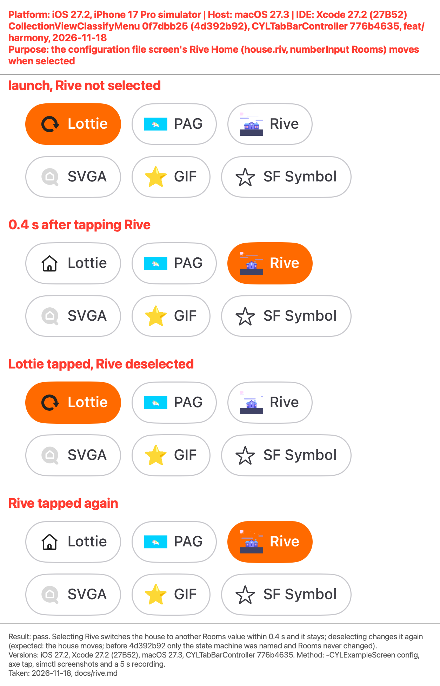
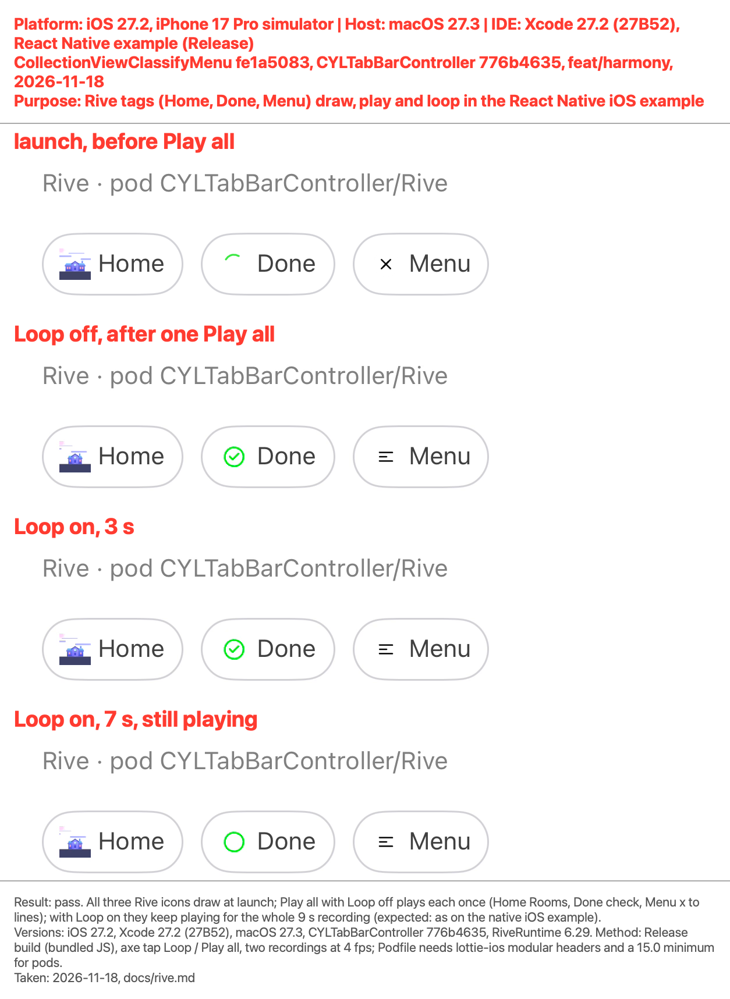
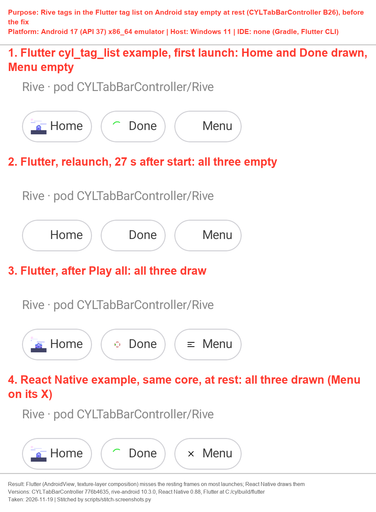
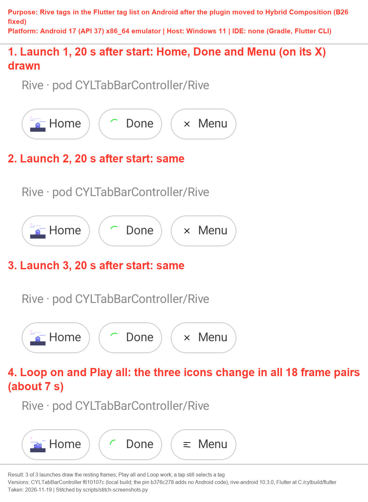

# Rive animated icons: engine per platform / Rive 动效图标：各平台使用的引擎

Tags with a `.riv` animation (for example `animated-tags.json`) are drawn by a different Rive runtime on each
platform. The table lists which one, its version, and its state on 2026-11-16 (branch `feat/harmony`).

带 `.riv` 动效的标签在每个平台由不同的 Rive 引擎绘制。下表列出引擎、版本与 2026-11-16 的状态（分支 `feat/harmony`）。

| Platform / 平台 | Rive engine / 引擎 | Version / 版本 | Linked by / 接入方式 | Renderer / 渲染 | State / 状态 |
|---|---|---|---|---|---|
| iOS (Swift / ObjC examples) | `RiveRuntime` (rive-ios) | `~> 6.29` | `pod 'CYLTabBarController/Rive'` (`Example/Podfile`), through `CYLTabBarItemAnimation` | Rive (Metal) | Linked; not affected by the HarmonyOS crash |
| Android (Kotlin) | `app.rive:rive-android` | `10.3.0` | `android/gradle/libs.versions.toml`, `implementation(libs.rive)` in `android/merged/example` | Rive (GPU) | Linked; not affected by the HarmonyOS crash |
| HarmonyOS (ArkTS) | `@ohos/rive` (`RiveAnimationView`) | `1.0.4` | `harmony/classifymenu/oh-package.json5`; `CYLAnimatedIcon.ets` | Emulator: `RendererType.Canvas`; device: `RendererType.Rive` (`cylRiveRendererType()`, `3417e7e`) | Crash fixed on the emulator (`e82b503`, `3417e7e`); real device untested. Switch: `CYL_RIVE_ENABLED` |
| Flutter on HarmonyOS | `@ohos/rive` via the HarmonyOS core | `1.0.4` | `flutter/cyl_tag_list_ohos/ohos/oh-package.json5` → `file:../../../harmony/classifymenu` | Same as HarmonyOS | Same fix as HarmonyOS |
| React Native on HarmonyOS | `@ohos/rive` via the HarmonyOS core | `1.0.4` | `react-native/react-native-cyl-tag-list/harmony-example/harmony/entry/oh-package.json5` → `file:` `harmony/classifymenu` | Same as HarmonyOS | Same fix as HarmonyOS |
| Flutter on iOS / Android | `RiveRuntime` (rive-ios) / `app.rive:rive-android` | `~> 6.29` / `10.3.0` | `pod 'CYLTabBarController/Rive'` in `flutter/cyl_tag_list/example/ios/Podfile`; rive-android in `example/android/app/build.gradle.kts` (with `cyl.tabbar.libs`); `.riv` files in `example/assets/rive` (`13bcb84`) | Rive (Metal / GPU) | Linked; the Rive row (Home, Done, Menu) is in `example/lib/main.dart`. iOS simulator: draws and loops (2026-11-18, `assets/flutter-ios-rive-loop.png`). Android emulator (2026-11-19, API 37 x86_64): draws at rest, plays and loops after the plugin moved to Hybrid Composition (CYLTabBarController B26; before, the icons were empty at rest), `assets/flutter-android-rive-hybrid-composition.png` |
| React Native on iOS / Android | `RiveRuntime` (rive-ios) / `app.rive:rive-android` | `~> 6.29` / `10.3.0` | `pod 'CYLTabBarController/Rive'` in `example/ios/Podfile`; rive-android in `example/android/app/build.gradle`; `.riv` files in the iOS app bundle (`Animations/`, in the Xcode project) and Android `assets/` (`13bcb84`) | Rive (Metal / GPU) | Linked; the Rive row is in `example/src/TagListPage.tsx`. iOS simulator: draws, plays and loops (2026-11-18, `assets/react-native-ios-rive-loop.png`). Android emulator (2026-11-19, API 37 x86_64): draws at rest (Menu on its X), plays and loops |
| WeChat mini program / 微信小程序 | `@rive-app/canvas-advanced` (WebAssembly, 573 KB) wrapped as `cyl-rive-miniprogram` | `2.39.1` | CYLTabBarController `CrossPlatform/rive-miniprogram`, copied into `cyl_components` by `scripts/fetch-cyltabbar.js` | Canvas 2D | Linked (`engines.rive: true` in `utils/tag-animations.js`); not affected |

## The HarmonyOS crash / 鸿蒙崩溃

- Cause: the tag list rebuilt every tag on its first relayouts, and disposing a `RiveAnimationView` crashed inside
  `@ohos/rive` 1.0.4 (`eglDestroySurface` on a destroyed native window); the emulator's host GPU also crashed with the
  default GPU renderer. Details: `issue-progress.md`.
- Fix: stable tag keys (`e82b503`) and the Canvas renderer on the emulator (`3417e7e`), the same choice as
  CYLTableViewPlaceHolder's `CYLRivePlaceholderItemAnimator.ets`.
- 原因与修复同上；详见 `issue-progress.md`。

## Open / 待办

- TODO: run the animation screen on a real HarmonyOS device (GPU renderer).
- Done (decided "加上 Rive"): the Flutter and React Native iOS / Android examples link Rive (`13bcb84`).
- Done (2026-11-19): the Rive row of the Flutter and React Native examples draws, plays and loops on the iOS simulator (Mac session) and the Android emulator (Windows session); screenshots and details in "Rive checks on simulators" below.

## DONE (2026-11-16, checked 2026-11-19, `feat/harmony`): link Rive in the Flutter and React Native iOS / Android examples

- Prompt (verbatim): "加上 Rive" (answer to: link Rive in Flutter and React Native on iOS and Android so `.riv` tags animate there too).
- Requirements: (1) iOS: `pod 'CYLTabBarController/Rive'` in `flutter/cyl_tag_list/example/ios/Podfile` and `react-native/react-native-cyl-tag-list/example/ios/Podfile`; (2) Android: `app.rive:rive-android:10.3.0` in both example apps; (3) a Rive section of `.riv` tags (from `harmony/entry/src/main/resources/rawfile/rive`, with `LICENSE-rive-ios.txt`) in `flutter/cyl_tag_list/example/lib/main.dart` and `react-native/react-native-cyl-tag-list/example/src/TagListPage.tsx`; (4) run on the iOS simulator and the Android emulator, screenshots in `docs/assets`; (5) update the table above.
- Context: both examples link only `CYLTabBarController/Lottie` (iOS) and Lottie 6.6.2 (Android); a tag whose engine is missing shows its static image.
- Progress (18:11): `13bcb84` adds the Rive pods, rive-android and the Rive sections. The Flutter iOS example did not link
  before this task: its Xcode project uses Swift Package Manager for the core while the Podfile also pulled the
  `CollectionViewClassifyMenu` pod (3666 duplicate symbols); the Podfile now keeps only CYLTabBarController's pods.
  It builds and runs on the iPhone 17 Pro simulator (iOS 27.2, `CYL ClassifyMenu iOS`), RiveRuntime 6.29.0 is embedded
  and the three `.riv` files are in `flutter_assets`, but the Rive tags show no icon (`assets/flutter-ios-rive-section-13bcb84.png`);
  the native iOS example draws the same files (`../assets/rive-tags-transparent-background.png`). Not yet run: Flutter
  Android, React Native iOS and Android.

## Bug fixed (2026-11-18): Rive tags in the React Native and Flutter examples played once or never

- Reported by the maintainer through the CYLTabBarController session: Rive icons in "Rive · pod 'CYLTabBarController/Rive'"
  play once and stop; on React Native some never play.
- Cause here: the React Native (`example/src/TagListPage.tsx`) and Flutter (`example/lib/main.dart`) examples listed
  `house.riv`, `check.riv` and `menu_button.riv` without the `animationOptions` the other platforms pass, so the player
  drove the default input `active`, which these files do not have.
- Fix: `house` `{stateMachine: 'State Machine 1'}`, `check` `{stateMachine: 'State Machine 1', triggerInput: 'Check'}`,
  `menu_button` `{stateMachine: 'State Machine', input: 'isOpen', duration: '0'}`, as in
  `harmony/entry/src/main/resources/rawfile/menu/animation-demo.json`. Checked: `tsc --noEmit` and `flutter analyze`
  clean; not yet run on a simulator.
- Still TODO upstream (CYLTabBarController, recorded in its `docs/WeChat-Mini-Program.md`): looping and replaying Rive
  icons (no state machine restart, triggers never loop, a held input cannot replay).

## DONE (2026-11-19, `feat/harmony`): Rive checks on simulators (configuration file Home, React Native, Flutter)

- **Prompt (verbatim)**: "continue Rive"
- **Prompt (English)**: continue the paused Rive simulator checks.
- **Plan**: (1) iOS example, configuration file screen (`-CYLExampleScreen config`): the Rive Home tag (`house.riv`, now
  `numberInput: Rooms`, `values: 3,4,5,6`, `4d392b92`) moves when selected; frames before / after a tap, pixel diff.
  (2) React Native iOS example and (3) Flutter iOS example: the three Rive tags (`house`, `check`, `menu_button`, options
  from the fix above) play and loop; screenshots and pixel diffs. Stitched with `scripts/stitch-screenshots.swift`.
- **Progress (2026-11-18), step 1 done: configuration file screen, Rive Home moves.** iPhone 17 Pro `62B54974`, iOS 27.2,
  Xcode 27.2 (27B52), macOS 27.3, CYLTabBarController `776b4635`, `-CYLExampleScreen config`, `axe tap`, screenshots
  and a 5 s recording (8 fps): selecting Rive switches the house to another `Rooms` value within 0.4 s and it stays;
  deselecting changes it again. Each new selection lands on the same value (no stepping through 3, 4, 5, 6 without
  loop; the loop is on the Animations screen only). Before `4d392b92` the file named only the state machine and the
  house never changed.

  

  Platform: iOS 27.2, iPhone 17 Pro simulator | Host: macOS 27.3 | IDE: Xcode 27.2 (27B52); CollectionViewClassifyMenu
  `0f7dbb25` (`4d392b92`), CYLTabBarController `776b4635`, feat/harmony, 2026-11-18.
- **Progress (2026-11-18), step 3 done: Flutter iOS, the Rive tags draw and loop.**
  - Bug found and fixed: the example no longer linked (`21 duplicate symbols`, `CYLAnimatedItem` twice): the plugin
    brought the core through Swift Package Manager (package `CollectionViewClassifyMenu`, which depends on the product
    `CYLAnimatedItem`), while the Podfile's `CYLAnimatedItem/Rive` engine brought the pod `CYLAnimatedItem`; CYLTabBarController
    has no Swift package product for the Rive engine. Fix: the example uses CocoaPods only on iOS
    (`pubspec.yaml` `flutter: config: enable-swift-package-manager: false`, `pod 'CollectionViewClassifyMenu', :path`
    in the Podfile, and the two local package references `cyl_tag_list` and `FlutterFramework` removed from
    `Runner.xcodeproj`). `flutter build ios --simulator --debug` builds (Flutter 3.47.9).
  - Result: Home, Done and Menu draw (before: empty, `assets/flutter-ios-rive-section-13bcb84.png`) and keep playing
    with Loop on and Play all: Done redraws its check, Home changes `Rooms`, Menu toggles (8 s recording, 4 fps tiles).

  

  Platform: iOS 27.2, iPhone 17 Pro simulator | Host: macOS 27.3 | IDE: Xcode 27.2 (27B52), Flutter 3.47.9;
  CollectionViewClassifyMenu `822c9055`, CYLTabBarController `776b4635`, feat/harmony, 2026-11-18.
- **Progress (2026-11-18), step 2 done: React Native iOS, the Rive tags draw, play and loop.**
  - Bugs found and fixed in `example/ios/Podfile` (the example did not install or build at the current pins):
    `pod install` refused the Swift pod `CYLAnimatedItem` as a static library because `lottie-ios` has no module map
    (now `pod 'lottie-ios', :modular_headers => true`); Xcode 27 refused `RiveRuntime-runtime_ios_privacy` with
    iOS 14.0 (post_install raises every pod target below 15.0 to 15.0). A stale `.deps/CYLTabBarController` checkout
    (`117be52c`) failed with `unknown type name 'CYLTabBarHostView'`; `scripts/fetch-cyltabbar.sh` moves it to the pin.
  - Result (Release build, bundled JavaScript): Home, Done and Menu draw at launch; Play all with Loop off plays each
    once (Home `Rooms`, the Done check, Menu from x to lines); with Loop on they keep playing for the whole 9 s
    recording (4 fps tiles).

  

  Platform: iOS 27.2, iPhone 17 Pro simulator | Host: macOS 27.3 | IDE: Xcode 27.2 (27B52), React Native example
  (Release); CollectionViewClassifyMenu `fe1a5083`, CYLTabBarController `776b4635`, feat/harmony, 2026-11-18.
- **DONE (2026-11-19)**: all three steps pass on the iPhone 17 Pro simulator (iOS 27.2): the configuration file
  screen's Rive Home (`822c9055`), Flutter iOS (`fe1a5083`) and React Native iOS (this commit). Not run here: the Flutter
  and React Native Android examples on an emulator.
- **DONE (2026-11-19), Android (Windows session): Flutter and React Native, the Rive tags draw, play and loop.**
  - React Native Android (debug build with the JavaScript bundled in, emulator-5556): at rest Home, Done and Menu (on its X)
    are drawn; Play all plays all three; with Loop on they keep changing.
  - Flutter Android: Play all and Loop worked, but the icons were empty at rest on most launches (CYLTabBarController
    B26). The tag list was a texture-layer `AndroidView`, which shows a TextureView's new frames (rive-android draws on its
    own thread) only when something else redraws the platform view. Fix in the plugin (`lib/cyl_tag_list.dart`): Hybrid
    Composition (`PlatformViewLink` + `initExpensiveAndroidView`), as the core's `flutter_cyltabbar`. After: 3 of 3 launches
    draw all three at rest; Play all and Loop work; a tap still selects a tag.

  

  

  Platform: Android 17 (API 37) x86_64 emulator | Host: Windows 11 | IDE: none (Gradle 9.4.1, Flutter CLI);
  CYLTabBarController `776b4635` (before) and `f610107c` (after; the pin `b376c278` adds no Android code), feat/harmony,
  2026-11-19.
