# Screenshots

Screenshots from CI/CD and local builds that have no feature document of their own. Images live in `assets/`.
Rules: AGENTS.md, "CI/CD and Example screenshots" (labels: platform, OS version, simulator / emulator version, platform
SDK version, repository version or commit URL, time taken; clear originals; stitched vertically first).

| Screenshot | Platform | Environment | Commit | Taken |
| --- | --- | --- | --- | --- |
| 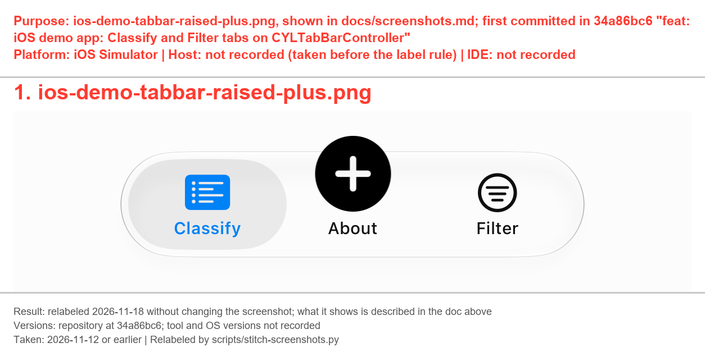 Tab bar: one tab per feature, raised plus button | iOS | macOS 27.3, Xcode 27.2 (27B5028f), iPhone 17 Pro simulator, iOS 27.2 (24B8117), CYLTabBarController `53766de` | `feat/android-kotlin` (the commit adding this row) | 2026-11-12 19:20 NZDT |
| 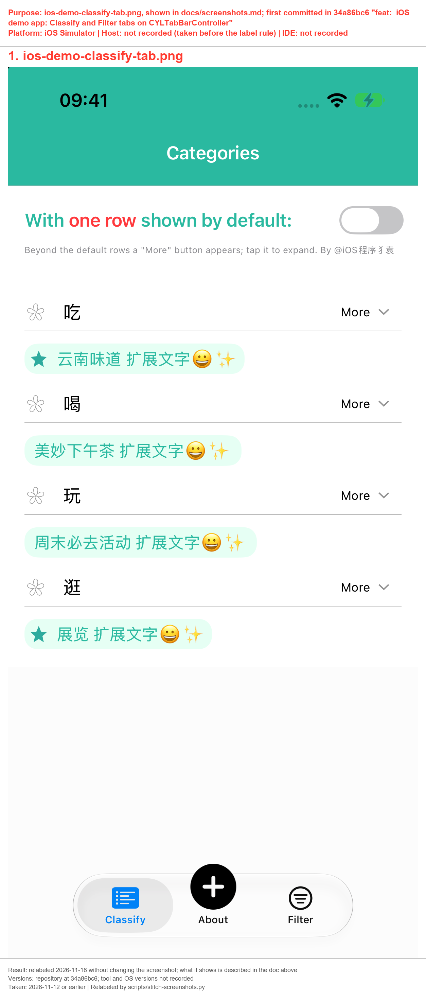 Classify tab: single-choice classify menu only | iOS | as above | as above | 2026-11-12 19:20 NZDT |
|  Filter tab: the filter button, Reset filters, the 83 places of the demo data | iOS | as above | as above | 2026-11-12 19:25 NZDT |
|  Filter tab: the panel slides in from the left over most of the screen; Reset / Apply above the home indicator | iOS | as above | as above | 2026-11-12 19:20 NZDT |
| 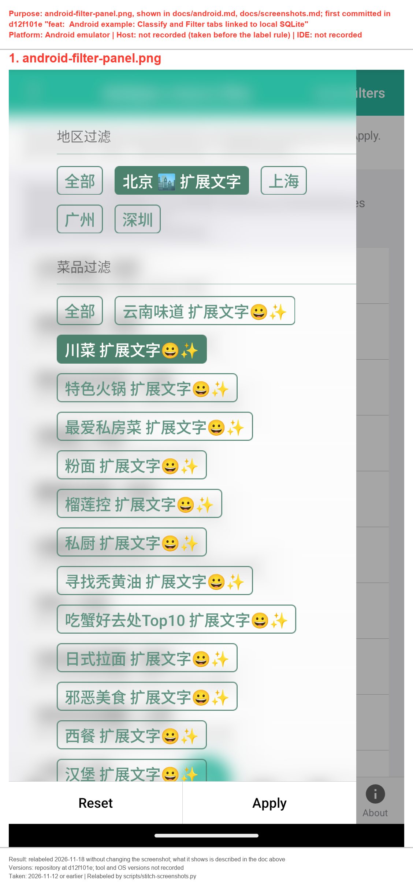 Android Filter tab (details in [android.md](android.md)) | Android | Android 15 (API 35) emulator `CYL_API35_arm64`, compileSdk 35 | `d12f101` | 2026-11-12 18:35 NZDT |

## HarmonyOS: every demo (2026-11-16)

The 22-demo HarmonyOS example (`harmony/entry`) on a new dedicated emulator, taken by `harmony/scripts/screenshots.sh`
(launch options open each screen; `en-`, `zh-hant-` and `dark-` rows set the language or the color mode). Rows with a
defect are TODO in [harmony-verification.md](harmony-verification.md) (B1, B9, B11, B12). Stacked top to bottom.

| Screenshot | Platform | Environment | Commit | Taken |
| --- | --- | --- | --- | --- |
|  `root` — defect: the screen renders, but the Chinese tab titles are cut off ("场景一：评价筛", "场景二：搜索分"); English fits | HarmonyOS | HarmonyOS 6.0.1 SDK (API 21), emulator `CYL ClassifyMenu Test` (Mate 70 Pro profile, 6.0.0.112(SP3DEVC00E112R4P11), 1316 × 2832), DevEco Studio 6.0.1 hvigor, macOS 27.3 | `b1d3724` | 2026-11-16 14:36–14:41 NZDT |
|  `en-root` | HarmonyOS | HarmonyOS 6.0.1 SDK (API 21), emulator `CYL ClassifyMenu Test` (Mate 70 Pro profile, 6.0.0.112(SP3DEVC00E112R4P11), 1316 × 2832), DevEco Studio 6.0.1 hvigor, macOS 27.3 | `b1d3724` | 2026-11-16 14:36–14:41 NZDT |
|  `dark-root` — defect: the screen renders, but the Chinese tab titles are cut off ("场景一：评价筛", "场景二：搜索分"); English fits | HarmonyOS | HarmonyOS 6.0.1 SDK (API 21), emulator `CYL ClassifyMenu Test` (Mate 70 Pro profile, 6.0.0.112(SP3DEVC00E112R4P11), 1316 × 2832), DevEco Studio 6.0.1 hvigor, macOS 27.3 | `b1d3724` | 2026-11-16 14:36–14:41 NZDT |
|  `product` | HarmonyOS | HarmonyOS 6.0.1 SDK (API 21), emulator `CYL ClassifyMenu Test` (Mate 70 Pro profile, 6.0.0.112(SP3DEVC00E112R4P11), 1316 × 2832), DevEco Studio 6.0.1 hvigor, macOS 27.3 | `b1d3724` | 2026-11-16 14:36–14:41 NZDT |
| 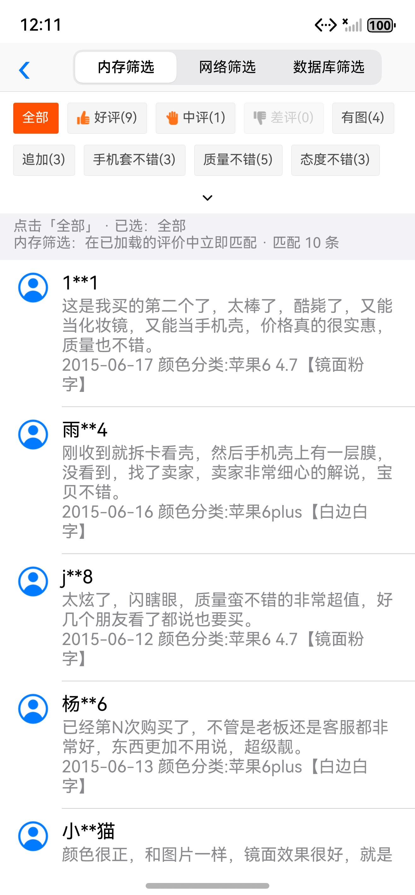 `reviews-memory` | HarmonyOS | HarmonyOS 6.0.1 SDK (API 21), emulator `CYL ClassifyMenu Test` (Mate 70 Pro profile, 6.0.0.112(SP3DEVC00E112R4P11), 1316 × 2832), DevEco Studio 6.0.1 hvigor, macOS 27.3 | `b1d3724` | 2026-11-16 14:36–14:41 NZDT |
|  `reviews-network` | HarmonyOS | HarmonyOS 6.0.1 SDK (API 21), emulator `CYL ClassifyMenu Test` (Mate 70 Pro profile, 6.0.0.112(SP3DEVC00E112R4P11), 1316 × 2832), DevEco Studio 6.0.1 hvigor, macOS 27.3 | `b1d3724` | 2026-11-16 14:36–14:41 NZDT |
| 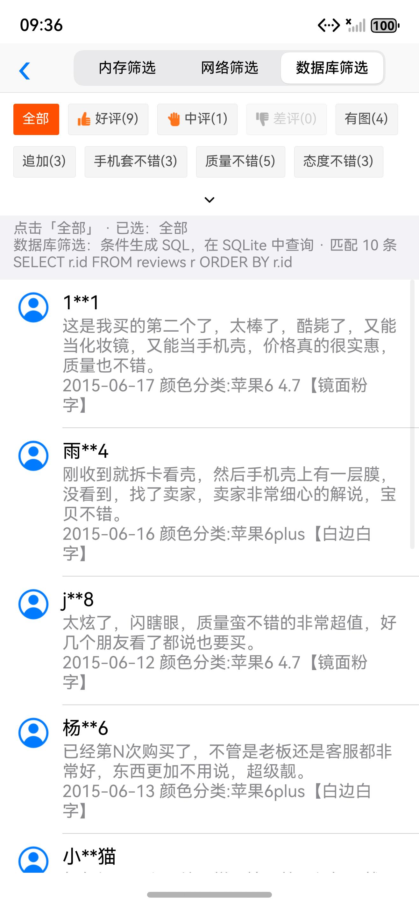 `reviews-database` | HarmonyOS | HarmonyOS 6.0.1 SDK (API 21), emulator `CYL ClassifyMenu Test` (Mate 70 Pro profile, 6.0.0.112(SP3DEVC00E112R4P11), 1316 × 2832), DevEco Studio 6.0.1 hvigor, macOS 27.3 | `b1d3724` | 2026-11-16 14:36–14:41 NZDT |
|  `search-home` | HarmonyOS | HarmonyOS 6.0.1 SDK (API 21), emulator `CYL ClassifyMenu Test` (Mate 70 Pro profile, 6.0.0.112(SP3DEVC00E112R4P11), 1316 × 2832), DevEco Studio 6.0.1 hvigor, macOS 27.3 | `b1d3724` | 2026-11-16 14:36–14:41 NZDT |
|  `search-category` | HarmonyOS | HarmonyOS 6.0.1 SDK (API 21), emulator `CYL ClassifyMenu Test` (Mate 70 Pro profile, 6.0.0.112(SP3DEVC00E112R4P11), 1316 × 2832), DevEco Studio 6.0.1 hvigor, macOS 27.3 | `b1d3724` | 2026-11-16 14:36–14:41 NZDT |
|  `search-category-page` | HarmonyOS | HarmonyOS 6.0.1 SDK (API 21), emulator `CYL ClassifyMenu Test` (Mate 70 Pro profile, 6.0.0.112(SP3DEVC00E112R4P11), 1316 × 2832), DevEco Studio 6.0.1 hvigor, macOS 27.3 | `b1d3724` | 2026-11-16 14:36–14:41 NZDT |
|  `search-discover` | HarmonyOS | HarmonyOS 6.0.1 SDK (API 21), emulator `CYL ClassifyMenu Test` (Mate 70 Pro profile, 6.0.0.112(SP3DEVC00E112R4P11), 1316 × 2832), DevEco Studio 6.0.1 hvigor, macOS 27.3 | `b1d3724` | 2026-11-16 14:36–14:41 NZDT |
|  `query-scenarios` | HarmonyOS | HarmonyOS 6.0.1 SDK (API 21), emulator `CYL ClassifyMenu Test` (Mate 70 Pro profile, 6.0.0.112(SP3DEVC00E112R4P11), 1316 × 2832), DevEco Studio 6.0.1 hvigor, macOS 27.3 | `b1d3724` | 2026-11-16 14:36–14:41 NZDT |
|  `menu-linkage` — defect: the category headers (吃喝玩逛) render as large blurred, stretched images instead of their titles, and several tags as teal wedges; the SQL and the 83 results are right | HarmonyOS | HarmonyOS 6.0.1 SDK (API 21), emulator `CYL ClassifyMenu Test` (Mate 70 Pro profile, 6.0.0.112(SP3DEVC00E112R4P11), 1316 × 2832), DevEco Studio 6.0.1 hvigor, macOS 27.3 | `b1d3724` | 2026-11-16 14:36–14:41 NZDT |
|  `styles` | HarmonyOS | HarmonyOS 6.0.1 SDK (API 21), emulator `CYL ClassifyMenu Test` (Mate 70 Pro profile, 6.0.0.112(SP3DEVC00E112R4P11), 1316 × 2832), DevEco Studio 6.0.1 hvigor, macOS 27.3 | `b1d3724` | 2026-11-16 14:36–14:41 NZDT |
|  `zh-hant-styles` | HarmonyOS | HarmonyOS 6.0.1 SDK (API 21), emulator `CYL ClassifyMenu Test` (Mate 70 Pro profile, 6.0.0.112(SP3DEVC00E112R4P11), 1316 × 2832), DevEco Studio 6.0.1 hvigor, macOS 27.3 | `b1d3724` | 2026-11-16 14:36–14:41 NZDT |
|  `animations` — defect: in Chinese (and dark mode) the Lottie, PAG and Rive rows show no tags, only empty rows; in English every animated tag renders | HarmonyOS | HarmonyOS 6.0.1 SDK (API 21), emulator `CYL ClassifyMenu Test` (Mate 70 Pro profile, 6.0.0.112(SP3DEVC00E112R4P11), 1316 × 2832), DevEco Studio 6.0.1 hvigor, macOS 27.3 | `b1d3724` | 2026-11-16 14:36–14:41 NZDT |
|  `en-animations` | HarmonyOS | HarmonyOS 6.0.1 SDK (API 21), emulator `CYL ClassifyMenu Test` (Mate 70 Pro profile, 6.0.0.112(SP3DEVC00E112R4P11), 1316 × 2832), DevEco Studio 6.0.1 hvigor, macOS 27.3 | `b1d3724` | 2026-11-16 14:36–14:41 NZDT |
|  `dark-animations` — defect: in Chinese (and dark mode) the Lottie, PAG and Rive rows show no tags, only empty rows; in English every animated tag renders | HarmonyOS | HarmonyOS 6.0.1 SDK (API 21), emulator `CYL ClassifyMenu Test` (Mate 70 Pro profile, 6.0.0.112(SP3DEVC00E112R4P11), 1316 × 2832), DevEco Studio 6.0.1 hvigor, macOS 27.3 | `b1d3724` | 2026-11-16 14:36–14:41 NZDT |
| 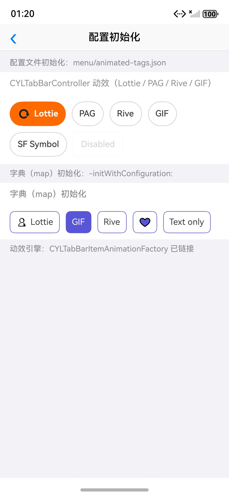 `configuration` — defect: renders, but the fourth chip of the dictionary row is empty; the log shows `NapiDefineClass occur exception, className:JPAGImageView` (PAG) | HarmonyOS | HarmonyOS 6.0.1 SDK (API 21), emulator `CYL ClassifyMenu Test` (Mate 70 Pro profile, 6.0.0.112(SP3DEVC00E112R4P11), 1316 × 2832), DevEco Studio 6.0.1 hvigor, macOS 27.3 | `b1d3724` | 2026-11-16 14:36–14:41 NZDT |
| 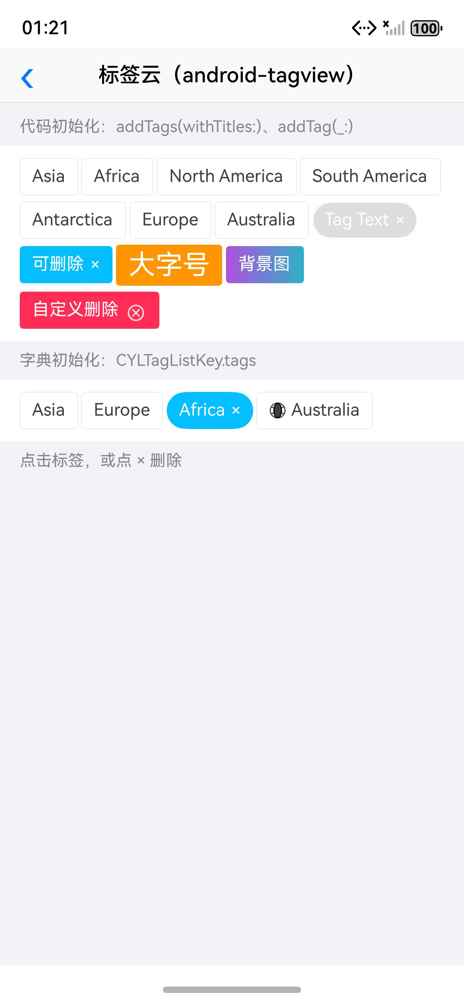 `tag-cloud` | HarmonyOS | HarmonyOS 6.0.1 SDK (API 21), emulator `CYL ClassifyMenu Test` (Mate 70 Pro profile, 6.0.0.112(SP3DEVC00E112R4P11), 1316 × 2832), DevEco Studio 6.0.1 hvigor, macOS 27.3 | `b1d3724` | 2026-11-16 14:36–14:41 NZDT |
| 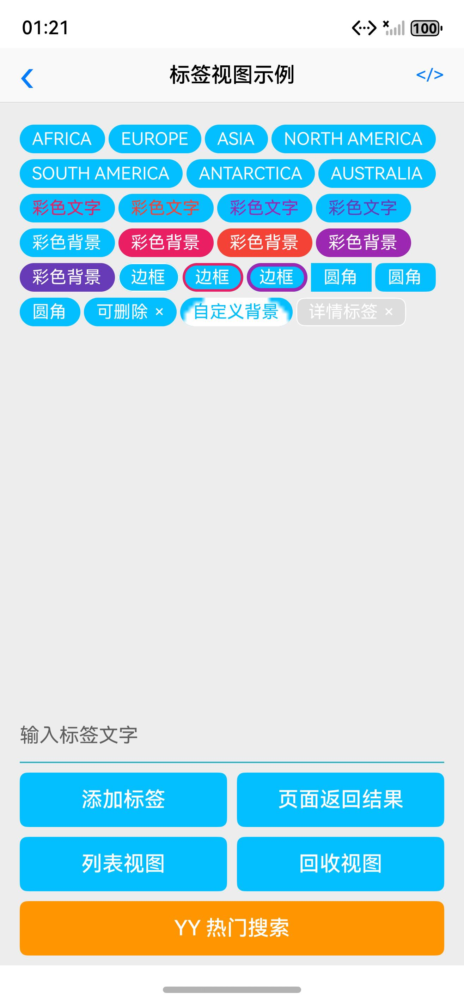 `tag-cloud-sample` | HarmonyOS | HarmonyOS 6.0.1 SDK (API 21), emulator `CYL ClassifyMenu Test` (Mate 70 Pro profile, 6.0.0.112(SP3DEVC00E112R4P11), 1316 × 2832), DevEco Studio 6.0.1 hvigor, macOS 27.3 | `b1d3724` | 2026-11-16 14:36–14:41 NZDT |
|  `tag-cloud-sub` | HarmonyOS | HarmonyOS 6.0.1 SDK (API 21), emulator `CYL ClassifyMenu Test` (Mate 70 Pro profile, 6.0.0.112(SP3DEVC00E112R4P11), 1316 × 2832), DevEco Studio 6.0.1 hvigor, macOS 27.3 | `b1d3724` | 2026-11-16 14:36–14:41 NZDT |
|  `tag-cloud-list` | HarmonyOS | HarmonyOS 6.0.1 SDK (API 21), emulator `CYL ClassifyMenu Test` (Mate 70 Pro profile, 6.0.0.112(SP3DEVC00E112R4P11), 1316 × 2832), DevEco Studio 6.0.1 hvigor, macOS 27.3 | `b1d3724` | 2026-11-16 14:36–14:41 NZDT |
|  `tag-cloud-recycler` | HarmonyOS | HarmonyOS 6.0.1 SDK (API 21), emulator `CYL ClassifyMenu Test` (Mate 70 Pro profile, 6.0.0.112(SP3DEVC00E112R4P11), 1316 × 2832), DevEco Studio 6.0.1 hvigor, macOS 27.3 | `b1d3724` | 2026-11-16 14:36–14:41 NZDT |
|  `hot-search` | HarmonyOS | HarmonyOS 6.0.1 SDK (API 21), emulator `CYL ClassifyMenu Test` (Mate 70 Pro profile, 6.0.0.112(SP3DEVC00E112R4P11), 1316 × 2832), DevEco Studio 6.0.1 hvigor, macOS 27.3 | `b1d3724` | 2026-11-16 14:36–14:41 NZDT |
|  `image-tag-sample` | HarmonyOS | HarmonyOS 6.0.1 SDK (API 21), emulator `CYL ClassifyMenu Test` (Mate 70 Pro profile, 6.0.0.112(SP3DEVC00E112R4P11), 1316 × 2832), DevEco Studio 6.0.1 hvigor, macOS 27.3 | `b1d3724` | 2026-11-16 14:36–14:41 NZDT |
|  `image-tag-edit` | HarmonyOS | HarmonyOS 6.0.1 SDK (API 21), emulator `CYL ClassifyMenu Test` (Mate 70 Pro profile, 6.0.0.112(SP3DEVC00E112R4P11), 1316 × 2832), DevEco Studio 6.0.1 hvigor, macOS 27.3 | `b1d3724` | 2026-11-16 14:36–14:41 NZDT |
|  `image-tag-list` | HarmonyOS | HarmonyOS 6.0.1 SDK (API 21), emulator `CYL ClassifyMenu Test` (Mate 70 Pro profile, 6.0.0.112(SP3DEVC00E112R4P11), 1316 × 2832), DevEco Studio 6.0.1 hvigor, macOS 27.3 | `b1d3724` | 2026-11-16 14:36–14:41 NZDT |
|  `tag-container` | HarmonyOS | HarmonyOS 6.0.1 SDK (API 21), emulator `CYL ClassifyMenu Test` (Mate 70 Pro profile, 6.0.0.112(SP3DEVC00E112R4P11), 1316 × 2832), DevEco Studio 6.0.1 hvigor, macOS 27.3 | `b1d3724` | 2026-11-16 14:36–14:41 NZDT |

## HarmonyOS: pushed pages (2026-11-16)

Reached by tapping controls found by their text or accessibility text (AGENTS.md, accessibility-first UI driving), from
the root tab bar or a demo opened by launch option. Stacked top to bottom.

| Screenshot | Platform | Environment | Commit | Taken |
| --- | --- | --- | --- | --- |
| 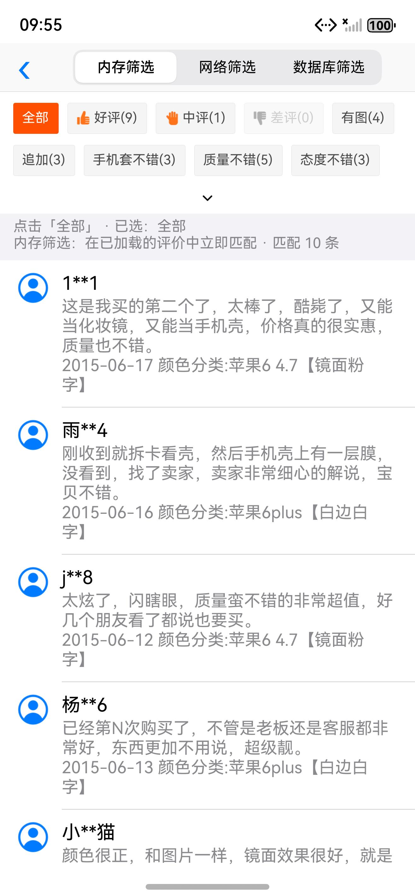 root → "查看更多评价" (See all reviews): the review list, memory mode | HarmonyOS | HarmonyOS 6.0.1 SDK (API 21), emulator `CYL ClassifyMenu Test` (6.0.0.112(SP3DEVC00E112R4P11), 1316 × 2832), macOS 27.3 | `6081884` | 2026-11-16 14:55–14:57 NZDT |
|  root → tab "场景二：搜索分类" (Scenario 2) | HarmonyOS | HarmonyOS 6.0.1 SDK (API 21), emulator `CYL ClassifyMenu Test` (6.0.0.112(SP3DEVC00E112R4P11), 1316 × 2832), macOS 27.3 | `6081884` | 2026-11-16 14:55–14:57 NZDT |
| 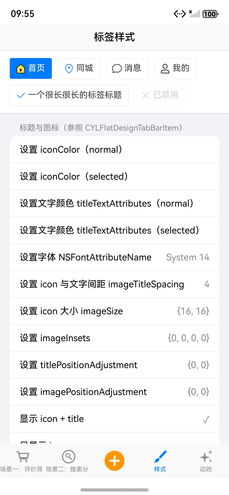 root → tab "样式" (Styles) | HarmonyOS | HarmonyOS 6.0.1 SDK (API 21), emulator `CYL ClassifyMenu Test` (6.0.0.112(SP3DEVC00E112R4P11), 1316 × 2832), macOS 27.3 | `6081884` | 2026-11-16 14:55–14:57 NZDT |
|  root → tab "动效" (Animations): the animated tags render in Chinese on this route | HarmonyOS | HarmonyOS 6.0.1 SDK (API 21), emulator `CYL ClassifyMenu Test` (6.0.0.112(SP3DEVC00E112R4P11), 1316 × 2832), macOS 27.3 | `6081884` | 2026-11-16 14:55–14:57 NZDT |
|  image tag sample → "标签列表" (Tag list) | HarmonyOS | HarmonyOS 6.0.1 SDK (API 21), emulator `CYL ClassifyMenu Test` (6.0.0.112(SP3DEVC00E112R4P11), 1316 × 2832), macOS 27.3 | `6081884` | 2026-11-16 14:55–14:57 NZDT |
|  tag cloud sample → "列表视图" (List view) | HarmonyOS | HarmonyOS 6.0.1 SDK (API 21), emulator `CYL ClassifyMenu Test` (6.0.0.112(SP3DEVC00E112R4P11), 1316 × 2832), macOS 27.3 | `6081884` | 2026-11-16 14:55–14:57 NZDT |
|  query scenarios → "评价筛选 · 数据库（SQLite）" (Review filter · database): the review list in database mode, its SQL shown | HarmonyOS | HarmonyOS 6.0.1 SDK (API 21), emulator `CYL ClassifyMenu Test` (6.0.0.112(SP3DEVC00E112R4P11), 1316 × 2832), macOS 27.3 | `7c4c294` | 2026-11-16 15:07–15:09 NZDT |
|  query scenarios → "分类菜单 + 多选筛选 · 数据库联动" (Classify menu + multiple filter): the menu linkage page | HarmonyOS | HarmonyOS 6.0.1 SDK (API 21), emulator `CYL ClassifyMenu Test` (6.0.0.112(SP3DEVC00E112R4P11), 1316 × 2832), macOS 27.3 | `7c4c294` | 2026-11-16 15:07–15:09 NZDT |
|  query scenarios → "最近搜索 + 发现" (Recent searches + discover) | HarmonyOS | HarmonyOS 6.0.1 SDK (API 21), emulator `CYL ClassifyMenu Test` (6.0.0.112(SP3DEVC00E112R4P11), 1316 × 2832), macOS 27.3 | `7c4c294` | 2026-11-16 15:07–15:09 NZDT |
|  image tag sample → "创建标签" (Create tags): the edit page with its steps | HarmonyOS | HarmonyOS 6.0.1 SDK (API 21), emulator `CYL ClassifyMenu Test` (6.0.0.112(SP3DEVC00E112R4P11), 1316 × 2832), macOS 27.3 | `7c4c294` | 2026-11-16 15:07–15:09 NZDT |
| 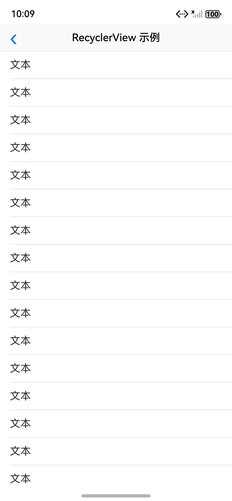 tag cloud sample → "回收视图" (RecyclerView example) | HarmonyOS | HarmonyOS 6.0.1 SDK (API 21), emulator `CYL ClassifyMenu Test` (6.0.0.112(SP3DEVC00E112R4P11), 1316 × 2832), macOS 27.3 | `7c4c294` | 2026-11-16 15:07–15:09 NZDT |
|  tag cloud sample → "页面返回结果" (Page result): the sub-page that returns a tag | HarmonyOS | HarmonyOS 6.0.1 SDK (API 21), emulator `CYL ClassifyMenu Test` (6.0.0.112(SP3DEVC00E112R4P11), 1316 × 2832), macOS 27.3 | `7c4c294` | 2026-11-16 15:07–15:09 NZDT |

Not documented as pages, because the tap changed nothing on screen (reported to the port's owner, TODO): the plus
button (it exposes no accessibility text, only a description), the menu-linkage filter button (an image with neither
text nor description), the review filter "好评" (Good) and the search category "找人" (People).

Second batch (2026-11-16 15:07–15:09): the review filter, retried with its real label "好评(9)" (Good), still leaves
"全部" (All) selected with 10 matches (reported, TODO). Taps on a product review tag ("质量不错(5)"), a hot-search tag
("小西瓜"), a search-category tag ("腾讯工程师") and the tag-cloud "可删除" (Deletable) tag showed no new page; whether
the iOS example opens one there is not checked yet.
