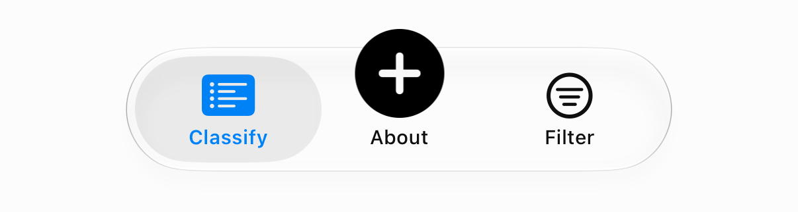
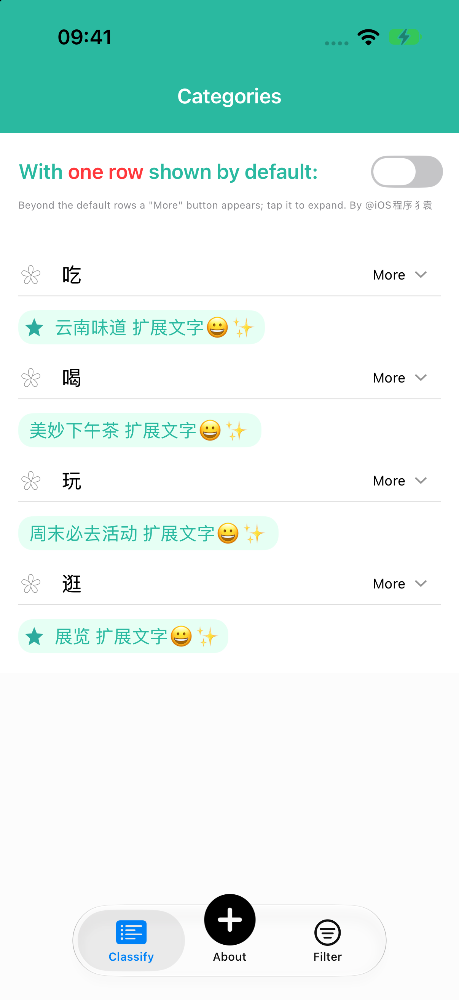
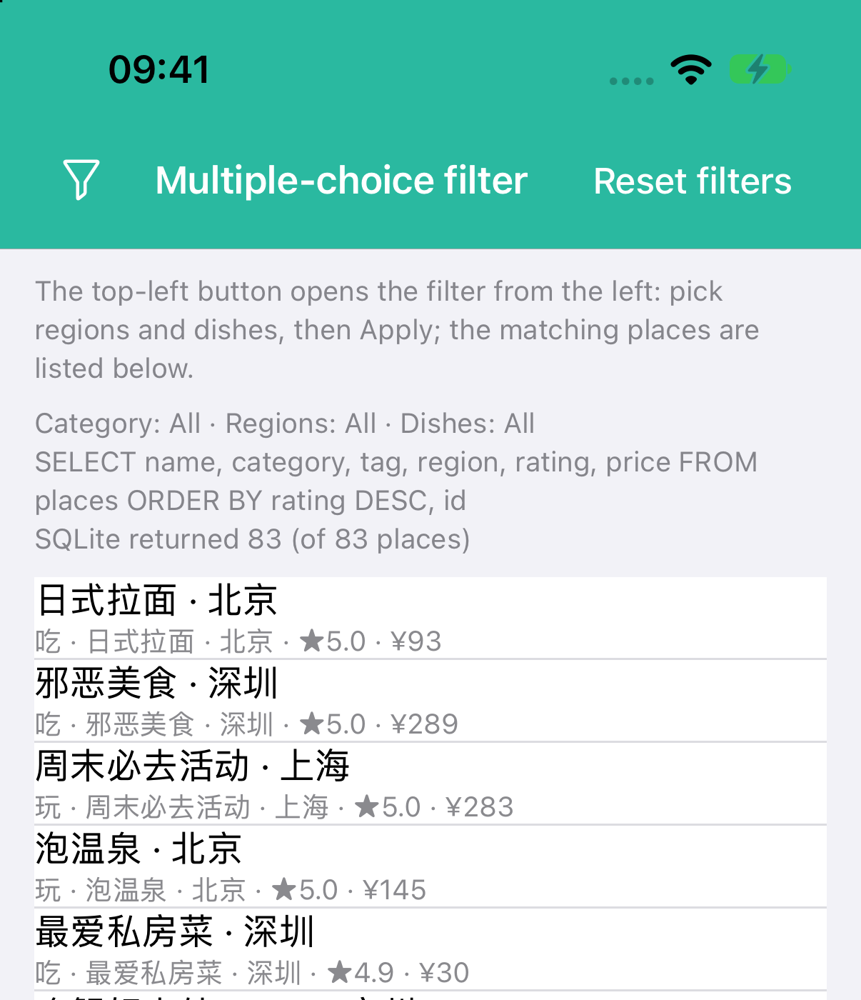
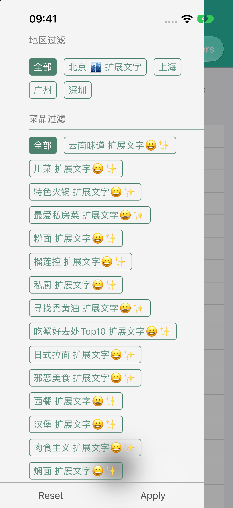
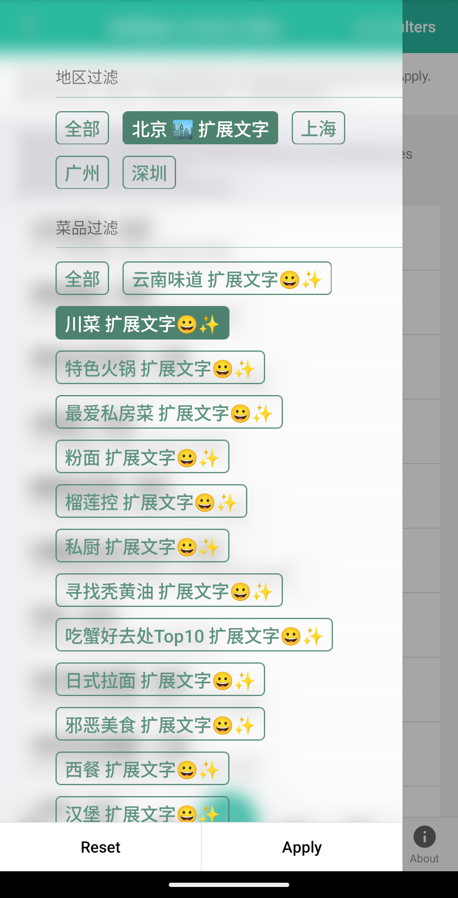

# Screenshots

Screenshots from CI/CD and local builds that have no feature document of their own. Images live in `assets/`.
Rules: AGENTS.md, "CI/CD and Example screenshots" (labels: platform, OS version, simulator / emulator version, platform
SDK version, repository version or commit URL, time taken; clear originals; stitched vertically first).

| Screenshot | Platform | Environment | Commit | Taken |
| --- | --- | --- | --- | --- |
|  Tab bar: one tab per feature, raised plus button | iOS | macOS 27.3, Xcode 27.2 (27B5028f), iPhone 17 Pro simulator, iOS 27.2 (24B8117), CYLTabBarController `53766de` | `feat/android-kotlin` (the commit adding this row) | 2026-11-12 19:20 NZDT |
|  Classify tab: single-choice classify menu only | iOS | as above | as above | 2026-11-12 19:20 NZDT |
|  Filter tab: the filter button, Reset filters, the 83 places of the demo data | iOS | as above | as above | 2026-11-12 19:25 NZDT |
|  Filter tab: the panel slides in from the left over most of the screen; Reset / Apply above the home indicator | iOS | as above | as above | 2026-11-12 19:20 NZDT |
|  Android Filter tab (details in [android.md](android.md)) | Android | Android 15 (API 35) emulator `CYL_API35_arm64`, compileSdk 35 | `d12f101` | 2026-11-12 18:35 NZDT |
