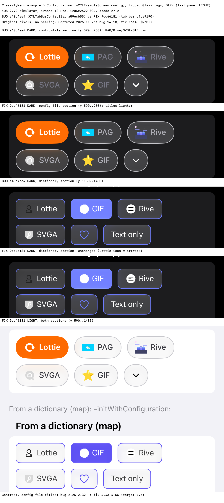

# Tag and item tint unification on dark Liquid Glass / 深色液态玻璃上标签与条目的 tint 统一

Context, new interfaces, the fix and what it fixed (2026-11-26). Branch `fix/shared-contrast-ios` (also `feat/tag-final-merge-plus`), ClassifyMenu `9cc46181`,
CYLTabBarController `dfbe9190` (`feat/harmony-animated-item-engines`). iOS only unless a row says otherwise.
背景、新接口、修复方法与修复内容（2026-11-26）。分支 `fix/shared-contrast-ios`（同时是 `feat/tag-final-merge-plus`），ClassifyMenu `9cc46181`，
CYLTabBarController `dfbe9190`。除非另有说明，仅 iOS。

## 1. The bug / 问题

Screenshot: `/tmp/xpa/cm-final-out/raw/a40c4ee4-dark.png` (iOS 27.2 simulator, ClassifyMenu example, Configuration page, Dark mode, Liquid Glass tags).
截图：`/tmp/xpa/cm-final-out/raw/a40c4ee4-dark.png`（iOS 27.2 模拟器，示例的 Configuration 页，深色模式，液态玻璃标签）。

- Unselected tags of the configuration-file section (PAG, Rive, SVGA, GIF) show dim gray titles on dark glass (contrast about 2.3 to 2.9, the rule promises 4.5).
  配置文件一节中未选中的标签（PAG、Rive、SVGA、GIF）在深色玻璃上标题发灰（对比度约 2.3 到 2.9，规则承诺 4.5）。
- Selected tags (orange, indigo) always looked clear; the dictionary section's unselected titles (no text color set) are white, about 10:1.
  选中的标签（橙色、靛蓝）看起来始终清楚；字典一节未设置文字色的未选中标题是白色，约 10:1。
- The dictionary section's Lottie icon is dark gray (34, 34, 34) and nearly invisible: that color is in the animation file, not in a tint (not part of this fix).
  字典一节的 Lottie 图标是深灰（34, 34, 34），几乎看不见：这个颜色来自动画文件而不是 tint（不在本次修复范围）。

### Why / 原因

1. **The same code path judged two different glasses.** Selected and normal titles already went through the same item code, but the glass a color is judged against
   differs: a selected tag has an explicit tint at alpha 1, so its reference luminance is the tint itself (accurate); a normal tag has the default frosted glass,
   which the shared model took as "white 0.14 over black" (luminance about 0.017) while real iOS dark glass renders brighter (about Y 66, luminance about 0.055).
   The lift therefore stopped too early: `#3C3C43` became about `#8A8A96`, 2.9:1 on the real glass.
   同一段代码对照了两种不同的玻璃。选中和常态标题其实走同一段条目代码，但颜色所对照的玻璃不同：选中标签有透明度 1 的显式着色，参考亮度就是着色本身（准确）；
   常态标签是默认磨砂玻璃，共享模型把它当成“黑底上的 0.14 白”（亮度约 0.017），而 iOS 真实的深色玻璃更亮（约 Y 66，亮度约 0.055）。因此提亮停得太早。
2. **The normal and the selected built-in colors were not resolved the same way** (normal stayed a dynamic color, selected was resolved with the item's traits) and
   neither was adapted to drawn dark glass.
   常态与选中的内置颜色解析方式不同（常态保持动态颜色，选中用条目的 trait 解析），并且都没有适配深色玻璃。
3. **CYLTagButton re-implemented what CYLAnimatedItemView does** (dark-glass lift, glass/flat decisions, pressed look, Increase Contrast, Reduce Motion, ...), so
   a bug fixed in the tag stayed in every integrator that uses the item directly. One intermediate version (`098809db`) even overwrote the integrator's `itemAppearance`.
   CYLTagButton 重复实现了 CYLAnimatedItemView 的功能（深色玻璃提亮、玻璃/扁平判断、按下外观、增强对比度、减弱动态效果等），tag 里修好的问题，直接使用条目的集成方仍然存在。
   中间一个版本（`098809db`）甚至覆盖了集成方的 `itemAppearance`。

## 1b. Screenshots: bug and fix / 截图：问题与修复

Labelled comparison (one column, original pixels, iOS 27.2 simulator, iPhone 18 Pro, Xcode 27.2, captured 2026-11-26; bug `a40c4ee4` at 14:18 NZDT, fix `9cc46181` at 16:45 NZDT):
对照图（单列，原始像素，iOS 27.2 模拟器，iPhone 18 Pro，Xcode 27.2，2026-11-26 拍摄；问题 `a40c4ee4` 14:18，修复 `9cc46181` 16:45，新西兰时间）：



| Frame / 画面 | File / 文件 | Commit / 提交 | Taken / 时间 |
|---|---|---|---|
| Bug, dark, full page / 问题，深色，整页 | [ios-27.2-iphone18pro-sim-config-dark-bug-a40c4ee4-20261126-1418.png](assets/ios-27.2-iphone18pro-sim-config-dark-bug-a40c4ee4-20261126-1418.png) | `a40c4ee4`, CYLTabBarController `a59ecb55` | 2026-11-26 14:18 NZDT |
| Fix, dark, full page / 修复，深色，整页 | [ios-27.2-iphone18pro-sim-config-dark-fix-9cc46181-20261126-1645.png](assets/ios-27.2-iphone18pro-sim-config-dark-fix-9cc46181-20261126-1645.png) | `9cc46181`, CYLTabBarController `dfbe9190` | 2026-11-26 16:45 NZDT |
| Fix, light, full page / 修复，浅色，整页 | [ios-27.2-iphone18pro-sim-config-light-fix-9cc46181-20261126-1645.png](assets/ios-27.2-iphone18pro-sim-config-light-fix-9cc46181-20261126-1645.png) | `9cc46181`, CYLTabBarController `dfbe9190` | 2026-11-26 16:45 NZDT |

Measured (Rec.601 luma of sRGB bytes; glyph = mean of the brightest 2.5% of the title box; contrast against the tag glass, Y 66 in dark mode): config-file titles PAG / Rive / SVGA / GIF, dark mode.
实测（sRGB 字节的 Rec.601 亮度；字形为标题框内最亮 2.5% 像素的均值；对照标签玻璃，深色模式 Y 66）：配置文件标题，深色模式。

| | Bug `a40c4ee4` | After the shared-path refactor `99662054` | Fix `9cc46181` |
|---|---|---|---|
| Glyph Y / 字形亮度 | 121.6 | 139.4 | 174.9 |
| Contrast / 对比度 | 2.25 to 2.32 | 2.86 to 2.94 | PAG 4.56, Rive 4.55, GIF 4.48, SVGA 4.43 |

PAG and Rive reach the 4.5 target; GIF (4.48) and SVGA (4.43) are just under it (the glyph pixels are anti-aliased and the box was placed by eye, so the numbers carry a small error). The dictionary section's titles (white, about 10:1), the glass interior (Y 66 to 68) and the selected tags are unchanged; the dictionary Lottie icon is still dark (artwork).
PAG 与 Rive 达到 4.5 目标；GIF（4.48）与 SVGA（4.43）略低（字形边缘有抗锯齿，测量框是目测放置的，数字有小误差）。字典一节的标题（白色，约 10:1）、玻璃内部（Y 66 到 68）与选中的标签不变；字典里的 Lottie 图标仍是深色（素材颜色）。

### Code, before (the bug) and after (the fix) / 代码：改动前（问题）与改动后（修复）

**Before, the bug** (ClassifyMenu `a40c4ee4`, `CYLTagButton.updateAppearance`; CYLTabBarController `a59ecb55`, `CYLAnimatedItemContrast.adjusted`): the tag decided and lifted the colors itself, and the item judged them against the shared model only (white 0.14 over black, luminance about 0.017), so the config-file title `#3C3C43` was lifted only to about `#8A8A96`: 2.9:1 on the real glass, the dim gray in the first screenshot.
**改动前（问题）：** tag 自己判断并提亮颜色，条目只对照共享模型（黑底上的 0.14 白，亮度约 0.017），所以配置文件标题 `#3C3C43` 只提亮到约 `#8A8A96`：在真实玻璃上 2.9:1，即第一张截图里发灰的标题。

```swift
// CYLTagButton.updateAppearance (a40c4ee4): the tag re-implements the item's dark-glass rule
let liftsOnGlass = drawsGlass && traitCollection.userInterfaceStyle == .dark
var textColor: UIColor = appearance.textColor
if liftsOnGlass, let explicit = appearance.explicitTextColor {
    textColor = CYLAnimatedItemContrast.adjustedTitle(explicit, glassTint: itemBackgroundColor, tintAlpha: itemGlassTintAlpha)
}
titleLabel.textColor = textColor
var iconColor = style.iconColor(for: state)
if liftsOnGlass, let explicit = style.explicitIconColor(for: state) {
    iconColor = CYLAnimatedItemContrast.adjustedIcon(explicit, glassTint: itemBackgroundColor, tintAlpha: itemGlassTintAlpha)
}
applyIconTintColor(iconColor)

// CYLAnimatedItemContrast.adjusted (a59ecb55): the reference is the model only
let reference = glassReferenceLuminance(glassTint: glassTint, tintAlpha: tintAlpha)   // nil tint: white 0.14, L about 0.017
```

**After, the fix** (ClassifyMenu `9cc46181`, CYLTabBarController `dfbe9190`): the tag only hands colors to the item by channels; the item adapts explicit AND built-in colors for every state in one place, against the rendered glass.
**改动后（修复）：** tag 只通过通道把颜色交给条目；条目在一处为所有状态适配显式与内置颜色，对照实际渲染的玻璃。

```swift
// CYLTagButton.updateAppearance (9cc46181): hand-off only, no contrast code, no itemAppearance, no liftsOnGlass
for tagState in Self.states {
    let stateAppearance = style.appearance(for: tagState)
    setSubclassTitleColor(stateAppearance.explicitTextColor, for: tagState)      // explicit: adapted by the item
    setSubclassIconColor(style.explicitIconColor(for: tagState), for: tagState)
}
applyTitleTintColor(appearance.textColor)                                         // built-in level (the effective color)
applyIconTintColor(style.iconColor(for: state))

// CYLAnimatedItemContrast (dfbe9190): the reference never goes below the rendered glass of this platform
public static let renderedDarkGlassWhiteShare: CGFloat = 0.28                    // measured 0.26 on iOS 27.2 (tag glass Y 66, L about 0.055) plus a margin
public static func renderedGlassReferenceLuminance(glassTint: UIColor?, tintAlpha: CGFloat?) -> CGFloat {
    max(glassReferenceLuminance(glassTint: glassTint, tintAlpha: tintAlpha),
        relativeLuminance(red: renderedDarkGlassWhiteShare, green: renderedDarkGlassWhiteShare, blue: renderedDarkGlassWhiteShare))
}
// adjusted(...) now: let reference = renderedGlassReferenceLuminance(glassTint: glassTint, tintAlpha: tintAlpha)

// CYLAnimatedItemView (9905aaa0): ONE resolution of every built-in color, normal and selected alike
private func resolvedBuiltInColor(_ color: UIColor, state: IconState, minimumContrast: CGFloat) -> UIColor {
    let resolved = color.resolvedColor(with: traitCollection)                    // the item's own traits, a plain color
    guard state != .disabled else { return resolved }
    return glassAdapted(resolved, minimumContrast: minimumContrast)              // behind the item's drawsLiquidGlass guard
}
```

## 2. What was fixed, and how / 修复内容与方法

| # | Change / 改动 | Where / 位置 | Commit / 提交 |
|---|---|---|---|
| 1 | Subclass-explicit channel: a subclass hands per-state title and icon colors to the item; they count as explicit and get the dark-glass adaptation; the tag no longer touches `itemAppearance`. 子类显式颜色通道：子类把每个状态的标题与图标颜色交给条目，视为显式并获得深色玻璃适配；tag 不再碰 `itemAppearance`。 | `CYLAnimatedItemView` | tab bar `7eea93b1` |
| 2 | Liquid/flat guards inside the item (`drawsLiquidGlass`, `drawsFlatBackground`); the tag reads them instead of `style.resolvedBackgroundStyle`. 条目内部的液态/扁平 guard，tag 读取它们。 | `CYLAnimatedItemView` | `7eea93b1` |
| 3 | The item owns the default glass tint (0.10 light, 0.04 dark) and several options (pressed background, disabled animation alpha, last frame when selected, Increase Contrast outline, Reduce Motion, disabled-wins image). 默认玻璃着色与多个选项归条目所有。 | `CYLAnimatedItemView`, `CYLLiquidGlass` | `7eea93b1` |
| 4 | One resolution for ALL built-in title and icon colors (component and subclass level, normal and selected): resolved with the item's own traits and adapted on drawn dark glass (not the disabled look); the default dark `UIColor.label` passes unchanged. 所有内置标题与图标颜色用同一处解析并适配。 | `CYLAnimatedItemView.resolvedBuiltInColor` | tab bar `9905aaa0` |
| 5 | The rule judges against the rendered glass: `renderedDarkGlassWhiteShare` 0.28 (0.26 measured on iOS 27.2 plus a margin of about 0.02, tab bar `f9a9569c`) and `renderedGlassReferenceLuminance = max(model, floor)`. Shared algorithm and constants unchanged. 规则对照实际渲染的玻璃：下限 0.28（iOS 27.2 实测 0.26 再加约 0.02 的余量，tab bar `f9a9569c`），算法与共享常量不变。 | `CYLAnimatedItemContrast` | tab bar `dfbe9190` |
| 6 | A detached item gets its built-in title once at set-up. 未加入窗口的条目在初始化时也获得内置标题颜色。 | `animatedItemSetUp` | `dfbe9190` |
| 7 | `CYLTagButton` shrinks to hand-off: explicit colors via `setSubclassTitleColor` / `setSubclassIconColor`, unset ones via `applyTitleTintColor` / `applyIconTintColor`, tag-specific rules stay. `CYLTagButton` 缩减为交接：显式颜色走通道，未设置的走内置，tag 特有规则保留。 | `CYLTagButton.swift` | ClassifyMenu `99662054` and later |
| 8 | Plus button: the title lines up with the tab titles by default (`+alignsTitleWithTabBarItemTitles` has a core default), fixing the dim gray plus title in dark mode. plus 按钮标题默认与 Tab 标题对齐（核心提供默认值），修复深色模式偏灰。 | `CYLPlusButton+CYLImplementation.swift` | tab bar `a59ecb55` |

What stays in the tag, and why / 留在 tag 里的及原因: the glass border rule (the explicit color decides; needs `CYLTagAppearance` explicit flags), explicit-background-only under glass,
selected tint alpha 1, delete cross/image/hit frames, layout, measurement, elevation: all depend on `CYLMenuStyle` / `CYLTagAppearance`. Deferred: the badge (two implementations on two item subclasses).

### Color precedence in the item / 条目中的颜色优先级

own `itemAppearance` (integrator) > subclass-explicit channel > stack-inherited `itemAppearance` > subclass built-in (`applyIconTintColor` / `applyTitleTintColor`) > component built-in.
Explicit levels and the built-in levels (except the disabled look) are adapted on drawn dark glass: title 4.5:1, icon and animation tint 3:1. Dynamic colors are never adapted.
集成方自己的 `itemAppearance` > 子类显式通道 > 堆叠继承的 `itemAppearance` > 子类内置 > 组件内置。显式层与内置层（禁用外观除外）在深色玻璃真正绘制时适配：标题 4.5:1，图标与动画着色 3:1；动态颜色从不适配。

## 3. New interfaces (all on `CYLAnimatedItemView`, tab bar repo) / 新接口

| API | Default / 默认 | Meaning / 含义 |
|---|---|---|
| `setSubclassTitleColor(_:for:)`, `setSubclassIconColor(_:for:)` | none / 无 | Subclass-explicit color per state; adapted like explicit colors. 子类显式颜色（按状态），与显式颜色一样适配。 |
| `applyTitleTintColor(_:)` | none | Built-in title color of a subclass (twin of `applyIconTintColor`). 子类内置标题颜色。 |
| `adaptedOnGlass(_:kind:)` | | The item's own dark-glass rule as a public function (`kind`: `.icon` / `.title`). 条目自己的深色玻璃规则，公开为函数。 |
| `drawsLiquidGlass`, `drawsFlatBackground` | computed | Glass really drawn / flat (glass asked for but not drawn counts as flat). 玻璃真正绘制 / 扁平。 |
| `CYLAnimatedItemView.defaultGlassTint`, `defaultGlassTintAlphaLight` 0.10, `defaultGlassTintAlphaDark` 0.04 | | The nil-tint default of the glass. 玻璃未设置着色时的默认值。 |
| `itemHighlightedBackgroundColor` | nil | Pressed background (while `isHighlighted && isEnabled`). 按下背景。 |
| `itemDisabledAnimationAlpha` | nil (= 1) | Animation alpha while disabled. 禁用时动画透明度。 |
| `showsLastFrameWhenSelected` | false | Selected shows the last frame. 选中显示最后一帧。 |
| `showsOutlineWhenIncreaseContrast` | false | Outline in the title color under Increase Contrast. 增强对比度时的轮廓。 |
| `respectsReduceMotion` | false | `playAnimation` shows the state frame. 遵守“减弱动态效果”。 |
| `disabledWinsImage` | false | `selectedImage` only when selected and enabled. 禁用优先于选中图片。 |
| static `resolvedContentHorizontalInset(_:style:)`, static `isAnimationEngineAvailable` | | Forwarders the tag used to re-implement. 标签原来自己实现的转发。 |
| `CYLAnimatedItemContrast.renderedDarkGlassWhiteShare` 0.28, `renderedGlassReferenceLuminance(glassTint:tintAlpha:)` | | The per-platform floor of the reference and its use. 参考亮度的按平台下限及用法。 |

Integrator example / 集成示例:

```swift
let item = MyItem(frame: .zero)               // a CYLAnimatedItemView subclass
item.itemBackgroundStyle = .liquidGlass       // nil tint: the item's default tint
item.setSubclassTitleColor(UIColor(red: 0x3C / 255, green: 0x3C / 255, blue: 0x43 / 255, alpha: 1), for: .normal)
// On drawn dark glass the item lifts this color to 4.5:1 against the rendered glass; flat and light mode are as set.
item.applyTitleTintColor(.secondaryLabel)     // built-in level: resolved with the item's traits, adapted like the explicit level
```

## 4. What this fixes, and what it does not / 修复了什么，没修复什么

- Fixes (measured on `9cc46181`, section 1b): an explicit dark title in the normal state on drawn dark glass (config-file `#3C3C43`) now reaches 4.43 to 4.56:1 on the real glass (was 2.25 to 2.32:1; PAG and Rive pass 4.5, GIF 4.48 and SVGA 4.43 are just under); the normal and selected built-in colors take one path; a detached item has its built-in title; the integrator's `itemAppearance` is never overwritten by the tag.
  修复（已在 `9cc46181` 上实测，见 1b）：常态显式深色标题在深色绘制玻璃上对照实际玻璃现在达到 4.43 到 4.56:1（原 2.25 到 2.32:1；PAG 与 Rive 达到 4.5，GIF 4.48 与 SVGA 4.43 略低）；常态与选中的内置颜色走同一条路径；未加入窗口的条目有内置标题；tag 不再覆盖集成方的 `itemAppearance`。
- Does not fix / 未修复：the dictionary section's Lottie icon (artwork color, owner decision on recoloring an unset animation: tint spec v2, unset = untinted; an example can opt in with `animationTint = "title"`); the heart icon (explicit indigo, 2.8:1) and the config-file Rive icon (2.76) are explicit icon colors that the 3:1 rule should now lift, to be confirmed by a capture.
  字典一节的 Lottie 图标（素材自带颜色；未设置的动画是否重新着色是 owner 的决定：tint 规范 v2，未设置 = 不着色；示例可以用 `animationTint = "title"` 选择启用）；心形图标（显式靛蓝，2.8:1）与配置文件 Rive 图标（2.76）是显式图标颜色，3:1 规则现在应能提亮，待截图确认。

## 5. Behavior changes to know / 需要知道的行为变化

- The nil-tint default glass of EVERY iOS `CYLAnimatedItemView` (tab bar items included) is now 0.10 / 0.04 (was 0.5 / 0.14). Other platforms keep 0.5 / 0.14 until the owner un-pauses their port.
  所有 iOS `CYLAnimatedItemView`（含 tab bar 条目）未设置着色时的默认玻璃现在是 0.10 / 0.04（原 0.5 / 0.14）；其他平台保持不变，直到 owner 恢复移植。
- Built-in title/icon colors are adapted on drawn dark glass now (selected built-in too); Android adapts only the unselected enabled built-in, HarmonyOS and the mini program adapt no built-in colors.
  内置标题与图标颜色现在在深色绘制玻璃上也会适配（选中的内置颜色也是）；Android 只适配未选中且可用的内置颜色，HarmonyOS 与小程序不适配内置颜色。
- The dark-glass reference is the iOS floor 0.26: lifts are stronger than the shared 0.14 model. Android and HarmonyOS are estimated about 0.19 and the mini program at the model; each platform measures its own.
  深色玻璃的参考是 iOS 下限 0.28：提亮比共享的 0.14 模型更强。Android 与 HarmonyOS 估计约 0.19，小程序为模型值；各平台自己测量。
- `CYLMenuStyle.defaultGlassTint*` and `CYLTagButton.liquidGlassView` are deprecated forwarders; `CYLIconContrast` was removed.
  `CYLMenuStyle.defaultGlassTint*` 与 `CYLTagButton.liquidGlassView` 是弃用的转发；`CYLIconContrast` 已删除。

## 6. Verification status / 验证状态

Compile only on the author's side (`scripts/library-warnings.sh`, `build-for-testing` of `CYLMenuExample` and `CYLTabBarController-Framework`). The placeholder session ran 123 tab-bar Framework cases (0 failures)
at `9905aaa0` and the Configuration page at `99662054` / `510ed988`; the calibrated reference (`dfbe9190`) is verified by the captures and measurements of section 1b (taken on `9cc46181`); unit tests were not run by the author.
作者一侧只做编译检查。占位符会话在 `9905aaa0` 上跑了 123 个 tab bar Framework 用例（0 失败），并在 `99662054` / `510ed988` 上拍了 Configuration 页；校准后的参考亮度（`dfbe9190`）由 1b 节在 `9cc46181` 上的截图与测量验证；作者没有运行单元测试。

## 7. Follow-up (2026-11-26): floor 0.28, the Lottie opt-in, plain sections in the Configuration example / 后续

- GIF (4.48) and SVGA (4.43) were just under 4.5 at the floor 0.26 (anti-aliased glyph edges, glass Y 66 to 68): the floor is now 0.28 (tab bar `f9a9569c`); the effect is verified by a new capture, not yet in this document.
  GIF（4.48）与 SVGA（4.43）在下限 0.26 时略低于 4.5（字形抗锯齿边缘、玻璃 Y 66 到 68）：下限现为 0.28（tab bar `f9a9569c`）；效果由新截图验证，尚未写入本文档。
- EVERY animated entry of the dictionary section (Lottie, GIF, Rive, SVGA) uses the unified policy `animationOptions: ["renderingMode": "automatic"]` (it replaces the Lottie-only `["tint": "title"]`; the shared animated-tags.json is not edited). `automatic` tints a ONE-color file like the title color (the near-black Lottie person icon follows the item's icon color, so it is visible in dark and light mode; it was dark gray (34, 34, 34), contrast 1.59 on dark glass) and leaves multi-colour or undetectable artwork as it is (detection: Lottie and GIF; PAG, SVGA and Rive are treated as multi-colour). `tint=title` would force the template look on every engine, even a multi-colour file. Compile checked only, not run.
  字典一节的每个动画条目（Lottie、GIF、Rive、SVGA）都使用统一策略 `animationOptions: ["renderingMode": "automatic"]`（取代只针对 Lottie 的 `["tint": "title"]`；共享的 animated-tags.json 未修改）。`automatic` 把单色文件按标题颜色着色（近黑的 Lottie 人形图标跟随条目的图标颜色，因此深色与浅色模式下都可见；原为深灰 (34, 34, 34)，在深色玻璃上对比度 1.59），多色或无法检测的素材保持原样（可检测：Lottie 与 GIF；PAG、SVGA、Rive 视为多色）。`tint=title` 会强制所有引擎使用模板外观，即使是多色文件。仅编译检查，未运行。
- The Configuration example now matches Android: both lists use `sectionStyle = plain` (Android: `plainSections()` for the file list and `sectionStyle: "plain"` in the map style), so both sections are flat and full width, like Android. The config-file list folds after two rows with the fold control at the end: on iOS the "SF Symbol" tag (the 6th) does not fit next to the fold control by a hair and stays hidden until expanded (Android shows it; the iOS tag text is slightly wider). Accepted by the owner: the configuration itself is complete (all entries are in the shared file). Shrinking the tag margin to force it was tried and reverted.
  Configuration 示例与 Android 对齐：两个列表都用 `sectionStyle = plain`（Android：配置文件列表用 `plainSections()`，字典样式里是 `sectionStyle: "plain"`），两节都是扁平、全宽，和 Android 一致。配置文件列表在两行后折叠，折叠控件在末尾：iOS 上第 6 个标签 "SF Symbol" 与折叠控件并排时差一点点放不下，展开前保持隐藏（Android 会显示；iOS 标签文字稍宽）。owner 接受：配置本身是完整的（所有条目都在共享文件里）。曾尝试缩小标签 margin 强行放下，已撤回。

## Color roles 颜色角色

**What a role is.** A `CYLAnimatedItemColorRole` (a struct, so subclasses can add roles) declares ONE element whose color the item resolves and writes: `id`, `kind` (`.title` 4.5:1 or `.icon` 3:1), an extractor of the explicit color from a `UITabBarItemStateAppearance` (nil for a subclass-only role), the role's own built-in per state, and an `apply` hook that takes the ITEM as a parameter (no capture, no retain cycle). The item registers three: `.icon`, `.animationTint` (derived from the icon role, the same for every animation engine) and `.title`. 一个角色声明一个元素的颜色：id、kind、显式颜色提取器、各状态内置值、以条目为参数的 apply 钩子。

**The resolver.** `resolvedColor(role, state)`: own `itemAppearance` > subclass-explicit (`setSubclassColor(_:for:role:)`) > the stack's inherited `itemAppearance` > subclass built-in (`applyBuiltInColor(_:role:)`) > the role's built-in. The explicit level is adapted ONCE on drawn dark glass (`glassAdapted`, by `role.kind`); the built-in levels are resolved with the item's traits into a plain color and, if `role.adaptsBuiltIn`, adapted too (not the disabled look). Dynamic colors are never adapted. ONE `refreshColors()` runs every role on every change of state, appearance, tint, traits, glass and icon.

**The tag's roles.** `CYLTagButton` registers `tag.deleteIndicatorLabel` (title), `tag.deleteIndicatorCross` and `tag.editingIcons` (icon; the rename and delete icons are one role) with `adaptsBuiltIn: false` (the tag default is as it is, as before), gives them the style's `deleteIndicatorColor` / the state's explicit text color as explicit, the state's text color as built-in, and no longer calls `adaptedOnGlass`. The badge stays deferred.

**How to add a third element** (nothing else to plumb):

```swift
register(CYLAnimatedItemColorRole(id: "mine.hint", kind: .title,
    componentBuiltIn: { _, _ in .secondaryLabel },
    apply: { item, resolved in (item as? MyItem)?.hintLabel.textColor = resolved.color }))
setSubclassColor(.systemBlue, for: .normal, role: <the same role>)   // optional explicit color
applyBuiltInColor(.systemGray, role: <the same role>)                // optional subclass built-in
```

**Public names that did not change** (Windows ports these): `setSubclassTitleColor(_:for:)`, `setSubclassIconColor(_:for:)`, `applyTitleTintColor(_:)`, `applyIconTintColor(_:)`, `adaptedOnGlass(_:kind:)`, `drawsLiquidGlass`, `drawsFlatBackground`. They are wrappers over the role API. New: `register(_:)`, `setSubclassColor(_:for:role:)`, `applyBuiltInColor(_:role:)`.

**Flat tags (2026-11-26, tab bar `3013b646`).** The item's contrast rule no longer needs drawn glass: in dark mode it also adapts the explicit colors of a flat tag that draws a FILL (the style's background color, the pressed color included), against that fill composited over black. A flat tag with NO fill (a tag without a background) is not adapted: the item cannot know what is behind it. The glass-only rules in `CYLTagButton` (explicit background and glass border under drawn glass, the default tint) stay tag-specific; none of them gates the contrast. Light mode is never adapted; a light label on a mid-luminance fill is not fixed (the rule only raises lightness). 紧凑说明：深色模式下，绘制了填充的扁平标签的显式颜色也会按该填充（叠在黑色上）调整；没有填充的扁平标签不调整（条目无法知道其后是什么）；浅色模式从不调整。仅编译检查。
