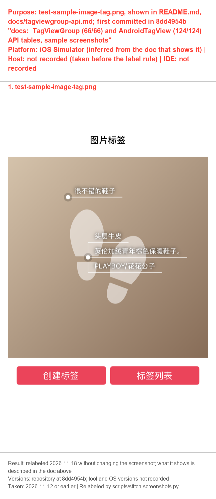
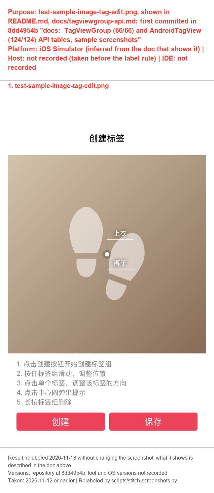
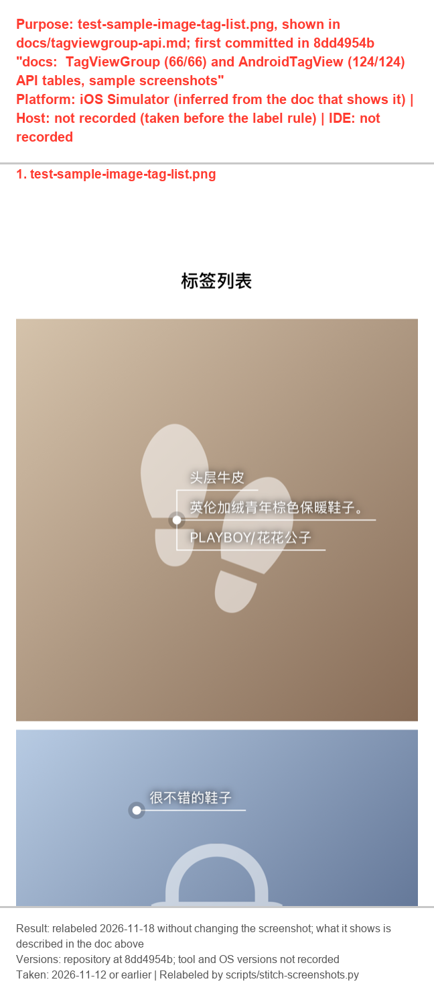

# TagViewGroup API 对照 / TagViewGroup API comparison

| 中文 | English |
|:---|:---|
| [shellljx/TagViewGroup](https://github.com/shellljx/TagViewGroup) 把小红书风格的标签放在图片上：一个带涟漪的圆点，最多六个通过连线与它相连的标签，有十一种方向，带显示和隐藏动效、编辑和拖拽。本页把它的库（`com.licrafter.tagview`，Kotlin）的每个公开 API、XML 属性和 README 对应到 CollectionViewClassifyMenu。Swift 名称在前，Objective-C 名称在括号中。 | [shellljx/TagViewGroup](https://github.com/shellljx/TagViewGroup) puts Xiaohongshu-style tags on a picture: a dot with a ripple, and up to six tags joined to it by lines in eleven directions, with show and hide animations, editing and dragging. This page maps every public API of its library (`com.licrafter.tagview`, Kotlin), its XML attributes and its README to CollectionViewClassifyMenu. Swift names first, Objective-C in brackets. |
| 本页逐项对照 TagViewGroup 的全部公开 API；第二列是本项目的对应 API。 | This page compares every public API of TagViewGroup one by one; the second column is this project's counterpart API. |

## 评分 / Score

| 中文 | English |
|:---|:---|
| 评分 = 已对应的 API 数 ÷ TagViewGroup 公开 API 数 × 100。 | Score = matched APIs ÷ TagViewGroup public APIs × 100. |

| 版本 | 已对应 | 评分 |
| --- | --- | --- |
| 之前（`3f88358`） | 0 / 66：完全没有图片标签 | 0 |
| `c4205eb` + 本次改动 | 66 / 66 | **100** |

| Version | Matched | Score |
| --- | --- | --- |
| Before (`3f88358`) | 0 / 66: no picture tags at all | 0 |
| `c4205eb` + this change | 66 / 66 | **100** |

| 中文 | English |
|:---|:---|
| 示例也已移植：“样式”标签页 → “TagViewGroup 示例”（`CYLImageTagSampleViewController`、`CYLImageTagEditViewController`、`CYLImageTagListViewController`），由 `CYLAndroidSampleTests` 验证。 | The sample is ported too: Styles tab → TagViewGroup sample (`CYLImageTagSampleViewController`, `CYLImageTagEditViewController`, `CYLImageTagListViewController`), verified by `CYLAndroidSampleTests`. |

| 状态 | 截图 |
| --- | :---: |
| MainActivity：两组标签，点击图片显示/隐藏 |  |
| TagEditActivity：创建、拖动、转向、删除 |  |
| TagListActivity：30 张图片 |  |

| State | Screenshot |
| --- | :---: |
| MainActivity: two groups of tags, tap the picture to show / hide |  |
| TagEditActivity: create, drag, turn, delete |  |
| TagListActivity: 30 pictures |  |

## TagViewGroup 组件 / TagViewGroup

| TagViewGroup 组件 | CollectionViewClassifyMenu 的对应项（`CYLImageTagGroupView`） |
| --- | --- |
| `TagViewGroup(Context)` | `CYLImageTagGroupView()` (`-initWithFrame:`) |
| `TagViewGroup(Context, AttributeSet)` | Interface Builder 支持：`init(coder:)`、`IB_DESIGNABLE` |
| `TagViewGroup(Context, AttributeSet, Int)` | `init(coder:)`，配合下面的 `IBInspectable` 值 |
| XML 属性 `app:radius` | IB `circleRadius` |
| XML 属性 `app:inner_radius` | IB `circleInnerRadius` |
| XML 属性 `app:line_width` | IB `lineWidth` |
| XML 属性 `app:v_distance` | IB `verticalDistance` |
| XML 属性 `app:tilt_distance` | IB `tiltDistance` |
| `addRipple()`（见 README） | `showsRipple = true` |
| `getTagList()` | `tagViews` |
| `startShowAnimator()` | `show(animated:completion:)` |
| `startHideAnimator()` | `hide(animated:completion:)`; `isGroupHidden` |
| `setShowAnimator(Animator)` | `showAnimation`（一个 block；内置的是示例中的那个） |
| `setHideAnimator(Animator)` | `hideAnimation` |
| `setTagAdapter(TagAdapter)` | `dataSource` (`CYLImageTagGroupViewDataSource`), or `tags` |
| `getTagAdapter()` | `dataSource` |
| `setPercent(Float, Float)` | `setPercentX(_:percentY:)`, `percentPosition` |
| `setOnTagGroupClickListener(…)` | `delegate` (`CYLImageTagGroupViewDelegate`) |
| `setOnTagGroupDragListener(…)` | `isDraggable = true` 加 `groupView(_:didDragToPercentPosition:)` |
| `getCenterPoint()` | `centerPoint` |
| `setCircleRadius` / `getCircleRadius` | `circleRadius` |
| `setCircleInnerRadius` / `getCircleInnerRadius` | `circleInnerRadius` |
| `setLinesRatio` / `getLinesRatio` | `linesProgress` |
| `setTagAlpha` / `getTagAlpha` | `tagAlpha` |
| `setLineWidth` / `getLineWidth` | `lineWidth` |
| `setVDistance` / `getVDistance` | `verticalDistance` |
| `setTitlDistance` / `getTitlDistance` | `tiltDistance` |
| `CIRCLE_RADIUS`（动画器属性） | `CYLImageTagGroupKeyCircleRadius`，配合 `animateValue(forKey:values:duration:completion:)` |
| `CIRCLE_INNER_RADIUS` | `CYLImageTagGroupKeyCircleInnerRadius` |
| `LINES_RATIO` | `CYLImageTagGroupKeyLinesProgress` |
| `TAG_ALPHA` | `CYLImageTagGroupKeyTagAlpha` |
| `DEFAULT_RADIUS` (8) | `CYLImageTagGroupDefaultCircleRadius` |
| `DEFAULT_INNER_RADIUS` (4) | `CYLImageTagGroupDefaultCircleInnerRadius` |
| `DEFAULT_V_DISTANCE` (28) | `CYLImageTagGroupDefaultVerticalDistance` |
| `DEFAULT_TILT_DISTANCE` (20) | `CYLImageTagGroupDefaultTiltDistance` |
| `DEFAULT_LINES_WIDTH` (1) | `CYLImageTagGroupDefaultLineWidth` |
| `DEFAULT_MAX_TAG` (6) | `CYLImageTagGroupMaximumTagCount` |

| TagViewGroup | CollectionViewClassifyMenu (`CYLImageTagGroupView`) |
| --- | --- |
| `TagViewGroup(Context)` | `CYLImageTagGroupView()` (`-initWithFrame:`) |
| `TagViewGroup(Context, AttributeSet)` | Interface Builder: `init(coder:)`, `IB_DESIGNABLE` |
| `TagViewGroup(Context, AttributeSet, Int)` | `init(coder:)` with the `IBInspectable` values below |
| XML `app:radius` | IB `circleRadius` |
| XML `app:inner_radius` | IB `circleInnerRadius` |
| XML `app:line_width` | IB `lineWidth` |
| XML `app:v_distance` | IB `verticalDistance` |
| XML `app:tilt_distance` | IB `tiltDistance` |
| `addRipple()` (README) | `showsRipple = true` |
| `getTagList()` | `tagViews` |
| `startShowAnimator()` | `show(animated:completion:)` |
| `startHideAnimator()` | `hide(animated:completion:)`; `isGroupHidden` |
| `setShowAnimator(Animator)` | `showAnimation` (a block; the built-in one is the sample's) |
| `setHideAnimator(Animator)` | `hideAnimation` |
| `setTagAdapter(TagAdapter)` | `dataSource` (`CYLImageTagGroupViewDataSource`), or `tags` |
| `getTagAdapter()` | `dataSource` |
| `setPercent(Float, Float)` | `setPercentX(_:percentY:)`, `percentPosition` |
| `setOnTagGroupClickListener(…)` | `delegate` (`CYLImageTagGroupViewDelegate`) |
| `setOnTagGroupDragListener(…)` | `isDraggable = true` and `groupView(_:didDragToPercentPosition:)` |
| `getCenterPoint()` | `centerPoint` |
| `setCircleRadius` / `getCircleRadius` | `circleRadius` |
| `setCircleInnerRadius` / `getCircleInnerRadius` | `circleInnerRadius` |
| `setLinesRatio` / `getLinesRatio` | `linesProgress` |
| `setTagAlpha` / `getTagAlpha` | `tagAlpha` |
| `setLineWidth` / `getLineWidth` | `lineWidth` |
| `setVDistance` / `getVDistance` | `verticalDistance` |
| `setTitlDistance` / `getTitlDistance` | `tiltDistance` |
| `CIRCLE_RADIUS` (animator property) | `CYLImageTagGroupKeyCircleRadius` with `animateValue(forKey:values:duration:completion:)` |
| `CIRCLE_INNER_RADIUS` | `CYLImageTagGroupKeyCircleInnerRadius` |
| `LINES_RATIO` | `CYLImageTagGroupKeyLinesProgress` |
| `TAG_ALPHA` | `CYLImageTagGroupKeyTagAlpha` |
| `DEFAULT_RADIUS` (8) | `CYLImageTagGroupDefaultCircleRadius` |
| `DEFAULT_INNER_RADIUS` (4) | `CYLImageTagGroupDefaultCircleInnerRadius` |
| `DEFAULT_V_DISTANCE` (28) | `CYLImageTagGroupDefaultVerticalDistance` |
| `DEFAULT_TILT_DISTANCE` (20) | `CYLImageTagGroupDefaultTiltDistance` |
| `DEFAULT_LINES_WIDTH` (1) | `CYLImageTagGroupDefaultLineWidth` |
| `DEFAULT_MAX_TAG` (6) | `CYLImageTagGroupMaximumTagCount` |

## 监听接口 / Listeners

| TagViewGroup 组件 | CollectionViewClassifyMenu 的对应项 |
| --- | --- |
| `OnTagGroupClickListener.onCircleClick(container)` | `groupViewDidTapCircle(_:)`; `CYLImageTagView.circleTapHandler` |
| `OnTagGroupClickListener.onTagClick(container, tag, position)` | `groupView(_:didTapTagAt:)`; `tagTapHandler` |
| `OnTagGroupClickListener.onLongPress(container)` | `groupViewDidLongPress(_:)`; `longPressHandler` |
| `OnTagGroupDragListener.onDrag(container, percentX, percentY)` | `groupView(_:didDragToPercentPosition:)`; `dragHandler` |

| TagViewGroup | CollectionViewClassifyMenu |
| --- | --- |
| `OnTagGroupClickListener.onCircleClick(container)` | `groupViewDidTapCircle(_:)`; `CYLImageTagView.circleTapHandler` |
| `OnTagGroupClickListener.onTagClick(container, tag, position)` | `groupView(_:didTapTagAt:)`; `tagTapHandler` |
| `OnTagGroupClickListener.onLongPress(container)` | `groupViewDidLongPress(_:)`; `longPressHandler` |
| `OnTagGroupDragListener.onDrag(container, percentX, percentY)` | `groupView(_:didDragToPercentPosition:)`; `dragHandler` |

## TagAdapter 适配器 / TagAdapter

| TagViewGroup 组件 | CollectionViewClassifyMenu 的对应项 |
| --- | --- |
| `getCount()` | `numberOfTags(in:)` |
| `getItem(position)` | `groupView(_:viewForTagAt:)` |
| `instantiateItem(container, position)` | `reloadData()` 向数据源询问并添加视图 |
| `destroyItem(container, position, tagView)` | `reloadData()` 移除旧视图 |
| `isViewFromObject(view, obj)` | `tagViews[index]`：视图即条目 |
| `getItemId(position)` | 索引 |
| `notifyDataSetChanged()` | `reloadData()` |
| `registerDataSetObserver(observer)` | 设置 `dataSource` |
| `unregisterDataSetObserver(observer)` | 设置另一个 `dataSource` 或 `tags` |

| TagViewGroup | CollectionViewClassifyMenu |
| --- | --- |
| `getCount()` | `numberOfTags(in:)` |
| `getItem(position)` | `groupView(_:viewForTagAt:)` |
| `instantiateItem(container, position)` | `reloadData()` asks the data source and adds the views |
| `destroyItem(container, position, tagView)` | `reloadData()` removes the old views |
| `isViewFromObject(view, obj)` | `tagViews[index]`: the view is the item |
| `getItemId(position)` | the index |
| `notifyDataSetChanged()` | `reloadData()` |
| `registerDataSetObserver(observer)` | setting `dataSource` |
| `unregisterDataSetObserver(observer)` | setting another `dataSource` or `tags` |

## ITagView、DIRECTION 与标签视图 / ITagView, DIRECTION and the tag views

| TagViewGroup 组件 | CollectionViewClassifyMenu 的对应项 |
| --- | --- |
| `ITagView.setDirection(direction)` | `CYLImageTagItem.tagDirection` |
| `ITagView.getDirection()` | `tagDirection` |
| `ITagView.getMeasuredWidth()` / `getMeasuredHeight()` | `sizeThatFits(_:)` |
| `ITagView.getTop()` / `getLeft()` / `getRight()` / `getBottom()` | `frame` |
| `ITagView.layout(l, t, r, b)` | 分组视图在 `layoutSubviews` 中设置 `frame` |
| `DIRECTION`（11 个值） | `CYLImageTagDirection` (`.leftCenter` … `.rightBottomStraight`, `.center`); `CYLImageTagDirectionNext` |
| `TagTextView(…)` | `CYLImageTagLabel`（白色 13 pt 文字，黑色光晕，12 × 4 pt 内边距）；`tagLabelConfiguration` |
| `RippleView(…)` | `CYLImageTagRippleView` |
| XML 属性 `app:ripple_alpha` | `rippleAlpha`, `CYLImageTagRippleView.startAlpha` |
| XML 属性 `app:ripple_maxRadius` | `rippleMaxRadius`, `CYLImageTagRippleView.maximumRadius` |
| `setRippleRadius(radius)` | 涟漪动画（`startAnimating()`、`stopAnimating()`） |
| `setRippleAlpha` / `getRippleAlpha` | `startAlpha` |
| `setRippleMaxRadius` / `getRippleMaxRadius` | `maximumRadius` |

| TagViewGroup | CollectionViewClassifyMenu |
| --- | --- |
| `ITagView.setDirection(direction)` | `CYLImageTagItem.tagDirection` |
| `ITagView.getDirection()` | `tagDirection` |
| `ITagView.getMeasuredWidth()` / `getMeasuredHeight()` | `sizeThatFits(_:)` |
| `ITagView.getTop()` / `getLeft()` / `getRight()` / `getBottom()` | `frame` |
| `ITagView.layout(l, t, r, b)` | the group sets `frame` in `layoutSubviews` |
| `DIRECTION` (11 values) | `CYLImageTagDirection` (`.leftCenter` … `.rightBottomStraight`, `.center`); `CYLImageTagDirectionNext` |
| `TagTextView(…)` | `CYLImageTagLabel` (white 13 pt text, black glow, 12 × 4 pt padding); `tagLabelConfiguration` |
| `RippleView(…)` | `CYLImageTagRippleView` |
| XML `app:ripple_alpha` | `rippleAlpha`, `CYLImageTagRippleView.startAlpha` |
| XML `app:ripple_maxRadius` | `rippleMaxRadius`, `CYLImageTagRippleView.maximumRadius` |
| `setRippleRadius(radius)` | the ripple animation (`startAnimating()`, `stopAnimating()`) |
| `setRippleAlpha` / `getRippleAlpha` | `startAlpha` |
| `setRippleMaxRadius` / `getRippleMaxRadius` | `maximumRadius` |

## 工具类 / Utilities

| TagViewGroup 组件 | CollectionViewClassifyMenu 的对应项 |
| --- | --- |
| `DipConvertUtils.dip2px(context, dp)` | 不需要：点（point）本来就与密度无关 |
| `TagGroupUtils.getTagViewUsed(group)` | `tagSpaceUsed()` |
| `TagGroupUtils.getStartPoint(group, child)` | `originForTag(of:direction:)` |

| TagViewGroup | CollectionViewClassifyMenu |
| --- | --- |
| `DipConvertUtils.dip2px(context, dp)` | not needed: points are already density-independent |
| `TagGroupUtils.getTagViewUsed(group)` | `tagSpaceUsed()` |
| `TagGroupUtils.getStartPoint(group, child)` | `originForTag(of:direction:)` |

## 缺少的 API / Missing APIs

| 中文 | English |
|:---|:---|
| 无。 | None. |

## 本项目有而 TagViewGroup 没有的功能 / What we have that TagViewGroup does not

| 中文 | English |
|:---|:---|
| `CYLImageTagView`：库中的示例 `TagImageView`（图片、分组、可旋转标签并移动分组的编辑模式、`toggleTagGroups(animated:)`），以及模型 `CYLImageTag` 和 `CYLImageTagGroup`，配有 `defaultDirections(forTagCount:)`。 | `CYLImageTagView`: the sample's `TagImageView` in the library (picture, groups, edit mode that turns tags and moves groups, `toggleTagGroups(animated:)`), and the models `CYLImageTag` and `CYLImageTagGroup` with `defaultDirections(forTagCount:)`. |
| 圆环、圆点和连线的颜色；当标签会超出图片时，分组也会在垂直方向上向内移动。 | Colors of the ring, dot and lines; groups move inward vertically too when tags would leave the picture. |
| 只有圆点和标签接收触摸，因此分组可以彼此重叠，也可以与图片自身的手势重叠。 | Only the dot and the tags take touches, so groups overlap each other and the picture's own gestures. |
| 减弱动态效果：动画直接跳到结束状态；标签文字是 VoiceOver 按钮。 | Reduce Motion: animations jump to their end; tag labels are VoiceOver buttons. |
| 无障碍：图片和每个分组的圆点都是元素（“标签组：…”）；圆点的自定义操作取代长按和拖拽（上移 / 下移 / 左移 / 右移）；编辑模式下的标签会读出“轻点两下改变方向”；标签文字随 Dynamic Type 缩放，连线变长，过长的标签会换行而不是重叠。字符串提供英文、简体中文和繁体中文。由 `CYLAndroidSampleAccessibilityTests` 验证。 | Accessibility: the picture and each group's dot are elements ("Tag group: …"); the dot's custom actions replace the long press and dragging (Move up / Move down / Move left / Move right); tags in edit mode say "Double-tap to change direction"; tag text scales with Dynamic Type, lines grow and long tags wrap instead of overlapping. Strings in English, Simplified and Traditional Chinese. Verified by `CYLAndroidSampleAccessibilityTests`. |
| 分组绝不互相覆盖（2026-11-12）：当某个分组的圆点和标签（`occupiedFrame`）会与前面的分组重叠时，`CYLImageTagView` 会把它向上或向下移动能避开的最小距离，并保持在图片内（`displayOffset`）；`percentPosition` 和数据不会改变。编辑时，分组停留在被拖到的位置。在最大字号下由 `CYLAndroidSampleAccessibilityTests` 验证。 | Groups never cover each other (2026-11-12): when a group's dot and tags (`occupiedFrame`) would overlap an earlier group, `CYLImageTagView` moves it up or down by the smallest distance that clears it and stays inside the picture (`displayOffset`); `percentPosition` and the data do not change. While editing, groups stay where they are dragged. Verified at the largest text size in `CYLAndroidSampleAccessibilityTests`. |
