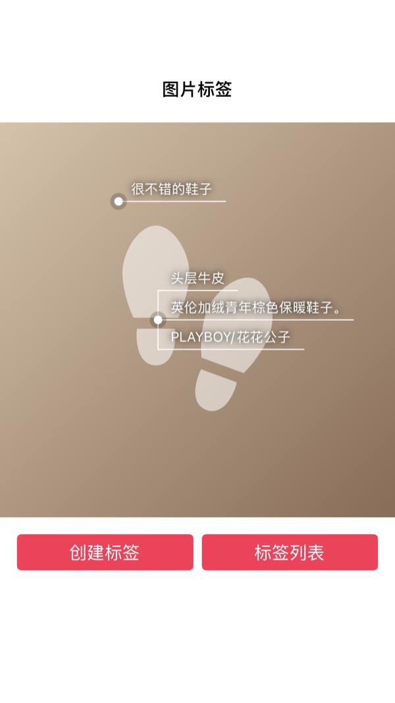
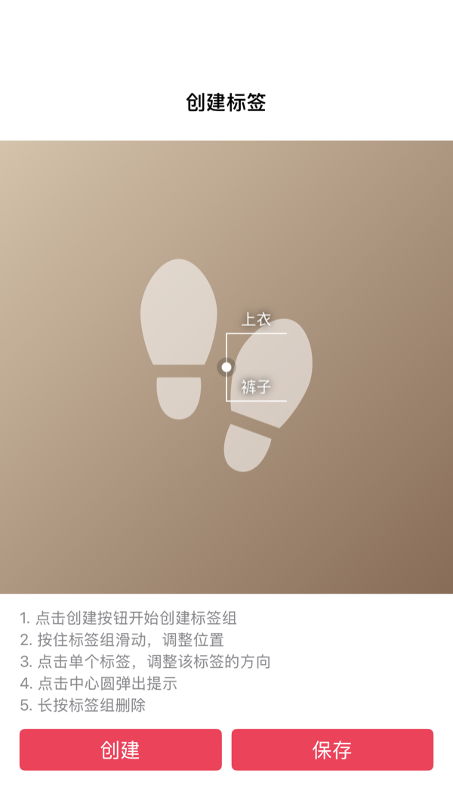
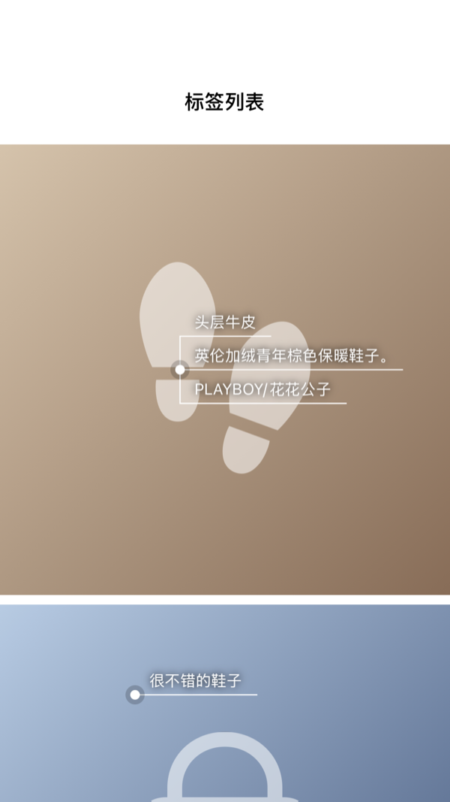

# TagViewGroup API 对照

[shellljx/TagViewGroup](https://github.com/shellljx/TagViewGroup) puts Xiaohongshu-style tags on a picture: a dot with a
ripple, and up to six tags joined to it by lines in eleven directions, with show and hide animations, editing and
dragging. This page maps every public API of its library (`com.licrafter.tagview`, Kotlin), its XML attributes and its
README to CollectionViewClassifyMenu. Swift names first, Objective-C in brackets.

本页逐项对照 TagViewGroup 的全部公开 API；第二列是本项目的对应 API。

## Score / 评分

Score = matched APIs ÷ TagViewGroup public APIs × 100.

| Version | Matched | Score |
| --- | --- | --- |
| Before (`3f88358`) | 0 / 66: no picture tags at all | 0 |
| `c4205eb` + this change | 66 / 66 | **100** |

The sample is ported too: 样式 tab → TagViewGroup 示例 (`CYLImageTagSampleViewController`, `CYLImageTagEditViewController`,
`CYLImageTagListViewController`), verified by `CYLAndroidSampleTests`.

| 状态 / State | 截图 / Screenshot |
| --- | :---: |
| MainActivity：两组标签，点击图片显示/隐藏 |  |
| TagEditActivity：创建、拖动、转向、删除 |  |
| TagListActivity：30 张图片 |  |

## TagViewGroup

| TagViewGroup | CollectionViewClassifyMenu (`CYLImageTagGroupView`) |
| --- | --- |
| `TagViewGroup(Context)` | `CYLImageTagGroupView()` (`-initWithFrame:`) |
| `TagViewGroup(Context, AttributeSet)` | Interface Builder: `init(coder:)`, `IB_DESIGNABLE` |
| `TagViewGroup(Context, AttributeSet, Int)` | `init(coder:)` with the `IBInspectable` values below |
| XML `app:radius` | IB `circleRadius` |
| XML `app:inner_radius` | IB `circleInnerRadius` |
| XML `app:line_width` | IB `lineWidth` |
| XML `app:v_distance` | IB `verticalDistance` |
| XML `app:tilt_distance` | IB `tiltDistance` |
| `addRipple()` (README) | `showsRipple = true` |
| `getTagList()` | `tagViews` |
| `startShowAnimator()` | `show(animated:completion:)` |
| `startHideAnimator()` | `hide(animated:completion:)`; `isGroupHidden` |
| `setShowAnimator(Animator)` | `showAnimation` (a block; the built-in one is the sample's) |
| `setHideAnimator(Animator)` | `hideAnimation` |
| `setTagAdapter(TagAdapter)` | `dataSource` (`CYLImageTagGroupViewDataSource`), or `tags` |
| `getTagAdapter()` | `dataSource` |
| `setPercent(Float, Float)` | `setPercentX(_:percentY:)`, `percentPosition` |
| `setOnTagGroupClickListener(…)` | `delegate` (`CYLImageTagGroupViewDelegate`) |
| `setOnTagGroupDragListener(…)` | `isDraggable = true` and `groupView(_:didDragToPercentPosition:)` |
| `getCenterPoint()` | `centerPoint` |
| `setCircleRadius` / `getCircleRadius` | `circleRadius` |
| `setCircleInnerRadius` / `getCircleInnerRadius` | `circleInnerRadius` |
| `setLinesRatio` / `getLinesRatio` | `linesProgress` |
| `setTagAlpha` / `getTagAlpha` | `tagAlpha` |
| `setLineWidth` / `getLineWidth` | `lineWidth` |
| `setVDistance` / `getVDistance` | `verticalDistance` |
| `setTitlDistance` / `getTitlDistance` | `tiltDistance` |
| `CIRCLE_RADIUS` (animator property) | `CYLImageTagGroupKeyCircleRadius` with `animateValue(forKey:values:duration:completion:)` |
| `CIRCLE_INNER_RADIUS` | `CYLImageTagGroupKeyCircleInnerRadius` |
| `LINES_RATIO` | `CYLImageTagGroupKeyLinesProgress` |
| `TAG_ALPHA` | `CYLImageTagGroupKeyTagAlpha` |
| `DEFAULT_RADIUS` (8) | `CYLImageTagGroupDefaultCircleRadius` |
| `DEFAULT_INNER_RADIUS` (4) | `CYLImageTagGroupDefaultCircleInnerRadius` |
| `DEFAULT_V_DISTANCE` (28) | `CYLImageTagGroupDefaultVerticalDistance` |
| `DEFAULT_TILT_DISTANCE` (20) | `CYLImageTagGroupDefaultTiltDistance` |
| `DEFAULT_LINES_WIDTH` (1) | `CYLImageTagGroupDefaultLineWidth` |
| `DEFAULT_MAX_TAG` (6) | `CYLImageTagGroupMaximumTagCount` |

## Listeners

| TagViewGroup | CollectionViewClassifyMenu |
| --- | --- |
| `OnTagGroupClickListener.onCircleClick(container)` | `groupViewDidTapCircle(_:)`; `CYLImageTagView.circleTapHandler` |
| `OnTagGroupClickListener.onTagClick(container, tag, position)` | `groupView(_:didTapTagAt:)`; `tagTapHandler` |
| `OnTagGroupClickListener.onLongPress(container)` | `groupViewDidLongPress(_:)`; `longPressHandler` |
| `OnTagGroupDragListener.onDrag(container, percentX, percentY)` | `groupView(_:didDragToPercentPosition:)`; `dragHandler` |

## TagAdapter

| TagViewGroup | CollectionViewClassifyMenu |
| --- | --- |
| `getCount()` | `numberOfTags(in:)` |
| `getItem(position)` | `groupView(_:viewForTagAt:)` |
| `instantiateItem(container, position)` | `reloadData()` asks the data source and adds the views |
| `destroyItem(container, position, tagView)` | `reloadData()` removes the old views |
| `isViewFromObject(view, obj)` | `tagViews[index]`: the view is the item |
| `getItemId(position)` | the index |
| `notifyDataSetChanged()` | `reloadData()` |
| `registerDataSetObserver(observer)` | setting `dataSource` |
| `unregisterDataSetObserver(observer)` | setting another `dataSource` or `tags` |

## ITagView, DIRECTION and the tag views

| TagViewGroup | CollectionViewClassifyMenu |
| --- | --- |
| `ITagView.setDirection(direction)` | `CYLImageTagItem.tagDirection` |
| `ITagView.getDirection()` | `tagDirection` |
| `ITagView.getMeasuredWidth()` / `getMeasuredHeight()` | `sizeThatFits(_:)` |
| `ITagView.getTop()` / `getLeft()` / `getRight()` / `getBottom()` | `frame` |
| `ITagView.layout(l, t, r, b)` | the group sets `frame` in `layoutSubviews` |
| `DIRECTION` (11 values) | `CYLImageTagDirection` (`.leftCenter` … `.rightBottomStraight`, `.center`); `CYLImageTagDirectionNext` |
| `TagTextView(…)` | `CYLImageTagLabel` (white 13 pt text, black glow, 12 × 4 pt padding); `tagLabelConfiguration` |
| `RippleView(…)` | `CYLImageTagRippleView` |
| XML `app:ripple_alpha` | `rippleAlpha`, `CYLImageTagRippleView.startAlpha` |
| XML `app:ripple_maxRadius` | `rippleMaxRadius`, `CYLImageTagRippleView.maximumRadius` |
| `setRippleRadius(radius)` | the ripple animation (`startAnimating()`, `stopAnimating()`) |
| `setRippleAlpha` / `getRippleAlpha` | `startAlpha` |
| `setRippleMaxRadius` / `getRippleMaxRadius` | `maximumRadius` |

## Utilities

| TagViewGroup | CollectionViewClassifyMenu |
| --- | --- |
| `DipConvertUtils.dip2px(context, dp)` | not needed: points are already density-independent |
| `TagGroupUtils.getTagViewUsed(group)` | `tagSpaceUsed()` |
| `TagGroupUtils.getStartPoint(group, child)` | `originForTag(of:direction:)` |

## Missing APIs / 缺少的 API

None. 无。

## What we have that TagViewGroup does not

- `CYLImageTagView`: the sample's `TagImageView` in the library (picture, groups, edit mode that turns tags and moves
  groups, `toggleTagGroups(animated:)`), and the models `CYLImageTag` and `CYLImageTagGroup` with
  `defaultDirections(forTagCount:)`.
- Colors of the ring, dot and lines; groups move inward vertically too when tags would leave the picture.
- Only the dot and the tags take touches, so groups overlap each other and the picture's own gestures.
- Reduce Motion: animations jump to their end; tag labels are VoiceOver buttons.
- Accessibility: the picture and each group's dot are elements ("标签组：…"); the dot's custom actions replace the
  long press and dragging (上移 / 下移 / 左移 / 右移); tags in edit mode say "轻点两下改变方向"; tag text scales with
  Dynamic Type, lines grow and long tags wrap instead of overlapping. Strings in English, Simplified and Traditional
  Chinese. Verified by `CYLAndroidSampleAccessibilityTests`.
